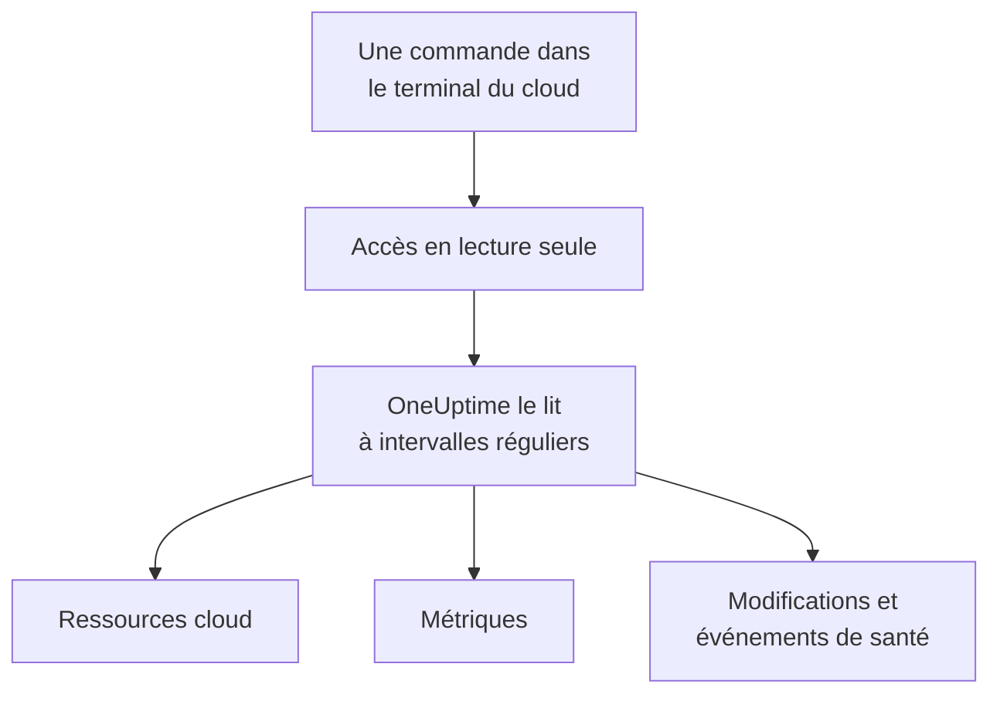

# Connecter un compte cloud

Connectez un compte AWS, un abonnement Azure ou un projet Google Cloud depuis le tableau de bord, et OneUptime liste chaque ressource qu'il contient, lit leurs métriques clés, et enregistre ce qui y a changé et ce que votre fournisseur cloud dit de leur santé. Vous exécutez une commande dans le terminal du navigateur de votre cloud et collez ce qu'elle affiche : aucun collecteur à faire tourner, rien à installer.

:::cards
- [Amazon Web Services](#amazon-web-services): Un rôle IAM auquel OneUptime se connecte, ou une clé d'accès.
- [Microsoft Azure](#microsoft-azure): Une application avec le rôle Monitoring Reader.
- [Google Cloud](#google-cloud): Un compte de service avec quatre rôles en lecture seule.
- [Ce que lit OneUptime](#ce-que-lit-oneuptime): Ressources, métriques, modifications et événements de santé, à quelle fréquence, et ce que cela coûte.
:::

## Fonctionnement



- **L'accès ne peut que lire.** La commande crée un accès qui lit vos ressources et leur configuration, leurs métriques, ce qui a changé et les événements de santé de votre fournisseur, et rien d'autre : les actions listées ci-dessous sur AWS, le rôle **Monitoring Reader** sur Azure et quatre rôles de lecteur sur Google Cloud. Il ne lit jamais de données ni de secrets. Supprimez-le pour couper l'accès de OneUptime.
- **OneUptime lit selon un calendrier.** Toutes les 5 minutes pour Azure et Google Cloud, et toutes les 10 minutes pour AWS, sauf si vous choisissez un autre intervalle à la connexion. Chaque lecture enregistre aussi ce qui a changé depuis la précédente, et toutes les 30 minutes une lecture liste à nouveau chaque ressource.
- **Chaque ressource a sa propre page.** Les ressources apparaissent dans **Cloud → Toutes les ressources** avec leurs métriques clés, leurs propriétaires et leurs libellés. La page d'une ressource listée montre aussi ses **Ressources connectées** (ce dans quoi elle s'exécute, ce qui lui envoie du trafic), ses points de terminaison, étiquettes et paramètres, ainsi que ses **Incidents**, **Alertes** et **Modifications**.
- **Chaque compte a sa propre page.** Les comptes apparaissent dans **Cloud → Comptes** avec leurs ressources par type et par région, leurs **Modifications** et une **Topologie** qui montre comment leurs ressources s'articulent.
- **OneUptime AI lit ce qui a changé.** Une investigation d'un incident ou d'une alerte liés à une ressource cloud lit d'abord les modifications de cette ressource, et relit le journal d'activité du compte à son démarrage.

## Avant de commencer

- **Un propriétaire ou un administrateur du projet.** Eux seuls peuvent connecter, tester et modifier des comptes cloud.
- **Le terminal de votre cloud** (AWS CloudShell, Azure Cloud Shell ou Google Cloud Shell), connecté en tant que personne autorisée à créer un rôle ou un utilisateur IAM, une inscription d'application ou un compte de service.

## Amazon Web Services

:::steps
### Ouvrir le formulaire AWS

Allez dans **Cloud → Connecter** et choisissez **Amazon Web Services**.

### Exécuter la commande dans AWS CloudShell

Choisissez comment OneUptime se connecte. Un **Rôle IAM** est la méthode recommandée : rien de secret n'est stocké, et vous pouvez supprimer le rôle à tout moment. Le formulaire affiche la commande écrite pour votre projet : elle crée un rôle qui fait confiance au compte AWS de OneUptime avec l'ID externe de votre projet, et affiche l'ARN du rôle.

Sous **Ce qu'il faut lire**, choisissez ce compte, ou chaque compte de votre AWS Organization. Exécutez la commande de l'organisation dans son compte de gestion : elle ajoute un StackSet qui place le même rôle dans chaque compte, maintenant et à mesure que des comptes s'ajoutent, et permet au rôle du compte de gestion de lister les comptes. Une connexion lit jusqu'à 50 comptes.

Utilisez une **Clé d'accès** lorsqu'un rôle n'est pas possible : elle ne lit que son propre compte. Cette commande crée un utilisateur avec les mêmes autorisations et affiche sa clé :

```bash
aws iam create-user --user-name OneUptimeReadOnly > /dev/null 2>&1 || true
aws iam put-user-policy --user-name OneUptimeReadOnly --policy-name OneUptimeReadOnly --policy-document '{"Version":"2012-10-17","Statement":[{"Effect":"Allow","Action":["cloudwatch:GetMetricData","cloudwatch:ListMetrics","tag:GetResources","iam:ListAccountAliases","cloudformation:ListResources","ec2:DescribeInstances","ec2:DescribeVolumes","ec2:DescribeVpcs","ec2:DescribeNatGateways","autoscaling:DescribeAutoScalingGroups","elasticloadbalancing:DescribeLoadBalancers","elasticloadbalancing:DescribeLoadBalancerAttributes","elasticloadbalancing:DescribeTargetGroups","elasticloadbalancing:DescribeTargetGroupAttributes","elasticloadbalancing:DescribeTargetHealth","elasticloadbalancing:DescribeTags","ecs:ListClusters","ecs:DescribeClusters","ecs:ListServices","ecs:DescribeServices","lambda:ListFunctions","rds:DescribeDBInstances","rds:DescribeDBClusters","elasticache:DescribeReplicationGroups","sqs:ListQueues","sqs:GetQueueAttributes","sns:ListTopics","sns:GetTopicAttributes","sns:ListSubscriptionsByTopic","dynamodb:ListTables","dynamodb:DescribeTable","kinesis:ListStreams","kinesis:DescribeStreamSummary","states:ListStateMachines","states:DescribeStateMachine","cloudfront:ListDistributions","elasticfilesystem:DescribeFileSystems","es:ListDomainNames","es:DescribeDomains","apprunner:ListServices","apprunner:DescribeService","cloudtrail:LookupEvents","health:DescribeEvents","health:DescribeEventDetails"],"Resource":"*"},{"Effect":"Allow","Action":["apigateway:GET"],"Resource":["arn:aws:apigateway:*::/restapis","arn:aws:apigateway:*::/restapis/*","arn:aws:apigateway:*::/apis","arn:aws:apigateway:*::/apis/*"]}]}'
aws iam create-access-key --user-name OneUptimeReadOnly
```

### Coller ce que la commande AWS a affiché

Collez tout ce que la commande a affiché dans **Ce que la commande a affiché**. OneUptime en extrait l'ARN du rôle, ou l'ID de la clé d'accès et son secret.

### Tester et connecter AWS

OneUptime teste la connexion dès que cette étape s'ouvre : il se connecte, compte les ressources trouvées et indique ce que coûte leur lecture. Sélectionnez **Connecter** pour enregistrer.
:::

Le rôle et l'utilisateur peuvent faire ceci, et rien d'autre :

| Ce à quoi OneUptime les utilise | Actions |
| --- | --- |
| Trouver les ressources qui signalent des métriques, et lire leurs métriques | `cloudwatch:GetMetricData`, `cloudwatch:ListMetrics` |
| Nommer chaque ressource et lire ses étiquettes | `tag:GetResources`, `iam:ListAccountAliases` |
| Lister chaque ressource et sa configuration, via Cloud Control | `cloudformation:ListResources`, `ec2:DescribeInstances`, `ec2:DescribeVolumes`, `ec2:DescribeVpcs`, `ec2:DescribeNatGateways`, `autoscaling:DescribeAutoScalingGroups`, `elasticloadbalancing:DescribeLoadBalancers`, `elasticloadbalancing:DescribeLoadBalancerAttributes`, `elasticloadbalancing:DescribeTargetGroups`, `elasticloadbalancing:DescribeTargetGroupAttributes`, `elasticloadbalancing:DescribeTargetHealth`, `elasticloadbalancing:DescribeTags`, `ecs:ListClusters`, `ecs:DescribeClusters`, `ecs:ListServices`, `ecs:DescribeServices`, `lambda:ListFunctions`, `rds:DescribeDBInstances`, `rds:DescribeDBClusters`, `elasticache:DescribeReplicationGroups`, `sqs:ListQueues`, `sqs:GetQueueAttributes`, `sns:ListTopics`, `sns:GetTopicAttributes`, `sns:ListSubscriptionsByTopic`, `dynamodb:ListTables`, `dynamodb:DescribeTable`, `kinesis:ListStreams`, `kinesis:DescribeStreamSummary`, `states:ListStateMachines`, `states:DescribeStateMachine`, `cloudfront:ListDistributions`, `elasticfilesystem:DescribeFileSystems`, `es:ListDomainNames`, `es:DescribeDomains`, `apprunner:ListServices`, `apprunner:DescribeService`, `apigateway:GET` |
| Lire ce qui a changé : les événements de gestion du compte | `cloudtrail:LookupEvents` |
| Lire les propres événements de santé d'AWS pour le compte | `health:DescribeEvents`, `health:DescribeEventDetails` |
| Lister les comptes de l'organisation, depuis son compte de gestion | `organizations:ListAccounts` |

`apigateway:GET` n'est autorisé que sur les définitions des API elles-mêmes, jamais sur leurs clés, et seul le rôle du compte de gestion peut lister les comptes de l'organisation. AWS Health ne répond qu'aux comptes dotés d'un plan de support Business, Enterprise On-Ramp ou Enterprise : sans lui, OneUptime redemande un jour plus tard.

> [!NOTE]
> Sur un OneUptime auto-hébergé, la méthode **Rôle IAM** nécessite une identité AWS propre à OneUptime : définissez `CLOUD_CONNECT_AWS_ACCESS_KEY_ID` et `CLOUD_CONNECT_AWS_SECRET_ACCESS_KEY` sur la clé d'un utilisateur IAM autorisé à appeler `sts:AssumeRole`. Sans elles, le formulaire propose une **Clé d'accès**.

## Microsoft Azure

:::steps
### Ouvrir le formulaire Azure

Allez dans **Cloud → Connecter** et choisissez **Microsoft Azure**.

### Exécuter la commande dans Azure Cloud Shell

La commande crée une application avec le rôle **Monitoring Reader** sur votre abonnement actuel, et affiche ses détails avec la date d'expiration de son secret :

```bash
SCOPE="/subscriptions/$(az account show --query id --output tsv)"
OUT=$(az ad sp create-for-rbac --name OneUptimeReadOnly --role "Monitoring Reader" --scopes "$SCOPE")
APP=$(echo "$OUT" | jq -r .appId)
END=$(az ad app credential list --id "$APP" --query "max([].endDateTime)" --output tsv)
echo "$OUT" | jq --arg end "$END" '. + {endDateTime: $end}'
```

Sous **Ce qu'il faut lire**, choisissez plutôt chaque abonnement du locataire, et le rôle est attribué au groupe d'administration racine du locataire :

```bash
SCOPE="/providers/Microsoft.Management/managementGroups/$(az account show --query tenantId --output tsv)"
OUT=$(az ad sp create-for-rbac --name OneUptimeReadOnly --role "Monitoring Reader" --scopes "$SCOPE")
APP=$(echo "$OUT" | jq -r .appId)
END=$(az ad app credential list --id "$APP" --query "max([].endDateTime)" --output tsv)
echo "$OUT" | jq --arg end "$END" '. + {endDateTime: $end}'
```

### Coller ce que la commande Azure a affiché

Collez tout ce que la commande a affiché dans **Ce que la commande a affiché**. OneUptime en extrait le `tenant`, l'`appId`, le `password` et sa date d'expiration.

### Tester et connecter Azure

OneUptime teste la connexion dès que cette étape s'ouvre. Sélectionnez **Connecter** pour enregistrer.
:::

Pour lire d'autres abonnements avec la même application, donnez-lui le rôle sur chacun d'eux :

```bash
az role assignment create --assignee <APP_ID> --role "Monitoring Reader" --scope /subscriptions/<SUBSCRIPTION_ID>
```

OneUptime lit chaque abonnement que l'application peut lire, jusqu'à 50, sauf si vous en listez certains dans **Abonnements**. Le secret de l'application cesse de fonctionner à sa date d'expiration : à partir de 30 jours avant, chaque lecture vous en avertit. Exécutez à nouveau la commande et collez ce qu'elle affiche pour lui en donner un nouveau.

## Google Cloud

:::steps
### Ouvrir le formulaire Google Cloud

Allez dans **Cloud → Connecter** et choisissez **Google Cloud**.

### Exécuter la commande dans Google Cloud Shell

Exécutez-la dans le projet à surveiller. Elle active les API que lit OneUptime, crée un compte de service avec les rôles **Monitoring Viewer**, **Cloud Asset Viewer**, **Logs Viewer** et **Service Health Viewer**, et affiche sa clé :

```bash
PROJECT_ID=$(gcloud config get-value project)
gcloud services enable monitoring.googleapis.com cloudasset.googleapis.com logging.googleapis.com cloudresourcemanager.googleapis.com servicehealth.googleapis.com
gcloud iam service-accounts create oneuptime-read-only --display-name "OneUptime (read only)" > /dev/null 2>&1 || true
gcloud projects add-iam-policy-binding "$PROJECT_ID" --member "serviceAccount:oneuptime-read-only@$PROJECT_ID.iam.gserviceaccount.com" --role roles/monitoring.viewer --condition=None > /dev/null
gcloud projects add-iam-policy-binding "$PROJECT_ID" --member "serviceAccount:oneuptime-read-only@$PROJECT_ID.iam.gserviceaccount.com" --role roles/cloudasset.viewer --condition=None > /dev/null
gcloud projects add-iam-policy-binding "$PROJECT_ID" --member "serviceAccount:oneuptime-read-only@$PROJECT_ID.iam.gserviceaccount.com" --role roles/logging.viewer --condition=None > /dev/null
gcloud projects add-iam-policy-binding "$PROJECT_ID" --member "serviceAccount:oneuptime-read-only@$PROJECT_ID.iam.gserviceaccount.com" --role roles/servicehealth.viewer --condition=None > /dev/null
gcloud iam service-accounts keys create oneuptime-key.json --iam-account "oneuptime-read-only@$PROJECT_ID.iam.gserviceaccount.com"
cat oneuptime-key.json && rm oneuptime-key.json
```

Sous **Ce qu'il faut lire**, choisissez plutôt chaque projet de l'organisation, et les rôles sont attribués à l'organisation du projet :

```bash
PROJECT_ID=$(gcloud config get-value project)
ORG_ID=$(gcloud projects get-ancestors "$PROJECT_ID" --format="value(id)" | tail -1)
gcloud services enable monitoring.googleapis.com cloudasset.googleapis.com logging.googleapis.com cloudresourcemanager.googleapis.com servicehealth.googleapis.com
gcloud iam service-accounts create oneuptime-read-only --display-name "OneUptime (read only)" > /dev/null 2>&1 || true
gcloud organizations add-iam-policy-binding "$ORG_ID" --member "serviceAccount:oneuptime-read-only@$PROJECT_ID.iam.gserviceaccount.com" --role roles/monitoring.viewer --condition=None > /dev/null
gcloud organizations add-iam-policy-binding "$ORG_ID" --member "serviceAccount:oneuptime-read-only@$PROJECT_ID.iam.gserviceaccount.com" --role roles/cloudasset.viewer --condition=None > /dev/null
gcloud organizations add-iam-policy-binding "$ORG_ID" --member "serviceAccount:oneuptime-read-only@$PROJECT_ID.iam.gserviceaccount.com" --role roles/logging.viewer --condition=None > /dev/null
gcloud organizations add-iam-policy-binding "$ORG_ID" --member "serviceAccount:oneuptime-read-only@$PROJECT_ID.iam.gserviceaccount.com" --role roles/servicehealth.viewer --condition=None > /dev/null
gcloud iam service-accounts keys create oneuptime-key.json --iam-account "oneuptime-read-only@$PROJECT_ID.iam.gserviceaccount.com"
cat oneuptime-key.json && rm oneuptime-key.json
```

### Coller la clé

Collez tout ce que la commande a affiché. OneUptime lit le projet propre à la clé, et stocke la clé chiffrée.

### Tester et connecter Google Cloud

OneUptime teste la connexion dès que cette étape s'ouvre. Sélectionnez **Connecter** pour enregistrer.
:::

Pour lire d'autres projets avec le même compte de service, donnez-lui les quatre rôles dans chacun d'eux et listez-les dans **Projets** :

```bash
for ROLE in roles/monitoring.viewer roles/cloudasset.viewer roles/logging.viewer roles/servicehealth.viewer; do gcloud projects add-iam-policy-binding <PROJECT_ID> --member "serviceAccount:oneuptime-read-only@<KEY_PROJECT_ID>.iam.gserviceaccount.com" --role "$ROLE"; done
```

La connexion d'une organisation lit jusqu'à 50 de ses projets, sauf si vous en listez certains dans **Projets**.

## Ce que lit OneUptime

| | AWS | Azure | Google Cloud |
| --- | --- | --- | --- |
| Ressources | Chaque ressource des types que connaît OneUptime, dans chaque région que vous utilisez, via Cloud Control | Chaque ressource des abonnements, via Resource Graph | Chaque ressource des projets, via Cloud Asset Inventory |
| Métriques | Les métriques clés de chaque service, comme le processeur, le réseau et les vérifications d'état d'une instance | Jusqu'à 8 métriques clés par ressource | Les métriques clés de chaque type de ressource |
| Modifications | Les événements de gestion CloudTrail | Les événements administratifs du journal d'activité | Le journal d'audit Admin Activity |
| Événements de santé | AWS Health | Service Health et Resource Health | Service Health |
| Lu toutes les | 10 minutes | 5 minutes | 5 minutes |
| Une ressource supprimée | Archivée dès qu'une liste complète ne la contient plus | Archivée dès qu'une liste complète ne la contient plus | Archivée dès qu'une liste complète ne la contient plus |

Chaque lecture reprend là où la précédente s'est arrêtée, de sorte que chaque point de données et chaque modification sont écrits une seule fois. La première lecture d'une nouvelle connexion démarre en moins d'une minute et remonte d'une heure pour les métriques et de 2 heures pour les modifications ; après une pause, une lecture remonte au plus de 6 heures. Une ressource qui ne fait que signaler des métriques, et qu'aucune liste ne contient, est archivée après 7 jours sans métriques.

Les appels de OneUptime sont facturés à votre compte cloud, aux tarifs de votre cloud. Lister les ressources et lire les modifications et les événements de santé ne coûte rien sur les trois clouds ; lire les métriques, si. Le test estime le coût de ce qu'il trouve, et lire moins souvent coûte moins cher : modifiez **Fréquence de lecture des métriques** dans **Plus de champs**.

| Cloud | Prix |
| --- | --- |
| AWS | CloudWatch `GetMetricData` : $0.01 pour 1 000 métriques, et chaque métrique clé d'une ressource compte pour une métrique par lecture |
| Azure | Les 1 000 000 premières lectures de métriques par mois de chaque abonnement sont gratuites, puis $0.01 pour 1 000 |
| Google Cloud | Les 1 000 000 premières séries temporelles lues par mois sont gratuites, puis $0.50 par million |

## Ce que vous voyez dans OneUptime

- **La page d'un compte.** Dans **Cloud → Comptes**, la vue d'ensemble d'un compte compte ses ressources par type et par région, et indique quand une connexion l'a lu pour la dernière fois. Ses **Ressources** les listent, ses **Modifications** listent ce qui y a changé, les plus récentes d'abord, et sa **Topologie** dessine ses régions, les réseaux qu'elles contiennent et ce qui s'exécute dans chacun, avec les incidents et alertes ouverts sur les ressources auxquelles ils sont liés.
- **Les modifications d'une ressource.** Une modification est conservée comme un événement de changement lié à la ressource modifiée et à son compte, et dessinée comme un repère sur les graphiques de métriques de la ressource, avec ses incidents et ses alertes. Les graphiques filtrés sur aucune ressource laissent de côté le journal d'activité d'un compte cloud, pour qu'un compte très actif n'éclipse pas vos déploiements ; les événements de santé du fournisseur y restent.
- **Incidents et alertes.** Liez une ressource cloud à un moniteur, un incident ou une alerte dans ses ressources liées, et ses incidents et alertes sont listés sur la page de la ressource. Un moniteur de site web, d'API, SSL, ping ou port dont l'hôte mène à un point de terminaison d'une ressource, directement ou via son DNS, affiche la ressource sous **Ressources cloud suggérées** sur sa carte **Ressources liées** : sélectionnez **Lier la ressource** pour la lier.

## Dépannage

:::details Le test indique que la clé ou le secret n'a pas été accepté
Copiez tout ce que la commande a affiché et collez-le à nouveau. Une clé créée il y a une minute peut mettre une minute à fonctionner. Un secret Azure expiré est refusé lui aussi : exécutez à nouveau la commande.
:::

:::details Le test se connecte, mais ne peut pas lire
Exécutez à nouveau la commande : elle accorde les rôles dont OneUptime a besoin. Sur AWS, exécutez la commande que le formulaire affiche pour ce projet : un rôle créé pour un autre projet fait confiance à l'ID externe de ce projet-là, pas à celui-ci.
:::

:::details Google Cloud ne laisse pas la commande créer une clé
Une stratégie d'organisation, `iam.disableServiceAccountKeyCreation`, peut interdire les clés de compte de service. Demandez à l'administrateur de votre organisation une exception pour le projet, ou [envoyez les métriques avec votre propre collecteur](/docs/telemetry/cloud-resources).
:::

:::details Aucune ressource n'apparaît
La première lecture liste chaque ressource du compte, qu'elle signale des métriques ou non. Si une connexion ne fonctionne pas, **Voir l'erreur** dans **Cloud → Connecter** indique pourquoi sa dernière lecture a échoué.
:::

:::details Certains comptes de l'organisation manquent
Une connexion lit jusqu'à 50 comptes, abonnements ou projets, et chaque lecture le signale quand il y en a davantage. Connectez les autres avec une connexion à part.
:::

## Prochaines étapes

:::cards
- [Ressources cloud](/docs/telemetry/cloud-resources): Faites plutôt tourner votre propre OpenTelemetry Collector, ou diffusez les métriques CloudWatch.
- [Déploiements et changements](/docs/telemetry/change-events): Chaque modification que OneUptime enregistre, et comment OneUptime AI les lit.
- [Moniteur de métriques](/docs/monitor/metrics-monitor): Créez des alertes sur les métriques d'une ressource.
:::
