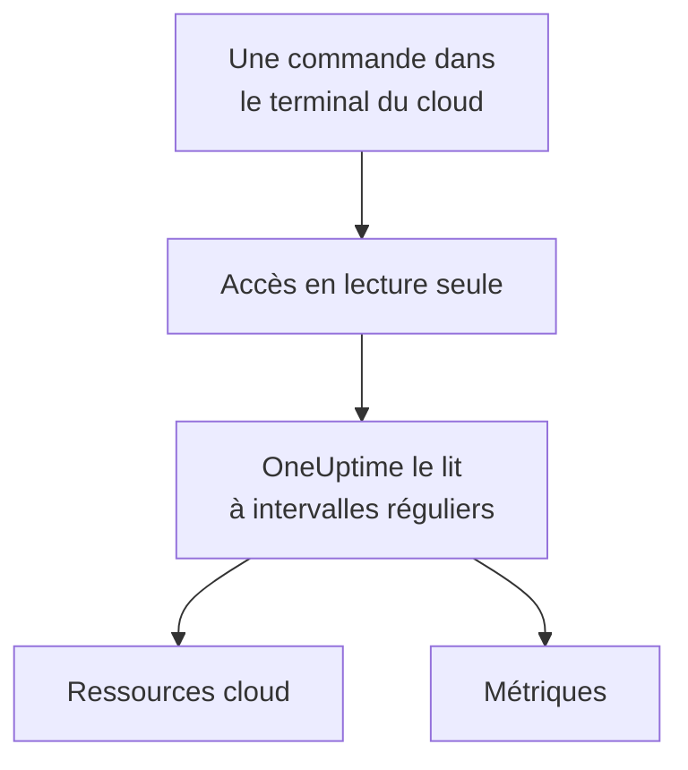

# Connecter un compte cloud

Connectez un compte AWS, un abonnement Azure ou un projet Google Cloud depuis le tableau de bord, et OneUptime liste ses ressources et lit leurs métriques clés selon un calendrier. Vous exécutez une commande dans le terminal du navigateur de votre cloud et collez ce qu'elle affiche : aucun collecteur à faire tourner, rien à installer.

:::cards
- [Amazon Web Services](#amazon-web-services): Un rôle IAM auquel OneUptime se connecte, ou une clé d'accès.
- [Microsoft Azure](#microsoft-azure): Une application avec le rôle Monitoring Reader.
- [Google Cloud](#google-cloud): Un compte de service avec le rôle Monitoring Viewer.
- [Ce que lit OneUptime](#ce-que-lit-oneuptime): Quelles ressources et métriques, à quelle fréquence, et ce que cela coûte.
:::

## Fonctionnement



- **L'accès ne peut que lire.** La commande crée un accès qui lit les métriques et rien d'autre : trois actions de lecture sur AWS, le rôle **Monitoring Reader** sur Azure et le rôle **Monitoring Viewer** sur Google Cloud. Supprimez-le pour couper l'accès de OneUptime.
- **OneUptime lit selon un calendrier.** Toutes les 5 minutes pour Azure et Google Cloud, et toutes les 10 minutes pour AWS, sauf si vous choisissez un autre intervalle à la connexion.
- **Chaque ressource a sa propre page.** Les ressources apparaissent dans **Cloud → Toutes les ressources** avec leurs métriques clés, leurs propriétaires et leurs libellés, comme les ressources qu'un collecteur signale.

## Avant de commencer

- **Un propriétaire ou un administrateur du projet.** Eux seuls peuvent connecter, tester et modifier des comptes cloud.
- **Le terminal de votre cloud** (AWS CloudShell, Azure Cloud Shell ou Google Cloud Shell), connecté en tant que personne autorisée à créer un rôle ou un utilisateur IAM, une inscription d'application ou un compte de service.

## Amazon Web Services

:::steps
### Ouvrir le formulaire AWS

Allez dans **Cloud → Connecter** et choisissez **Amazon Web Services**.

### Exécuter la commande dans AWS CloudShell

Choisissez comment OneUptime se connecte. Un **Rôle IAM** est la méthode recommandée : rien de secret n'est stocké, et vous pouvez supprimer le rôle à tout moment. Le formulaire affiche la commande écrite pour votre projet : elle crée un rôle qui fait confiance au compte AWS de OneUptime avec l'ID externe de votre projet, et affiche l'ARN du rôle. Utilisez une **Clé d'accès** lorsqu'un rôle n'est pas possible. Cette commande crée un utilisateur avec les mêmes autorisations et affiche sa clé :

```bash
aws iam create-user --user-name OneUptimeReadOnly > /dev/null 2>&1 || true
aws iam put-user-policy --user-name OneUptimeReadOnly --policy-name OneUptimeReadOnly --policy-document '{"Version":"2012-10-17","Statement":[{"Effect":"Allow","Action":["cloudwatch:GetMetricData","cloudwatch:ListMetrics","tag:GetResources"],"Resource":"*"}]}'
aws iam create-access-key --user-name OneUptimeReadOnly
```

### Coller ce qu'a affiché la commande AWS

Collez tout ce que la commande a affiché dans **Ce que la commande a affiché**. OneUptime en extrait l'ARN du rôle, ou l'ID de clé d'accès et son secret.

### Tester et connecter AWS

OneUptime teste la connexion dès que cette étape s'ouvre : il se connecte, compte les ressources qu'il trouve et indique ce que coûte leur lecture. Sélectionnez **Connecter** pour enregistrer.
:::

Le rôle et l'utilisateur peuvent faire trois choses, et rien d'autre :

| Action | Ce que OneUptime en fait |
| --- | --- |
| `cloudwatch:ListMetrics` | Trouver les ressources qui signalent des métriques, dans chaque région |
| `cloudwatch:GetMetricData` | Lire leurs métriques clés |
| `tag:GetResources` | Nommer chaque ressource d'après son tag `Name` |

> [!NOTE]
> Sur un OneUptime auto-hébergé, la méthode **Rôle IAM** nécessite une identité AWS propre à OneUptime : définissez `CLOUD_CONNECT_AWS_ACCESS_KEY_ID` et `CLOUD_CONNECT_AWS_SECRET_ACCESS_KEY` avec la clé d'un utilisateur IAM autorisé à appeler `sts:AssumeRole`. Sans elles, le formulaire propose une **Clé d'accès**.

## Microsoft Azure

:::steps
### Ouvrir le formulaire Azure

Allez dans **Cloud → Connecter** et choisissez **Microsoft Azure**.

### Exécuter la commande dans Azure Cloud Shell

La commande crée une application avec le rôle **Monitoring Reader** sur votre abonnement actuel, et affiche ses détails :

```bash
az ad sp create-for-rbac --name OneUptimeReadOnly --role "Monitoring Reader" --scopes "/subscriptions/$(az account show --query id --output tsv)"
```

### Coller ce qu'a affiché la commande Azure

Collez tout ce que la commande a affiché dans **Ce que la commande a affiché**. OneUptime en extrait `tenant`, `appId` et `password`.

### Tester et connecter Azure

OneUptime teste la connexion dès que cette étape s'ouvre. Sélectionnez **Connecter** pour enregistrer.
:::

Pour lire d'autres abonnements avec la même application, donnez-lui le rôle sur chacun d'eux :

```bash
az role assignment create --assignee <APP_ID> --role "Monitoring Reader" --scope /subscriptions/<SUBSCRIPTION_ID>
```

OneUptime lit chaque abonnement que l'application peut lire, sauf si vous en listez certains dans **Abonnements**.

## Google Cloud

:::steps
### Ouvrir le formulaire Google Cloud

Allez dans **Cloud → Connecter** et choisissez **Google Cloud**.

### Exécuter la commande dans Google Cloud Shell

Exécutez-la dans le projet à surveiller. Elle active l'API Cloud Monitoring, crée un compte de service avec le rôle **Monitoring Viewer**, et affiche sa clé :

```bash
PROJECT_ID=$(gcloud config get-value project)
gcloud services enable monitoring.googleapis.com
gcloud iam service-accounts create oneuptime-read-only --display-name "OneUptime (read only)"
gcloud projects add-iam-policy-binding "$PROJECT_ID" --member "serviceAccount:oneuptime-read-only@$PROJECT_ID.iam.gserviceaccount.com" --role roles/monitoring.viewer --condition=None > /dev/null
gcloud iam service-accounts keys create oneuptime-key.json --iam-account "oneuptime-read-only@$PROJECT_ID.iam.gserviceaccount.com"
cat oneuptime-key.json && rm oneuptime-key.json
```

### Coller la clé

Collez tout ce que la commande a affiché. OneUptime lit le projet propre de la clé, et stocke la clé chiffrée.

### Tester et connecter Google Cloud

OneUptime teste la connexion dès que cette étape s'ouvre. Sélectionnez **Connecter** pour enregistrer.
:::

Pour lire d'autres projets avec le même compte de service, donnez-lui le rôle dans chacun d'eux et listez-les dans **Projets** :

```bash
gcloud projects add-iam-policy-binding <PROJECT_ID> --member "serviceAccount:oneuptime-read-only@<KEY_PROJECT_ID>.iam.gserviceaccount.com" --role roles/monitoring.viewer
```

## Ce que lit OneUptime

| | AWS | Azure | Google Cloud |
| --- | --- | --- | --- |
| Ressources | Celles qui envoient des métriques à CloudWatch, dans chaque région que vous utilisez | Chaque ressource des abonnements | Celles qui envoient des métriques à Cloud Monitoring |
| Métriques | Les métriques clés de chaque service, comme le CPU, le réseau et les contrôles d'état d'une instance | Jusqu'à 8 métriques clés par ressource | Les métriques clés de chaque type de ressource |
| Lu toutes les | 10 minutes | 5 minutes | 5 minutes |
| Une ressource supprimée | Archivée après 7 jours sans métriques | Archivée à la lecture suivante | Archivée après 7 jours sans métriques |

Chaque lecture reprend là où la précédente s'est arrêtée, de sorte que chaque point de données est écrit une seule fois. La première lecture d'une nouvelle connexion démarre dans la minute et remonte une heure en arrière ; après une pause, une lecture remonte au plus 6 heures en arrière.

Les appels de OneUptime sont facturés à votre compte cloud, aux prix de votre cloud. Le test estime le coût de ce qu'il trouve, et lire moins souvent coûte moins cher : changez **Fréquence de lecture des métriques** dans **Plus de champs**.

| Cloud | Prix |
| --- | --- |
| AWS | CloudWatch `GetMetricData` : $0.01 pour 1 000 métriques, et chaque métrique clé d'une ressource compte pour une métrique par lecture |
| Azure | Les 1 000 000 premières lectures de métriques par mois de chaque abonnement sont gratuites, puis $0.01 pour 1 000 |
| Google Cloud | Les 1 000 000 premières séries temporelles lues par mois sont gratuites, puis $0.50 par million |

## Dépannage

:::details Le test indique que la clé ou le secret n'a pas été accepté
Copiez tout ce que la commande a affiché et collez-le à nouveau. Une clé créée il y a une minute peut mettre une minute à fonctionner.
:::

:::details Le test se connecte, mais ne peut pas lire
Exécutez à nouveau la commande : elle accorde le rôle dont OneUptime a besoin. Sur AWS, exécutez la commande que le formulaire affiche pour ce projet : un rôle créé pour un autre projet fait confiance à l'ID externe de cet autre projet, pas à celui de ce projet.
:::

:::details Google Cloud empêche la commande de créer une clé
Une règle d'administration, `iam.disableServiceAccountKeyCreation`, peut interdire les clés de compte de service. Demandez une exception pour le projet à l'administrateur de votre organisation, ou [envoyez les métriques avec votre propre collecteur](/docs/telemetry/cloud-resources).
:::

:::details Aucune ressource n'apparaît
Sur AWS et Google Cloud, une ressource apparaît dès qu'elle signale des métriques. Si une connexion ne fonctionne pas, **Voir l'erreur** dans **Cloud → Connecter** indique pourquoi sa dernière lecture a échoué.
:::

## Prochaines étapes

:::cards
- [Ressources cloud](/docs/telemetry/cloud-resources): Faites plutôt tourner votre propre OpenTelemetry Collector, ou diffusez les métriques CloudWatch.
- [Moniteur de métriques](/docs/monitor/metrics-monitor): Créez des alertes sur les métriques d'une ressource.
:::
