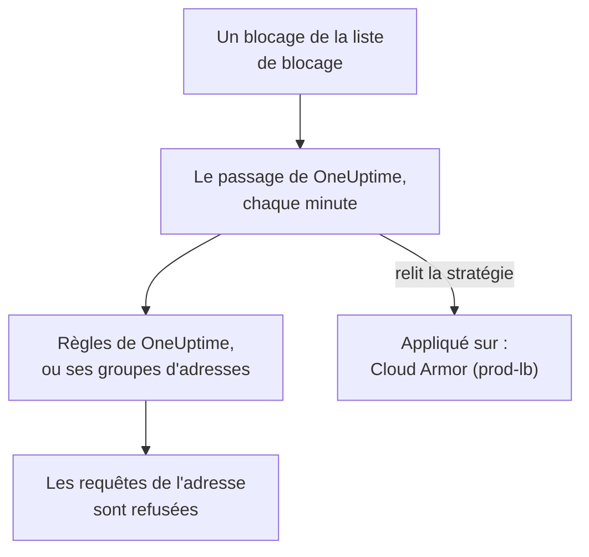

# Bloquer des adresses dans Cloud Armor

La liste de blocage de votre projet peut être appliquée dans les stratégies de sécurité Google Cloud Armor de vos équilibreurs de charge. Activez-la sur une connexion Google Cloud que vous avez déjà, choisissez les stratégies de sécurité, et chaque adresse que la liste de blocage bloque y est bloquée, qu'elle ait été bloquée par une personne, par un playbook ou par OneUptime AI.

:::cards
- [Activation](#activation): Un paramètre sur la connexion Google Cloud, et le rôle qu'il nécessite.
- [Ce que crée OneUptime](#ce-que-crée-oneuptime): Des règles qui lui sont propres dans chaque stratégie, ou des groupes d'adresses avec Cloud Armor Enterprise.
- [Quelle adresse est comparée](#quelle-adresse-est-comparée): L'adresse qui s'est connectée, ou l'IP utilisateur derrière un proxy.
:::

## Fonctionnement

OneUptime tient ses propres règles dans chaque stratégie de sécurité que vous choisissez, et y place les adresses que la liste de blocage bloque. Chaque minute, il modifie ce qui a changé, une règle à la fois, puis relit la stratégie. Sur la page **Liste de blocage**, la colonne **Appliqué sur** d'un blocage ne nomme Cloud Armor (prod-lb) qu'une fois que la stratégie contient le blocage ; jusque-là, le blocage n'est pas appliqué.

## Avant de commencer

- Un projet Google Cloud connecté à OneUptime (voir [Connecter un compte cloud](/docs/telemetry/cloud-accounts#google-cloud)).
- Un rôle autorisé à modifier l'endroit où la liste de blocage est appliquée : **Propriétaire du projet**, **Administrateur du projet** ou **Administrateur de la sécurité**.
- Une personne autorisée à créer des rôles et à les attribuer dans le projet Google Cloud, pour exécuter une commande dans Cloud Shell.

## Activation

:::steps
### Ouvrir la connexion
Ouvrez **Cloud → Connecter** et modifiez la connexion Google Cloud.

### Activer le paramètre
Sous **Plus de champs**, réglez **Bloquer des adresses dans Cloud Armor** sur **Activé**, puis enregistrez. La commande de configuration qu'affiche le formulaire accorde désormais le rôle ci-dessous là où elle accorde les autres. Une connexion que vous avez déjà n'a pas besoin de la relancer : la boîte de dialogue **Ajouter un WAF** donne les lignes qui accordent le rôle dans le projet de la stratégie.

### Ajouter les stratégies de sécurité
Ouvrez **Événements de sécurité → Playbooks → Liste de blocage**. Sous **WAF cloud**, cliquez sur **Ajouter un WAF** et choisissez une stratégie de sécurité. OneUptime demande à Google Cloud si la connexion a le droit d'y écrire, sans rien écrire.

### Accorder le rôle, s'il manque
Quand une autorisation manque, la boîte de dialogue affiche les lignes qui l'accordent dans le projet de la stratégie. Exécutez-les dans Cloud Shell, cliquez sur **Vérifier à nouveau**, puis ajoutez la stratégie. Son **Statut** indique **Appliquée** une fois que OneUptime l'a configurée.
:::

Les stratégies de sécurité proviennent de l'inventaire de la connexion : une stratégie que OneUptime n'a pas encore lue apparaît après la lecture suivante. Tant qu'une stratégie applique la liste de blocage, le paramètre de sa connexion ne peut pas être désactivé et la connexion ne peut pas être supprimée : retirez d'abord la stratégie, pour que OneUptime en retire ses règles.

## Ce que crée OneUptime

OneUptime choisit la façon dont une stratégie contient la liste de blocage quand vous l'ajoutez.

| Quoi | Nom | Où |
| --- | --- | --- |
| Des règles qui refusent avec 403, chacune contenant jusqu'à 10 adresses ou plages | Leur description commence par `OneUptime blocklist <project> #1`, `#2`, ... | Dans chaque stratégie choisie, 20 au plus. |
| Deux groupes d'adresses, IPv4 et IPv6 | `oneuptime-<project>-block-ipv4`, `oneuptime-<project>-block-ipv6` | Globaux, dans le projet de la stratégie. Avec Cloud Armor Enterprise uniquement. |
| Une règle qui refuse avec 403 tout ce que contient l'un ou l'autre groupe | Sa description commence par `OneUptime blocklist <project>, address groups` | Dans chaque stratégie backend globale choisie, avec Cloud Armor Enterprise. |

`<project>` correspond aux huit premiers caractères de l'ID externe de votre projet, si bien que deux projets OneUptime qui choisissent une même stratégie n'écrivent jamais les règles l'un de l'autre. Cloud Armor ne nomme une règle que par sa priorité : OneUptime reconnaît donc ses propres règles à leur description.

- **Règles.** Cloud Armor accepte 10 adresses ou plages dans une règle : une stratégie contient donc jusqu'à 200 blocages dans les 20 règles de OneUptime ; un blocage qui ne tient pas l'indique sur sa ligne.
- **Groupes d'adresses.** Une stratégie backend globale d'un projet avec Cloud Armor Enterprise contient plutôt la liste de blocage dans deux groupes d'adresses : 10 000 plages IPv4 et 2 000 plages IPv6. Toutes les stratégies de ce type du projet les partagent, et une règle dans chaque stratégie refuse ce qu'ils contiennent. Les groupes occupent 16 000 unités du quota de groupes d'adresses du projet.

OneUptime ajoute, modifie et supprime chacune de ses règles séparément, avec les méthodes de règle de Cloud Armor : il n'écrit jamais la stratégie d'un seul tenant, et n'écrit jamais une de vos règles. Une adresse seule s'écrit `/32` ou `/128`.

## La place des règles dans la stratégie

OneUptime place ses règles à des priorités libres avant votre première règle qui laisse passer une requête, en commençant par la plus basse, afin qu'aucune de vos règles ne laisse passer une adresse bloquée : une règle qui autorise, limite le débit, bannit selon le débit ou répartit équitablement. Une de vos règles qui refuse peut passer avant. OneUptime ne renumérote, ne modifie ni ne supprime jamais une de vos règles : quand aucune priorité n'est libre avant votre première règle de ce type, la stratégie indique **Aucune priorité libre**, et OneUptime ajoute sa règle dès que vous en libérez une.

## Quelle adresse est comparée

| Stratégie de sécurité | Adresse du client | Quand la choisir |
| --- | --- | --- |
| Backend | **L'adresse qui s'est connectée à l'équilibreur de charge (origin.ip)** | La valeur par défaut. |
| Backend | L'IP utilisateur des en-têtes de requête de la stratégie (origin.user_ip) | Pour un équilibreur de charge placé derrière un autre proxy ou CDN. |
| Périphérique | L'adresse qui s'est connectée à l'équilibreur de charge (origin.ip) | Le seul choix : une stratégie périphérique ne lit aucune autre adresse. |

`origin.user_ip` est l'adresse des en-têtes de requête d'IP utilisateur de la stratégie (`userIpRequestHeaders`), qu'écrit un proxy ou CDN placé devant l'équilibreur de charge. Si aucun n'est défini, ou s'ils ne contiennent aucune adresse valide, c'est `origin.ip`. Ne choisissez l'IP utilisateur que si un tel proxy les écrit, car un client qui atteint directement l'équilibreur de charge peut les écrire lui-même. Le choix se trouve sous **Plus de champs** dans la boîte de dialogue **Ajouter un WAF**, et vous pouvez le modifier plus tard avec **Adresse du client** sur la ligne de la stratégie.

Une stratégie de sécurité de périphérie réseau, pour les équilibreurs de charge réseau passthrough, ne peut pas être choisie, et la boîte de dialogue **Ajouter un WAF** indique pourquoi : ses règles correspondent à des paquets, pas à des requêtes.

Les règles de OneUptime dans Cloud Armor ne font que refuser. Un blocage qui demande de soumettre une adresse à un défi n'est pas appliqué dans Cloud Armor, et l'indique. Le défi d'une politique de réponse automatique y est appliqué sous forme de blocage pour la même durée.

## Quand une règle est modifiée à la main

Quand quelqu'un passe une des règles de OneUptime en mode aperçu, la modifie ou la supprime, ou supprime un de ses groupes d'adresses, OneUptime laisse les choses telles que cette personne les a laissées. La stratégie indique **Modifiée à la main**, et les blocages concernés ne sont pas appliqués, avec la raison, jusqu'à ce que quelqu'un clique sur **Rétablir** sur la ligne de la stratégie. « Rétablir » réécrit la règle telle que OneUptime l'écrit, à sa propre priorité tant que celle-ci est libre, et recrée un groupe d'adresses supprimé.

OneUptime ne vérifie pas qu'une stratégie est rattachée à un service backend. Une stratégie rattachée à aucun ne bloque rien.

## Gérer une stratégie dans Terraform

Une `google_compute_security_policy` avec des blocs `rule` possède chaque règle de la stratégie : son prochain plan supprime donc les règles de OneUptime. Gardez vos règles sous forme de ressources `google_compute_security_policy_rule`, qui laissent les autres règles intactes, ou ajoutez `ignore_changes = [rule]` au bloc `lifecycle` de la stratégie.

## Autorisations

La commande de configuration ajoute un rôle personnalisé, `oneuptimeCloudArmorBlocklist`, là où elle accorde les autres rôles de la connexion, et l'accorde au compte de service de la connexion. Les lignes qu'affiche la boîte de dialogue **Ajouter un WAF** ajoutent le même rôle dans le projet de la stratégie. Une stratégie en mode règles n'a besoin que de ses propres autorisations.

| Autorisation | Pourquoi |
| --- | --- |
| `compute.securityPolicies.get`, `compute.securityPolicies.update` | Lire une stratégie globale et y modifier les règles de OneUptime. |
| `compute.regionSecurityPolicies.get`, `compute.regionSecurityPolicies.update` | Lire une stratégie régionale et y modifier les règles de OneUptime. |
| `compute.globalOperations.get`, `compute.regionOperations.get` | Attendre qu'une modification soit terminée. |
| `compute.projects.get` | Lire si le projet dispose de Cloud Armor Enterprise. |
| `networksecurity.addressGroups.get`, `networksecurity.addressGroups.list`, `networksecurity.addressGroups.create`, `networksecurity.addressGroups.update`, `networksecurity.addressGroups.delete`, `networksecurity.addressGroups.use` | Tenir les groupes d'adresses de OneUptime, et y faire référence depuis sa règle. Avec Cloud Armor Enterprise uniquement. |
| `networksecurity.operations.get` | Attendre que la modification d'un groupe d'adresses soit terminée. |

Le rôle ne peut pas supprimer de stratégie, et OneUptime n'écrit jamais rien d'autre. La commande de configuration active aussi les API Compute Engine et Network Security.

## Désactivation

:::steps
### Retirer la stratégie de sécurité
Dans **Événements de sécurité → Playbooks → Liste de blocage**, cliquez sur **Supprimer** sur la ligne de la stratégie. OneUptime retire ses règles de la stratégie, et supprime ses groupes d'adresses dès qu'aucune autre stratégie du projet ne les utilise.

### Désactiver le paramètre
Modifiez la connexion, réglez **Bloquer des adresses dans Cloud Armor** sur **Désactivé**, puis enregistrez. Le paramètre peut être désactivé dès qu'aucune stratégie de la connexion n'applique la liste de blocage.
:::

Quand OneUptime n'a plus le droit d'écrire dans la stratégie, cochez **Retirer de OneUptime uniquement** dans la boîte de dialogue **Retirer le WAF**. OneUptime retire la stratégie de la liste de blocage et nomme les règles et les groupes d'adresses qu'il a laissés : ils continuent de bloquer ce qu'ils contiennent jusqu'à ce que vous les supprimiez dans Google Cloud.

## Dépannage

:::details Non appliquée
Le statut de la stratégie indique ce que Google Cloud a répondu et ce qu'il faut faire. Un refus nomme l'autorisation qui manque : exécutez les lignes qu'affiche **Ajouter un WAF** pour la stratégie, puis cliquez sur **Vérifier à nouveau**. Un refus pour dépassement de quota nomme ce quota : demandez un quota plus élevé à Google Cloud, ou supprimez les règles que vous n'utilisez plus.
:::

:::details Aucune priorité libre
Toutes les priorités avant votre première règle qui laisse passer une requête sont prises. Donnez à cette règle un numéro plus élevé, puis cliquez sur **Vérifier à nouveau**.
:::

:::details Une stratégie n'apparaît pas dans la liste
OneUptime liste les stratégies de sécurité des connexions dont le paramètre est activé, une fois qu'il les a lues. Une stratégie ajoutée depuis apparaît après la prochaine lecture de la connexion.
:::

## Prochaines étapes

:::cards
- [Dossiers de sécurité et playbooks](/docs/telemetry/security-cases): Bloquez une adresse depuis un dossier, et voyez son étape vérifiée.
- [Connecter un compte cloud](/docs/telemetry/cloud-accounts): La connexion dont fait partie ce paramètre.
:::
