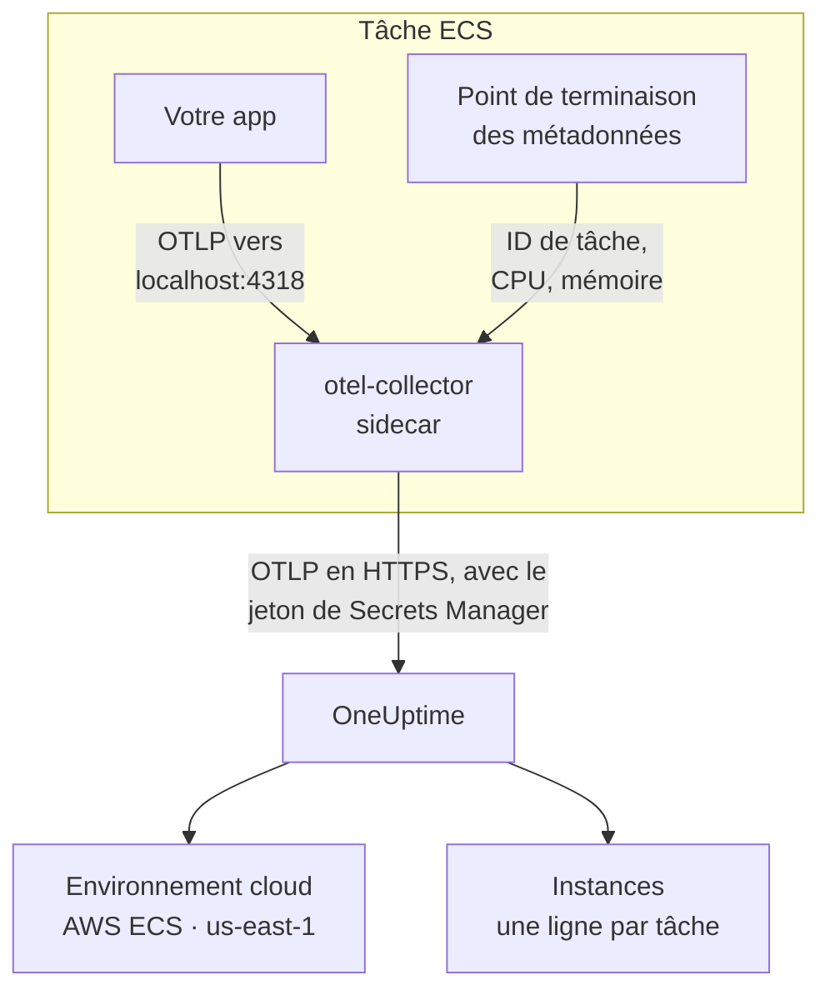

# AWS ECS / Fargate

Envoyez les traces, journaux et métriques de vos tâches Amazon ECS à OneUptime, sur les types de lancement Fargate comme EC2. Chaque tâche qui rapporte `cloud.platform=aws_ecs` rejoint un **Environnement cloud** par compte AWS et région, par exemple _AWS ECS · us-east-1 · 123456789012_, qu'il y tourne un service ou cinquante.

:::cards
- [Fonctionnement](#fonctionnement): Ce que font le détecteur ECS et le collecteur sidecar.
- [Mise en place](#mise-en-place): Stocker le jeton, ajouter les réglages à la définition de tâche, déployer et vérifier.
- [La définition de tâche complète](#la-définition-de-tâche-complète): Une définition de tâche Fargate complète à enregistrer.
- [Dépannage](#dépannage): Tâches bloquées en PENDING, exports refusés, instances ou tuiles vides.
:::

## Fonctionnement



- **Le détecteur ECS nomme l'environnement.** Le détecteur de ressources ECS d'OpenTelemetry, dans le SDK ou dans un collecteur, lit le point de terminaison des métadonnées de tâche qu'ECS fournit à chaque conteneur, et place le compte, la région et la tâche sur tout ce que la tâche envoie. Rien n'est codé en dur.
- **La tâche nomme chaque instance.** L'onglet **Instances** de l'environnement liste les tâches en cours par ID de tâche, avec leur CPU et leur mémoire.
- **Un collecteur sidecar ajoute le CPU et la mémoire.** Son récepteur `awsecscontainermetrics` lit le CPU et la mémoire de chaque tâche au même point de terminaison, et il détient le jeton pour que l'application ne le voie jamais.

Le détecteur ECS définit ces attributs de ressource :

| Attribut | Défini par le détecteur ECS | Sert à |
| ------------------------------------------------------------------ | ----------------------- | --------------------------------------------------------------------------------------------------------- |
| `cloud.platform` | `aws_ecs` | Classer la télémétrie sous **Environnements cloud**. La valeur doit être exacte |
| `cloud.account.id` | `123456789012` | Faire partie de la clé d'environnement |
| `cloud.region` | `us-east-1` | Faire partie de la clé d'environnement |
| `aws.ecs.task.arn` | l'ARN de la tâche | Nommer une tâche en cours sous **Instances**, par l'ID de tâche à sa fin |
| `aws.ecs.task.id` | l'ID de la tâche | La même chose ; les versions récentes du détecteur définissent les deux |
| `aws.ecs.cluster.arn`, `aws.ecs.task.family`, `aws.ecs.launchtype` | le cluster et la tâche | Conservés sur chaque span, log et métrique pour vos recherches ; ne font pas partie de l'environnement |

La clé d'environnement est `aws_ecs|123456789012|us-east-1`. L'ID de tâche nomme une instance même quand le SDK définit aussi `service.instance.id` : les métriques de conteneur du sidecar ne portent que l'ID de tâche, et une clé basée dessus garde les spans d'une tâche et son CPU et sa mémoire sur une seule ligne. La règle complète est sur [Environnements cloud](/docs/telemetry/cloud-environments).

## Avant de commencer

- **Une clé d'ingestion.** Créez une clé **Serveur** sous **Paramètres du projet → Télémétrie & APM → Clés d'ingestion** et copiez son jeton.
- **Un cluster ECS et une définition de tâche que vous pouvez réviser**, et l'AWS CLI configurée pour ce compte.
- **Votre application instrumentée avec un SDK OpenTelemetry** qui exporte en OTLP, dans n'importe quel langage.

## Choisir comment la télémétrie quitte la tâche

| | Sidecar collector | SDK direct |
| ----------------------- | ---------------------------------------------- | ----------------------------------------------- |
| Conteneur supplémentaire | `otel-collector` dans chaque tâche | Aucun |
| CPU et mémoire par tâche | Oui, du récepteur `awsecscontainermetrics` | Non |
| Détient le jeton | Le collecteur | L'application |
| Le secret contient | Le jeton seul | L'en-tête complet `x-oneuptime-token=...` |

La plupart des équipes utilisent le collecteur sidecar : il place les attributs `cloud.*` même sur la télémétrie de bibliothèques qui ne savent rien d'ECS. SDK direct est le choix le plus simple pour un service unique. Chaque étape ci-dessous a un onglet pour chacun ; choisissez-en un et chaque étape le suit.

## Mise en place

:::steps
### Stocker le jeton dans Secrets Manager

> [!IMPORTANT]
> Le jeton est un secret. Gardez-le dans AWS Secrets Manager et référencez-le depuis la définition de tâche avec `secrets` et `valueFrom`. Un jeton dans une simple entrée `environment` est visible par quiconque peut lire la définition de tâche, et il apparaît dans chaque sortie de `describe-task-definition` et chaque diff CloudFormation.

:::tabs
@tab Sidecar collector
```bash
aws secretsmanager create-secret \
  --name oneuptime/ingestion-token \
  --region us-east-1 \
  --secret-string "YOUR_TELEMETRY_INGESTION_TOKEN"
```

La configuration du collecteur ajoute le nom de l'en-tête, ce secret ne contient donc que le jeton.
@tab SDK direct
```bash
aws secretsmanager create-secret \
  --name oneuptime/ingestion-token \
  --region us-east-1 \
  --secret-string "x-oneuptime-token=YOUR_TELEMETRY_INGESTION_TOKEN"
```

ECS place la valeur d'un secret telle quelle dans la variable, et `OTEL_EXPORTER_OTLP_HEADERS` a besoin de la paire `name=value` complète : ce secret contient donc l'en-tête complet.
:::

Notez l'ARN qu'affiche la commande. Il se termine par un suffixe aléatoire, par exemple `oneuptime/ingestion-token-AbCdEf`, et vous le collez dans la définition de tâche.

### Laisser la tâche lire le secret

Le rôle d'exécution de tâche (le rôle avec lequel ECS démarre la tâche, pas celui sous lequel votre code tourne) doit pouvoir lire le secret. Attachez cette stratégie à `ecsTaskExecutionRole` :

```json title="secret-access-policy.json"
{
  "Version": "2012-10-17",
  "Statement": [
    {
      "Effect": "Allow",
      "Action": ["secretsmanager:GetSecretValue"],
      "Resource": "arn:aws:secretsmanager:us-east-1:123456789012:secret:oneuptime/ingestion-token-*"
    }
  ]
}
```

Si une clé KMS gérée par le client chiffre le secret, le rôle a aussi besoin de `kms:Decrypt` sur cette clé. Sans l'un ou l'autre, la tâche ne démarre pas : elle s'arrête avec `ResourceInitializationError: unable to pull secrets`.

### Ajouter les réglages à la définition de tâche

:::tabs
@tab Sidecar collector
1. **AWS Console → Amazon Elastic Container Service → Task definitions** → sélectionnez la famille → **Create new revision**.
2. Sous **Container - 1** (votre application), développez **Environment variables** et ajoutez les variables d'application ci-dessous.
3. **+ Add container** : nom `otel-collector`, image `otel/opentelemetry-collector-contrib:latest` (fixez une version une fois que cela fonctionne), **Essential container: No**. Sous **Docker configuration → Command**, saisissez `--config=env:OTEL_COLLECTOR_CONFIG`.
4. Sur le conteneur du collecteur, ajoutez la variable d'environnement `ONEUPTIME_TOKEN` avec **Value type: ValueFrom** et l'ARN du secret, et `OTEL_COLLECTOR_CONFIG` avec **Value type: Value** et la configuration du collecteur ci-dessous.
5. Sous **Startup dependency ordering** sur le conteneur de l'application, ajoutez `otel-collector` avec la condition **Start**, afin que l'application ne démarre jamais avant que quelque chose n'écoute sur le port 4318.
6. Sous **Task execution role**, vérifiez qu'il s'agit du rôle auquel vous avez attaché la stratégie.

Variables de l'application. En mode réseau `awsvpc` (toujours, sur Fargate), les conteneurs d'une tâche partagent un réseau, donc `localhost` est le sidecar :

```bash
OTEL_SERVICE_NAME=checkout-api
OTEL_EXPORTER_OTLP_ENDPOINT=http://localhost:4318
OTEL_EXPORTER_OTLP_PROTOCOL=http/protobuf
```

Configuration du collecteur. Le collecteur la lit entièrement depuis la variable `OTEL_COLLECTOR_CONFIG`, il n'y a donc aucun fichier à intégrer dans une image, et il résout `${env:ONEUPTIME_TOKEN}` à partir du secret qu'ECS place dans son environnement :

```yaml title="OTEL_COLLECTOR_CONFIG"
receivers:
  otlp:
    protocols:
      http:
        endpoint: 0.0.0.0:4318
      grpc:
        endpoint: 0.0.0.0:4317
  # Per-task and per-container CPU / memory from the ECS task metadata
  # endpoint. This is what fills the CPU and memory tiles in OneUptime.
  awsecscontainermetrics:
    collection_interval: 20s
processors:
  # Stamps cloud.provider, cloud.platform=aws_ecs, cloud.account.id,
  # cloud.region and aws.ecs.task.arn on every span, log and metric.
  resourcedetection:
    detectors: [env, ecs]
    timeout: 5s
  batch: {}
exporters:
  otlphttp/oneuptime:
    endpoint: https://oneuptime.com/otlp
    headers:
      x-oneuptime-token: ${env:ONEUPTIME_TOKEN}
service:
  pipelines:
    traces:
      receivers: [otlp]
      processors: [resourcedetection, batch]
      exporters: [otlphttp/oneuptime]
    metrics:
      receivers: [otlp, awsecscontainermetrics]
      processors: [resourcedetection, batch]
      exporters: [otlphttp/oneuptime]
    logs:
      receivers: [otlp]
      processors: [resourcedetection, batch]
      exporters: [otlphttp/oneuptime]
```

Ni le détecteur `ecs` ni le récepteur `awsecscontainermetrics` n'a besoin d'une autorisation IAM : tous deux lisent le point de terminaison des métadonnées qu'ECS fournit à chaque conteneur dans `ECS_CONTAINER_METADATA_URI_V4`.
@tab SDK direct
1. **AWS Console → Amazon Elastic Container Service → Task definitions** → sélectionnez la famille → **Create new revision**.
2. Sous **Container - 1** (votre application), développez **Environment variables** et ajoutez les variables ci-dessous. Ajoutez `OTEL_EXPORTER_OTLP_HEADERS` avec **Value type: ValueFrom** et l'ARN du secret comme valeur.
3. Ajoutez le réglage qui active le détecteur de ressources ECS de votre langage, d'après le tableau ci-dessous.
4. Sous **Task execution role**, vérifiez qu'il s'agit du rôle auquel vous avez attaché la stratégie.

```bash
OTEL_SERVICE_NAME=checkout-api
OTEL_EXPORTER_OTLP_ENDPOINT=https://oneuptime.com/otlp
OTEL_EXPORTER_OTLP_PROTOCOL=http/protobuf
# Injected from Secrets Manager (secrets / valueFrom), not typed here.
OTEL_EXPORTER_OTLP_HEADERS=x-oneuptime-token=YOUR_TELEMETRY_INGESTION_TOKEN
```

| Langage | Activer le détecteur ECS |
| -------- | --------------------------------------------------------------------------------------------------------------- |
| Node.js | `OTEL_NODE_RESOURCE_DETECTORS=env,host,os,aws` (auto-instrumentations-node) |
| Python | `pip install opentelemetry-sdk-extension-aws`, puis `OTEL_EXPERIMENTAL_RESOURCE_DETECTORS=aws_ecs` |
| Java | `-Dotel.resource.providers.aws.enabled=true` (l'agent livre ce fournisseur désactivé) |
| Go | `import "go.opentelemetry.io/contrib/detectors/aws/ecs"` et passez `ecs.NewResourceDetector()` à `resource.New` |
| .NET | Le paquet `OpenTelemetry.Resources.AWS` : `.ConfigureResource(r => r.AddAWSECSDetector())` |

Dans un fichier de définition de tâche, le secret s'écrit `"secrets": [{ "name": "OTEL_EXPORTER_OTLP_HEADERS", "valueFrom": "<secret ARN>" }]`.
:::

Si vous hébergez OneUptime vous-même, utilisez `https://YOUR-ONEUPTIME-HOST/otlp` comme point de terminaison.

### Déployer la nouvelle révision

Cliquez sur **Create**, puis **Clusters → your cluster → Services → select the service → Update → Task definition revision: latest → Deploy**. Ou depuis la CLI :

```bash
aws ecs update-service \
  --cluster production \
  --service checkout-api \
  --task-definition checkout-api
```

### Vérifier la connexion

Vérifiez d'abord le jeton : c'est la vérification la moins coûteuse, et rien après elle ne fonctionne sans lui.

```bash
curl -i https://oneuptime.com/otlp/v1/validate \
  -H "x-oneuptime-token: YOUR_TELEMETRY_INGESTION_TOKEN"
```

`200` avec `"valid": true` signifie que le jeton est accepté. `401` signifie qu'il est inconnu, révoqué, désactivé ou expiré. Lancez la même commande depuis la tâche avec ECS Exec, pour prouver que la tâche elle-même atteint OneUptime :

```bash
aws ecs execute-command --cluster production --task <task id> \
  --container app --interactive --command "sh"
```

Le flux de journaux CloudWatch du collecteur (`otel/otel-collector/...`) doit indiquer `Everything is ready`, sans ligne `401` ou `connection refused`. Dans la minute qui suit le premier span, log ou métrique, l'environnement apparaît sous **Cloud → Tous les environnements** sous le nom _AWS ECS · us-east-1 · 123456789012_.
:::

## La définition de tâche complète

La configuration avec sidecar sous forme de fichier, à enregistrer avec `aws ecs register-task-definition --cli-input-json file://task-definition.json`. Remplacez l'ID de compte, la région, l'image et l'ARN du secret :

```json title="task-definition.json"
{
  "family": "checkout-api",
  "requiresCompatibilities": ["FARGATE"],
  "networkMode": "awsvpc",
  "cpu": "512",
  "memory": "1024",
  "executionRoleArn": "arn:aws:iam::123456789012:role/ecsTaskExecutionRole",
  "taskRoleArn": "arn:aws:iam::123456789012:role/checkout-api-task-role",
  "containerDefinitions": [
    {
      "name": "app",
      "image": "123456789012.dkr.ecr.us-east-1.amazonaws.com/checkout-api:1.4.2",
      "essential": true,
      "portMappings": [{ "containerPort": 8080, "protocol": "tcp" }],
      "environment": [
        { "name": "OTEL_SERVICE_NAME", "value": "checkout-api" },
        {
          "name": "OTEL_EXPORTER_OTLP_ENDPOINT",
          "value": "http://localhost:4318"
        },
        { "name": "OTEL_EXPORTER_OTLP_PROTOCOL", "value": "http/protobuf" }
      ],
      "dependsOn": [
        { "containerName": "otel-collector", "condition": "START" }
      ],
      "logConfiguration": {
        "logDriver": "awslogs",
        "options": {
          "awslogs-group": "/ecs/checkout-api",
          "awslogs-region": "us-east-1",
          "awslogs-stream-prefix": "app"
        }
      }
    },
    {
      "name": "otel-collector",
      "image": "otel/opentelemetry-collector-contrib:latest",
      "essential": false,
      "command": ["--config=env:OTEL_COLLECTOR_CONFIG"],
      "secrets": [
        {
          "name": "ONEUPTIME_TOKEN",
          "valueFrom": "arn:aws:secretsmanager:us-east-1:123456789012:secret:oneuptime/ingestion-token-AbCdEf"
        }
      ],
      "environment": [
        {
          "name": "OTEL_COLLECTOR_CONFIG",
          "value": "receivers:\n  otlp:\n    protocols:\n      http:\n        endpoint: 0.0.0.0:4318\n      grpc:\n        endpoint: 0.0.0.0:4317\n  awsecscontainermetrics:\n    collection_interval: 20s\nprocessors:\n  resourcedetection:\n    detectors: [env, ecs]\n    timeout: 5s\n  batch: {}\nexporters:\n  otlphttp/oneuptime:\n    endpoint: https://oneuptime.com/otlp\n    headers:\n      x-oneuptime-token: ${env:ONEUPTIME_TOKEN}\nservice:\n  pipelines:\n    traces:\n      receivers: [otlp]\n      processors: [resourcedetection, batch]\n      exporters: [otlphttp/oneuptime]\n    metrics:\n      receivers: [otlp, awsecscontainermetrics]\n      processors: [resourcedetection, batch]\n      exporters: [otlphttp/oneuptime]\n    logs:\n      receivers: [otlp]\n      processors: [resourcedetection, batch]\n      exporters: [otlphttp/oneuptime]\n"
        }
      ],
      "logConfiguration": {
        "logDriver": "awslogs",
        "options": {
          "awslogs-group": "/ecs/checkout-api",
          "awslogs-region": "us-east-1",
          "awslogs-stream-prefix": "otel"
        }
      }
    }
  ]
}
```

La valeur de `OTEL_COLLECTOR_CONFIG` est la configuration du collecteur sous forme d'une seule chaîne JSON. Plutôt que de l'échapper à la main, gardez le YAML dans `collector.yaml` et laissez `jq` s'en charger :

```bash
jq --rawfile cfg collector.yaml \
  '.containerDefinitions[1].environment[0].value = $cfg' \
  task-definition.json > task-definition.rendered.json
aws ecs register-task-definition --cli-input-json file://task-definition.rendered.json
```

## Réseau

La tâche doit atteindre deux choses en dehors de votre VPC : Secrets Manager, pour démarrer, et OneUptime, pour exporter.

- **Les tâches Fargate dans des sous-réseaux privés** ont besoin d'une route vers Internet : une passerelle NAT dans la table de routage du sous-réseau, ou un sous-réseau public avec `assignPublicIp=ENABLED`. Une tâche sans l'une ni l'autre reste bloquée en `PENDING` sur le secret, avant que le collecteur n'envoie quoi que ce soit.
- **Les règles sortantes du groupe de sécurité** doivent autoriser TCP 443 vers l'hôte OneUptime : `oneuptime.com`, ou votre propre hôte sur le port où il écoute. Le groupe de sécurité par défaut autorise tout le trafic sortant ; un groupe verrouillé souvent non. La télémétrie n'a besoin d'aucune règle entrante.
- **Les points de terminaison d'interface VPC** pour `com.amazonaws.us-east-1.secretsmanager` (et `ecr.api`, `ecr.dkr` et S3 pour récupérer les images) gardent les appels AWS hors du chemin NAT. OneUptime lui-même a toujours besoin de la route vers Internet.

```bash
aws ecs update-service \
  --cluster production \
  --service checkout-api \
  --task-definition checkout-api \
  --network-configuration "awsvpcConfiguration={subnets=[subnet-0abc1234],securityGroups=[sg-0def5678],assignPublicIp=ENABLED}"
```

## Ce que vous obtenez

- **Vue d'ensemble** : requêtes, taux d'erreur et latence p95 issus de vos traces, les tuiles **CPU** et **Mémoire** et **Principales instances par CPU**. Les tuiles se remplissent à partir de `ecs.task.cpu.utilized` et `ecs.task.memory.utilized` du récepteur `awsecscontainermetrics`, ou de toute métrique `container.cpu.utilization` et `container.memory.usage` qui porte l'identité de la tâche. SDK direct n'envoie ni l'un ni l'autre.
- **Instances** : une ligne par tâche en cours, nommée par son ID de tâche (la fin de `aws.ecs.task.arn`), avec son dernier CPU, sa mémoire et l'heure où elle a été vue pour la dernière fois. Une tâche qui ne remonte plus de données passe en **Stale**.
- **Journaux**, **Traces** et **Métriques** : tout ce qui a porté `cloud.platform=aws_ecs` pour ce compte et cette région.
- **Services** : les mêmes tâches, ventilées par `service.name`.

## Dépannage

Les pannes propres à ECS, dans l'ordre où elles surviennent :

:::details Une tâche reste bloquée en PENDING avec "unable to pull secrets"
L'erreur complète est `ResourceInitializationError: unable to pull secrets`. Soit le rôle d'exécution de tâche n'a pas `secretsmanager:GetSecretValue` sur le secret (ou `kms:Decrypt` sur sa clé), soit la tâche n'a aucune route vers Secrets Manager : ni passerelle NAT ni point de terminaison VPC. Voir [Réseau](#réseau).
:::

:::details Le collecteur journalise 401
Le secret contient la mauvaise valeur. Pour le collecteur sidecar, ce doit être le jeton seul ; pour SDK direct, l'en-tête complet `x-oneuptime-token=...`. Vérifiez le jeton lui-même avec la commande de [Vérifier la connexion](#vérifier-la-connexion).
:::

:::details L'environnement apparaît, mais Instances est vide
La télémétrie ne porte aucune identité de tâche. Assurez-vous que le détecteur `ecs` tourne : la ressource doit porter `aws.ecs.task.arn`, `aws.ecs.task.id` ou `service.instance.id`.
:::

:::details Les instances se remplissent, mais les tuiles CPU et Mémoire restent vides
Le récepteur `awsecscontainermetrics` manque dans le pipeline `metrics`, ou ce pipeline saute le processeur `resourcedetection`, si bien que les métriques de conteneur arrivent sans `cloud.platform`. SDK direct ne remplit jamais ces tuiles.
:::

Un environnement qui n'apparaît jamais, arrive sous **Hôtes** ou **Fonctions serverless**, affiche **Déconnecté** ou se scinde en deux est traité dans [Dépannage cloud](/docs/telemetry/cloud-troubleshooting).

## Prochaines étapes

:::cards
- [Environnements cloud](/docs/telemetry/cloud-environments): Comment les environnements et les instances sont identifiés.
- [Dépannage cloud](/docs/telemetry/cloud-troubleshooting): Les pannes communes à toutes les plateformes.
- [Ressources cloud (IaaS et PaaS)](/docs/telemetry/cloud-resources): Vos équilibreurs de charge, bases RDS et buckets, depuis CloudWatch.
- [OpenTelemetry](/docs/telemetry/open-telemetry): Instrumenter votre application, ainsi que les points de terminaison et les limites.
:::
