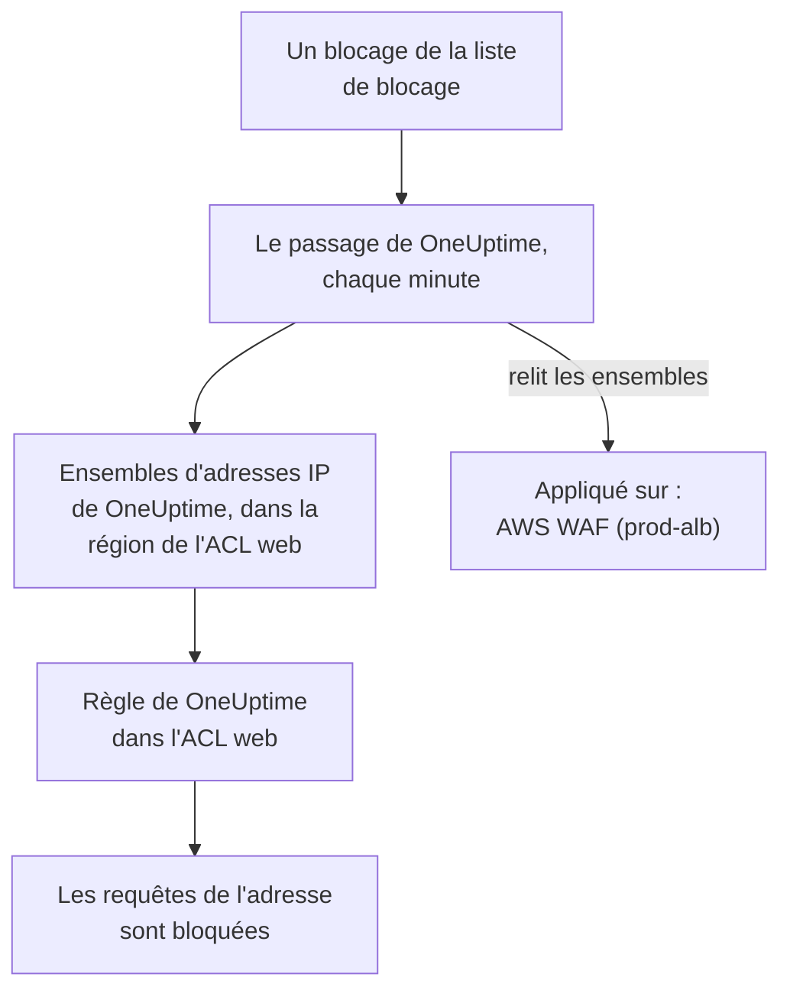

# Bloquer des adresses dans AWS WAF

La liste de blocage de votre projet peut être appliquée dans les ACL web AWS WAF placées devant vos distributions CloudFront, vos équilibreurs de charge et vos API Gateway. Activez-la sur une connexion cloud AWS que vous avez déjà, choisissez les ACL web, et chaque adresse que la liste de blocage bloque y est bloquée, qu'elle ait été bloquée par une personne, par un playbook ou par OneUptime AI.

:::cards
- [Activation](#activation): Un paramètre sur la connexion AWS, puis à nouveau sa commande de configuration.
- [Ce que crée OneUptime](#ce-que-crée-oneuptime): Quatre ensembles d'adresses IP par région, et deux règles par ACL web.
- [Gérer l'ACL web dans le code](#gérer-lacl-web-dans-le-code): Ajoutez vous-même les règles dans Terraform ou CloudFormation.
:::

## Fonctionnement

OneUptime tient ses propres ensembles d'adresses IP dans chaque région où se trouve une ACL web choisie, et dans chaque ACL web une règle qui bloque les adresses qu'ils contiennent. Chaque minute, il écrit une fois chaque ensemble avec ce que contient la liste de blocage, puis relit les ensembles. Sur la page **Liste de blocage**, la colonne **Appliqué sur** d'un blocage ne nomme AWS WAF (prod-alb) qu'une fois qu'AWS WAF détient le blocage et que la règle de l'ACL web bloque son ensemble ; jusque-là, le blocage n'est pas appliqué.

## Avant de commencer

- Un compte AWS connecté à OneUptime (voir [Connecter un compte cloud](/docs/telemetry/cloud-accounts#amazon-web-services)).
- Un rôle autorisé à modifier l'endroit où la liste de blocage est appliquée : **Propriétaire du projet**, **Administrateur du projet** ou **Administrateur de la sécurité**.
- Une personne capable d'exécuter à nouveau la commande de configuration de la connexion dans le compte AWS.

## Activation

:::steps
### Ouvrir la connexion
Ouvrez **Cloud → Connecter** et modifiez la connexion AWS.

### Choisir qui ajoute la règle
Sous **Plus de champs**, réglez **Bloquer des adresses dans AWS WAF** sur **Activé, et OneUptime ajoute sa règle**, ou sur **Activé, et j'ajoute la règle dans mon code** si vos ACL web sont gérées dans Terraform ou CloudFormation.

### Relancer la commande de configuration
La commande qu'affiche le formulaire accorde désormais les ensembles d'adresses IP, et la règle quand OneUptime l'ajoute. Exécutez-la dans AWS CloudShell, puis enregistrez la connexion.

### Ajouter les ACL web
Ouvrez **Événements de sécurité → Playbooks → Liste de blocage**. Sous **WAF cloud**, cliquez sur **Ajouter une ACL web**, choisissez une ACL web et l'endroit où elle lit l'adresse du client, puis ajoutez-la. OneUptime la configure aussitôt, et son **Statut** indique **Appliquée** quand sa règle bloque les ensembles.
:::

Les ACL web proviennent de l'inventaire de la connexion : une ACL web que OneUptime n'a pas encore lue apparaît après la lecture suivante. Tant qu'une ACL web applique la liste de blocage, le paramètre de sa connexion ne peut ni être désactivé ni passer de l'ajout de la règle par OneUptime à son ajout dans le code, et la connexion ne peut pas être supprimée : retirez d'abord l'ACL web, pour que OneUptime en retire sa règle.

## Ce que crée OneUptime

| Quoi | Nom | Où |
| --- | --- | --- |
| Quatre ensembles d'adresses IP : blocage et défi, IPv4 et IPv6 | `oneuptime-<project>-block-ipv4`, `oneuptime-<project>-block-ipv6`, `oneuptime-<project>-challenge-ipv4`, `oneuptime-<project>-challenge-ipv6` | Dans chaque région où se trouve une ACL web choisie. Les ACL web de CloudFront sont globales, et leurs ensembles se trouvent dans `us-east-1`. |
| Deux règles : l'une bloque, l'autre soumet à un défi | `OneUptime-Blocklist-<project>`, `OneUptime-Challenge-<project>` | Dans chaque ACL web choisie, quand OneUptime ajoute sa règle. |

`<project>` correspond aux huit premiers caractères de l'ID externe de votre projet, si bien que deux projets OneUptime d'un même compte n'écrivent jamais dans les ensembles l'un de l'autre. Les ACL web d'une même région partagent les ensembles. Une adresse seule s'écrit `/32` ou `/128`. AWS WAF accepte 10 000 adresses dans un ensemble, et 100 ensembles d'adresses IP par région, sauf si AWS a relevé cette limite pour vous ; un blocage qui ne tient pas l'indique sur sa ligne.

## La place de la règle dans l'ACL web

OneUptime place ses deux règles à des priorités libres inférieures à celle de votre première règle, afin qu'elles s'exécutent avant les règles que vous avez écrites. Sans règle dans l'ACL web, elles prennent les priorités 0 et 1. OneUptime ne renumérote, ne modifie ni ne supprime jamais une de vos règles : quand il n'y a pas deux priorités libres sous celle de votre première règle, l'ACL web indique **Aucune priorité libre**, et OneUptime ajoute ses règles dès que vous en libérez deux.

Chaque règle correspond quand l'un de ses ensembles, IPv4 ou IPv6, contient l'adresse du client. AWS WAF met à jour une ACL web d'un seul tenant : OneUptime la lit donc, ajoute ses règles et la réécrit avec le jeton de verrouillage de l'ACL web, puis la relit si quelqu'un d'autre l'a écrite entre-temps.

## Adresses transmises

Une ACL web placée derrière un autre proxy ou CDN voit l'adresse du proxy, pas celle du client. Choisissez où elle lit l'adresse du client sous **Adresse du client** :

| Adresse du client | Ce que lit la règle |
| --- | --- |
| **L'adresse source de la requête** | L'adresse d'où vient la requête. La valeur par défaut. |
| La dernière adresse de l'en-tête `X-Forwarded-For` | L'adresse que le dernier proxy a ajoutée. Une adresse placée avant elle est une adresse que la requête a déclarée. |
| L'en-tête `CF-Connecting-IP` | La seule adresse qu'écrit Cloudflare. |
| L'en-tête `True-Client-IP` | La seule adresse qu'écrit Akamai ou Cloudflare Enterprise. |

Une requête sans cet en-tête ne correspond pas : AWS WAF la laisse passer plutôt que de bloquer l'adresse d'un proxy.

## Gérer l'ACL web dans le code

Avec **Activé, et j'ajoute la règle dans mon code**, OneUptime ne crée que les ensembles d'adresses IP et n'écrit jamais dans votre ACL web. Cliquez sur **Afficher la règle** sur la ligne de l'ACL web : elle donne les deux règles en Terraform (blocs `rule` de `aws_wafv2_web_acl`) et en CloudFormation, avec l'ARN de chaque ensemble et l'en-tête que lit l'ACL web. Ajoutez-les à votre code avant vos autres règles, puis appliquez-le.

Tant que les règles n'y sont pas, l'ACL web indique **En attente de votre règle**, et ses blocages ne sont pas appliqués. OneUptime lit l'ACL web à chaque passage, et ses blocages sont appliqués dès le premier passage qui trouve une règle bloquant chaque ensemble, quel que soit le nom que vous lui avez donné.

## Autorisations

La commande de configuration ajoute au rôle une stratégie en ligne, `OneUptimeWafBlocklist`. Avec une clé d'accès, la limite qu'IAM impose aux stratégies propres d'un utilisateur la place sur un groupe, `OneUptimeWafBlocklist-<project>`, que l'utilisateur rejoint.

| Action | Ressource | Pourquoi |
| --- | --- | --- |
| `wafv2:ListIPSets` | Toutes | Trouver les ensembles d'adresses IP de OneUptime dans une région. |
| `wafv2:GetIPSet`, `wafv2:CreateIPSet`, `wafv2:UpdateIPSet`, `wafv2:DeleteIPSet` | Les ensembles d'adresses IP de OneUptime uniquement (`oneuptime-<project>-*`) | Tenir les ensembles à jour, et les supprimer quand vous retirez la dernière ACL web d'une région. |
| `wafv2:GetSampledRequests` | ACL web | Lire les requêtes qu'une règle a refoulées : la preuve d'après laquelle l'étape de blocage d'un dossier est vérifiée. |
| `wafv2:UpdateWebACL` | ACL web, ainsi que les ensembles d'adresses IP, ensembles d'expressions régulières et groupes de règles qu'elles référencent | Ajouter les règles de OneUptime. Uniquement avec **Activé, et OneUptime ajoute sa règle**. |

La lecture d'une ACL web, `wafv2:GetWebACL`, fait déjà partie de la stratégie en lecture seule de la connexion.

## Désactivation

:::steps
### Retirer l'ACL web
Dans **Événements de sécurité → Playbooks → Liste de blocage**, cliquez sur **Supprimer** sur la ligne de l'ACL web. OneUptime retire ses règles de l'ACL web, puis vide et supprime ses ensembles d'adresses IP dès qu'aucune autre ACL web de la région ne les utilise.

### Désactiver le paramètre
Modifiez la connexion, réglez **Bloquer des adresses dans AWS WAF** sur **Désactivé**, puis enregistrez. Le paramètre peut être désactivé dès qu'aucune ACL web de la connexion n'applique la liste de blocage.
:::

Quand OneUptime n'a plus le droit d'écrire dans l'ACL web, cochez **Retirer de OneUptime uniquement** dans la boîte de dialogue **Retirer l'ACL web**. OneUptime retire l'ACL web de la liste de blocage et nomme les règles et les ensembles d'adresses IP qu'il a laissés dans AWS WAF : ils continuent de bloquer ce qu'ils contiennent jusqu'à ce que vous les y supprimiez. Une de vos règles qui référence encore un ensemble le conserve aussi : OneUptime le vide, et le nomme.

## Dépannage

:::details Non appliquée
Le statut de l'ACL web indique ce qu'AWS a répondu et ce qu'il faut faire. Un refus nomme l'action et le paramètre qui l'accorde : activez le paramètre, ou choisissez **Activé, et OneUptime ajoute sa règle**, puis relancez la commande de configuration de la connexion et cliquez sur **Vérifier à nouveau**.
:::

:::details Aucune priorité libre
Votre première règle est à la priorité 0 ou 1 : il n'y a donc pas deux priorités libres en dessous. Augmentez de deux le numéro de priorité de vos règles, puis cliquez sur **Vérifier à nouveau**.
:::

:::details Une ACL web n'apparaît pas dans la liste
OneUptime liste les ACL web des connexions dont le paramètre est activé, une fois qu'il les a lues. Les ACL web vues uniquement par leurs métriques nécessitent de relancer la commande de configuration de la connexion, qui permet à OneUptime de les lire.
:::

## Prochaines étapes

:::cards
- [Dossiers de sécurité et playbooks](/docs/telemetry/security-cases): Bloquez une adresse depuis un dossier, et voyez son étape vérifiée.
- [Connecter un compte cloud](/docs/telemetry/cloud-accounts): La connexion dont fait partie ce paramètre.
:::
