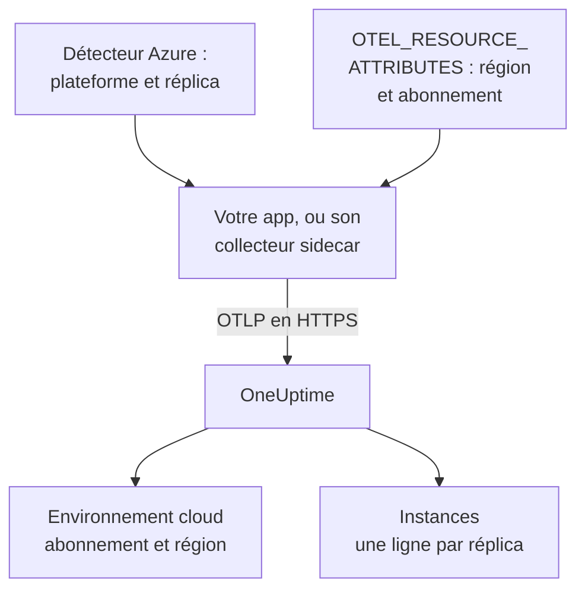

# Azure Container Apps

Envoyez les traces, journaux et métriques de vos Azure Container Apps à OneUptime. Chaque réplica qui rapporte `cloud.platform=azure_container_apps` rejoint un **Environnement cloud** par abonnement Azure et région, par exemple _Azure Container Apps · eastus · 00000000-0000-0000-0000-000000000000_, et les réplicas en cours sont listés sous **Instances**.

:::cards
- [Fonctionnement](#fonctionnement): Ce que définissent les détecteurs, et les deux attributs que vous définissez vous-même.
- [Mise en place](#mise-en-place): Stocker le jeton, configurer l'app avec l'Azure CLI ou le portail, et vérifier.
- [Utiliser l'agent OpenTelemetry managé de l'environnement](#utiliser-lagent-opentelemetry-managé-de-lenvironnement): Faire suivre chaque app de l'environnement sans sidecar.
- [Dépannage](#dépannage): Exports refusés, environnements manquants et instances vides.
:::

## Fonctionnement



Container Apps dispose de détecteurs de ressources : le détecteur `azurecontainerapps` du Collector, et ceux de Node.js (`@opentelemetry/resource-detector-azure`) et de .NET (`OpenTelemetry.Resources.Azure`). Ils lisent `CONTAINER_APP_NAME` et `CONTAINER_APP_REPLICA_NAME`, et définissent `cloud.provider`, `cloud.platform`, `service.name` et l'ID du réplica. Aucun d'eux ne connaît la région ni l'abonnement, vous définissez donc vous-même `cloud.region` et `cloud.account.id`, dans `OTEL_RESOURCE_ATTRIBUTES`.

| Attribut | Valeur | Sert à |
| --------------------------------- | ------------------------------------------------------------------------- | ------------------------------------------------------------ |
| `cloud.provider` | `azure` | Être affiché sur la vue d'ensemble |
| `cloud.platform` | `azure_container_apps` | Classer la télémétrie sous **Environnements cloud** |
| `cloud.region` | la région de l'environnement, par exemple `eastus` : définie par vous | Faire partie de la clé d'environnement |
| `cloud.account.id` | l'ID de l'abonnement : défini par vous | Faire partie de la clé d'environnement |
| `azure.container_app.instance.id` | le nom du réplica, défini par les détecteurs à partir de `CONTAINER_APP_REPLICA_NAME` | Nommer un réplica en cours : une ligne chacun sous **Instances** |
| `service.instance.id` | le nom du réplica, si vous le définissez vous-même | Servir quand aucun détecteur n'a défini l'ID du réplica |

- **Les écritures avec un point fonctionnent.** Les détecteurs Node.js et .NET écrivent la plateforme `azure.container_apps`, avec un point. OneUptime la réécrit en `azure_container_apps` à la réception, les deux écritures arrivent donc dans le même environnement.
- **Le nom d'hôte est le nom du réplica.** Un SDK qui n'exécute que le détecteur `host` rapporte le nom du réplica comme `host.name`, et OneUptime nomme l'instance ainsi quand rien de plus précis n'est présent.

La clé d'environnement est `azure_container_apps|<subscription id>|eastus`.

## Avant de commencer

- **Une clé d'ingestion.** Créez une clé **Serveur** sous **Paramètres du projet → Télémétrie & APM → Clés d'ingestion** et copiez son jeton.
- **L'Azure CLI avec l'extension `containerapp`** (`az extension add --name containerapp --upgrade`), connectée à l'abonnement, ou le portail Azure.
- **Votre application instrumentée avec un SDK OpenTelemetry** qui exporte en OTLP.

## Choisir comment la télémétrie quitte l'app

| | SDK direct | Sidecar collector |
| ------------------ | ------------------------------------------- | ------------------------------------------------------------ |
| Conteneur supplémentaire | Aucun | `otel-collector` dans l'app, qui partage le CPU et la mémoire du réplica |
| Définit les attributs | Le SDK et `OTEL_RESOURCE_ATTRIBUTES` sur l'app | Le collecteur, pour tout ce qui le traverse |
| Le secret | `oneuptime-otlp-headers`, l'en-tête complet | `oneuptime-token`, le jeton seul |

Une troisième voie, l'agent OpenTelemetry managé de l'environnement, fait suivre chaque app de l'environnement sans sidecar : voir [Utiliser l'agent OpenTelemetry managé de l'environnement](#utiliser-lagent-opentelemetry-managé-de-lenvironnement). Chaque étape ci-dessous a un onglet pour SDK direct et pour le collecteur sidecar ; choisissez-en un et chaque étape le suit.

## Mise en place

:::steps
### Stocker le jeton comme secret Container Apps

> [!IMPORTANT]
> Le jeton est un secret. Stockez-le comme secret Container Apps et référencez-le depuis les variables d'environnement avec `secretref:`. Une fois défini, un secret n'apparaît ni dans `az containerapp show` ni dans le portail ; une simple variable d'environnement, si.

:::tabs
@tab SDK direct
```bash
az containerapp secret set \
  --name checkout-api \
  --resource-group my-rg \
  --secrets oneuptime-otlp-headers="x-oneuptime-token=YOUR_TELEMETRY_INGESTION_TOKEN"
```

Le `OTEL_EXPORTER_OTLP_HEADERS` du SDK attend l'en-tête `name=value` complet, le secret le contient donc.
@tab Sidecar collector
```bash
az containerapp secret set \
  --name checkout-api \
  --resource-group my-rg \
  --secrets oneuptime-token=YOUR_TELEMETRY_INGESTION_TOKEN
```

Le collecteur ajoute lui-même le nom de l'en-tête, le secret ne contient donc que le jeton.
:::

Dans le portail : **Azure portal → Container Apps → your app → Settings → Secrets → + Add**. Saisissez la clé, choisissez le type **Container Apps secret**, collez la valeur et cliquez sur **Add**.

Si vous gardez vos secrets dans Key Vault, référencez le secret au lieu de copier sa valeur. L'identité managée de l'app a besoin du rôle **Key Vault Secrets User** sur le coffre :

```bash
az containerapp secret set \
  --name checkout-api --resource-group my-rg \
  --secrets "oneuptime-token=keyvaultref:https://my-vault.vault.azure.net/secrets/oneuptime-token,identityref:system"
```

### Configurer la container app

:::tabs
@tab SDK direct
Définissez l'exportateur, et les attributs qu'aucun détecteur ne connaît, sur le conteneur de l'application. Remplacez la région et l'ID d'abonnement par les vôtres :

```bash
az containerapp update \
  --name checkout-api \
  --resource-group my-rg \
  --set-env-vars \
    OTEL_SERVICE_NAME=checkout-api \
    OTEL_EXPORTER_OTLP_ENDPOINT=https://oneuptime.com/otlp \
    OTEL_EXPORTER_OTLP_PROTOCOL=http/protobuf \
    OTEL_EXPORTER_OTLP_HEADERS=secretref:oneuptime-otlp-headers \
    "OTEL_RESOURCE_ATTRIBUTES=cloud.provider=azure,cloud.platform=azure_container_apps,cloud.region=eastus,cloud.account.id=00000000-0000-0000-0000-000000000000"
```

Pour l'identité du réplica, activez le détecteur Azure du SDK : `OTEL_NODE_RESOURCE_DETECTORS=env,host,os,azure` en Node.js, ou `.ConfigureResource(r => r.AddAzureContainerAppsDetector())` avec `OpenTelemetry.Resources.Azure` en .NET. Il définit `azure.container_app.instance.id` à partir de `CONTAINER_APP_REPLICA_NAME`.

Container Apps ne peut pas insérer une variable d'environnement dans une autre, donc dans les autres langages `service.instance.id` ne peut pas aller dans `OTEL_RESOURCE_ATTRIBUTES`. Activez le détecteur d'hôte (son `host.name` est le nom du réplica), ou définissez-le dans le code :

```js title="tracing.js"
// Node.js: the file you load with --require before the app starts
const { NodeSDK } = require("@opentelemetry/sdk-node");
const { resourceFromAttributes } = require("@opentelemetry/resources");

const sdk = new NodeSDK({
  resource: resourceFromAttributes({
    "service.instance.id": process.env.CONTAINER_APP_REPLICA_NAME,
  }),
});
sdk.start();
```

```python title="tracing.py"
# Python: before the tracer provider is created
import os
from opentelemetry.sdk.resources import Resource

resource = Resource.create({"service.instance.id": os.environ.get("CONTAINER_APP_REPLICA_NAME", "")})
```

Quel que soit le détecteur utilisé, gardez `cloud.region` et `cloud.account.id` dans `OTEL_RESOURCE_ATTRIBUTES` : aucun détecteur Container Apps ne les définit, et la clé d'environnement en a besoin.

Dans le portail plutôt :

1. Ouvrez **Application → Containers → Edit and deploy**, sélectionnez votre conteneur dans l'onglet **Container** et cliquez sur **Edit**.
2. Sous **Environment variables**, ajoutez chaque variable ci-dessus avec la source **Manual entry**, et `OTEL_EXPORTER_OTLP_HEADERS` avec la source **Reference a secret**, pointant vers `oneuptime-otlp-headers`.
3. Cliquez sur **Save**.
@tab Sidecar collector
Un sidecar tourne dans le même réplica, il voit donc les mêmes `CONTAINER_APP_NAME` et `CONTAINER_APP_REPLICA_NAME`. Son détecteur `azurecontainerapps` en fait `cloud.provider`, `cloud.platform`, `service.name` et `azure.container_app.instance.id`, et son détecteur `env` lit `cloud.region` et `cloud.account.id` dans `OTEL_RESOURCE_ATTRIBUTES` de l'environnement propre du collecteur. L'application exporte seulement vers `http://localhost:4318`.

Exportez la définition de l'app, ajoutez le collecteur à `template.containers`, et appliquez-la :

```bash
az containerapp show --name checkout-api --resource-group my-rg -o yaml > checkout-api.yaml
# edit checkout-api.yaml as below
az containerapp update --name checkout-api --resource-group my-rg --yaml checkout-api.yaml
```

```yaml title="checkout-api.yaml"
properties:
  configuration:
    secrets:
      - name: oneuptime-token
        value: YOUR_TELEMETRY_INGESTION_TOKEN
  template:
    containers:
      - name: app
        image: myregistry.azurecr.io/checkout-api:1.4.2
        env:
          - name: OTEL_SERVICE_NAME
            value: checkout-api
          - name: OTEL_EXPORTER_OTLP_ENDPOINT
            value: http://localhost:4318
          - name: OTEL_EXPORTER_OTLP_PROTOCOL
            value: http/protobuf
        resources:
          cpu: 0.5
          memory: 1Gi
      - name: otel-collector
        image: otel/opentelemetry-collector-contrib:latest
        args:
          - --config=env:OTEL_COLLECTOR_CONFIG
        env:
          - name: ONEUPTIME_TOKEN
            secretRef: oneuptime-token
          # Read by the resourcedetection processor's env detector.
          - name: OTEL_RESOURCE_ATTRIBUTES
            value: cloud.provider=azure,cloud.platform=azure_container_apps,cloud.region=eastus,cloud.account.id=00000000-0000-0000-0000-000000000000
          - name: OTEL_COLLECTOR_CONFIG
            value: |
              receivers:
                otlp:
                  protocols:
                    http:
                      endpoint: 0.0.0.0:4318
                    grpc:
                      endpoint: 0.0.0.0:4317
              processors:
                # env: cloud.region + cloud.account.id from OTEL_RESOURCE_ATTRIBUTES.
                # azurecontainerapps: cloud.provider, cloud.platform, service.name
                # and azure.container_app.instance.id from the CONTAINER_APP_*
                # variables. override: false keeps the service.name the
                # application set instead of the Container App's name.
                resourcedetection:
                  detectors: [env, azurecontainerapps]
                  timeout: 2s
                  override: false
                batch: {}
              exporters:
                otlphttp/oneuptime:
                  endpoint: https://oneuptime.com/otlp
                  headers:
                    x-oneuptime-token: ${env:ONEUPTIME_TOKEN}
              service:
                pipelines:
                  traces:
                    receivers: [otlp]
                    processors: [resourcedetection, batch]
                    exporters: [otlphttp/oneuptime]
                  metrics:
                    receivers: [otlp]
                    processors: [resourcedetection, batch]
                    exporters: [otlphttp/oneuptime]
                  logs:
                    receivers: [otlp]
                    processors: [resourcedetection, batch]
                    exporters: [otlphttp/oneuptime]
        resources:
          cpu: 0.25
          memory: 0.5Gi
```

`az containerapp show` n'exporte pas les valeurs des secrets : rajoutez l'entrée `secrets` à la main, ou omettez-la si vous avez défini le secret à la première étape, car une mise à jour conserve les secrets existants. Container Apps additionne le CPU et la mémoire de tous les conteneurs d'un réplica, les `resources` du sidecar comptent donc sur celles de l'app.

Dans le portail plutôt :

1. Ouvrez **Application → Containers → Edit and deploy**. Dans l'onglet **Container**, **+ Add** un conteneur nommé `otel-collector` avec l'image `otel/opentelemetry-collector-contrib:latest` et l'**Arguments override** `--config=env:OTEL_COLLECTOR_CONFIG`.
2. Ajoutez ses variables d'environnement : `ONEUPTIME_TOKEN` (**Reference a secret** : `oneuptime-token`), `OTEL_RESOURCE_ATTRIBUTES` et `OTEL_COLLECTOR_CONFIG` (**Manual entry**, avec les valeurs ci-dessus).
3. Cliquez sur **Save**.
:::

Si vous hébergez OneUptime vous-même, utilisez `https://YOUR-ONEUPTIME-HOST/otlp` comme point de terminaison.

### Déployer la nouvelle révision

`az containerapp update` déploie une nouvelle révision de lui-même. Dans le portail, cliquez sur **Create**. Si plusieurs révisions sont actives, basculez le trafic vers la nouvelle sous **Revisions and replicas**.

### Vérifier la connexion

```bash
curl -i https://oneuptime.com/otlp/v1/validate \
  -H "x-oneuptime-token: YOUR_TELEMETRY_INGESTION_TOKEN"
```

`200` avec `"valid": true` signifie que le jeton est accepté. `401` signifie qu'il est inconnu, révoqué, désactivé ou expiré. Lisez ensuite la sortie du collecteur :

```bash
az containerapp logs show --name checkout-api --resource-group my-rg \
  --container otel-collector --follow
```

Cherchez `Everything is ready`, et aucun `401` ni `connection refused`. Dans la minute qui suit le premier span, log ou métrique, l'environnement apparaît sous **Cloud → Tous les environnements** sous le nom _Azure Container Apps · eastus · 00000000-0000-0000-0000-000000000000_.
:::

## Utiliser l'agent OpenTelemetry managé de l'environnement

Un environnement Container Apps peut exécuter l'agent OpenTelemetry managé d'Azure. Il reçoit l'OTLP de chaque app de l'environnement et le transmet à un point de terminaison que vous configurez, sans sidecar dans chaque app. L'agent exporte **uniquement en OTLP/gRPC**, il ne peut donc pas utiliser le chemin HTTP `/otlp`. Pointez-le plutôt vers l'hôte OneUptime sur le port 443, où OneUptime sert l'OTLP/gRPC sur TLS :

```bash
az containerapp env telemetry otlp add \
  --name my-aca-env \
  --resource-group my-rg \
  --otlp-name oneuptime \
  --endpoint oneuptime.com:443 \
  --insecure false \
  --headers "x-oneuptime-token=YOUR_TELEMETRY_INGESTION_TOKEN" \
  --enable-open-telemetry-traces true \
  --enable-open-telemetry-logs true \
  --enable-open-telemetry-metrics true
```

- **Auto-hébergé :** utilisez `YOUR-ONEUPTIME-HOST:443`. Un OneUptime auto-hébergé n'accepte l'OTLP/gRPC que sur TLS : voir [OTLP via gRPC](/docs/telemetry/open-telemetry#otlp-sur-grpc).
- **Les apps définissent toujours les attributs.** L'agent place ses propres `OTEL_EXPORTER_OTLP_ENDPOINT` et `OTEL_EXPORTER_OTLP_PROTOCOL=grpc` dans chaque app : retirez ces deux-là de l'app et gardez `OTEL_SERVICE_NAME` et `OTEL_RESOURCE_ATTRIBUTES`. L'agent transmet ce que les apps envoient, donc `cloud.*` et l'ID du réplica viennent toujours de chaque app.
- **Votre `OTEL_RESOURCE_ATTRIBUTES` l'emporte.** L'agent définit aussi `OTEL_RESOURCE_ATTRIBUTES`, et une valeur définie sur l'app la remplace : incluez-y le nom de la container app et l'ID du réplica, ou définissez-les dans le code.

## Réseau

- **Le trafic sortant est ouvert par défaut.** Un réplica atteint `oneuptime.com:443` sans aucune configuration, que l'ingress de l'environnement soit externe ou interne.
- **Les VNet personnalisés font exception.** Sur un VNet avec une route définie par l'utilisateur qui envoie `0.0.0.0/0` vers un pare-feu ou une passerelle NAT, ou avec un groupe de sécurité réseau sur le sous-réseau, autorisez TCP 443 vers l'hôte OneUptime (ou le port de votre propre hôte) sur le pare-feu ou le NSG.
- **Un OneUptime auto-hébergé dans le VNet** doit être résolvable et joignable depuis le sous-réseau de l'environnement.
- **Aucun rôle Azure n'est nécessaire pour la télémétrie.** Seules les références Key Vault exigent que l'identité managée de l'app ait **Key Vault Secrets User** sur le coffre.

## Ce que vous obtenez

- **Vue d'ensemble** : requêtes, taux d'erreur et latence p95 issus de vos traces. Container Apps ne montre pas l'utilisation des ressources d'un réplica à un sidecar, les tuiles **CPU** et **Mémoire** ne se remplissent donc que si vous envoyez des métriques `container.cpu.utilization` et `container.memory.usage` portant l'identité du réplica. La plupart des équipes laissent cela à Azure Monitor.
- **Instances** : une ligne par réplica, nommée par le `azure.container_app.instance.id` des détecteurs, par `service.instance.id` quand vous le définissez vous-même, ou par `host.name` quand seul le détecteur d'hôte a tourné.
- **Journaux**, **Traces** et **Métriques**, filtrés sur l'environnement, et la vue par service sous **Services**.

## Dépannage

:::details Rien n'apparaît, et le collecteur journalise 401
Le secret contient la mauvaise valeur. `oneuptime-token` doit être le jeton seul ; `oneuptime-otlp-headers`, l'en-tête complet `x-oneuptime-token=...`.
:::

:::details L'app est sous Services, mais aucun environnement n'existe
`OTEL_RESOURCE_ATTRIBUTES` manque, ou `cloud.platform` ne vaut pas exactement `azure_container_apps`. Regardez ce que l'app contient avec `az containerapp show ... --query properties.template.containers[].env`.
:::

:::details L'environnement existe, mais Instances est vide
Aucun de `service.instance.id`, `azure.container_app.instance.id` ou `host.name` n'est sur la ressource. Ajoutez le détecteur `azurecontainerapps` au collecteur, activez le détecteur Azure ou d'hôte du SDK, ou définissez `service.instance.id` dans le code.
:::

:::details Deux environnements pour un même abonnement
Une app définit `cloud.region` (ou `cloud.account.id`) et une autre non, ou l'une écrit la région autrement (`eastus` et `East US`). Les valeurs doivent correspondre caractère pour caractère.
:::

Tout le reste se trouve dans [Dépannage cloud](/docs/telemetry/cloud-troubleshooting).

## Prochaines étapes

:::cards
- [Environnements cloud](/docs/telemetry/cloud-environments): Comment les environnements et les instances sont identifiés.
- [Autres plateformes cloud](/docs/telemetry/cloud-other-platforms): Azure App Service et Azure Container Instances.
- [Dépannage cloud](/docs/telemetry/cloud-troubleshooting): Les pannes communes à toutes les plateformes.
- [Ressources cloud (IaaS et PaaS)](/docs/telemetry/cloud-resources): Chaque ressource de votre abonnement, depuis Azure Monitor.
:::
