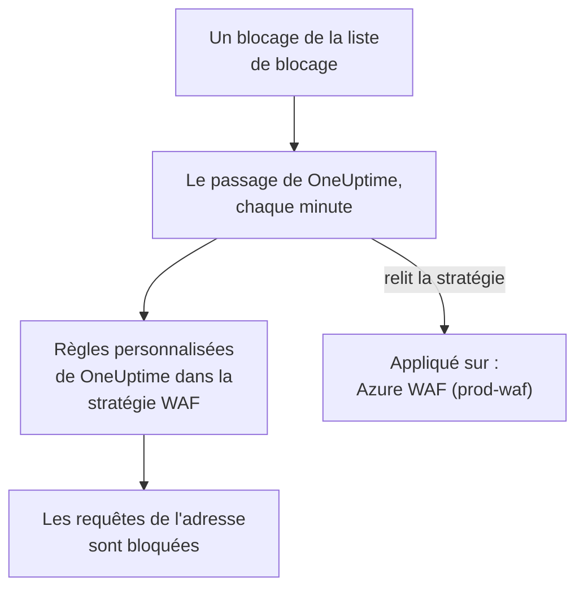

# Bloquer des adresses dans Azure WAF

La liste de blocage de votre projet peut être appliquée dans les stratégies Azure WAF de vos Application Gateway et de vos Front Door. Activez-la sur une connexion cloud Azure que vous avez déjà, choisissez les stratégies WAF, et chaque adresse que la liste de blocage bloque y est bloquée, qu'elle ait été bloquée par une personne, par un playbook ou par OneUptime AI.

:::cards
- [Activation](#activation): Un paramètre sur la connexion Azure, et le rôle qu'il nécessite.
- [Ce que crée OneUptime](#ce-que-crée-oneuptime): Des règles personnalisées qui lui sont propres, dans chaque stratégie que vous choisissez.
- [Quelle adresse est comparée](#quelle-adresse-est-comparée): L'adresse qui s'est connectée, ou le client d'origine derrière un proxy.
:::

## Fonctionnement

OneUptime tient ses propres règles personnalisées dans chaque stratégie WAF que vous choisissez, et y place les adresses que la liste de blocage bloque. Chaque minute, il écrit une fois la stratégie avec ce que contient la liste de blocage, puis la relit. Sur la page **Liste de blocage**, la colonne **Appliqué sur** d'un blocage ne nomme Azure WAF (prod-waf) qu'une fois que la stratégie contient le blocage et qu'Azure l'a appliqué ; jusque-là, le blocage n'est pas appliqué.

## Avant de commencer

- Un abonnement Azure connecté à OneUptime (voir [Connecter un compte cloud](/docs/telemetry/cloud-accounts#microsoft-azure)).
- Un rôle autorisé à modifier l'endroit où la liste de blocage est appliquée : **Propriétaire du projet**, **Administrateur du projet** ou **Administrateur de la sécurité**.
- Une personne autorisée à attribuer des rôles dans l'abonnement Azure, pour exécuter une commande dans Azure Cloud Shell.

## Activation

:::steps
### Ouvrir la connexion
Ouvrez **Cloud → Connecter** et modifiez la connexion Azure.

### Activer le paramètre
Sous **Plus de champs**, réglez **Bloquer des adresses dans Azure WAF** sur **Activé**, puis enregistrez. La commande de configuration qu'affiche le formulaire accorde désormais le rôle ci-dessous sur tout l'abonnement. Une connexion que vous avez déjà n'a pas besoin de la relancer : la boîte de dialogue **Ajouter un WAF** donne les lignes qui accordent le rôle sur une seule stratégie.

### Ajouter les stratégies WAF
Ouvrez **Événements de sécurité → Playbooks → Liste de blocage**. Sous **WAF cloud**, cliquez sur **Ajouter un WAF** et choisissez une stratégie WAF. OneUptime demande à Azure si la connexion a le droit d'y écrire, sans rien écrire.

### Accorder le rôle, s'il manque
Quand une autorisation manque, la boîte de dialogue affiche les lignes qui l'accordent sur cette seule stratégie. Exécutez-les dans Azure Cloud Shell, cliquez sur **Vérifier à nouveau**, puis ajoutez la stratégie. Son **Statut** indique **Appliquée** une fois que OneUptime l'a lue.
:::

Les stratégies WAF proviennent de l'inventaire de la connexion : une stratégie que OneUptime n'a pas encore lue apparaît après la lecture suivante. Tant qu'une stratégie applique la liste de blocage, le paramètre de sa connexion ne peut pas être désactivé et la connexion ne peut pas être supprimée : retirez d'abord la stratégie, pour que OneUptime en retire ses règles.

## Ce que crée OneUptime

| Quoi | Nom | Où |
| --- | --- | --- |
| Des règles personnalisées, chacune avec une condition de correspondance IP et l'action Block | `OneUptime<project>Block1`, `OneUptime<project>Block2`, ... | Dans chaque stratégie WAF choisie, 10 au plus. |

`<project>` correspond aux huit premiers caractères de l'ID externe de votre projet, si bien que deux projets OneUptime qui choisissent une même stratégie n'écrivent jamais les règles l'un de l'autre. Une règle contient 540 adresses ou plages sur Application Gateway, 600 avec CRS 3.2 ou un Default Rule Set, et 600 sur Front Door. Avec dix règles, une stratégie contient 5 400 ou 6 000 blocages ; un blocage qui ne tient pas l'indique sur sa ligne.

OneUptime ne modifie rien d'autre que ses propres règles dans une stratégie. Azure n'écrit une stratégie WAF que d'un seul tenant : OneUptime lit donc la stratégie avec son ETag, modifie ses propres règles, et la réécrit avec l'ETag dans `If-Match`, si bien que chaque autre règle, paramètre et ensemble de règles managé est écrit tel qu'il a été lu. Quand quelqu'un d'autre a écrit la stratégie entre-temps, Azure refuse l'écriture, et OneUptime la relit et applique sa modification sur ce que cette personne a écrit.

## La place des règles dans la stratégie

OneUptime place ses règles à des priorités libres avant votre première règle qui autorise du trafic, en commençant par la plus basse, afin qu'aucune de vos règles ne laisse passer une adresse bloquée. Une de vos règles qui bloque ou journalise peut passer avant. OneUptime ne renumérote, ne modifie ni ne supprime jamais une de vos règles : quand aucune priorité n'est libre avant votre première règle Allow, la stratégie indique **Aucune priorité libre**, et OneUptime ajoute sa règle dès que vous en libérez une.

## Quelle adresse est comparée

| Stratégie WAF | Adresse du client | Quand la choisir |
| --- | --- | --- |
| Front Door | **L'adresse qui s'est connectée à Front Door (SocketAddr)** | La valeur par défaut. |
| Front Door | Le client d'origine, d'après X-Forwarded-For (RemoteAddr) | Pour un Front Door placé derrière un autre proxy ou CDN. |
| Application Gateway | L'adresse qui s'est connectée à la passerelle (RemoteAddr) | Le seul choix : sa correspondance IP ne lit aucune autre adresse. |

Front Door prend `RemoteAddr` dans l'en-tête `X-Forwarded-For`, qu'un client qui se connecte directement à Front Door écrit lui-même. Ne choisissez le client d'origine que si un autre proxy ou CDN placé devant Front Door écrit cet en-tête. Le choix se trouve sous **Plus de champs** dans la boîte de dialogue **Ajouter un WAF**, et vous pouvez le modifier plus tard avec **Adresse du client** sur la ligne de la stratégie.

La correspondance IP d'Application Gateway ne lit que des adresses IPv4 : un blocage IPv6 n'y est donc pas appliqué, et sa ligne indique pourquoi.

Les règles de OneUptime dans Azure WAF ne font que bloquer. Un blocage qui demande de soumettre une adresse à un défi n'est pas appliqué dans Azure WAF, et l'indique. Le défi d'une politique de réponse automatique y est appliqué sous forme de blocage pour la même durée.

## Combien de temps prend une modification

Application Gateway applique une modification dès qu'Azure l'écrit. Front Door accepte la modification et la propage à ses points de présence au cours des minutes suivantes : la stratégie indique **En cours d'application**, et la colonne **Appliqué sur** d'un nouveau blocage attend la stratégie jusqu'à ce qu'Azure la signale comme provisionnée. Le blocage est appliqué dès lors.

## Quand une règle est modifiée à la main

Quand quelqu'un désactive, modifie ou supprime une des règles de OneUptime dans Azure, OneUptime la laisse telle que cette personne l'a laissée. La stratégie indique **Modifiée à la main**, et les blocages que contenait cette règle ne sont pas appliqués, avec la raison, jusqu'à ce que quelqu'un clique sur **Rétablir** sur la ligne de la stratégie. « Rétablir » réécrit la règle telle que OneUptime l'écrit, à sa propre priorité tant que celle-ci est libre.

Une stratégie qui ne bloque rien l'indique aussi, et ses blocages ne sont pas appliqués :

- Une stratégie désactivée.
- Une stratégie en mode **Detection**, qui ne fait que journaliser ce à quoi correspondent les règles de OneUptime.
- Une stratégie qui n'est associée à aucune passerelle d'application, à aucun écouteur, à aucune règle de chemin ni à aucun domaine Front Door.

## Gérer une stratégie dans Terraform

Terraform écrit lui aussi une stratégie WAF d'un seul tenant : son prochain plan supprime donc les règles de OneUptime. Pour que OneUptime les conserve, ajoutez `ignore_changes = [custom_rules]` au bloc `lifecycle` d'une `azurerm_web_application_firewall_policy`, ou `ignore_changes = [custom_rule]` à celui d'une `azurerm_cdn_frontdoor_firewall_policy`, et gardez vos propres règles personnalisées hors du code de cette stratégie.

## Autorisations

La commande de configuration ajoute un rôle personnalisé, `OneUptime WAF Blocklist`, et l'attribue à l'application de la connexion sur l'abonnement. Les lignes qu'affiche la boîte de dialogue **Ajouter un WAF** attribuent le même rôle sur une seule stratégie.

| Action | Pourquoi |
| --- | --- |
| `Microsoft.Network/ApplicationGatewayWebApplicationFirewallPolicies/read`, `Microsoft.Network/ApplicationGatewayWebApplicationFirewallPolicies/write` | Lire une stratégie WAF d'Application Gateway et y écrire les règles de OneUptime. |
| `Microsoft.Network/FrontDoorWebApplicationFirewallPolicies/read`, `Microsoft.Network/FrontDoorWebApplicationFirewallPolicies/write` | Lire une stratégie WAF de Front Door et y écrire les règles de OneUptime. |

Le rôle ne peut pas supprimer de stratégie, et OneUptime n'écrit jamais rien d'autre.

## Désactivation

:::steps
### Retirer la stratégie WAF
Dans **Événements de sécurité → Playbooks → Liste de blocage**, cliquez sur **Supprimer** sur la ligne de la stratégie. OneUptime retire ses règles de la stratégie, et n'y modifie rien d'autre.

### Désactiver le paramètre
Modifiez la connexion, réglez **Bloquer des adresses dans Azure WAF** sur **Désactivé**, puis enregistrez. Le paramètre peut être désactivé dès qu'aucune stratégie de la connexion n'applique la liste de blocage.
:::

Quand OneUptime n'a plus le droit d'écrire dans la stratégie, cochez **Retirer de OneUptime uniquement** dans la boîte de dialogue **Retirer le WAF**. OneUptime retire la stratégie de la liste de blocage et nomme les règles qu'il y a laissées : elles continuent de bloquer ce qu'elles contiennent jusqu'à ce que vous les supprimiez dans Azure.

## Dépannage

:::details Non appliquée
Le statut de la stratégie indique ce qu'Azure a répondu et ce qu'il faut faire. Un refus nomme l'autorisation qui manque : exécutez les lignes qu'affiche **Ajouter un WAF** pour la stratégie, puis cliquez sur **Vérifier à nouveau**.
:::

:::details Aucune priorité libre
Votre première règle qui autorise du trafic est à la priorité 1, ou toutes les priorités avant elle sont prises. Augmentez son numéro de priorité, puis cliquez sur **Vérifier à nouveau**.
:::

:::details Une stratégie n'apparaît pas dans la liste
OneUptime liste les stratégies WAF des connexions dont le paramètre est activé, une fois qu'il les a lues. Une stratégie ajoutée depuis apparaît après la prochaine lecture de la connexion.
:::

## Prochaines étapes

:::cards
- [Dossiers de sécurité et playbooks](/docs/telemetry/security-cases): Bloquez une adresse depuis un dossier, et voyez son étape vérifiée.
- [Connecter un compte cloud](/docs/telemetry/cloud-accounts): La connexion dont fait partie ce paramètre.
:::
