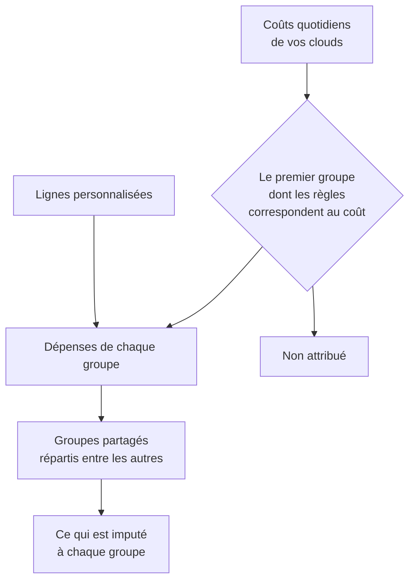

# Répartition des coûts du cloud

Les groupes de coûts répondent à la première question de chaque facture cloud mensuelle : qui a dépensé ? Une **vue de coûts** comme « Par équipe » ou « Par centre de coûts » répartit les dépenses de vos comptes connectés en **groupes de coûts** selon des règles, sans rien compter deux fois. Ce qu'aucune règle ne prend reste bien visible comme dépenses non attribuées, et les coûts partagés sont répartis entre les groupes. Vous les trouvez sous **Cloud → Dépenses → Groupes de coûts**.

:::cards
- [Créer une vue](#créer-une-vue): Par équipe depuis les propriétaires déjà définis, par balise, ou vos propres groupes.
- [Écrire les règles d'un groupe](#écrire-les-règles-dun-groupe): Comptes, services, balises, équipes propriétaires, étiquettes et plus.
- [Dépenses non attribuées](#dépenses-non-attribuées): Ce qu'aucune règle ne prend, et un clic pour le répartir.
- [Coûts partagés](#coûts-partagés): Un plan de support ou un cluster partagé, réparti entre les groupes.
:::

## Fonctionnement



- **Le premier groupe qui correspond prend le coût.** Les groupes d'une vue sont ordonnés, et chaque coût va dans le premier groupe dont les règles lui correspondent, donc rien n'est compté deux fois. Les groupes et les dépenses non attribuées totalisent toujours le montant de la période.
- **Les règles lisent tout ce que porte un coût.** Le compte, le cloud, le service, la région, la ressource et ses balises, et ce qu'OneUptime sait de la ressource : ses équipes propriétaires, ses étiquettes, son environnement et son application des plateformes d'applications.
- **Tout est calculé à la lecture.** Rien n'est écrit par coût. Une règle modifiée répartit à nouveau chaque mois qu'OneUptime conserve, jusqu'à 400 jours en arrière, sans rien attendre.
- **Plusieurs vues peuvent répartir les mêmes dépenses.** « Par équipe » et « Par centre de coûts » répartissent chacune la totalité, à leur façon.

## Avant de commencer

- **Des coûts lus.** [Connectez un compte cloud](/docs/telemetry/cloud-accounts) et laissez-le [lire ses coûts](/docs/telemetry/cloud-costs).
- **Des balises ou des propriétaires, si vous le souhaitez.** Les règles sur des balises demandent des coûts qui les portent ; sur AWS, activez [Coûts par ressource](/docs/telemetry/cloud-costs#coûts-par-ressource). Les équipes propriétaires viennent des propriétaires de chaque ressource, définis à la main ou par des [règles de propriétaire](/docs/configuration/label-and-owner-rules).

## Créer une vue

Ouvrez **Cloud → Dépenses → Groupes de coûts**. Un projet sans vue se voit proposer trois façons de commencer :

| Départ | Ce qui est créé |
| --- | --- |
| **Par équipe, depuis les propriétaires** | Un groupe pour chaque équipe propriétaire de ressources cloud, lié à l'équipe. |
| **Par balise** | Un groupe pour chaque valeur d'une balise que portent vos coûts, comme `team` ou `cost-center`. |
| **Vos propres groupes** | Une vue vide. Vous écrivez les règles de chaque groupe. |

OneUptime crée les groupes d'une vue par balise ou par équipe propriétaire à l'enregistrement, puis toutes les heures à mesure que de nouvelles valeurs de balise et de nouveaux propriétaires apparaissent. Vous pouvez renommer ces groupes, les lier à une équipe ou les partager. Leurs règles restent celles d'OneUptime. Pour créer maintenant les groupes manquants, ouvrez la vue et cliquez sur **Créer les groupes maintenant**.

## Écrire les règles d'un groupe

Ouvrez une vue, puis **Créer : Groupe de coûts** sous **Groupes**. Un coût revient au groupe quand **l'une** de ses règles lui correspond, et une règle correspond quand **toutes** ses conditions correspondent. Une condition compare une chose que porte un coût aux valeurs que vous choisissez ou saisissez :

| Champ | Ce qu'il lit |
| --- | --- |
| **Balise** | La valeur d'une balise, par la clé de la balise. **est défini** et **n'est pas défini** demandent si le coût la porte. |
| **Compte** | Le compte connecté auquel le coût est facturé. |
| **Équipe propriétaire** | Les équipes propriétaires de la ressource dans OneUptime. |
| **Service** | Le service, tel que la facturation de votre cloud le nomme. |
| **Étiquette** | Les étiquettes de la ressource, ou de son compte, dans OneUptime. |
| **Région** | La région. Laissez la valeur vide pour un service global. |
| **Cloud** | AWS, Azure ou Google Cloud. |
| **Ressource** | La ressource, telle que votre cloud la nomme. |
| **Environnement des plateformes d'applications** et **Application** | Ce qui est facturé à un environnement ou à une application, tel que **Cloud → Dépenses → Coûts** le compte. |
| **Espace de noms Kubernetes** et **cluster Kubernetes** | Les espaces de noms d'un cluster, quand un groupe partagé est réparti selon eux. Voir [Clusters Kubernetes](#clusters-kubernetes). |

Le texte est comparé sans tenir compte de la casse : `Payments` et `payments` sont une seule équipe. La clé d'une balise est comparée telle qu'elle est écrite, comme vos clouds la conservent.

Par exemple, un groupe **Paiements** avec trois règles prend un coût balisé `team: payments`, **ou** facturé au compte payments, **ou** détenu par l'équipe Paiements.

### L'ordre des groupes

Faites glisser les groupes sous **Groupes** pour changer leur ordre. Un groupe dont un groupe précédent couvre déjà les règles ne peut jamais prendre de coût, et sa ligne indique quel groupe prend tout. Un groupe dont les règles correspondent aussi à des coûts qu'un groupe précédent prend indique combien il en obtient.

### Ressources avec plusieurs équipes propriétaires

Une ressource détenue par deux équipes est répartie à parts égales entre elles : la moitié de chaque équipe passe par les règles séparément. Une règle qui ne porte pas sur les propriétaires, comme une balise ou un compte, prend toujours le coût entier. Une moitié dont l'équipe n'a pas de groupe reste non attribuée.

## Dépenses non attribuées

La page d'une vue liste ce qu'aucune règle ne prend encore : les services, comptes, valeurs de balise et équipes propriétaires qui le composent, les plus coûteux d'abord. Cliquez sur **Ajouter au groupe** à côté de l'un d'eux pour ajouter une règle le concernant à un groupe, ou à un nouveau groupe. Ses coûts passent aussitôt dans le groupe, mois passés compris.

## Coûts partagés

Un plan de support, un cluster partagé ou un hub réseau appartient à tous. Faites-en un groupe à part, puis sous **Plus de champs** activez **Partagé** et choisissez comment ses coûts sont répartis entre les autres groupes de la vue :

| Répartition | Comment |
| --- | --- |
| **Répartir selon la part des dépenses** | Chaque groupe prend sa part des dépenses cloud des autres groupes ce mois-là. Un mois où ils n'ont rien dépensé est réparti à parts égales. |
| **Répartir à parts égales** | Le même montant pour chaque groupe. |
| **Répartir selon des pourcentages fixes** | Les pourcentages que vous fixez pour chaque groupe, qui totalisent 100. |
| **Répartir par espaces de noms Kubernetes** | Ce qu'a coûté chaque espace de noms d'un cluster ce mois-là. Voir ci-dessous. |

Les coûts d'un groupe partagé sont répartis jour par jour avec les parts de chaque mois, si bien qu'un mois donne les mêmes chiffres lu par jour ou par mois. Les dépenses non attribuées ne prennent jamais de part.

### Clusters Kubernetes

Les nœuds d'un cluster sont facturés par votre cloud, tandis que le moteur de coûts du cluster dit ce que chaque espace de noms a utilisé. Pour imputer à chaque équipe ses charges de travail dans un cluster partagé :

1. Créez un groupe dont les règles correspondent aux nœuds du cluster, par exemple **Balise** `eks:cluster-name` **est l'un de** `prod`.
2. Activez **Partagé**, choisissez **Répartir par espaces de noms Kubernetes**, puis le **Cluster Kubernetes**.
3. Donnez aux groupes des équipes des règles qui lisent les labels des espaces de noms, qui comptent comme des balises. Par exemple, **Balise** `team` **est l'un de** `payments`, ou **Espace de noms Kubernetes** **commence par** `payments-`.

Chaque mois, les coûts des nœuds sont répartis selon ce qu'a coûté chaque espace de noms dans le [moteur de coûts](/docs/telemetry/kubernetes-cost) du cluster, et la part de chaque espace de noms va au premier groupe dont les règles lui correspondent. La capacité inutilisée, et un espace de noms qu'aucun groupe ne prend, restent au groupe du cluster. Les coûts valorisés du cluster lui-même ne sont jamais ajoutés à votre facture, donc rien n'est compté deux fois.

## Lignes personnalisées

Sous **Cloud → Dépenses → Groupes de coûts → Lignes personnalisées**, ajoutez un débit ou un crédit que les factures de vos clouds ne portent pas : une part d'un contrat de support, une remise entreprise, une majoration interne ou des frais de plateforme.

- **Une fois ou chaque mois.** Une ligne mensuelle est répartie sur les jours de chaque mois : un mois partiel en prend sa part.
- **Sur un compte ou un groupe.** Une ligne ajoutée à un compte passe par les règles de chaque vue comme les coûts du compte. Une ligne ajoutée à un groupe va directement à lui.
- **Toujours à part.** Chaque chiffre garde les lignes à part de ce que les clouds ont facturé, si bien que les chiffres des clouds correspondent toujours à leurs consoles.

## Voir les dépenses de chaque groupe

- **Cloud → Dépenses → Coûts** : sous **Où va l'argent**, choisissez **Groupes de coûts** et une vue. Les dépenses de chaque groupe, par rapport à la période précédente.
- **La page d'une vue** : ce qui a été imputé à chaque groupe, avec ses coûts partagés, ce qu'aucune règle ne prend, et **Télécharger le CSV** pour la refacturation du mois.
- **La page d'un groupe** : ses dépenses jour par jour, les services, ressources et comptes qui lui sont le plus facturés, et ses règles. Elle ne montre que les dépenses de ce groupe : liez donc le groupe à son **Équipe** et envoyez à l'équipe sa page ; quiconque peut lire les dépenses cloud peut l'ouvrir.

## API, CLI et MCP

Les vues, groupes et lignes sont des ressources d'API (`cloud-cost-view`, `cloud-cost-group`, `cloud-cost-line-item`), avec des commandes CLI et des outils MCP comme toute ressource. Les règles d'un groupe sont en JSON :

```json
[
  { "conditions": [{ "field": "tag", "key": "team", "operator": "is", "values": ["payments"] }] },
  { "conditions": [{ "field": "ownerTeam", "operator": "is", "values": ["<team ID>"] }] }
]
```

Pour lire ce qu'une vue répartit, sur des jours UTC entiers de `startDate` à `endDate` :

```bash
curl -X POST "https://oneuptime.com/api/cloud-cost-view/<view ID>/allocation" \
  -H "apikey: <API key>" -H "tenantid: <project ID>" -H "Content-Type: application/json" \
  -d '{"startDate": "2026-11-01", "endDate": "2026-11-30", "currency": "USD"}'
```

La réponse donne le `total` de chaque groupe et sa composition (`cloud`, `lineItems`, `sharedIn`, `sharedOut`), ses chiffres par jour ou par mois, la période précédente, et la composition des dépenses non attribuées. `POST /cloud-cost-group/<group ID>/spend` répond pour un seul groupe.

## Limites

- Une vue contient au plus 500 groupes. Une vue par balise crée des groupes pour les 500 valeurs les plus coûteuses.
- Un groupe a au plus 25 règles, une règle 20 conditions, et une condition 200 valeurs.
- Les coûts sont conservés 400 jours, donc une vue lit au plus 400 jours.

## Dépannage

:::details Un groupe n'obtient rien
Ses règles ne correspondent peut-être encore à aucun coût, ou un groupe précédent prend tous les coûts qu'elles couvrent. Sa ligne sous **Groupes** nomme alors ce groupe : faites glisser celui-ci au-dessus, ou restreignez les règles du groupe précédent.
:::

:::details Un coût est dans le mauvais groupe
Un coût va dans le premier groupe dont les règles lui correspondent. Faites glisser le groupe auquel il appartient au-dessus de celui qui le prend, ou restreignez les règles de ce dernier.
:::

:::details Une règle sur une balise ne correspond à rien
Un coût garde les balises qu'il avait à sa lecture : les étiquettes d'un export de facturation Google Cloud, sinon les balises de la ressource à laquelle il est facturé, ce qui sur AWS demande [Coûts par ressource](/docs/telemetry/cloud-costs#coûts-par-ressource). La clé d'une balise est comparée telle qu'elle est écrite.
:::

:::details Il manque un groupe à une vue par balise ou par équipe propriétaire
OneUptime crée les groupes manquants toutes les heures : un pour chaque valeur de balise des coûts des 400 derniers jours, ou pour chaque équipe propriétaire de ressources cloud, jusqu'à 500 groupes. Cliquez sur **Créer les groupes maintenant** sur la page de la vue pour les créer aussitôt.
:::

:::details Les chiffres laissent un compte de côté
Les chiffres d'une vue sont dans la devise de facturation de la plupart de vos comptes. Un compte facturé dans une autre en est exclu, tout comme une ligne dans une autre devise.
:::

## Prochaines étapes

:::cards
- [Coûts et économies du cloud](/docs/telemetry/cloud-costs): Ce que coûtent vos comptes connectés, et comment dépenser moins.
- [Règles d'étiquettes et de propriétaires](/docs/configuration/label-and-owner-rules): Donnez aux ressources des équipes propriétaires et des étiquettes que les règles liront.
- [Observabilité des coûts Kubernetes](/docs/telemetry/kubernetes-cost): Ce que coûte chaque charge de travail Kubernetes.
:::
