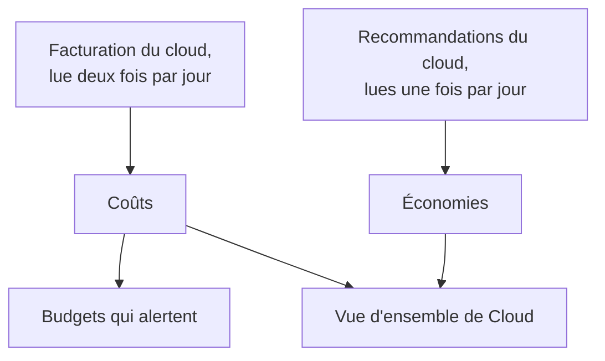

# Coûts et économies du cloud

Un compte cloud connecté dit aussi ce qu'il coûte et comment il pourrait coûter moins. OneUptime lit les coûts de chaque jour dans la facturation de votre cloud et les recommandations du propre moteur de recommandation de votre cloud, les affiche dans **Cloud → Dépenses → Coûts** et **Cloud → Dépenses → Économies**, et alerte avant qu'un mois ne coûte plus que son budget dans **Cloud → Dépenses → Budgets**.

:::cards
- [Amazon Web Services](#amazon-web-services): Cost Explorer et Cost Optimization Hub, chacun activé une fois.
- [Microsoft Azure](#microsoft-azure): Cost Management et Azure Advisor, avec un rôle de plus.
- [Google Cloud](#google-cloud): Votre export de facturation vers BigQuery, et le Recommender.
- [Budgets](#budgets): Une alerte quand les dépenses d'un mois dépassent une part de son budget.
:::

## Fonctionnement



- **Les coûts viennent de la facturation de votre cloud.** AWS Cost Explorer, Azure Cost Management et l'export de facturation de Google Cloud vers BigQuery, avant crédits et remboursements, dans la devise dans laquelle le compte est facturé. Chaque montant est celui d'un jour, en jours UTC, comme votre cloud les facture.
- **Un cloud signale le dernier jour ou deux en retard.** Chaque lecture reprend la dernière semaine, et tout le mois dernier dans les premiers jours d'un mois, si bien que le coût d'un jour se stabilise à mesure que votre cloud le clôt. La première lecture d'une connexion remonte au début de l'avant-dernier mois.
- **La projection du mois suit le rythme de la dernière semaine.** C'est ce que le mois a coûté jusqu'ici, avec chaque jour restant à la moyenne des sept derniers jours complets.
- **Les économies viennent du moteur de recommandation de votre cloud.** AWS Cost Optimization Hub, Azure Advisor et le Recommender de Google Cloud : une taille plus petite, une ressource inactive, un engagement qui vaut la peine, chacun avec ce qu'il ferait économiser par mois. Une recommandation que vous appliquez ou rejetez dans la console de votre cloud disparaît à la lecture suivante.

## Avant de commencer

- **Un compte connecté.** [Connecter un compte cloud](/docs/telemetry/cloud-accounts) avec la commande de configuration actuelle : elle permet à la connexion de lire les coûts et les recommandations. Une connexion créée avant ne lit ni l'un ni l'autre tant que vous n'exécutez pas de nouveau sa commande.

## Amazon Web Services

La connexion lit les coûts avec `ce:GetCostAndUsage` et les recommandations avec `cost-optimization-hub:ListRecommendations`. Chacun demande d'abord d'activer quelque chose dans le compte :

:::steps
### Activer Cost Explorer

Ouvrez Cost Explorer une fois dans la console AWS Billing and Cost Management : AWS prépare les coûts du compte en moins d'un jour. Connectez le compte de gestion de l'organisation pour lire les coûts de chaque compte membre.

### Activer Cost Optimization Hub

Ouvrez Cost Optimization Hub dans la même console et activez-le, pour l'organisation depuis son compte de gestion ou pour le compte seul. Ses recommandations arrivent en moins d'un jour.
:::

Cost Explorer facture $0.01 par requête, et une lecture des coûts en fait quelques-unes. Cost Optimization Hub est gratuit.

## Microsoft Azure

L'application lit les coûts avec le rôle **Cost Management Reader**, sur la même étendue que **Monitoring Reader** : la commande de configuration accorde les deux. Les recommandations d'Azure Advisor sont lues avec **Monitoring Reader**, il n'y a donc rien à activer. Pour donner le rôle à une application créée avant, exécutez :

```bash
az role assignment create --assignee <APP_ID> --role "Cost Management Reader" --scope /subscriptions/<SUBSCRIPTION_ID>
```

Cost Management répond pour chaque abonnement, avec la ressource à laquelle correspond chaque coût, et sa lecture ne coûte rien. Quand il ne peut pas répondre pour un abonnement, les **Coûts** du compte disent pourquoi.

## Google Cloud

Google Cloud n'a aucune API pour les coûts d'un projet : OneUptime les lit dans l'export de votre compte de facturation vers BigQuery.

:::steps
### Exporter votre facturation vers BigQuery

Dans la console Google Cloud, ouvrez Billing, puis Billing export, et activez l'export du coût d'utilisation détaillé vers un ensemble de données BigQuery. Google l'écrit avec quelques heures de retard, à partir du jour où vous l'activez.

### Laisser le compte de service le lire

Donnez au compte de service de la connexion **BigQuery Data Viewer** sur l'ensemble de données de l'export. La commande de configuration lui a déjà donné **BigQuery Job User**, pour exécuter la requête dans son propre projet.

### Indiquer la table de l'export

Modifiez la connexion dans **Cloud → Connecter** et, dans **Plus de champs**, renseignez **Table de l'export de facturation** avec le nom complet de la table : `<PROJECT_ID>.<DATASET>.gcp_billing_export_resource_v1_<BILLING_ACCOUNT_ID>`.
:::

L'export détaillé indique la ressource à laquelle correspond chaque coût ; l'export standard ne donne que le service et la région. BigQuery facture la requête : le premier 1 Tio par mois est gratuit, puis $6.25 par Tio, et un mois d'export représente de quelques mégaoctets à quelques gigaoctets. Les recommandations de type de machine et de ressources inactives du Recommender sont lues avec **Compute Recommender Viewer**, que la commande de configuration accorde, et ne coûtent rien.

## Moyens de dépenser moins

**Cloud → Dépenses → Économies** liste chaque recommandation, la plus grosse économie d'abord : quoi faire, sur quelle ressource, ce qui changerait et ce qu'elle fait économiser par mois. Le bandeau du dessus les additionne, au total et par type : une taille plus petite, une ressource inactive, un engagement. Une recommandation renvoie vers la page de sa ressource quand OneUptime possède la ressource.

### Redimensionnement d'après les propres relevés de OneUptime

Une ressource pour laquelle aucun moteur de recommandation ne se prononce, parce qu'il n'est pas activé, ne couvre pas son type ou la juge trop récente, est dimensionnée par OneUptime d'après les relevés de CPU et de mémoire que sa connexion a pris au cours des 14 derniers jours. OneUptime dimensionne les instances EC2, les bases de données RDS et les clusters ElastiCache sur AWS, les machines virtuelles, les serveurs flexibles PostgreSQL et MySQL et les plans App Service sur Azure, ainsi que les VM Compute Engine et les instances Cloud SQL sur Google Cloud :

- **Surdimensionné** quand la taille deux fois plus petite, ou quatre fois plus petite, aurait encore de la marge : sur la plus petite taille, le 95e centile de son CPU serait d'au plus 60 %, son relevé de CPU le plus haut d'au plus 100 % et le pic de sa mémoire d'au plus 70 % quand sa mémoire est lue.
- **Sous-dimensionné** quand le 95e centile de son CPU atteint 85 % ou plus, ou le pic de sa mémoire 90 % ou plus : la taille deux fois plus grande.

Une ressource est dimensionnée dès qu'elle a 6 jours de relevés. Sa page montre son **Redimensionnement** à côté de ce qu'elle coûte, et une ressource surdimensionnée figure sous **Cloud → Dépenses → Économies**, avec OneUptime comme source. Ce qu'un changement fait économiser est sa part de ce que la ressource a coûté sur les 30 derniers jours : on le connaît donc dès que votre cloud facture la ressource par son nom. L'export détaillé d'Azure et de Google Cloud le fait, AWS Cost Explorer non. Une instance EC2 ne signale sa mémoire qu'avec l'agent CloudWatch, et une VM Compute Engine qu'avec l'Ops Agent : sans lui, elle est dimensionnée d'après son seul CPU. Les tailles burstables, comme t3, la série B et e2-micro, ne sont jamais dimensionnées.

## Budgets

:::steps
### Créer un budget

Dans **Cloud → Dépenses → Budgets**, créez un budget : son **Montant mensuel** et le **Compte** concerné, ou aucun pour tous les comptes.

### Choisir quand il alerte

**Alerter à** prend les parts du budget auxquelles alerter, en pourcentage : 80 et 100 pour commencer. **Alerter si un dépassement se profile** alerte aussi, une fois par mois, quand le rythme de la dernière semaine ferait dépasser le budget au mois. **Alerter en cas de jour inhabituel** alerte aussi le lendemain d'un jour qui a coûté bien plus que d'habitude : voir [Jours inhabituels](#jours-inhabituels). **Gravité de l'alerte** et **Politiques d'astreinte** disent la gravité des alertes et qui est prévenu.
:::

Un budget est vérifié après chaque lecture des coûts et toutes les heures. Quand les dépenses du mois franchissent un seuil, une alerte est levée pour lui, la plus haute si une lecture en franchit plusieurs à la fois, et un nouveau mois résout les alertes du mois précédent. Un budget ne compte que les comptes facturés dans sa devise.

Les agents d'IA peuvent créer et modifier des budgets via le [serveur MCP](/docs/ai/mcp-server), et les scripts avec la commande `oneuptime cloud-budget` de la CLI : voir [Opérations sur les ressources](/docs/cli/resource-operations).

### Jours inhabituels

Après chaque lecture, chacun des 14 derniers jours complets d'un compte est comparé aux 14 jours qui le précèdent. Un jour est inhabituel quand un service a coûté le double de sa journée habituelle ou plus, ou le compte entier une fois et demie sa journée habituelle ou plus. Dans les deux cas, il faut au moins 10 de plus que d'habitude, dans la devise du compte, et au moins 5 % de la journée habituelle du compte, pour que quelques centimes ne passent jamais pour un pic. La valeur habituelle d'un jour est la médiane des 14 jours qui le précèdent, si bien qu'un pic isolé la fait peu bouger, et un compte n'est jugé qu'une fois qu'il a une semaine de coûts.

**Cloud → Dépenses → Coûts** liste les jours inhabituels sous les dépenses quotidiennes. Un budget qui inclut le compte lève une alerte pour chaque compte et chaque jour, le lendemain, en nommant chaque service qui a coûté trop. Un pic qui dure plusieurs jours est signalé le jour où il a commencé, et un jour vieux de plus d'une semaine n'est pas signalé.

## Ce que vous voyez dans OneUptime

- **La vue d'ensemble de Cloud.** **Cloud → Vue d'ensemble** montre les dépenses du mois face à celles du mois dernier au même jour, les services qui coûtent le plus et les plus gros moyens de dépenser moins, à côté de ce qui demande votre attention.
- **Les dépenses de chaque jour.** **Cloud → Dépenses → Coûts** trace chacun des 30 derniers jours, liste les jours qui ont coûté bien plus que d'habitude et ventile une période par service, région, compte ou ressource. Les comptes dont les coûts ne sont pas lus sont listés en dessous, chacun avec la raison.
- **Les coûts d'un compte.** Les **Coûts** d'un compte montrent la même chose pour ce seul compte, avec ses moyens de dépenser moins.
- **Le coût d'une ressource.** La page d'une ressource montre ce qu'elle a coûté ce mois-ci et sur les 30 derniers jours quand son cloud la facture par son nom, avec ses moyens de dépenser moins et son redimensionnement.

## Dépannage

:::details Un compte indique Autorisation requise
La connexion ne peut pas encore lire les coûts du compte. Exécutez de nouveau sa commande de configuration depuis **Cloud → Connecter** : elle ajoute ce dont la lecture des coûts a besoin. Sur Google Cloud, donnez aussi au compte de service **BigQuery Data Viewer** sur l'ensemble de données de l'export.
:::

:::details Un compte indique Non configuré
Son cloud n'a pas encore de coûts à fournir. Sur AWS, activez Cost Explorer ; sur Google Cloud, indiquez la table de l'export dans **Table de l'export de facturation**. Les premiers montants arrivent avec la lecture suivante, en moins de 12 heures.
:::

:::details Les montants laissent un compte de côté
Les montants sont dans la devise dans laquelle la plupart de vos comptes sont facturés. Un compte facturé dans une autre est listé en dessous avec sa devise, et un budget ne compte que les comptes facturés dans la sienne.
:::

:::details Ce mois est plus bas que dans la console de votre cloud
Votre cloud signale le dernier jour ou deux en retard, et les montants sont avant crédits et remboursements. Les lectures suivantes rattrapent le retard.
:::

## Prochaines étapes

:::cards
- [Connecter un compte cloud](/docs/telemetry/cloud-accounts): Connectez un autre compte, ou exécutez de nouveau sa commande.
- [Ressources cloud](/docs/telemetry/cloud-resources): Les métriques de chaque ressource, depuis votre propre collecteur.
- [Observabilité des coûts Kubernetes](/docs/telemetry/kubernetes-cost): Ce que coûte chaque charge de travail Kubernetes.
:::
