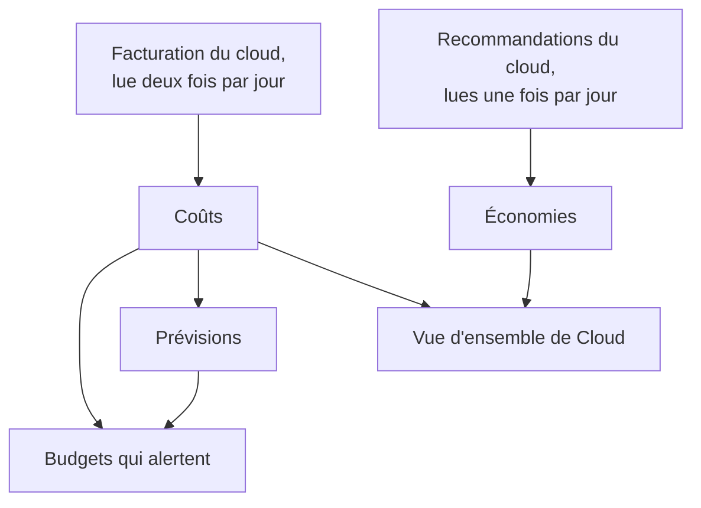

# Coûts et économies du cloud

Un compte cloud connecté dit aussi ce qu'il coûte et comment il pourrait coûter moins. OneUptime lit les coûts de chaque jour dans la facturation de votre cloud et les recommandations du propre moteur de recommandation de votre cloud, les affiche dans **Cloud → Dépenses → Coûts** et **Cloud → Dépenses → Économies**, liste vos Savings Plans, réservations et remises sur engagement d'utilisation dans **Cloud → Dépenses → Engagements**, vous prévient dans **Cloud → Dépenses → Budgets** avant qu'un mois, un trimestre ou une année coûte plus que son budget, et prévoit les mois à venir dans **Cloud → Dépenses → Prévision**. Si vous le lui permettez, il réalise aussi les économies qu'un propriétaire approuve, arrête les ressources hors production en dehors des heures de travail et vérifie chaque modification sur la facture.

:::cards
- [Amazon Web Services](#amazon-web-services): Cost Explorer et Cost Optimization Hub, chacun activé une fois.
- [Microsoft Azure](#microsoft-azure): Cost Management et Azure Advisor, avec un rôle de plus.
- [Google Cloud](#google-cloud): Votre export de facturation vers BigQuery, et le Recommender.
- [Facturé, amorti et net](#facturé-amorti-et-net): Chaque coût de trois façons, pour que les engagements et les crédits tombent là où l'argent est allé.
- [Engagements et renouvellements](#engagements-et-renouvellements): Chaque engagement, des alertes avant la fin de l'un d'eux ou quand il est sous-utilisé, et ce qu'il faut renouveler ou acheter.
- [Appliquer des économies](#appliquer-des-économies): Appliquer une économie avec l'approbation de son propriétaire, et l'annuler.
- [Plannings hors heures](#plannings-hors-heures): Arrêter les ressources hors production la nuit et le week-end.
- [Règles IA d'économies](#règles-ia-déconomies): Des propositions aux propriétaires, ou des modifications dans une limite.
- [Budgets](#budgets): Le budget d'un mois, d'un trimestre ou d'une année pour n'importe quel compte, groupe de coûts ou service.
- [Prévisions](#prévisions): Ce que les 12 prochains mois sont en route pour coûter, et avec quelle certitude.
:::

## Fonctionnement



- **Les coûts viennent de la facturation de votre cloud.** AWS Cost Explorer, Azure Cost Management et l'export de facturation de Google Cloud vers BigQuery, dans la devise dans laquelle le compte est facturé, chacun conservé facturé, amorti et net : voir [Facturé, amorti et net](#facturé-amorti-et-net). Chaque montant est celui d'un jour, en jours UTC, comme votre cloud les facture.
- **Un cloud signale le dernier jour ou deux en retard.** Chaque lecture reprend la dernière semaine, et tout le mois dernier dans les premiers jours d'un mois, si bien que le coût d'un jour se stabilise à mesure que votre cloud le clôt. La première lecture d'une connexion remonte au début de l'avant-dernier mois.
- **La projection du mois suit le rythme de la dernière semaine.** C'est ce que le mois a coûté jusqu'ici, avec chaque jour restant à la moyenne des sept derniers jours complets.
- **Les économies viennent du moteur de recommandation de votre cloud.** AWS Cost Optimization Hub, Azure Advisor et le Recommender de Google Cloud : une taille plus petite, une ressource inactive, un engagement qui vaut la peine, chacun avec ce qu'il ferait économiser par mois. Une recommandation que vous appliquez ou rejetez dans la console de votre cloud disparaît à la lecture suivante.

## Avant de commencer

- **Un compte connecté.** [Connecter un compte cloud](/docs/telemetry/cloud-accounts) avec la commande de configuration actuelle : elle permet à la connexion de lire les coûts et les recommandations. Une connexion créée avant ne lit ni l'un ni l'autre tant que vous n'exécutez pas de nouveau sa commande.

## Amazon Web Services

La connexion lit les coûts avec `ce:GetCostAndUsage`, ses engagements avec `ce:GetSavingsPlansCoverage`, `ce:GetSavingsPlansUtilization`, `ce:GetSavingsPlansUtilizationDetails`, `ce:GetReservationCoverage` et `ce:GetReservationUtilization`, les Savings Plans achetés avec `savingsplans:DescribeSavingsPlans`, et les recommandations avec `cost-optimization-hub:ListRecommendations` et `cost-optimization-hub:GetRecommendation`. La commande de configuration accorde les lectures de Cost Explorer en trois familles, `ce:GetCostAndUsage*`, `ce:GetSavingsPlans*` et `ce:GetReservation*`, toutes des lectures, pour que l'utilisateur d'une clé d'accès tienne encore dans les 2 048 caractères qu'IAM accorde à sa politique. Cost Explorer et Cost Optimization Hub doivent d'abord être activés dans le compte :

:::steps
### Activer Cost Explorer

Ouvrez Cost Explorer une fois dans la console AWS Billing and Cost Management : AWS prépare les coûts du compte en moins d'un jour. Connectez le compte de gestion de l'organisation pour lire les coûts de chaque compte membre.

### Activer Cost Optimization Hub

Ouvrez Cost Optimization Hub dans la même console et activez-le, pour l'organisation depuis son compte de gestion ou pour le compte seul. Ses recommandations arrivent en moins d'un jour.
:::

Cost Explorer facture $0.01 par requête : une lecture des coûts en fait deux ou quelques-unes de plus, une pour facturé et amorti et une pour net, et les engagements sont lus avec quatre par jour pour leur couverture et leur utilisation, et six à douze de plus par jour pour ceux de chacun. L'API Savings Plans et Cost Optimization Hub sont gratuits.

### Coûts par ressource

Cost Explorer indique aussi ce que coûte chaque ressource, sur les 14 derniers jours, une fois les données au niveau des ressources activées. Dans la console AWS Billing and Cost Management, ouvrez les préférences Cost Management et activez les données au niveau des ressources avec une granularité quotidienne, pour l'organisation depuis son compte de gestion. AWS les prépare en 48 heures.

Modifiez ensuite la connexion sous **Cloud → Connecter**, et sous **Plus de champs** activez **Coûts par ressource**. La connexion les lit avec `ce:GetCostAndUsageWithResources` une fois par jour : les 14 jours la première fois, puis les trois derniers à nouveau, avec quelques requêtes à chaque fois. Ce qu'elle lit reste avec les coûts du compte après que Cost Explorer l'a oublié. Une connexion créée avant doit relancer sa commande de configuration, qui ajoute l'action.

## Microsoft Azure

L'application lit les coûts avec le rôle **Cost Management Reader**, sur la même étendue que **Monitoring Reader** : la commande de configuration accorde les deux. Les recommandations d'Azure Advisor sont lues avec **Monitoring Reader**, il n'y a donc rien à activer. Pour donner le rôle à une application créée avant, exécutez :

```bash
az role assignment create --assignee <APP_ID> --role "Cost Management Reader" --scope /subscriptions/<SUBSCRIPTION_ID>
```

Cost Management répond pour chaque abonnement, avec la ressource à laquelle correspond chaque coût, et sa lecture ne coûte rien. Quand il ne peut pas répondre pour un abonnement, les **Coûts** du compte disent pourquoi.

Cost Management limite la vitesse de lecture des coûts d'un locataire, la même pour tous ceux qui les lisent : chaque requête coûte une unité de traitement de requête (QPU) par mois de données lu, et un locataire dispose de 12 QPU toutes les 10 secondes, 60 par minute et 600 par heure. OneUptime lit les abonnements d'un locataire l'un après l'autre en restant sous les deux tiers de chaque quota, attend aussi longtemps que Cost Management le demande quand il refuse une requête, et reprend à la lecture suivante là où il s'est arrêté. Un abonnement pas encore lu indique **En file d'attente**, avec le moment où il est lu ; un abonnement qui a déjà des montants les garde entre-temps. Son coût amorti est lu à chaque lecture et son coût réel une fois par jour, donc la première lecture d'un abonnement interroge Cost Management deux fois et consomme deux fois plus d'unités de requête : les premiers montants d'un grand locataire demandent quelques lectures de plus.

Les réservations et les plans d'économies du locataire sont lus avec **Reservations Reader** et **Savings plan Reader**, qu'Azure accorde au niveau du locataire lui-même, où seul un administrateur général disposant d'un accès élevé peut les accorder. La commande de configuration essaie, et le signale si elle ne le peut pas. Pour les accorder plus tard, en tant qu'administrateur général disposant d'un accès élevé :

```bash
az role assignment create --assignee <APP_ID> --role "Reservations Reader" --scope /providers/Microsoft.Capacity
az role assignment create --assignee <APP_ID> --role "Savings plan Reader" --scope /providers/Microsoft.BillingBenefits
```

Sans eux, les coûts et les recommandations sont lus comme avant, et **Cloud → Dépenses → Engagements** indique le rôle à accorder.

## Google Cloud

Google Cloud n'a aucune API pour les coûts d'un projet : OneUptime les lit dans l'export de votre compte de facturation vers BigQuery.

:::steps
### Exporter votre facturation vers BigQuery

Dans la console Google Cloud, ouvrez Billing, puis Billing export, et activez l'export du coût d'utilisation détaillé vers un ensemble de données BigQuery. Google l'écrit avec quelques heures de retard, à partir du jour où vous l'activez.

### Laisser le compte de service le lire

Donnez au compte de service de la connexion **BigQuery Data Viewer** sur l'ensemble de données de l'export. La commande de configuration lui a déjà donné **BigQuery Job User**, pour exécuter la requête dans son propre projet.

### Indiquer la table de l'export

Modifiez la connexion dans **Cloud → Connecter** et, dans **Plus de champs**, renseignez **Table de l'export de facturation** avec le nom complet de la table : `<PROJECT_ID>.<DATASET>.gcp_billing_export_resource_v1_<BILLING_ACCOUNT_ID>`.
:::

L'export détaillé indique la ressource à laquelle correspond chaque coût ; l'export standard ne donne que le service et la région. BigQuery facture la requête : le premier 1 Tio par mois est gratuit, puis $6.25 par Tio, et un mois d'export représente de quelques mégaoctets à quelques gigaoctets. Les recommandations de type de machine et de ressources inactives du Recommender sont lues avec **Compute Recommender Viewer**, que la commande de configuration accorde, et ne coûtent rien. Les engagements de Compute Engine sont listés depuis Cloud Asset Inventory avec **Cloud Asset Viewer**, que la commande de configuration accorde déjà : rien de plus à donner.

## Facturé, amorti et net

Chaque coût est conservé de trois façons, et **Cloud → Dépenses → Coûts**, les **Coûts** d'un compte, la vue d'ensemble de Cloud et les budgets affichent celle que vous choisissez :

- **Facturé** est chaque frais le jour où votre cloud l'a facturé, avant crédits et remboursements. Un Savings Plan ou une réservation payé d'avance est un seul gros frais le jour de son achat, et l'utilisation qu'il couvre semble gratuite pour le reste de sa durée.
- **Amorti** répartit les frais de chaque engagement sur les jours et les ressources qu'il couvre, pour que l'argent tombe là où il a été dépensé. Toujours avant crédits et remboursements. C'est ce qu'affichent les pages, sauf si vous en choisissez une autre.
- **Net** est l'amorti, moins les crédits, remboursements et remises : le montant de la facture.

| | Facturé | Amorti | Net |
|---|---|---|---|
| AWS | Le coût non combiné (unblended) de Cost Explorer | Le coût amorti de Cost Explorer | Le coût amorti net de Cost Explorer, crédits et remboursements inclus |
| Azure | Le coût réel de Cost Management | Le coût amorti de Cost Management | Le coût amorti : Azure déduit les crédits au niveau du compte de facturation, que la connexion d'un abonnement ne lit pas |
| Google Cloud | Le coût de l'export | Le coût moins les crédits des remises sur engagement d'utilisation et des abonnements | Le coût moins chaque crédit |

Le sélecteur au-dessus des montants change la base sur la page, et OneUptime retient votre choix pour ce projet, dans votre navigateur. La base propre au projet, celle sur laquelle les pages s'ouvrent et que surveillent les budgets, se trouve dans **Cloud → Paramètres → Paramètres de coûts**. Un budget peut surveiller sa propre base : modifiez-le et définissez **Base de coût**.

Les coûts lus avant que les trois soient conservés affichent leur montant facturé sur chaque base. Chaque connexion relit ses coûts une fois, aussi loin qu'une première lecture, pour que chaque base se remplisse.

## Moyens de dépenser moins

**Cloud → Dépenses → Économies** liste chaque recommandation, la plus grosse économie d'abord : quoi faire, sur quelle ressource, ce qui changerait et ce qu'elle fait économiser par mois. Le bandeau du dessus les additionne, au total et par type : une taille plus petite, une ressource inactive, un engagement. Une recommandation renvoie vers la page de sa ressource quand OneUptime possède la ressource, et celle que OneUptime peut réaliser a **Appliquer** : voir [Appliquer des économies](#appliquer-des-économies).

### Redimensionnement d'après les propres relevés de OneUptime

Une ressource pour laquelle aucun moteur de recommandation ne se prononce, parce qu'il n'est pas activé, ne couvre pas son type ou la juge trop récente, est dimensionnée par OneUptime d'après les relevés de CPU et de mémoire que sa connexion a pris au cours des 14 derniers jours. OneUptime dimensionne les instances EC2, les bases de données RDS et les clusters ElastiCache sur AWS, les machines virtuelles, les serveurs flexibles PostgreSQL et MySQL et les plans App Service sur Azure, ainsi que les VM Compute Engine et les instances Cloud SQL sur Google Cloud :

- **Surdimensionné** quand la taille deux fois plus petite, ou quatre fois plus petite, aurait encore de la marge : sur la plus petite taille, le 95e centile de son CPU serait d'au plus 60 %, son relevé de CPU le plus haut d'au plus 100 % et le pic de sa mémoire d'au plus 70 % quand sa mémoire est lue.
- **Sous-dimensionné** quand le 95e centile de son CPU atteint 85 % ou plus, ou le pic de sa mémoire 90 % ou plus : la taille deux fois plus grande.

Une ressource est dimensionnée dès qu'elle a 6 jours de relevés. Sa page montre son **Redimensionnement** à côté de ce qu'elle coûte, et une ressource surdimensionnée figure sous **Cloud → Dépenses → Économies**, avec OneUptime comme source. Ce qu'un changement fait économiser est sa part de ce que la ressource a coûté sur les 30 derniers jours : on le connaît donc dès que votre cloud facture la ressource par son nom. L'export détaillé d'Azure et de Google Cloud le fait, et AWS aussi une fois Coûts par ressource activé. Une instance EC2 ne signale sa mémoire qu'avec l'agent CloudWatch, et une VM Compute Engine qu'avec l'Ops Agent : sans lui, elle est dimensionnée d'après son seul CPU. Les tailles burstables, comme t3, la série B et e2-micro, ne sont jamais dimensionnées.

### Engagements

**Cloud → Dépenses → Économies** et les **Coûts** d'un compte montrent quelle part des dépenses des 30 derniers jours les engagements de chaque compte ont payée, et quelle part de ceux-ci a été utilisée, une ligne par type :

- AWS : Savings Plans et instances réservées, depuis Cost Explorer. Le compte de gestion d'une organisation les lit pour chaque compte de l'organisation.
- Azure : plans d'économies et réservations, depuis Cost Management, en coût amorti.
- Google Cloud : remises sur engagement d'utilisation, depuis votre export de facturation. L'export ne dit pas quelle part d'un engagement est restée inutilisée, donc la part utilisée n'est pas affichée.

Un compte sans engagement indique ce qui a tourné au tarif à la demande et qu'un engagement paierait moins cher. Les chiffres de chaque type sont ceux de son cloud, et les types ne sont jamais additionnés : une réservation et un Savings Plan peuvent tous deux compter les dépenses d'une même machine comme les leurs à couvrir. Chaque engagement à part est listé dans **Cloud → Dépenses → Engagements** : voir [Engagements et renouvellements](#engagements-et-renouvellements).

## Engagements et renouvellements

**Cloud → Dépenses → Engagements** liste chaque Savings Plan, réservation et remise sur engagement d'utilisation que vos connexions peuvent lire, pour qu'aucun ne se termine sans qu'on le remarque :

- **Engagements actifs**, au-dessus, compte les engagements actifs et ceux qui se terminent dans les 90 jours, **Utilisation** la part utilisée sur les 30 derniers jours et ce qui est resté inutilisé, et **Couverture** la part des dépenses qu'ils couvrent.
- **Se terminent bientôt** liste ceux qui se terminent dans les 90 jours et ne se renouvellent pas d'eux-mêmes, chacun avec son plan de renouvellement : ce qu'il faut acheter pour garder sa remise (son engagement horaire, ou ses instances, à la part qui a été utilisée), ce que cela coûte et économise par mois, quand c'est rentabilisé, et la part des dépenses couverte maintenant et après sa fin. **Renouveler dans la console** ouvre la page où votre cloud le renouvelle.
- **Tous les engagements** est la liste complète : ce qu'est et couvre chacun, son compte, sa date de fin, sa durée et son option de paiement, la part utilisée sur les 30 derniers jours, et l'utilisation qu'il a payée et ce qu'elle a économisé.
- **Plans d'achat** sont ce que le moteur de recommandation de votre cloud suggère d'acheter, chacun avec ce qu'il coûterait et économiserait par mois, quand il serait rentabilisé, et comment la couverture changerait. **Acheter dans la console** ouvre la page où l'acheter.
- En dessous, les engagements de chaque compte par type, comme ses **Coûts** les affichent, et quand les engagements alertent, avec **Modifier les alertes**.

OneUptime ne fait que planifier : il n'achète, ne renouvelle ni ne restitue jamais un engagement. Vous achetez dans la console de votre cloud.

| | D'où viennent les engagements | Ce qu'on sait de chacun |
|---|---|---|
| AWS | Les Savings Plans et instances réservées de Cost Explorer, chacun avec sa propre utilisation, et l'API Savings Plans pour les plans achetés, y compris ceux en file d'attente pour démarrer | Sa fin, sa durée, son option de paiement, son engagement horaire ou ses instances, ses frais, et son utilisation sur les 30 et 7 derniers jours |
| Azure | Les réservations et les plans d'économies du locataire | Sa fin, sa durée, son plan de facturation, s'il se renouvelle de lui-même, et son utilisation sur les 30 et 7 derniers jours |
| Google Cloud | Les engagements de Compute Engine, depuis Cloud Asset Inventory | Sa fin, son plan, ses ressources et s'il se renouvelle de lui-même. Google Cloud n'indique pas la part utilisée d'un engagement |

Le compte de gestion d'une organisation liste ceux de chaque compte sur AWS. Les remises sur engagement d'utilisation basées sur les dépenses, que Google Cloud garde sur le compte de facturation plutôt que dans un projet, ne sont pas encore listées.

### Alertes d'engagement

Les engagements lèvent des alertes, appelées via les politiques d'astreinte comme toute alerte. Dans **Cloud → Paramètres → Paramètres de coûts**, **Alertes d'engagement** dit quand :

- **Alerter avant la fin d'un engagement** : 90, 30 et 7 jours avant sa fin pour commencer. Une alerte au plus proche de ces jours que l'engagement a atteint, chaque plus proche remplaçant la précédente. Un engagement qui se renouvelle de lui-même, ou dont le renouvellement est en file d'attente pour démarrer à sa fin, n'en lève aucune.
- **Alerter quand l'utilisation est inférieure à** : 80 % pour commencer, sur les 7 derniers jours d'un engagement, une fois qu'il a tourné une semaine. L'alerte se résout quand son utilisation revient.
- **Alerter quand la couverture passe sous** : 60 % pour commencer, des dépenses que les engagements d'un type d'un compte pourraient couvrir, après en avoir couvert plus. Elle se résout quand la couverture revient. Vide, la couverture ne lève aucune alerte.

**Alerter sur les engagements** les désactive toutes, et **Gravité de l'alerte**, **Politiques d'astreinte** et **Propriétaires** disent leur gravité, qui est appelé et à qui elles appartiennent. Chaque alerte dit ce que l'engagement couvre et ce qu'il a payé, et renvoie à son plan de renouvellement. Une alerte se résout d'elle-même quand son engagement se termine, se renouvelle ou n'est plus listé.

## Appliquer des économies

OneUptime réalise une économie par la connexion cloud du compte dès que son réglage **Actions d'économie** le permet : [Actions d'économie](/docs/telemetry/cloud-accounts#actions-déconomie) dit ce que chaque choix accorde. Il ne fait que des modifications en une étape : il arrête une instance ou une base de données inactive, passe un volume gp2 en gp3, supprime un disque non attaché, un ancien instantané ou une image inutilisée, libère une adresse inutilisée et, si vous le permettez, redimensionne une instance ou une base de données à la taille recommandée. Il n'achète jamais d'engagement : **Acheter dans la console** ouvre la page de votre cloud pour cela.

:::steps
### Choisir Appliquer

Dans **Cloud → Dépenses → Économies**, choisissez **Appliquer** sur une économie. La boîte de dialogue dit ce qui change, ce que cela économise par mois, comment l'annuler ou que ce n'est pas possible, et qui l'approuve.

### Un propriétaire l'approuve

Une personne désignée comme propriétaire de la ressource, ou membre d'une équipe qui la possède, et qui peut aussi la modifier, approuve la modification. Une ressource sans propriétaire est approuvée par un Propriétaire du projet ou un Administrateur du projet. Si vous pouvez l'approuver vous-même, **Appliquer** l'effectue aussitôt, en votre nom. Sinon, elle attend dans **En attente d'approbation** qu'un propriétaire choisisse **Approuver**, ou **Masquer** avec un motif.

### OneUptime l'effectue

La modification passe par la connexion et figure dans les chronologies de la ressource et du compte, avec qui l'a approuvée. Un disque supprimé reçoit d'abord un instantané final, sauf si vous désactivez **Prendre d'abord un instantané final**.
:::

Chaque modification dit comment l'annuler : **Annuler** dans **Modifications effectuées** redémarre une instance arrêtée, rétablit un volume ou une taille, ou recrée un disque supprimé à partir de son instantané final. Ce qui supprime définitivement, comme un instantané, une image ou une adresse libérée, ne peut pas être annulé, et la boîte de dialogue le dit avant que vous l'appliquiez. Lorsque le projet exige deux approbations avec **Exiger deux approbations pour les correctifs plus risqués**, une modification irréversible demande deux personnes.

Une ressource dont les balises disent qu'elle est gérée en tant que code, par exemple par Terraform ou CloudFormation, est modifiée dans son code à la place : la boîte de dialogue propose **Ouvrir la pull request** vers le dépôt qui la déclare, afin que le prochain apply n'annule pas l'économie.

### Prouvé par la facture

**Économisé ce mois-ci** ne compte que ce que la facture de votre cloud montre. Dès que trois jours après une modification sont stabilisés sur la facture, le coût par jour de la ressource est comparé à la semaine précédant la modification : elle est **Visible dans la facture** quand le coût a baissé d'au moins un quart de ce qui était promis, **Pas visible dans la facture** sinon, et **Non mesurable** quand votre cloud ne facture pas la ressource par son nom. **Vérification de la facture** compte les modifications qui attendent encore ces jours.

## Plannings hors heures

Dans **Cloud → Dépenses → Plannings**, un planning arrête les instances et bases de données hors production en dehors des heures de travail, et les redémarre :

:::steps
### Choisir les ressources

Nommez la balise cloud qui les choisit, par exemple `Schedule` = `office-hours`, dans un compte ou dans tous.

### Dire quand elles tournent

Choisissez les jours ouvrés, l'heure à laquelle elles démarrent et celle à laquelle elles s'arrêtent, au format 24 heures, et le fuseau horaire.
:::

À la fin des heures de travail, un planning arrête, par la connexion de son compte, chaque ressource en marche que sa balise choisit et qui est connue comme hors production, et à leur début il ne redémarre que ce qu'il a arrêté : une ressource que quelqu'un a arrêtée à la main reste arrêtée. **Voir les ressources** liste ce qu'un planning choisit maintenant, et pourquoi il en laisse en marche. Il arrête les instances EC2 et les bases de données RDS sur AWS, les machines virtuelles sur Azure et les instances Compute Engine sur Google Cloud. AWS redémarre de lui-même une base de données arrêtée depuis sept jours.

Un planning n'arrête jamais la production, ni une ressource dont rien n'indique l'environnement. Une ressource est connue comme hors production quand :

- l'une de ses balises le dit, sous une clé comme `environment`, `env`, `stage`, `tier` ou `deployment.environment`, avec un mot comme `dev`, `test`, `qa`, `staging` ou `sandbox` ;
- son compte est marqué **Hors production** dans **Environnement** des **Paramètres** du compte ;
- ou l'une de ses étiquettes le dit, par exemple `Staging` ou `env: dev`.

La production l'emporte : une balise qui dit `prod`, `production` ou `live`, ou un compte marqué **Production**, garde une ressource en marche, quoi que dise le reste. Le nom d'une ressource n'est jamais lu pour cela. Désactivez un planning et il n'arrête plus rien, et redémarre ce qu'il a arrêté au début de ses heures de travail ; supprimez-le et ce qu'il a arrêté est redémarré aussitôt.

## Règles IA d'économies

Avec **Activer l'IA** activé, OneUptime AI propose aux propriétaires de la ressource chaque économie qu'il peut réaliser, après chaque lecture des économies du compte, et ils l'approuvent ou la refusent dans **En attente d'approbation**. Dans **Cloud → Paramètres → Règles IA d'économies**, une règle dit ce que OneUptime AI fait des économies auxquelles elle correspond, selon le type de modification, l'environnement de la ressource et son cloud : **Désactivé**, **Proposer au propriétaire** ou **Agir sans demander**, jusqu'à une limite mensuelle. Sans règle, chaque économie est proposée et aucune n'est effectuée ; avec des règles, seulement ce à quoi une règle correspond, et entre les règles qui correspondent, la plus prudente l'emporte.

Une règle n'agit sans demander que sur une ressource connue comme hors production, que pour une modification qui peut être annulée, que jusqu'à la plus petite limite des règles qui correspondent, et au plus 10 fois par heure dans un projet : tout le reste est proposé. Une modification effectuée sans demander figure dans les chronologies avec la règle qui l'a effectuée, et ses propriétaires peuvent l'annuler. Une économie refusée ou annulée n'est plus proposée pendant 30 jours.

## Budgets

:::steps
### Créer un budget

Dans **Cloud → Dépenses → Budgets**, créez un budget et choisissez à quoi il **S'applique à** : tous les comptes, un **Compte**, un **Groupe de coûts** tel que ses règles répartissent les dépenses, ou les services, régions et étiquettes qu'un **Filtre** nomme, écrit comme les règles d'un groupe de coûts. Laissez sa **Base de coût** vide pour compter celle du projet.

### Dire ce qu'il peut coûter

Sa **Période** est un mois, un trimestre ou une année, et son **Montant** est ce qu'une période peut coûter. Les trimestres et les années commencent au **Premier mois de l'année** : à partir d'avril, une année va d'avril à mars. Le **Plan budgétaire** d'une année peut répartir son montant également sur ses mois, ou donner à chaque mois le sien dans un **Plan mensuel**. Chaque mois est alors tenu à sa propre part : un mois calme n'est jamais alerté pour les dépenses d'un mois chargé.

### Choisir quand il alerte

**Alerter à** prend les parts du budget auxquelles agir, en pourcentage : 80 et 100 pour commencer. **Alerter si un dépassement se profile** alerte aussi, une fois par période, quand la période est en route pour coûter plus que le budget. **Alerter en cas de jour inhabituel** alerte aussi le lendemain d'une journée qui a coûté bien plus que d'habitude : voir [Jours inhabituels](#jours-inhabituels). **Gravité de l'alerte** dit la gravité de ses alertes.

### Choisir qui est prévenu

Les personnes et équipes à **Notifier** sont prévenues par e-mail et par chat quand les dépenses franchissent une part en dessous de 100 %, sans alerte : personne n'est alerté pour des dépenses dans le budget. **Prévenir l'équipe du groupe de coûts** prévient aussi l'équipe à laquelle appartient le groupe de coûts. À partir de 100 %, une alerte est créée, elles en sont propriétaires, et les **Politiques d'astreinte** sont alertées. Un budget sans personne à prévenir crée une alerte à chaque part.
:::

Un budget est vérifié après chaque lecture des coûts et toutes les heures. Quand les dépenses de la période franchissent une part, les personnes à prévenir sont prévenues, ou à partir de 100 % une alerte est créée, une fois pour la plus haute quand une lecture en franchit plusieurs à la fois, et une nouvelle période résout les alertes de la précédente. Une année répartie par mois est vérifiée un mois à la fois, par rapport à la part de ce mois. Un budget ne compte que les comptes facturés dans sa devise, sur sa base : un budget amorti n'est pas déclenché par un engagement acheté d'avance, qu'un budget facturé compte le jour de son achat.

Une période est en route pour dépasser le budget quand ce qu'elle a coûté jusqu'ici, le reste de ce mois au rythme de la dernière semaine complète, et les mois suivants d'un trimestre ou d'une année selon la [prévision](#prévisions) dépassent ensemble le budget.

La ligne de chaque budget dit ce qu'il compte, sa période et la période jusqu'ici : pour une année répartie par mois, ce mois-ci par rapport à sa part, avec l'année à côté. Sa page montre la période mois par mois par rapport à la part de chaque mois, ce mois-ci jour par jour, ce qui a le plus coûté, et qui est prévenu. La page d'un budget annuel peut enregistrer sa prévision comme son plan.

Les agents d'IA peuvent créer et modifier des budgets via le [serveur MCP](/docs/ai/mcp-server), et les scripts avec la commande `oneuptime cloud-budget` de la CLI : voir [Opérations sur les ressources](/docs/cli/resource-operations).

### Jours inhabituels

Après chaque lecture, chacun des 14 derniers jours complets d'un compte est comparé aux 14 jours qui le précèdent. Un jour est inhabituel quand un service a coûté le double de sa journée habituelle ou plus, ou le compte entier une fois et demie sa journée habituelle ou plus. Dans les deux cas, il faut au moins 10 de plus que d'habitude, dans la devise du compte, et au moins 5 % de la journée habituelle du compte, pour que quelques centimes ne passent jamais pour un pic. La valeur habituelle d'un jour est la médiane des 14 jours qui le précèdent, si bien qu'un pic isolé la fait peu bouger, et un compte n'est jugé qu'une fois qu'il a une semaine de coûts.

**Cloud → Dépenses → Coûts** marque les jours inhabituels sur les dépenses quotidiennes, au-dessus de leurs barres, et les liste en dessous. Sur tous les comptes, chaque marque ouvre les **Coûts** de son compte. Un budget mensuel pour tous les comptes ou un seul crée une alerte pour chaque compte et chaque jour, le lendemain, en nommant chaque service qui a dépassé. Tout autre budget tient ce qu'il compte à sa propre journée habituelle de la même façon. Une hausse qui dure plusieurs jours est signalée le jour où elle a commencé, et un jour de plus d'une semaine n'est pas signalé. Un budget créé avant ces alertes ne les crée pas tant que vous ne le modifiez pas pour les activer.

## Prévisions

**Cloud → Dépenses → Prévision** dit ce que les dépenses sont en route pour coûter dans chacun des 12 prochains mois, pour tout, un compte, un groupe de coûts ou un service, sur la base de coût que vous choisissez. Elle dit comment chaque prévision est établie, à partir des mois complets de coûts que OneUptime conserve, un an ou un peu plus :

- **Ce mois-ci**, c'est ce qu'il a coûté jusqu'ici, avec chaque jour restant à la moyenne des sept derniers jours complets, comme un budget le projette.
- **Avec moins de 3 mois complets**, chaque mois à venir prolonge ce rythme, sans fourchette probable : trop peu a été lu pour distinguer une tendance d'un accident.
- **À partir de 3 mois complets**, une tendance passe par la journée moyenne de chaque mois : la médiane des pentes entre chaque paire de mois, si bien qu'un mois atypique la bouge à peine.
- **À partir de 12 mois complets**, chaque mois du calendrier garde aussi son écart au-dessus ou en dessous de la tendance l'an dernier, si bien qu'un pic de décembre est aussi prévu pour le décembre suivant.

Chaque mois à venir a une fourchette probable, où il devrait tomber 8 fois sur 10, tirée de l'écart des mois passés à leur tendance, et jamais plus étroite que 5 % de part et d'autre. Elle s'élargit à mesure qu'un mois est lointain, et que la prévision repose sur peu de mois. À partir de 12 mois complets, chaque fourchette est encore plus large, car une année ne montre chaque mois du calendrier qu'une fois. Une prévision n'est pas une promesse : un nouveau service, une migration ou un changement de prix fait bouger les mois à venir d'une façon qu'aucun mois passé ne montre.

**Simulation** fait croître ou décroître chaque mois à venir à partir du mois choisi, de la part que vous saisissez, par exemple 20 % dès janvier. **Enregistrer comme plan budgétaire** fait des douze prochains mois le plan d'un budget annuel, dans un nouveau budget ou un budget existant, chaque mois tenu à sa part prévue.

## Budgets et prévisions dans l'API

Les budgets sont une ressource de l'API (`cloud-budget`), avec des commandes CLI et des outils MCP comme toute ressource. Le `scope` d'un budget est `allAccounts`, `account` (avec `cloudAccountId`), `costGroup` (avec `cloudCostGroupId`) ou `filter` (avec `filterRules`, écrit comme les règles d'un groupe de coûts). Sa `period` est `month`, `quarter` ou `year`, à partir de `fiscalYearStartMonth`, de 1 à 12. Le `planSplit` d'une année est `none`, `equal` ou `byMonth`, avec ses douze mois dans `monthlyPlan`, dans l'ordre de l'exercice.

Pour lire la période d'un budget mois par mois, les jours de ce mois-ci et ce qui a le plus coûté, comme sa page :

```bash
curl -X POST "https://oneuptime.com/api/cloud-budget/<budget ID>/spend" \
  -H "apikey: <API key>" -H "tenantid: <project ID>"
```

Pour prévoir une portée, de 1 à 24 mois à l'avance, avec une simulation facultative :

```bash
curl -X POST "https://oneuptime.com/api/cloud-budget/forecast" \
  -H "apikey: <API key>" -H "tenantid: <project ID>" -H "Content-Type: application/json" \
  -d '{"scope": "costGroup", "cloudCostGroupId": "<group ID>", "monthsAhead": 12, "growth": {"percent": 20, "fromMonth": "2027-01"}}'
```

Le `forecast` de la réponse contient sa `method` (`pace`, `trend` ou `trendAndSeason`), les mois dont elle est tirée, et chaque mois avec son `amount` et, pour les mois à venir, son `low` et son `high`. Envoyez `basis` en `billed`, `amortized` ou `net` pour prévoir sur cette base ; sans lui, la prévision est sur celle du projet, et le `basis` de la réponse dit laquelle. Les dépenses d'un budget sont sur sa propre base.

## Où va l'argent

**Cloud → Dépenses → Coûts** ventile les dépenses d'une période par service, région, compte ou ressource, et de trois autres façons :

- Par environnement des plateformes d'applications : le service de plateforme de chaque environnement dans son compte et sa région, comme Amazon ECS ou Cloud Run, et les ressources d'un environnement Elastic Beanstalk par l'étiquette qu'AWS leur donne.
- Par application : ce qu'une plateforme facture nommément à une application, comme un service Cloud Run ou une Container App. Amazon ECS facture ses tâches et App Service ses plans : les coûts de leurs applications restent ceux de leur environnement.
- Par étiquette : chaque valeur de l'étiquette que vous choisissez. Un coût conserve les étiquettes qu'il avait lors de sa lecture : les libellés d'un export de facturation Google Cloud, sinon les étiquettes de la ressource à laquelle il est facturé, ce qui demande Coûts par ressource sur AWS.

Sous la liste, la carte indique à combien s'élève le reste : ce qui n'est dans aucun environnement, ce qui est facturé à un environnement dans son ensemble, ou ce qui ne porte pas l'étiquette. Les coûts lus avant que les étiquettes soient conservées sont relus une fois, aussi loin qu'une première lecture, pour que leurs étiquettes se complètent.

## Ce que vous voyez dans OneUptime

- **La vue d'ensemble de Cloud.** **Cloud → Vue d'ensemble** montre les dépenses du mois face à celles du mois dernier au même jour, les services qui coûtent le plus et les plus gros moyens de dépenser moins, à côté de ce qui demande votre attention.
- **Les dépenses de chaque jour.** **Cloud → Dépenses → Coûts** trace chacun des 30 derniers jours en marquant ceux qui ont coûté bien plus que d'habitude, liste ces jours et ventile une période par service, région, compte, ressource, environnement des plateformes d'applications, application ou étiquette, facturé, amorti ou net. Les comptes dont les coûts ne sont pas lus sont listés en dessous, chacun avec la raison.
- **Chaque engagement.** **Cloud → Dépenses → Engagements** liste chacun avec sa date de fin et sa part utilisée, ceux qui se terminent bientôt avec ce qu'il faut renouveler, et ce qu'il faut acheter.
- **Les coûts d'un compte.** Les **Coûts** d'un compte montrent la même chose pour ce seul compte, avec ses engagements et ses moyens de dépenser moins.
- **Le coût d'une ressource.** La page d'une ressource montre ce qu'elle a coûté ce mois-ci et sur les 30 derniers jours quand son cloud la facture par son nom, avec ses moyens de dépenser moins et son redimensionnement.
- **Chaque budget.** **Cloud → Dépenses → Budgets** liste chaque budget avec ce qu'il compte, sa période et la période jusqu'ici, et chacun ouvre sa page.
- **Les mois à venir.** **Cloud → Dépenses → Prévision** trace les mois dont une prévision est tirée, ce mois-ci en route et les 12 prochains, avec la façon dont elle est établie.
- **Ce qui a été économisé.** **Cloud → Dépenses → Économies** s'ouvre sur ce que les modifications effectuées ont économisé ce mois-ci, selon la facture, les modifications en attente d'approbation et celles effectuées, et les heures pendant lesquelles les plannings ont arrêté des ressources.

## Dépannage

:::details Un compte indique Autorisation requise
La connexion ne peut pas encore lire les coûts du compte. Exécutez de nouveau sa commande de configuration depuis **Cloud → Connecter** : elle ajoute ce dont la lecture des coûts a besoin. Sur Google Cloud, donnez aussi au compte de service **BigQuery Data Viewer** sur l'ensemble de données de l'export.
:::

:::details Un compte indique Non configuré
Son cloud n'a pas encore de coûts à fournir. Sur AWS, activez Cost Explorer ; sur Google Cloud, indiquez la table de l'export dans **Table de l'export de facturation**. Les premiers montants arrivent avec la lecture suivante, en moins de 12 heures.
:::

:::details Un compte indique En file d'attente
Ses coûts attendent leur tour : Azure Cost Management limite la vitesse de lecture des coûts d'un locataire. Le compte indique quand ils sont lus, à la première lecture de la connexion à partir de ce moment, et il n'y a rien à faire. Un compte qui a déjà des montants les garde entre-temps.
:::

:::details Coûts par ressource indique Non configuré
Les données au niveau des ressources ne sont pas activées pour le compte. Activez-les avec une granularité quotidienne dans les préférences Cost Management de la console AWS Billing and Cost Management, depuis le compte de gestion de l'organisation pour ses membres. AWS les prépare en 48 heures, et la lecture du lendemain les prend.
:::

:::details Les engagements indiquent Autorisation requise
La connexion ne peut pas encore lire les Savings Plans et les réservations du compte. Relancez sa commande de configuration depuis **Cloud → Connecter** : elle ajoute les actions avec lesquelles ils sont lus. Sur Azure, un administrateur général disposant d'un accès élevé accorde **Reservations Reader** et **Savings plan Reader** : voir [Microsoft Azure](#microsoft-azure).
:::

:::details Amorti et net affichent la même chose que facturé
Les coûts lus avant que les trois soient conservés affichent leur montant facturé sur chaque base jusqu'à la prochaine lecture des coûts de la connexion, qui les relit aussi loin que sa première. Sur Azure, le net est toujours le coût amorti.
:::

:::details Un engagement se termine et aucune alerte n'est venue
Un engagement qui se renouvelle de lui-même, ou dont le renouvellement est en file d'attente pour démarrer à sa fin, n'en lève aucune, pas plus qu'un engagement d'un projet dont les alertes d'engagement sont désactivées dans **Cloud → Paramètres → Paramètres de coûts**. Une alerte a aussi besoin que le projet ait une gravité d'alerte.
:::

:::details Les montants laissent un compte de côté
Les montants sont dans la devise dans laquelle la plupart de vos comptes sont facturés. Un compte facturé dans une autre est listé en dessous avec sa devise, et un budget ne compte que les comptes facturés dans la sienne.
:::

:::details Une économie n'a pas d'Appliquer
OneUptime ne fait que des modifications en une étape : un engagement, ou une recommandation qui change plus d'une chose, se fait dans la console de votre cloud. Appliquer ouvre une boîte de dialogue qui dit pourquoi elle ne peut pas être faite d'ici quand la connexion du compte ne le permet pas : activez ses **Actions d'économie** et exécutez à nouveau sa commande de configuration.
:::

:::details Un planning laisse une ressource en marche
**Voir les ressources** dit pourquoi : c'est de la production, rien n'indique que ce n'est pas de la production, ou la connexion de son compte ne permet pas les actions d'économie. Balisez-la, par exemple `environment` = `dev`, ou marquez son compte **Hors production**.
:::

:::details Une prévision n'a pas de fourchette probable
Elle a été établie à partir de moins de 3 mois complets de coûts : chaque mois à venir prolonge le rythme de la dernière semaine complète, et aucune fourchette n'est donnée. La fourchette arrive dès que le troisième mois complet est lu. La première lecture d'une connexion remonte au début de l'avant-dernier mois.
:::

:::details Quelqu'un a été prévenu d'un budget mais aucune alerte n'est venue
En dessous de 100 %, un budget qui nomme des personnes ou des équipes à prévenir les prévient et ne crée pas d'alerte : personne n'est alerté. À partir de 100 %, il crée une alerte, et ses politiques d'astreinte sont alertées. Un budget sans personne à prévenir crée une alerte à chaque part.
:::

:::details Ce mois est plus bas que dans la console de votre cloud
Votre cloud signale le dernier jour ou deux en retard, et les montants facturés et amortis sont avant crédits et remboursements. Les lectures suivantes rattrapent le retard. Comparez avec la base qu'affiche la console de votre cloud : AWS s'ouvre sur les coûts non combinés, c'est-à-dire facturés.
:::

## Prochaines étapes

:::cards
- [Répartition des coûts du cloud](/docs/telemetry/cloud-cost-allocation): Répartissez les dépenses entre équipes, produits et centres de coûts.
- [Connecter un compte cloud](/docs/telemetry/cloud-accounts): Connectez un autre compte, ou exécutez de nouveau sa commande.
- [Ressources cloud](/docs/telemetry/cloud-resources): Les métriques de chaque ressource, depuis votre propre collecteur.
- [Observabilité des coûts Kubernetes](/docs/telemetry/kubernetes-cost): Ce que coûte chaque charge de travail Kubernetes.
:::
