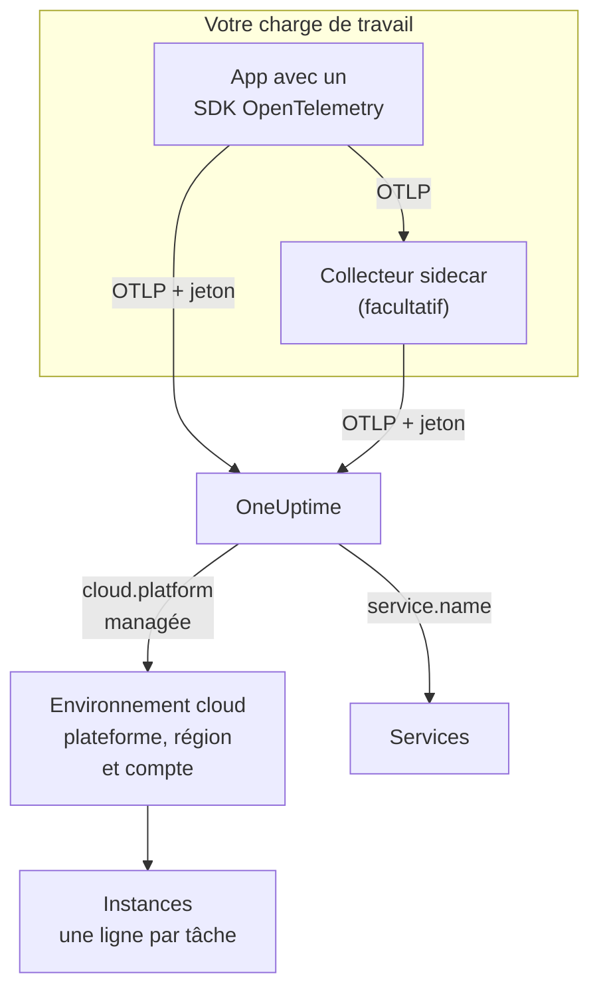

# Environnements cloud

Un **Environnement cloud** est l'endroit où vos conteneurs tournent sur une plateforme cloud managée : le compte et la région d'un cluster ECS, le projet et la région de Cloud Run, l'abonnement et la région de Container Apps. OneUptime le crée la première fois que votre télémétrie arrive avec les bons attributs de ressource, et regroupe chaque charge de travail qui y tourne. Rien à enregistrer à la main.

:::cards
- [AWS ECS / Fargate](/docs/telemetry/cloud-aws-ecs): Des tâches sur Fargate ou EC2, avec le CPU et la mémoire de chaque tâche.
- [Google Cloud Run](/docs/telemetry/cloud-gcp-cloud-run): Services et jobs, aussi listés comme fonctions serverless.
- [Azure Container Apps](/docs/telemetry/cloud-azure-container-apps): Des réplicas, avec la région et l'abonnement définis à la main.
- [Autres plateformes cloud](/docs/telemetry/cloud-other-platforms): Elastic Beanstalk, App Runner, App Engine, App Service et Container Instances.
:::

## Fonctionnement



- **Un détecteur de ressources dit où tourne la charge de travail.** Un détecteur de ressources OpenTelemetry, dans le SDK ou dans un collecteur, lit les métadonnées de la plateforme et place `cloud.platform`, `cloud.account.id` et `cloud.region` sur tout ce que la charge de travail envoie. Là où aucun détecteur n'existe, vous les définissez vous-même.
- **L'environnement regroupe tout.** Chaque charge de travail ayant la même plateforme, le même compte et la même région arrive dans un seul environnement. Les services gardent leurs propres lignes sous **Services**.
- **Chaque tâche en cours est une instance.** L'onglet **Instances** de l'environnement liste ses tâches, instances ou réplicas en cours, avec le CPU et la mémoire en direct quand la plateforme peut les fournir.

## Avant de commencer

- **Une clé d'ingestion.** Créez une clé **Serveur** sous **Paramètres du projet → Télémétrie & APM → Clés d'ingestion** et copiez son jeton : voir [Créer une clé d'ingestion](/docs/telemetry/open-telemetry#créer-une-clé-dingestion). C'est un secret : chaque page de plateforme montre où le garder dans le magasin de secrets de ce cloud.
- **OpenTelemetry dans votre application.** Un SDK OpenTelemetry qui exporte en OTLP, ou un OpenTelemetry Collector qui tourne à côté de l'application.

## Plateformes prises en charge

| Plateforme | `cloud.platform` | `cloud.*` renseignés par | Identité d'instance | Guide |
| ------------------------- | --------------------------- | ---------------------- | --------------------------------- | ------------------------------------------------------------------ |
| AWS ECS / Fargate | `aws_ecs` | détecteur de ressources | `aws.ecs.task.arn` | [AWS ECS / Fargate](/docs/telemetry/cloud-aws-ecs) |
| AWS Elastic Beanstalk | `aws_elastic_beanstalk` | détecteur de ressources | `host.id` | [Autres plateformes cloud](/docs/telemetry/cloud-other-platforms) |
| AWS App Runner | `aws_app_runner` | à la main | `host.name` | [Autres plateformes cloud](/docs/telemetry/cloud-other-platforms) |
| Google Cloud Run | `gcp_cloud_run` | détecteur de ressources | `faas.instance` | [Google Cloud Run](/docs/telemetry/cloud-gcp-cloud-run) |
| Google App Engine | `gcp_app_engine` | détecteur de ressources | `faas.instance` | [Autres plateformes cloud](/docs/telemetry/cloud-other-platforms) |
| Azure Container Apps | `azure_container_apps` | détecteur de ressources | `azure.container_app.instance.id` | [Azure Container Apps](/docs/telemetry/cloud-azure-container-apps) |
| Azure Container Instances | `azure_container_instances` | à la main | `host.name` | [Autres plateformes cloud](/docs/telemetry/cloud-other-platforms) |
| Azure App Service | `azure_app_service` | détecteur de ressources | `host.id` | [Autres plateformes cloud](/docs/telemetry/cloud-other-platforms) |

- **Détecteur de ressources :** un détecteur de ressources OpenTelemetry, dans le SDK ou dans le processeur `resourcedetection` du Collector, définit les attributs `cloud.*` pour vous.
- **À la main :** aucun détecteur n'existe, vous mettez donc les attributs dans `OTEL_RESOURCE_ATTRIBUTES`. La page de la plateforme donne la ligne exacte.
- **Les détecteurs Azure en savent moins.** Les détecteurs de Container Apps ne connaissent ni la région ni l'abonnement, et ceux d'App Service ne connaissent pas l'abonnement : définissez vous-même ce qui manque.
- **Les écritures Azure avec un point fonctionnent.** Les détecteurs Azure pour Node.js et .NET écrivent `azure.container_apps` et `azure.app_service`. OneUptime les réécrit en valeurs avec tiret bas ci-dessus à la réception.

## Comment OneUptime identifie un environnement

Il existe un environnement par combinaison de trois attributs de ressource :

| Attribut | Obligatoire | Ce que c'est |
| ------------------ | -------- | ------------------------------------------------------------------------------------------- |
| `cloud.platform` | Oui | L'une des valeurs de [Plateformes prises en charge](#plateformes-prises-en-charge) |
| `cloud.account.id` | Non | L'ID de compte AWS, l'ID de projet Google Cloud ou l'ID d'abonnement Azure |
| `cloud.region` | Non | La région, par exemple `us-east-1`, `us-central1` ou `eastus` |

OneUptime joint les trois avec `|` pour former la **clé d'environnement**, et nomme l'environnement d'après les mêmes valeurs, par exemple _AWS ECS · us-east-1 · 123456789012_ :

```text title="Environment keys"
aws_ecs|123456789012|us-east-1
gcp_cloud_run|my-project|us-central1
azure_container_apps|00000000-0000-0000-0000-000000000000|eastus
```

> [!IMPORTANT]
> Une partie manquante reste dans la clé sous forme de segment vide : `aws_ecs||us-east-1`. Une charge de travail qui omet `cloud.account.id` arrive donc dans un autre environnement qu'une charge qui le définit. C'est la raison habituelle pour laquelle vous voyez deux environnements là où vous en attendiez un.

### Identité d'instance

Dans un environnement, chaque tâche, instance ou réplica en cours obtient une ligne sous **Instances**. Son nom vient du premier de ces attributs de ressource que porte la télémétrie :

1. `aws.ecs.task.id`
2. `aws.ecs.task.arn` (raccourci à l'ID de la tâche)
3. `faas.instance`
4. `azure.container_app.instance.id`
5. `service.instance.id`
6. `container.id`
7. `host.id`
8. `host.name`

L'identité propre de la plateforme vient en premier, exprès. Un collecteur sidecar et le SDK de l'application la voient tous les deux, et elle survit aux redémarrages. Un SDK invente généralement un nouveau `service.instance.id` pour chaque processus (le SDK Node.js le fait par défaut), si bien qu'une clé basée dessus partagerait une tâche ECS en deux lignes. `service.instance.id` est utilisé quand la plateforme ne définit aucune identité propre. La colonne **Identité d'instance** de [Plateformes prises en charge](#plateformes-prises-en-charge) indique l'attribut qu'utilise une configuration type sur chaque plateforme.

### Environnements créés à la main

C'est rarement nécessaire : l'ingestion crée les environnements pour vous. Pour en créer un avant sa télémétrie, ouvrez **Cloud → Tous les environnements** et cliquez sur **Créer : Ressource cloud**. Choisissez la **Plateforme cloud**, puis saisissez l'**ID de compte cloud** et la **Région cloud** exactement comme votre télémétrie les rapporte. OneUptime construit la clé `platform|account|region` à partir de ces trois valeurs, et l'ingestion associe un environnement par sa clé seule. Il nomme l'environnement comme le ferait l'ingestion ; pour afficher un autre nom, ouvrez **Plus de champs** et saisissez-le dans **Nom d'affichage**.

## Ce qui n'est pas un environnement cloud

| Vous utilisez | Où cela apparaît | Pourquoi |
| ------------------------------------------------------------------------------------------------- | ------------------------ | ---------------------------------------------------------------------------------------------------- |
| EC2, Compute Engine, Azure VM (`aws_ec2`, `gcp_compute_engine`, `azure_vm`) | **Hôtes** | Une machine virtuelle est un hôte. Voir [Collecteur OpenTelemetry sur l'hôte](/docs/telemetry/host-otel-collector) |
| EKS, GKE, AKS, Kubernetes autogéré | **Kubernetes** | Aiguillé par les attributs `k8s.*`. Voir [Agent Kubernetes](/docs/telemetry/kubernetes-agent) |
| Lambda, Cloud Functions, Azure Functions (`aws_lambda`, `gcp_cloud_functions`, `azure_functions`) | **Fonctions serverless** | Aiguillé par `faas.name`, ou `service.name` sur une `cloud.platform` FaaS. Voir [Fonctions serverless](/docs/telemetry/serverless-functions) |
| Équilibreurs de charge, buckets, bases de données managées et autres ressources IaaS ou PaaS | **Ressources cloud** | Découvertes à partir des métriques que publient Azure Monitor, CloudWatch et Cloud Monitoring. Voir [Ressources cloud](/docs/telemetry/cloud-resources) |

> [!NOTE]
> Cloud Run et App Engine apparaissent à deux endroits, exprès. Leur détecteur définit à la fois une `cloud.platform` managée et `faas.name`, si bien que chaque service est aussi une **Fonction serverless** à part entière, tandis que l'**Environnement cloud** regroupe chaque service de ce projet et de cette région. La même télémétrie est classée sous les deux.

## Connecter une charge de travail

Chaque page de plateforme reprend ces étapes avec les commandes et les écrans de console propres à ce cloud. En bref :

:::steps
### Placer les attributs cloud sur votre télémétrie

:::tabs
@tab Sidecar collector
Un second conteneur dans la tâche, l'instance ou le réplica. L'application exporte vers `localhost:4318`, et le processeur `resourcedetection` du collecteur place `cloud.*` sur tout ce qui le traverse. Le collecteur détient le jeton et, sur ECS, il envoie aussi le CPU et la mémoire de chaque tâche :

```yaml title="collector.yaml"
processors:
  resourcedetection:
    detectors: [env, ecs] # [env, gcp] on Cloud Run and App Engine; [env, azurecontainerapps] on Container Apps
    timeout: 5s
```
@tab SDK direct
Le SDK de l'application exporte directement vers OneUptime. Activez dans le SDK le détecteur de ressources de la plateforme, par exemple `OTEL_NODE_RESOURCE_DETECTORS=env,host,os,aws` en Node.js : chaque page de plateforme donne le réglage pour chaque langage. Pas de conteneur supplémentaire, et ni CPU ni mémoire de conteneur.
:::

### Exporter en OTLP vers OneUptime

:::tabs
@tab Sidecar collector
```yaml title="collector.yaml"
exporters:
  otlphttp/oneuptime:
    endpoint: https://oneuptime.com/otlp
    headers:
      x-oneuptime-token: ${env:ONEUPTIME_TOKEN}

service:
  pipelines:
    traces:
      receivers: [otlp]
      processors: [resourcedetection, batch]
      exporters: [otlphttp/oneuptime]
    metrics:
      receivers: [otlp]
      processors: [resourcedetection, batch]
      exporters: [otlphttp/oneuptime]
    logs:
      receivers: [otlp]
      processors: [resourcedetection, batch]
      exporters: [otlphttp/oneuptime]
```

Le collecteur résout `${env:ONEUPTIME_TOKEN}` à partir d'une variable d'environnement que la plateforme remplit depuis son magasin de secrets : Secrets Manager, Secret Manager ou les secrets de Container Apps.
@tab SDK direct
```bash
OTEL_EXPORTER_OTLP_ENDPOINT="https://oneuptime.com/otlp"
OTEL_EXPORTER_OTLP_HEADERS="x-oneuptime-token=YOUR_TELEMETRY_INGESTION_TOKEN"
```
:::

Si vous hébergez OneUptime vous-même, utilisez `https://YOUR-ONEUPTIME-HOST/otlp`.

### Vérifier la connexion

```bash
curl -i https://oneuptime.com/otlp/v1/validate \
  -H "x-oneuptime-token: YOUR_TELEMETRY_INGESTION_TOKEN"
```

`200` avec `"valid": true` signifie que le jeton est accepté. `401` signifie qu'il est inconnu, révoqué, désactivé ou expiré, et le `message` de la réponse précise lequel. Dans la minute qui suit le premier span, log ou métrique, l'environnement apparaît sous **Cloud → Tous les environnements**.
:::

> [!TIP]
> Les mêmes étapes figurent dans le tableau de bord, avec votre jeton déjà renseigné : sous **Cloud → Tous les environnements** jusqu'à l'arrivée de votre premier environnement, et dans l'onglet **Documentation** de chaque environnement.

## Ce que vous obtenez

La **Vue d'ensemble** d'un environnement affiche :

- **Requêtes**, **Taux d'erreur** et **p95 latency**, issus de vos traces, avec des graphiques des requêtes, des erreurs et de la mémoire sur la période choisie.
- **CPU** et **Mémoire** sur les instances actives, et une liste **Principales instances par CPU**. Ils proviennent de métriques `container.cpu.utilization` et `container.memory.usage` qui portent l'identité de l'instance ; sur ECS, de `ecs.task.cpu.utilized` et `ecs.task.memory.utilized` du récepteur `awsecscontainermetrics`.
- **Instances** : combien ont remonté des données au cours des 15 dernières minutes. L'onglet **Instances** compte une ligne par instance.
- Les onglets **Journaux**, **Traces** et **Métriques**, filtrés sur l'environnement.

Un environnement dont la télémétrie s'arrête pendant 15 minutes affiche **Déconnecté**, et le span, log ou métrique suivant le repasse à **Connecté**. Le temps pendant lequel OneUptime lui-même était arrêté ou rattrapait son retard ne compte pas dans les 15 minutes.

### Étiquettes et propriétaires

- **Depuis votre télémétrie :** un attribut de ressource tel que `oneuptime.label.team=payments` ajoute l'étiquette `team:payments` à l'environnement.
- **Depuis des règles :** **Cloud → Paramètres → Règles d'étiquettes** et **Règles de propriétaire** ajoutent des étiquettes et des propriétaires aux environnements correspondants. Voir [Règles d'étiquettes et de propriétaires](/docs/configuration/label-and-owner-rules).

## Dépannage

[Dépannage cloud](/docs/telemetry/cloud-troubleshooting) passe en revue chaque panne dans l'ordre où elle survient : un environnement qui n'apparaît jamais, qui arrive sous **Hôtes** ou seulement sous **Fonctions serverless**, qui n'a ni instances ni CPU et mémoire, qui affiche **Déconnecté**, qui se scinde en deux, ou qui a été créé à la main et n'est jamais associé.

## Prochaines étapes

:::cards
- [AWS ECS / Fargate](/docs/telemetry/cloud-aws-ecs): La configuration la plus courante, avec une définition de tâche complète.
- [Dépannage cloud](/docs/telemetry/cloud-troubleshooting): Que vérifier quand un environnement manque ou est faux.
- [Ressources cloud (IaaS et PaaS)](/docs/telemetry/cloud-resources): Équilibreurs de charge, buckets et bases de données managées, depuis la propre surveillance de votre cloud.
- [Fonctions serverless](/docs/telemetry/serverless-functions): Lambda, Cloud Functions et Azure Functions.
:::
