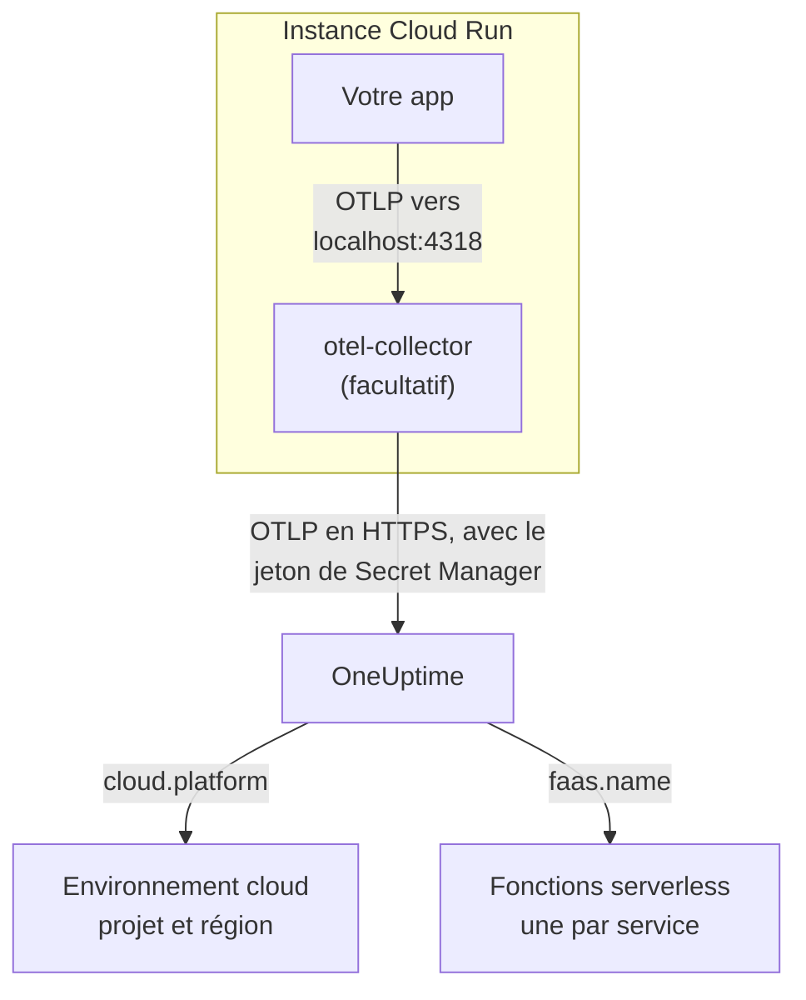

# Google Cloud Run

Envoyez les traces, journaux et métriques de vos services et jobs Cloud Run à OneUptime. Tout ce qui rapporte `cloud.platform=gcp_cloud_run` rejoint un **Environnement cloud** par projet Google Cloud et région, par exemple _GCP Cloud Run · us-central1 · my-project_, et chaque service apparaît aussi sous **Fonctions serverless**.

:::cards
- [Fonctionnement](#fonctionnement): Ce que définit le détecteur GCP, et pourquoi un service apparaît à deux endroits.
- [Mise en place](#mise-en-place): Stocker le jeton, configurer le service, déployer et vérifier.
- [Le YAML du service avec un sidecar](#le-yaml-du-service-avec-un-sidecar): Un service Cloud Run complet avec un collecteur.
- [Dépannage](#dépannage): Erreurs de secret, ordre de démarrage du sidecar et environnements manquants.
:::

## Fonctionnement



Le détecteur de ressources GCP d'OpenTelemetry lit le serveur de métadonnées et les variables d'environnement `K_SERVICE` et `K_REVISION`, et définit :

| Attribut | Valeur sur Cloud Run | Sert à |
| ------------------ | ------------------------------ | ----------------------------------------------------------------------------------------- |
| `cloud.platform` | `gcp_cloud_run` | Classer la télémétrie sous **Environnements cloud** |
| `cloud.account.id` | l'ID du projet | Faire partie de la clé d'environnement |
| `cloud.region` | `us-central1` | Faire partie de la clé d'environnement |
| `faas.name` | le nom du service (`K_SERVICE`) | Lister aussi le service sous **Fonctions serverless** |
| `faas.version` | la révision (`K_REVISION`) | Affiché sur la vue d'ensemble de la fonction serverless du service ; l'environnement ne l'utilise pas |
| `faas.instance` | l'ID de l'instance | Nommer une instance en cours : une ligne chacune sous **Instances** |

> [!NOTE]
> Cloud Run apparaît à deux endroits, exprès. Comme le détecteur définit `faas.name`, chaque service est aussi une **Fonction serverless**, avec ses propres invocations, taux d'erreur et durée. L'**Environnement cloud** regroupe chaque service de ce projet et de cette région. Rien n'est stocké deux fois : la même télémétrie est classée sous les deux.

La clé d'environnement est `gcp_cloud_run|my-project|us-central1`.

## Avant de commencer

- **Une clé d'ingestion.** Créez une clé **Serveur** sous **Paramètres du projet → Télémétrie & APM → Clés d'ingestion** et copiez son jeton.
- **`gcloud`**, connecté au projet, avec l'API Secret Manager activée : `gcloud services enable secretmanager.googleapis.com`.
- **Votre application instrumentée avec un SDK OpenTelemetry** qui exporte en OTLP.

## Choisir comment la télémétrie quitte le service

| | SDK direct | Sidecar collector |
| --------------- | ---------------------------------------------------- | ---------------------------------------------------------------------- |
| Conteneur supplémentaire | Aucun | `otel-collector` dans le service |
| Idéal pour | Un service, et les jobs Cloud Run | Plusieurs services dans un projet, ou un SDK qui ne peut pas exécuter de détecteur |
| Détient le jeton | L'application | Le collecteur |
| Le secret | `oneuptime-otlp-headers`, l'en-tête complet | `oneuptime-ingestion-token`, le jeton seul |

Un job s'exécute jusqu'au bout, il n'y a donc rien pour quoi garder un sidecar en vie : utilisez SDK direct. Chaque étape ci-dessous a un onglet pour chacun ; choisissez-en un et chaque étape le suit.

## Mise en place

:::steps
### Stocker le jeton dans Secret Manager

> [!IMPORTANT]
> Le jeton est un secret. Placez-le dans Secret Manager et référencez-le depuis le service comme variable d'environnement adossée à un secret. Une simple variable d'environnement est visible par chaque lecteur du projet, dans la console et dans `gcloud run services describe`.

:::tabs
@tab SDK direct
```bash
printf '%s' "x-oneuptime-token=YOUR_TELEMETRY_INGESTION_TOKEN" | gcloud secrets create oneuptime-otlp-headers \
  --data-file=- \
  --replication-policy=automatic

gcloud secrets add-iam-policy-binding oneuptime-otlp-headers \
  --member="serviceAccount:checkout-api@my-project.iam.gserviceaccount.com" \
  --role="roles/secretmanager.secretAccessor"
```

Cloud Run place la valeur d'un secret telle quelle dans la variable, et `OTEL_EXPORTER_OTLP_HEADERS` a besoin de la paire `name=value` complète : ce secret contient donc l'en-tête complet.
@tab Sidecar collector
```bash
printf '%s' "YOUR_TELEMETRY_INGESTION_TOKEN" | gcloud secrets create oneuptime-ingestion-token \
  --data-file=- \
  --replication-policy=automatic

gcloud secrets add-iam-policy-binding oneuptime-ingestion-token \
  --member="serviceAccount:checkout-api@my-project.iam.gserviceaccount.com" \
  --role="roles/secretmanager.secretAccessor"
```

La configuration du collecteur ajoute le nom de l'en-tête, ce secret ne contient donc que le jeton.
:::

Mettez dans `--member` le compte de service d'exécution du service, pas votre propre utilisateur. Sans `roles/secretmanager.secretAccessor`, la révision échoue au déploiement avec `Permission denied on secret`. Si le service tourne encore sous le compte de service Compute par défaut, accordez le rôle à ce compte, et envisagez de donner au service son propre compte : celui par défaut est partagé par tout le projet.

### Configurer le service

:::tabs
@tab SDK direct
1. **Google Cloud console → Cloud Run → click the service → Edit & deploy new revision**.
2. Dans l'onglet **Containers**, ouvrez votre conteneur et allez dans **Variables & Secrets**. Ajoutez les variables ci-dessous.
3. Cliquez sur **Reference a secret**, choisissez `oneuptime-otlp-headers`, version `latest`, et exposez-le comme variable d'environnement `OTEL_EXPORTER_OTLP_HEADERS`.
4. Dans l'onglet **Security**, vérifiez que le **Service account** est celui auquel vous avez accordé `roles/secretmanager.secretAccessor`.

```bash
OTEL_SERVICE_NAME=checkout-api
OTEL_EXPORTER_OTLP_ENDPOINT=https://oneuptime.com/otlp
OTEL_EXPORTER_OTLP_PROTOCOL=http/protobuf
# Secret-backed (Variables & Secrets → Reference a secret), not typed here.
OTEL_EXPORTER_OTLP_HEADERS=x-oneuptime-token=YOUR_TELEMETRY_INGESTION_TOKEN
```

Activez ensuite le détecteur de ressources GCP de votre langage :

| Langage | Activer le détecteur GCP |
| -------- | ------------------------------------------------------------------------------------------------------------------- |
| Node.js | `OTEL_NODE_RESOURCE_DETECTORS=env,host,os,gcp` (auto-instrumentations-node) |
| Python | `pip install opentelemetry-resourcedetector-gcp`, puis `OTEL_EXPERIMENTAL_RESOURCE_DETECTORS=gcp_resource_detector` |
| Java | `-Dotel.resource.providers.gcp.enabled=true` |
| Go | `import "go.opentelemetry.io/contrib/detectors/gcp"` et passez `gcp.NewDetector()` à `resource.New` |
| .NET | Le paquet `OpenTelemetry.Resources.Gcp` : `.ConfigureResource(r => r.AddGcpDetector())` |

Ou définissez tout depuis la CLI :

```bash
gcloud run services update checkout-api --region us-central1 \
  --set-env-vars "^@^OTEL_SERVICE_NAME=checkout-api@OTEL_EXPORTER_OTLP_ENDPOINT=https://oneuptime.com/otlp@OTEL_EXPORTER_OTLP_PROTOCOL=http/protobuf@OTEL_NODE_RESOURCE_DETECTORS=env,host,os,gcp" \
  --set-secrets "OTEL_EXPORTER_OTLP_HEADERS=oneuptime-otlp-headers:latest"
```

Le préfixe `^@^` fait découper par `gcloud` la liste de cette option sur `@` au lieu de `,`. Sans lui, `gcloud` découpe `OTEL_NODE_RESOURCE_DETECTORS=env,host,os,gcp` à chaque virgule et échoue avec `Bad syntax for dict arg [host]`.
@tab Sidecar collector
1. **Google Cloud console → Cloud Run → click the service → Edit & deploy new revision**.
2. Dans l'onglet **Containers**, ouvrez votre conteneur et allez dans **Variables & Secrets**. Ajoutez les variables d'application ci-dessous.
3. Cliquez sur **+ Add container**. Indiquez l'URL d'image de conteneur `otel/opentelemetry-collector-contrib:latest`, et sous **Container command and arguments** ajoutez l'argument `--config=env:OTEL_COLLECTOR_CONFIG`.
4. Dans l'onglet **Variables & Secrets** du nouveau conteneur, **Reference a secret** : `oneuptime-ingestion-token`, comme variable d'environnement `ONEUPTIME_TOKEN`. Ajoutez la variable `OTEL_COLLECTOR_CONFIG` avec la configuration du collecteur de [Le YAML du service avec un sidecar](#le-yaml-du-service-avec-un-sidecar).
5. Dans l'onglet **Settings** du collecteur, ajoutez une **Startup probe** (HTTP, chemin `/`, port `13133`), et sous **Container start-up order** rendez votre conteneur dépendant de `otel-collector`.
6. Dans l'onglet **Security**, vérifiez que le **Service account** est celui auquel vous avez accordé `roles/secretmanager.secretAccessor`.

Les conteneurs d'une même instance Cloud Run partagent `localhost`, l'application exporte donc vers le sidecar à cette adresse :

```bash
OTEL_SERVICE_NAME=checkout-api
OTEL_EXPORTER_OTLP_ENDPOINT=http://localhost:4318
OTEL_EXPORTER_OTLP_PROTOCOL=http/protobuf
```

Depuis la CLI, le sidecar correspond au YAML du service ci-dessous, déployé avec `gcloud run services replace service.yaml --region us-central1`.
:::

Si vous hébergez OneUptime vous-même, utilisez `https://YOUR-ONEUPTIME-HOST/otlp` comme point de terminaison.

### Déployer la nouvelle révision

Dans la console, cliquez sur **Deploy**. Cloud Run démarre une nouvelle révision avec les réglages et lui envoie le trafic dès qu'elle est prête. Les commandes `gcloud` déploient une nouvelle révision d'elles-mêmes.

### Vérifier la connexion

```bash
curl -i https://oneuptime.com/otlp/v1/validate \
  -H "x-oneuptime-token: YOUR_TELEMETRY_INGESTION_TOKEN"
```

`200` avec `"valid": true` signifie que le jeton est accepté. `401` signifie qu'il est inconnu, révoqué, désactivé ou expiré. Envoyez ensuite une requête au service, et cherchez dans les journaux du collecteur, dans Cloud Logging (filtrés sur le conteneur `otel-collector`), `401`, `connection refused` ou `context deadline exceeded`. Dans la minute, l'environnement apparaît sous **Cloud → Tous les environnements** sous le nom _GCP Cloud Run · us-central1 · my-project_, et le service sous **Fonctions serverless**.
:::

## Le YAML du service avec un sidecar

Le collecteur lit toute sa configuration depuis `OTEL_COLLECTOR_CONFIG` (`--config=env:OTEL_COLLECTOR_CONFIG`), et le jeton depuis le secret via `${env:ONEUPTIME_TOKEN}`. L'annotation `run.googleapis.com/container-dependencies` fait démarrer d'abord le collecteur par Cloud Run, qui attend sa sonde de démarrage avant de démarrer l'application :

```yaml title="service.yaml"
apiVersion: serving.knative.dev/v1
kind: Service
metadata:
  name: checkout-api
spec:
  template:
    metadata:
      annotations:
        # "app" depends on "otel-collector": the collector starts first and
        # must pass its startup probe before the app container is started.
        run.googleapis.com/container-dependencies: '{"app":["otel-collector"]}'
    spec:
      serviceAccountName: checkout-api@my-project.iam.gserviceaccount.com
      containers:
        - name: app
          image: us-central1-docker.pkg.dev/my-project/apps/checkout-api:1.4.2
          ports:
            - containerPort: 8080
          env:
            - name: OTEL_SERVICE_NAME
              value: checkout-api
            - name: OTEL_EXPORTER_OTLP_ENDPOINT
              value: http://localhost:4318
            - name: OTEL_EXPORTER_OTLP_PROTOCOL
              value: http/protobuf
        - name: otel-collector
          image: otel/opentelemetry-collector-contrib:latest
          args:
            - --config=env:OTEL_COLLECTOR_CONFIG
          env:
            - name: ONEUPTIME_TOKEN
              valueFrom:
                secretKeyRef:
                  name: oneuptime-ingestion-token
                  key: latest
            - name: OTEL_COLLECTOR_CONFIG
              value: |
                receivers:
                  otlp:
                    protocols:
                      http:
                        endpoint: 0.0.0.0:4318
                      grpc:
                        endpoint: 0.0.0.0:4317
                processors:
                  # Stamps cloud.provider, cloud.platform=gcp_cloud_run,
                  # cloud.account.id, cloud.region and faas.* on everything.
                  resourcedetection:
                    detectors: [env, gcp]
                    timeout: 5s
                  batch: {}
                exporters:
                  otlphttp/oneuptime:
                    endpoint: https://oneuptime.com/otlp
                    headers:
                      x-oneuptime-token: ${env:ONEUPTIME_TOKEN}
                extensions:
                  health_check:
                    endpoint: 0.0.0.0:13133
                service:
                  extensions: [health_check]
                  pipelines:
                    traces:
                      receivers: [otlp]
                      processors: [resourcedetection, batch]
                      exporters: [otlphttp/oneuptime]
                    metrics:
                      receivers: [otlp]
                      processors: [resourcedetection, batch]
                      exporters: [otlphttp/oneuptime]
                    logs:
                      receivers: [otlp]
                      processors: [resourcedetection, batch]
                      exporters: [otlphttp/oneuptime]
          startupProbe:
            httpGet:
              path: /
              port: 13133
            periodSeconds: 2
            failureThreshold: 15
          resources:
            limits:
              cpu: 500m
              memory: 256Mi
```

Déployez-le :

```bash
gcloud run services replace service.yaml --region us-central1
```

Seul le conteneur qui reçoit les requêtes (`app`) déclare des `ports` ; un sidecar ne doit pas le faire.

## Réseau

- **Par défaut**, un service Cloud Run atteint Internet directement, et exporter vers `oneuptime.com` ne demande rien de plus.
- **Avec VPC egress: All traffic** (`--vpc-egress all-traffic`, via Direct VPC egress ou un connecteur Serverless VPC Access), le trafic sortant passe par votre VPC, qui a alors besoin de Cloud NAT (ou d'une route vers un proxy) pour atteindre l'hôte OneUptime. Avec la valeur par défaut `private-ranges-only`, seules les adresses privées passent par le VPC et OneUptime est atteint directement.
- **Les règles de pare-feu sortantes** du VPC doivent autoriser TCP 443 vers l'hôte OneUptime.
- **Un OneUptime auto-hébergé dans le VPC** est le cas inverse : faites passer le trafic par le VPC (`private-ranges-only` ou `all-traffic`), pour que `https://YOUR-ONEUPTIME-HOST/otlp` y soit résolu.

## Ce que vous obtenez

- **Vue d'ensemble** : requêtes, taux d'erreur et latence p95 issus de vos traces.
- **Instances** : une ligne par instance Cloud Run, nommée par `faas.instance`. Cloud Run ne montre pas l'utilisation des ressources d'un conteneur à un sidecar, les tuiles **CPU** et **Mémoire** restent donc vides sauf si vous envoyez vous-même des métriques `container.cpu.utilization` et `container.memory.usage` avec le même `faas.instance`. Lisez ici les tuiles de requêtes, et laissez le CPU et la mémoire des instances à Cloud Monitoring.
- **Journaux**, **Traces** et **Métriques**, filtrés sur l'environnement.
- Le même service sous **Fonctions serverless** (par `faas.name`) et sous **Services** (par `service.name`).

## Dépannage

:::details La révision échoue avec "Permission denied on secret"
Le compte de service d'exécution n'a pas `roles/secretmanager.secretAccessor` sur le secret, ou la liaison porte sur un autre secret que celui que référence le service. Relancez la commande `gcloud secrets add-iam-policy-binding` avec le compte de service d'exécution comme `--member`.
:::

:::details Cloud Run refuse container-dependencies
L'annotation nomme un conteneur qui n'existe pas, ou le collecteur n'a pas de sonde de démarrage, si bien que Cloud Run ne peut pas savoir quand il est prêt.
:::

:::details Le service est sous Fonctions serverless, mais aucun environnement n'existe
La télémétrie n'a pas de `cloud.platform` : le détecteur GCP n'est pas activé dans le SDK, ou `gcp` manque dans la liste `detectors` du collecteur.
:::

:::details L'environnement est là, mais Instances est vide
La télémétrie n'a ni `faas.instance` ni `service.instance.id`. La cause est la même : le détecteur ne tourne pas.
:::

Un environnement qui n'apparaît jamais, affiche **Déconnecté** ou se scinde en deux est traité dans [Dépannage cloud](/docs/telemetry/cloud-troubleshooting).

## Prochaines étapes

:::cards
- [Environnements cloud](/docs/telemetry/cloud-environments): Comment les environnements et les instances sont identifiés.
- [Fonctions serverless](/docs/telemetry/serverless-functions): La vue par service de chaque service Cloud Run.
- [Dépannage cloud](/docs/telemetry/cloud-troubleshooting): Les pannes communes à toutes les plateformes.
- [Ressources cloud (IaaS et PaaS)](/docs/telemetry/cloud-resources): Votre Cloud SQL, vos équilibreurs de charge et vos buckets, depuis Cloud Monitoring.
:::
