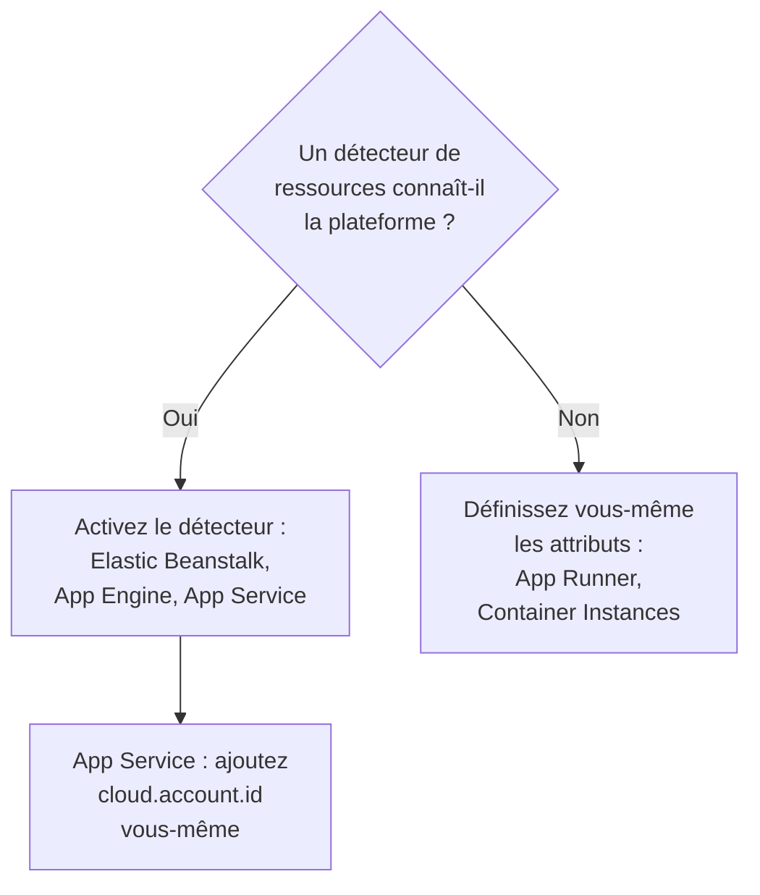

# Autres plateformes cloud

Configurez les plateformes managées qui n'ont pas de page à elles : AWS Elastic Beanstalk, AWS App Runner, Google App Engine, Azure App Service et Azure Container Instances. La règle est la même sur chaque plateforme : la télémétrie qui porte une `cloud.platform` managée, avec `cloud.account.id` et `cloud.region`, rejoint un **Environnement cloud** par plateforme, compte et région, et une identité d'instance donne à chaque instance en cours une ligne sous **Instances**.

:::cards
- [AWS Elastic Beanstalk](#aws-elastic-beanstalk): Un collecteur sur chaque instance, avec les détecteurs Beanstalk et EC2.
- [AWS App Runner](#aws-app-runner): Les attributs définis à la main, le jeton depuis Secrets Manager.
- [Google App Engine](#google-app-engine): Le détecteur GCP, avec les réglages dans `app.yaml`.
- [Azure App Service](#azure-app-service): Les détecteurs Azure, une référence Key Vault et l'abonnement à la main.
- [Azure Container Instances](#azure-container-instances): Les attributs définis à la main, le jeton comme variable sécurisée.
:::

## Ce dont chaque plateforme a besoin

Ce qui diffère entre ces plateformes, c'est qui définit les attributs `cloud.*`, et où vont les réglages dans la console du cloud :



| Plateforme | `cloud.platform` | `cloud.*` renseignés par | Identité d'instance |
| ------------------------- | --------------------------- | ------------------------------------------------------------------------------------------ | ----------------------------------------------------------- |
| AWS Elastic Beanstalk | `aws_elastic_beanstalk` | Les détecteurs `elastic_beanstalk` et `ec2` du Collector ; `aws` en Node.js | `host.id` (supprimez le `service.instance.id` du déploiement) |
| AWS App Runner | `aws_app_runner` | Vous (aucun détecteur) | `host.name` |
| Google App Engine | `gcp_app_engine` | Le détecteur `gcp` (celui du Collector et de chaque SDK) | `faas.instance` |
| Azure App Service | `azure_app_service` | `azureappservice` du Collector, les détecteurs `azure` de Node.js et .NET ; `cloud.account.id` par vous | `service.instance.id`, puis `host.id` |
| Azure Container Instances | `azure_container_instances` | Vous (aucun détecteur) | `host.name` |

Chaque section ci-dessous a besoin d'une clé d'ingestion **Serveur** issue de **Paramètres du projet → Télémétrie & APM → Clés d'ingestion**, et d'une application instrumentée avec un SDK OpenTelemetry. Si vous hébergez OneUptime vous-même, remplacez `https://oneuptime.com/otlp` par `https://YOUR-ONEUPTIME-HOST/otlp`.

> [!IMPORTANT]
> Le jeton est un secret sur chacune de ces plateformes. Chaque section nomme le magasin de secrets de la plateforme. Un jeton saisi dans une simple variable d'environnement peut être lu par toute personne qui peut lire la configuration de l'app.

## AWS Elastic Beanstalk

`cloud.platform` : `aws_elastic_beanstalk`. Le détecteur Beanstalk lit `/var/elasticbeanstalk/xray/environment.conf` sur l'instance et définit `cloud.platform`, `service.instance.id`, `service.version` et le nom de l'environnement. Il ne connaît ni le compte ni la région : associez-le donc au détecteur EC2, qui les connaît, et qui définit aussi `host.id`.

Exécutez un OpenTelemetry Collector sur chaque instance, avec cette configuration :

```yaml title="config.yaml"
receivers:
  otlp:
    protocols:
      http:
        endpoint: 0.0.0.0:4318
      grpc:
        endpoint: 0.0.0.0:4317
processors:
  # elastic_beanstalk sets cloud.platform and service.instance.id; ec2 adds
  # cloud.account.id, cloud.region and host.id. The first detector to set an
  # attribute wins, so elastic_beanstalk comes first.
  resourcedetection:
    detectors: [env, elastic_beanstalk, ec2]
    timeout: 5s
  # The Beanstalk detector's service.instance.id is the deployment ID, shared
  # by every instance of a deployment: drop it, so that ec2's host.id names
  # each instance.
  resource:
    attributes:
      - key: service.instance.id
        action: delete
  batch: {}
exporters:
  otlphttp/oneuptime:
    endpoint: https://oneuptime.com/otlp
    headers:
      x-oneuptime-token: ${env:ONEUPTIME_TOKEN}
service:
  pipelines:
    traces:
      receivers: [otlp]
      processors: [resourcedetection, resource, batch]
      exporters: [otlphttp/oneuptime]
    metrics:
      receivers: [otlp]
      processors: [resourcedetection, resource, batch]
      exporters: [otlphttp/oneuptime]
    logs:
      receivers: [otlp]
      processors: [resourcedetection, resource, batch]
      exporters: [otlphttp/oneuptime]
```

:::steps
1. Stockez le jeton dans Secrets Manager : `aws secretsmanager create-secret --name oneuptime/ingestion-token --secret-string "YOUR_TELEMETRY_INGESTION_TOKEN"`. Les propriétés d'environnement de Beanstalk sont conservées dans la configuration de l'environnement, pas dans un magasin de secrets : lisez donc plutôt le secret depuis un hook de plateforme, avec le profil d'instance. Le profil d'instance a besoin de `secretsmanager:GetSecretValue` dessus.
2. Installez le collecteur depuis un script `.platform/hooks/postdeploy/` (ou `.ebextensions`) : le paquet `otelcol-contrib`, avec la configuration ci-dessus et le secret dans son environnement sous le nom `ONEUPTIME_TOKEN`.
3. **AWS Console → Elastic Beanstalk → Environments → your environment → Configuration**.
4. Dans la catégorie **Updates, monitoring, and logging**, cliquez sur **Edit** et descendez jusqu'à **Environment properties**. Ajoutez `OTEL_SERVICE_NAME`, `OTEL_EXPORTER_OTLP_ENDPOINT` avec `http://localhost:4318`, et `OTEL_EXPORTER_OTLP_PROTOCOL` avec `http/protobuf`.
5. Cliquez sur **Apply**. Beanstalk redémarre l'application avec les nouvelles propriétés.
:::

Les applications Node.js peuvent se passer du collecteur : les détecteurs du SDK incluent Beanstalk et EC2. Définissez `OTEL_EXPORTER_OTLP_ENDPOINT` à `https://oneuptime.com/otlp`, `OTEL_EXPORTER_OTLP_HEADERS` à `x-oneuptime-token=YOUR_TELEMETRY_INGESTION_TOKEN` et `OTEL_NODE_RESOURCE_DETECTORS=env,host,os,aws`. Le jeton se trouve alors dans une propriété d'environnement. Vérifiez ensuite les attributs de ressource d'une trace : si `cloud.platform` vaut `aws_ec2`, votre version du SDK a laissé gagner le détecteur EC2, et le collecteur est la voie fiable.

**Réseau :** les instances d'un sous-réseau privé ont besoin d'une passerelle NAT, et le groupe de sécurité de l'instance doit autoriser le trafic sortant sur TCP 443 vers l'hôte OneUptime.

## AWS App Runner

`cloud.platform` : `aws_app_runner`. Aucun détecteur n'existe, vous définissez donc les attributs vous-même. App Runner peut placer un secret de Secrets Manager (ou de SSM Parameter Store) dans une variable d'environnement.

```bash
OTEL_SERVICE_NAME=checkout-api
OTEL_EXPORTER_OTLP_ENDPOINT=https://oneuptime.com/otlp
OTEL_EXPORTER_OTLP_PROTOCOL=http/protobuf
# From Secrets Manager: the secret holds the whole header.
OTEL_EXPORTER_OTLP_HEADERS=x-oneuptime-token=YOUR_TELEMETRY_INGESTION_TOKEN
OTEL_RESOURCE_ATTRIBUTES=cloud.provider=aws,cloud.platform=aws_app_runner,cloud.region=us-east-1,cloud.account.id=123456789012
OTEL_NODE_RESOURCE_DETECTORS=env,host,os
```

Remplacez la région et l'ID de compte par les vôtres. Le détecteur `host` fournit `host.name`, le nom d'hôte du conteneur, qui diffère pour chaque instance App Runner, et OneUptime nomme l'instance ainsi.

:::steps
1. Stockez l'en-tête complet dans Secrets Manager : `aws secretsmanager create-secret --name oneuptime/otlp-headers --secret-string "x-oneuptime-token=YOUR_TELEMETRY_INGESTION_TOKEN"`. App Runner place la valeur du secret telle quelle dans la variable.
2. **AWS Console → App Runner → Services → your service → Configuration → Configure service** (dans l'onglet **Configuration**, cliquez sur **Edit**).
3. Sous **Environment variables**, cliquez sur **Add environment variable** pour chaque valeur simple ci-dessus.
4. Ajoutez `OTEL_EXPORTER_OTLP_HEADERS` avec **Source: Secrets Manager** et l'ARN du secret. Sous **Security → Instance role**, choisissez un rôle qui a `secretsmanager:GetSecretValue` sur le secret : le rôle d'instance, pas le rôle d'accès qui récupère l'image.
5. Cliquez sur **Save changes**. App Runner déploie une nouvelle version.
:::

**Réseau :** un service sans connecteur VPC atteint Internet directement. Avec **Outgoing network traffic: Custom VPC**, le trafic sortant passe par votre VPC, qui a besoin d'une passerelle NAT et d'une règle sortante du groupe de sécurité sur TCP 443 vers l'hôte OneUptime.

## Google App Engine

`cloud.platform` : `gcp_app_engine`. Le détecteur GCP reconnaît App Engine standard et flexible grâce à `GAE_SERVICE`, `GAE_VERSION` et `GAE_INSTANCE` et au serveur de métadonnées. Il définit `cloud.account.id` (le projet), `cloud.region`, `faas.name`, `faas.version` et `faas.instance`. Comme sur Cloud Run, `faas.name` fait aussi apparaître chaque service App Engine sous **Fonctions serverless**, tandis que l'environnement regroupe le projet et la région.

| Langage | Activer le détecteur GCP |
| -------- | ------------------------------------------------------------------------------------------------------------------- |
| Node.js | `OTEL_NODE_RESOURCE_DETECTORS=env,host,os,gcp` |
| Python | `pip install opentelemetry-resourcedetector-gcp`, puis `OTEL_EXPERIMENTAL_RESOURCE_DETECTORS=gcp_resource_detector` |
| Java | `-Dotel.resource.providers.gcp.enabled=true` |
| Go | `go.opentelemetry.io/contrib/detectors/gcp` → `gcp.NewDetector()` |
| .NET | `OpenTelemetry.Resources.Gcp` → `.AddGcpDetector()` |

App Engine n'a pas d'éditeur de variables d'environnement dans la console : elles vivent dans `app.yaml`.

```yaml title="app.yaml"
runtime: nodejs22
env_variables:
  OTEL_SERVICE_NAME: checkout-api
  OTEL_EXPORTER_OTLP_ENDPOINT: https://oneuptime.com/otlp
  OTEL_EXPORTER_OTLP_PROTOCOL: http/protobuf
  OTEL_NODE_RESOURCE_DETECTORS: env,host,os,gcp
  # Do not commit the real value. Template it in CI, or read the secret at
  # start-up with the Secret Manager client instead.
  OTEL_EXPORTER_OTLP_HEADERS: x-oneuptime-token=YOUR_TELEMETRY_INGESTION_TOKEN
```

:::steps
1. Stockez l'en-tête complet dans Secret Manager : `printf '%s' "x-oneuptime-token=YOUR_TELEMETRY_INGESTION_TOKEN" | gcloud secrets create oneuptime-otlp-headers --data-file=-`. Accordez au compte de service App Engine (`my-project@appspot.gserviceaccount.com`) `roles/secretmanager.secretAccessor` dessus.
2. Insérez le secret dans `app.yaml` dans votre pipeline de déploiement, en gardant un espace réservé dans le fichier versionné. Ou lisez `projects/PROJECT_ID/secrets/oneuptime-otlp-headers/versions/latest` au démarrage et passez-le à l'option `headers` de l'exportateur dans le code.
3. Déployez avec `gcloud app deploy`. Dans la console, **App Engine → Versions** affiche la nouvelle version, et **App Engine → Services** le service qui apparaît sous **Fonctions serverless**.
:::

**Réseau :** App Engine standard atteint Internet directement. Les instances de l'environnement flexible vivent dans un VPC : si le sous-réseau n'a pas d'IP externes, elles ont besoin de Cloud NAT, et d'une règle de pare-feu sortante sur TCP 443 vers l'hôte OneUptime.

## Azure App Service

`cloud.platform` : `azure_app_service`. Les détecteurs Azure de Node.js et .NET, et le détecteur `azureappservice` du Collector, lisent les variables `WEBSITE_*` que définit App Service. Ils renseignent `cloud.platform`, `cloud.region`, `service.instance.id` (à partir de `WEBSITE_INSTANCE_ID`), `deployment.environment` (l'emplacement) et `host.id`. Aucun d'eux ne définit `cloud.account.id` : ajoutez vous-même l'ID d'abonnement, sinon la clé d'environnement reçoit un segment de compte vide.

```bash
OTEL_SERVICE_NAME=checkout-api
OTEL_EXPORTER_OTLP_ENDPOINT=https://oneuptime.com/otlp
OTEL_EXPORTER_OTLP_PROTOCOL=http/protobuf
# The Key Vault reference, which resolves to the whole header.
OTEL_EXPORTER_OTLP_HEADERS=@Microsoft.KeyVault(SecretUri=https://my-vault.vault.azure.net/secrets/oneuptime-otlp-headers/)
OTEL_RESOURCE_ATTRIBUTES=cloud.account.id=00000000-0000-0000-0000-000000000000
# Node.js:
OTEL_NODE_RESOURCE_DETECTORS=env,host,os,azure
```

Les détecteurs des SDK écrivent la plateforme `azure.app_service`, avec un point ; OneUptime la réécrit en `azure_app_service` à la réception. En .NET, ajoutez `OpenTelemetry.Resources.Azure` et appelez `.ConfigureResource(r => r.AddAzureAppServiceDetector())`. Les autres langages ajoutent `cloud.provider=azure,cloud.platform=azure_app_service,cloud.region=<region>` à `OTEL_RESOURCE_ATTRIBUTES`, et prennent `service.instance.id` dans `WEBSITE_INSTANCE_ID` dans le code.

:::steps
1. Activez l'identité managée attribuée par le système de l'app (**Settings → Identity**), et accordez-lui **Key Vault Secrets User** sur le coffre. Stockez l'en-tête complet, `x-oneuptime-token=YOUR_TELEMETRY_INGESTION_TOKEN`, comme secret `oneuptime-otlp-headers`.
2. **Azure portal → App Services → your app → Settings → Environment variables** (**Configuration → Application settings** sur les anciens portails).
3. **+ Add** pour chaque variable ci-dessus. La valeur de `OTEL_EXPORTER_OTLP_HEADERS` est la référence Key Vault.
4. Cliquez sur **Apply**, puis sur **Confirm** : l'app redémarre avec les nouveaux réglages. Les emplacements de déploiement ont leurs propres réglages : cochez **deployment slot setting** pour le jeton si un seul emplacement doit envoyer de la télémétrie.
:::

**Réseau :** App Service atteint Internet directement, sauf si **VNet integration** avec **Route All** est activé. Le VNet a alors besoin d'une passerelle NAT, ou d'une route vers un pare-feu qui autorise TCP 443 vers l'hôte OneUptime.

## Azure Container Instances

`cloud.platform` : `azure_container_instances`. Aucun détecteur n'existe, vous définissez donc les attributs vous-même. Les variables d'environnement d'un groupe de conteneurs sont fixées à la création : en changer une revient à recréer le groupe. Passez le jeton avec `--secure-environment-variables`, pour que `az container show` ne le renvoie pas :

```bash
az container create \
  --resource-group my-rg \
  --name checkout-api \
  --image myregistry.azurecr.io/checkout-api:1.4.2 \
  --location eastus \
  --environment-variables \
    OTEL_SERVICE_NAME=checkout-api \
    OTEL_EXPORTER_OTLP_ENDPOINT=https://oneuptime.com/otlp \
    OTEL_EXPORTER_OTLP_PROTOCOL=http/protobuf \
    "OTEL_RESOURCE_ATTRIBUTES=cloud.provider=azure,cloud.platform=azure_container_instances,cloud.region=eastus,cloud.account.id=00000000-0000-0000-0000-000000000000" \
    OTEL_NODE_RESOURCE_DETECTORS=env,host,os \
  --secure-environment-variables \
    "OTEL_EXPORTER_OTLP_HEADERS=x-oneuptime-token=YOUR_TELEMETRY_INGESTION_TOKEN"
```

Le `host.name` du détecteur `host`, le nom d'hôte du groupe de conteneurs, nomme l'instance. Un collecteur sidecar fonctionne ici aussi, puisqu'un groupe de conteneurs exécute plusieurs conteneurs comme une tâche ECS : utilisez le modèle `detectors: [env]` plus `OTEL_RESOURCE_ATTRIBUTES` d'[Azure Container Apps](/docs/telemetry/cloud-azure-container-apps). C'est aussi lui qui remplit les tuiles **CPU** et **Mémoire**, s'il envoie `container.cpu.utilization` et `container.memory.usage` avec l'identité du groupe.

:::steps
1. **Azure portal → Container Instances → + Create**. Remplissez l'onglet **Basics** : groupe de ressources, nom, région et image.
2. Dans l'onglet **Advanced**, sous **Environment variables**, ajoutez chaque variable. Pour `OTEL_EXPORTER_OTLP_HEADERS`, réglez **Mark as secure** sur **Yes**, pour que le portail et l'API n'affichent pas sa valeur.
3. Cliquez sur **Review + create**, puis sur **Create**. Pour changer une variable plus tard, supprimez le groupe et recréez-le.
:::

**Réseau :** un groupe de conteneurs avec une IP publique atteint Internet directement. Un groupe dans un sous-réseau VNet ne sort que par la route du VNet : ajoutez une passerelle NAT, ou autorisez TCP 443 vers l'hôte OneUptime sur le pare-feu ou le NSG.

## Vérifier la connexion

Quelle que soit la plateforme configurée, vérifiez d'abord le jeton, puis cherchez l'environnement :

```bash
curl -i https://oneuptime.com/otlp/v1/validate \
  -H "x-oneuptime-token: YOUR_TELEMETRY_INGESTION_TOKEN"
```

`200` avec `"valid": true` signifie que le jeton est accepté. `401` signifie qu'il est inconnu, révoqué, désactivé ou expiré. Dans la minute qui suit le premier span, log ou métrique, l'environnement apparaît sous **Cloud → Tous les environnements**, nommé d'après la plateforme, la région et le compte.

## Dépannage

:::details Les instances Beanstalk apparaissent sous Hôtes
Le `cloud.platform=aws_ec2` du détecteur EC2 l'a emporté. Le premier détecteur qui définit un attribut l'emporte : gardez donc `elastic_beanstalk` avant `ec2` dans `detectors`. Sans collecteur, le SDK Node.js peut aussi favoriser le détecteur EC2 : exécutez le collecteur.
:::

:::details Toutes les instances Beanstalk partagent une ligne sous Instances
Le `service.instance.id` du détecteur Beanstalk est l'ID du déploiement, partagé par toutes les instances d'un déploiement, et il est lu avant `host.id`. Gardez dans chaque pipeline le processeur `resource` qui le supprime.
:::

:::details Une app App Service reçoit 401
La référence Key Vault ne s'est pas résolue, App Service a donc transmis le texte littéral `@Microsoft.KeyVault(...)` comme en-tête. Donnez à l'identité managée de l'app **Key Vault Secrets User** sur le coffre, et vérifiez que le secret contient l'en-tête complet `x-oneuptime-token=...`.
:::

:::details Un environnement App Service a un segment de compte vide
Aucun des détecteurs App Service ne définit `cloud.account.id`. Ajoutez l'ID d'abonnement à `OTEL_RESOURCE_ATTRIBUTES` sur chaque app : la télémétrie avec et sans lui arrive dans deux environnements.
:::

:::details Une variable de Container Instances modifiée n'a aucun effet
Les variables d'environnement d'un groupe de conteneurs sont fixées à la création. Supprimez le groupe et recréez-le avec les nouvelles valeurs.
:::

Voir [Dépannage cloud](/docs/telemetry/cloud-troubleshooting) pour le reste, en particulier un environnement qui apparaît sous **Hôtes**, seulement sous **Fonctions serverless** (App Engine sans le détecteur GCP), ou en double (`cloud.account.id` défini sur certains déploiements et pas sur d'autres).

## Prochaines étapes

:::cards
- [Environnements cloud](/docs/telemetry/cloud-environments): Comment les environnements et les instances sont identifiés.
- [Dépannage cloud](/docs/telemetry/cloud-troubleshooting): Les pannes communes à toutes les plateformes.
- [Fonctions serverless](/docs/telemetry/serverless-functions): Lambda, Cloud Functions et Azure Functions.
- [Ressources cloud (IaaS et PaaS)](/docs/telemetry/cloud-resources): Les ressources autour de vos apps, depuis la propre surveillance de votre cloud.
:::
