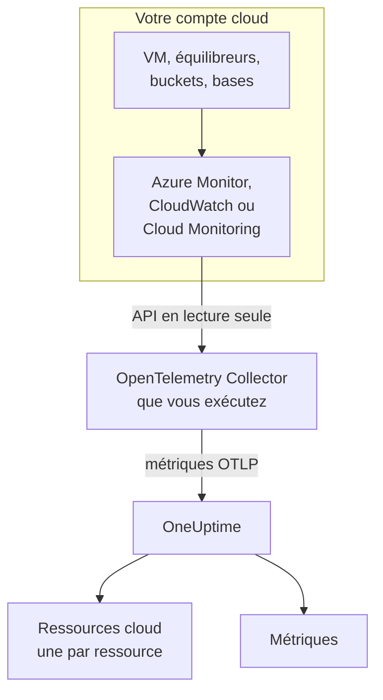
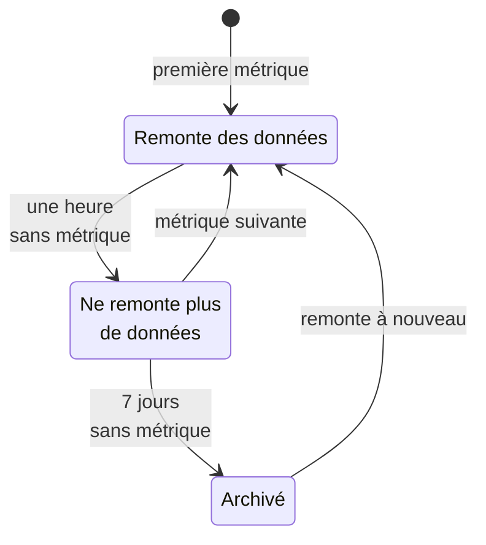

# Ressources cloud (IaaS et PaaS)

**Ressources cloud** liste les ressources IaaS et PaaS de vos comptes AWS, Azure et Google Cloud : machines virtuelles, disques, équilibreurs de charge, buckets, bases de données managées, caches, files d'attente, passerelles d'API et le reste. Chacune a sa propre page, avec son type, sa région et son compte, l'ID que lui donne le fournisseur, chaque métrique que le fournisseur publie à son sujet, et des propriétaires et étiquettes comme toute autre ressource dans OneUptime. Vous les trouvez sous **Cloud → Toutes les ressources**.

:::cards
- [Connecter Azure](#connecter-azure): Lire chaque ressource d'un abonnement depuis Azure Monitor.
- [Connecter AWS](#connecter-aws): Interroger CloudWatch, ou le diffuser via Amazon Data Firehose.
- [Connecter Google Cloud](#connecter-google-cloud): Lire les services d'un projet depuis Cloud Monitoring.
- [Comment une ressource est identifiée](#comment-une-ressource-est-identifiée): Chaque type de ressource que OneUptime reconnaît, par fournisseur.
:::

## Fonctionnement



- **Le fournisseur mesure déjà vos ressources.** Azure Monitor, Amazon CloudWatch et Google Cloud Monitoring publient des métriques sur chaque ressource qu'ils exécutent pour vous.
- **Un collecteur que vous exécutez les lit.** Un OpenTelemetry Collector avec un accès en lecture seule à ce service de surveillance exporte les métriques vers OneUptime. Rien n'est installé sur les ressources, et OneUptime ne détient jamais vos identifiants cloud : c'est le collecteur qui les détient, dans votre environnement.
- **Chaque ressource apparaît avec sa première métrique.** OneUptime déduit de chaque point de données la ressource concernée, et crée la ressource cloud la première fois qu'il la voit.

Ressources cloud est l'un des endroits où votre cloud apparaît :

| Vous exécutez | Où cela apparaît | Comment |
| --- | --- | --- |
| Des conteneurs sur ECS, Cloud Run, Container Apps, App Service, … | **Cloud → Tous les environnements** | La télémétrie propre de vos charges de travail, par son `cloud.platform`. Voir [Environnements cloud](/docs/telemetry/cloud-environments) |
| Toute ressource IaaS ou PaaS que le fournisseur surveille | **Cloud → Toutes les ressources** | L'API de surveillance du fournisseur, lue par un collecteur : cette page |
| Des machines virtuelles avec un OpenTelemetry Collector | **Hôtes** | Les métriques et journaux propres de l'hôte. Voir [Collecteur OpenTelemetry sur l'hôte](/docs/telemetry/host-otel-collector) |
| Les files d'attente et topics que vos applications utilisent | **Files d'attente** | Des spans, et les mêmes métriques cloud. Voir [Files d'attente](/docs/telemetry/queues) |

Une ressource peut apparaître à plusieurs endroits. Une machine virtuelle sur laquelle tourne le collecteur est un **Hôte**, et ses métriques de plateforme (crédits CPU, disque et réseau vus par l'hyperviseur) en font aussi une **Ressource cloud**. Une file SQS est une **File d'attente** et une **Ressource cloud**. Chaque vue montre ce que sa source sait.

## Avant de commencer

- **Une clé d'ingestion.** Créez une clé **Serveur** sous **Paramètres du projet → Télémétrie & APM → Clés d'ingestion**. Les collecteurs ci-dessous la lisent dans la variable d'environnement `ONEUPTIME_TOKEN`, jamais dans leur fichier de configuration.
- **Un endroit où exécuter l'OpenTelemetry Collector** : la distribution `otelcol-contrib`, image `otel/opentelemetry-collector-contrib`, avec un accès sortant vers votre fournisseur cloud et vers OneUptime. Une petite VM, un conteneur ou votre cluster Kubernetes conviennent, et un collecteur peut lire plusieurs comptes et fournisseurs.
- **Un accès en lecture à l'API de surveillance du fournisseur.** La première étape de chaque fournisseur ci-dessous le crée.

> [!TIP]
> Les mêmes étapes figurent dans le tableau de bord, avec votre jeton déjà renseigné : sous **Cloud → Toutes les ressources** jusqu'à l'arrivée de la première ressource, et dans l'onglet **Documentation** de chaque ressource, qui s'ouvre sur son propre fournisseur.

Si vous hébergez OneUptime vous-même, remplacez `https://oneuptime.com/otlp` par `https://YOUR-ONEUPTIME-HOST/otlp`.

## Connecter Azure

Le récepteur `azure_monitor` liste les ressources d'un abonnement et lit leurs métriques de plateforme chaque minute. Sans liste `services`, il lit tous les types de ressources, si bien que chaque ressource de l'abonnement devient une ressource cloud.

:::steps
### Créer un principal de service Monitoring Reader

**Monitoring Reader** lit les métriques et liste les ressources, et ne peut rien modifier :

```bash
az ad sp create-for-rbac \
  --name oneuptime-cloud-collector \
  --role "Monitoring Reader" \
  --scopes /subscriptions/<SUBSCRIPTION_ID>
```

Il affiche un `appId` (l'ID client), un `password` (le secret client) et le `tenant`. Donnez au même principal de service le rôle sur d'autres abonnements pour les lire avec le même collecteur.

### Configurer le récepteur Azure Monitor

Enregistrez ceci sous `config.yaml` :

```yaml
extensions:
  azure_auth:
    service_principal:
      tenant_id: ${env:AZURE_TENANT_ID}
      client_id: ${env:AZURE_CLIENT_ID}
      client_secret: ${env:AZURE_CLIENT_SECRET}

receivers:
  azure_monitor:
    subscription_ids: ["${env:AZURE_SUBSCRIPTION_ID}"]
    auth:
      authenticator: azure_auth
    collection_interval: 60s
    # No `services` list: every resource type in the subscription.
    # Series Azure returns per metric and resource (default 10).
    maximum_number_of_records_per_resource: 50

processors:
  batch: {}

exporters:
  otlphttp/oneuptime:
    endpoint: https://oneuptime.com/otlp
    headers:
      x-oneuptime-token: ${env:ONEUPTIME_TOKEN}

service:
  extensions: [azure_auth]
  pipelines:
    metrics:
      receivers: [azure_monitor]
      processors: [batch]
      exporters: [otlphttp/oneuptime]
```

### Exécuter le collecteur Azure

```bash
docker run -d --name oneuptime-cloud-collector --restart unless-stopped \
  -e ONEUPTIME_TOKEN=YOUR_TELEMETRY_INGESTION_TOKEN \
  -e AZURE_TENANT_ID=<TENANT> \
  -e AZURE_CLIENT_ID=<APP_ID> \
  -e AZURE_CLIENT_SECRET=<PASSWORD> \
  -e AZURE_SUBSCRIPTION_ID=<SUBSCRIPTION_ID> \
  -v "$(pwd)/config.yaml:/etc/otelcol-contrib/config.yaml" \
  otel/opentelemetry-collector-contrib:latest
```

Les ressources apparaissent sous **Cloud → Toutes les ressources** en quelques minutes.
:::

Options du récepteur `azure_monitor` :

| Option | Ce qu'elle fait |
| --- | --- |
| `resource_groups`, `services`, `resource_tags` | Lire moins : une liste de groupes de ressources, de types Resource Manager (`Microsoft.Compute/virtualMachines`), ou de tags qu'une ressource doit porter |
| `metrics` | Limite chaque type de ressource aux métriques et agrégations listées. Dès qu'un type est listé, seules ses métriques listées sont lues |
| `discover_subscriptions: true` | Lit chaque abonnement que le principal de service peut voir, au lieu de `subscription_ids` |
| `maximum_number_of_records_per_resource` | Combien de séries Azure renvoie par métrique et par ressource (10 par défaut). Augmentez-le quand une métrique se divise selon une dimension aux nombreuses valeurs |
| `use_batch_api: true` | Pour les grands abonnements. Le récepteur fait un appel Resource Manager par ressource et par lot de 20 métriques, et Resource Manager autorise environ 12 000 lectures par heure ; l'API batch lit jusqu'à 50 ressources par appel depuis le plan de données d'Azure Monitor, dont la limite est bien plus élevée |
| `cache_resources` | À quelle fréquence, en secondes, le récepteur liste les ressources : une fois par jour par défaut. Une ressource créée après le démarrage du collecteur peut mettre jusqu'à un jour à apparaître ; redémarrez le collecteur pour les lister tout de suite |

## Connecter AWS

Les métriques CloudWatch arrivent dans OneUptime de l'une de deux façons :

| | Interrogation | Metric Streams |
| --- | --- | --- |
| Comment | Le récepteur `aws_cloudwatch` du collecteur interroge CloudWatch | CloudWatch pousse via Amazon Data Firehose vers le récepteur `awsfirehose` du collecteur |
| Requis côté AWS | Des identifiants seulement | Un flux Firehose et un metric stream dans chaque région |
| Le collecteur doit être joignable depuis AWS | Non | Oui, en HTTPS sur le port 443 |
| Délai | 10 à 20 minutes | Quelques minutes |
| Convient à | La plupart des comptes | Les grands comptes |

### Interrogation avec le récepteur aws_cloudwatch

:::steps
#### Autoriser le collecteur à lire CloudWatch

Attachez cette stratégie au rôle sous lequel le collecteur tourne (un profil d'instance EC2, un rôle de tâche ECS, un compte de service EKS), ou à un utilisateur IAM dont vous lui donnez les clés d'accès :

```json
{
  "Version": "2012-10-17",
  "Statement": [
    {
      "Effect": "Allow",
      "Action": [
        "cloudwatch:ListMetrics",
        "cloudwatch:GetMetricData",
        "sts:GetCallerIdentity"
      ],
      "Resource": "*"
    }
  ]
}
```

`sts:GetCallerIdentity` permet au récepteur de rapporter l'ID de compte, dont l'ARN de chaque ressource a besoin.

#### Configurer les récepteurs CloudWatch

Un récepteur lit un namespace dans une région : ajoutez-en donc un pour chaque namespace et chaque région voulus. Cet exemple lit les plus courants ; enregistrez-le sous `config.yaml` :

```yaml
receivers:
  aws_cloudwatch/ec2:
    region: ${env:AWS_REGION}
    metrics:
      collection_interval: 5m
      period: 5m
      delay: 10m
      discovery:
        filters:
          namespace: AWS/EC2
        # Metrics read per scrape, at most. Each costs 4 GetMetricData queries.
        limit: 1000
  aws_cloudwatch/ebs:
    region: ${env:AWS_REGION}
    metrics:
      collection_interval: 5m
      period: 5m
      delay: 10m
      discovery:
        filters:
          namespace: AWS/EBS
        # Metrics read per scrape, at most. Each costs 4 GetMetricData queries.
        limit: 1000
  aws_cloudwatch/applicationelb:
    region: ${env:AWS_REGION}
    metrics:
      collection_interval: 5m
      period: 5m
      delay: 10m
      discovery:
        filters:
          namespace: AWS/ApplicationELB
        # Metrics read per scrape, at most. Each costs 4 GetMetricData queries.
        limit: 1000
  aws_cloudwatch/rds:
    region: ${env:AWS_REGION}
    metrics:
      collection_interval: 5m
      period: 5m
      delay: 10m
      discovery:
        filters:
          namespace: AWS/RDS
        # Metrics read per scrape, at most. Each costs 4 GetMetricData queries.
        limit: 1000
  aws_cloudwatch/lambda:
    region: ${env:AWS_REGION}
    metrics:
      collection_interval: 5m
      period: 5m
      delay: 10m
      discovery:
        filters:
          namespace: AWS/Lambda
        # Metrics read per scrape, at most. Each costs 4 GetMetricData queries.
        limit: 1000
  aws_cloudwatch/dynamodb:
    region: ${env:AWS_REGION}
    metrics:
      collection_interval: 5m
      period: 5m
      delay: 10m
      discovery:
        filters:
          namespace: AWS/DynamoDB
        # Metrics read per scrape, at most. Each costs 4 GetMetricData queries.
        limit: 1000

processors:
  batch: {}

exporters:
  otlphttp/oneuptime:
    endpoint: https://oneuptime.com/otlp
    headers:
      x-oneuptime-token: ${env:ONEUPTIME_TOKEN}

service:
  pipelines:
    metrics:
      receivers: [aws_cloudwatch/ec2, aws_cloudwatch/ebs, aws_cloudwatch/applicationelb, aws_cloudwatch/rds, aws_cloudwatch/lambda, aws_cloudwatch/dynamodb]
      processors: [batch]
      exporters: [otlphttp/oneuptime]
```

#### Exécuter le collecteur CloudWatch

```bash
docker run -d --name oneuptime-cloud-collector --restart unless-stopped \
  -e ONEUPTIME_TOKEN=YOUR_TELEMETRY_INGESTION_TOKEN \
  -e AWS_REGION=us-east-1 \
  -e AWS_ACCESS_KEY_ID=<ACCESS_KEY_ID> \
  -e AWS_SECRET_ACCESS_KEY=<SECRET_ACCESS_KEY> \
  -v "$(pwd)/config.yaml:/etc/otelcol-contrib/config.yaml" \
  otel/opentelemetry-collector-contrib:latest
```

Sur une instance EC2, une tâche ECS ou un pod EKS qui a le rôle, omettez les deux variables de clé.
:::

- **Laissez `stats` non défini.** Chaque métrique est alors lue comme un résumé par période : quatre statistiques, quatre requêtes `GetMetricData`, et AWS facture `GetMetricData` par métrique demandée. `discovery.limit` plafonne les métriques qu'un récepteur lit par collecte (définissez-le : la valeur par défaut du récepteur est 100), et un `collection_interval` plus long les lit moins souvent.
- **Les données arrivent en retard.** `delay` attend que CloudWatch publie une période, si bien que les points de données arrivent 10 à 20 minutes après l'instant qu'ils mesurent, et que les ressources apparaissent en une vingtaine de minutes.

### Diffusion avec CloudWatch Metric Streams

:::steps
#### Configurer le récepteur Firehose

Le collecteur a besoin d'un certificat pour son adresse : Firehose ne livre qu'en `https://` sur le port 443. Enregistrez ceci sous `config.yaml` :

```yaml
extensions:
  awscloudwatchmetricstreams_encoding:
    format: opentelemetry1.0

receivers:
  awsfirehose:
    # Firehose delivers to HTTPS on port 443 only: expose this port as
    # 443, for example behind a load balancer.
    endpoint: 0.0.0.0:4433
    encoding: awscloudwatchmetricstreams_encoding
    access_key: ${env:FIREHOSE_ACCESS_KEY}
    tls:
      cert_file: /etc/otelcol-contrib/tls/server.crt
      key_file: /etc/otelcol-contrib/tls/server.key

processors:
  batch: {}

exporters:
  otlphttp/oneuptime:
    endpoint: https://oneuptime.com/otlp
    headers:
      x-oneuptime-token: ${env:ONEUPTIME_TOKEN}

service:
  extensions: [awscloudwatchmetricstreams_encoding]
  pipelines:
    metrics:
      receivers: [awsfirehose]
      processors: [batch]
      exporters: [otlphttp/oneuptime]
```

#### Exécuter le collecteur Firehose

```bash
docker run -d --name oneuptime-cloud-collector --restart unless-stopped \
  -e ONEUPTIME_TOKEN=YOUR_TELEMETRY_INGESTION_TOKEN \
  -e FIREHOSE_ACCESS_KEY=<A_LONG_RANDOM_SECRET> \
  -p 4433:4433 \
  -v "$(pwd)/tls:/etc/otelcol-contrib/tls:ro" \
  -v "$(pwd)/config.yaml:/etc/otelcol-contrib/config.yaml" \
  otel/opentelemetry-collector-contrib:latest
```

Le certificat et sa clé vont dans `tls/`, sous les noms `server.crt` et `server.key`. Publiez le port 4433 derrière quelque chose qui répond sur 443, par exemple un équilibreur de charge.

#### Créer le flux Firehose et le metric stream

1. **Amazon Data Firehose → Create Firehose stream** : source **Direct PUT**, destination **HTTP Endpoint**. L'URL du point de terminaison est l'adresse `https://` du collecteur ; la clé d'accès est `FIREHOSE_ACCESS_KEY`. Choisissez ou créez un bucket S3 pour les livraisons échouées.
2. **CloudWatch → Metrics → Streams → Create metric stream** : les namespaces à inclure (ou tous), le flux Firehose, et le format de sortie **OpenTelemetry 1.0**.
3. Répétez dans chaque région : un metric stream transporte les métriques de sa propre région.
:::

AWS facture un metric stream par mise à jour de métrique livrée, plus les frais de données de Firehose : n'incluez donc que les namespaces voulus. Un flux au format **JSON** (`format: json` sur l'extension d'encodage) nomme les mêmes ressources, mais écrit aussi chaque namespace dans `service.name`, si bien que chaque namespace apparaît aussi sous **Services** : préférez **OpenTelemetry 1.0**.

## Connecter Google Cloud

Le récepteur `googlecloudmonitoring` lit les types de métriques que nomme sa `metrics_list`, pour un projet.

:::steps
### Créer un compte de service Monitoring Viewer

**Monitoring Viewer** lit les métriques, et ne peut rien modifier :

```bash
gcloud iam service-accounts create oneuptime-cloud-collector \
  --project <PROJECT_ID>

gcloud projects add-iam-policy-binding <PROJECT_ID> \
  --member "serviceAccount:oneuptime-cloud-collector@<PROJECT_ID>.iam.gserviceaccount.com" \
  --role roles/monitoring.viewer

gcloud iam service-accounts keys create key.json \
  --iam-account oneuptime-cloud-collector@<PROJECT_ID>.iam.gserviceaccount.com
```

Sur Google Cloud lui-même, exécutez le collecteur sous ce compte de service au lieu de créer une clé.

### Configurer le récepteur Cloud Monitoring

Chaque filtre lit tous les types de métriques d'un service. Enregistrez ceci sous `config.yaml` :

```yaml
receivers:
  googlecloudmonitoring:
    project_id: ${env:GCP_PROJECT_ID}
    collection_interval: 2m
    # Only the metric types these filters list are read.
    metrics_list:
      - metric_descriptor_filter: 'metric.type = starts_with("compute.googleapis.com/")'
      - metric_descriptor_filter: 'metric.type = starts_with("cloudsql.googleapis.com/")'
      - metric_descriptor_filter: 'metric.type = starts_with("loadbalancing.googleapis.com/")'
      - metric_descriptor_filter: 'metric.type = starts_with("storage.googleapis.com/")'
      - metric_descriptor_filter: 'metric.type = starts_with("redis.googleapis.com/")'
      - metric_descriptor_filter: 'metric.type = starts_with("run.googleapis.com/")'

processors:
  batch: {}

exporters:
  otlphttp/oneuptime:
    endpoint: https://oneuptime.com/otlp
    headers:
      x-oneuptime-token: ${env:ONEUPTIME_TOKEN}

service:
  pipelines:
    metrics:
      receivers: [googlecloudmonitoring]
      processors: [batch]
      exporters: [otlphttp/oneuptime]
```

### Exécuter le collecteur Google Cloud

```bash
docker run -d --name oneuptime-cloud-collector --restart unless-stopped \
  -e ONEUPTIME_TOKEN=YOUR_TELEMETRY_INGESTION_TOKEN \
  -e GCP_PROJECT_ID=<PROJECT_ID> \
  -e GOOGLE_APPLICATION_CREDENTIALS=/etc/otelcol-contrib/key.json \
  -v "$(pwd)/key.json:/etc/otelcol-contrib/key.json:ro" \
  -v "$(pwd)/config.yaml:/etc/otelcol-contrib/config.yaml" \
  otel/opentelemetry-collector-contrib:latest
```
:::

- **La liste est lue au démarrage du collecteur :** redémarrez-le après une modification. `metric_name: compute.googleapis.com/instance/cpu/utilization` lit un seul type au lieu de tous les types d'un service.
- **Un récepteur lit un projet :** ajoutez-en un par projet.
- **La lecture a un coût et un quota.** Chaque type de métrique représente une lecture de l'API Cloud Monitoring par intervalle de collecte. La lecture des métriques propres à Google Cloud est gratuite dans la limite de l'allocation mensuelle de l'API ; un `collection_interval` plus long garde un grand projet dans cette limite, et dans le quota par minute.

## Garder le pipeline sans détection de ressources

> [!WARNING]
> N'ajoutez pas le processeur `resourcedetection` au pipeline qui lit la surveillance cloud. Il place les `host.name` et `os.type` de la machine du collecteur sur chaque point de données, et OneUptime classe alors aussi les métriques de votre cloud sous cette machine dans **Hôtes**. Un collecteur qui surveille aussi son propre hôte doit le faire dans un pipeline distinct.

## Comment une ressource est identifiée

Chaque point de données de ces récepteurs nomme une ressource, et OneUptime associe la ressource cloud à l'identité de cette ressource, jamais à son nom, que vous pouvez changer. L'identité est comparée sans tenir compte de la casse, si bien qu'une ressource rapportée sous deux graphies est une seule ressource.

### Azure

Chaque point de données porte l'ID de ressource Azure de sa ressource (`azuremonitor.resource_id`), si bien que chaque ressource que lit le récepteur devient une ressource cloud : les types ci-dessous sous un nom lisible, tout autre sous son type Resource Manager. L'ID de ressource, la région, l'abonnement et le groupe de ressources sont tous affichés sur la ressource.

:::details Les types de ressources Azure avec un nom lisible
| Type de ressource | Affiché comme | Modèle |
| --- | --- | --- |
| `Microsoft.Compute/virtualMachines` | Virtual Machine | IaaS |
| `Microsoft.Compute/virtualMachineScaleSets` | Virtual Machine Scale Set | IaaS |
| `Microsoft.Compute/disks` | Managed Disk | IaaS |
| `Microsoft.Network/loadBalancers` | Load Balancer | IaaS |
| `Microsoft.Network/applicationGateways` | Application Gateway | IaaS |
| `Microsoft.Network/publicIPAddresses` | Public IP Address | IaaS |
| `Microsoft.Network/natGateways` | NAT Gateway | IaaS |
| `Microsoft.Network/virtualNetworkGateways` | Virtual Network Gateway | IaaS |
| `Microsoft.Network/expressRouteCircuits` | ExpressRoute Circuit | IaaS |
| `Microsoft.Network/azureFirewalls` | Azure Firewall | IaaS |
| `Microsoft.Network/frontdoors` | Front Door (classic) | IaaS |
| `Microsoft.Cdn/profiles` | Front Door and CDN Profile | IaaS |
| `Microsoft.Network/trafficmanagerprofiles` | Traffic Manager Profile | IaaS |
| `Microsoft.Network/networkInterfaces` | Network Interface | IaaS |
| `Microsoft.Network/virtualNetworks` | Virtual Network | IaaS |
| `Microsoft.Network/privateEndpoints` | Private Endpoint | IaaS |
| `Microsoft.Network/dnszones` | DNS Zone | IaaS |
| `Microsoft.Network/bastionHosts` | Bastion | IaaS |
| `Microsoft.Storage/storageAccounts` | Storage Account | IaaS |
| `Microsoft.RecoveryServices/vaults` | Recovery Services Vault | PaaS |
| `Microsoft.Web/sites` | App Service or Function App | PaaS |
| `Microsoft.Web/serverfarms` | App Service Plan | PaaS |
| `Microsoft.Web/staticSites` | Static Web App | PaaS |
| `Microsoft.App/containerApps` | Container App | PaaS |
| `Microsoft.App/managedEnvironments` | Container Apps Environment | PaaS |
| `Microsoft.ContainerInstance/containerGroups` | Container Instance | PaaS |
| `Microsoft.ContainerService/managedClusters` | AKS Cluster | PaaS |
| `Microsoft.ContainerRegistry/registries` | Container Registry | PaaS |
| `Microsoft.SignalRService/SignalR` | SignalR Service | PaaS |
| `Microsoft.Sql/servers/databases` | SQL Database | PaaS |
| `Microsoft.Sql/servers/elasticpools` | SQL Elastic Pool | PaaS |
| `Microsoft.Sql/managedInstances` | SQL Managed Instance | PaaS |
| `Microsoft.DBforPostgreSQL/flexibleServers` | PostgreSQL Flexible Server | PaaS |
| `Microsoft.DBforMySQL/flexibleServers` | MySQL Flexible Server | PaaS |
| `Microsoft.DocumentDB/databaseAccounts` | Cosmos DB Account | PaaS |
| `Microsoft.Cache/redis` | Azure Cache for Redis | PaaS |
| `Microsoft.Cache/redisEnterprise` | Azure Managed Redis | PaaS |
| `Microsoft.ServiceBus/namespaces` | Service Bus Namespace | PaaS |
| `Microsoft.EventHub/namespaces` | Event Hubs Namespace | PaaS |
| `Microsoft.EventGrid/topics` | Event Grid Topic | PaaS |
| `Microsoft.EventGrid/systemTopics` | Event Grid System Topic | PaaS |
| `Microsoft.EventGrid/namespaces` | Event Grid Namespace | PaaS |
| `Microsoft.ApiManagement/service` | API Management | PaaS |
| `Microsoft.Logic/workflows` | Logic App | PaaS |
| `Microsoft.DataFactory/factories` | Data Factory | PaaS |
| `Microsoft.Synapse/workspaces` | Synapse Workspace | PaaS |
| `Microsoft.Kusto/clusters` | Data Explorer Cluster | PaaS |
| `Microsoft.StreamAnalytics/streamingjobs` | Stream Analytics Job | PaaS |
| `Microsoft.CognitiveServices/accounts` | Azure AI Services or OpenAI | PaaS |
| `Microsoft.Search/searchServices` | AI Search Service | PaaS |
| `Microsoft.MachineLearningServices/workspaces` | Machine Learning Workspace | PaaS |
| `Microsoft.KeyVault/vaults` | Key Vault | PaaS |
| `Microsoft.Insights/components` | Application Insights | PaaS |
| `Microsoft.OperationalInsights/workspaces` | Log Analytics Workspace | PaaS |
| `Microsoft.Automation/automationAccounts` | Automation Account | PaaS |
| `Microsoft.Devices/IotHubs` | IoT Hub | PaaS |
:::

### AWS

Une métrique CloudWatch nomme sa ressource dans une dimension qui dépend du namespace. Un point de données qui porte les dimensions de **Identifiée par** appartient à cette ressource, avec son compte et sa région ; les dimensions supplémentaires affinent la série, pas la ressource (les séries par groupe cible d'un Application Load Balancer appartiennent à l'équilibreur de charge). Un point de données agrégé sur autre chose (`InstanceType`, `DatabaseClass`, un total sur tout le compte) ne nomme aucune ressource et n'est pas découvert. Pas plus qu'un namespace absent de la liste : ses métriques arrivent quand même dans **Métriques**.

Chaque ressource est affichée avec son ARN quand ses métriques le nomment entièrement ; sinon (l'ARN d'un groupe Auto Scaling contient un UUID qu'aucune métrique ne rapporte), avec son namespace et ses dimensions.

:::details Les namespaces CloudWatch et les dimensions qui identifient une ressource
| Namespace | Identifiée par | Affiché comme | Type de ressource | Modèle |
| --- | --- | --- | --- | --- |
| `AWS/EC2` | `InstanceId` | EC2 Instance | `AWS::EC2::Instance` | IaaS |
| `AWS/EC2` | `AutoScalingGroupName` (without `InstanceId`) | Auto Scaling Group | `AWS::AutoScaling::AutoScalingGroup` | IaaS |
| `AWS/AutoScaling` | `AutoScalingGroupName` | Auto Scaling Group | `AWS::AutoScaling::AutoScalingGroup` | IaaS |
| `AWS/EBS` | `VolumeId` | EBS Volume | `AWS::EC2::Volume` | IaaS |
| `AWS/ELB` | `LoadBalancerName` | Classic Load Balancer | `AWS::ElasticLoadBalancing::LoadBalancer` | IaaS |
| `AWS/ApplicationELB` | `LoadBalancer` | Elastic Load Balancer (ALB, NLB, GWLB) | `AWS::ElasticLoadBalancingV2::LoadBalancer` | IaaS |
| `AWS/NetworkELB` | `LoadBalancer` | Elastic Load Balancer (ALB, NLB, GWLB) | `AWS::ElasticLoadBalancingV2::LoadBalancer` | IaaS |
| `AWS/GatewayELB` | `LoadBalancer` | Elastic Load Balancer (ALB, NLB, GWLB) | `AWS::ElasticLoadBalancingV2::LoadBalancer` | IaaS |
| `AWS/NATGateway` | `NatGatewayId` | NAT Gateway | `AWS::EC2::NatGateway` | IaaS |
| `AWS/TransitGateway` | `TransitGateway` | Transit Gateway | `AWS::EC2::TransitGateway` | IaaS |
| `AWS/VPN` | `VpnId` | Site-to-Site VPN Connection | `AWS::EC2::VPNConnection` | IaaS |
| `AWS/DX` | `ConnectionId` | Direct Connect Connection | `AWS::DirectConnect::Connection` | IaaS |
| `AWS/CloudFront` | `DistributionId` | CloudFront Distribution | `AWS::CloudFront::Distribution` | IaaS |
| `AWS/GlobalAccelerator` | `Accelerator` (without `Listener`, `EndpointGroup`) | Global Accelerator | `AWS::GlobalAccelerator::Accelerator` | IaaS |
| `AWS/Route53` | `HealthCheckId` | Route 53 Health Check | `AWS::Route53::HealthCheck` | IaaS |
| `AWS/NetworkFirewall` | `FirewallName` | Network Firewall | `AWS::NetworkFirewall::Firewall` | IaaS |
| `AWS/WAFV2` | `WebACL` (without `Rule`, `RuleGroup`) | WAF Web ACL | `AWS::WAFv2::WebACL` | PaaS |
| `AWS/S3` | `BucketName` | S3 Bucket | `AWS::S3::Bucket` | IaaS |
| `AWS/EFS` | `FileSystemId` | EFS File System | `AWS::EFS::FileSystem` | IaaS |
| `AWS/FSx` | `FileSystemId` | FSx File System | `AWS::FSx::FileSystem` | IaaS |
| `AWS/ECS` | `ClusterName` + `ServiceName` | ECS Service | `AWS::ECS::Service` | PaaS |
| `AWS/ECS` | `ClusterName` (without `ServiceName`) | ECS Cluster | `AWS::ECS::Cluster` | PaaS |
| `AWS/AppRunner` | `ServiceName` | App Runner Service | `AWS::AppRunner::Service` | PaaS |
| `AWS/ElasticBeanstalk` | `EnvironmentName` | Elastic Beanstalk Environment | `AWS::ElasticBeanstalk::Environment` | PaaS |
| `AWS/Lambda` | `FunctionName` | Lambda Function | `AWS::Lambda::Function` | PaaS |
| `AWS/States` | `StateMachineArn` | Step Functions State Machine | `AWS::StepFunctions::StateMachine` | PaaS |
| `AWS/RDS` | `DBInstanceIdentifier` | RDS DB Instance | `AWS::RDS::DBInstance` | PaaS |
| `AWS/RDS` | `DBClusterIdentifier` (without `DBInstanceIdentifier`) | Aurora / RDS DB Cluster | `AWS::RDS::DBCluster` | PaaS |
| `AWS/DocDB` | `DBInstanceIdentifier` | DocumentDB Instance | `AWS::DocDB::DBInstance` | PaaS |
| `AWS/DocDB` | `DBClusterIdentifier` (without `DBInstanceIdentifier`) | DocumentDB Cluster | `AWS::DocDB::DBCluster` | PaaS |
| `AWS/Neptune` | `DBInstanceIdentifier` | Neptune Instance | `AWS::Neptune::DBInstance` | PaaS |
| `AWS/Neptune` | `DBClusterIdentifier` (without `DBInstanceIdentifier`) | Neptune Cluster | `AWS::Neptune::DBCluster` | PaaS |
| `AWS/DynamoDB` | `TableName` | DynamoDB Table | `AWS::DynamoDB::Table` | PaaS |
| `AWS/ElastiCache` | `CacheClusterId` | ElastiCache Cluster | `AWS::ElastiCache::CacheCluster` | PaaS |
| `AWS/ElastiCache` | `ReplicationGroupId` (without `CacheClusterId`) | ElastiCache Replication Group | `AWS::ElastiCache::ReplicationGroup` | PaaS |
| `AWS/ElastiCache` | `clusterId` (without `CacheClusterId`) | ElastiCache Serverless Cache | `AWS::ElastiCache::ServerlessCache` | PaaS |
| `AWS/MemoryDB` | `ClusterName` | MemoryDB Cluster | `AWS::MemoryDB::Cluster` | PaaS |
| `AWS/Redshift` | `ClusterIdentifier` | Redshift Cluster | `AWS::Redshift::Cluster` | PaaS |
| `AWS/ES` | `DomainName` | OpenSearch Domain | `AWS::OpenSearchService::Domain` | PaaS |
| `AWS/SQS` | `QueueName` | SQS Queue | `AWS::SQS::Queue` | PaaS |
| `AWS/SNS` | `TopicName` | SNS Topic | `AWS::SNS::Topic` | PaaS |
| `AWS/Kinesis` | `StreamName` | Kinesis Data Stream | `AWS::Kinesis::Stream` | PaaS |
| `AWS/Firehose` | `DeliveryStreamName` | Data Firehose Stream | `AWS::KinesisFirehose::DeliveryStream` | PaaS |
| `AWS/AmazonMQ` | `Broker` | Amazon MQ Broker | `AWS::AmazonMQ::Broker` | PaaS |
| `AWS/Kafka` | `Cluster Name` | MSK Cluster | `AWS::MSK::Cluster` | PaaS |
| `AWS/Events` | `RuleName` | EventBridge Rule | `AWS::Events::Rule` | PaaS |
| `AWS/ApiGateway` | `ApiName` | API Gateway REST API | `AWS::ApiGateway::RestApi` | PaaS |
| `AWS/ApiGateway` | `ApiId` (without `ApiName`) | API Gateway HTTP or WebSocket API | `AWS::ApiGatewayV2::Api` | PaaS |
| `AWS/AppSync` | `GraphQLAPIId` | AppSync GraphQL API | `AWS::AppSync::GraphQLApi` | PaaS |
| `AWS/CertificateManager` | `CertificateArn` | ACM Certificate | `AWS::CertificateManager::Certificate` | PaaS |
| `AWS/KMS` | `KeyId` | KMS Key | `AWS::KMS::Key` | PaaS |
| `AWS/Cognito` | `UserPool` | Cognito User Pool | `AWS::Cognito::UserPool` | PaaS |
| `AWS/SageMaker` | `EndpointName` | SageMaker Endpoint | `AWS::SageMaker::Endpoint` | PaaS |
| `AWS/Logs` | `LogGroupName` | CloudWatch Log Group | `AWS::Logs::LogGroup` | PaaS |
:::

### Google Cloud

Cloud Monitoring nomme la ressource surveillée de chaque métrique par un type et des labels. Un point de données d'un type ci-dessous appartient à cette ressource, identifiée par les labels listés ; les autres labels de la ressource, et ses labels de métadonnées, ne la scindent jamais. Les types Kubernetes (`k8s_container`, `k8s_pod`, …) sont laissés au produit [Kubernetes](/docs/telemetry/kubernetes-agent).

:::details Les types de ressources Cloud Monitoring et les labels qui les identifient
| Type de ressource surveillée | Identifiée par | Affiché comme | Modèle |
| --- | --- | --- | --- |
| `gce_instance` | `project_id`, `zone`, `instance_id` | Compute Engine VM Instance | IaaS |
| `instance_group` | `project_id`, `location`, `instance_group_id` | Instance Group | IaaS |
| `gcs_bucket` | `project_id`, `bucket_name` | Cloud Storage Bucket | IaaS |
| `filestore_instance` | `project_id`, `location`, `instance_name` | Filestore Instance | IaaS |
| `https_lb_rule` | `project_id`, `url_map_name` | External Application Load Balancer | IaaS |
| `internal_http_lb_rule` | `project_id`, `region`, `url_map_name` | Internal Application Load Balancer | IaaS |
| `vpn_gateway` | `project_id`, `region`, `gateway_id` | Cloud VPN Gateway | IaaS |
| `nat_gateway` | `project_id`, `region`, `router_id`, `gateway_name` | Cloud NAT Gateway | IaaS |
| `gce_router` | `project_id`, `region`, `router_id` | Cloud Router | IaaS |
| `cloudsql_database` | `project_id`, `database_id` | Cloud SQL Instance | PaaS |
| `alloydb.googleapis.com/Instance` | `resource_container`, `location`, `cluster_id`, `instance_id` | AlloyDB Instance | PaaS |
| `redis_instance` | `project_id`, `region`, `instance_id` | Memorystore for Redis Instance | PaaS |
| `spanner_instance` | `project_id`, `instance_id` | Spanner Instance | PaaS |
| `bigtable_table` | `project_id`, `instance` | Bigtable Instance | PaaS |
| `bigquery_dataset` | `project_id`, `dataset_id` | BigQuery Dataset | PaaS |
| `cloud_function` | `project_id`, `region`, `function_name` | Cloud Run Function | PaaS |
| `cloud_run_revision` | `project_id`, `location`, `service_name` | Cloud Run Service | PaaS |
| `cloud_run_job` | `project_id`, `location`, `job_name` | Cloud Run Job | PaaS |
| `gae_app` | `project_id`, `module_id` | App Engine Service | PaaS |
| `pubsub_topic` | `project_id`, `topic_id` | Pub/Sub Topic | PaaS |
| `pubsub_subscription` | `project_id`, `subscription_id` | Pub/Sub Subscription | PaaS |
| `cloud_tasks_queue` | `project_id`, `location`, `queue_id` | Cloud Tasks Queue | PaaS |
| `cloud_composer_environment` | `project_id`, `location`, `environment_name` | Cloud Composer Environment | PaaS |
| `dataproc_cluster` | `project_id`, `region`, `cluster_name` | Dataproc Cluster | PaaS |
| `aiplatform.googleapis.com/Endpoint` | `resource_container`, `location`, `endpoint_id` | Vertex AI Endpoint | PaaS |
:::

### Noms

Une ressource est nommée d'après ce que son fournisseur l'appelle (`vm-prod-01`, `checkout`, `orders`). Les noms sont uniques dans un projet, ceux du fournisseur non : deux abonnements ont chacun un `web-01`, et un plan App Service et son app s'appellent tous deux `checkout`. Une ressource dont le nom est pris est donc nommée avec son type, puis son groupe de ressources ou sa région, puis son compte : `web-01 (Virtual Machine, rg-prod)`. Renommez n'importe quelle ressource dans son onglet **Paramètres** : les métriques sont associées par son identité, pas par son nom.

## État, archivage et limites



- **Remonte des données** signifie que le fournisseur a envoyé une métrique sur la ressource au cours de la dernière heure ; après une heure sans métrique, elle affiche **Ne remonte plus de données**. Certaines ressources sont calmes par nature, comme un Key Vault que personne n'a appelé ou un bucket dont CloudWatch publie les métriques de stockage une fois par jour, et reviennent avec leur point de données suivant.
- Une ressource qui n'envoie **aucune métrique pendant 7 jours** est archivée automatiquement : une instance qu'un groupe Auto Scaling a remplacée, un volume supprimé, un bucket disparu. Elle garde ses étiquettes, propriétaires et son historique sous **Cloud → Avancé → Archivé**, et est restaurée d'elle-même dès qu'elle remonte à nouveau des données. Une ressource que vous archivez vous-même reste archivée ; une ressource que vous restaurez pendant qu'elle est silencieuse reste dans la liste jusqu'à ce qu'elle remonte des données.
- Supprimer une ressource que le fournisseur rapporte encore ne tient pas : elle est redécouverte à partir de ses métriques suivantes. Archivez-la plutôt.
- La découverte cesse de créer des ressources quand un projet en compte **5 000** actives (non archivées), et journalise un avertissement ; les ressources archivées ne comptent pas.

Les installations auto-hébergées peuvent modifier ces valeurs avec des variables d'environnement sur l'app :

| Variable | Par défaut | Signification |
| --- | --- | --- |
| `CLOUD_RESOURCE_AUTO_ARCHIVE_DAYS` | `7` | Jours sans métrique avant qu'une ressource soit archivée (au moins 1) |
| `CLOUD_RESOURCE_AUTO_CREATE_BUDGET` | `5000` | Ressources actives qu'un projet peut compter avant que la découverte cesse d'en créer (`0` désactive la découverte) |

## Alerter sur une ressource

:::steps
1. Ouvrez la ressource et son onglet **Métriques**, qui liste chaque métrique que son fournisseur rapporte à son sujet.
2. Ouvrez une métrique pour la tracer dans l'explorateur de métriques, déjà filtrée sur la ressource.
3. Cliquez sur **Créer un moniteur à partir de cette vue** : le moniteur surveille cette métrique pour cette ressource.
:::

> [!IMPORTANT]
> La surveillance cloud publie chaque valeur quelques minutes après l'instant qu'elle mesure : 10 à 20 minutes pour CloudWatch interrogé comme ci-dessus, quelques minutes pour Azure Monitor et Cloud Monitoring. Elle est stockée à l'instant qu'elle mesure. Donnez à un moniteur sur ces métriques une fenêtre plus longue que ce délai (30 minutes pour CloudWatch, 15 pour les autres), sinon il ne voit aucune donnée et ne se déclenche jamais.

## Inventaire et règles

- **Inventaire :** les ressources cloud sont listées dans l'[Inventaire](/docs/inventory/overview) comme éléments de type **Ressource cloud**, avec l'ID du fournisseur comme `cloud.resource.id` et le type comme `cloud.resource.type`. Les outils de ressources de l'agent IA les listent aussi.
- **Règles :** **Cloud → Paramètres → Règles d'étiquettes** et **Règles de propriétaire** s'appliquent à elles comme aux environnements cloud.

## Dépannage

### Aucune ressource n'apparaît

1. Vérifiez le jeton : `curl -i https://oneuptime.com/otlp/v1/validate -H "x-oneuptime-token: YOUR_TELEMETRY_INGESTION_TOKEN"` doit répondre `200` avec `"valid": true`.
2. Lisez le journal du collecteur (`docker logs oneuptime-cloud-collector`). Une erreur d'autorisation nomme l'autorisation manquante : `AuthorizationFailed` (Azure : **Monitoring Reader** sur l'abonnement), `AccessDenied` sur `cloudwatch:GetMetricData` (AWS : la stratégie ci-dessus), `PermissionDenied` (Google Cloud : **Monitoring Viewer**).
3. Cherchez dans **Métriques** les métriques du fournisseur (`azure_…`, `amazonaws.com/aws/…`, `compute.googleapis.com/…`). Si elles y sont mais qu'aucune ressource n'apparaît, les points de données ne nomment aucune ressource que OneUptime reconnaît : un namespace AWS ou un type Google Cloud absent des listes ci-dessus, ou un point de données agrégé sur autre chose qu'une ressource.
4. Attendez les données en retard : CloudWatch interrogé comme ci-dessus a 10 à 20 minutes de retard.

### Une ressource manque

- **Azure :** le récepteur liste les ressources une fois par jour ; redémarrez le collecteur pour lister les nouvelles tout de suite. Un type de ressource sans métriques de plateforme dans Azure Monitor n'a rien à rapporter.
- **AWS :** chaque récepteur lit un namespace dans une région, et `discovery.limit` plafonne le nombre de métriques qu'il lit : augmentez-le quand un compte en a davantage.
- **Google Cloud :** `metrics_list` doit nommer le service de la ressource.
- **Tout fournisseur :** un projet arrivé au plafond ne crée plus de ressources tant que certaines ne sont pas archivées. Voir [État, archivage et limites](#état-archivage-et-limites).

### La même ressource apparaît deux fois

Une ressource AWS lue une fois avec son ID de compte et une fois sans donne deux ressources : le récepteur d'interrogation ne rapporte le compte que s'il peut appeler `sts:GetCallerIdentity`. Donnez cette autorisation à chaque collecteur, et archivez la copie sans compte.

### Les métriques de mon cloud apparaissent sous un hôte

Le pipeline contient un processeur `resourcedetection`. Voir [Garder le pipeline sans détection de ressources](#garder-le-pipeline-sans-détection-de-ressources).

## Limites

- **Uniquement des métriques.** Les API de surveillance des fournisseurs ne publient ni journaux ni traces sur une ressource. Envoyez-les depuis vos charges de travail avec OpenTelemetry.
- **La découverte suit les métriques.** Une ressource sur laquelle le fournisseur ne publie aucune métrique, ou que le collecteur ne lit pas, n'est pas découverte.
- **Aucun réglage de rétention propre.** Les métriques d'une ressource sont conservées aussi longtemps que les autres métriques qu'envoie son collecteur.
- **L'interrogation coûte de l'argent** et compte dans les limites des API cloud : voir les remarques de chaque fournisseur ci-dessus.

## Prochaines étapes

:::cards
- [Environnements cloud](/docs/telemetry/cloud-environments): Vos conteneurs sur ECS, Cloud Run et Container Apps, depuis leur propre télémétrie.
- [Files d'attente](/docs/telemetry/queues): SQS, Service Bus et Pub/Sub, avec les mêmes métriques cloud.
- [Règles d'étiquettes et de propriétaires](/docs/configuration/label-and-owner-rules): Étiqueter les ressources et leur attribuer des propriétaires dès leur découverte.
- [Inventaire](/docs/inventory/overview): Chaque hôte, appareil et ressource cloud dans une seule liste.
:::
