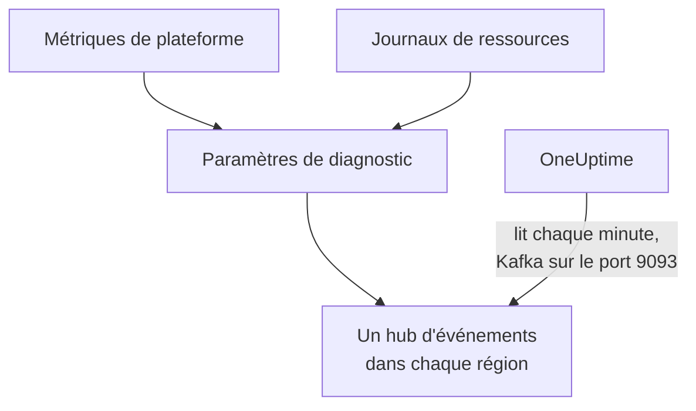

# Diffuser les métriques et journaux Azure Monitor

Un abonnement Azure connecté peut diffuser ses métriques Azure Monitor et ses journaux de ressources vers OneUptime. Des paramètres de diagnostic les envoient vers des hubs d'événements de votre abonnement, et OneUptime lit ces hubs chaque minute : la plupart des métriques clés arrivent quelques minutes après qu'Azure Monitor les a, au lieu d'attendre la prochaine lecture de la connexion, et les journaux de ressources arrivent sous forme de journaux OneUptime, chacun classé sous la ressource qu'il concerne. Une seule commande dans Azure Cloud Shell met tout en place, et il n'y a rien à exécuter.

:::cards
- [Fonctionnement](#fonctionnement): Des paramètres de diagnostic envoient vers un hub d'événements dans chaque région, et OneUptime les lit.
- [Configurer la diffusion](#configurer-la-diffusion): Choisissez ce qu'il faut diffuser, activez la lecture et exécutez une commande.
- [Ce qui arrive](#ce-qui-arrive): Les métriques sur les ressources qu'elles mesurent, et les journaux sur les ressources dont ils proviennent.
- [Ce que crée la commande](#ce-que-crée-la-commande): Chaque ressource et chaque autorisation que la commande crée dans votre abonnement.
- [Arrêter la diffusion](#arrêter-la-diffusion): Arrêtez la lecture, puis supprimez ce que la commande a créé.
:::

## Fonctionnement



- **Un hub d'événements dans chaque région.** Un paramètre de diagnostic n'envoie qu'à un hub d'événements de la région de sa ressource : la commande crée donc un espace de noms Event Hubs dans chaque région où se trouvent vos ressources, tous dans un même groupe de ressources, et dirige le paramètre de diagnostic de chaque ressource vers celui de sa région.
- **OneUptime les lit.** Azure Monitor n'envoie qu'à un hub d'événements, un compte de stockage ou un espace de travail Log Analytics, jamais à une adresse à vous : un hub d'événements que OneUptime lit est le moyen qui ne demande rien à exécuter chez vous. OneUptime se connecte en tant qu'application de la connexion, autorisée à lire ces hubs d'événements et rien d'autre.
- **Les lectures laissent les métriques diffusées au flux.** Tant que le flux livre les métriques clés d'un type de ressource dans une région, les lectures de la connexion cessent d'écrire celles qu'il transporte, si bien qu'aucun point de données n'est compté deux fois, et continuent d'écrire [celles qu'il ne peut pas transporter](#ce-qui-arrive). Les lectures continuent de trouver les ressources, leur état et leurs modifications, et reprennent les métriques après 15 minutes sans événement.
- **Rien n'est perdu tant que OneUptime ne peut pas lire.** Les événements attendent dans les hubs d'événements que OneUptime les lise, aussi longtemps que les hubs les conservent, et OneUptime retient jusqu'où il a lu chaque partition, pour reprendre là où il s'est arrêté.

## Avant de commencer

- **Un abonnement Azure connecté.** Connectez-le d'abord dans **Cloud → Connecter** : voir [Connecter un compte cloud](/docs/telemetry/cloud-accounts).
- **Un propriétaire ou un administrateur du projet.** Eux seuls peuvent activer la lecture et arrêter la diffusion.
- **Azure Cloud Shell**, connecté en tant que **Owner** des abonnements, ou que **Contributor** qui est aussi **User Access Administrator** : la commande crée un groupe de ressources et une attribution de rôle, et modifie des paramètres de diagnostic.
- **Une sortie vers Azure, pour un OneUptime auto-hébergé.** OneUptime lit chaque espace de noms à `<namespace>.servicebus.windows.net` sur le port 9093, et les espaces de noms acceptent les connexions depuis Internet.

## Configurer la diffusion

:::steps
### Ouvrir la fenêtre de diffusion

Allez dans **Cloud → Connecter** et, sur la ligne de l'abonnement Azure, choisissez **Diffuser les métriques et les journaux**.

### Choisir ce qu'il faut diffuser

**Métriques** diffuse les métriques clés de chaque ressource, minute par minute, les métriques que OneUptime trace pour chaque ressource et sur lesquelles il la juge, sauf [celles qu'un paramètre de diagnostic ne peut pas envoyer](#ce-qui-arrive), que la connexion continue de lire. **Métriques et journaux** ajoute les journaux propres à chaque ressource, chaque catégorie qu'Azure conserve pour elle, et **Journaux** diffuse les journaux de ressources seuls.

### Activer la lecture

Choisissez **Activer la lecture**. OneUptime cherche les hubs d'événements chaque minute, et les attend jusqu'à ce que la commande les ait créés.

### Exécuter la commande dans Azure Cloud Shell

Copiez la commande, exécutez-la dans Azure Cloud Shell et attendez qu'elle se termine. Elle indique chaque région où elle a créé un hub d'événements, combien de ressources y envoient, et quelles ressources elle a laissées de côté, avec la raison donnée par Azure.

### Attendre les premiers événements

La fenêtre demande toutes les quelques secondes ce qui est arrivé. Azure commence à envoyer quelques minutes après la fin de la commande ; la fenêtre indique alors ce qui est venu d'où, et la ligne de la connexion affiche **Diffusion en cours**.
:::

**Plus de champs** contient le reste :

| Champ | Ce qu'il fait |
| --- | --- |
| **Abonnements** | Les abonnements à diffuser : au départ, ceux que lit la connexion. Le premier contient les hubs d'événements, et OneUptime les y lit. 50 au plus |
| **Configurer autrement** | Les noms qu'utilise la commande, pour tout configurer avec Terraform ou le portail |

Quand la connexion n'a encore lu aucun abonnement, ou plus de 50, la fenêtre demande plutôt les **Abonnements** avant ses étapes.

Quand le premier abonnement n'est pas celui où OneUptime lit les hubs d'événements, la fenêtre le signale : choisissez **Les lire là-bas** avant d'exécuter la commande.

## Ce qui arrive

| Quoi | Où cela arrive |
| --- | --- |
| Métriques clés | Sur les ressources cloud qu'elles mesurent, dans les mêmes séries que celles qu'écrivent les lectures de la connexion |
| Journaux de ressources | Dans l'explorateur de journaux, sous le service de télémétrie de la connexion, avec l'abonnement, la région et la catégorie comme attributs |
| Journaux d'une ressource que OneUptime connaît | Aussi sur cette ressource : sa page dans Cloud gagne un onglet **Journaux** |

Le flux transporte les métriques clés que la connexion lit minute par minute. Les lectures continuent d'écrire le reste selon leur calendrier : une métrique qu'elles lisent à une granularité plus grossière, comme le stockage utilisé d'un registre de conteneurs, et chaque métrique clé qu'un paramètre de diagnostic ne peut pas envoyer, que la liste des métriques prises en charge par Azure Monitor marque comme non exportable dans la colonne DS Export :

- Machines virtuelles et groupes identiques : `Network In Total`, `Network Out Total`.
- Disques : `Composite Disk Read Bytes/sec`, `Composite Disk Write Bytes/sec`, `Composite Disk Read Operations/sec`, `Composite Disk Write Operations/sec`.
- Comptes Azure Cosmos DB : `TotalRequests`, `TotalRequestUnits`, `NormalizedRUConsumption`, `ServerSideLatency`.
- Comptes de stockage : `UsedCapacity`.
- Clusters AKS : `kube_pod_status_ready`.
- Passerelles d'application : `ApplicationGatewayTotalTime`, `Throughput`.
- Pare-feu : `Throughput`.
- Passerelles NAT : `ByteCount`, `SNATConnectionCount`, `DatapathAvailability`.

Un espace de noms Service Bus ou Event Hubs ne diffuse aucune métrique. Les lectures lisent ses métriques clés pour chaque file, topic et hub d'événements, et les totaux propres à l'espace de noms les additionnent, alors qu'un paramètre de diagnostic n'envoie que les totaux de l'espace de noms, et n'envoie pas du tout 4 des 6 métriques clés d'un espace de noms Service Bus, ni 2 des 4 d'un espace de noms Event Hubs. Les lectures les écrivent donc toutes, avec ou sans diffusion, et aucun message n'est compté deux fois.

Un journal est classé sous sa ressource par l'ID ARM de la ressource, porté en `cloud.resource_id`, et garde sa catégorie, son opération, son résultat et ses propriétés comme attributs, par exemple `azure.category`.

Les machines virtuelles, groupes identiques, disques, interfaces réseau, réseaux virtuels, points de terminaison privés, passerelles NAT, zones DNS et plans App Service n'envoient pas de journaux de ressources propres : leurs pages n'ont donc pas d'onglet **Journaux**. Les journaux d'un compte de stockage sont ceux de ses services, et ceux d'une application conteneur ceux de son environnement.

## Ce que crée la commande

Le groupe de ressources s'appelle `oneuptime-stream-` suivi des 8 premiers caractères de l'ID de la connexion. Il ne donne à OneUptime aucun accès à vos ressources : l'application de la connexion peut lire les hubs d'événements, et rien de plus.

| Ressource | Ce qu'elle peut faire |
| --- | --- |
| Un groupe de ressources, `oneuptime-stream-<suffix>`, dans le premier abonnement | Contient les hubs d'événements, étiqueté avec l'ID de la connexion en `oneuptime-connection` |
| Un espace de noms Event Hubs dans chaque région, `oneuptime-<suffix>-<region>`, au niveau Standard avec 1 unité de débit | Reçoit ce qu'envoient les paramètres de diagnostic de sa région |
| Un hub d'événements dans chacun, `oneuptime`, avec 2 partitions | Conserve les événements jusqu'à ce que OneUptime les lise |
| Le rôle **Azure Event Hubs Data Receiver** pour l'application de la connexion, sur le seul groupe de ressources | Permet à l'application de lire les hubs d'événements, et rien d'autre |
| Un paramètre de diagnostic sur chaque ressource, `OneUptime-<suffix>` | Envoie les métriques, les journaux ou les deux de la ressource vers le hub d'événements de sa région |

Une ressource d'une région globale, comme Front Door, envoie vers le hub d'événements de la première région. Une ressource dont Azure ne conserve que des métriques ou que des journaux est configurée avec ce qu'elle a, et une qui a déjà 5 paramètres de diagnostic, le maximum permis par Azure, est laissée de côté. Azure facture l'unité de débit de chaque espace de noms à l'heure, et les événements qu'envoient les paramètres de diagnostic.

## Arrêter la diffusion

:::steps
### Arrêter la lecture

Sur la ligne de l'abonnement dans **Cloud → Connecter**, choisissez **Arrêter la diffusion**. OneUptime cesse aussitôt de lire les hubs d'événements, et la connexion relit toutes ses métriques selon son planning. Ce qui a été lu reste.

### Supprimer ce que la commande a créé

Les hubs d'événements et les paramètres de diagnostic restent dans Azure, qui les facture, jusqu'à leur suppression. La fenêtre affiche la commande : elle supprime le paramètre de diagnostic de chaque ressource, puis le groupe de ressources, quel que soit l'abonnement qui le contient.

```bash
oneuptime_stream_stop() {
  local SUB ID N=0
  for SUB in '11111111-aaaa-4aaa-8aaa-111111111111' '22222222-bbbb-4bbb-8bbb-222222222222'; do
    while IFS= read -r ID; do
      if [ -z "$ID" ]; then continue; fi
      az monitor diagnostic-settings delete --name OneUptime-6f1c3a2e --resource "$ID" --output none 2> /dev/null &
      N=$((N + 1))
      if [ $((N % 4)) -eq 0 ]; then wait; fi
    done < <(az resource list --subscription "$SUB" --query "[].id" --output tsv)
  done
  wait
  for SUB in '11111111-aaaa-4aaa-8aaa-111111111111' '22222222-bbbb-4bbb-8bbb-222222222222'; do
    if [ "$(az group exists --subscription "$SUB" --name oneuptime-stream-6f1c3a2e 2> /dev/null)" = true ]; then
      az group delete --subscription "$SUB" --name oneuptime-stream-6f1c3a2e --yes --no-wait && echo "Deleting oneuptime-stream-6f1c3a2e in $SUB."
    fi
  done
}
oneuptime_stream_stop
```
:::

Pour changer ce qui est diffusé, ouvrez de nouveau **Diffuser les métriques et les journaux**, choisissez ce qu'il faut diffuser et exécutez la nouvelle commande : elle met à jour ce que la première exécution a créé, et ne crée rien deux fois.

## Configurer autrement

Avec Terraform ou le portail, créez ce que crée la commande, avec ces noms :

| Paramètre | Valeur |
| --- | --- |
| Groupe de ressources | `oneuptime-stream-<suffix>`, dans l'abonnement où OneUptime lit les hubs d'événements |
| Espace de noms Event Hubs | `oneuptime-<suffix>-<region>`, un dans chaque région d'une ressource à diffuser |
| Hub d'événements | `oneuptime`, dans chaque espace de noms |
| Paramètre de diagnostic | `OneUptime-<suffix>` sur chaque ressource, vers le hub d'événements de sa région, avec la règle `RootManageSharedAccessKey` de l'espace de noms |
| Rôle | **Azure Event Hubs Data Receiver** pour l'application de la connexion, sur le groupe de ressources |

Activez ensuite la lecture, avec cet abonnement en premier sous **Abonnements**.

## Dépannage

:::details La fenêtre attend toujours les premiers événements
Vérifiez que la commande s'est terminée et qu'elle a indiqué que le hub d'événements d'une région est prêt : `az eventhubs namespace list --resource-group oneuptime-stream-6f1c3a2e` liste les espaces de noms. Un paramètre de diagnostic n'envoie que ce qu'Azure Monitor possède, donc une ressource qui ne fait rien envoie peu. Un nouveau rôle peut mettre quelques minutes à prendre effet : d'ici là, les lectures ne voient pas les événements.
:::

:::details La connexion affiche Flux en échec
La fenêtre et l'info-bulle de la ligne disent pourquoi. Quand l'application n'est pas autorisée à lire les hubs d'événements, exécutez de nouveau la commande : elle redonne son rôle à l'application. Quand OneUptime n'a pas pu les joindre, vérifiez que les espaces de noms acceptent les connexions depuis Internet, et qu'un OneUptime auto-hébergé peut joindre le port 9093.
:::

:::details La commande a laissé des ressources de côté
Elle les liste, chacune avec la raison donnée par Azure. Une ressource d'un type sans paramètres de diagnostic n'envoie rien, et pour une qui a déjà 5 paramètres de diagnostic, il faut d'abord en supprimer un. Exécutez ensuite de nouveau la commande.
:::

## Étapes suivantes

:::cards
- [Connecter un compte cloud](/docs/telemetry/cloud-accounts): Ce que lit une connexion, et à quelle fréquence.
- [Diffuser les journaux Google Cloud](/docs/telemetry/cloud-streaming-google-cloud): Les journaux d'un projet Google Cloud, envoyés via Pub/Sub.
- [Diffuser les métriques et journaux CloudWatch](/docs/telemetry/cloud-streaming): Ceux d'un compte AWS, livrés par Amazon Data Firehose.
- [Explorateur de journaux](/docs/telemetry/logs-explorer): Recherchez et filtrez ce que les flux ont livré.
:::
