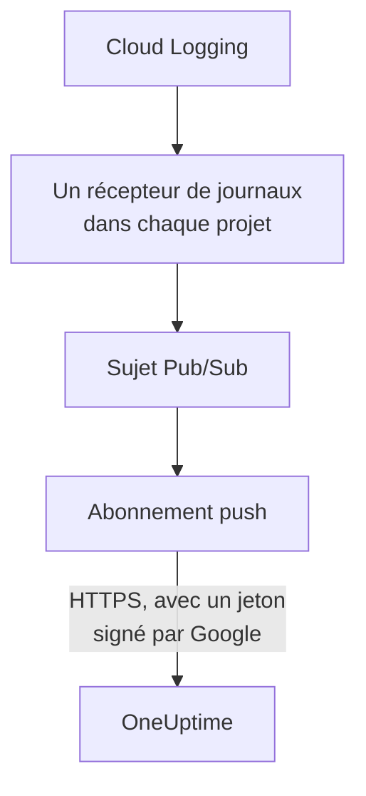

# Diffuser les journaux Google Cloud

Un projet Google Cloud connecté peut diffuser ses journaux vers OneUptime dès leur écriture. Cloud Logging les achemine par un récepteur de journaux vers un sujet Pub/Sub, et l'abonnement push du sujet livre chaque entrée à OneUptime dans la minute, sous forme de journal OneUptime classé sous la ressource qu'il concerne. Une seule commande dans Google Cloud Shell met tout en place, et il n'y a rien à exécuter. Cloud Monitoring n'a aucune exportation qui envoie les métriques : la connexion continue donc de lire les métriques selon son planning.

:::cards
- [Fonctionnement](#fonctionnement): Un récepteur de journaux dans chaque projet, un sujet et son abonnement push.
- [Configurer la diffusion](#configurer-la-diffusion): Choisissez les journaux, créez une clé de flux et exécutez une commande.
- [Ce qui arrive](#ce-qui-arrive): Les journaux sur les ressources dont ils proviennent.
- [Ce que crée la commande](#ce-que-crée-la-commande): Chaque ressource et chaque autorisation que la commande crée dans vos projets.
- [Arrêter la diffusion](#arrêter-la-diffusion): Désactivez les clés, puis supprimez ce que la commande a créé.
:::

## Fonctionnement



- **Un récepteur de journaux dans chaque projet.** Le récepteur de chaque projet achemine les entrées que son filtre retient vers un seul sujet Pub/Sub, dans le projet du compte de service de la connexion.
- **Deux vérifications à chaque envoi.** Pub/Sub signe un jeton OpenID Connect pour un compte de service créé pour les seuls envois, et l'audience du jeton est la clé de flux de la connexion. OneUptime n'accepte un envoi que si Google a signé son jeton pour ce compte de service et que la clé est une de celles de la connexion. La clé désigne la connexion, et donc le projet : rien dans un envoi ne décide où il est écrit. OneUptime ne conserve que le SHA-256 de la clé.
- **Rien n'est perdu tant que OneUptime ne peut pas l'accepter.** Pub/Sub renvoie une entrée refusée, en attendant de 10 secondes à 10 minutes entre deux essais, et la conserve un jour.

## Avant de commencer

- **Un projet Google Cloud connecté.** Connectez-le d'abord dans **Cloud → Connecter** : voir [Connecter un compte cloud](/docs/telemetry/cloud-accounts).
- **Un propriétaire ou un administrateur du projet.** Eux seuls peuvent créer une clé de flux et arrêter la diffusion.
- **Google Cloud Shell**, connecté en tant que **Owner** des projets, ou que personne autorisée à y créer des comptes de service, des sujets Pub/Sub et des récepteurs de journaux.
- **Une adresse HTTPS, pour un OneUptime auto-hébergé.** Pub/Sub n'envoie qu'à des adresses `https://`, avec un certificat reconnu par Google, et l'adresse doit être joignable depuis Google Cloud.

## Configurer la diffusion

:::steps
### Ouvrir la fenêtre de diffusion

Allez dans **Cloud → Connecter** et, sur la ligne du projet Google Cloud, choisissez **Diffuser les journaux**.

### Choisir les journaux

**Avertissements et erreurs** diffuse chaque entrée de gravité `WARNING` ou plus : ce qui a mal tourné, pas chaque requête. **Tous les journaux** diffuse chaque entrée sauf les journaux d'audit Data Access, qui consignent chaque lecture et peuvent dépasser tout ce qu'écrit un projet. **Un filtre à vous** diffuse les entrées qu'une requête Cloud Logging retient, écrite dans le champ **Filtre**.

### Créer une clé de flux

Choisissez **Créer une clé de flux**. La clé n'est affichée qu'une fois, dans la commande : OneUptime n'en conserve que le SHA-256.

### Exécuter la commande dans Google Cloud Shell

Copiez la commande, exécutez-la dans Google Cloud Shell et attendez qu'elle se termine. Elle indique chaque projet où elle a mis un récepteur en place, et s'arrête à la première étape que Google refuse, avec la raison donnée par Google.

### Attendre le premier envoi

La fenêtre demande toutes les quelques secondes ce qui est arrivé. Pub/Sub envoie une entrée dans la minute où un projet en écrit une que le filtre retient ; la fenêtre indique alors ce qui est venu d'où, et la ligne de la connexion affiche **Diffusion en cours**.
:::

**Plus de champs** contient le reste :

| Champ | Ce qu'il fait |
| --- | --- |
| **Projets** | Les projets dont diffuser les journaux : au départ, ceux que lit la connexion. Le sujet est créé dans le projet du compte de service de la connexion. 100 au plus |
| **Configurer autrement** | Le point de terminaison push, le compte de service push et la clé, pour tout configurer avec Terraform ou la console |

## Ce qui arrive

| Quoi | Où cela arrive |
| --- | --- |
| Journaux | Dans l'explorateur de journaux, sous le service de télémétrie de la connexion, avec le projet, la région et le nom du journal comme attributs |
| Journaux d'une ressource que OneUptime connaît | Aussi sur cette ressource : sa page dans Cloud gagne un onglet **Journaux** |

Chaque journal garde l'heure de son entrée à la nanoseconde, sa gravité, sa trace et son span, et sa requête HTTP sous les noms des conventions sémantiques d'OpenTelemetry. Il est classé sous une ressource quand sa ressource surveillée est d'un type dont OneUptime lit les métriques, comme une VM (`gce_instance`), un service Cloud Run (`cloud_run_revision`) ou une instance Cloud SQL (`cloudsql_database`), et porte l'ID de la ressource en `cloud.resource_id`. Les journaux de requêtes d'un équilibreur de charge externe, écrits sous `http_load_balancer`, sont classés sous son mappage d'URL, la `https_lb_rule` où arrivent ses métriques.

Les journaux d'un groupe d'instances sont ceux de ses VM : sa page n'a donc pas d'onglet **Journaux**. Une entrée d'un autre type est diffusée tout de même, sous son projet.

## Ce que crée la commande

Ses ressources sont nommées d'après les 8 premiers caractères de l'ID de la connexion. Elle ne donne à OneUptime aucun accès à vos projets : les entrées ne font que sortir.

| Ressource | Ce qu'elle peut faire |
| --- | --- |
| Un compte de service, `oneuptime-push-<suffix>`, dans le projet du compte de service de la connexion | N'a aucun rôle : Pub/Sub signe pour lui les jetons de ses envois |
| Le rôle **Service Account OpenID Connect Identity Token Creator** pour l'agent de service Pub/Sub, sur ce seul compte de service | Permet à Pub/Sub de créer ces jetons, et rien d'autre |
| Un sujet Pub/Sub, `oneuptime-stream-<suffix>` | Contient les entrées qu'acheminent les récepteurs |
| Son abonnement push, `oneuptime-stream-<suffix>-push` | Envoie chaque entrée à OneUptime, avec un délai d'accusé de réception de 60 secondes, et conserve un jour ce qu'il n'a pas pu envoyer |
| Un récepteur de journaux dans chaque projet, `oneuptime-stream-<suffix>` | Achemine vers le sujet les entrées que son filtre retient |
| Le rôle **Pub/Sub Publisher** pour l'auteur de chaque récepteur, sur le seul sujet | Permet au récepteur de publier dans le sujet, et rien d'autre |

La commande active les API Pub/Sub et Cloud Logging dans le projet du sujet si elles sont désactivées. Google facture Pub/Sub pour les journaux livrés : ne diffusez que les journaux dont vous avez besoin.

## Arrêter la diffusion

:::steps
### Désactiver les clés

Sur la ligne du projet dans **Cloud → Connecter**, choisissez **Arrêter la diffusion**. Toutes les clés de flux de la connexion cessent aussitôt de fonctionner, et OneUptime refuse ce que Pub/Sub envoie. Ce qui a été livré reste.

### Supprimer ce que la commande a créé

Les récepteurs, le sujet et son abonnement push restent dans Google Cloud, et Pub/Sub continue d'envoyer, jusqu'à leur suppression. La fenêtre affiche la commande, pour les projets que lit la connexion :

```bash
for SOURCE in 'acme-prod' 'acme-data'; do
  gcloud logging sinks delete oneuptime-stream-6f1c3a2e --project "$SOURCE" --quiet
done
gcloud pubsub subscriptions delete oneuptime-stream-6f1c3a2e-push --project 'acme-prod' --quiet
gcloud pubsub topics delete oneuptime-stream-6f1c3a2e --project 'acme-prod' --quiet
gcloud iam service-accounts delete 'oneuptime-push-6f1c3a2e@acme-prod.iam.gserviceaccount.com' --project 'acme-prod' --quiet
```
:::

Pour changer les journaux diffusés, ouvrez de nouveau **Diffuser les journaux**, choisissez **Créer une nouvelle clé** et exécutez la nouvelle commande. La clé qu'elle remplace reste valable 24 heures, si bien qu'aucun envoi n'est refusé pendant la mise à jour de l'abonnement. 3 clés remplacées au plus restent valables en même temps.

## Configurer autrement

Donnez à un sujet Pub/Sub un abonnement push avec ces valeurs, et autorisez l'agent de service Pub/Sub à créer des jetons pour le compte de service push :

| Paramètre | Valeur |
| --- | --- |
| Point de terminaison push | `https://oneuptime.com/telemetry/gcp-pubsub/v1/logs` |
| Authentification | Un jeton OpenID Connect pour `oneuptime-push-<suffix>@<project>.iam.gserviceaccount.com` |
| Audience | La clé de flux |
| Charge utile | Encapsulée, comme Pub/Sub l'envoie sauf indication contraire |
| Délai d'accusé de réception | 60 secondes |
| Conservation des messages | 1 jour |

Acheminez ensuite les journaux de chaque projet vers le sujet avec un récepteur de journaux, et donnez à l'auteur de chaque récepteur **Pub/Sub Publisher** sur le sujet. Pour un OneUptime auto-hébergé, remplacez `https://oneuptime.com` par l'adresse HTTPS de votre OneUptime.

OneUptime répond à chaque envoi comme Pub/Sub l'attend :

| Réponse | Quand | Ce que fait Pub/Sub |
| --- | --- | --- |
| `204` | L'entrée a été acceptée, ou l'avait déjà été, ou le message n'est pas une entrée de journal | Passe à la suite |
| `400` | Ce n'est pas un envoi Pub/Sub que OneUptime sait lire | Le renvoie, en attendant plus longtemps à chaque fois, pendant un jour |
| `401` | Le jeton n'a pas été signé par Google pour le compte de service push, ou son audience n'est pas une clé de la connexion | Le renvoie, en attendant plus longtemps à chaque fois, pendant un jour |
| `402` | Le projet ne peut pas être facturé pour la télémétrie | Le renvoie, en attendant plus longtemps à chaque fois, pendant un jour |
| `403` | La connexion est désactivée, ou le projet ne peut pas accepter de télémétrie | Le renvoie, en attendant plus longtemps à chaque fois, pendant un jour |
| `413` | La requête dépasse 1 Mio, ou son entrée 512 Kio | Le renvoie, en attendant plus longtemps à chaque fois, pendant un jour |
| `429` | L'abonnement de la connexion a envoyé plus de 12 000 entrées en une minute | Le renvoie, en attendant plus longtemps à chaque fois, pendant un jour |
| `503` | OneUptime n'a pas pu vérifier le jeton ou mettre l'entrée en file d'attente à ce moment-là | Le renvoie, en attendant plus longtemps à chaque fois, pendant un jour |

## Dépannage

:::details La fenêtre attend toujours le premier envoi
Vérifiez que la commande s'est terminée sans s'arrêter, et qu'un projet a écrit une entrée que le filtre retient : avec **Avertissements et erreurs**, un projet calme n'envoie rien. `gcloud pubsub subscriptions describe oneuptime-stream-6f1c3a2e-push --project acme-prod` affiche le point de terminaison de l'abonnement. Pour un OneUptime auto-hébergé, vérifiez que Google Cloud joint son adresse en HTTPS.
:::

:::details La connexion affiche Flux refusé
La fenêtre et l'info-bulle de la ligne disent pourquoi. Une mauvaise clé signifie que l'abonnement envoie avec une clé qui ne fonctionne plus : créez une nouvelle clé et exécutez de nouveau la commande. Un envoi non signé pour le compte de service push signifie que l'abonnement signe au nom d'un autre, ou que Pub/Sub n'est pas autorisé à signer pour lui : exécutez de nouveau la commande.
:::

:::details Les journaux d'une ressource n'apparaissent pas sur sa page
La page affiche les journaux que Cloud Logging classe sous la ressource surveillée de la ressource, avec les libellés qu'ont ses métriques. Les journaux qu'une charge de travail écrit sous une autre ressource, comme ceux d'un conteneur, sont diffusés sous leur seul projet.
:::

## Étapes suivantes

:::cards
- [Connecter un compte cloud](/docs/telemetry/cloud-accounts): Ce que lit une connexion, et à quelle fréquence.
- [Diffuser les métriques et journaux Azure Monitor](/docs/telemetry/cloud-streaming-azure): Ceux d'un abonnement Azure, lus dans des hubs d'événements.
- [Diffuser les métriques et journaux CloudWatch](/docs/telemetry/cloud-streaming): Ceux d'un compte AWS, livrés par Amazon Data Firehose.
- [Explorateur de journaux](/docs/telemetry/logs-explorer): Recherchez et filtrez ce que les flux ont livré.
:::
