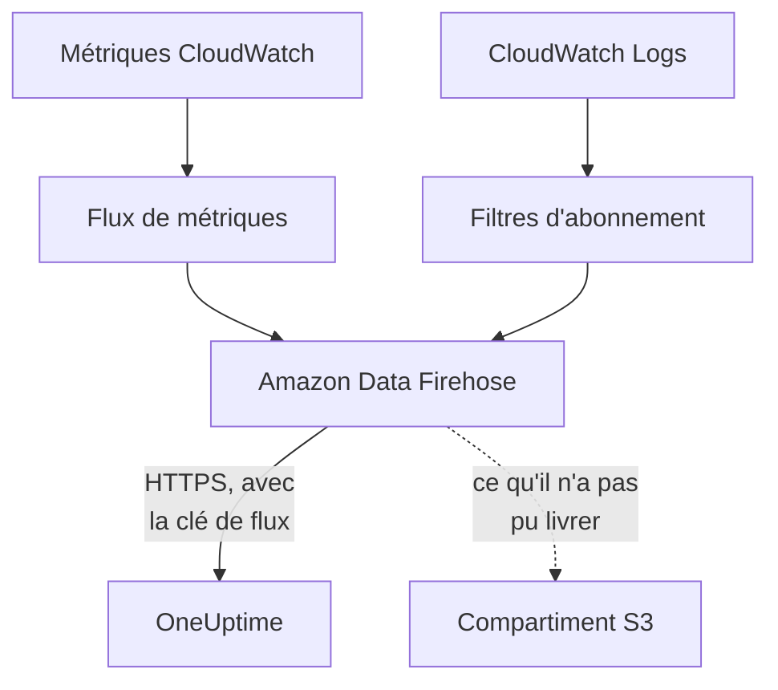

# Diffuser les métriques et journaux CloudWatch

Un compte AWS connecté peut diffuser ses métriques et journaux CloudWatch vers OneUptime via Amazon Data Firehose. Les métriques arrivent alors quelques minutes après que CloudWatch les a, au lieu d'attendre la prochaine lecture de la connexion, et CloudWatch Logs arrive sous forme de journaux OneUptime, chacun classé sous la ressource qu'il concerne. Une seule commande dans AWS CloudShell met tout en place, et il n'y a rien à exécuter.

:::cards
- [Fonctionnement](#fonctionnement): Un flux de métriques et des abonnements aux journaux dans chaque région, livrés par Firehose.
- [Configurer la diffusion](#configurer-la-diffusion): Choisissez ce qu'il faut diffuser, créez une clé de flux et exécutez une commande.
- [Ce qui arrive](#ce-qui-arrive): Les métriques sur les ressources qu'elles mesurent, et les journaux sur les ressources dont ils proviennent.
- [Ce que crée la pile](#ce-que-crée-la-pile): Chaque ressource et chaque autorisation que la commande crée dans votre compte.
- [Arrêter la diffusion](#arrêter-la-diffusion): Désactivez les clés, puis supprimez les piles.
:::

## Fonctionnement



- **Une pile dans chaque région.** La commande déploie une pile CloudFormation dans chaque région depuis laquelle vous diffusez. Son flux de métriques et ses filtres d'abonnement aux journaux transmettent tout à deux flux Firehose, et Firehose le livre à OneUptime en HTTPS.
- **La clé de flux dit à qui c'est.** Firehose envoie la clé de flux de la connexion avec chaque livraison. La clé désigne la connexion, et donc le projet : rien dans une livraison ne décide où elle est écrite. OneUptime ne conserve que le SHA-256 de la clé.
- **Les lectures laissent les métriques diffusées au flux.** Tant qu'un flux livre un espace de noms d'une région, les lectures de la connexion cessent d'écrire les métriques de cet espace de noms, si bien qu'aucun point de données n'est compté deux fois. Les lectures continuent de trouver les ressources, leur état et leurs modifications, et reprennent un espace de noms après 15 minutes sans livraison.
- **Rien n'est perdu tant que OneUptime ne peut pas l'accepter.** Firehose renvoie un lot refusé pendant une heure au plus, puis le conserve 30 jours dans le compartiment S3 de la pile.

## Avant de commencer

- **Un compte AWS connecté.** Connectez-le d'abord dans **Cloud → Connecter** : voir [Connecter un compte cloud](/docs/telemetry/cloud-accounts).
- **Un propriétaire ou un administrateur du projet.** Eux seuls peuvent créer une clé de flux et arrêter la diffusion.
- **AWS CloudShell dans ce compte**, connecté en tant que personne autorisée à créer des piles CloudFormation et des rôles IAM.
- **Une adresse HTTPS, pour un OneUptime auto-hébergé.** Firehose ne livre qu'à des adresses `https://` sur le port 443, avec un certificat reconnu par AWS, et l'adresse doit être joignable depuis AWS.

## Configurer la diffusion

:::steps
### Ouvrir la fenêtre de diffusion

Allez dans **Cloud → Connecter**, et sur la ligne du compte AWS choisissez **Diffuser les métriques et les journaux**.

### Choisir ce qu'il faut diffuser

**Métriques** diffuse chaque métrique clé de chaque ressource, une fois par minute : les métriques que OneUptime affiche et sur lesquelles il juge chaque ressource. **Métriques et journaux** ajoute CloudWatch Logs, et **Journaux** diffuse CloudWatch Logs seul.

Pour les journaux, indiquez les **Groupes de journaux** un par ligne, par nom dans la **Région** à côté ou par ARN dans leur propre région, ou choisissez **Tous les groupes de journaux du compte, y compris les nouveaux**. Une commande abonne au plus 50 groupes de journaux par nom, dans au plus 10 régions.

### Créer une clé de flux

Choisissez **Créer une clé de flux**. La clé n'est affichée que cette fois, dans la commande : OneUptime n'en conserve que le SHA-256.

### Exécuter la commande dans AWS CloudShell

Copiez la commande, exécutez-la dans AWS CloudShell et attendez qu'elle se termine. Elle écrit le modèle dans `oneuptime-stream.json` et le déploie dans chaque région, avec la clé comme paramètre qui n'est plus jamais affiché.

### Attendre la première livraison

La fenêtre demande toutes les quelques secondes ce qui est arrivé. Firehose livre dans les quelques minutes qui suivent la fin de la commande ; la fenêtre indique alors ce qui est venu d'où, et la ligne de la connexion affiche **Diffusion en cours**.
:::

**Plus de champs** contient le reste :

| Champ | Ce qu'il fait |
| --- | --- |
| **Toutes les métriques, pas seulement les métriques clés** | Diffuse toutes les métriques que CloudWatch possède pour le compte, y compris les vôtres. AWS facture chaque mise à jour de métrique qu'envoie un flux, cela peut donc coûter bien plus cher |
| **Régions** | D'où diffuser : au départ, les régions où la connexion a trouvé des ressources. Laissé vide, la commande diffuse depuis la région d'AWS CloudShell. Au plus 30 |
| **Configurer autrement** | Les points de terminaison des métriques et des journaux et la clé, pour configurer les flux avec Terraform ou la console |

**Télécharger le modèle** enregistre le modèle que la commande déploie, pour le déployer à votre façon.

## Ce qui arrive

| Quoi | Où cela arrive |
| --- | --- |
| Métriques | Sur les ressources cloud qu'elles mesurent, avec les noms et attributs que leur donnent les lectures de la connexion |
| Journaux | Dans l'explorateur de journaux, sous le service de télémétrie de la connexion, avec le compte, la région et le groupe de journaux comme attributs |
| Journaux d'un groupe de journaux qu'AWS nomme d'après une ressource | Sur cette ressource aussi : sa page dans Cloud reçoit un onglet **Journaux** |

Un groupe de journaux est classé sous une ressource quand AWS l'a nommé d'après elle :

| Groupe de journaux | Type de ressource |
| --- | --- |
| `/aws/lambda/<function>` | `AWS::Lambda::Function` |
| `/aws/rds/instance/<instance>/<log>` | `AWS::RDS::DBInstance` |
| `/aws/rds/cluster/<cluster>/<log>` | `AWS::RDS::DBCluster` |
| `/aws/docdb/<cluster>/<log>` | `AWS::DocDB::DBCluster` |
| `/aws/neptune/<cluster>/<log>` | `AWS::Neptune::DBCluster` |
| `/aws/redshift/cluster/<cluster>/<log>` | `AWS::Redshift::Cluster` |
| `/aws/OpenSearchService/domains/<domain>/<log>` | `AWS::OpenSearchService::Domain` |
| `/aws/aes/domains/<domain>/<log>` | `AWS::OpenSearchService::Domain` |
| `/aws/apprunner/<service>/<service-id>/<log>` | `AWS::AppRunner::Service` |
| `/aws/elasticbeanstalk/<environment>/<log>` | `AWS::ElasticBeanstalk::Environment` |
| `/aws/ecs/containerinsights/<cluster>/performance` | `AWS::ECS::Cluster` |

Chaque journal porte l'ID de la ressource dans `cloud.resource_id`, et les journaux d'une fonction Lambda portent aussi `faas.name`, ils apparaissent donc également sur la fonction dans Serverless. Un groupe de journaux d'un autre nom est diffusé quand même, sous son compte et sa région. La gravité d'un journal est celle qu'indique son message, à la manière de Lambda.

## Ce que crée la pile

La pile s'appelle `OneUptimeStream-` suivi des 8 premiers caractères de l'ID de la connexion. Elle ne donne à OneUptime aucun accès à votre compte : les données ne font que sortir.

| Ressource | Ce qu'elle peut faire |
| --- | --- |
| Un flux de métriques CloudWatch, au format OpenTelemetry 1.0 | Écrire des enregistrements uniquement dans le flux Firehose des métriques |
| Des filtres d'abonnement aux journaux, ou une stratégie d'abonnement à l'échelle du compte pour chaque groupe de journaux | Écrire des enregistrements uniquement dans le flux Firehose des journaux |
| Deux flux Firehose, `OneUptime-<suffix>-metrics` et `OneUptime-<suffix>-logs` | Livrer à OneUptime avec GZIP, un tampon de 1 Mio ou 60 secondes et une heure de nouvelles tentatives, et écrire dans le compartiment ce qu'ils n'ont pas pu livrer |
| Un compartiment S3 pour ce qui n'a pas pu être livré | Accès public bloqué, chiffré, vidé après 30 jours, et conservé à la suppression de la pile |
| Un groupe de journaux, `/aws/kinesisfirehose/OneUptime-<suffix>` | Contient les erreurs de livraison de Firehose lui-même, et n'est jamais diffusé |
| Trois rôles IAM | Chacun fait confiance à un service AWS de ce compte et n'autorise que ce que disent les lignes ci-dessus |

AWS facture le flux de métriques pour chaque mise à jour de métrique qu'il envoie, et Firehose pour ce qu'il livre. Ne diffusez que les métriques et les groupes de journaux dont vous avez besoin.

## Arrêter la diffusion

:::steps
### Désactiver les clés

Sur la ligne du compte dans **Cloud → Connecter**, choisissez **Arrêter la diffusion**. Toutes les clés de flux de la connexion cessent de fonctionner immédiatement, OneUptime refuse ce que les flux livrent, et la connexion lit de nouveau toutes ses métriques selon son calendrier. Ce que les flux ont livré est conservé.

### Supprimer les piles

Les flux restent dans AWS, et AWS les facture, jusqu'à la suppression de leurs piles. La fenêtre affiche la commande, pour les régions où la connexion a trouvé des ressources :

```bash
for REGION in us-east-1 eu-west-1; do
  aws cloudformation delete-stack --region "$REGION" --stack-name OneUptimeStream-6f1c3a2e
done
```
:::

Pour changer ce qu'une pile diffuse, ouvrez de nouveau **Diffuser les métriques et les journaux**, choisissez **Créer une nouvelle clé** et exécutez la nouvelle commande. La clé qu'elle remplace fonctionne encore 24 heures, si bien qu'aucune livraison n'est refusée pendant la mise à jour des piles. Au plus 3 clés remplacées fonctionnent en même temps.

## Configurer autrement

Donnez à chaque flux Firehose une destination point de terminaison HTTP avec ces valeurs, et au flux de métriques le format de sortie OpenTelemetry 1.0 :

| Paramètre | Valeur |
| --- | --- |
| Point de terminaison des métriques | `https://oneuptime.com/telemetry/aws-firehose/v1/metrics` |
| Point de terminaison des journaux | `https://oneuptime.com/telemetry/aws-firehose/v1/logs` |
| Clé d'accès | La clé de flux, envoyée dans `X-Amz-Firehose-Access-Key` |
| Encodage du contenu | `GZIP` |
| Tampon | 1 Mio ou 60 secondes |
| Durée des nouvelles tentatives | 3600 secondes, avec un compartiment S3 pour ce qui n'a pas pu être livré |

Pour un OneUptime auto-hébergé, remplacez `https://oneuptime.com` par l'adresse HTTPS de votre OneUptime. Le point de terminaison des métriques accepte aussi un flux de métriques au format JSON.

OneUptime répond à chaque livraison comme Firehose l'attend :

| Réponse | Quand | Ce que fait Firehose |
| --- | --- | --- |
| `200` | La livraison a été acceptée, ou elle l'avait déjà été | Passe à la suite |
| `400` | Ce n'est pas une livraison Firehose que OneUptime sait lire, par exemple une de plus de 10 000 enregistrements | La renvoie pendant une heure au plus |
| `401` | La clé n'est pas l'une de celles de la connexion | La renvoie pendant une heure au plus |
| `402` | Le projet ne peut pas être facturé pour la télémétrie | La renvoie pendant une heure au plus |
| `403` | La connexion est désactivée, ou le projet ne peut pas accepter de télémétrie | La renvoie pendant une heure au plus |
| `413` | La requête dépasse 4 Mio, ou se décompresse en plus de 32 Mio | La conserve dans le compartiment |
| `429` | Les flux de la connexion ont envoyé plus de 600 livraisons en une minute | La renvoie plus tard |

## Dépannage

:::details La fenêtre attend toujours la première livraison
Vérifiez que la commande s'est terminée dans chaque région, sans erreur : `aws cloudformation describe-stacks --stack-name OneUptimeStream-6f1c3a2e` indique l'état de la pile. Un flux de métriques ne livre que les métriques que CloudWatch possède, donc une région sans ressources n'envoie rien. Pour un OneUptime auto-hébergé, vérifiez qu'AWS atteint son adresse en HTTPS sur le port 443.
:::

:::details La connexion indique Flux refusé
La fenêtre et l'infobulle de la ligne disent pourquoi. Une mauvaise clé signifie que les piles tournent avec une clé qui ne fonctionne plus : créez une nouvelle clé et exécutez de nouveau la commande. Firehose continue d'envoyer ce qu'il conserve, et c'est accepté dès que la clé est la bonne.
:::

:::details Les journaux d'une fonction Lambda n'apparaissent pas sur sa page
La page affiche les journaux du groupe de journaux nommé d'après la fonction, `/aws/lambda/<function>`. Une fonction qui écrit dans un groupe de journaux d'un autre nom ne diffuse ses journaux que sous son compte et sa région.
:::

## Étapes suivantes

:::cards
- [Connecter un compte cloud](/docs/telemetry/cloud-accounts): Ce qu'une connexion lit, et à quelle fréquence.
- [Ressources cloud (IaaS et PaaS)](/docs/telemetry/cloud-resources): Chaque type de ressource que OneUptime reconnaît.
- [Explorateur de journaux](/docs/telemetry/logs-explorer): Recherchez et filtrez ce que les flux ont livré.
:::
