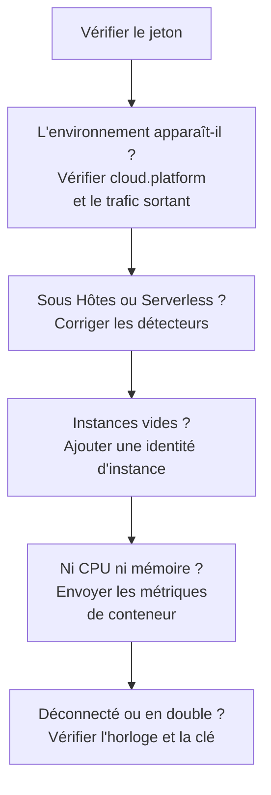

# Dépannage cloud

Trouvez pourquoi un environnement cloud manque, est classé au mauvais endroit, est vide ou en double. Les sections suivent l'ordre dans lequel ces choses échouent, et chacune écarte une couche : avancez donc de haut en bas. Les pannes propres à une plateforme sont à la fin de sa page : [AWS ECS / Fargate](/docs/telemetry/cloud-aws-ecs), [Google Cloud Run](/docs/telemetry/cloud-gcp-cloud-run), [Azure Container Apps](/docs/telemetry/cloud-azure-container-apps) et [Autres plateformes cloud](/docs/telemetry/cloud-other-platforms).



## Vérifier d'abord le jeton

C'est la vérification la moins coûteuse, et rien plus bas ne fonctionne sans elle :

```bash
curl -i https://oneuptime.com/otlp/v1/validate \
  -H "x-oneuptime-token: YOUR_TELEMETRY_INGESTION_TOKEN"
```

| Réponse | Ce qu'elle signifie |
| ------------------------- | -------------------------------------------------------------------------------------------------------------------------- |
| `200`, `"valid": true` | Le jeton est accepté. Son `keyType` doit être `Server` : une clé `Browser` est refusée depuis un collecteur ou un service backend. |
| `401`, `"valid": false` | Le jeton manque, est inconnu, révoqué, désactivé ou expiré, et le `message` de la réponse précise lequel. Créez une nouvelle clé sous **Paramètres du projet → Télémétrie & APM → Clés d'ingestion** et redéployez-la. |

Si vous hébergez OneUptime vous-même, utilisez `https://YOUR-ONEUPTIME-HOST/otlp/v1/validate`. Lancez la vérification depuis la tâche, l'instance ou le réplica quand c'est possible (ECS Exec, `az containerapp exec`) : cela prouve que la charge de travail elle-même atteint OneUptime, pas seulement votre ordinateur portable.

## L'environnement n'apparaît pas

Rien sous **Cloud → Tous les environnements** une minute après la première requête. Vérifiez ces trois points, dans cet ordre.

**`cloud.platform` manque, ou n'est pas une valeur managée.** OneUptime ne classe la télémétrie sous Environnements cloud que lorsque la ressource porte l'une de ces valeurs : `aws_ecs`, `aws_elastic_beanstalk`, `aws_app_runner`, `gcp_cloud_run`, `gcp_app_engine`, `azure_container_apps`, `azure_container_instances` ou `azure_app_service`. Les causes habituelles :

- Le détecteur de ressources est désactivé dans le SDK (`OTEL_NODE_RESOURCE_DETECTORS`, `OTEL_EXPERIMENTAL_RESOURCE_DETECTORS`, `-Dotel.resource.providers.<cloud>.enabled=true`).
- Le pipeline du collecteur saute le processeur `resourcedetection`.
- Sur une plateforme sans détecteur, `OTEL_RESOURCE_ATTRIBUTES` contient une faute de frappe.

Les détecteurs Azure de Node.js et .NET écrivent `azure.container_apps`, `azure.app_service` et `azure.functions` ; OneUptime les réécrit en valeurs avec tiret bas, elles comptent donc. Pour voir ce que porte votre télémétrie, ouvrez le service sous **Services**, ouvrez l'une de ses traces depuis l'onglet **Traces**, et lisez les attributs de ressource. Si `cloud.platform` n'y est pas, c'est tout le problème.

**Le jeton est faux.** La vérification du jeton a répondu `401`. Le collecteur le journalise sous la forme `Permanent error: ... 401`. Un SDK le journalise une fois et cesse de réessayer, ce qui est le comportement OTLP correct et passe facilement inaperçu.

**Le trafic sortant est bloqué.** Le collecteur journalise `connection refused`, `context deadline exceeded`, `i/o timeout` ou un échec DNS :

- **ECS et Fargate :** un sous-réseau privé a besoin d'une passerelle NAT ou de `assignPublicIp=ENABLED`, et le groupe de sécurité doit autoriser le trafic sortant sur TCP 443.
- **Cloud Run :** **VPC egress: All traffic** a besoin de Cloud NAT.
- **Container Apps :** une route définie par l'utilisateur vers un pare-feu doit autoriser l'hôte OneUptime.
- **Partout :** un OneUptime auto-hébergé derrière un nom DNS privé doit être résolu depuis le réseau de la charge de travail.

## Il apparaît sous Hôtes à la place

La ressource porte la plateforme d'une machine virtuelle (`aws_ec2`, `gcp_compute_engine` ou `azure_vm`), OneUptime la classe donc sous **Hôtes** : juste pour une machine virtuelle, faux pour du calcul managé. Le détecteur d'une machine virtuelle l'a emporté sur le détecteur managé : `detectors: [ec2, elastic_beanstalk]` dans un collecteur, où le premier détecteur qui définit `cloud.platform` l'emporte, ou un SDK dont l'ordre favorise le détecteur EC2. Placez `elastic_beanstalk` en premier, ou définissez vous-même `cloud.platform` dans `OTEL_RESOURCE_ATTRIBUTES` et ne gardez que le détecteur `env`.

## Il apparaît seulement sous Fonctions serverless

La ressource porte `faas.name` mais aucune `cloud.platform` managée. Cloud Run et App Engine définissent les deux quand le détecteur GCP tourne. Si vous définissez `faas.name` à la main, ou si un collecteur supprime les attributs de ressource que le détecteur du SDK a définis, seul le côté serverless est satisfait. Activez le détecteur, ou définissez vous-même `cloud.platform=gcp_cloud_run` (ou `gcp_app_engine`), `cloud.account.id` et `cloud.region`.

> [!NOTE]
> Sur Cloud Run et App Engine, un service est censé apparaître aux deux endroits : l'environnement regroupe le projet et la région, et **Fonctions serverless** affiche le service seul.

## Instances est vide

L'environnement est là, mais son onglet **Instances** ne liste rien : la télémétrie ne porte aucune identité d'instance. OneUptime nomme une instance d'après le premier de ces attributs de ressource qu'il trouve :

1. `aws.ecs.task.id`
2. `aws.ecs.task.arn` (raccourci à l'ID de la tâche)
3. `faas.instance`
4. `azure.container_app.instance.id`
5. `service.instance.id`
6. `container.id`
7. `host.id`
8. `host.name`

L'identité propre de la plateforme passe avant `service.instance.id`, pour qu'un ID que le SDK invente pour chaque processus (le SDK Node.js le fait par défaut) ne puisse pas séparer une tâche du CPU et de la mémoire de son sidecar. Ce qui définit l'identité sur chaque plateforme :

| Plateforme | Ce qui définit l'identité |
| ----------------------------------------- | ------------------------------------------------------------------------------------------------------------------------------------------------ |
| ECS | Le détecteur `ecs` définit l'ARN de la tâche |
| Cloud Run, App Engine | Le détecteur `gcp` définit `faas.instance` |
| Container Apps | Le détecteur `azurecontainerapps` du Collector définit l'ID du réplica ; ou définissez `service.instance.id` à partir de `CONTAINER_APP_REPLICA_NAME`, ou exécutez le détecteur d'hôte |
| App Runner, Container Instances | Le `host.name` du détecteur d'hôte |
| App Service, Elastic Beanstalk | Le détecteur de la plateforme définit `service.instance.id` ; sur Beanstalk, supprimez-le pour que `host.id` nomme chaque instance |

Une instance apparaît dans la minute qui suit le premier signal qui porte l'attribut.

## CPU et mémoire sont vides

Les instances sont listées, mais les tuiles **CPU** et **Mémoire** de la vue d'ensemble, et les colonnes CPU et mémoire de **Instances**, sont vides. Elles viennent de métriques, pas de traces : des points de données `container.cpu.utilization` et `container.memory.usage` (ou `container.memory.usage.total`) dont la ressource porte la même identité d'instance que les traces, et `cloud.platform`.

- **Sur ECS,** le récepteur `awsecscontainermetrics` d'un collecteur sidecar les fournit sous la forme `ecs.task.cpu.utilized` et `ecs.task.memory.utilized`. Gardez-le dans le pipeline `metrics`, et gardez aussi `resourcedetection` dans ce pipeline, sinon les métriques arrivent sans `cloud.platform` et sont classées ailleurs.
- **Sur Cloud Run, Container Apps et les autres plateformes,** la plateforme ne montre pas l'utilisation des conteneurs à un sidecar. Les tuiles restent vides sauf si vous envoyez ces métriques vous-même : lisez plutôt les tuiles de requêtes.
- **Avec SDK direct,** rien n'envoie de métriques de conteneur, des tuiles vides sont donc normales.

## L'environnement affiche Déconnecté

Un environnement affiche **Déconnecté** quand aucune télémétrie n'est arrivée pour lui en 15 minutes, et le span, log ou métrique suivant le rétablit. Le temps pendant lequel OneUptime lui-même était arrêté ou rattrapait son retard ne compte pas. Tant que la télémétrie circule, l'heure de dernière réception peut avoir jusqu'à cinq minutes de retard, c'est pourquoi le seuil est de 15.

- **Un environnement actif affiche Déconnecté :** l'exportateur s'est arrêté. Cherchez dans les journaux du collecteur les erreurs `401` et de trafic sortant décrites plus haut.
- **Un environnement de préproduction qui descend à zéro la nuit** affiche Déconnecté jusqu'à la première requête du matin, ce qui est exact.

Les instances suivent deux horloges :

- **Stale :** l'onglet **Instances** marque une tâche, une instance ou un réplica comme **Stale** quand il n'a rien remonté au cours des 15 dernières minutes, et la vue d'ensemble ne compte que les autres comme actifs.
- **Supprimé :** un nettoyage supprime les lignes d'instance non vues depuis `CLOUD_INSTANCE_STALE_MINUTES` (15 par défaut, au moins 10), mesuré depuis la dernière télémétrie de l'environnement lui-même, si bien qu'une panne du collecteur fige cette horloge au lieu d'effacer la dernière liste de tâches connue. Les fonctions serverless utilisent `SERVERLESS_INSTANCE_STALE_MINUTES`. Relever le seuil garde les lignes plus longtemps ; cela ne change pas le moment où elles passent en **Stale**.

## Deux environnements là où il en faudrait un

La clé d'environnement est `cloud.platform|cloud.account.id|cloud.region`, comparée caractère pour caractère. Si certaines charges de travail définissent `cloud.account.id` et d'autres non, si l'une écrit `eastus` et une autre `East US`, ou si un collecteur exécute le détecteur `ecs` et un autre non, vous obtenez `aws_ecs|123456789012|us-east-1` et `aws_ecs||us-east-1` côte à côte.

Ouvrez la **Vue d'ensemble** de chaque environnement : sa **Clé d'environnement** montre quelle partie diffère. Corrigez la charge de travail à laquelle il manque la valeur. L'environnement à la partie vide cesse de recevoir de la télémétrie, et vous pouvez l'archiver.

## Un environnement créé à la main n'est jamais associé

L'ingestion associe un environnement par sa clé seule, et la clé doit valoir exactement `platform|account|region`, par exemple `aws_ecs|123456789012|us-east-1` : la même valeur de plateforme, le même ID de compte et la même région que porte la télémétrie. Le formulaire de création (**Créer : Ressource cloud** sous **Cloud → Tous les environnements**) construit la clé à partir de ses champs **Plateforme cloud**, **ID de compte cloud** et **Région cloud** : ces trois champs doivent donc correspondre à la télémétrie caractère pour caractère. Sinon, l'ingestion crée un second environnement avec la clé qu'elle a calculée, et le vôtre reste vide. Archivez l'environnement créé à la main et laissez l'ingestion créer le bon, ou recréez-le avec les valeurs corrigées.

## Toujours bloqué

Rassemblez ces éléments avant de demander de l'aide :

- Les attributs de ressource d'un vrai span ou enregistrement de journal de la charge de travail. L'exportateur `debug` du collecteur les affiche, ou ouvrez une trace du service sous **Services**.
- La réponse de la vérification `/otlp/v1/validate`, lancée depuis la charge de travail.
- Les 50 dernières lignes du journal du collecteur, ou le journal de diagnostic du SDK avec `OTEL_LOG_LEVEL=debug`.
- La **Clé d'environnement** de tout environnement qui est bien apparu.

Contactez ensuite support@oneuptime.com, ou ouvrez une issue sur [GitHub](https://github.com/OneUptime/oneuptime).

## Prochaines étapes

:::cards
- [Environnements cloud](/docs/telemetry/cloud-environments): Comment les environnements et les instances sont identifiés.
- [AWS ECS / Fargate](/docs/telemetry/cloud-aws-ecs): La configuration ECS, avec une définition de tâche complète.
- [OpenTelemetry](/docs/telemetry/open-telemetry): Points de terminaison, limites et signification de chaque réponse.
:::
