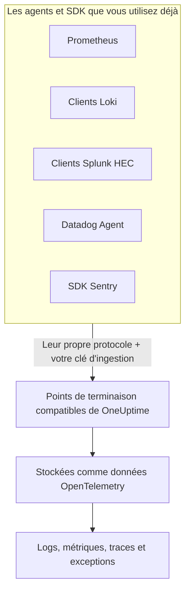

# Prometheus, Loki, Splunk, Datadog & Sentry

Vous utilisez déjà Prometheus, un client Loki, un forwarder Splunk, le Datadog Agent ou un SDK Sentry ? Inutile d'en changer. OneUptime accepte ce que chacun de ces outils envoie, aux chemins que l'outil utilise déjà, et le stocke sous forme de données OpenTelemetry. Essayer OneUptime revient à changer d'URL et de clé, pas à réinstrumenter, et vos filtres de suppression, règles de masquage, pipelines de journaux, votre rétention et vos budgets d'ingestion s'appliquent à ces données comme à toutes les autres.

:::cards
- [Prometheus remote write](#prometheus-remote-write): Des métriques depuis Prometheus, Grafana Alloy ou tout émetteur remote write.
- [Loki](#loki): Des logs depuis Promtail, Grafana Alloy, Fluent Bit ou Vector.
- [Splunk HTTP Event Collector](#splunk-http-event-collector): Des logs et des événements de métrique depuis tout client HEC.
- [Datadog Agent](#datadog-agent): Les métriques et les logs du Datadog Agent.
- [SDK Sentry](#sdk-sentry): Les erreurs, les transactions et les logs de tout SDK Sentry.
:::

## Fonctionnement



Chaque point de terminaison répond dans la langue de son outil — un `204` pour Prometheus et Loki, le `{"text": "Success", "code": 0}` de HEC, le `202` de Datadog, l'ID d'événement de Sentry —, si bien que l'outil signale ses succès et ses échecs comme il l'a toujours fait. Les données sont ensuite traitées exactement comme celles d'un SDK OpenTelemetry.

## Avant de commencer

- **Un projet OneUptime** – sur OneUptime Cloud, la télémétrie est facturée par Go ingéré, et un projet du forfait Free a besoin d'un moyen de paiement avant de pouvoir envoyer de la télémétrie.
- **Clé d'ingestion de télémétrie** – créez une clé **Serveur** sous **Produits → Paramètres du projet → Télémétrie & APM → Clés d'ingestion**, et copiez sa **Clé secrète**. Chaque outil l'envoie là où il envoie ses propres identifiants. Le DSN Sentry d'une application de navigateur prend plutôt une clé **Navigateur**, limitée aux origines de votre site.
- **Votre hôte** – les exemples utilisent `oneuptime.com`. Si vous hébergez OneUptime vous-même, utilisez votre propre hôte.

> [!TIP]
> L'onglet Guide de configuration de Journaux, Métriques, Traces et Exceptions propose ces outils parmi ses façons d'envoyer, avec votre hôte et une clé de votre choix déjà renseignés.

## Points de terminaison

| Outil | Adresse cible | Où va la clé |
| --- | --- | --- |
| Prometheus remote write | `https://oneuptime.com/telemetry/prometheus/api/v1/write` | Un jeton bearer, ou l'authentification basic avec la clé comme mot de passe. |
| Loki | `https://oneuptime.com/telemetry/loki/api/v1/push` | L'authentification basic avec la clé comme mot de passe, ou un jeton bearer. |
| Splunk HTTP Event Collector | `https://oneuptime.com/telemetry/services/collector` | Le jeton HEC : `Authorization: Splunk <key>`. |
| Datadog Agent | `https://oneuptime.com/telemetry/datadog` | La clé d'API : `DD-API-KEY`. |
| SDK Sentry | Le DSN `https://<key>@oneuptime.com/telemetry/sentry/1` | La clé publique du DSN. |

Chaque point de terminaison accepte aussi la clé dans un en-tête `x-oneuptime-token`, et un en-tête `x-oneuptime-service-name` nomme le service auquel appartient tout ce que l'outil envoie. Une clé peut s'écrire sous la forme de ses 32 chiffres hexadécimaux, sans tirets ; dans le DSN Sentry et comme clé d'API Datadog, elle doit s'écrire ainsi.

## Prometheus remote write

Ajoutez OneUptime comme cible remote write. Prometheus poursuit ses scrapes comme aujourd'hui et envoie une copie de chaque échantillon :

```yaml title="prometheus.yml"
remote_write:
  - url: https://oneuptime.com/telemetry/prometheus/api/v1/write
    authorization:
      credentials: YOUR_TELEMETRY_KEY
```

Avec Grafana Alloy, ajoutez un composant `prometheus.remote_write` et transmettez-lui vos scrapes :

```text title="config.alloy"
prometheus.remote_write "oneuptime" {
  endpoint {
    url          = "https://oneuptime.com/telemetry/prometheus/api/v1/write"
    bearer_token = "YOUR_TELEMETRY_KEY"
  }
}
```

Remote write 1.0 et 2.0 sont tous deux acceptés, compressés en snappy comme tous les émetteurs les envoient.

### Ce que devient une série

- **Son nom et ses labels restent.** `http_requests_total{job="checkout", code="500"}` est la métrique `http_requests_total` avec les attributs `job` et `code`, si bien qu'une requête reprise de Grafana la retrouve.
- **Le job est le service.** Chaque `job` devient un service, et chaque `instance` son instance de service, selon la correspondance des règles Prometheus d'OpenTelemetry.
- **Les types sont conservés.** Les compteurs, ainsi que les buckets et le nombre d'observations d'un histogramme, sont des sommes cumulatives, si bien que leurs taux s'affichent correctement dans les graphiques. Le type vient des métadonnées que l'émetteur inclut ; sans elles, un nom en `_total` est un compteur, et un `_bucket` avec un label `le`, un bucket d'histogramme.
- **Les histogrammes natifs** deviennent des histogrammes exponentiels, et les histogrammes natifs à buckets personnalisés deviennent des histogrammes.
- **Non conservés :** les marqueurs d'obsolescence et autres échantillons NaN ou infinis, les séries `_created` des compteurs et les exemplars.

## Loki

OneUptime prend en charge l'API push de Loki au chemin même de Loki, en JSON ou sous la forme du protobuf compressé en snappy qu'envoient Promtail et Grafana Alloy. Ajoutez-le comme client :

```yaml title="promtail.yaml"
clients:
  - url: https://oneuptime.com/telemetry/loki/api/v1/push
    bearer_token: YOUR_TELEMETRY_KEY
```

La sortie `loki` de Fluent Bit prend l'hôte et le chemin séparément :

```text title="fluent-bit.conf"
[OUTPUT]
    Name         loki
    Match        *
    Host         oneuptime.com
    Port         443
    Tls          On
    Uri          /telemetry/loki/api/v1/push
    Http_User    oneuptime
    Http_Passwd  YOUR_TELEMETRY_KEY
    Labels       job=fluent-bit
```

### Ce que devient un flux

- **Chaque entrée est un log**, avec son propre horodatage à la nanoseconde et sa ligne comme corps.
- **Les labels et les métadonnées structurées sont des attributs**, sous les noms qu'ils portent dans Loki.
- **Le service** vient du premier, parmi `service_name`, `service`, `app`, `application`, `name`, `app_kubernetes_io_name`, `container`, `container_name`, `component`, `workload` et `job`, que possède un flux, comme Loki le détermine. Un label `host` ou `hostname` nomme l'hôte.
- **Le niveau** vient d'un label ou d'une métadonnée `level`, `detected_level` ou `severity`, ou à défaut d'un `level=` logfmt ou du champ `level` d'une ligne JSON.
- **Contexte de trace :** un `trace_id` et un `span_id` dans les métadonnées structurées relient le log à sa trace.

## Splunk HTTP Event Collector

Utilisez OneUptime comme HTTP Event Collector, avec votre clé d'ingestion comme jeton HEC. Le pilote de journalisation Docker de Splunk ajoute lui-même le chemin ; il ne prend donc que l'hôte :

```bash
docker run \
  --log-driver=splunk \
  --log-opt splunk-url=https://oneuptime.com \
  --log-opt splunk-token=YOUR_TELEMETRY_KEY \
  --log-opt splunk-format=json \
  your-image
```

Tout autre client HEC envoie ses requêtes POST à `/services/collector/event` ou `/services/collector/raw`. Pour envoyer un événement :

```bash
curl https://oneuptime.com/telemetry/services/collector/event \
  -H "Authorization: Splunk YOUR_TELEMETRY_KEY" \
  -d '{"event": "Payment failed for order 42", "sourcetype": "app", "fields": {"service": "checkout"}}'
```

Un `200` avec `{"text": "Success", "code": 0}` signifie que l'événement a été accepté. Le point de terminaison répond aussi avec les codes propres à HEC — `No data` (5), `Invalid data format` (6) avec le numéro de l'événement non valide, et `Event field is required` (12) — et répond à `GET /services/collector/health` sans jeton.

### Ce que devient un événement

- **Un log**, avec son `time` comme horodatage. Un événement de type chaîne est le corps ; pour un événement de type objet, `message`, `msg`, `log`, `line` ou `text` est le corps, et ses autres champs sont des attributs.
- **Ses métadonnées restent :** `host` est l'hôte, et `source`, `sourcetype` et `index` sont conservés en `com.splunk.source`, `com.splunk.sourcetype` et `com.splunk.index`. Les `host`, `source`, `sourcetype` et `index` de la chaîne de requête complètent ce qu'un événement omet.
- **Ses champs sont des attributs.** Un champ `service.name` nomme le service, tout comme le champ `service` d'un log.
- **Les événements de métrique** (`"event": "metric"`, avec `metric_name` et `_value`, ou des champs `metric_name:<name>`) sont stockés comme métriques, jamais comme logs.
- **Non proposé :** l'accusé de réception de l'indexeur. Un client qui le demande ne reçoit pas d'`ackId`.

## Datadog Agent

Pointez les métriques et les logs de l'Agent vers OneUptime, avec votre clé d'ingestion comme clé d'API :

```yaml title="datadog.yaml"
api_key: YOUR_TELEMETRY_KEY_WITHOUT_HYPHENS
dd_url: https://oneuptime.com/telemetry/datadog
logs_enabled: true
logs_config:
  use_http: true
  logs_dd_url: oneuptime.com:443
apm_config:
  enabled: false
process_config:
  process_collection:
    enabled: false
```

L'Agent ajoute ses propres chemins à `dd_url`, et envoie les logs à `/api/v2/logs` sur l'hôte et le port que nomme `logs_dd_url`. À la racine, OneUptime ne répond à ces chemins que pour une requête qui porte un en-tête `DD-API-KEY`. Redémarrez l'Agent après la modification ; `datadog-agent status` affiche sa clé d'API comme valide quand OneUptime l'accepte.

### Ce que deviennent les données de l'Agent

- **Les métriques** gardent leur nom. Les jauges restent des jauges, les compteurs deviennent des sommes, et les taux, des jauges de leur valeur par seconde.
- **Les distributions** deviennent des summaries avec leur nombre, leur somme, leur minimum et leur maximum.
- **Les checks de service** deviennent une métrique qui porte le nom du check, et dont la valeur est le statut du check : 0 OK, 1 avertissement, 2 critique, 3 inconnu.
- **Les logs** gardent leur message, leur statut, leur hôte et leur service, et le reste de leurs champs en attributs.
- **Les tags sont des attributs**, et les tags `service`, `env` et `version` nomment le service, son environnement et sa version.
- **Pas encore lus :** les traces APM, les processus, les conteneurs, les données réseau et les profils. Laissez-les désactivés dans `datadog.yaml`, comme ci-dessus.

Les clients de l'API HTTP de Datadog — une bibliothèque de logs qui envoie à `/api/v2/logs`, un script qui envoie des séries — peuvent envoyer au même point de terminaison avec l'en-tête `DD-API-KEY`.

## SDK Sentry

Remplacez le DSN là où vous configurez Sentry. Le reste de votre code Sentry ne change pas :

```javascript
Sentry.init({
  dsn: "https://YOUR_TELEMETRY_KEY_WITHOUT_HYPHENS@oneuptime.com/telemetry/sentry/1",
  release: "checkout@1.4.2",
  environment: "production",
});
```

```python
sentry_sdk.init(
    dsn="https://YOUR_TELEMETRY_KEY_WITHOUT_HYPHENS@oneuptime.com/telemetry/sentry/1",
    release="checkout@1.4.2",
    environment="production",
)
```

Le `1` à la fin du DSN est exigé par les SDK Sentry et n'est pas lu. Le DSN d'une application de navigateur est public : utilisez-y donc une clé d'ingestion **Navigateur**, limitée aux origines de votre site.

### Ce que devient une enveloppe

- **Les erreurs** apparaissent dans Exceptions, avec leurs stack traces et les exceptions qui les ont causées, regroupées comme toute autre exception. Chacune est un span de sa trace, sous le span qui était actif.
- **Les transactions** et leurs spans apparaissent dans Traces.
- **Les logs Sentry** et les messages capturés avec `capture_message` apparaissent dans Journaux.
- **Le service** est un tag `service`, ou à défaut le nom de la release avant le `@` : `checkout@1.4.2` donne `checkout`. La release est la version du service, et l'environnement est conservé.
- **Non conservés :** les sessions, les replays, les pièces jointes, les profils et les check-ins. Le SDK les envoie toujours ; OneUptime les accepte puis les écarte.

## Limites et budgets d'ingestion

- **Taille des requêtes** – l'ingress de OneUptime accepte des requêtes jusqu'à 4 Mo sous `/telemetry`, et chaque corps peut se décompresser en 64 Mo au plus.
- **Budgets d'ingestion** – Prometheus remote write et Loki sont vérifiés par rapport au budget de métriques ou de logs avant la lecture de leur corps, et refusés avec `403` quand il est épuisé. Un lot HEC, une charge utile Datadog ou une enveloppe Sentry peut porter plusieurs signaux : chaque signal est donc décompté de son propre budget au moment où il est stocké, et écarté quand ce budget est épuisé.

## Dépannage

### Chaque requête est refusée avec 401

La clé n'est pas arrivée là où le point de terminaison la cherche, ou ce n'est pas une clé de ce projet. Comparez le réglage d'identifiants de l'outil avec le tableau [Points de terminaison](#points-de-terminaison), et vérifiez que la clé n'est ni désactivée ni expirée.

### Un SDK Sentry indique que le DSN n'est pas valide

Les SDK Sentry refusent un DSN dont la clé contient des tirets. Écrivez la clé sous la forme de ses 32 chiffres hexadécimaux, sans les tirets.

### Les métriques Datadog arrivent, mais pas les logs

Vérifiez que `logs_config.use_http` vaut `true` et que `logs_config.logs_dd_url` est un hôte et un port, pas une URL. L'Agent envoie les logs en TCP quand `use_http` n'est pas défini.

### Prometheus renvoie 415

L'émetteur a demandé un protocole remote write que OneUptime ne lit pas. Envoyez en remote write 1.0 ou 2.0.
