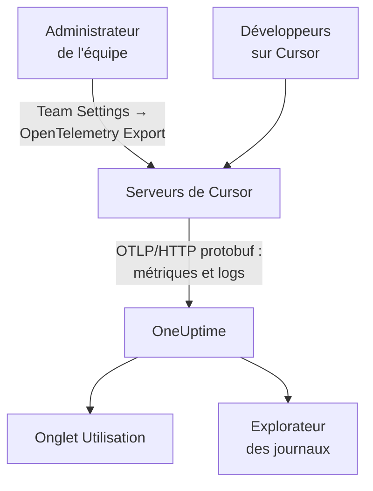

# Cursor

Cursor exporte la télémétrie de son équipe depuis les serveurs de Cursor. Un administrateur de l'équipe ajoute OneUptime comme destination une seule fois, dans le tableau de bord de Cursor, et les jetons, le coût estimé et les appels d'outils de toute l'équipe arrivent : rien à installer ni à régler sur les postes des développeurs.

:::cards
- [La mettre en place](#la-mettre-en-place): Créer une clé dans OneUptime et une destination dans Cursor.
- [Ce que vous obtenez](#ce-que-vous-obtenez-et-ce-que-vous-nobtenez-pas): Des métriques et des logs ; pas de traces.
- [Qui a dépensé quoi](#attribution-aux-employés): Les personnes arrivent sous forme d'identifiants utilisateur Cursor.
- [Dépannage](#dépannage): Que vérifier quand rien n'arrive.
:::

## Fonctionnement



## Avant de commencer

- **L'offre Enterprise de Cursor.** L'écran OpenTelemetry Export n'existe pas dans les autres offres.
- **Un point de terminaison que Cursor peut joindre depuis Internet.** C'est Cursor qui se connecte à vous, depuis un ensemble fixe d'adresses. OneUptime Cloud n'a besoin de rien de plus ; un OneUptime auto-hébergé derrière un pare-feu doit autoriser les adresses sortantes que Cursor liste sur sa page [OpenTelemetry Export](https://cursor.com/docs/enterprise/opentelemetry-export).

## La mettre en place

:::steps
### Créer une clé d'ingestion

Dans OneUptime, ouvrez **Paramètres du projet → Télémétrie & APM → Clés d'ingestion**, cliquez sur **Créer une clé d'ingestion** et copiez la clé. Votre URL de base OTLP est `https://oneuptime.com/otlp`, ou `https://YOUR-ONEUPTIME-HOST/otlp` si vous hébergez OneUptime vous-même.

### Créer la destination dans Cursor

Dans le tableau de bord web de Cursor, en tant qu'administrateur de l'équipe, ouvrez **Team Settings → OpenTelemetry Export** et créez une destination :

| Champ | Valeur |
| --- | --- |
| Endpoint (base URL) | `https://oneuptime.com/otlp` |
| Header name | `x-oneuptime-token` |
| Header value | `YOUR_INGESTION_TOKEN` |

Saisissez l'URL de base sans `/v1` : Cursor ajoute lui-même `/v1/metrics` et `/v1/logs`, et `https://oneuptime.com/otlp/v1` enverrait vers `/otlp/v1/v1/metrics`, où rien n'arrive.

### Tester et activer

Cliquez sur **Test connection** pour vérifier l'URL et l'en-tête, puis sur **Enable**. L'export démarre en une minute environ ; les modifications ultérieures de l'en-tête prennent environ 30 secondes.

### Vérifier que les données arrivent

Utilisez Cursor une minute ou deux, puis ouvrez **Journaux** dans OneUptime et filtrez sur le nom de service `cursor` : des enregistrements `cursor.api.request` avec des nombres de jetons signifient que la clé et l'URL sont bonnes.
:::

Cursor parle OTLP sur HTTP en protobuf binaire uniquement (ni gRPC, ni JSON), ce que OneUptime accepte tel quel. Il stocke l'en-tête chiffré et envoie vers une seule destination par équipe : pour envoyer vers OneUptime et ailleurs, placez un collector devant.

## Ce que vous obtenez, et ce que vous n'obtenez pas

| Signal | Depuis Cursor |
| --- | --- |
| Métriques : jetons, coût estimé, appels d'outils | Oui, en deltas |
| Événements de log : requêtes, erreurs, corrections, skills, hooks, plugins, agents cloud | Oui |
| Texte des prompts et des réponses | Seulement si vous activez la famille `conversation_content` |
| Traces | Non |
| Tout ce qui précède l'activation de la destination | Non |

Dans OneUptime, Cursor apparaît donc dans l'onglet **Utilisation** de **Produits → IA / LLM**, depuis `cursor.token.usage` et `cursor.cost.usage`, mais jamais dans **Appels** ni **Conversations**, qui sont construits à partir des traces. Le détail par requête est l'événement `cursor.api.request` dans l'explorateur **Journaux**.

### Familles

Chaque signal, et chaque famille de télémétrie, a son propre interrupteur dans les paramètres de Cursor :

| Famille | Couvre |
| --- | --- |
| `model_usage` | `cursor.token.usage`, `cursor.cost.usage`, et les événements `cursor.api.request`, `cursor.api.error` et `cursor.api.correction` |
| `tool_calls` | `cursor.tool.calls` |
| `skills_hooks_plugins` | Les événements de skills, de hooks et de plugins |
| `cloud_agents` | Les événements `cursor.cloud_agent.*` |
| `grok_bot_agent_actions` | Les événements `cursor.grok_bot.*` ; nécessite Action Recording |
| `conversation_content` | Le texte des messages et l'entrée et la sortie des outils MCP ; désactivée par défaut |

Toutes les familles sauf `conversation_content` démarrent activées. Les familles que Cursor ajoute plus tard démarrent aussi activées, sauf si vous désactivez `auto_enable_new_families`.

## Métriques et événements

Les trois métriques sont des sommes delta :

| Métrique | Unité | Attributs |
| --- | --- | --- |
| `cursor.token.usage` | `{token}` | `cursor.token.type` : `input`, `output`, `cache_read`, `cache_creation` ; `cursor.model.name` ; `cursor.api.status` : `success`, `errored`, `aborted` ; `cursor.api.billable` |
| `cursor.cost.usage` | `USD` | `cursor.model.name` |
| `cursor.tool.calls` | `{call}` | `cursor.tool.kind` : `builtin`, `mcp` ; `cursor.tool.name` ; `cursor.tool.status` : `success`, `failure`, `aborted` ; `cursor.mcp.server.name` |

Les points de données ne portent aucun identifiant de conversation ni de requête, donc le coût par session n'est pas dans les métriques. `cursor.model.name` est le modèle demandé, avec les choix routés regroupés : une ventilation par modèle comporte une ligne nommée `Auto` qu'on ne peut pas répartir entre les modèles vers lesquels Cursor l'a routée.

L'événement de log que vous utiliserez le plus est `cursor.api.request` : un par requête, avec ses nombres de jetons en entrée, en sortie et en cache, le modèle et s'il a été facturé. `cursor.api.error` enregistre une requête en échec (sans le message d'erreur), et `cursor.api.correction` arrive plus tard pour dire qu'une requête n'a finalement pas été facturée. La [référence du format](https://cursor.com/docs/enterprise/opentelemetry-export/wire) de Cursor liste chaque événement et attribut.

Chaque enregistrement porte ces attributs de ressource :

| Attribut | Ce que c'est |
| --- | --- |
| `service.name` | Toujours `cursor` : filtrez les explorateurs **Journaux** et **Métriques** dessus |
| `cursor.team.id` | Votre équipe, un entier ; toujours présent |
| `cursor.user.id` | La personne, un entier propre à l'équipe ; facultatif |
| `cursor.surface` | D'où vient l'activité, comme `desktop`, `cli`, `cloud_agent` ou `bugbot` |
| `cursor.entrypoint` | Comment elle a commencé, comme `desktop`, `cli`, `web`, `api` ou `github_pr` |

## Attribution aux employés

**Cursor nomme une personne par `cursor.user.id`, un entier que seul Cursor peut transformer en nom, et l'omet souvent pour les agents cloud.** OneUptime le lit comme l'employé, et `cursor.team.id` comme l'équipe, si bien que l'onglet **Utilisation** classe personnes et équipes sans configuration, mais que les personnes apparaissent sous forme d'entiers.

- Les deux arrivent comme attributs de ressource (`resource.cursor.user.id`, `resource.cursor.team.id`), que OneUptime lit.
- Cursor peut aussi envoyer `cursor.user.email`, mais OneUptime ne le lit pas encore, donc la colonne de l'e-mail de l'employé reste vide pour Cursor.
- `gen_ai.user`, `llm.user` et les identifiants d'utilisateur final de LiteLLM ne sont jamais lus comme l'employé : ils nomment vos clients, pas votre personnel. Voir [Attribution aux employés et aux équipes](/docs/telemetry/ai-coding-assistants#attribution-aux-employés-et-aux-équipes).

### Où Cursor apparaît dans l'onglet Utilisation

Cursor envoie des métriques sans spans GenAI, et les métriques ne font que prendre le relais des spans : **si le même projet reçoit des spans GenAI avec un coût, les dépenses de Cursor n'apparaissent pas.** Envoyez Cursor dans un projet à lui. Voir [Les spans d'abord, les métriques en relais](/docs/telemetry/ai-llm-observability#les-spans-dabord-les-métriques-en-relais).

| Ventilation | Pour Cursor |
| --- | --- |
| **Employé** | Oui, par `cursor.user.id` |
| **Équipe** | Oui, par `cursor.team.id` |
| **Modèle** | Oui, par `cursor.model.name` |
| **Fournisseur** | Non : Cursor ne dit jamais quel fournisseur a servi un appel |
| **Application / Service** | Non : les métriques de Cursor n'appartiennent à aucun service OneUptime |

Une ligne Cursor ne porte que le coût : ses cellules d'appels et de jetons affichent `—`, car `cursor.cost.usage` n'a aucun détail par appel. `cursor.token.usage` alimente toujours les totaux de jetons au-dessus du tableau (ses types `input` et `output` ; les jetons de cache sont laissés de côté), et vous pouvez le représenter sur un tableau de bord par `cursor.token.type`.

:::details Transformer un identifiant utilisateur Cursor en personne
Les noms et les montants facturés se trouvent dans l'API d'administration de Cursor, que OneUptime n'appelle pas : interrogez-la vous-même si besoin. Elle est réservée à l'offre Enterprise, à `https://api.cursor.com`, et prend une clé d'API d'administration comme nom d'utilisateur avec un mot de passe vide :

```bash
curl -u YOUR_API_KEY: https://api.cursor.com/teams/members
```

`GET /teams/members` liste l'e-mail et le nom de chaque membre. `POST /teams/filtered-usage-events` renvoie l'usage facturé par événement ; additionnez ses `chargedCents` pour les dépenses. Son `conversationId` correspond à `cursor.conversation.id` dans les événements de log de Cursor, ce qui relie une personne et un montant facturé à une session que vous voyez déjà, quand les deux côtés le portent. Cursor ne documente pas que l'entier `cursor.user.id` et les identifiants utilisateur de l'API d'administration sont les mêmes : vérifiez-le sur votre propre équipe avant de facturer qui que ce soit sur cette base.
:::

## Comment Cursor livre

Ces points changent ce que vous voyez dans les graphiques, connaissez-les avant de signaler un trou :

- **Les métriques sont envoyées au plus une fois.** Un export en échec n'est pas retenté, donc un bref trou après un échec est normal : n'alertez pas sur les trous des métriques de Cursor.
- **Les logs sont envoyés au moins une fois**, dédoublonnés sur `cursor.event.id` et retentés automatiquement pendant environ 7 jours.
- **Il n'y a pas d'ordre garanti.** Un `cursor.api.correction` arrive après la requête qu'il corrige : triez par l'horodatage de l'enregistrement, jamais par l'arrivée.
- **Rien n'est rattrapé.** Rien d'antérieur à l'activation de la destination n'arrive, et une destination laissée en panne perd ce que Cursor n'a pas pu envoyer.
- **Désactiver ou supprimer une destination fait perdre les données en transit.** Pour changer la clé d'ingestion, modifiez l'en-tête de la destination au lieu de la supprimer et de la recréer.

## Le coût est une estimation, pas une facture

Cursor documente `cursor.cost.usage` comme une estimation au mieux. Il ne sépare pas l'usage inclus de l'usage facturé à la demande ; avec vos propres clés de modèle, il ne reflète que le tarif de jetons de Cursor, pas la facture de votre fournisseur ; et un `cursor.api.correction` ultérieur peut retirer un usage déjà compté. Lisez-le comme une tendance. Pour un chiffre qui correspond à la facture, additionnez les `chargedCents` de l'API d'administration de Cursor.

## Dépannage

:::details Rien n'arrive
Relancez **Test connection** dans Cursor. Vérifiez que l'URL de base ne se termine pas par `/v1`, que le nom de l'en-tête est `x-oneuptime-token` et sa valeur exactement la clé, et que la famille `model_usage` est activée. L'export démarre environ une minute après l'activation de la destination.
:::

:::details Rien n'arrive sur un OneUptime auto-hébergé
Cursor se connecte depuis ses propres serveurs : votre point de terminaison OTLP doit être joignable depuis Internet, sous un nom DNS public, et laisser passer les adresses sortantes de Cursor dans votre pare-feu.
:::

:::details Les logs arrivent, mais l'onglet Utilisation n'affiche aucune dépense Cursor
Le projet reçoit aussi des spans GenAI avec un coût, donc les métriques de Cursor ne sont pas lues. Envoyez Cursor dans un projet à lui, avec sa propre clé d'ingestion.
:::

:::details Les personnes apparaissent sous forme de nombres
C'est `cursor.user.id` : le seul identifiant de personne que OneUptime lit aujourd'hui depuis Cursor. Associez-le à des noms avec l'API d'administration de Cursor.
:::

## Étapes suivantes

:::cards
- [Assistants de code IA](/docs/telemetry/ai-coding-assistants): Comment les dépenses sont attribuées pour chaque assistant de code.
- [Passerelles IA](/docs/telemetry/ai-gateways): Des traces et des prompts complets pour les appels de modèle de vos propres applications.
- [Surveillance des métriques](/docs/monitor/metrics-monitor): Alerter sur `cursor.cost.usage`, `cursor.token.usage` ou `cursor.tool.calls`.
:::
