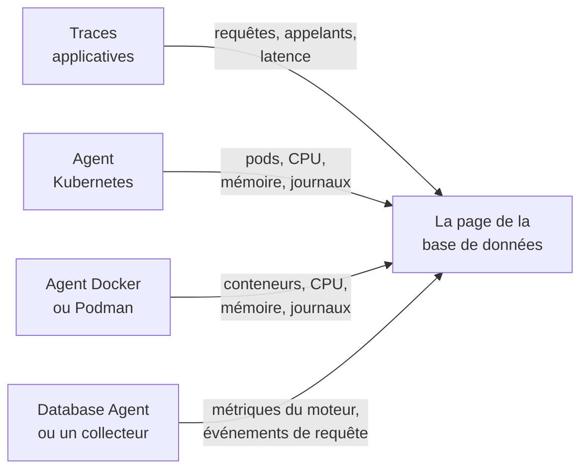

# Bases de données

**Bases de données** donne à chaque serveur de base de données que votre projet exécute ou sollicite sa propre page : qui l'appelle et à quelle vitesse, où il s'exécute, les métriques de santé propres au moteur, ses journaux et traces, les incidents, alertes et maintenances planifiées qui lui sont rattachés, et les moniteurs d'alerte recommandés pour son moteur. Les bases de données ont des étiquettes, des propriétaires, des règles d'étiquettes et de propriétaires, une rétention et un archivage par base, comme toute autre ressource. Ouvrez-les sous **Produits → Ressources → Bases de données**.

:::cards
- [Le Database Agent](#le-database-agent): Métriques du moteur pour PostgreSQL, MySQL, SQL Server, Oracle, Redis, MongoDB, Elasticsearch et Memcached.
- [Comment les bases de données sont détectées](#comment-les-bases-de-données-sont-détectées): À partir des traces, de Kubernetes, de Docker, de Podman et des collecteurs.
- [Alertes sur une base de données](#alertes-sur-une-base-de-données): Moniteurs recommandés, et moniteurs que vous construisez.
- [Dépannage](#dépannage): Un script de diagnostic, et les problèmes habituels.
:::

## Fonctionnement

La plupart des bases de données apparaissent d'elles-mêmes. OneUptime assemble chacune à partir de quatre sources au plus, et chaque source apporte quelque chose de différent :

| Source | Ce qu'elle attend de vous | Ce qu'elle ajoute à la page de la base de données |
| --- | --- | --- |
| **Traces applicatives** | Des applications instrumentées (OpenTelemetry) | Les requêtes des applications : taux d'appels, erreurs, latence et les services qui l'appellent |
| **Kubernetes** | L'[agent Kubernetes de OneUptime](/docs/telemetry/kubernetes-agent) | Où elle s'exécute : pods, CPU et mémoire, et les journaux des pods |
| **Docker / Podman** | L'[agent Docker](/docs/telemetry/docker-host) ou l'[agent Podman](/docs/telemetry/podman-host) | Où elle s'exécute : les conteneurs, leur CPU et leur mémoire, et leurs journaux |
| **Database Agent** (un OpenTelemetry Collector) | Le [Database Agent](#le-database-agent) ou votre propre collecteur | **Métriques du moteur** — connexions, débit, taux de succès du cache, verrous, retard de réplication, mémoire, dans la mesure où le moteur les fournit (voir [Ce qui est collecté](#ce-qui-est-collecté)) — plus, en option, des échantillons de requêtes, les requêtes principales et le fichier journal du moteur |



Les métriques du moteur ne viennent jamais que d'un collecteur qui parle à la base de données elle-même (ou, pour une base de données cloud managée, à l'API de supervision de son fournisseur). Les traces et les inventaires de conteneurs indiquent à OneUptime qu'une base de données existe et comment elle est utilisée, mais pas comment elle se porte de l'intérieur — le statut **Métriques du moteur** de chaque base indique si cette partie est connectée.

Vous pouvez aussi ajouter une base de données à la main : **Bases de données → Créer : Base de données** avec son moteur, son adresse et son port. Pour un contrôle de santé depuis une sonde qui ne demande aucun agent, voir la [Surveillance de la santé des bases de données](/docs/monitor/database-health-monitor).

## Bases de données prises en charge

OneUptime connaît les moteurs ci-dessous par leur nom : il normalise ce que les instrumentations placent dans `db.system.name` (ou l'ancien `db.system`) vers la valeur de la deuxième colonne, affiche le nom du moteur, applique son port par défaut quand un span ou une adresse n'en a pas, reconnaît ses images de conteneur et ses charts Helm, et sait d'où viennent ses métriques de moteur. Un moteur absent de la liste fonctionne quand même partout où une base de données est identifiée par son adresse — il apparaît simplement sous le nom brut que rapportent vos spans et n'est jamais créé à partir des seules traces.

Une **famille** est le moteur par lequel on atteint un fork ou un moteur compatible au niveau du protocole : les bibliothèques clientes ne distinguent pas MariaDB de MySQL ni Valkey de Redis, donc un span indique `mysql` ou `redis` tandis qu'une image de conteneur, un chart Helm ou le Database Agent nomme le fork. Les deux aboutissent sur la même base de données, et celle-ci affiche le moteur le plus précis dès que son image de conteneur, ou une source au moins aussi forte que celle qui a donné son moteur actuel, le nomme (voir [Quel moteur une base de données affiche](#quel-moteur-une-base-de-données-affiche)).

**Créée à partir des traces** indique si les spans clients suffisent à créer une base de données de ce moteur (voir [À partir des traces applicatives](#à-partir-des-traces-applicatives)) : un service managé atteint par l'hôte d'API partagé de son fournisseur, et un moteur qui s'exécute dans le processus de votre application, ne le sont jamais. **Métriques du moteur** indique d'où viennent les métriques de santé propres au moteur : une configuration du Database Agent, un récepteur collector-contrib que vous ajoutez à votre propre collecteur, le point de terminaison Prometheus propre au moteur (`:port/path`, collecté avec le récepteur `prometheus` du collecteur), l'API de supervision du fournisseur cloud, ou rien d'intégré. L'onglet **Documentation** de chaque base de données en fait une configuration de collecteur prête à l'emploi pour cette base.

| Moteur | `db.system.name` | Port par défaut | Famille | Créée à partir des traces | Métriques du moteur |
| --- | --- | --- | --- | --- | --- |
| Actian Ingres | `actian.ingres` | — | — | Oui | Rien d'intégré |
| Actian Zen (Pervasive PSQL) | `pervasive` | 1583 | — | Oui | Rien d'intégré |
| Aerospike | `aerospike` | 3000 | — | Oui | récepteur `aerospike` |
| Amazon DocumentDB | `aws.documentdb` | 27017 | MongoDB | Oui | récepteur `awsfirehose` (supervision cloud) |
| Amazon DynamoDB | `aws.dynamodb` | 443 | — | Non (API cloud) | récepteur `awsfirehose` (supervision cloud) |
| Amazon Neptune | `aws.neptune` | 8182 | — | Oui | récepteur `awsfirehose` (supervision cloud) |
| Amazon Redshift | `aws.redshift` | 5439 | PostgreSQL | Oui | récepteur `awsfirehose` (supervision cloud) |
| Apache Derby | `derby` | 1527 | — | Non (dans le processus) | Aucune (dans le processus) |
| Apache Doris | `doris` | 9030 | MySQL | Oui | Prometheus, `:8030/metrics` |
| Apache Druid | `druid` | 8888 | — | Oui | Rien d'intégré |
| Apache Geode | `geode` | 10334 | — | Oui | Rien d'intégré |
| Apache HBase | `hbase` | — | — | Oui | Rien d'intégré |
| Apache Hive | `hive` | 10000 | — | Oui | Rien d'intégré |
| Apache Ignite | `ignite` | 10800 | — | Oui | Rien d'intégré |
| Apache Impala | `impala` | 21050 | — | Oui | Rien d'intégré |
| Apache Pinot | `pinot` | 8099 | — | Oui | Rien d'intégré |
| Apache Solr | `solr` | 8983 | — | Oui | Rien d'intégré |
| ArangoDB | `arangodb` | 8529 | — | Oui | Prometheus, `:8529/_admin/metrics/v2` |
| Azure Cosmos DB | `azure.cosmosdb` | 443 | — | Non (API cloud) | récepteur `azure_monitor` (supervision cloud) |
| Cassandra | `cassandra` | 9042 | — | Oui | Rien d'intégré |
| Chroma | `chroma` | 8000 | — | Oui | Rien d'intégré |
| Claris FileMaker | `filemaker` | 2399 | — | Oui | Rien d'intégré |
| ClickHouse | `clickhouse` | 9000 | — | Oui | Prometheus, `:9363/metrics` |
| Cloud Bigtable | `gcp.bigtable` | 443 | — | Non (API cloud) | récepteur `googlecloudmonitoring` (supervision cloud) |
| Cloud Firestore | `gcp.firestore` | 443 | — | Non (API cloud) | récepteur `googlecloudmonitoring` (supervision cloud) |
| Cloud Spanner | `gcp.spanner` | 443 | — | Non (API cloud) | récepteur `google_cloud_spanner` |
| CockroachDB | `cockroachdb` | 26257 | PostgreSQL | Oui | Prometheus, `:8080/_status/vars` |
| Couchbase | `couchbase` | 11210 | — | Oui | Prometheus, `:8091/metrics` |
| CouchDB | `couchdb` | 5984 | — | Oui | récepteur `couchdb` |
| Databricks | `databricks` | 443 | — | Oui | Rien d'intégré |
| Dragonfly | `dragonfly` | 6379 | Redis | Oui | Database Agent (récepteur `redis`) |
| DuckDB | `duckdb` | — | — | Non (dans le processus) | Aucune (dans le processus) |
| Elasticsearch | `elasticsearch` | 9200 | — | Oui | Database Agent (récepteur `elasticsearch`) |
| etcd | `etcd` | 2379 | — | Oui | Prometheus, `:2379/metrics` |
| FerretDB | `ferretdb` | 27017 | MongoDB | Oui | Prometheus, `:8088/debug/metrics` |
| Firebird | `firebirdsql` | 3050 | — | Oui | Rien d'intégré |
| FoundationDB | `foundationdb` | 4500 | — | Oui | Rien d'intégré |
| Google BigQuery | `bigquery` | 443 | — | Non (API cloud) | récepteur `googlecloudmonitoring` (supervision cloud) |
| Greenplum | `greenplum` | 5432 | PostgreSQL | Oui | Rien d'intégré |
| H2 | `h2database` | 9092 | — | Non (dans le processus) | Aucune (dans le processus) |
| Hazelcast | `hazelcast` | 5701 | — | Oui | Rien d'intégré |
| HyperSQL | `hsqldb` | 9001 | — | Non (dans le processus) | Aucune (dans le processus) |
| IBM Db2 | `ibm.db2` | 50000 | — | Oui | Rien d'intégré |
| IBM Informix | `ibm.informix` | 9088 | — | Oui | Rien d'intégré |
| IBM Netezza | `ibm.netezza` | 5480 | — | Oui | Rien d'intégré |
| InfluxDB | `influxdb` | 8086 | — | Oui | Prometheus, `:8086/metrics` |
| InstantDB | `instantdb` | — | — | Non (dans le processus) | Aucune (dans le processus) |
| InterBase | `interbase` | 3050 | Firebird | Oui | Rien d'intégré |
| InterSystems IRIS / Caché | `intersystems.cache` | 1972 | — | Oui | Prometheus, `:52773/api/monitor/metrics` |
| KeyDB | `keydb` | 6379 | Redis | Oui | Database Agent (récepteur `redis`) |
| MariaDB | `mariadb` | 3306 | MySQL | Oui | Database Agent (récepteur `mysql`) |
| Meilisearch | `meilisearch` | 7700 | — | Oui | Prometheus, `:7700/metrics` |
| Memcached | `memcached` | 11211 | — | Oui | Database Agent (récepteur `memcached`) |
| Milvus | `milvus` | 19530 | — | Oui | Prometheus, `:9091/metrics` |
| MongoDB | `mongodb` | 27017 | — | Oui | Database Agent (récepteur `mongodb`) |
| MySQL | `mysql` | 3306 | — | Oui | Database Agent (récepteur `mysql`) |
| Neo4j | `neo4j` | 7687 | — | Oui | Prometheus, `:2004/metrics` |
| OceanBase | `oceanbase` | 2881 | MySQL | Oui | Rien d'intégré |
| OpenSearch | `opensearch` | 9200 | Elasticsearch | Oui | Database Agent (récepteur `elasticsearch`) |
| Oracle | `oracle.db` | 1521 | — | Oui | Database Agent (récepteur `oracledb`) |
| Pinecone | `pinecone` | 443 | — | Non (API cloud) | Rien d'intégré |
| PostgreSQL | `postgresql` | 5432 | — | Oui | Database Agent (récepteur `postgresql`) |
| Presto | `presto` | 8080 | — | Oui | Rien d'intégré |
| Progress OpenEdge | `progress` | — | — | Oui | Rien d'intégré |
| Qdrant | `qdrant` | 6333 | — | Oui | Prometheus, `:6333/metrics` |
| QuestDB | `questdb` | 8812 | PostgreSQL | Oui | Prometheus, `:9003/metrics` |
| RavenDB | `ravendb` | 8080 | — | Oui | Rien d'intégré |
| Redis | `redis` | 6379 | — | Oui | Database Agent (récepteur `redis`) |
| Riak KV | `riak` | 8087 | — | Oui | récepteur `riak` |
| SAP ASE (Sybase) | `sybase` | 5000 | — | Oui | Rien d'intégré |
| SAP HANA | `sap.hana` | 30015 | — | Oui | récepteur `saphana` |
| SAP MaxDB | `sap.maxdb` | 7210 | — | Oui | Rien d'intégré |
| ScyllaDB | `scylladb` | 9042 | Cassandra | Oui | Prometheus, `:9180/metrics` |
| SingleStore | `singlestore` | 3306 | MySQL | Oui | Prometheus, `:9104/metrics` |
| Snowflake | `snowflake` | 443 | — | Oui | récepteur `snowflake` |
| Software AG Adabas | `softwareag.adabas` | — | — | Oui | Rien d'intégré |
| SQL Server | `microsoft.sql_server` | 1433 | — | Oui | Database Agent (récepteur `sqlserver`) |
| SQLite | `sqlite` | — | — | Non (dans le processus) | Aucune (dans le processus) |
| StarRocks | `starrocks` | 9030 | MySQL | Oui | Prometheus, `:8030/metrics` |
| SurrealDB | `surrealdb` | 8000 | — | Oui | Rien d'intégré |
| Teradata | `teradata` | 1025 | — | Oui | Rien d'intégré |
| TiDB | `tidb` | 4000 | MySQL | Oui | Prometheus, `:10080/metrics` |
| Trino | `trino` | 8080 | — | Oui | Prometheus, `:8080/metrics` |
| Typesense | `typesense` | 8108 | — | Oui | Rien d'intégré |
| Valkey | `valkey` | 6379 | Redis | Oui | Database Agent (récepteur `redis`) |
| Vertica | `vertica` | 5433 | — | Oui | Rien d'intégré |
| Vitess | `vitess` | 3306 | MySQL | Oui | Prometheus, `:15000/metrics` |
| Weaviate | `weaviate` | 8080 | — | Oui | Prometheus, `:2112/metrics` |
| YugabyteDB | `yugabytedb` | 5433 | PostgreSQL | Oui | Prometheus, `:9000/prometheus-metrics` |

Les autres orthographes courantes sont aussi acceptées : `postgres` et `pg`, `mssql` et `sqlserver`, `oracle`, `mongo`, `scylla`, `dragonflydb`, `memsql`, et toutes les anciennes valeurs de `db.system` qu'OpenTelemetry a utilisées (`db2`, `hanadb`, `cosmosdb`, `dynamodb`, `spanner`, `redshift`, `informix`, `maxdb`, `cache`, `h2`, `firebird`, `edb`, `cloudscape`, …). Un service managé qui parle le protocole d'un moteur — Amazon RDS et Aurora, Azure Database, Cloud SQL, AlloyDB, Neon, Supabase, PlanetScale, ElastiCache, Memorystore, MongoDB Atlas — est ce moteur.

## Comment les bases de données sont détectées

Chaque base de données retient la source qui l'a créée (la colonne **Découvert depuis**), et le premier élément de son **Fil d'activité** indique ce qui l'a trouvée : la charge de travail Kubernetes et son cluster, le conteneur Docker ou Podman — ou le service Compose ou Swarm — et son hôte, le point de terminaison appelé par les applications, ou le Database Agent (avec sa version) ou le collecteur qui l'a signalée. Les sources suivantes complètent la même base de données au lieu d'en créer une autre, tant qu'elles décrivent le même point de terminaison (voir [Points de terminaison](#les-points-de-terminaison-et-la-règle-du-propriétaire-unique)).

### À partir des traces applicatives

Toutes les 10 minutes, OneUptime résume les spans CLIENT que vos applications ont envoyés au cours des 15 dernières minutes et qui portent `db.system.name` (ou l'ancien `db.system`). Le serveur vient de `server.address` (ou de l'ancien `net.peer.name`, puis `network.peer.address` / `net.sock.peer.addr`) et le port de `server.port` (ou `net.peer.port`, `network.peer.port`, `net.sock.peer.port`) ; quand le span n'a pas de port, le port par défaut du moteur est supposé. Les noms de moteur sont normalisés (voir [Bases de données prises en charge](#bases-de-données-prises-en-charge)), donc `postgres`, `pg` et `postgresql` sont un seul moteur, tout comme `mssql` et `microsoft.sql_server` ; `mariadb` et `mysql` sont deux moteurs d'une même famille.

Une base de données n'est **créée** à partir des traces que si toutes ces conditions sont réunies — tout le reste compte toujours pour une base de données qui existe déjà, mais n'en crée jamais une :

- l'adresse désigne un seul serveur dans tout le projet : un nom DNS — pas une IP littérale, ni un nom qui ne se résout que sur une machine ou dans un réseau, sauf si le cluster Kubernetes de l'appelant le qualifie (voir [Points de terminaison](#les-points-de-terminaison-et-la-règle-du-propriétaire-unique)) ;
- le port est un port sur lequel un serveur écoute. Les systèmes d'exploitation attribuent l'extrémité cliente d'une connexion à partir du port 32768 (la plage éphémère par défaut de Linux commence là ; Windows et macOS utilisent 49152–65535), donc un port à partir de 32768 ne crée jamais de base de données, sauf s'il s'agit du port par défaut du moteur lui-même (50000 pour IBM Db2). L'instrumentation eBPF, y compris celle de l'agent Kubernetes, peut prendre une connexion de longue durée en cours de route et en inverser les deux extrémités. Le span désigne alors le propre port du client comme serveur, et sans cette règle chaque connexion deviendrait une base de données à part entière ;
- le moteur est un moteur que OneUptime connaît, avec une adresse propre — la colonne **Créée à partir des traces** de [Bases de données prises en charge](#bases-de-données-prises-en-charge). Les API cloud dont l'hôte est partagé par tous les clients (DynamoDB, BigQuery, Spanner, Firestore, Bigtable, Cosmos DB, Pinecone), les moteurs qui s'exécutent dans votre application (SQLite, DuckDB, H2, HyperSQL, Derby) et les moteurs que OneUptime ne connaît pas ne sont jamais créés à partir des traces — ajoutez-les à la main ;
- le point de terminaison a reçu au moins 10 requêtes dans la fenêtre de 15 minutes qu'examine une exécution, afin qu'un script ponctuel ne crée pas de base de données. Les spans de gestion de connexion d'une bibliothèque cliente (`pg.connect` et `pg-pool.connect` de node-postgres, `redis-connect`, `connect`, …) ne sont pas des requêtes : ils ne comptent ni ici ni dans les **Queries** d'une base de données ;
- le projet est sous son [budget de création automatique](#le-budget-de-création-automatique).

Chaque span CLIENT de base de données est aussi marqué de son point de terminaison à l'ingestion, de sorte que, dès qu'une base de données possède un point de terminaison, la section **Queries from applications** et l'onglet **Traces** montrent chaque appel qui lui est adressé — y compris les appels faits avant la création de la base. Les métriques `db.client.*` (par exemple `db.client.operation.duration`) qui portent un `server.address` sont marquées de la même façon.

**Clusters et listes d'hôtes.** Une chaîne de connexion qui liste plusieurs hôtes (`m1:27017,m2:27017,m3:27017`) est une seule base de données, quel que soit l'ordre dans lequel un client les liste. Les membres de MongoDB Atlas (`cluster0-shard-00-01.ab1cd.mongodb.net`) deviennent une seule base de données nommée d'après leur cluster (`cluster0.ab1cd.mongodb.net`), et chaque membre vu devient l'un de ses points de terminaison. Les pilotes qui signalent séparément chaque membre d'un anneau Cassandra, d'un Redis Cluster, d'un cluster Elasticsearch ou des nœuds ElastiCache produisent toujours une base de données par membre : rien dans ces noms d'hôte n'indique à quel cluster ils appartiennent. Gardez-en une et [fusionnez](#les-points-de-terminaison-et-la-règle-du-propriétaire-unique) les autres avec elle.

### À partir de Kubernetes

Toutes les 5 minutes, OneUptime examine les pods de chaque cluster Kubernetes connecté et reconnaît les charges de travail de bases de données :

1. **D'abord les étiquettes des opérateurs et des charts** : CloudNativePG, Zalando (Spilo), Crunchy PGO, les charts Bitnami, ECK, Altinity ClickHouse, cass-operator, Percona, l'opérateur Oracle MySQL et l'opérateur Vitess (ses pods `vtgate` sont la base de données ; `vttablet`, `vtctld`, `vtorc` et `vtbackup` en sont des parties, pas des membres). Un cluster d'opérateur devient une base de données. Le service vtgate propre au cluster Vitess a un nom haché ; ajoutez-le donc dans l'onglet **Points de terminaison** de la base si les applications se connectent par lui.
2. **Sinon, les images de conteneur**, par nom d'image exact — les images officielles, Bitnami (y compris les dépôts déplacés `bitnamilegacy` et `bitnamisecure`) et Red Hat / OpenShift de chaque moteur de [Bases de données prises en charge](#bases-de-données-prises-en-charge) qui en fournit une (`postgres`, `bitnami/postgresql`, `rhel9/postgresql-16`, `mysql`, `mariadb`, `mssql/server`, `gvenzl/oracle-free`, `redis`, `valkey/valkey`, `mongo`, `cockroachdb/cockroach`, `pingcap/tidb`, `clickhouse/clickhouse-server`, `qdrant/qdrant`, …). Un fork est reconnu pour lui-même : une image `mariadb` est MariaDB, une image `valkey/valkey` est Valkey. Les exporteurs, opérateurs, interfaces d'administration, poolers de connexions (pgbouncer, pgpool, ProxySQL, HAProxy, Cloud SQL Proxy) et outils de sauvegarde ne sont pas des bases de données. Un pod qui exécute aussi un conteneur d'application n'est pas non plus traité comme une base de données — une application avec un sidecar de base de données reste l'application —, même si un StatefulSet dont le conteneur de base de données déclare le port par défaut du moteur peut comporter un conteneur supplémentaire que OneUptime ne reconnaît pas (un expéditeur de journaux, par exemple).

Une image de base de données ne fait pas d'un pod un serveur de base de données, mais seule une preuve positive en fait autre chose. Un conteneur dont le programme est un outil client ou de dump (`psql`, `redis-cli`, `mongosh`, `pg_dump`, `mysql`), un maintien en vie (`sleep infinity`, `tail -f /dev/null`) ou un shell interactif — ou dont le script `sh -c` n'exécute que de tels outils, des commandes internes du shell et des utilitaires simples (`echo`, `cp`) — est une exécution client ou de débogage, pas une base de données ; de même pour un Sentinel Redis ou Valkey (`redis-sentinel`, `redis-server --sentinel`). Cela vaut aussi derrière un lanceur : `env` (avec ses réglages `NAME=value`), `nohup`, `setsid`, `tini`, `dumb-init` et le `docker-entrypoint.sh` d'une image sont traversés jusqu'au programme qu'ils lancent, tout comme `exec`, `env` et `nohup` à l'intérieur d'un script ; ainsi `env PGPASSWORD=… psql` et `tini -- redis-cli` sont des exécutions client, tandis que `tini -- docker-entrypoint.sh postgres` est le serveur — tout comme `docker-entrypoint.sh -c max_connections=200`, le serveur propre de l'image lancé avec une option. Un script qui lance ensuite autre chose (`sleep 5 && exec redis-server`, `bash -ecx 'exec cockroach start …'`), un fichier de script (`sh /start.sh`), un wrapper qui prend ses propres arguments avant le programme (`gosu postgres …`, `timeout 30 …`) ou un script trop long à lire compte comme un serveur possible. Les pods terminés, les jobs batch et les pods ponctuels `kubectl run` qui ne déclarent aucun port ne sont pas non plus des bases de données.

Une base de données apparaît dès que l'un de ses pods est Ready depuis environ 10 minutes (quand seul un sidecar empêche le pod de passer Ready, c'est un conteneur de base de données prêt qui compte). Un pod en boucle de plantage repasse Ready à chaque redémarrage, il ne devient donc jamais une base de données, pas plus qu'un job de CI ou un pod qui a planté au bout d'une minute. Une fois créée, une base de données est mise à jour à chaque exécution.

Les pods sont regroupés par StatefulSet, Deployment ou cluster d'opérateur, de sorte qu'un StatefulSet à trois membres est une base de données à trois membres. **Instances** sur sa page compte les pods dont le conteneur de base de données s'exécute — pas un pod en attente dans `CrashLoopBackOff` ou `ImagePullBackOff`, ni un pod terminé, même si Kubernetes peut encore signaler un tel pod comme Running ; une charge de travail réduite à zéro affiche 0 et garde sa page jusqu'à ce que l'[archivage automatique](#cycle-de-vie-archivage-et-rétention) la retire. Le chemin inverse fonctionne aussi : la page StatefulSet ou Deployment de la charge de travail, et la page de chacun de ses pods, nomment la base de données qu'elle exécute avec un lien **Open database** — y compris un StatefulSet ou Deployment nommé autrement que sa base de données (`shop-redis-master` de Bitnami pour `shop-redis`, `cluster1-pxc` de Percona pour `cluster1`), tandis qu'une charge de travail de pooler ou de sauvegarde qu'un opérateur étiquette comme partie d'un cluster indique qu'elle fait partie du cluster de cette base de données.

L'agent Kubernetes ne signale pas les objets Service ; les noms de Service d'une base de données viennent donc des conventions que suivent les charts et les opérateurs : le nom du StatefulSet ou du Deployment propriétaire, le Service headless du StatefulSet (et chaque membre derrière lui, `<pod>.<headless-service>`), et les Services de proxy et de pooler des opérateurs — HAProxy et ProxySQL de Percona XtraDB Cluster, le routeur et HAProxy de Percona Server for MySQL, mongos de Percona Server for MongoDB, pgBouncer de Crunchy, et les poolers de Zalando et de CloudNativePG. Chacun devient un point de terminaison qualifié par le cluster — `postgres.prod.svc.cluster.local:5432@my-cluster` —, de sorte que le même nom dans deux clusters reste deux bases de données. Tant que le projet a exactement un cluster, le nom non qualifié `postgres.prod.svc.cluster.local:5432` est ajouté aussi, puis libéré environ 2 heures après l'apparition d'un second cluster. Ajoutez un Service de tout autre nom dans l'onglet **Points de terminaison** de la base.

Les applications dont la télémétrie passe par l'agent Kubernetes portent leur namespace et leur cluster ; leurs appels sont donc lus comme le résolveur de leur pod les lit : `postgres` (depuis le même namespace), `postgres.prod` (le Service `postgres` du namespace `prod`), `postgres.prod.svc` et le nom complet sont tous associés à la base de données, tout comme `mongo-0.mongo-headless`, un membre de StatefulSet dans le propre namespace de l'appelant.

OneUptime lit les métadonnées des pods, les étiquettes, les images, les ports déclarés et ce qu'exécute la ligne de commande d'un conteneur — le nom du programme, les options d'un shell et les commandes client, de maintien en vie et de shell bien connues qu'exécute son script (toute autre commande est seulement notée comme non reconnue) —, jamais les variables d'environnement, les valeurs d'arguments, le texte des scripts ni les secrets.

### À partir de Docker et Podman

Toutes les 5 minutes, les conteneurs de chaque hôte Docker ou Podman connecté sont classés par image de la même façon, puis regroupés et filtrés selon leurs noms et leurs étiquettes Compose, Swarm et Testcontainers — jamais selon la commande qu'ils exécutent (voir ci-dessous). Les conteneurs d'un même service Compose (selon les étiquettes de projet et de service Compose) ou d'un même service Swarm forment une base de données à plusieurs membres, et sa charge de travail est ce service (`Compose service/<project>-<service>`, `Swarm service/<service>`). Tout autre conteneur est sa propre base de données sous son nom exact (`Container/<name>`), de sorte que `redis-6379` et `redis-6380` restent deux. Les Testcontainers, les exécutions ponctuelles `docker compose run`, les conteneurs que le kubelet exécute sur un nœud Docker (la découverte Kubernetes les trouve en tant que pods) et les conteneurs qui tournent moins de 10 minutes ne deviennent jamais des bases de données. L'âge d'un conteneur est sa durée de fonctionnement ; un conteneur qui tourne déjà depuis aussi longtemps devient donc une base de données dès la première exécution après l'installation de l'agent. **Instances** compte les conteneurs en cours d'exécution, et la page de chaque conteneur renvoie à sa base de données (**Open database**). Un hôte enregistré deux fois sous le même nom est lu une seule fois, via l'enregistrement vu le plus récemment.

L'agent envoie ces étiquettes avec les métriques de chaque conteneur, dès que son `otel-collector-config.yaml` les copie (`container_labels_to_metric_labels`). Un agent Docker ou Podman plus ancien ne le fait pas : mettez-le à jour, sinon chaque conteneur est une base de données à part entière, exécutions Testcontainers et ponctuelles comprises.

Contrairement à Kubernetes, la ligne de commande d'un conteneur n'est jamais lue — les agents ne l'envoient pas, car elle peut contenir des secrets —, donc un conteneur client ou de débogage de longue durée issu d'une image de base de données (`sleep infinity`, une boucle `psql` ou `redis-cli`) devient une base de données après 10 minutes de fonctionnement. Archivez-le pour l'écarter : une base de données qu'une personne a archivée reste archivée. Laissée telle quelle, elle est [archivée automatiquement](#cycle-de-vie-archivage-et-rétention) 7 jours après l'arrêt du conteneur.

Les noms de conteneur ne se résolvent qu'à l'intérieur d'un réseau Docker ; ces bases de données n'obtiennent donc **aucun** point de terminaison automatiquement, et leur page montre les métriques et journaux propres aux conteneurs. Pour y rattacher les requêtes que vos applications envoient, ajoutez l'adresse qu'elles utilisent dans l'onglet [Points de terminaison](#les-points-de-terminaison-et-la-règle-du-propriétaire-unique).

Pour les métriques du moteur, installez le [Database Agent](#le-database-agent) depuis l'onglet **Documentation** de la base de données elle-même : sa commande d'installation et son `.env` contiennent `DATABASE_SERVER_ID`, prérempli, afin que les données de l'agent rejoignent cette base. Un agent installé sans lui est rapproché par son `DATABASE_SERVER_ADDRESS`, que ne possède pas une base de données issue de conteneurs : un nom DNS enregistre le serveur comme une seconde base de données — une page avec les conteneurs, une autre avec les métriques du moteur (voir [Deux bases de données pour un seul serveur](#deux-bases-de-données-pour-un-seul-serveur)) —, et une IP privée ou un nom de conteneur ne se rattache à rien.

### À partir du Database Agent ou de votre propre collecteur

Quand des métriques ou des journaux de moteur arrivent d'un récepteur de base de données d'un collecteur, OneUptime les rattache à une base de données dès leur ingestion — directement par identifiant quand les données portent `oneuptime.database.server.id` (le `DATABASE_SERVER_ID` de l'agent), sinon par le point de terminaison que nomment les données (`server.address` / `server.port`) :

- les données liées par identifiant se rattachent à cette base de données et s'affichent sur ses pages — et seulement là —, quelle que soit l'adresse qu'elles indiquent : une IP privée, un nom local au cluster, une adresse que possède une autre base, ou aucune. Une adresse indiquée qui désigne un seul serveur dans tout le projet et n'appartient encore à aucune base de données est ajoutée à la base comme point de terminaison, afin que les traces applicatives vers cette adresse y aboutissent aussi ;
- sinon, un point de terminaison que possède déjà une base de données y rattache les données, quelle que soit la source qui l'a créée ;
- sinon, une base de données est **créée**, mais uniquement à partir d'un nom qui désigne un seul serveur dans tout le projet — un nom DNS, une IP publique, ou un nom local au cluster, `.internal` ou `.local` que les données qualifient par leur cluster Kubernetes (`k8s.cluster.name`, que le Database Agent n'appose jamais) — et uniquement pour un moteur qui peut être créé de lui-même (la colonne **Créée à partir des traces** de [Bases de données prises en charge](#bases-de-données-prises-en-charge) : jamais une API cloud partagée, un moteur intégré au processus ni un moteur inconnu). Les IP privées et link-local, les noms à un seul libellé (`db`) et les noms non qualifiés locaux au cluster (`postgres.prod.svc.cluster.local`), `.internal` ou `.local` peuvent désigner un serveur différent dans chaque réseau ; l'IP d'un pod change à chaque redémarrage ; et un nom à un seul libellé que le namespace propre du collecteur a complété peut être un Service ou le propre pod du collecteur. Les données qui nomment l'un d'eux ne rejoignent qu'une base de données qui l'a déjà comme point de terminaison — la charge de travail détectée dans Kubernetes, pour ses noms de Service. Créez cette base à la main (**Bases de données → Créer : Base de données**, même adresse et même port) ou liez-y l'agent avec `DATABASE_SERVER_ID`. Dans un projet doté d'un cluster Kubernetes, un nom de Service local au cluster est refusé sans son cluster : créez la base comme `postgres.prod.svc.cluster.local:5432@my-cluster`, puis ajoutez le nom non qualifié `postgres.prod.svc.cluster.local:5432` — ce que signale l'agent — dans son onglet **Points de terminaison** ;
- un lot de récepteur qui ne nomme aucun serveur est ignoré (voir [Utiliser votre propre OpenTelemetry Collector](#utiliser-votre-propre-opentelemetry-collector)).

Les bases de données qu'un collecteur crée comptent dans le [budget de création automatique](#le-budget-de-création-automatique) comme toute autre base découverte ; une base de données que vous avez créée à la main et liée avec `DATABASE_SERVER_ID` n'a jamais besoin d'une création. Voir [Le Database Agent](#le-database-agent).

### Quel moteur une base de données affiche

Quand les sources ne s'accordent pas sur le moteur d'une base de données, la preuve la plus forte l'emporte : un moteur défini par une personne, puis un collecteur ou le Database Agent (le moteur qui parle de lui-même), puis une image de conteneur ou un chart Helm, puis les spans clients — un pilote PostgreSQL indique `postgresql` même quand il parle à CockroachDB. Une source ne fait passer une base de données à une autre famille de moteurs que si sa preuve est plus forte que ce qui a nommé le moteur actuel, et un moteur défini par une personne n'est jamais modifié par la découverte. Au sein d'une famille, un fork précise le moteur quand la source qui le nomme est au moins aussi forte que celle qui a nommé le moteur actuel, ou qu'il s'agit d'une image de conteneur : un span dit `redis`, l'image dit `valkey`, et la base de données affiche Valkey — même là où le récepteur `redis` d'un collecteur a dit `redis`, puisqu'il ne peut pas distinguer les deux. Les traces applicatives seules ne précisent jamais un moteur qu'une image ou un collecteur a déterminé : un client nomme le protocole qu'il parle, et MariaDB Connector/J indique `mariadb` face à un serveur MySQL. Un collecteur nomme le fork quand il l'appose dans `db.system.name` (le Database Agent le fait, depuis `DATABASE_SYSTEM`), ou quand le `db.system.version` du lot le nomme : une chaîne de version qui porte le nom du fork (`8.0.11-TiDB-v7.5.1`), ou une version majeure que seul le fork a publiée — MySQL n'a pas de 10.x ni de 11.x, donc `mysql` avec `11.4.13`, le simple numéro que le récepteur `mysql` indique pour MariaDB 11.4, est MariaDB (voir [Utiliser votre propre OpenTelemetry Collector](#utiliser-votre-propre-opentelemetry-collector)). Un fork n'est annulé que par une image de conteneur qui nomme le moteur de sa famille, et seulement si rien de plus que des traces applicatives n'a nommé le fork — un collecteur ou une trace qui nomme la famille n'en annule jamais un. Une charge de travail Kubernetes dont l'image passe à un fork de la même famille (`redis` vers `valkey`) reste la même base de données.

### Le budget de création automatique

Les traces, Kubernetes, Docker, Podman et les collecteurs ne créent des bases de données d'eux-mêmes que tant que le projet compte moins de 500 bases découvertes actives et non archivées (`DATABASE_SERVER_AUTO_CREATE_BUDGET`, voir [Réglages pour l'auto-hébergement](#réglages-pour-lauto-hébergement)). Les bases de données que vous créez à la main ne comptent jamais et ne sont jamais bloquées ; les bases archivées ne comptent pas, donc l'[archivage automatique](#cycle-de-vie-archivage-et-rétention) libère du budget ; et les bases qui existent déjà continuent d'être rapprochées et mises à jour. Une fois le budget atteint, les données de collecteur pour un nouveau point de terminaison ne créent rien — elles ne rejoignent que des bases existantes — et OneUptime journalise un avertissement au plus une fois toutes les 10 minutes par projet.

## Le Database Agent

Le Database Agent de OneUptime est un OpenTelemetry Collector préconfiguré pour **PostgreSQL**, **MySQL / MariaDB**, **SQL Server**, **Oracle**, **Redis / Valkey / KeyDB / Dragonfly**, **MongoDB**, **Elasticsearch / OpenSearch** et **Memcached**. Il ne consiste qu'en configuration : un conteneur `otel/opentelemetry-collector-contrib` standard qui exécute le récepteur natif du collecteur pour votre moteur, avec une configuration qui marque chaque lot de l'identité de la base de données et l'envoie à OneUptime en OTLP. Rien n'est installé sur le serveur de base de données. Le même `docker-compose.yml` exécute aussi l'[agent IA de base de données](#agent-ia) à côté du collecteur, pour OneUptime AI. Pour les autres moteurs de [Bases de données prises en charge](#bases-de-données-prises-en-charge), voir [Utiliser votre propre OpenTelemetry Collector](#utiliser-votre-propre-opentelemetry-collector) — l'onglet **Documentation** de chaque base contient la configuration.

**Un agent surveille un serveur de base de données.** L'identité est apposée sur tout ce qu'envoie l'agent ; exécutez donc un agent — un répertoire d'installation — par serveur, et un par réplique si vous voulez les répliques sur leurs propres pages.

L'agent se trouve dans le [répertoire DatabaseAgent](https://github.com/OneUptime/oneuptime/tree/master/agents/DatabaseAgent) : `docker-compose.yml`, une configuration de collecteur par récepteur (`configs/postgresql.yaml`, `configs/mysql.yaml`, `configs/sqlserver.yaml`, `configs/oracledb.yaml`, `configs/redis.yaml`, `configs/mongodb.yaml`, `configs/elasticsearch.yaml`, `configs/memcached.yaml`), `install.sh`, `troubleshoot.sh` et une unité systemd. Un fork ou un remplaçant compatible exécute la configuration de sa famille et indique son propre nom : `DATABASE_SYSTEM=mariadb` exécute `configs/mysql.yaml`, et la base de données s'affiche comme MariaDB.

### Avant de commencer

- Docker Engine 20.10 ou version ultérieure avec le plugin Docker Compose v2, sur une machine qui atteint le port de la base de données (ou un cluster Kubernetes : voir [Kubernetes](#kubernetes)).
- Un login sur la base de données qui peut créer l'utilisateur de supervision et lui accorder les droits de statistiques ci-dessous.
- Une clé d'ingestion. Créez-en une sous **Paramètres du projet → Télémétrie & APM → Clés d'ingestion** et copiez sa valeur.

:::steps
### Créer un utilisateur de supervision

Donnez à l'agent son propre login avec un accès en lecture aux statistiques du moteur — jamais un administrateur, et jamais le login d'une application. Si vous avez déjà créé un utilisateur de supervision pour la [Surveillance de la santé des bases de données](/docs/monitor/database-health-monitor#créer-un-utilisateur-de-surveillance), ses droits PostgreSQL, MySQL et SQL Server couvrent aussi l'agent.

:::tabs
@tab PostgreSQL
```sql
CREATE USER oneuptime_monitor WITH PASSWORD 'a-strong-password';
GRANT pg_monitor TO oneuptime_monitor;
```

`pg_monitor` est un rôle intégré (PostgreSQL 10 et versions ultérieures) qui accorde un accès en lecture aux vues de statistiques et de supervision, et aucun accès à vos tables. Il n'est pas facultatif : sans lui, `pg_stat_activity` n'échoue pas, il ne renvoie que la propre session de l'agent, si bien que le nombre de connexions vaut `1` sur un serveur pourtant plein. Le récepteur se connecte à chaque base de données pour lire les statistiques par base ; l'utilisateur a donc aussi besoin de `CONNECT` sur chacune (`PUBLIC` l'a par défaut). Le récepteur PostgreSQL refuse de démarrer sans mot de passe.

Les requêtes principales (`DATABASE_QUERY_EVENTS=true`) lisent aussi `pg_stat_statements` : chargez-le avec `shared_preload_libraries = 'pg_stat_statements'` (un redémarrage) et créez-le dans chaque base surveillée :

```sql
CREATE EXTENSION IF NOT EXISTS pg_stat_statements;
```

Les plans d'exécution des requêtes principales demandent `SELECT` sur les tables que touchent les requêtes, ce que `pg_monitor` n'accorde pas — accordez-le par schéma (`GRANT SELECT ON ALL TABLES IN SCHEMA app TO oneuptime_monitor`) si vous voulez des plans. Sans lui, les requêtes principales arrivent quand même, avec des plans vides, et le collecteur journalise `failed to explain` pour chacune ; le script de diagnostic le signale comme un avertissement, pas comme un droit manquant.

Sur un service managé où `pg_monitor` n'est pas disponible, `pg_read_all_stats` couvre les mêmes vues. L'agent ignore déjà les bases internes d'Amazon RDS, d'Azure, de Cloud SQL et d'AlloyDB qu'aucun login client ne peut ouvrir.
@tab MySQL / MariaDB
```sql
CREATE USER 'oneuptime_monitor'@'%' IDENTIFIED BY 'a-strong-password';
GRANT PROCESS, REPLICATION CLIENT ON *.* TO 'oneuptime_monitor'@'%';
GRANT SELECT ON performance_schema.* TO 'oneuptime_monitor'@'%';
```

`PROCESS` et `REPLICATION CLIENT` couvrent les compteurs d'état globaux, l'état InnoDB et l'état des répliques ; `performance_schema` (activé par défaut depuis MySQL 5.6) est lu pour les échantillons de requêtes et les requêtes principales. MariaDB 10.5.9 et versions ultérieures a séparé l'état des répliques dans son propre privilège ; exécutez donc aussi `GRANT SLAVE MONITOR ON *.* TO 'oneuptime_monitor'@'%';` sur ce serveur. Définissez `DATABASE_SYSTEM=mariadb` pour un serveur MariaDB : la même configuration le surveille, et la base de données s'affiche comme MariaDB. C'est la méthode fiable. Un agent installé en `mysql` face à MariaDB 10 ou version ultérieure y aboutit aussi, par son numéro de version (`11.4.13` — MySQL n'a jamais publié de 10.x ni de 11.x), mais un MariaDB 5.5 reste MySQL.
@tab SQL Server
```sql
CREATE LOGIN oneuptime_monitor WITH PASSWORD = 'a-strong-password';
GRANT VIEW SERVER STATE TO oneuptime_monitor;
GRANT VIEW ANY DEFINITION TO oneuptime_monitor;
```

`VIEW SERVER STATE` (sur SQL Server 2022 et versions ultérieures, `VIEW SERVER PERFORMANCE STATE` suffit) lit les vues de gestion dynamique d'où vient chaque métrique, et n'accorde aucun accès à vos données. Le récepteur insère le login dans une chaîne de connexion sans le mettre entre guillemets ; le nom d'utilisateur et le mot de passe ne doivent donc contenir ni point-virgule (`;`) ni guillemet double (`"`), ni commencer ou se terminer par une espace — `install.sh` les refuse. Le pilote négocie lui-même le chiffrement avec le serveur ; les variables TLS ne s'appliquent donc pas.

Pour une instance nommée (`sql1.corp\INST01`), faites pointer `DATABASE_ENDPOINT` vers le port TCP propre à l'instance — jamais vers le 1433 de l'instance par défaut, qui atteint l'instance par défaut à la place. Le Gestionnaire de configuration SQL Server l'affiche (le protocole TCP/IP de l'instance, IPAll), ou exécutez `SELECT local_tcp_port FROM sys.dm_exec_connections WHERE session_id = @@SPID;` sur l'instance. `install.sh` refuse `host\instance` et demande `host:port`.
@tab Oracle
```sql
-- In the pluggable database the agent connects to, e.g. ALTER SESSION SET CONTAINER = FREEPDB1;
CREATE USER oneuptime_monitor IDENTIFIED BY "a-strong-password";
GRANT CREATE SESSION TO oneuptime_monitor;
GRANT SELECT_CATALOG_ROLE TO oneuptime_monitor;
```

`SELECT_CATALOG_ROLE` lit les vues `V$` et `DBA_` d'où viennent les métriques, les échantillons de requêtes et les requêtes principales, et n'accorde aucun accès à vos tables. `DATABASE_ORACLE_SERVICE` nomme le service auquel l'agent se connecte (`FREEPDB1`, `ORCLPDB1`, …).
@tab Redis / Valkey / KeyDB / Dragonfly
```text
ACL SETUSER oneuptime_monitor on >a-strong-password -@all +info +ping
```

Le récepteur n'exécute que `INFO`. Rendez l'utilisateur persistant avec `ACL SAVE` (ou une ligne `user` dans `redis.conf` / votre fichier ACL). Sur un serveur protégé uniquement par `requirepass`, laissez `DATABASE_USERNAME` vide et définissez `DATABASE_PASSWORD` ; sur un serveur sans authentification, laissez les deux vides. Définissez `DATABASE_SYSTEM` à `valkey`, `keydb` ou `dragonfly` pour ces serveurs. Le récepteur lit la version dans le `redis_version` de `INFO`, que Valkey garde à `7.2.4` (la version de Redis dont il est issu) et que Dragonfly fixe à la version de Redis qu'il émule. OneUptime l'ignore pour eux ; une base Valkey ou Dragonfly affiche donc la version de son image de conteneur quand Kubernetes, Docker ou Podman l'exécute, et aucune sous l'agent seul.
@tab MongoDB
```js
db.getSiblingDB("admin").createUser({
  user: "oneuptime_monitor",
  pwd: "a-strong-password",
  roles: [{ role: "clusterMonitor", db: "admin" }],
});
```

`clusterMonitor` couvre toutes les métriques. Les plans d'exécution des requêtes principales demandent en plus `{ role: "read", db: "<database>" }` pour chaque base surveillée ; sans cela, les requêtes principales arrivent quand même, avec des plans vides. L'agent se connecte à exactement un membre (`direct_connection`) ; exécutez donc un agent par membre du replica set.
@tab Elasticsearch / OpenSearch
```text
POST /_security/role/oneuptime_monitor
{ "cluster": ["monitor"], "indices": [{ "names": ["*"], "privileges": ["monitor"] }] }

POST /_security/user/oneuptime_monitor
{ "password": "a-strong-password", "roles": ["oneuptime_monitor"] }
```

Les privilèges `monitor` lisent les statistiques des nœuds, du cluster et des index, et aucun document. Sur OpenSearch avec le plugin de sécurité, accordez plutôt la permission de cluster `cluster_monitor` et la permission d'index `indices_monitor` sur `*` ; sur un cluster sans sécurité, laissez `DATABASE_USERNAME` et `DATABASE_PASSWORD` vides. Un agent surveille tout le cluster par un seul point de terminaison, une URL (`http://search.internal:9200`, ou `https://` pour TLS). Définissez `DATABASE_SYSTEM=opensearch` pour un cluster OpenSearch.
@tab Memcached
Memcached n'a pas d'utilisateurs : le récepteur exécute `stats` via le protocole texte ; laissez donc `DATABASE_USERNAME` et `DATABASE_PASSWORD` vides. Un serveur démarré avec l'authentification SASL (`-S`) ne peut pas être surveillé de cette façon.
:::

### Installer et démarrer l'agent

:::tabs
@tab install.sh
Téléchargez le script d'installation et exécutez-le sur la machine qui hébergera l'agent :

```bash
curl -sSL https://raw.githubusercontent.com/OneUptime/oneuptime/master/agents/DatabaseAgent/install.sh -o install.sh
bash install.sh
```

Le script demande votre URL OneUptime et votre clé d'ingestion, le moteur, le point de terminaison auquel se connecter et les identifiants de supervision (le mot de passe est lu sans écho) — et, pour un moteur que l'[agent IA](#agent-ia) prend en charge, s'il peut appliquer des corrections et, si oui, un login qui lui soit propre. Il télécharge `docker-compose.yml` et le `configs/<receiver>.yaml` correspondant (enregistré sous `otel-collector-config.yaml`) dans `/opt/oneuptime-database-agent`, écrit un fichier `.env` aux droits `0600` et démarre l'agent. Quand le point de terminaison n'a de sens que sur cette machine (`localhost`, `host.docker.internal`), il demande aussi le nom d'hôte qu'utilisent vos applications, car ce nom est l'identité de la base de données ; quand ce nom ne se résout que dans un réseau — une IP privée ou link-local, un nom à un seul libellé, un nom local au cluster, `.internal` ou `.local` —, il demande l'identifiant de la base de données dans OneUptime (`DATABASE_SERVER_ID`), car un tel nom n'en crée jamais une de lui-même.

Chaque question peut recevoir sa réponse par une variable exportée du même nom, et `INSTALL_DIR` choisit le répertoire — par exemple `INSTALL_DIR=/opt/oneuptime-database-agent-orders bash install.sh` pour une deuxième base de données. Relancer le script réutilise chaque valeur de votre `.env` existant (voir [Mettre à jour et désinstaller](#mettre-à-jour-et-désinstaller)).

Tout caractère est admis dans le mot de passe, sauf les quelques-uns que la chaîne de connexion de SQL Server ne peut pas transporter (voir l'onglet SQL Server de [Créer un utilisateur de supervision](#créer-un-utilisateur-de-supervision)). Le collecteur développe une nouvelle fois les `$` dans les valeurs qu'il lit — `$$` devient `$` et `${NAME}` devient une autre variable —, donc le script écrit chaque `$` de `DATABASE_USERNAME` et `DATABASE_PASSWORD` en double, en plus de mettre les valeurs entre guillemets pour Docker Compose.
@tab Docker Compose
Téléchargez `docker-compose.yml` et la configuration de votre moteur depuis le [répertoire DatabaseAgent](https://github.com/OneUptime/oneuptime/tree/master/agents/DatabaseAgent) dans un même dossier, en enregistrant la configuration sous `otel-collector-config.yaml` :

```bash
curl -fsSL https://raw.githubusercontent.com/OneUptime/oneuptime/master/agents/DatabaseAgent/docker-compose.yml -o docker-compose.yml
curl -fsSL https://raw.githubusercontent.com/OneUptime/oneuptime/master/agents/DatabaseAgent/configs/postgresql.yaml -o otel-collector-config.yaml
```

Créez un fichier `.env` à côté (`chmod 600 .env` — il contient un mot de passe) :

```bash
# DATABASE_USERNAME and DATABASE_PASSWORD are escaped for the collector: every $ is written as $$.
ONEUPTIME_URL=YOUR_ONEUPTIME_URL
ONEUPTIME_TELEMETRY_INGESTION_KEY=YOUR_TELEMETRY_INGESTION_KEY
DATABASE_SYSTEM=postgresql
DATABASE_ENDPOINT=db.example.com:5432
DATABASE_ENDPOINT_HOST=db.example.com
DATABASE_ENDPOINT_PORT=5432
DATABASE_ORACLE_SERVICE=
DATABASE_SERVER_ADDRESS=db.example.com
DATABASE_SERVER_PORT=5432
DATABASE_USERNAME=oneuptime_monitor
DATABASE_PASSWORD='a-strong-password'
DATABASE_TLS_INSECURE=true
DATABASE_TLS_INSECURE_SKIP_VERIFY=false
DATABASE_COLLECTION_INTERVAL=30s
DATABASE_QUERY_EVENTS=false
DATABASE_SERVER_ID=
```

Mettez le mot de passe entre guillemets simples et écrivez chaque `$` qu'il contient sous la forme `$$`. La première ligne le dit, dans les termes du `.env` qu'écrit `install.sh` — et `install.sh`, relancé sur ce dossier (`INSTALL_DIR`), lit le fichier de la même façon. Démarrez-le :

```bash
docker compose up -d
```
:::

### Trouver la base de données dans OneUptime

Après la première collecte, la base de données apparaît sous **Bases de données** — ou, si OneUptime l'avait déjà détectée à partir de traces ou de conteneurs à la même adresse, son statut **Métriques du moteur** passe à Connecté. Pour une IP privée ou un nom qui ne se résout que dans votre réseau (`db.prod.internal`, un nom local au cluster), créez d'abord la base de données ou définissez `DATABASE_SERVER_ID` (voir [À partir du Database Agent ou de votre propre collecteur](#à-partir-du-database-agent-ou-de-votre-propre-collecteur)).
:::

### Variables d'environnement

| Variable | Obligatoire | Description |
| --- | --- | --- |
| `ONEUPTIME_URL` | Oui | L'URL de votre instance OneUptime (par exemple `https://oneuptime.com` ou votre hôte auto-hébergé) |
| `ONEUPTIME_TELEMETRY_INGESTION_KEY` | Oui | La clé d'ingestion de **Paramètres du projet → Télémétrie & APM → Clés d'ingestion** |
| `DATABASE_SYSTEM` | Oui | Le moteur, apposé en tant que `db.system.name` : `postgresql`, `mysql`, `mariadb`, `redis`, `valkey`, `keydb`, `dragonfly`, `mongodb`, `microsoft.sql_server`, `oracle.db`, `elasticsearch`, `opensearch` ou `memcached`. `install.sh` accepte les orthographes courantes et télécharge la configuration correspondante |
| `DATABASE_ENDPOINT` | Oui | `host:port` auquel l'agent se connecte. Utilisez `host.docker.internal:<port>` quand l'agent s'exécute sur la machine de la base de données (voir [Dépannage](#dépannage) si c'est refusé). Pour Elasticsearch / OpenSearch, une URL : `http://host:9200`, ou `https://` pour TLS |
| `DATABASE_ENDPOINT_HOST` | SQL Server | L'hôte de `DATABASE_ENDPOINT` seul — le récepteur SQL Server prend l'hôte et le port séparément. `install.sh` l'écrit |
| `DATABASE_ENDPOINT_PORT` | SQL Server | Le port de `DATABASE_ENDPOINT` seul. `install.sh` l'écrit |
| `DATABASE_ORACLE_SERVICE` | Oracle | Le service Oracle auquel se connecter, par exemple `FREEPDB1` ou `ORCLPDB1` |
| `DATABASE_SERVER_ADDRESS` | Oui | L'identité de la base de données, apposée en tant que `server.address` : le nom d'hôte que vos **applications** utilisent pour l'atteindre. Jamais `localhost` — OneUptime ignore les adresses qui n'ont de sens que sur une machine. Un nom qui ne se résout que dans un réseau — une IP privée, un nom à un seul libellé, un nom local au cluster, `.internal` ou `.local` — ne rejoint qu'une base de données qui l'a déjà comme point de terminaison. Gardez-le stable ; le modifier enregistre une deuxième base de données |
| `DATABASE_SERVER_PORT` | Oui | Le port qu'utilisent vos applications, apposé en tant que `server.port` |
| `DATABASE_USERNAME` | PostgreSQL, MySQL, SQL Server, Oracle | L'utilisateur de supervision. Facultatif pour les serveurs Redis, MongoDB et Elasticsearch sans authentification ; inutilisé pour Memcached |
| `DATABASE_PASSWORD` | PostgreSQL, SQL Server, Oracle | Son mot de passe. Dans `.env`, mettez-le entre guillemets simples et écrivez chaque `$` sous la forme `$$` (`install.sh` fait les deux pour vous) |
| `DATABASE_TLS_INSECURE` | Non | `true` (par défaut) se connecte sans TLS ; `false` active TLS |
| `DATABASE_TLS_INSECURE_SKIP_VERIFY` | Non | `true` accepte un certificat auquel l'image du collecteur ne fait pas confiance (auto-signé, AC privée). Vaut `false` par défaut |
| `DATABASE_COLLECTION_INTERVAL` | Non | La fréquence de lecture des statistiques du moteur. Vaut `30s` par défaut |
| `DATABASE_QUERY_EVENTS` | Non | `true` envoie les échantillons de requêtes et les requêtes principales sous forme de journaux (PostgreSQL, MySQL, MongoDB, SQL Server et Oracle). Ils contiennent le texte des requêtes. Vaut `false` par défaut |
| `DATABASE_SERVER_ID` | Non | L'identifiant d'une base de données que OneUptime affiche déjà (son onglet **Documentation** le fournit, prérempli). Les données rejoignent alors directement cette base et s'affichent sur ses pages, quelle que soit l'adresse qu'elles indiquent (ou aucune) — la solution dans Kubernetes et pour les IP privées. Ce doit être une base de données du projet auquel appartient la clé d'ingestion |

### Ce qui est collecté

| Moteur | Récepteur | Activé en plus par l'agent (désactivé en amont) | Événements de requête |
| --- | --- | --- | --- |
| PostgreSQL | `postgresql` — connexions face à `max_connections`, commits et rollbacks, lectures de blocs, tailles des bases et des tables, opérations sur les lignes, retard de réplication en octets, âge du WAL, checkpoints, vacuums | `postgresql.blks_hit` / `postgresql.blks_read` (taux de succès du cache), `postgresql.deadlocks`, `postgresql.temp_files`, `postgresql.tup_*` (débit de lignes), `postgresql.database.locks`, `postgresql.wal.delay` (retard de réplication en temps) | échantillons de requêtes (`pg_stat_activity`), requêtes principales (`pg_stat_statements`) |
| MySQL / MariaDB | `mysql` — threads et connexions, utilisation et lectures du buffer pool, verrous de lignes et de tables, handlers, opérations sur les lignes (MySQL uniquement), uptime | `mysql.query.count`, `mysql.query.slow.count`, `mysql.commands`, `mysql.connection.count`, `mysql.connection.errors`, `mysql.max_used_connections`, `mysql.replica.time_behind_source`, `mysql.client.network.io` | échantillons de requêtes, requêtes principales (`performance_schema`) |
| SQL Server | `sqlserver` — connexions utilisateur, requêtes par lots, compilations, taux de succès du cache tampon, espérance de vie des pages, attentes de verrous | `sqlserver.deadlock.rate`, `sqlserver.processes.blocked`, `sqlserver.memory.grants.pending.count`, `sqlserver.cpu.utilization`, `sqlserver.database.io`, `sqlserver.database.latency`, `sqlserver.availability_group.database_replica.secondary_lag` | échantillons de requêtes, requêtes principales (vues de gestion dynamique) |
| Oracle | `oracledb` — sessions, exécutions, commits et rollbacks, analyses, lectures logiques et physiques, temps CPU, PGA, tailles des tablespaces (une connexion à une base enfichable ne signale ni nombre de processus ni limites de sessions ou de processus) | `oracledb.db.time`, `oracledb.tablespace.utilization`, `oracledb.sga.usage`, `oracledb.sga.limit` | échantillons de requêtes, requêtes principales (`V$SESSION`, `V$SQL`) |
| Redis / Valkey / KeyDB / Dragonfly | `redis` — clients, commandes par seconde, succès et échecs du keyspace, mémoire, évictions, expirations, offset de réplication, uptime | `redis.maxmemory`, `redis.role`, `redis.replication.replica_offset`, `redis.cmd.latency` | — |
| MongoDB | `mongodb` — connexions, opérations et leur durée, opérations de cache, mémoire, tailles des données, du stockage et des index, curseurs, sessions | `mongodb.uptime`, `mongodb.operation.latency.time`, `mongodb.page_faults`, `mongodb.lock.deadlock.count`, `mongodb.active.reads`, `mongodb.active.writes` | échantillons de requêtes (`$currentOp`), requêtes principales (profileur ou `getLog`) |
| Elasticsearch / OpenSearch | `elasticsearch` — santé du cluster, shards et tâches en attente, documents par nœud, opérations et leur durée, pools de threads, caches, disque, tas JVM et GC, tailles et opérations par index | `jvm.memory.heap.utilization`, `elasticsearch.process.cpu.usage`, `elasticsearch.node.operations.current` | — |
| Memcached | `memcached` — connexions, commandes, succès et échecs, évictions, éléments, octets, réseau, threads, CPU (tous activés par défaut) | — | — |

La feature gate `postgresqlreceiver.preciselagmetrics` du récepteur PostgreSQL, activée par défaut, enregistre le retard de réplication en temps sous `postgresql.wal.delay` plutôt que `postgresql.wal.lag`, et cette métrique est désactivée en amont — c'est pourquoi l'agent l'active. Chaque configuration liste d'autres métriques facultatives dans un commentaire ; activez-les de la même façon. La section **Métriques du moteur** de la vue d'ensemble d'une base de données trace une sélection choisie pour chaque moteur de ce tableau — pour Elasticsearch / OpenSearch la santé du cluster, les nœuds, les shards non attribués, les tâches en attente, le tas JVM, le disque libre, les recherches et l'indexation ; pour Memcached les connexions, la mémoire, les éléments, les succès et échecs de get, les commandes et les évictions —, et l'onglet **Métriques** a tout. Là, une métrique que trace la vue d'ensemble affiche la valeur de la vue d'ensemble — ses séries combinées de la même façon, un compteur sous forme de taux par seconde — avec une légende qui dit comment (_total of series_, _per second, all series_) ; toute autre ligne affiche la moyenne de ses séries, comme le fait chaque ligne pendant que vous filtrez la liste par un attribut. MariaDB indique `mysql.buffer_pool.limit` comme le nombre de pages du buffer pool plutôt que les octets que déclare le récepteur ; sur une base MariaDB, cette ligne et son graphique se lisent donc en pages. MariaDB n'a pas de compteurs d'état `Innodb_rows_*` ; le récepteur n'envoie donc pas de `mysql.row_operations` pour elle, et la vue d'ensemble d'une base MariaDB n'a pas de graphique **Row operations** ; **Handler operations** montre ses lectures et écritures de lignes.

La **Version** de la base de données vient du récepteur quand il en indique une : `db.system.version` (MySQL / MariaDB, MongoDB), `redis.version` (Redis, KeyDB), `oracle.db.version` (Oracle) et `elasticsearch.node.version` (Elasticsearch / OpenSearch). Les récepteurs PostgreSQL, SQL Server et Memcached n'en indiquent aucune ; sous l'agent seul, ces bases n'affichent donc pas de version, et une base qui s'exécute aussi dans Kubernetes, Docker ou Podman affiche celle de son image de conteneur.

Les échantillons de requêtes et les requêtes principales arrivent dans l'onglet **Journaux** de la base de données, avec le texte de la requête comme message. Les récepteurs les envoient avec un corps vide et la requête dans `db.query.text` ; le processeur `transform/query_event_body` de la configuration la copie dans le corps, conserve l'attribut, et donne à un événement sans texte de requête son nom d'événement (`db.server.query_sample`, `db.server.top_query`).

Chaque lot porte `db.system.name` (depuis `DATABASE_SYSTEM`), `server.address`, `server.port`, `oneuptime.database.agent` et `oneuptime.agent.version`, plus `oneuptime.database.server.id` quand `DATABASE_SERVER_ID` est défini. La configuration supprime `service.name` afin que les données ne puissent jamais enregistrer de Service fantôme, les configurations SQL Server et Oracle désactivent le `host.name` de leurs récepteurs (le nom de la machine de la base de données), et aucune configuration n'a de processeur `resourcedetection`, de sorte qu'aucune machine ne prend jamais la place de l'identité de la base de données.

### Facultatif — Envoyer le fichier journal de la base de données

Les configurations PostgreSQL, MySQL, Redis et MongoDB ont un récepteur `filelog` en commentaire. Décommentez-le, ajoutez-le au pipeline `logs` et montez le répertoire des journaux du moteur sur `/var/log/database` dans `docker-compose.yml` (par exemple `- /var/log/postgresql:/var/log/database:ro`). Le collecteur s'exécute en tant qu'utilisateur non root ; les fichiers doivent donc lui être lisibles. Le processeur `resource` appose la même identité, de sorte que les lignes aboutissent dans l'onglet **Journaux** de la base de données.

### Exécuter en tant que service systemd

```bash
sudo cp /opt/oneuptime-database-agent/systemd/oneuptime-database-agent.service /etc/systemd/system/
sudo systemctl daemon-reload
sudo systemctl enable --now oneuptime-database-agent
```

L'unité suppose `/opt/oneuptime-database-agent` (la valeur par défaut du script d'installation). Pour une deuxième base de données, copiez-la sous un nouveau nom et modifiez `WorkingDirectory`.

### Mettre à jour et désinstaller

Relancez `install.sh` : il réutilise chaque valeur de votre `.env` existant, remplace `docker-compose.yml`, `otel-collector-config.yaml` et l'unité systemd par les versions actuelles, et recrée le conteneur de l'agent pour que la nouvelle configuration prenne effet. Un fichier que vous aviez modifié — `network_mode: host`, un récepteur `filelog` et son montage, des métriques supplémentaires — est conservé à côté du nouveau sous `<file>.bak.<timestamp>`, et le script le liste à la fin pour que vous puissiez réappliquer la modification. Appliquez toute modification de `.env` ou de `otel-collector-config.yaml` avec `docker compose up -d --force-recreate` : le collecteur ne lit sa configuration qu'au démarrage, et un simple `docker compose up -d` laisse le conteneur en cours d'exécution tel quel quand seul le fichier de configuration a changé. Le script enregistre ce qu'il a installé dans `.agent-files.sha256`, de sorte qu'un fichier que personne n'a modifié est remplacé sans copie, quelle que soit l'ampleur des changements de la nouvelle version ; dans un répertoire sans cet enregistrement (un répertoire que vous avez préparé à la main), chaque fichier qui diffère de la nouvelle version est conservé, car il peut contenir des modifications. Pour supprimer l'agent : `cd /opt/oneuptime-database-agent && docker compose down`, puis supprimez l'utilisateur de supervision (et le login propre de l'agent IA, si vous en avez créé un).

L'agent indique comme **Version de l'agent** la version du collecteur que fixent ses fichiers. Quand elle est plus ancienne que la version que fixe cette version de OneUptime, un signe d'avertissement apparaît à côté sur la **Vue d'ensemble** de la base de données. Sélectionnez-le pour voir comment mettre à jour : par le script d'installation, avec Docker Compose ou, pour une base de données dans Kubernetes, avec le Deployment du guide de configuration.

## Agent IA

Le `docker-compose.yml` du Database Agent exécute aussi l'**Agent IA de base de données**, le service `oneuptime-database-ai-agent` (image `oneuptime/resource-ai-agent:release`). Pendant que OneUptime AI enquête sur un incident ou une alerte de cette base de données, il demande à l'agent des diagnostics — `db sessions --limit 20`, `db long-queries --min-seconds 30`, `db locks`, `db replication`, `db settings work_mem` — et, seulement si vous l'autorisez, applique une correction : annuler une requête en cours ou mettre fin à une session. `db` n'est pas du SQL : chaque commande est une opération d'un catalogue fixe que l'agent exécute par le pilote propre au moteur, dans une session en lecture seule avec une limite de temps sur chaque instruction. OneUptime AI n'écrit jamais de SQL, de commande Redis ni de code shell MongoDB, et le texte des requêtes revient avec chaque littéral remplacé par `?`.

- **Les enquêtes IA sont activées par défaut.** Dès que l'agent se connecte, OneUptime AI s'en sert pour enquêter sur les incidents et les alertes de cette base de données, et la **Vue d'ensemble** de la base affiche l'état de l'agent. Pour arrêter, définissez `ONEUPTIME_AI_INVESTIGATION=false` là où s'exécute l'agent (**Modifier** sous **Ce que l'IA peut faire** sur la page de l'agent IA montre comment), ou n'installez pas l'agent.
- Il prend en charge PostgreSQL, MySQL (ainsi que MariaDB et Percona Server), Redis (ainsi que Valkey, KeyDB et Dragonfly) et MongoDB. Pour SQL Server, Oracle, Elasticsearch / OpenSearch et Memcached, il n'exécute rien et le dit sur la page **IA → Agent IA** de la base de données.
- Il s'enregistre comme la base de données que signale le collecteur — `DATABASE_SERVER_ID`, ou `DATABASE_SYSTEM`, `DATABASE_SERVER_ADDRESS` et `DATABASE_SERVER_PORT` — et se connecte à `DATABASE_ENDPOINT` avec le login de supervision du collecteur, depuis le même `.env`. **Le login est la limite absolue** : le login de supervision peut lire, et rien d'autre.
- Il est en **lecture seule** sauf si vous définissez `ONEUPTIME_AI_ALLOW_WRITES=true`. Les corrections demandent un login propre à l'agent IA qui puisse envoyer des signaux aux autres sessions — `pg_signal_backend` sur PostgreSQL, le privilège `CONNECTION_ADMIN` sur MySQL 8, `+client|kill` pour un utilisateur ACL Redis, l'action `killop` sur MongoDB —, défini comme `ONEUPTIME_AI_DATABASE_USERNAME` / `ONEUPTIME_AI_DATABASE_PASSWORD` dans le même `.env`, afin que celui du collecteur reste en lecture seule (le README de l'agent contient les droits, et [Identifiants et moindre privilège](/docs/ai/infrastructure-ai-agents#credentials-and-least-privilege) ceux des autres ressources). Il ne met jamais fin à sa propre session. `ONEUPTIME_AI_FIXES` dans le même `.env` indique comment les corrections s'exécutent — `ask-for-approval` (une personne approuve chacune), `automatic` ou `bypass-approval` —, et la page de l'agent IA l'affiche en lecture seule ([Ce que l'IA peut faire, défini par l'agent](/docs/ai/infrastructure-ai-agents#what-ai-may-do-set-by-the-agent)).
- Il s'exécute en tant qu'UID 1000 sans capacités. Supprimez le service `oneuptime-database-ai-agent` de `docker-compose.yml` si vous n'utilisez pas OneUptime AI.

Ses propres variables, dans le même `.env` (le fichier compose ne les transmet qu'à l'agent IA ; exécutez `docker compose up -d` après en avoir modifié une) :

| Variable | Défaut | Description |
| --- | --- | --- |
| `ONEUPTIME_AI_INVESTIGATION` | `true` | `false` empêche OneUptime AI d'exécuter même les diagnostics en lecture seule pendant qu'il enquête |
| `ONEUPTIME_AI_FIXES` | `ask-for-approval` avec `ONEUPTIME_AI_ALLOW_WRITES=true`, sinon `off` | Comment les corrections s'exécutent : `off`, `ask-for-approval`, `automatic` ou `bypass-approval`. Tout mode autre que `off` demande aussi `ONEUPTIME_AI_ALLOW_WRITES=true`. La page de l'agent IA de la base de données affiche les deux en lecture seule |
| `ONEUPTIME_AI_ALLOW_WRITES` | `false` | `true` lui permet d'appliquer des corrections ; toute autre valeur le maintient en lecture seule |
| `ONEUPTIME_AI_WRITE_TARGETS` | n'importe quelle session | Globs `session:<id>` séparés par des virgules qu'une correction peut toucher |
| `ONEUPTIME_AI_PROTECTED_TARGETS` | — | Globs `session:<id>` séparés par des virgules qu'une correction ne touche jamais |
| `ONEUPTIME_AI_DATABASE_USERNAME` | le login de supervision | Un login propre à l'agent IA, utilisé à la place de `DATABASE_USERNAME` / `DATABASE_PASSWORD` quand l'une de ces deux variables est définie. Écrit tel quel : contrairement au login du collecteur, ses `$` ne sont pas doublés |
| `ONEUPTIME_AI_DATABASE_PASSWORD` | — | Le mot de passe de ce login ; mettez-le entre guillemets simples |
| `ONEUPTIME_AI_DATABASE_NAME` | `postgres` / `admin` | PostgreSQL : la base de données à laquelle l'agent se connecte. MongoDB : la base d'authentification du login |
| `ONEUPTIME_AI_DATABASE_CA_FILE` | — | Un bundle d'AC au format PEM, monté dans le conteneur (voir les `volumes` en commentaire de `oneuptime-database-ai-agent`), contre lequel vérifier le certificat du serveur quand `DATABASE_TLS_INSECURE=false` |
| `ONEUPTIME_AI_AGENT_RESOURCE_NAME` | l'identité du collecteur | Enregistre l'agent IA comme une autre base de données que celle du collecteur : son identifiant dans OneUptime, ou `<engine>\|<address>:<port>`. Laissez-le vide |
| `LOG_LEVEL` | `info` | Le niveau de journalisation de l'agent IA : `debug`, `info`, `warn` ou `error` |

Ce qu'il peut exécuter, comment fonctionnent les corrections et comment le dépanner : [Infrastructure AI Agents](/docs/ai/infrastructure-ai-agents#database-servers).

## Kubernetes

Les bases de données qui s'exécutent dans un cluster doté de l'agent Kubernetes de OneUptime sont [détectées automatiquement](#à-partir-de-kubernetes) avec leurs pods, leur utilisation des ressources et leurs journaux. Les métriques du moteur demandent le Database Agent à côté d'elles : exécutez-le comme un petit Deployment dans le namespace de la base de données, lié à la base détectée par son identifiant.

L'onglet **Documentation** de l'application, pour une base détectée, génère ce manifeste prérempli pour cette base — namespace, moteur, adresse et identifiant. À la main :

:::steps
### Placer la configuration et les secrets dans le namespace

Placez la configuration de votre moteur dans une ConfigMap et les secrets dans un Secret (écrivez chaque `$` du mot de passe sous la forme `$$` — le collecteur le développe) :

```bash
curl -fsSL https://raw.githubusercontent.com/OneUptime/oneuptime/master/agents/DatabaseAgent/configs/postgresql.yaml -o config.yaml
kubectl -n prod create configmap oneuptime-database-agent --from-file=config.yaml=config.yaml
kubectl -n prod create secret generic oneuptime-database-agent \
  --from-literal=ONEUPTIME_TELEMETRY_INGESTION_KEY='YOUR_TELEMETRY_INGESTION_KEY' \
  --from-literal=DATABASE_PASSWORD='a-strong-password'
```

### Appliquer le Deployment

```yaml
apiVersion: apps/v1
kind: Deployment
metadata:
  name: oneuptime-database-agent
  namespace: prod
spec:
  replicas: 1
  selector:
    matchLabels:
      app.kubernetes.io/name: oneuptime-database-agent
  template:
    metadata:
      labels:
        app.kubernetes.io/name: oneuptime-database-agent
    spec:
      containers:
        - name: otel-collector
          image: otel/opentelemetry-collector-contrib:0.161.0
          env:
            - name: ONEUPTIME_URL
              value: "YOUR_ONEUPTIME_URL"
            - name: ONEUPTIME_TELEMETRY_INGESTION_KEY
              valueFrom:
                secretKeyRef:
                  name: oneuptime-database-agent
                  key: ONEUPTIME_TELEMETRY_INGESTION_KEY
            - name: DATABASE_SYSTEM
              value: "postgresql"
            - name: DATABASE_ENDPOINT
              value: "postgres.prod.svc.cluster.local:5432"
            - name: DATABASE_ENDPOINT_HOST
              value: "postgres.prod.svc.cluster.local"
            - name: DATABASE_ENDPOINT_PORT
              value: "5432"
            - name: DATABASE_ORACLE_SERVICE
              value: ""
            - name: DATABASE_SERVER_ADDRESS
              value: "postgres.prod.svc.cluster.local"
            - name: DATABASE_SERVER_PORT
              value: "5432"
            - name: DATABASE_USERNAME
              value: "oneuptime_monitor"
            - name: DATABASE_PASSWORD
              valueFrom:
                secretKeyRef:
                  name: oneuptime-database-agent
                  key: DATABASE_PASSWORD
            - name: DATABASE_TLS_INSECURE
              value: "true"
            - name: DATABASE_TLS_INSECURE_SKIP_VERIFY
              value: "false"
            - name: DATABASE_COLLECTION_INTERVAL
              value: "30s"
            - name: DATABASE_QUERY_EVENTS
              value: "false"
            - name: DATABASE_SERVER_ID
              value: "YOUR_DATABASE_ID"
          volumeMounts:
            - name: config
              mountPath: /etc/otelcol-contrib
              readOnly: true
          resources:
            requests:
              cpu: 50m
              memory: 64Mi
            limits:
              memory: 320Mi
      volumes:
        - name: config
          configMap:
            name: oneuptime-database-agent
```
:::

Deux valeurs relient les métriques à la base de données que OneUptime a déjà détectée :

- `DATABASE_SERVER_ID` — l'identifiant de la base de données, depuis son onglet **Documentation**. Un nom local au cluster n'est unique qu'au sein d'un cluster, il ne crée donc jamais de base de données de lui-même ; l'identifiant rattache directement les données à la base détectée, et elles s'affichent sur les pages de cette base même quand le projet a plusieurs clusters. Sans lui, les données ne rejoignent qu'une base de données qui a déjà le simple `<service>.<namespace>.svc.cluster.local:<port>` comme point de terminaison, ce que OneUptime n'ajoute automatiquement que tant que le projet a exactement un cluster.
- `DATABASE_SERVER_ADDRESS` — le nom complet du Service, `<service>.<namespace>.svc.cluster.local`, avec `DATABASE_ENDPOINT` pointant vers le même Service. Pour des métriques par membre, exécutez un agent par membre, les deux réglés sur le nom headless de ce pod (`<pod>.<headless-service>.<namespace>.svc.cluster.local`) et le même `DATABASE_SERVER_ID` : les séries des membres restent alors séparées par `server.address`.

L'agent n'appose jamais `k8s.cluster.name`. OneUptime lit cet attribut comme le battement de cœur de l'agent Kubernetes lui-même ; le Database Agent ferait donc paraître le cluster connecté — ou enregistrerait un nouveau cluster à la moindre faute de frappe.

L'image du collecteur monte la ConfigMap au chemin que sa commande par défaut lit déjà ; aucun `args` n'est donc nécessaire. Elle n'est pas détectée elle-même comme une base de données : les collecteurs sont reconnus comme de l'infrastructure.

## Utiliser votre propre OpenTelemetry Collector

Si vous exécutez déjà des collecteurs, ajoutez le récepteur à l'un d'eux au lieu d'exécuter l'agent. OneUptime reconnaît les données des récepteurs collector-contrib `postgresql`, `mysql`, `sqlserver`, `oracledb`, `redis`, `mongodb`, `mongodbatlas`, `elasticsearch`, `memcached`, `couchdb`, `riak`, `saphana`, `snowflake`, `aerospike` et `googlecloudspanner` (les collecteurs actuels configurent ceux d'Atlas et de Spanner sous les noms `mongodb_atlas` et `google_cloud_spanner`), et de toute ressource qui porte à la fois `db.system.name` (ou l'ancien `db.system`) et `server.address` (par exemple une collecte Prometheus du point de terminaison de métriques propre au moteur, que vous marquez vous-même). L'onglet **Documentation** de chaque base de données génère la configuration de collecteur complète pour son moteur — récepteur ou collecte Prometheus, marquage d'identité, exportateur et pipeline. Trois règles :

1. **Chaque lot doit nommer le serveur.** OneUptime lit `server.address` / `server.port`, puis un `host:port` dans `service.instance.id`, puis `mysql.instance.endpoint`, puis `mongodb_atlas.host.name` / `mongodb_atlas.process.port`, puis `saphana.host` (avec le port par défaut de SAP HANA, 30015) ; les valeurs qui n'identifient rien (`unknown`, un identifiant de conteneur, le propre nom du pod) comptent comme absentes. Les récepteurs qui n'en signalent aucune — Redis sauf si `resource_attributes.server.address` et `server.port` sont activés, Memcached, Elasticsearch, CouchDB, Snowflake, Riak, Aerospike et Cloud Spanner — sont ignorés tant que vous n'apposez pas `server.address` et `server.port` avec un processeur `resource`, comme le font les configurations de l'agent (ou que vous n'apposez pas `oneuptime.database.server.id`). Les lots du récepteur `saphana` se rattachent par le nom d'hôte propre de HANA ; apposez quand même `server.address` et `server.port` (ou l'identifiant) quand ce nom d'hôte est un nom à un seul libellé — qui ne rejoint qu'une base qui l'a déjà et n'en crée jamais — ou n'est pas l'adresse qu'utilisent vos applications. Une instance de récepteur par pipeline, sinon le marquage les fusionne. Un récepteur pointé vers un fork signale sa famille — avec ses réglages par défaut, le récepteur `mysql` dit `mysql` pour MariaDB et TiDB, le récepteur `redis` dit `redis` pour Valkey. Le récepteur `mysql` nomme lui-même MariaDB dès que son `resource_attributes.db.system.name` est activé (il est désactivé par défaut) : il signale alors `mariadb`. Un `db.system.version` qui contient la chaîne de version propre du serveur précise aussi le moteur quand il nomme MariaDB, TiDB, Vitess ou OceanBase (`8.0.11-TiDB-v7.5.1` est TiDB). Le récepteur `mysql` n'y signale que le numéro (`11.4.13`, jamais `11.4.13-MariaDB`) ; cela nomme quand même MariaDB 10 et versions ultérieures, puisque MySQL n'a jamais publié de 10.x ni de 11.x, mais pas un MariaDB 5.5, ni TiDB, Vitess ou OceanBase, dont les numéros sont ceux de MySQL. Apposer le nom du fork dans `db.system.name` est la méthode fiable pour le voir pour lui-même — le Database Agent le fait, depuis `DATABASE_SYSTEM`.
2. **Gardez `service.name` hors de la ressource.** Les données qui ont un `service.name` sont d'abord acheminées vers ce Service. Le récepteur Prometheus le définit toujours (au nom du job) ; supprimez-le donc — ainsi que `service.instance.id`, la cible de collecte — dans le processeur `resource`.
3. **Nommez le serveur qu'utilisent vos applications.** Un point de terminaison de bouclage (`localhost:5432`) ne nomme aucun serveur. OneUptime ne se rabat sur le `host.name` de la machine du collecteur que pour un collecteur qui s'exécute directement sur une VM ou un hôte physique (le détecteur `system` de `resourcedetection` signale `os.type`, et rien ne le marque comme conteneur, pod ou tâche serverless) ; partout ailleurs, le lot est ignoré. Apposer `server.address` avec le nom qu'utilisent les applications est plus fiable dans tous les cas, et c'est ce qui relie les métriques du moteur aux traces applicatives. Donnez aux récepteurs de bases de données leur propre pipeline, comme le font les configurations de l'agent : les données du récepteur appartiennent de toute façon à sa base de données (voir [Les métriques aboutissent sur un hôte](#les-métriques-aboutissent-sur-un-hôte-ou-un-nouveau-service-apparaît)), mais un processeur `resource` qui appose l'identité d'une base de données l'appose sur chaque ressource de son pipeline, métriques d'hôte comprises.

Pour rattacher un récepteur à une base de données que OneUptime affiche déjà, quelle que soit son adresse, apposez aussi `oneuptime.database.server.id` avec l'identifiant de cette base (son onglet **Documentation** le fournit). Les valeurs que le collecteur lit dans l'environnement sont développées une nouvelle fois ; écrivez donc chaque `$` d'un mot de passe sous la forme `$$`.

Si vous activez les événements de requête d'un récepteur (`db.server.query_sample`, `db.server.top_query`), copiez le texte de la requête dans le corps du journal comme le font les configurations de l'agent — les récepteurs laissent le corps vide, et l'onglet **Journaux** afficherait `{}` comme message de chaque événement :

```yaml
processors:
  transform/query_event_body:
    error_mode: ignore
    log_statements:
      - set(log.body, log.attributes["db.query.text"]) where (log.body == nil or log.body == "") and log.attributes["db.query.text"] != nil and log.attributes["db.query.text"] != ""
      - set(log.body, log.event_name) where (log.body == nil or log.body == "") and log.event_name != ""
```

Ajoutez-le au pipeline `logs`, avant `batch`.

## Les points de terminaison et la règle du propriétaire unique

Un point de terminaison est un `host:port` sur lequel une base de données répond. L'onglet **Points de terminaison** d'une base de données les liste : le principal — le point de terminaison à partir duquel la base a été créée, qui ne peut pas être supprimé — et tous les alias. Tout ce qui nomme un point de terminaison — un span, une métrique `db.client.*`, un lot de récepteur, un moniteur de santé de base de données ou de requête SQL — est attribué à la base de données qui le possède ; ce sont donc les points de terminaison qui relient traces, Kubernetes, métriques du moteur et alertes en une seule page.

- **Un seul propriétaire.** Un point de terminaison appartient à au plus une base de données dans un projet. L'ajout d'un alias qu'une autre base possède déjà est refusé, en nommant cette base quand vous pouvez la voir.
- **Ajouter ou supprimer un alias est une modification.** Cela demande l'autorisation de modifier cette base de données — une autorisation de modification limitée par étiquette ou par propriétaire ne couvre que les bases qu'elle atteint —, et le point de terminaison principal ne peut jamais être supprimé. Chaque alias ajouté ou supprimé de cette façon apparaît dans le **Fil d'activité** de la base, avec le point de terminaison et la personne qui l'a modifié ; les changements de points de terminaison propres à la découverte, non.
- **Fusionner deux bases de données qui sont un seul serveur.** Notez les points de terminaison de celle que vous ne gardez pas, supprimez-la, et ajoutez aussitôt ces points de terminaison comme alias sur l'autre. La suppression libère chaque point de terminaison de la base supprimée, principal compris ; l'archivage non — une base archivée garde ses points de terminaison. Une fois les alias ajoutés, tout ce qui les nomme aboutit sur la base que vous avez gardée, de sorte que la base supprimée ne revient pas.
- **Formes canoniques.** Les points de terminaison sont stockés en minuscules avec un port (le port par défaut du moteur quand aucun n'est donné), l'IPv6 entre crochets. Les noms Kubernetes sont développés en `<service>.<namespace>.svc.cluster.local`, et les noms qui ne se résolvent que dans un réseau reçoivent le cluster en suffixe — `postgres.prod.svc.cluster.local:5432@my-cluster` — chaque fois que le cluster est connu. Une chaîne de connexion qui liste plusieurs hôtes est un seul point de terminaison, quel que soit l'ordre dans lequel elle les liste.
- **Instances nommées de SQL Server.** Deux instances nommées sur un même hôte sont deux bases de données. Une adresse qui nomme une instance et aucun port — `sql1.corp\INST01`, ou le `db.mssql.instance_name` d'un span, ou la partie instance d'un `db.namespace` de la forme `instance|database` — devient le point de terminaison `sql1.corp\inst01`, sans port. Un port connu identifie déjà l'instance, donc `sql1.corp:14330` n'a pas besoin de nom d'instance, et `MSSQLSERVER`, l'instance par défaut, n'est pas du tout une instance. Si certaines applications nomment une instance et d'autres son port, fusionnez les deux bases comme ci-dessus.
- **Les noms purement locaux n'identifient jamais une base de données.** `localhost`, `127.0.0.1`, `::1`, `host.docker.internal`, `host.containers.internal`, tout autre nom `*.docker.internal` et les noms `host.<tool>.internal` de minikube, k3d, Lima, OrbStack et Rancher Desktop pointent ailleurs pour chaque appelant — généralement vers un proxy sidecar comme le Cloud SQL Auth Proxy ou pgbouncer sur localhost. Les appels vers eux ne sont attribués à aucune base de données, et ils ne peuvent pas être ajoutés comme alias.
- **Les noms qui ne se résolvent que dans un réseau** — un nom à un seul libellé (`postgres`), un nom local au cluster, un nom `.internal`, `.local`, `.home.arpa` ou `.localdomain`, une IP privée (`10/8`, `172.16/12`, `192.168/16`, `100.64/10`, `fc00::/7`) — sont qualifiés par le cluster de l'appelant quand celui-ci s'exécute dans Kubernetes. Sans cluster — un appel depuis une VM, un ordinateur portable, une fonction serverless ou le Database Agent —, ils sont enregistrés sur les spans et les données des récepteurs mais ne créent jamais de base de données : ils ne se rattachent qu'à une base qui a déjà exactement ce point de terminaison, une base que vous avez créée avec cette adresse ou une base à laquelle vous l'avez ajouté comme alias parce que le nom est réellement unique dans votre projet. Les adresses link-local (`169.254/16`, `fe80::/10`) ne créent jamais de base de données, même depuis un pod : chaque lien réseau a les siennes.
- **Les appels depuis Kubernetes portent leur cluster.** Une application dont la télémétrie passe par l'agent Kubernetes signale son namespace et son cluster ; ses appels sont donc lus comme le résolveur de son pod les lit — `postgres` comme le Service de son propre namespace, `postgres.prod` comme le Service `postgres` du namespace `prod` —, et les noms qui ne se résolvent qu'au sein du cluster sont enregistrés avec le cluster attaché. Un nom en deux parties appelé depuis une VM est un nom DNS ordinaire.
- **Nommer le cluster vous-même.** Quand vous saisissez un point de terminaison — l'adresse d'une base que vous créez, ou un alias dans son onglet Points de terminaison —, écrivez le cluster après un `@` pour un nom qui ne se résout que dans un cluster ou un réseau : `postgres.prod.svc.cluster.local:5432@my-cluster` ou `postgres.prod:5432@my-cluster`, avec le nom de cluster sous lequel votre agent Kubernetes a été installé ; sinon, les appels depuis ce cluster ne correspondront pas. Sur une base détectée dans Kubernetes, un nom saisi sans cluster prend celui de la base. Le qualificatif est refusé sur un nom qui se résout de la même façon partout (`db.example.com@prod`), un nom à un seul libellé a d'abord besoin de son namespace (`postgres.prod@prod`, pas `postgres@prod`), et `user@host` (`admin@10.0.0.5:5432`) est refusé : l'utilisateur de la base de données n'a pas sa place dans un point de terminaison.
- **Indépendants du moteur.** Les points de terminaison ne portent aucun moteur ; les moteurs compatibles au niveau du protocole se rejoignent donc : un cluster CockroachDB ou YugabyteDB que les applications atteignent avec un pilote PostgreSQL, un serveur MariaDB qu'elles atteignent avec un pilote MySQL, ou un cluster OpenSearch que les clients signalent comme Elasticsearch, aboutit quand même sur sa base de données — qui affiche le moteur précis dès qu'une image, un chart ou l'agent le nomme.
- **Les points de terminaison découverts suivent le mouvement.** La colonne **Ajouté par** indique si un point de terminaison a été ajouté par une personne ou par la découverte. La découverte gère les siens : un nom de Service Kubernetes est libéré environ 2 heures après que la charge de travail cesse de le produire (un Service renommé, ou la forme non qualifiée dès que le projet a un second cluster), et quand une charge de travail est remplacée — un Deployment devenu StatefulSet, une image reconnue comme un autre moteur —, les points de terminaison de l'ancienne base passent à la nouvelle dès que l'ancienne charge de travail n'a pas été vue depuis une heure. Ils quittent aussi un doublon intact que les traces applicatives ont créé avant que la charge de travail soit détectée — un doublon que personne n'a renommé, décrit, étiqueté, attribué à un propriétaire, lié à un incident, une alerte ou une maintenance planifiée, complété d'un point de terminaison, dont personne n'a changé la rétention ni ne l'a restauré depuis l'archive au cours des 30 derniers jours. Les points de terminaison ajoutés par une personne ne sont jamais déplacés ni libérés. **Dernière correspondance** est mis à jour au plus une fois par heure ; pour un nom de Service Kubernetes, c'est le moment où la charge de travail l'a produit pour la dernière fois.

Le nom d'une base de données est par défaut le moteur et son point de terminaison — `PostgreSQL db.example.com:5432` — ou, pour une base détectée à partir de ses conteneurs, le moteur et sa charge de travail : `<namespace>/<workload>` dans Kubernetes (`PostgreSQL data/postgres`), et sur Docker ou Podman le nom du conteneur, son service Compose (`<project>-<service>`) ou son service Swarm. On peut le renommer librement ; le nom n'est pas l'identité. Ce défaut facilite les règles d'étiquettes et de propriétaires par nom : un motif de nom `^PostgreSQL` correspond à toutes les bases PostgreSQL, et `^MariaDB` à toutes les bases MariaDB.

## Alertes sur une base de données

Les onglets **Alertes** et **Incidents** d'une base de données montrent ce qu'ont ouvert les moniteurs qui la nomment. Tant que la base est dans une fenêtre de maintenance planifiée en cours, ces moniteurs n'ouvrent aucun nouvel incident ni aucune nouvelle alerte, sauf s'ils nomment aussi une ressource située hors de la fenêtre. Leur état continue d'être mis à jour, et ce qu'ils ont ouvert avant la fenêtre se résout toujours. Les bases de données peuvent aussi être rattachées à la main à des incidents, alertes et maintenances planifiées, comme toute autre ressource : en créer un depuis l'onglet **Incidents**, **Alertes** ou **Maintenance planifiée** de la base de données elle-même démarre avec la base déjà sélectionnée.

### Moniteurs recommandés

L'onglet **Recommendations** de la base de données propose des moniteurs de métriques prêts à l'emploi pour son moteur — connexions proches de leur limite, retard de réplication, pression sur la mémoire et le cache, sessions bloquées, tablespaces pleins, santé du cluster, redémarrages, et une vérification **Engine Metrics Stopped** qui se déclenche quand les métriques du moteur cessent d'arriver — pour ces moteurs : PostgreSQL, MySQL, MariaDB, SQL Server, Oracle, Redis, Valkey, KeyDB, Dragonfly, Memcached, MongoDB, CouchDB, Elasticsearch et OpenSearch. Ils lisent les métriques que signale le récepteur du moteur dans le collecteur ; ils sont donc proposés dès que l'une de ces métriques est arrivée marquée du `oneuptime.database.server.id` de la base au cours des 30 derniers jours — ses journaux, un autre récepteur (le récepteur `mongodbatlas` d'un cluster MongoDB Atlas, par exemple) ou un exporteur ne comptent pas, et d'ici là l'onglet explique pourquoi il est vide —, et chacun filtre sur le `oneuptime.database.server.id` de la base. Le badge à côté de l'onglet compte ceux qui ne sont pas encore créés.

La documentation d'un récepteur liste ce qu'il peut signaler, pas ce qui arrive de chaque configuration ; les moniteurs SQL Server et Oracle ne lisent donc que des métriques dont l'arrivée a été observée depuis les configurations du Database Agent lui-même. C'est pourquoi SQL Server n'a pas de moniteur de journal des transactions ni de temps d'attente des verrous (seuls les compteurs de performances Windows les signalent, et l'agent se connecte directement) et Oracle aucun sur sa limite de sessions ou de processus (une connexion à une base enfichable ne les signale pas).

### Moniteurs que vous construisez

Un moniteur que vous construisez rattache ses alertes et ses incidents à une base de données quand il nomme la base :

- **Par identifiant.** Un moniteur **Métriques** sur une métrique de moteur, ou un moniteur **Journaux** sur ses événements de requête et son fichier journal, qui filtre sur `oneuptime.database.server.id` — l'identifiant de l'onglet **Documentation** de la base. Pour surveiller de nombreuses bases avec un seul moniteur, regroupez plutôt la requête par `oneuptime.database.server.id` : chaque série se rattache alors à sa propre base et n'est mise en sourdine que par la maintenance planifiée de cette base.
- **Par point de terminaison.** Les moniteurs **Santé de la base de données** et **SQL Query** se rattachent à la base de données dont les points de terminaison incluent l'hôte et le port auxquels ils se connectent (pour une instance nommée de SQL Server, `host\instance`, son hôte et son instance : le pilote ignore le port pour une instance nommée et demande à SQL Browser celui de l'instance), de même que les moniteurs de métriques et **Traces** qui filtrent `server.address` — avec `server.port`, ou à défaut le port par défaut du moteur que nomme un filtre `db.system.name` ou une métrique de récepteur (`postgresql.backends`). Un moniteur de traces sur les appels en échec vers `orders-db.example.com` appartient à cette base. L'adresse est lue comme celle d'un span ; un filtre `k8s.namespace.name` ou `k8s.cluster.name` à côté d'un nom local au cluster le complète et le qualifie donc ; une sonde ne porte aucun cluster, elle ne correspond donc à un nom qui ne se résout qu'au sein d'un cluster que tant que la base l'a aussi sous forme non qualifiée (un projet avec un seul cluster Kubernetes).

Le plus rapide est de le construire depuis le graphique lui-même : un graphique ouvert depuis l'onglet **Métriques** de la base de données propose **Créer un moniteur**, qui ouvre un nouveau moniteur de métriques sur cette métrique — avec l'agrégation, les filtres d'attributs et la plage de temps du graphique —, filtré sur le `oneuptime.database.server.id` de la base, de sorte qu'il appartient à la base dès le départ. Une jauge sélectionnée que le graphique additionne sur plusieurs séries — connexions par base de données, un agent par membre du replica set — devient un moniteur qui alerte sur chaque série (un moniteur ne peut pas additionner des séries), et une jauge dont le graphique montre le maximum ou le minimum de ses séries se lit avec Max ou Min ; une ligne sous le bouton l'indique. Le bouton est désactivé, et dit pourquoi, pour un compteur cumulatif (le graphique montre son taux, et un moniteur n'a pas de taux) et pour une métrique qui ne porte pas l'identifiant de la base : les métriques `db.client.*` des applications qui l'appellent, ou le CPU et la mémoire des pods et conteneurs sous lesquels elle s'exécute. Construisez ceux-là depuis l'explorateur de métriques.

Regrouper par `server.address` ne rattache rien : regroupez par `oneuptime.database.server.id`. Les graphiques superposent les incidents et alertes d'une base de données quand ils sont filtrés par `oneuptime.database.server.id`, jamais par `oneuptime.database.server.name`, qui est un nom d'affichage tiré des données plutôt que le nom propre de la base.

### Sur quoi alerter

Des jauges à seuil — connexions par rapport à leur limite, mémoire, retard de réplication, taux de succès du cache, sessions bloquées — ou un rapport entre deux jauges de la même collecte. Un compteur cumulatif (requêtes lentes, interblocages, connexions refusées, évictions) ne fait que croître et les moniteurs n'ont pas de fonction de taux ; un seuil sur sa valeur brute se déclenche donc une fois et ne retombe jamais ; l'onglet **Métriques** le trace quand même sous forme de taux. Pour alerter sur l'un d'eux, transformez-le en deltas dans le collecteur avec un processeur `cumulativetodelta` — chaque point est alors l'augmentation depuis le précédent, et une somme sur la fenêtre du moniteur lui applique le seuil. Dans le `otel-collector-config.yaml` de l'agent, ajoutez le processeur et placez-le dans le pipeline `metrics` avant `batch` :

```yaml
processors:
  cumulativetodelta/alerting:
    include:
      metrics:
        - postgresql.deadlocks
        - postgresql.rollbacks
      match_type: strict

service:
  pipelines:
    metrics:
      processors: [memory_limiter, resource, transform/optional_identity, cumulativetodelta/alerting, batch]
```

Ne listez que les compteurs sur lesquels vous alertez : dès lors, les graphiques de la base montrent ces métriques par intervalle. Une mise à jour remplace la configuration et conserve votre copie modifiée à côté (voir [Mettre à jour et désinstaller](#mettre-à-jour-et-désinstaller)) ; réappliquez donc la modification ensuite.

Les métriques `sqlserver.*.rate` de SQL Server (requêtes par lots, compilations, attentes de verrous, interblocages) sont des compteurs déguisés : par la connexion directe de l'agent, elles portent le total du compteur depuis le démarrage du serveur plutôt qu'un taux par seconde (seuls les compteurs de performances Windows signalent le taux), et `cumulativetodelta` les laisse telles quelles parce que le récepteur les signale comme des jauges. Alertez plutôt sur les valeurs instantanées de SQL Server — sessions bloquées, allocations de mémoire en attente, espérance de vie des pages, taux de succès du cache tampon.

Pour une sonde qui vérifie une base de données sans aucun agent, voir la [Surveillance de la santé des bases de données](/docs/monitor/database-health-monitor).

## Cycle de vie, archivage et rétention

- **Vu pour la dernière fois** est mis à jour par chaque source, et la pastille de l'en-tête d'une base de données le lit : _Seen recently_ tant qu'une source a vu la base au cours des 30 dernières minutes, _Not seen recently_ ensuite, et _Jamais vu_ avant qu'une source ne l'ait vue. Elle ne dit rien des métriques du moteur, qui ont leur propre statut.
- **Métriques du moteur** indique _Connecté_ tant que les données du collecteur continuent d'arriver, _Déconnecté_ dès qu'un collecteur qui a fait des signalements s'arrête pendant 15 minutes, et _Non connecté_ quand aucun Database Agent ni collecteur n'a jamais rien signalé. Les 15 minutes sont un minimum : OneUptime n'enregistre le battement de cœur d'un collecteur qu'environ toutes les 5 minutes tant que les données circulent ; il attend donc 7 minutes de plus, comptées depuis le dernier battement enregistré, et vérifie toutes les 5 minutes — un collecteur qui s'arrête indique _Déconnecté_ entre 15 et environ 27 minutes après son dernier point de données. Le filtre **Métriques du moteur** de la liste propose les trois.
- **Archiver pour écarter.** Supprimer une base de données découverte ne la retire que jusqu'à ce qu'une source la revoie — le prochain span ou pod la ramène comme une nouvelle base. Pour en écarter une définitivement, **archivez-la** : une base archivée garde ses points de terminaison, de sorte que tout ce qui leur correspond reste rattaché à la base archivée au lieu d'en créer une nouvelle.
- **Bases de données créées pour le port d'un client.** Une base de données que les traces applicatives ont créée pour un port à partir de 32768 (autre que le port par défaut de son moteur) est supprimée, et non archivée, si personne ne s'y est investi, ne l'a renommée, décrite, archivée ou restaurée. La découverte n'en crée plus (voir [Une base de données par connexion](#une-base-de-données-par-connexion-chacune-sur-un-port-élevé-différent)), et une base supprimée ne revient pas.
- **Archivage automatique.** Une base de données découverte qu'aucune source n'a vue depuis 7 jours est archivée automatiquement, sauf si quelqu'un s'y est investi : des étiquettes ou des propriétaires ajoutés par une personne, un incident, une alerte ou une maintenance planifiée, un point de terminaison ajouté par une personne, ou un réglage de rétention. Les étiquettes et propriétaires que des règles d'étiquettes ou de propriétaires, ou des attributs `oneuptime.label.*`, ont attachés d'eux-mêmes ne comptent pas — une règle fourre-tout garderait sinon toutes les bases pour toujours — tant qu'une personne ne les a pas enregistrés sur la base. Les bases d'un cluster Kubernetes ou d'un hôte Docker ou Podman qui s'est lui-même tu ne sont pas archivées tant qu'il est silencieux : une base ne compte comme non vue que si elle a cessé d'être vue bien avant son cluster ou son hôte.
- **Restauration.** Une base de données archivée automatiquement est restaurée automatiquement dès qu'une source la revoit — sauf la base d'une charge de travail Kubernetes, Docker ou Podman, que seule sa charge de travail ou un collecteur ramène : les traces applicatives qui nomment encore son Service ne la restaurent pas et ne comptent pas comme une observation (son **Vu pour la dernière fois** ne bouge pas). Les bases que vous avez créées, et les bases qu'une personne a archivées, ne sont jamais archivées ni restaurées par la découverte. Une base qu'une personne restaure reste restaurée pendant 30 jours (ou la fenêtre d'archivage, si elle est plus longue) même si rien ne la voit ; à partir de sa prochaine observation, la règle des 7 jours s'applique de nouveau.
- **Rétention.** Le réglage de rétention de l'onglet **Paramètres** d'une base de données s'applique à la télémétrie collectée sur la base elle-même par un collecteur ou l'agent — métriques du moteur, événements de requête et son fichier journal, y compris les données d'un récepteur de base de données qui partage un collecteur avec des métriques d'hôte ou Kubernetes. Sans réglage, la valeur par défaut du projet s'applique. Les traces applicatives suivent la rétention du service qui les a envoyées, et les journaux et métriques des conteneurs celle de leur cluster ou de leur hôte.

## Réglages pour l'auto-hébergement

Les installations auto-hébergées peuvent régler la découverte avec ces variables d'environnement sur l'application OneUptime :

| Variable | Défaut | Ce qu'elle contrôle |
| --- | --- | --- |
| `DATABASE_SERVER_MIN_CALLS` | `10` | Les requêtes dont un point de terminaison a besoin dans la fenêtre de 15 minutes qu'examine chaque exécution de 10 minutes avant que les traces créent une base de données pour lui (les spans de connexion comme `pg.connect` ne comptent pas) |
| `DATABASE_SERVER_AUTO_CREATE_BUDGET` | `500` | Les bases découvertes actives et non archivées qu'un projet peut avoir avant que les traces, Kubernetes, Docker, Podman et les collecteurs cessent d'en créer de nouvelles. Seules les bases créées à la main en sont exemptées ; `0` désactive la création automatique |
| `DATABASE_SERVER_AUTO_ARCHIVE_DAYS` | `7` | Les jours sans observation avant qu'une base découverte intacte soit archivée (minimum 1) |
| `DATABASE_SERVER_COLLECTOR_STALE_MINUTES` | `15` | Les minutes de silence du collecteur avant que les métriques du moteur indiquent Déconnecté (minimum 10) — au moins cette durée après les dernières données, et jusqu'à environ 12 minutes de plus (voir [Cycle de vie](#cycle-de-vie-archivage-et-rétention)) |

## Dépannage

### Exécuter d'abord le script de diagnostic

```bash
curl -sSL https://raw.githubusercontent.com/OneUptime/oneuptime/master/agents/DatabaseAgent/troubleshoot.sh -o troubleshoot.sh
bash troubleshoot.sh    # add -d <dir> if you installed outside /opt/oneuptime-database-agent
```

Il vérifie le conteneur, l'identité dans `.env`, l'accessibilité TCP de la base de données depuis le propre réseau de l'agent, les erreurs de login, d'autorisation et TLS dans le journal du collecteur (et nomme toute autre erreur de récepteur qu'il y trouve), ainsi que la clé d'ingestion. La vérification de la clé compte : les points de terminaison OTLP de OneUptime refusent une mauvaise clé avec `401` (`422` pour une clé désactivée ou une clé de navigateur), et le collecteur abandonne chaque lot qu'il ne peut pas livrer, en journalisant par lot une ligne `Exporting failed` facile à manquer dans la sortie du récepteur. Le script appelle `GET <url>/otlp/v1/validate`, qui répond directement `200` ou `401`. Il exécute ses sondes depuis une image curl épinglée et lui transmet la clé sur stdin, jamais sur une ligne de commande.

### L'agent s'exécute, mais aucune base de données n'apparaît

- `DATABASE_SERVER_ADDRESS` vaut `localhost`, `127.0.0.1` ou `host.docker.internal` — les adresses purement locales sont ignorées. Utilisez le nom qu'utilisent vos applications.
- C'est une IP privée, un nom à un seul libellé ou un nom local au cluster (`*.svc.cluster.local`) — de tels noms ne créent jamais de base de données d'eux-mêmes. Créez la base à la main avec cette adresse et ce port, ou définissez `DATABASE_SERVER_ID`. Dans un projet doté d'un cluster Kubernetes, créez un nom de Service local au cluster avec son cluster (`postgres.prod.svc.cluster.local:5432@my-cluster`) — le nom non qualifié y est refusé —, puis ajoutez le nom non qualifié que signale l'agent dans l'onglet **Points de terminaison** de la base.
- `DATABASE_SERVER_ID` n'est pas l'identifiant d'une base de données du projet auquel appartient la clé d'ingestion.
- La clé d'ingestion est erronée — exécutez le script de diagnostic.
- Votre propre collecteur envoie des lots de récepteur sans `server.address` — **les lots de récepteur qui ne nomment pas leur serveur sont ignorés**. Activez `resource_attributes.server.address` / `server.port` (Redis) ou apposez les deux avec un processeur `resource` (Memcached, Elasticsearch, CouchDB, Snowflake, Riak, Aerospike, Cloud Spanner). Une ressource que vous marquez vous-même a besoin de `db.system.name` (ou de l'ancien `db.system`) à côté de `server.address`.
- Les lots de votre propre collecteur ne nomment un serveur que par un nom à un seul libellé — le nom d'hôte propre de SAP HANA, par exemple —, qui ne crée jamais de base de données. Apposez `server.address` / `server.port` avec le nom qu'utilisent les applications, ou `oneuptime.database.server.id`.

### Le collecteur ne peut pas se connecter à la base de données

Dans le conteneur de l'agent, `localhost` est le conteneur lui-même. Utilisez `host.docker.internal:<port>` (le fichier compose le fait correspondre à la machine, sous Linux aussi) avec la base de données qui écoute aussi sur l'adresse du pont Docker — ou décommentez `network_mode: host` dans `docker-compose.yml` et utilisez `localhost:<port>`. Pour les serveurs distants, vérifiez le DNS, les pare-feux et la liste d'autorisation propre au serveur (`pg_hba.conf`, `bind-address`, `bind`, `net.bindIp`).

### Erreurs de login, d'autorisation ou TLS dans le journal du collecteur

- `password authentication failed`, `Access denied for user`, `Login failed for user`, `ORA-01017`, `WRONGPASS`, `Authentication failed` : vérifiez les identifiants. Le collecteur y développe une nouvelle fois les `$`, donc chaque `$` doit être écrit `$$` dans `.env` ou dans un Secret Kubernetes (`install.sh` le fait). Mettez entre guillemets, dans `.env`, un mot de passe qui contient `#`, des espaces ou des guillemets. Sur SQL Server, un login qui contient `;` ou `"`, ou entouré d'espaces, échoue toujours : sa chaîne de connexion ne peut pas les transporter (voir l'onglet SQL Server de [Créer un utilisateur de supervision](#créer-un-utilisateur-de-supervision)).
- Connexions toujours à `1`, `permission denied`, `Access denied; you need … privilege(s)` (erreur MySQL / MariaDB 1227 : `PROCESS`, ou `SLAVE MONITOR` sur MariaDB 10.5.9 et versions ultérieures), `NOPERM`, `not authorized`, `VIEW SERVER STATE`, `ORA-00942` : il manque un droit à l'utilisateur de supervision — voir [Créer un utilisateur de supervision](#créer-un-utilisateur-de-supervision).
- `ORA-12514` ou `ORA-12505` : le listener Oracle répond — la vérification de connexion réussit donc — mais ne connaît pas le service que nomme `DATABASE_ORACLE_SERVICE` ; `lsnrctl services` sur l'hôte de la base de données liste ceux qu'il connaît.
- `ORA-28000` ou `ORA-28001` : l'utilisateur de supervision Oracle est verrouillé ou son mot de passe a expiré.
- `failed to explain` sur les requêtes principales PostgreSQL n'est pas un droit manquant : les plans d'exécution demandent `SELECT` sur vos tables, ce que `pg_monitor` n'accorde délibérément pas. Les métriques et les requêtes principales ne sont pas affectées ; seuls les plans restent vides.
- `SSL is not enabled on the server` : définissez `DATABASE_TLS_INSECURE=true`. Un serveur qui exige TLS : `DATABASE_TLS_INSECURE=false`, plus `DATABASE_TLS_INSECURE_SKIP_VERIFY=true` pour un certificat auquel l'image ne fait pas confiance. Pour Elasticsearch / OpenSearch, c'est le `http://` ou le `https://` de `DATABASE_ENDPOINT` qui en décide.
- Erreurs `pg_stat_statements` : créez l'extension, ou définissez `DATABASE_QUERY_EVENTS=false`.
- Pour toute autre erreur de récepteur, le script de diagnostic affiche la plus fréquente, telle que le pilote de base de données l'a formulée (avec le mot de passe masqué).

### Les métriques aboutissent sur un hôte, ou un nouveau Service apparaît

OneUptime n'attribue un lot à une base de données que si le lot nomme le serveur de la base ou porte son `oneuptime.database.server.id`. Un lot qui ne le fait pas est attribué selon ses autres attributs — à l'hôte du collecteur quand `resourcedetection` a ajouté `host.name`, ou à un Service quand il porte `service.name`, qui l'emporte même sur l'identité d'une base de données. Apposez `server.address` / `server.port` (voir [Utiliser votre propre OpenTelemetry Collector](#utiliser-votre-propre-opentelemetry-collector)) et supprimez `service.name` dans le processeur `resource`.

Les données d'un récepteur de base de données appartiennent à la base même quand le récepteur partage un collecteur — et un pipeline — avec des métriques d'hôte ou Kubernetes : chaque récepteur émet sa propre ressource, donc un récepteur PostgreSQL ajouté au pipeline de métriques d'hôte ou de l'agent Kubernetes est attribué à sa base de données, pas à l'hôte ni au cluster, et il n'enregistre aucun hôte d'inventaire ni n'en maintient un en vie par un battement de cœur. Seule une ressource unique qui porte elle-même aussi des métriques `system.*` ou `process.*` reste un hôte. Les collecteurs configurés ainsi avant que la base de données existe envoient désormais ces données à la base — créée automatiquement quand son adresse le permet —, donc :

- la rétention de la base s'y applique (définissez-la dans l'onglet **Paramètres** de la base) et, tant que vous n'en définissez pas, celle du projet par défaut — pas celle de l'hôte ni du cluster ;
- leurs lignes portent `oneuptime.database.server.id` plutôt que `oneuptime.host.id` : un moniteur ou un tableau de bord qui regroupait ces métriques par `oneuptime.host.id` doit plutôt filtrer ou regrouper par `oneuptime.database.server.id`.

### Deux bases de données pour un seul serveur

Les sources l'ont nommé différemment — une IP à un endroit et un nom DNS à un autre, deux noms DNS, une instance SQL Server nommée par son instance à un endroit et par son port à un autre, ou un membre de cluster qu'un pilote a signalé séparément (Cassandra, Redis Cluster, Elasticsearch, ElastiCache). Supprimez celle que vous ne gardez pas et ajoutez ses points de terminaison comme alias sur l'autre (voir [Points de terminaison](#les-points-de-terminaison-et-la-règle-du-propriétaire-unique)). Diriger l'agent vers la base de données avec `DATABASE_SERVER_ID` évite le problème pour les métriques du moteur — en particulier pour une base détectée à partir de ses conteneurs Docker ou Podman, qui n'a aucun point de terminaison auquel l'adresse de l'agent pourrait correspondre : installez l'agent depuis l'onglet **Documentation** de cette base, où l'identifiant est prérempli.

### Une base de données par connexion, chacune sur un port élevé différent

De nombreuses bases de données avec un même hôte et des ports différents à partir de 32768, comme `Redis my-worker.default.svc.cluster.local:46600`, `…:46482` et `…:60538`, toutes trouvées par **Traces applicatives**, ne sont pas des bases de données. Ce sont les extrémités propres du client de chaque connexion. Une instrumentation eBPF qui a pris les connexions en cours de route en a inversé les deux extrémités, si bien que chaque span a désigné la charge de travail appelante et son port éphémère comme serveur. La découverte ne crée plus de base de données pour un tel port (voir [À partir des traces applicatives](#à-partir-des-traces-applicatives)). Celles créées auparavant sont supprimées sous 5 minutes, sauf si quelqu'un en a renommé, décrit, étiqueté, attribué à un propriétaire, archivé ou restauré une, l'a liée à un incident, une alerte ou une maintenance planifiée, lui a ajouté un point de terminaison ou a changé sa rétention. Supprimez celles-là vous-même.

### Une base de données qu'utilisent mes applications n'a pas été créée

Elle était probablement hors de la [politique de création](#à-partir-des-traces-applicatives) : une adresse IP, un nom purement local ou à un seul libellé, un nom qui ne se résout que dans un réseau (un nom `.internal` ou `.local`, un nom local au cluster) appelé depuis l'extérieur de Kubernetes, un port à partir de 32768 qui n'est pas le port par défaut du moteur (un port Docker publié au hasard, par exemple), moins de 10 requêtes au cours des 15 dernières minutes (les spans de connexion comme `pg.connect` et `pg-pool.connect` ne comptent pas), un moteur qui n'est jamais créé à partir des traces (une API cloud partagée, un moteur intégré au processus, ou un moteur que OneUptime ne connaît pas), ou le [budget de création automatique](#le-budget-de-création-automatique) du projet. Créez-la à la main avec l'adresse qu'utilisent vos applications — sa section **Queries from applications** se remplit à partir des spans déjà stockés.

### Une base de données Kubernetes n'a pas été détectée

Le cluster doit être connecté (l'agent Kubernetes en cours d'exécution), et l'un des pods de la base doit être Ready depuis environ 10 minutes ; un pod en `CrashLoopBackOff` repasse Ready à chaque redémarrage. Un pod qui exécute aussi un conteneur d'application, une exécution client ou de débogage d'une image de base de données (directement, via `sh -c`, ou derrière `env`, `nohup`, `tini`, `dumb-init` ou `docker-entrypoint.sh`), un pod `kubectl run` qui ne déclare aucun port, une image que OneUptime ne reconnaît pas, ou un pooler de connexions n'est pas une base de données. Créez-la à la main et ajoutez ses noms de Service comme points de terminaison avec le cluster attaché (`postgres.prod.svc.cluster.local:5432@my-cluster`), afin que les appels des applications du cluster correspondent.

### La section Queries from applications est vide

Il manque aux spans `db.system.name` / `db.system` ou `server.address`, ou ils utilisent une adresse qui n'est pas l'un des points de terminaison de la base — comparez l'onglet **Points de terminaison** avec le `server.address` d'un span dans l'explorateur **Traces**, et ajoutez l'alias manquant.

### Les métriques du moteur indiquent Déconnecté ou Non connecté

_Non connecté_ : aucun Database Agent ni collecteur n'a jamais rien signalé pour cette base de données — installez l'agent depuis son onglet **Documentation**. _Déconnecté_ : l'un d'eux l'a fait et n'a rien envoyé depuis au moins 15 minutes (voir [Cycle de vie](#cycle-de-vie-archivage-et-rétention)) — exécutez le [script de diagnostic](#exécuter-dabord-le-script-de-diagnostic) là où il s'exécute. Les moniteurs recommandés apparaissent dans l'onglet **Recommendations** dès que les métriques propres au récepteur du moteur sont arrivées.

### Les alertes d'un moniteur n'apparaissent pas sur la base de données

Le moniteur ne nomme pas la base de données. Filtrez ou regroupez un moniteur de métriques ou de journaux par `oneuptime.database.server.id`, ou vérifiez que l'hôte et le port que nomme un moniteur de santé de base de données, de requête SQL, de métriques ou de traces sont l'un des points de terminaison de la base, exactement tel que l'onglet **Points de terminaison** le liste (voir [Moniteurs que vous construisez](#moniteurs-que-vous-construisez)).

## Étapes suivantes

:::cards
- [Surveillance des métriques](/docs/monitor/metrics-monitor): Alertez sur les métriques de moteur d'une base de données, filtrées sur son `oneuptime.database.server.id`.
- [Surveillance de la santé des bases de données](/docs/monitor/database-health-monitor): Vérifiez PostgreSQL, MySQL ou SQL Server depuis une sonde, sans agent.
- [OpenTelemetry](/docs/telemetry/open-telemetry): Instrumentez vos applications pour que leurs appels de base de données remplissent **Queries from applications**.
- [Infrastructure AI Agents](/docs/ai/infrastructure-ai-agents): Ce que l'agent IA de base de données peut exécuter, et comment fonctionnent les corrections.
:::
