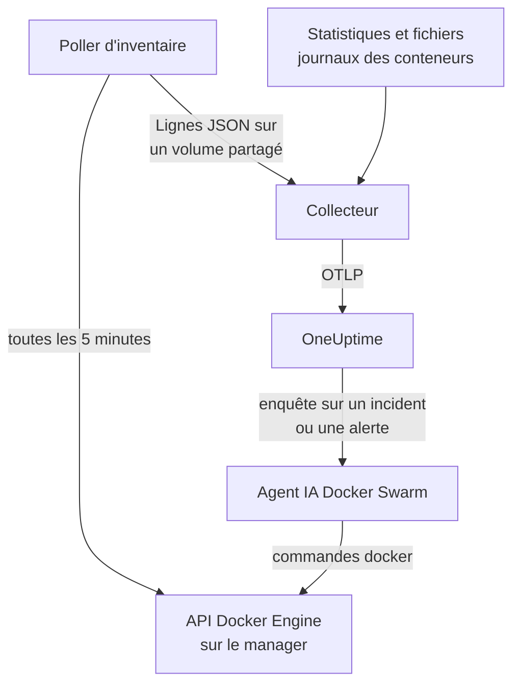

# Agent Docker Swarm

L'agent Docker Swarm de OneUptime surveille un cluster Docker Swarm : ses nœuds, services, tâches, stacks, réseaux overlay, secrets, configs et volumes, ainsi que les métriques et les journaux de chaque conteneur. Vous l'exécutez avec Docker Compose sur un nœud manager du swarm, et le cluster apparaît dans OneUptime avec tout cela. Les [moniteurs Docker Swarm](/docs/monitor/docker-swarm-monitor) alertent sur ce qui arrive.

:::cards
- [Installer l'agent](#installer-lagent): Le script d'installation ou Docker Compose, sur un nœud manager.
- [Ce que l'agent collecte](#ce-que-collecte-lagent): L'inventaire, les compteurs du cluster, et les métriques et journaux des conteneurs.
- [Agent IA](#agent-ia): Laisser OneUptime AI lire le swarm pendant qu'elle enquête.
- [Dépannage](#dépannage): Un script de diagnostic, et les problèmes habituels.
:::

## Fonctionnement

L'agent se compose de trois conteneurs, tous définis dans un seul `docker-compose.yml` :

1. **Collecteur** : un OpenTelemetry Collector qui lit `docker_stats` pour les métriques de chaque conteneur, suit les fichiers journaux des conteneurs et suit le fichier d'instantané de l'inventaire. Il appose le nom de votre cluster sur tout (`docker.swarm.cluster.name`) et l'envoie à OneUptime via OTLP.
2. **Poller d'inventaire** : un petit sidecar `curl` et `jq` qui, toutes les 5 minutes, parcourt l'API du manager du swarm (`/nodes`, `/services`, `/tasks`, `/networks`, `/secrets`, `/configs`, `/volumes`) et déduit les stacks du label de service `com.docker.stack.namespace`. Il écrit une ligne JSON par objet, que le collecteur transmet.
3. **Agent IA** : `oneuptime-docker-swarm-ai-agent`, qui exécute les commandes `docker` que demande OneUptime AI pendant qu'elle enquête sur un incident ou une alerte sur ce cluster. Il est en lecture seule, sauf si vous autorisez les corrections (voir [Agent IA](#agent-ia)).



Le cluster s'enregistre avec ses premières données, sous le nom de cluster que vous configurez.

## Avant de commencer

- Un nœud **manager** du swarm sur lequel exécuter l'agent : le poller d'inventaire et l'agent IA appellent des endpoints d'API auxquels seuls les managers répondent.
- Docker Engine 20.10 ou ultérieur avec le plugin Docker Compose v2.
- Une clé d'ingestion. Créez-en une sous **Paramètres du projet → Télémétrie & APM → Clés d'ingestion** et copiez sa valeur.
- Du HTTPS sortant du nœud vers votre URL OneUptime.

### Où exécuter l'agent

Exécutez-le sur un nœud manager. Le collecteur rapporte les conteneurs du nœud sur lequel il tourne : pour les métriques des conteneurs de tous les nœuds, exécutez donc le collecteur sur chaque nœud, tous avec le même `DOCKER_SWARM_CLUSTER_NAME` ; le poller d'inventaire et l'agent IA n'ont besoin de tourner que sur un seul manager. `install.sh` laisse l'agent IA de côté sur un nœud qui n'est pas un manager (et retire celui qu'il y avait installé auparavant). Un agent IA démarré malgré tout sur un worker ne s'enregistre jamais pour le cluster : il attend que son nœud devienne un manager, et ne peut donc pas évincer l'agent IA du manager. Vous déployez l'agent comme stack swarm plutôt qu'avec Compose ? Gardez le poller d'inventaire et l'agent IA sur des managers avec la contrainte `node.role == manager`.

## Installer l'agent

:::steps
### Installer et démarrer l'agent

:::tabs
@tab install.sh
Téléchargez le script d'installation et exécutez-le sur un nœud manager :

```bash
curl -sSL https://raw.githubusercontent.com/OneUptime/oneuptime/master/agents/DockerSwarmAgent/install.sh -o install.sh
sh install.sh
```

Le script demande votre URL OneUptime, la clé d'ingestion et un nom pour le cluster. Il s'installe dans `/opt/oneuptime-docker-swarm-agent`, écrit un fichier `.env` que seul son propriétaire peut lire, et démarre les trois conteneurs. Ajoutez `--no-ai-agent` pour laisser l'agent IA de côté.
@tab Docker Compose
Téléchargez `docker-compose.yml`, `otel-collector-config.yaml` et `inventory-snapshot.sh` depuis le [répertoire DockerSwarmAgent](https://github.com/OneUptime/oneuptime/tree/master/agents/DockerSwarmAgent) dans un nouveau dossier sur un nœud manager :

```bash
curl -fsSL https://raw.githubusercontent.com/OneUptime/oneuptime/master/agents/DockerSwarmAgent/docker-compose.yml -o docker-compose.yml
curl -fsSL https://raw.githubusercontent.com/OneUptime/oneuptime/master/agents/DockerSwarmAgent/otel-collector-config.yaml -o otel-collector-config.yaml
curl -fsSL https://raw.githubusercontent.com/OneUptime/oneuptime/master/agents/DockerSwarmAgent/inventory-snapshot.sh -o inventory-snapshot.sh
chmod +x inventory-snapshot.sh
```

Créez un fichier `.env` à côté. Il contient la clé d'ingestion : gardez-le privé avec `chmod 600 .env` :

```bash title=".env"
ONEUPTIME_URL=https://oneuptime.com
ONEUPTIME_SERVICE_TOKEN=your-telemetry-ingestion-key
DOCKER_SWARM_CLUSTER_NAME=my-swarm
```

Démarrez l'agent :

```bash
docker compose up -d
```
:::

### Vérifier que l'agent s'exécute

```bash
docker compose ps
docker compose logs --tail 50 oneuptime-docker-swarm-agent oneuptime-docker-swarm-inventory
```

`docker compose ps` liste trois conteneurs : le collecteur (`oneuptime-docker-swarm-agent`), le poller d'inventaire (`oneuptime-docker-swarm-inventory`) et l'agent IA (`oneuptime-docker-swarm-ai-agent`).

### Trouver le cluster dans OneUptime

Ouvrez **Produits → Infrastructure → Docker Swarm → Tous les clusters**. Le cluster apparaît en quelques minutes, et ses pages **Nœuds**, **Services**, **Tâches**, **Stacks**, **Réseaux**, **Secrets**, **Configurations** et **Volumes** se remplissent après le premier instantané de l'inventaire, en moins de 5 minutes.
:::

## Variables d'environnement

Le script d'installation écrit les trois premières dans `/opt/oneuptime-docker-swarm-agent/.env` ; une installation Docker Compose les lit dans le `.env` situé à côté de `docker-compose.yml`. Ajoutez-y ou modifiez-y n'importe laquelle, puis exécutez `docker compose up -d` dans ce dossier.

| Variable | Obligatoire | Description |
| --- | --- | --- |
| `ONEUPTIME_URL` | Oui | Votre URL OneUptime, comme `https://oneuptime.com` ou votre instance auto-hébergée. Utilisez `http://` et son port si l'instance ne parle que HTTP. |
| `ONEUPTIME_SERVICE_TOKEN` | Oui | La clé d'ingestion de **Paramètres du projet → Télémétrie & APM → Clés d'ingestion**. |
| `DOCKER_SWARM_CLUSTER_NAME` | Oui | Le nom du cluster dans OneUptime, et la clé par laquelle les données de chaque nœud se rejoignent : apposé sur tout comme attribut de ressource `docker.swarm.cluster.name`. Gardez-le stable : le modifier plus tard enregistre un second cluster. Par défaut `docker-swarm`. |
| `DOCKER_INVENTORY_INTERVAL_SECONDS` | Non | La fréquence à laquelle le poller d'inventaire prend un instantané, en secondes. Par défaut `300`. |
| `DOCKER_API_VERSION` | Non | La version de l'API Docker Engine que parlent le collecteur et le poller d'inventaire. Par défaut `1.44` ; vide, elle est négociée avec le démon (voir [Dépannage](#dépannage)). L'agent IA la négocie, sauf si vous en définissez une. |

Les réglages propres à l'agent IA se trouvent sous [Agent IA](#agent-ia).

## Ce que collecte l'agent

| Signal | Source | Où il apparaît |
| --- | --- | --- |
| Les nœuds, services, tâches, stacks, réseaux, secrets, configs et volumes | Le poller d'inventaire, depuis l'API du manager du swarm | Les listes et pages de détail du cluster |
| Compteurs du cluster (nœuds prêts, tâches en cours, services, stacks, …) | Le même instantané | Les cartes de la vue d'ensemble et les badges du menu latéral |
| CPU, mémoire, nombre de processus et durée de fonctionnement des conteneurs | Le récepteur `docker_stats` | La page **Métriques** |
| Journaux stdout et stderr des conteneurs | Le récepteur `filelog` | La page **Journaux** |

### En quoi il diffère de l'agent Docker

L'[agent Docker](/docs/telemetry/docker-host) modélise un seul hôte, et appose `host.name` et `container.runtime=docker`. L'agent Docker Swarm n'appose que `docker.swarm.cluster.name`, à dessein : OneUptime range alors les données sous le cluster swarm, au lieu d'enregistrer chaque nœud comme un hôte à part entière.

## Étiqueter le cluster avec des étiquettes de projet

Un attribut de ressource qui commence par `oneuptime.label.` devient une étiquette de projet sur le cluster : `oneuptime.label.<dimension>=<value>` correspond à l'étiquette `<dimension>:<value>`. Ajoutez les attributs au processeur `resource` dans `otel-collector-config.yaml`, à côté de `docker.swarm.cluster.name` :

```yaml
processors:
  resource:
    attributes:
      # ...existing attributes...
      - key: oneuptime.label.team
        value: platform
        action: upsert
      - key: oneuptime.label.env
        value: production
        action: upsert
```

Le collecteur ne lit sa configuration qu'au démarrage : exécutez `docker compose restart oneuptime-docker-swarm-agent`. Le cluster affiche alors les étiquettes `team:platform` et `env:production`. Les étiquettes sont comparées sans tenir compte de la casse : une étiquette `Production` existante est donc réutilisée plutôt que dupliquée, et l'agent ne retire jamais une étiquette que quelqu'un a ajoutée dans OneUptime.

## Exécuter comme service systemd

Pour démarrer l'agent avec le nœud et le relancer en cas d'échec, installez son unité systemd. Elle suppose que l'agent se trouve dans `/opt/oneuptime-docker-swarm-agent`, là où le script d'installation le place :

```bash
sudo curl -fsSL https://raw.githubusercontent.com/OneUptime/oneuptime/master/agents/DockerSwarmAgent/systemd/oneuptime-docker-swarm-agent.service -o /etc/systemd/system/oneuptime-docker-swarm-agent.service
sudo systemctl daemon-reload
sudo systemctl enable --now oneuptime-docker-swarm-agent
```

## Mettre à jour l'agent

L'agent rapporte la version du collecteur qu'il exécute. Quand elle est plus ancienne que la version qu'épingle cette version de OneUptime, un signe d'avertissement apparaît à côté de la version de l'agent, sur la page **Vue d'ensemble** du cluster. Sélectionnez-le pour voir ces commandes.

Relancez le script d'installation sur le nœud manager, et répondez à ses questions avec la même URL, la même clé et le même nom de cluster. Il télécharge les derniers fichiers, tire les images et redémarre l'agent :

```bash
curl -sSL https://raw.githubusercontent.com/OneUptime/oneuptime/master/agents/DockerSwarmAgent/install.sh -o install.sh
sh install.sh
```

Le script réécrit `.env` à partir de vos réponses. Il ne conserve que les listes de cibles de l'agent IA et ce que l'IA peut faire (`ONEUPTIME_AI_INVESTIGATION`, `ONEUPTIME_AI_FIXES`) : rajoutez toute variable que vous avez définie vous-même, comme `DOCKER_API_VERSION`. Vous aviez activé les corrections de l'IA ? Lancez-le en tant que `ONEUPTIME_AI_ALLOW_WRITES=true sh install.sh` pour les garder actives. Vous aviez laissé l'agent IA de côté ? Passez de nouveau `--no-ai-agent`.

Avec Docker Compose, téléchargez de nouveau les trois fichiers dans le dossier de l'agent (puis refaites toute modification apportée à `docker-compose.yml`), et tirez les images puis redémarrez :

```bash
docker compose pull
docker compose up -d
```

La version du collecteur est épinglée dans les fichiers : tirer les images ne suffit donc pas à faire avancer l'agent.

## Désinstaller l'agent

```bash
cd /opt/oneuptime-docker-swarm-agent
docker compose down
```

## Agent IA

Le `docker-compose.yml` du swarm (et `install.sh`) exécute aussi l'**Agent IA Docker Swarm** : un troisième conteneur, `oneuptime-docker-swarm-ai-agent` (image `oneuptime/resource-ai-agent:release`), qui exécute les commandes `docker` en lecture seule que demande OneUptime AI pendant qu'elle enquête sur un incident ou une alerte sur ce cluster — `docker node ls`, `docker service ps web --no-trunc`, `docker service logs --tail 200 web` — et, uniquement si vous l'autorisez, applique des corrections comme le redémarrage progressif d'un service nommé. Il lit les mêmes `ONEUPTIME_URL`, `ONEUPTIME_SERVICE_TOKEN` et `DOCKER_SWARM_CLUSTER_NAME` que le collecteur, sert donc exactement ce cluster, et apparaît sur la page **IA → Agent IA** du cluster dans OneUptime.

- **Les enquêtes IA sont activées par défaut.** Dès que l'agent se connecte, OneUptime AI enquête avec lui sur les incidents et les alertes de ce cluster, et la **Vue d'ensemble** du cluster affiche l'état de l'agent. Pour arrêter, définissez `ONEUPTIME_AI_INVESTIGATION=false` là où l'agent s'exécute (**Modifier**, sous **Ce que l'IA peut faire** sur la page de l'agent IA, montre comment), ou ne lancez pas l'agent.
- Comme le poller d'inventaire, il **doit tourner sur un nœud manager** : les commandes sur les nœuds, services et tâches sont réservées aux managers. Sur un worker, il n'exécute rien et ne s'enregistre pas pour le cluster tant que le nœud n'est pas un manager (son `/status` indique pourquoi). Exécutez-en un par cluster.
- Il est en **lecture seule**, sauf si vous définissez `ONEUPTIME_AI_ALLOW_WRITES=true` dans `.env` et exécutez `docker compose up -d` (ou lancez `install.sh` avec ; l'installeur écrit `ONEUPTIME_AI_ALLOW_WRITES`, `ONEUPTIME_AI_INVESTIGATION`, `ONEUPTIME_AI_FIXES`, `ONEUPTIME_AI_WRITE_TARGETS` et `ONEUPTIME_AI_PROTECTED_TARGETS` de son environnement dans `.env`, et une relance conserve ce que `.env` contient déjà pour les quatre derniers, sauf si vous passez cette variable, même vide) ; `ONEUPTIME_AI_WRITE_TARGETS` (motifs glob de noms de services et de nœuds, par exemple `web_*,api_*`) limite ce qu'une correction peut toucher. `ONEUPTIME_AI_FIXES`, dans le même `.env`, indique comment les corrections s'exécutent — `ask-for-approval` (une personne approuve chacune), `automatic` ou `bypass-approval` — et la page de l'agent IA l'affiche en lecture seule ([Ce que l'IA peut faire, défini par l'agent](/docs/ai/infrastructure-ai-agents#what-ai-may-do-set-by-the-agent)). Vider un nœud demande toujours l'approbation d'une personne, quel que soit le mode.
- Il s'exécute en root avec le socket Docker monté, car le socket appartient à root — et sur un manager, quiconque peut utiliser le socket contrôle tout le swarm, `:ro` ou non. La politique de commandes de l'agent est la limite : il ne crée ni ne supprime jamais de services ou de stacks, ne touche jamais aux secrets ni aux configs, et ne modifie jamais lui-même, le collecteur, le poller d'inventaire ni quoi que ce soit dans `ONEUPTIME_AI_PROTECTED_TARGETS` (motifs glob de noms de services et de nœuds).
- `install.sh --no-ai-agent` le laisse de côté, ou supprimez le service `oneuptime-docker-swarm-ai-agent` de `docker-compose.yml`.

Ce qu'il peut exécuter, comment fonctionnent les corrections et comment le dépanner : [Infrastructure AI Agents](/docs/ai/infrastructure-ai-agents#docker-swarm-clusters).

## Dépannage

:::details Exécutez d'abord le script de diagnostic
L'agent est livré avec un script, [`troubleshoot.sh`](https://github.com/OneUptime/oneuptime/blob/master/agents/DockerSwarmAgent/troubleshoot.sh), qui vérifie toute la chaîne : les conteneurs, que le poller d'inventaire est sur un manager (`docker node ls`), le fichier d'instantané, le nom du cluster apposé sur tout, la forme du jeton, les métriques propres au collecteur, et si OneUptime accepte la clé d'ingestion. Cette dernière vérification est la plus importante. OneUptime refuse une clé erronée avec `401` (`422` pour une clé désactivée ou une clé de navigateur), et le collecteur la journalise comme une ligne `Exporting failed` par lot, facile à manquer. Le script interroge `GET <url>/otlp/v1/validate` pour obtenir directement `200` (valide) ou `401` (invalide). Exécutez-le sur le nœud manager :

```bash
curl -sSL https://raw.githubusercontent.com/OneUptime/oneuptime/master/agents/DockerSwarmAgent/troubleshoot.sh -o troubleshoot.sh
bash troubleshoot.sh    # add -d <dir> if you installed outside /opt/oneuptime-docker-swarm-agent
```
:::

:::details Le cluster n'apparaît jamais
Exécutez d'abord le script de diagnostic. Sinon, lisez les journaux du collecteur (`docker compose logs oneuptime-docker-swarm-agent`), vérifiez que `ONEUPTIME_SERVICE_TOKEN` et `ONEUPTIME_URL` dans `.env` sont corrects, et que le nœud joint votre URL OneUptime.
:::

:::details Aucun inventaire n'apparaît
Vérifiez que le poller d'inventaire tourne sur un manager : `docker node ls` doit y réussir. Cherchez ensuite des lignes `failed to emit ...` dans ses journaux : `docker compose logs oneuptime-docker-swarm-inventory`.
:::

:::details Le cluster bascule à l'état déconnecté
Un cluster passe à l'état déconnecté quand OneUptime n'a rien reçu de lui pendant 15 minutes ; OneUptime vérifie toutes les 5 minutes, et le temps pendant lequel il ne recevait lui-même pas de données ne compte pas. Assurez-vous que le conteneur du collecteur reste démarré : `docker compose ps` l'affiche.
:::

:::details Le collecteur s'arrête avec "client version is too new"
Les journaux du collecteur affichent :

```text
Error: cannot start pipelines: failed to start "docker_stats" receiver:
Error response from daemon: client version 1.44 is too new.
Maximum supported API version is 1.41
```

La version d'API la plus élevée du démon est inférieure à la valeur par défaut `1.44` (Docker Engine 20.10 s'arrête à `1.41`) : le récepteur `docker_stats` ne peut donc pas démarrer et le conteneur redémarre en boucle. Trouvez la version la plus élevée du démon :

```bash
docker version --format '{{ .Server.APIVersion }}'
```

Définissez `DOCKER_API_VERSION` sur cette valeur dans `.env`, puis exécutez `docker compose up -d` sur chaque nœud où tourne l'agent. Les démons plus récents servent toujours les anciennes versions d'API : le réglage continue donc de fonctionner après une mise à niveau de Docker. Ou définissez `DOCKER_API_VERSION=` (vide) pour que le collecteur négocie la version avec le démon au lieu d'en épingler une.
:::

:::details Le cluster apparaît sous un mauvais nom
Le nom du cluster vient de `DOCKER_SWARM_CLUSTER_NAME`. Modifiez-le dans `.env` et exécutez `docker compose up -d` : un nouveau nom enregistre un nouveau cluster au lieu de renommer l'ancien.
:::

## Étapes suivantes

:::cards
- [Surveillance Docker Swarm](/docs/monitor/docker-swarm-monitor): Alerter sur les nœuds, les services, les tâches et les conteneurs.
- [Infrastructure AI Agents](/docs/ai/infrastructure-ai-agents): Ce que l'agent IA Docker Swarm peut exécuter, et comment fonctionnent les corrections.
- [Agent Docker](/docs/telemetry/docker-host): Surveiller plutôt un seul hôte Docker.
:::
