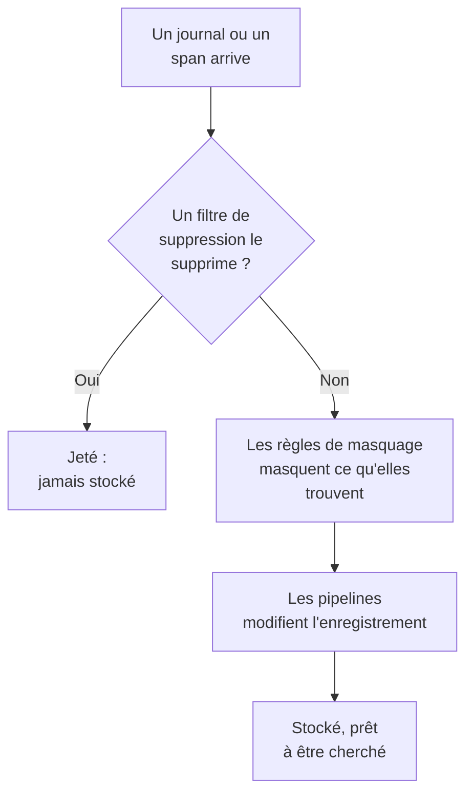

# Filtres de suppression et règles de masquage

Les filtres de suppression et les règles de masquage agissent sur vos journaux et vos spans à leur arrivée, avant que quoi que ce soit ne soit stocké. Un filtre de suppression jette les enregistrements dont vous n'avez jamais besoin, ou n'en garde qu'un échantillon. Une règle de masquage masque les données personnelles et les secrets, comme les adresses e-mail, les numéros de carte et les mots de passe, pour qu'ils n'atteignent jamais votre stockage.

:::cards
- [Où ils s'exécutent](#où-ils-sexécutent): Avant les pipelines, avant le stockage.
- [Supprimer ou échantillonner des enregistrements](#supprimer-ou-échantillonner-des-enregistrements): Cibler des enregistrements, puis les supprimer ou en garder une part.
- [Masquer les données sensibles](#masquer-les-données-sensibles): Masquer ou hacher ce qu'un modèle trouve.
- [Vérifier ce qu'un filtre a supprimé](#vérifier-ce-quun-filtre-a-supprimé): Des compteurs sur chaque filtre.
:::

## Où ils s'exécutent

Les journaux ont les leurs sous **Journaux → Paramètres**, et les spans sous **Traces → Paramètres**. À l'arrivée d'un enregistrement, OneUptime les applique dans cet ordre :



- **Ils n'agissent que sur les nouveaux enregistrements.** Une règle que vous créez ou modifiez s'applique aux enregistrements qui arrivent environ une minute plus tard. Les enregistrements déjà stockés ne changent pas.
- **Un enregistrement supprimé a disparu.** Aucune recherche, aucun graphique, aucun moniteur ni aucune règle d'enregistrement ne le voit jamais, et aucune exception n'en est tirée. Sur OneUptime Cloud, il n'est pas facturé non plus.
- **Chaque liste s'exécute dans l'ordre.** Faites glisser les lignes d'une liste pour changer l'ordre. Seuls les filtres et les règles activés s'exécutent.

Les filtres de suppression et les règles de masquage des journaux s'appliquent de la même façon aux journaux venant d'OpenTelemetry, de Syslog, de Fluent Bit et de Fluentd. [Pipelines de journaux](/docs/telemetry/log-pipelines) explique l'étape qui suit.

## Avant de commencer

- **Des journaux ou des spans qui arrivent.** Voir [OpenTelemetry](/docs/telemetry/open-telemetry).
- **Un rôle qui modifie les paramètres de télémétrie.** Project Owner ou Project Admin, ou un rôle personnalisé avec la permission de ce que vous modifiez, par exemple Create Log Drop Filter ou Create Trace Scrub Rule. Les rôles Telemetry voient les filtres et les règles, mais ne peuvent pas les modifier.

## Supprimer ou échantillonner des enregistrements

:::steps
### Ouvrir les filtres de suppression

Allez dans **Journaux → Paramètres → Filtres de suppression**, ou dans **Traces → Paramètres → Filtres de suppression** pour les spans.

### Cibler les enregistrements

Cliquez sur **Créer : Filtre de suppression de journaux**, ou sur **Créer : Filtre de suppression de traces** pour les spans. Dans **Correspondance**, donnez au filtre un **Nom**, puis construisez sa **Requête de filtre** : un champ, un opérateur et une valeur pour chaque condition, et si **Toutes les conditions** ou **Au moins une condition** doivent correspondre. Cliquez sur **Suivant**.

### Choisir l'action

Dans **Action**, gardez **Supprimer** pour jeter chaque enregistrement correspondant, ou choisissez **Échantillon** et saisissez le **Pourcentage d'échantillonnage** à garder, de 1 à 99. Créez ensuite le filtre.
:::

Le filtre commence à supprimer en moins d'une minute. Pour l'enregistrer sans encore rien supprimer, désactivez **Activé** sous **Avancé** avant de le créer.

> [!WARNING]
> Un enregistrement supprimé ne peut pas être récupéré. Gardez la requête d'un filtre étroite, et surveillez son compteur **Abandonné** après l'avoir créé.

Un filtre peut tester ces champs, et n'importe quel attribut avec **Attribut personnalisé...** :

| Enregistrements | Champs |
| --- | --- |
| Journaux | **Gravité**, **Corps du journal**, **ID du service** |
| Spans | **Nom du span**, **Type de span**, **Statut**, **Message d'état**, **ID du service**, **Possède une exception**, **Est un span racine** |

| Opérateur | Correspond à |
| --- | --- |
| **est égal à** | La valeur exacte, avec ses majuscules et ses minuscules : `Debug` correspond, `DEBUG` non. |
| **n'est pas égal à** | Tout sauf la valeur exacte. |
| **contient** | La valeur n'importe où dans le champ, sans tenir compte de la casse. Un `%` dans la valeur est un joker. |
| **fait partie de** | Une valeur parmi une liste de valeurs exactes, séparées par des virgules. |

**Preview query** affiche la requête que forment les conditions. Celle-ci supprime les lignes de débogage d'un contrôle de santé :

```text
severityText = 'Debug' AND body LIKE 'healthcheck'
```

L'échantillonnage se décide enregistrement par enregistrement : avec un **Pourcentage d'échantillonnage** de 10, environ un enregistrement correspondant sur dix est gardé. Les filtres s'exécutent dans l'ordre de la liste, et le premier qui supprime un enregistrement décide ; un enregistrement qu'un échantillon garde passe au filtre suivant.

## Masquer les données sensibles

:::steps
### Ouvrir les règles de masquage

Allez dans **Journaux → Paramètres → Règles de masquage**, ou dans **Traces → Paramètres → Règles de masquage** pour les spans.

### Choisir ce qu'il faut trouver

Cliquez sur **Créer : Règle de masquage de journaux**, ou sur **Créer : Règle de masquage de traces** pour les spans, et choisissez un **Type de modèle**. La règle prend son nom, par exemple **Nettoyer les adresses e-mail**, jusqu'à ce que vous en saisissiez un vous-même. Pour **Regex personnalisée**, remplissez aussi **Modèle Regex personnalisé**.

### Choisir comment masquer

Sous **Avancé**, choisissez l'**Action de nettoyage** et les **Champs à nettoyer**, ou laissez-les tels quels : une nouvelle règle remplace chaque correspondance par `[REDACTED]`, où qu'elle se trouve dans l'enregistrement. Créez ensuite la règle.
:::

| Type de modèle | Ce qu'il trouve |
| --- | --- |
| **Adresse e-mail** | Les adresses e-mail, comme `jane@example.com` |
| **Numéro de carte de crédit** | Seize chiffres en groupes de quatre, comme `4111 1111 1111 1111` |
| **SSN (numéro de sécurité sociale)** | Les numéros de sécurité sociale américains, comme `123-45-6789` |
| **Numéro de téléphone** | Les numéros de téléphone nord-américains, comme `555-123-4567` |
| **Adresse IP** | Les adresses IPv4, comme `192.168.1.1` |
| **Sensitive Attribute Keys** | La valeur entière de tout attribut dont la clé semble secrète, comme `password`, `token`, `api_key`, `authorization` ou `cookie` |
| **Regex personnalisée** | Votre propre expression régulière, écrite sans barres obliques ni options, et comparée en respectant la casse |

| Action de nettoyage | Ce que devient une correspondance |
| --- | --- |
| **Masquer** | `[REDACTED]`, par défaut |
| **Masque** | En grande partie cachée : une adresse e-mail garde sa première lettre et la fin de son domaine, un numéro de carte, de téléphone ou de sécurité sociale ses quatre derniers chiffres, et une correspondance personnalisée ou une valeur secrète son premier et son dernier caractère. Une adresse IP est entièrement cachée. |
| **Hachage** | Un court hachage de la valeur, toujours le même pour la même valeur, pour que les répétitions restent comptables |

Par exemple, une règle **Adresse e-mail** stocke ce corps de journal :

```text
Payment failed for jane@example.com
```

sous l'une de ces formes, selon son **Action de nettoyage** :

```text
Redact: Payment failed for [REDACTED]
Mask:   Payment failed for j***@***.com
Hash:   Payment failed for [HASHED:8c87b489]
```

Les **Champs à nettoyer** valent **Les deux (corps et attributs)** pour une règle de journaux, sauf si vous choisissez **Corps uniquement** ou **Attributs uniquement**, et **Tout (nom, attributs et événements)** pour une règle de spans, sauf si vous choisissez **Nom du span uniquement**, **Attributs uniquement** ou **Attributs d'événement uniquement**. Une règle **Sensitive Attribute Keys** masque toujours des valeurs d'attributs, puisqu'elle lit les clés des attributs.

- **Les exceptions viennent de l'enregistrement masqué.** Une exception trouvée dans un journal est créée après le masquage, et les règles qui masquent les événements de span masquent aussi les exceptions enregistrées sur eux.
- **Les Session Replays sont masqués aussi.** Les règles de masquage des journaux s'appliquent aussi aux enregistrements de Session Replay, en plus du masquage que fait l'enregistreur dans le navigateur.
- **Les règles s'exécutent dans l'ordre de la liste.** Chaque règle voit ce que les règles précédentes ont laissé.
- **Un modèle personnalisé prend un temps à la mesure de l'enregistrement.** Il garde la syntaxe et les réponses de JavaScript, assertions avant et arrière comprises, quelle que soit la façon dont il est écrit. Une référence arrière, comme `\1`, ne peut pas s'exécuter ainsi : une règle qui en contient une est refusée à l'enregistrement, tout comme un modèle trop grand pour être exécuté. S'il fallait relire une longue valeur encore et encore pour trouver chaque correspondance, la règle masque la valeur entière. Les filtres de suppression, les règles de masquage et les pipelines d'un projet partagent aussi une réserve de travail pour chaque lot qu'il envoie, à la mesure de la taille du lot et suffisante pour que des dizaines de modèles personnalisés lisent chaque valeur. Quand leurs modèles demandent plus, une règle de masquage personnalisée masque la valeur entière, et un filtre qui ne peut pas répondre ne s'applique pas à l'enregistrement.

## Vérifier ce qu'un filtre a supprimé

La liste **Filtres de suppression** affiche pour chaque filtre son compteur **Abandonné** et la date de son **Dernier abandon**. **Rien d'abandonné pour le moment** signifie qu'il n'a jamais correspondu. La page d'un filtre affiche la même chose sous **Activité**, mise à jour moins d'une minute après une suppression. Sa carte **Conditions de filtre** montre ce qu'il cible, et vous pouvez y changer les conditions.

## Dépannage

:::details Un filtre de suppression ne supprime rien
**est égal à**, **n'est pas égal à** et **fait partie de** comparent le texte exact, majuscules et minuscules comprises. Les gravités s'écrivent `Information` et `Warning`, pas `INFO` ni `WARN`. Vérifiez que le filtre est activé, et attendez une minute après une modification.
:::

:::details Des journaux attendus manquent
Regardez le compteur **Abandonné** et la date du **Dernier abandon** de chaque filtre de suppression. Désactivez **Activé** sur celui que vous soupçonnez, et les journaux suivants arrivent de nouveau.
:::

:::details Une règle de masquage personnalisée indique Ne nettoie rien
Son modèle est vide, n'est pas une expression régulière valide ou ne peut pas s'exécuter, par exemple parce qu'il contient une référence arrière comme `\1`, elle ne masque donc rien. Modifiez la règle et donnez-lui un modèle qui correspond à au moins un caractère.
:::

:::details D'anciens enregistrements montrent encore les données qu'une nouvelle règle masque
Les règles de masquage agissent à l'arrivée des enregistrements. Les enregistrements stockés avant la règle gardent leur contenu jusqu'à la fin de leur rétention. Voir [Rétention des données](/docs/telemetry/data-retention).
:::

## Étapes suivantes

:::cards
- [Pipelines de journaux](/docs/telemetry/log-pipelines): Analyser et enrichir les journaux que vous gardez.
- [Explorateur de journaux](/docs/telemetry/logs-explorer): Chercher ce qui a été stocké.
- [Explorateur de traces](/docs/telemetry/traces-explorer): Suivre les spans que vous gardez.
- [Rétention des données](/docs/telemetry/data-retention): Décider combien de temps ils sont conservés.
:::
