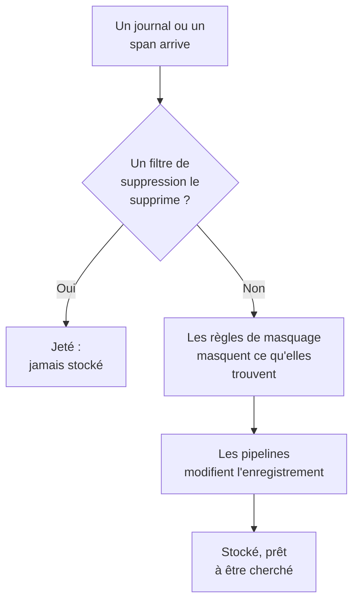

# Filtres de suppression et règles de masquage

Les filtres de suppression et les règles de masquage agissent sur vos journaux et vos spans à leur arrivée, avant que quoi que ce soit ne soit stocké. Un filtre de suppression jette les enregistrements dont vous n'avez jamais besoin, ou n'en garde qu'un échantillon. Une règle de masquage masque les données personnelles et les secrets, comme les adresses e-mail, les numéros de carte et les mots de passe, pour qu'ils n'atteignent jamais votre stockage.

:::cards
- [Où ils s'exécutent](#où-ils-sexécutent): Avant les pipelines, avant le stockage.
- [Supprimer ou échantillonner des enregistrements](#supprimer-ou-échantillonner-des-enregistrements): Cibler des enregistrements, puis les supprimer ou en garder une part.
- [Ce qu'un filtre prendrait](#ce-quun-filtre-prendrait): Ce qui lit les enregistrements, avant de l'enregistrer.
- [Masquer les données sensibles](#masquer-les-données-sensibles): Masquer ou hacher ce qu'un modèle trouve.
- [Vérifier ce qu'un filtre a supprimé](#vérifier-ce-quun-filtre-a-supprimé): Des compteurs sur chaque filtre.
:::

## Où ils s'exécutent

Les journaux ont les leurs sous **Journaux → Paramètres**, et les spans sous **Traces → Paramètres**. À l'arrivée d'un enregistrement, OneUptime les applique dans cet ordre :



- **Ils n'agissent que sur les nouveaux enregistrements.** Une règle que vous créez ou modifiez s'applique aux enregistrements qui arrivent environ une minute plus tard. Les enregistrements déjà stockés ne changent pas.
- **Un enregistrement supprimé a disparu.** Aucune recherche, aucun graphique, aucun moniteur ni aucune règle d'enregistrement ne le voit jamais, et aucune exception n'en est tirée. Sur OneUptime Cloud, il n'est pas facturé non plus.
- **Chaque liste s'exécute dans l'ordre.** Faites glisser les lignes d'une liste pour changer l'ordre. Seuls les filtres et les règles activés s'exécutent.

Les filtres de suppression et les règles de masquage des journaux s'appliquent de la même façon aux journaux venant d'OpenTelemetry, de Syslog, de Fluent Bit et de Fluentd. [Pipelines de journaux](/docs/telemetry/log-pipelines) explique l'étape qui suit.

## Avant de commencer

- **Des journaux ou des spans qui arrivent.** Voir [OpenTelemetry](/docs/telemetry/open-telemetry).
- **Un rôle qui modifie les paramètres de télémétrie.** Propriétaire du projet ou Administrateur du projet, ou un rôle personnalisé avec la permission de ce que vous modifiez, par exemple Create Log Drop Filter ou Create Trace Scrub Rule. Les rôles Telemetry voient les filtres et les règles, mais ne peuvent pas les modifier.

## Supprimer ou échantillonner des enregistrements

:::steps
### Ouvrir les filtres de suppression

Allez dans **Journaux → Paramètres → Filtres de suppression**, ou dans **Traces → Paramètres → Filtres de suppression** pour les spans.

### Cibler les enregistrements

Cliquez sur **Créer : Filtre de suppression de journaux**, ou sur **Créer : Filtre de suppression de traces** pour les spans. Dans **Correspondance**, donnez au filtre un **Nom**, puis construisez sa **Requête de filtre** : un champ, un opérateur et une valeur pour chaque condition, et si **Toutes les conditions** ou **Au moins une condition** doivent correspondre. Cliquez sur **Suivant**.

### Choisir l'action

Dans **Action**, gardez **Supprimer** pour jeter chaque enregistrement correspondant, ou choisissez **Échantillon** et saisissez le **Pourcentage d'échantillonnage** à garder, de 1 à 99. Créez ensuite le filtre.
:::

Le filtre commence à supprimer en moins d'une minute. Pour l'enregistrer sans encore rien supprimer, désactivez **Activé** sous **Avancé** avant de le créer.

> [!WARNING]
> Un enregistrement supprimé ne peut pas être récupéré. Gardez la requête d'un filtre étroite, et surveillez son compteur **Abandonné** après l'avoir créé.

Un filtre peut tester ces champs, et n'importe quel attribut avec **Attribut personnalisé...** :

| Enregistrements | Champs |
| --- | --- |
| Journaux | **Gravité**, **Corps du journal**, **ID du service** |
| Spans | **Nom du span**, **Type de span**, **Statut**, **Message d'état**, **ID du service**, **Possède une exception**, **Est un span racine** |

| Opérateur | Correspond à |
| --- | --- |
| **est égal à** | La valeur exacte, avec ses majuscules et ses minuscules : `Debug` correspond, `DEBUG` non. |
| **n'est pas égal à** | Tout sauf la valeur exacte. |
| **contient** | La valeur n'importe où dans le champ, sans tenir compte de la casse. Un `%` dans la valeur est un joker. |
| **fait partie de** | Une valeur parmi une liste de valeurs exactes, séparées par des virgules. |

**Preview query** affiche la requête que forment les conditions. Celle-ci supprime les lignes de débogage d'un contrôle de santé :

```text
severityText = 'Debug' AND body LIKE 'healthcheck'
```

L'échantillonnage se décide enregistrement par enregistrement : avec un **Pourcentage d'échantillonnage** de 10, environ un enregistrement correspondant sur dix est gardé. Les filtres s'exécutent dans l'ordre de la liste, et le premier qui supprime un enregistrement décide ; un enregistrement qu'un échantillon garde passe au filtre suivant.

## Ce qu'un filtre prendrait

Un enregistrement supprimé a disparu pour tout ce qui le lit. Aussi, pendant que vous écrivez un filtre de suppression, son formulaire dit ce qu'il prendrait, un instant après que vous avez cessé de taper : sous la **Requête de filtre** dans **Correspondance**, et sous l'action dans **Action**. Une ligne donne l'effet le plus important, et **Afficher les détails** donne le reste :

- **Combien il en cible.** Parmi les enregistrements stockés au cours du dernier jour, combien correspondent : ce que le filtre garde hors de votre stockage, et hors de votre facture. Le compte se fait sur ce qui a été stocké, après que les règles de masquage et les pipelines l'ont modifié, et seulement sur les services dont vous pouvez lire les enregistrements. Un comptage qui dure plus de 10 secondes est arrêté, et le formulaire le dit.
- **Ce que perdraient les Événements de sécurité.** Là où les [Événements de sécurité](/docs/telemetry/security-events) lisent vos journaux avec la carte **Vos journaux**, ou vos spans, le formulaire dit combien des enregistrements ciblés ils ont lus : les connexions, les attaques et les entrées de pare-feu qu'ils transforment en événements. Un filtre **Échantillon** nomme aussi les règles qui se déclenchent à partir d'un nombre, et ce qu'elles deviennent quand il ne garde que sa part : à 10 %, une règle qui se déclenche à 10 connexions échouées en cinq minutes en demande environ 100, et se déclenche donc bien moins souvent, voire jamais.
- **Ce qui lit aussi les mêmes enregistrements.** Les moniteurs, SLO, tableaux de bord avec leurs widgets, règles d'enregistrement et vues enregistrées dont les requêtes peuvent retenir un enregistrement que le filtre prend. Une requête les lit quand elle lit le même type d'enregistrement, d'un service dont le filtre peut prendre les enregistrements, et que rien de ce qu'elle fixe à une valeur exacte n'exclut le filtre : un filtre des journaux de niveau **Débogage** laisse tranquille un moniteur d'erreurs, et un filtre d'un service laisse tranquille le SLO d'un autre service. Tout ce que le formulaire ne peut pas exclure, comme une recherche dans le corps du journal, compte comme une lecture. Chacun est un lien, et ceux que vous ne pouvez pas ouvrir sont comptés, jamais nommés.

Quand quelque chose lit ce qu'un filtre prend, créer le filtre, l'activer, ou modifier la requête ou l'action d'un filtre actif vous demande de confirmer. Vous pouvez quand même enregistrer le filtre : la question est là pour que vous décidiez en connaissance de cause. Un filtre que rien ne lit s'enregistre sans question.

Par l'API, aucune question n'est posée, car un script ou Terraform n'a personne pour répondre. Un filtre que l'API crée ou modifie est enregistré, et quand il prend ce que d'autres lisent, la réponse porte un en-tête `X-OneUptime-Write-Warning` qui le dit en chiffres, et que le fournisseur Terraform affiche comme un avertissement. Pour demander d'abord, envoyez `filterQuery`, `action` et `samplePercentage` du filtre à `POST /api/telemetry/logs/drop-filter-impact`, ou à `/api/telemetry/traces/drop-filter-impact` pour les spans : la réponse contient tout ce que montre le formulaire.

Les filtres OpenStack que OneUptime ajoute à un projet gardent chaque ligne que lisent les Événements de sécurité, tant qu'ils restent tels que OneUptime les a créés. Modifiez-en un, et il supprime ce qu'il cible, comme un de vos propres filtres.

## Masquer les données sensibles

:::steps
### Ouvrir les règles de masquage

Allez dans **Journaux → Paramètres → Règles de masquage**, ou dans **Traces → Paramètres → Règles de masquage** pour les spans.

### Choisir ce qu'il faut trouver

Cliquez sur **Créer : Règle de masquage de journaux**, ou sur **Créer : Règle de masquage de traces** pour les spans, et choisissez un **Type de modèle**. La règle prend son nom, par exemple **Nettoyer les adresses e-mail**, jusqu'à ce que vous en saisissiez un vous-même. Pour **Regex personnalisée**, remplissez aussi **Modèle Regex personnalisé**, et pour **Attributs nommés**, les **Attributs à masquer**, un par ligne.

### Choisir comment masquer

Sous **Plus de champs**, choisissez l'**Action de nettoyage** et les **Champs à nettoyer**, ou laissez-les tels quels : une nouvelle règle remplace chaque correspondance par `[REDACTED]`, où qu'elle se trouve dans l'enregistrement. Créez ensuite la règle.
:::

| Type de modèle | Ce qu'il trouve |
| --- | --- |
| **Adresse e-mail** | Les adresses e-mail, comme `jane@example.com`, y compris dans une autre écriture, comme `张伟@example.com`, dans une URL encodée en pourcentage, et saisies en pleine chasse, comme `ｊａｎｅ＠ｅｘａｍｐｌｅ．ｃｏｍ` |
| **Numéro de carte de crédit** | Les numéros de carte, comme `4111 1111 1111 1111` ou un numéro American Express, y compris dans les chiffres d'une autre écriture, comme `４１１１ １１１１ １１１１ １１１１`, saisis entièrement en pleine chasse, comme `４１１１－１１１１－１１１１－１１１１`, avec un autre tiret entre leurs groupes, comme `4111–1111–1111–1111`, dans une URL avec un espace encodé en pourcentage ou un signe plus entre leurs groupes, et seize chiffres quelconques en groupes de quatre |
| **SSN (numéro de sécurité sociale)** | Les numéros de sécurité sociale américains, comme `123-45-6789`, y compris séparés par des points, des espaces ou un autre tiret, dans une URL, dans les chiffres d'une autre écriture, comme `１２３-４５-６７８９`, et saisis entièrement en pleine chasse, ainsi que neuf chiffres d'affilée à côté d'un mot qui les désigne ou seuls sous une clé qui les désigne, comme `customer.ssn` |
| **Numéro de téléphone** | Les numéros de téléphone, comme `555-123-4567` ou `+44 20 7946 0958`, les internationaux dans les groupes où on les écrit, y compris séparés par un autre tiret, dans une URL encodée en pourcentage, telle qu'un formulaire l'écrit, dans les chiffres d'une autre écriture et saisis entièrement en pleine chasse, comme `＋８１ ３－１２３４－５６７８`, ainsi qu'un numéro national à côté d'un mot qui le désigne ou seul sous une clé qui le désigne, comme `user.phone`, mais pas un nombre décimal, le décalage d'un fuseau horaire ni une version |
| **Adresse IP** | Les adresses IPv4 et IPv6 publiques, comme `203.0.113.7`, `2001:db8::1` ou `2001::1`, y compris juste après le deux-points d'une clé et dans une URL encodée en pourcentage, mais pas les adresses privées, de bouclage ou link-local |
| **Clés d'attributs sensibles** | La valeur entière de tout attribut dont la clé semble secrète, comme `password`, `token`, `api_key`, `authorization` ou `cookie` |
| **Attributs nommés** | La valeur entière des attributs que vous nommez, quoi qu'elle contienne, comme le nom d'une personne sous `customer_name`. Une clé nomme aussi les attributs imbriqués sous elle : `user` masque `user.email` |
| **Regex personnalisée** | Votre propre expression régulière, écrite sans barres obliques ni options, et comparée en respectant la casse, y compris dans une URL encodée en pourcentage, telle qu'un formulaire l'écrit, dans les chiffres d'une autre écriture et dans une valeur saisie entièrement en pleine chasse, lettres comprises |

| Action de nettoyage | Ce que devient une correspondance |
| --- | --- |
| **Masquer** | `[REDACTED]`, par défaut |
| **Masque** | En grande partie cachée : une adresse e-mail garde sa première lettre et la fin de son domaine, un numéro de carte, de téléphone ou de sécurité sociale ses quatre derniers chiffres, et une correspondance personnalisée ou une valeur secrète son premier et son dernier caractère. Une adresse IP est entièrement cachée. |
| **Hachage** | Un jeton propre à votre projet, toujours le même pour la même valeur, pour que les répétitions restent comptables, sans que personne puisse retrouver la valeur |

Par exemple, une règle **Adresse e-mail** stocke ce corps de journal :

```text
Payment failed for jane@example.com
```

sous l'une de ces formes, selon son **Action de nettoyage** :

```text
Redact: Payment failed for [REDACTED]
Mask:   Payment failed for j***@***.com
Hash:   Payment failed for [HASHED:5e29db14e508e09a]
```

Les **Champs à nettoyer** valent **Les deux (corps et attributs)** pour une règle de journaux, sauf si vous choisissez **Corps uniquement** ou **Attributs uniquement**, et **Tout (nom, attributs et événements)** pour une règle de spans, sauf si vous choisissez **Nom du span uniquement**, **Attributs uniquement** ou **Attributs d'événement uniquement**. Les attributs des liens d'un span sont masqués avec les attributs propres du span, et **Tout (nom, attributs et événements)** masque aussi le message d'état d'un span et les noms de ses événements. Une règle **Clés d'attributs sensibles** lit des clés, et masque donc toujours les valeurs qu'elles désignent : dans les attributs, et dans le corps JSON d'un journal.

- **Une règle peut valoir pour un seul service.** Sous **Plus de champs**, choisissez le service dans **Uniquement pour un service** : la règle masque les enregistrements de ce service, et ceux des autres services restent tels quels. Laissée vide, elle masque les enregistrements de tous les services. La colonne **Portée** de la liste dit ce qu'il en est.
- **Une règle peut nommer les attributs qu'elle lit.** Une règle **Attributs nommés** masque les attributs qu'elle nomme. Tout modèle autre que **Clés d'attributs sensibles** ne lit que les attributs listés sous **Plus de champs**, dans **Uniquement dans ces attributs**, un par ligne, ou tous les attributs si le champ est vide : le corps du journal, ou le nom et le message d'état d'un span, continue d'être lu comme l'indiquent les **Champs à nettoyer**. Une règle que Sécurité des données crée pour une détection ne lit que l'attribut où les données ont été trouvées, et son formulaire l'y affiche, pour que vous puissiez en ajouter un autre, comme `db.password_old`, ou vider le champ. La liste les nomme sous le **Type de modèle** de la règle : les attributs qu'une règle masque en entier, ou les seuls que son modèle lit.
- **La liste dit ce que chaque règle a modifié.** **Valeurs modifiées** compte les valeurs que chaque règle a masquées au cours des 7 derniers jours, et **Par service** ouvre les services et les versions dont elles venaient. Une version qui n'envoie plus ce qu'une règle masque ne change plus rien, et c'est ainsi qu'une fuite corrigée dans le code se voit ici.
- **Une règle que Sécurité des données a prouvée le dit.** Une règle créée pour une détection a été exécutée sur les enregistrements où les données ont été vues avant d'être enregistrée, et affiche **Prouvé** tant qu'elle est encore la règle qui a été prouvée (voir [Données sensibles dans la télémétrie](/docs/data-security/telemetry#prouvée-sur-les-enregistrements-de-la-détection)). Changez ce qu'elle trouve, les attributs qu'elle lit, sa façon de nettoyer, ce qu'elle nettoie ou son service, et **Prouvé** disparaît. Les mêmes attributs dans un autre ordre ou une autre casse le conservent.
- **Le formulaire dit ce qu'une règle changerait pour les autres.** Avant que vous ne créiez une règle, et quand vous en activez une, OneUptime liste ce qui lit les valeurs qu'elle masquerait : moniteurs, tableaux de bord, vues enregistrées, règles d'enregistrement et SLO, chacun sous forme de lien, et ce que perdraient les [Événements de sécurité](/docs/telemetry/security-events). Un moniteur qui filtre sur une valeur masquée ne la trouve plus. La règle est enregistrée dans tous les cas.
- **Une règle d'adresse IP cache les adresses qui sont des données personnelles.** Ce sont les adresses IPv4 et IPv6 publiques, quelle que soit leur écriture : abrégée, comme `2001:db8::1`, ou réduite à un groupe de chaque côté de `::`, comme `2001::1`, entre crochets avec un port, comme `[2001:db8::1]:443`, qui garde ses crochets et son port, avec une zone, comme `2001:db8::2%eth0`, qui garde sa zone, ou une adresse IPv4 écrite en IPv6, comme `::ffff:203.0.113.7`, cachée en entier. Une adresse juste après le deux-points d'une clé, telle que l'écrivent les lignes de journal au format logfmt ou syslog, comme `peer ip:2001:db8::1` ou `remote:2001:db8::1`, est cachée seule, et la clé garde toutes ses lettres. Une écriture avec un groupe de chaque côté de `::` n'est une adresse que si son premier groupe compte quatre chiffres hexadécimaux et commence par 2 ou 3, comme celui d'une adresse publique, si bien qu'un texte comme `10::30` ou `ab::cd` reste tel quel. Une adresse encodée en pourcentage dans une URL, comme `2001%3Adb8%3A%3A1` dans `/geo?ip=2001%3Adb8%3A%3A1`, est lue décodée et cachée telle qu'elle est écrite, séquences d'échappement comprises, et le reste de l'URL est conservé. Elle garde les adresses privées, de bouclage et link-local, comme `10.0.0.12`, `127.0.0.1` et `fe80::1`, et l'adresse de métadonnées cloud `169.254.169.254` dans l'URL d'une requête, où les [Événements de sécurité](/docs/telemetry/security-events) cherchent la falsification de requête côté serveur. Pour cacher aussi les adresses internes, ajoutez pour elles une règle **Regex personnalisée**, comme `\b(?:\d{1,3}\.){3}\d{1,3}\b` pour toute adresse IPv4. Sauf si la règle les hache, les Événements de sécurité ne nomment alors aucune adresse pour les attaques qu'ils trouvent dans les journaux ou les traces que la règle nettoie : voir [Masquée par une règle de nettoyage](/docs/telemetry/security-events#masquée-par-une-règle-de-nettoyage).
- **Une règle d'adresse e-mail cache ce que Sécurité des données appelle une adresse e-mail.** En plus de ce que trouve son propre motif, elle cache une adresse dans n'importe quelle écriture, comme `张伟@example.com`, `josé@example.com` ou `user@例え.jp`, et une adresse encodée en pourcentage dans une URL, comme `jane%40example.com` dans `/signup?email=jane%40example.com`, y compris les octets UTF-8 de ses lettres, comme `jos%C3%A9%40example.com`, qui est lue décodée et cachée telle qu'elle est écrite, tandis que le reste de l'URL est conservé. Elle cache aussi une adresse saisie en pleine chasse, comme la saisit une méthode de saisie en mode pleine chasse, par exemple `ｊａｎｅ＠ｅｘａｍｐｌｅ．ｃｏｍ`, ou dont seul le `＠` est en pleine chasse. **Masque** lit une telle adresse décodée et en ASCII, si bien qu'elle garde, comme toute adresse e-mail, sa première lettre et la fin de son domaine.
- **Une règle de numéro de carte de crédit cache ce que Sécurité des données appelle un numéro de carte.** En plus de seize chiffres quelconques en groupes de quatre, elle cache toute carte que Sécurité des données trouve, comme un numéro American Express en groupes de quatre, six et cinq chiffres, et une carte dans les chiffres d'une autre écriture : des chiffres pleine chasse, tels qu'un texte japonais écrit une carte, comme `４１１１ １１１１ １１１１ １１１１`, des chiffres arabo-indiens et persans, les chiffres des autres écritures, ou une carte saisie dans deux écritures. Elle cache aussi une carte dans une URL, ses groupes séparés par un espace encodé en pourcentage ou par le signe plus qu'un formulaire écrit à la place d'un espace, comme `4111%201111%201111%201111` ou `4111+1111+1111+1111` dans `/pay?card=4111+1111+1111+1111`, et le reste de l'URL est conservé. Elle cache de même une carte saisie entièrement en pleine chasse, ses groupes séparés par des traits d'union pleine chasse ou des espaces idéographiques, comme `４１１１－１１１１－１１１１－１１１１`, ou par un autre tiret, lu comme un trait d'union entre deux chiffres : le signe d'allongement `ー` qu'un texte japonais saisit pour un trait d'union, un trait d'union typographique, un tiret numérique, un tiret demi-cadratin ou un signe moins, comme `4111–1111–1111–1111`. **Masque** garde ses quatre derniers chiffres, écrits en chiffres ASCII.
- **Une règle de numéro de téléphone ou de SSN cache ce que Sécurité des données appelle un tel numéro.** En plus de ce que trouve son propre motif, une règle **Numéro de téléphone** cache tout numéro de téléphone que Sécurité des données trouve, et une règle **SSN (numéro de sécurité sociale)** tout numéro de sécurité sociale américain, chacun aussi saisi entièrement en pleine chasse, comme l'écrit un texte japonais ou chinois, signe plus, traits d'union, parenthèses, points et espaces idéographiques compris, comme `＋８１ ３－１２３４－５６７８` ou `５３６－２２－８７３１`. Chacune cache aussi un numéro que Sécurité des données ne reconnaît comme tel qu'à côté d'un mot qui le désigne : un numéro de téléphone national de 9 à 12 chiffres avec un mot comme tel, phone, mobile ou fax juste avant ou juste après, comme `tel 02012345678`, et neuf chiffres d'affilée près d'un mot comme SSN ou social security number, comme `SSN 536221234`. Le mot doit se trouver à la distance du numéro où Sécurité des données le cherche : `order 02012345678` et `ref 536221234` sont conservés. La clé d'un attribut est ce mot quand son nom désigne le numéro, comme Sécurité des données lit le nom d'un champ : un numéro national seul sous `user.phone` et neuf chiffres sous `customer.ssn` sont cachés, envoyés comme texte ou comme nombre, tout comme une valeur qui a tout entière la forme d'un numéro de téléphone sous une telle clé, comme `020 1234 5678`. Une liste ou une map est lue comme le texte JSON sous lequel elle est stockée, donc un numéro à côté d'une clé ou d'un mot qu'elle contient est caché, comme `[{"system": "phone", "value": "02012345678"}]`. Un numéro sous une clé qui ne désigne rien, comme `order.id`, est conservé, sauf si le propre motif de la règle le trouve, comme il trouve dix chiffres quelconques. Chacune cache aussi un numéro dont les groupes sont séparés par un autre tiret, lu comme un trait d'union seulement entre deux chiffres : le signe d'allongement qu'un texte japonais saisit pour un trait d'union, comme `＋８１ ３ー１２３４ー５６７８`, ou un trait d'union typographique, un tiret demi-cadratin ou un signe moins, comme `536–22–8731`. Un mot qui désigne un numéro compte aussi saisi en pleine chasse, comme `ＴＥＬ`. **Masque** garde les quatre derniers chiffres, écrits en chiffres ASCII.
- **Une règle de regex personnalisée lit une valeur comme Sécurité des données la lit.** Elle lit le texte tel qu'il est écrit, puis avec ses échappements en pourcentage décodés, y compris les octets UTF-8 d'un caractère, puis comme un formulaire écrit la chaîne de requête d'une URL, avec un signe plus pour chaque espace, puis avec les chiffres de chaque écriture lus comme des chiffres ASCII, puis avec le signe plus, les traits d'union, les parenthèses, les points et les barres obliques pleine chasse et les espaces idéographiques d'un numéro, et les autres tirets entre deux chiffres, lus comme des caractères ASCII, puis avec chaque lettre, chiffre et signe pleine chasse lu comme son caractère ASCII, et cache ce qu'elle trouve dans n'importe laquelle de ces lectures, tel qu'il est écrit, séquences d'échappement comprises : `\+44 \d{2} \d{4} \d{4}` cache `%2B44%2020%207946%200958` et `%2B44+20+7946+0958` dans une URL, `+٤٤ ٢٠ ٧٩٤٦ ٠٩٥٨` en chiffres arabo-indiens et `＋４４ ２０ ７９４６ ０９５８` saisi entièrement en pleine chasse. Les règles **Regex personnalisée** que **Nettoyer** crée pour d'autres types de données, comme un jeton GitHub ou un IBAN, lisent une valeur de la même façon, donc un IBAN saisi dans un formulaire, comme `DE44+5001+0517+5407+3249+31`, ou saisi en lettres pleine chasse, comme `ＤＥ４４　５００１　０５１７　５４０７　３２４９　３１`, est caché en entier. **Masque** garde le premier et le dernier caractère d'une correspondance telle qu'il la lit.
- **Un jeton de hachage est propre à votre projet.** Il est créé avec une clé de votre projet, dérivée du `ENCRYPTION_SECRET` de l'installation : la même valeur a un autre jeton dans un autre projet, et personne qui lit un jeton ne peut retrouver la valeur ni hacher une supposition pour comparer. Une adresse IP a un seul jeton, quelle que soit son écriture : `::ffff:203.0.113.7` et `203.0.113.7` en partagent un, tout comme `2001%3Adb8%3A%3A1` et `2001:db8::1`. De même pour une adresse e-mail encodée en pourcentage et telle qu'elle est écrite, comme `jane%40example.com` et `jane@example.com`, ou `jos%C3%A9%40example.com` et `josé@example.com`, pour une carte dans les chiffres d'une autre écriture et en chiffres ASCII, pour une carte écrite dans une URL et écrite telle quelle, comme `4111+1111+1111+1111` et `4111 1111 1111 1111`, pour un numéro saisi entièrement en pleine chasse et en ASCII, comme `＋８１ ３－１２３４－５６７８` et `+81 3-1234-5678`, pour un numéro séparé par un autre tiret et par des traits d'union, comme `536–22–8731` et `536-22-8731`, pour une adresse e-mail saisie en pleine chasse et en ASCII, comme `ｊａｎｅ＠ｅｘａｍｐｌｅ．ｃｏｍ` et `jane@example.com`, et pour ce que trouve une règle **Regex personnalisée**, d'après ce qu'elle lit. Les enregistrements stockés avant que les jetons aient une clé en contiennent de 8 caractères, comme `[HASHED:8c87b489]`, qui diffèrent de ceux d'aujourd'hui, de 16 caractères : tant que ces enregistrements n'ont pas atteint la fin de leur rétention, cherchez les deux. Changer `ENCRYPTION_SECRET` change tous les jetons, et sur une installation auto-hébergée, les jetons ne sont pas plus secrets que lui.
- **Une règle d'adresse IP qui efface ou masque dit ce qu'elle coûte aux Événements de sécurité.** Là où les [Événements de sécurité](/docs/telemetry/security-events) lisent vos journaux ou vos traces, une telle règle dit sur sa ligne qu'elle masque aussi les adresses aux Événements de sécurité, qui ne peuvent donc pas vous indiquer quelle adresse bloquer, avec **Hacher plutôt**, qui passe la règle en **Hachage** : les personnes voient un jeton à la place de l'adresse, et les Événements de sécurité voient toujours l'adresse. Le formulaire de la règle dit la même chose sous les actions de la règle, et **Nettoyer** y hache une adresse IP dès le départ.
- **Les Événements de sécurité peuvent toujours nommer une adresse IP hachée.** Quand les [Événements de sécurité](/docs/telemetry/security-events) lisent vos journaux ou vos traces, une règle d'adresse IP qui hache garde aussi chaque adresse qu'elle cache à côté de son jeton, dans un stockage que seules les analyses des Événements de sécurité lisent : aucune page, recherche, exportation, API ni outil d'IA ne peut le lire. Ainsi, une attaque venant d'une adresse que vos journaux ne montrent que sous forme de jeton nomme quand même l'adresse, et son dossier dit quelle adresse bloquer. Chaque adresse est gardée jusqu'à 30 jours après sa dernière apparition. Une règle qui efface ou masque l'adresse ne garde rien : les Événements de sécurité disent alors qu'une règle de masquage a caché l'adresse, comme pour un jeton de plus de 30 jours ou créé avant que les jetons aient une clé.
- **Les Événements de sécurité peuvent toujours nommer un utilisateur haché.** Là où les [Événements de sécurité](/docs/telemetry/security-events) lisent un utilisateur dans vos journaux ou vos traces, comme le `enduser.id` d'une requête, l'utilisateur d'un appel d'IA ou le principal d'un journal d'audit cloud, une règle qui le hache garde aussi l'utilisateur à côté de son jeton, dans un stockage que seules les analyses des Événements de sécurité lisent : aucune page, recherche, exportation, API ni outil d'IA ne peut le lire. Ainsi, un dossier sur un compte que vos journaux ne montrent que sous forme de jeton nomme le compte, et un playbook peut agir sur lui. Chaque utilisateur est gardé jusqu'à 30 jours après sa dernière apparition. Une valeur hachée là où les Événements de sécurité ne lisent aucun utilisateur, comme une adresse e-mail dans un message d'erreur, n'est jamais gardée, et une règle qui efface ou masque ne garde rien. Pour en retirer définitivement une personne, déposez une demande d'effacement : voir [Effacer une personne](/docs/telemetry/security-events#effacer-une-personne).
- **Les listes et les valeurs imbriquées sont lues aussi.** Une règle lit chaque texte d'une liste, d'une liste de listes ou d'une liste clé-valeur, comme les valeurs d'un en-tête HTTP, et garde la forme de la valeur : les nombres et les valeurs vrai ou faux restent tels quels. Une règle **Clés d'attributs sensibles** lit aussi les clés à l'intérieur d'une valeur, si bien que le `password` d'une liste clé-valeur est masqué aussi. Un corps de journal envoyé sous forme de map ou de liste est stocké comme son texte JSON, et une règle **Clés d'attributs sensibles** lit les clés qu'il contient, comme dans un corps écrit en JSON. Une règle de modèle garde un tel corps en JSON, et aussi un attribut écrit en JSON, comme les messages d'un appel d'IA : elle lit le texte tel que votre application l'a écrit, une séquence d'échappement comme `\n` lue comme le saut de ligne qu'elle représente, et ne remplace ce qu'elle trouve qu'à l'intérieur de ses textes et de ses nombres.
- **Le JSON contenu dans un texte est lu aussi.** Un texte qui est lui-même du JSON, comme un attribut `http.request.body` contenant `{"password":"hunter2"}`, ou la ligne `log` d'un enregistrement Fluentd dans le corps d'un journal, est lu comme du JSON, jusqu'à 4 niveaux de JSON l'un dans l'autre, et au-delà comme du texte. Une règle **Clés d'attributs sensibles** masque les valeurs sous les clés qui semblent secrètes à l'intérieur, et rien d'autre : ses nombres, ses espaces et ses autres textes restent tels que votre application les a écrits. Un texte qui ressemble seulement à du JSON, comme `{token}`, est laissé tel quel.
- **Une valeur trop grande pour être lue élément par élément est lue comme du texte.** Une valeur imbriquée sur plus de 32 niveaux, ou qui ferait dépasser à un enregistrement 10 000 valeurs dans ses listes et ses maps, est lue et stockée comme son texte JSON. Une règle de modèle masque ce qu'elle trouve dans ce texte, et une règle **Clés d'attributs sensibles** masque la valeur entière quand un mot comme `password` ou `token` y apparaît. Dans le corps d'un journal, et dans le JSON contenu dans un texte, seule la partie au-delà de ces limites est lue comme du texte : le reste est toujours lu clé par clé.
- **Les exceptions viennent de l'enregistrement masqué.** Une exception trouvée dans un journal est créée après le masquage, et les règles qui masquent les événements de span masquent aussi les exceptions enregistrées sur eux. Chaque exception reste regroupée selon ce qu'elle disait avant le masquage : ajouter une règle ne fait donc jamais d'une exception que vous avez déjà une nouvelle exception, et ne déclenche pas à nouveau **Nouvelle exception** pour elle. Quand une règle masque une partie de ce qui regroupe une nouvelle exception, son empreinte est calculée avec une clé de votre projet, comme un jeton de hachage, si bien que personne ne peut retrouver ce qui a été masqué. Une exception créée avant la règle passe à une telle empreinte à sa prochaine occurrence que la règle modifie ; ses occurrences enregistrées avant gardent l'ancienne jusqu'à la fin de leur conservation.
- **Les copies brutes d'une ligne syslog cachent ce que les règles ont caché dans ses parties.** Le syslog garde les données structurées d'une ligne RFC 5424 telles qu'elles sont arrivées dans `syslog.structured.raw`, et le syslog envoyé en HTTP garde la ligne entière dans `syslog.raw`. Chaque copie est reconstituée à partir de ce que les règles ont laissé des champs de l'en-tête, de chaque paramètre des données structurées et du message, puis les règles la lisent comme elles lisent n'importe quel attribut. Ainsi, un mot de passe qu'une règle **Clés d'attributs sensibles** masque dans `syslog.structured.auth_1.password`, ou une adresse qu'une règle **Corps uniquement** masque dans le message, est aussi masqué dans les copies, écrit comme RFC 5424 écrit une valeur : `password="[REDACTED\]"`. Une ligne dans laquelle les règles ne changent rien garde ses copies telles qu'elle est arrivée.
- **L'identifiant de session d'un enregistrement est conservé.** Une règle **Clés d'attributs sensibles** masque une session de connexion, comme un `session_id`, un `sessionid` ou un cookie, mais conserve `session.id` quand il contient la session à laquelle appartient le journal ou le span : l'identifiant aléatoire sous lequel [Session Replay](/docs/telemetry/session-replay) classe l'enregistrement, que l'enregistrement garde de toute façon comme sa session. L'identifiant de conversation d'un appel d'IA est conservé de la même manière. N'envoyez pas le secret d'une session de connexion comme `session.id`.
- **Les Session Replays sont masqués aussi.** Les règles de masquage des journaux qui valent pour tous les services s'appliquent aussi aux enregistrements de Session Replay, en plus du masquage que fait l'enregistreur dans le navigateur.
- **Les règles s'exécutent dans l'ordre de la liste.** Chaque règle voit ce que les règles précédentes ont laissé.
- **Un modèle personnalisé prend un temps à la mesure de l'enregistrement.** Il garde la syntaxe et les réponses de JavaScript, assertions avant et arrière comprises, quelle que soit la façon dont il est écrit. Une référence arrière, comme `\1`, ne peut pas s'exécuter ainsi : une règle qui en contient une est refusée à l'enregistrement, tout comme un modèle trop grand pour être exécuté. S'il fallait relire une longue valeur encore et encore pour trouver chaque correspondance, la règle masque la valeur entière. Les filtres de suppression, les règles de masquage et les pipelines d'un projet partagent aussi une réserve de travail pour chaque lot qu'il envoie, à la mesure de la taille du lot et suffisante pour que des dizaines de modèles personnalisés lisent chaque valeur. Quand leurs modèles demandent plus, une règle de masquage personnalisée masque la valeur entière, et un filtre qui ne peut pas répondre ne s'applique pas à l'enregistrement.

## Vérifier ce qu'un filtre a supprimé

La liste **Filtres de suppression** affiche pour chaque filtre son compteur **Abandonné** et la date de son **Dernier abandon**. **Rien d'abandonné pour le moment** signifie qu'il n'a jamais correspondu. La page d'un filtre affiche la même chose sous **Activité**, mise à jour moins d'une minute après une suppression. Sa carte **Conditions de filtre** montre ce qu'il cible, et vous pouvez y changer les conditions.

## Dépannage

:::details Un filtre de suppression ne supprime rien
**est égal à**, **n'est pas égal à** et **fait partie de** comparent le texte exact, majuscules et minuscules comprises. Les gravités s'écrivent `Information` et `Warning`, pas `INFO` ni `WARN`. Vérifiez que le filtre est activé, et attendez une minute après une modification.
:::

:::details Des journaux attendus manquent
Regardez le compteur **Abandonné** et la date du **Dernier abandon** de chaque filtre de suppression. Désactivez **Activé** sur celui que vous soupçonnez, et les journaux suivants arrivent de nouveau.
:::

:::details Une règle de masquage personnalisée indique Ne nettoie rien
Son modèle est vide, n'est pas une expression régulière valide ou ne peut pas s'exécuter, par exemple parce qu'il contient une référence arrière comme `\1`, elle ne masque donc rien. Modifiez la règle et donnez-lui un modèle qui correspond à au moins un caractère.
:::

:::details D'anciens enregistrements montrent encore les données qu'une nouvelle règle masque
Les règles de masquage agissent à l'arrivée des enregistrements. Les enregistrements stockés avant la règle gardent leur contenu jusqu'à la fin de leur rétention. Voir [Rétention des données](/docs/telemetry/data-retention).
:::

## Étapes suivantes

:::cards
- [Pipelines de journaux](/docs/telemetry/log-pipelines): Analyser et enrichir les journaux que vous gardez.
- [Explorateur de journaux](/docs/telemetry/logs-explorer): Chercher ce qui a été stocké.
- [Explorateur de traces](/docs/telemetry/traces-explorer): Suivre les spans que vous gardez.
- [Rétention des données](/docs/telemetry/data-retention): Décider combien de temps ils sont conservés.
:::
