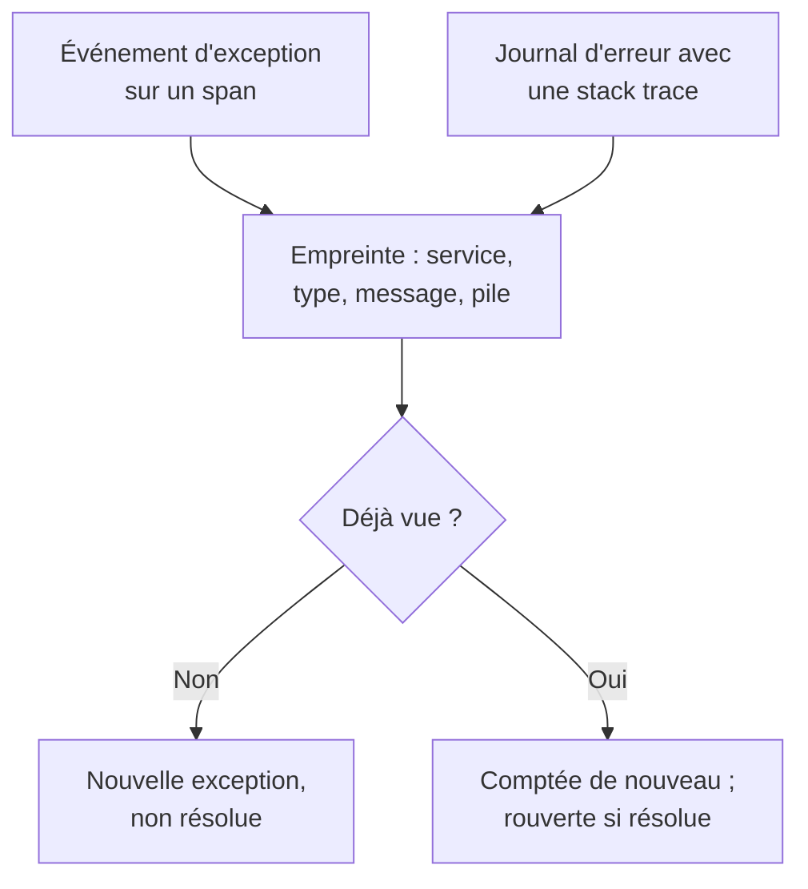

# Suivi des exceptions

Le suivi des exceptions recueille les erreurs que votre code lève et regroupe chaque occurrence d'une même erreur en une seule exception, avec sa stack trace, sa tendance et les requêtes où elle s'est produite. Traitez-les comme une liste de tâches : corrigez, résolvez ou archivez le bruit, et laissez l'IA ouvrir une pull request pour celles qu'elle sait corriger.

:::cards
- [D'où viennent les exceptions](#doù-viennent-les-exceptions): Des spans et des journaux que vos services envoient déjà.
- [Trier la liste](#trier-la-liste): Le non résolu d'abord, le bruit masqué.
- [La page d'une exception](#la-page-dune-exception): Stack trace, occurrences et contexte.
- [La corriger avec l'IA](#la-corriger-avec-lia): Une pull request avec le correctif, ou un test de régression.
- [Trouver et corriger les exceptions nouvelles ou en hausse avec l'IA](#trouver-et-corriger-les-exceptions-nouvelles-ou-en-hausse-avec-lia): Des pull requests pour les exceptions qu'OneUptime trouve.
:::

## D'où viennent les exceptions

Vous n'envoyez pas les exceptions à part. OneUptime les trouve dans la télémétrie que vos services envoient déjà :

- un événement d'exception sur un span, c'est-à-dire ce qu'écrit `recordException()` d'OpenTelemetry ;
- un journal avec les attributs `exception.type`, `exception.message` ou `exception.stacktrace` ;
- un journal de gravité Error ou Fatal dont le message contient une stack trace, quand le journal n'a pas été écrit à l'intérieur d'un span (le span la signale déjà).

Chaque occurrence est regroupée avec les précédentes de la même erreur en une seule exception :

- **Une exception par service et par erreur.** L'empreinte est calculée à partir du service, du type d'exception, du message et de la stack trace. Les valeurs qui changent d'un appel à l'autre en sont d'abord retirées : UUID et autres identifiants, horodatages, adresses IP et e-mail, et nombres de sept chiffres ou plus. Ainsi `Order id=1042 not found` et `Order id=2077 not found` forment une seule exception.
- **Une nouvelle occurrence rouvre une exception résolue.** Si elle se reproduit après que vous l'avez résolue, le correctif n'a pas tenu, et l'exception est marquée **Régression**. Une occurrence antérieure à la résolution qui n'arrive dans OneUptime que plus tard ne la rouvre pas.
- **Une exception archivée reste archivée.** Ses nouvelles occurrences sont toujours comptées, mais elles ne déclenchent plus de notification.

> [!TIP]
> Pour tenir une erreur attendue à l'écart du suivi des exceptions, comme une saisie invalide que votre service a refusée, mettez l'attribut `error.class` à `user-error` ou `expected-denial` sur l'événement d'exception du span. OneUptime n'enregistre alors aucune exception pour elle.

## Avant de commencer

- **Des spans ou des journaux qui arrivent.** Instrumentez vos services avec [OpenTelemetry](/docs/telemetry/open-telemetry). L'onglet **Guide de configuration** montre le code pour votre langage.
- **Un rôle qui peut lire la télémétrie.** Project Owner, Project Admin, Project Member, Viewer, Telemetry Admin, Telemetry Member ou Telemetry Viewer, ou un rôle personnalisé avec la permission Read Telemetry Service Exception. Résoudre et archiver demande Project Owner ou Project Admin, ou la permission Edit Telemetry Service Exception.

## Trier la liste

:::steps
### Ouvrir les exceptions

Ouvrez **Produits → Observabilité → Exceptions**. Le badge de l'onglet **Exceptions** compte les problèmes non résolus, et la liste s'ouvre sur les exceptions **Non résolu**.

### Choisir un statut

Passez de **Non résolu** à **Résolu**, **Archivé** et **Tous**. Le graphique au-dessus de la liste montre combien d'occurrences étaient **Non géré** et combien **Géré** au fil du temps. Une ligne marquée **Régression** est revenue après avoir été résolue, et une ligne marquée **Nouveau** a été vue pour la première fois au cours des dernières 24 heures.

### Choisir ce qui compte comme un problème

**Problèmes**, la vue par défaut, masque les erreurs d'utilisateur et les refus attendus, pour que la liste montre ce qui demande un correctif. **User errors** ne montre qu'eux, et **Tous** montre chaque exception.

### Chercher et filtrer

Tapez une requête comme `type:TypeError env:production`, voir [Syntaxe de recherche](/docs/telemetry/search-syntax#exceptions), ou cliquez sur une valeur de la barre latérale **Filtres** : un service, un hôte ou une autre ressource, un **Type d'exception**, un **Environnement** ou une **Classe d'erreur**. **Attribuées à moi** n'affiche que les exceptions qui vous sont attribuées, et le menu de tri classe la liste par **Vu pour la dernière fois**, **Vu pour la première fois** ou **Le plus d'événements**.

### Ouvrir une exception

Cliquez sur une ligne pour ouvrir la page de l'exception.
:::

## La page d'une exception

Le menu latéral de la page regroupe ce que vous faites d'une exception :

| Page | Ce qu'elle montre |
| --- | --- |
| **Vue d'ensemble** | Le message, le service, combien de fois elle s'est produite et quand elle a été vue la première et la dernière fois, sa tendance dans le temps, et sa dernière occurrence : la version, l'environnement, le span, la trace et la session utilisateur. En haut, l'explication de OneUptime AI sur ce qui s'est passé, quand l'IA est activée. |
| **Stack trace** | Les frames de la pile. Pour le code de navigateur, les fichiers et lignes d'origine, une fois que vous avez envoyé les [Source maps](/docs/telemetry/source-maps) de la version. |
| **Occurrences** | Chaque occurrence, avec son heure, son message et la trace où elle s'est produite. |
| **Contexte** | Les attributs de la dernière occurrence, son enregistrement de session s'il y en a un, et les étapes qui y ont mené. |
| **Journaux** | Les journaux écrits autour de la dernière occurrence. |
| **Assistance IA** | Des tâches IA qui corrigent l'exception ou la testent. |
| **Paramètres** | Résoudre ou archiver l'exception. Elle se trouve sous **Gérer**, replié au départ. |

## Résoudre, rouvrir et archiver

Les boutons en haut de la page de l'exception, sa page **Paramètres** et le menu ⋯ de sa ligne dans la liste changent son statut :

| Action | Quand l'utiliser | Ce qui se passe ensuite |
| --- | --- | --- |
| **Résoudre** | Vous avez déployé le correctif. | Elle quitte la liste **Non résolu**. Une nouvelle occurrence la rouvre. |
| **Résoudre dans la prochaine version** | Le correctif sort dans votre prochaine version. | Elle quitte la liste **Non résolu**. Les occurrences de la version où elle a été vue en dernier ne la rouvrent pas, et une occurrence de toute autre version la rouvre. |
| **Rouvrir** | Le correctif n'a pas marché. | Elle est de nouveau non résolue. |
| **Archiver** | C'est du bruit que vous ne comptez pas corriger. | Elle quitte la liste. Les nouvelles occurrences sont comptées mais ne déclenchent plus de notification. |
| **Désarchiver** | Vous voulez de nouveau en entendre parler. | Elle revient dans la liste qui lui correspond. |

**Résoudre dans la prochaine version** se trouve dans le menu à côté de **Résoudre**, dans le menu ⋯ de la ligne, sous **Actions groupées** et dans **Paramètres**, tant que les occurrences de l'exception nomment leur version : l'attribut de ressource `service.version`.

**Paramètres** indique qui a résolu ou archivé l'exception en dernier, et quand. Ses boutons s'intitulent **Marquer comme résolu** ou **Marquer comme non résolu**, et **Archiver** ou **Désarchiver**.

Pour en changer plusieurs à la fois, cochez leurs lignes dans la liste, ou la case au-dessus des lignes pour toutes les exceptions de la page, et utilisez les mêmes actions sous **Actions groupées**. Le résultat indique quelles exceptions ont été modifiées, lesquelles sont restées telles quelles, et pourquoi.

**Attribuer** dans l'en-tête de l'exception la confie à une personne ou à une équipe, et retirer ce choix annule l'attribution. Chaque ligne montre à qui elle appartient, son menu ⋯ propose **M'attribuer**, et **Attribuer à…** sous **Actions groupées** en attribue plusieurs à la fois.

## Classes d'erreur

Chaque exception a une classe d'erreur, qui dit à qui revient le problème. OneUptime AI la définit quand il trie un insight sur l'exception, comme une exception nouvelle ou en forte hausse : voir [AI SRE](/docs/ai/ai-sre#analyses-détection-proactive). Une exception qu'il n'a pas triée reste `unknown`.

| Classe | Ce qu'elle signifie | Dans **Problèmes** |
| --- | --- | --- |
| `code-fault` | Un défaut dans le code. La seule classe que l'IA corrige d'elle-même. | Oui |
| `infrastructure` | Un délai dépassé, une connexion coupée ou des ressources épuisées. | Oui |
| `unknown` | Pas encore classée. | Oui |
| `user-error` | La conséquence d'une saisie invalide d'un utilisateur. | Non |
| `expected-denial` | Un contrôle qui fait son travail, comme une connexion refusée. | Non |

Avec **Archiver les exceptions attendues** activé, dans les paramètres des insights IA, les exceptions que le tri identifie comme des refus attendus sont archivées pour vous.

## L'expliquer avec l'IA

En haut de la **Vue d'ensemble** d'une exception, **Expliquer avec OneUptime AI** demande à OneUptime AI ce qui n'a pas fonctionné. Il lit la stack trace, la trace et les journaux de la dernière occurrence, ainsi que les déploiements du service autour du moment où l'exception a commencé, et répond dans la carte **Ce qui s'est passé** :

| Partie | Ce qu'elle dit |
| --- | --- |
| **Ce qui s'est passé** | Une ou deux phrases, le degré de certitude de OneUptime AI, et l'endroit où se trouve la faute : le code, une dépendance, l'infrastructure, une entrée invalide ou la configuration. |
| **Cause racine probable** | La cause, et le frame, le span, la ligne de journal ou le déploiement qui la montre. |
| **Correctif suggéré** | Ce qu'il faut changer. |
| **Où regarder** | Les frames de la stack trace à ouvrir en premier. |
| **Prochaines étapes** | Au plus trois étapes pour la confirmer ou la corriger. |

L'explication est conservée sur l'exception : la personne suivante qui l'ouvre la lit tout de suite, et **Expliquer à nouveau** en demande une nouvelle. **Ouvrir une pull request de correction** ouvre la page **Assistance IA** de l'exception, et **Poser une question complémentaire** ouvre Ask AI sur l'exception.

Les identifiants, les adresses e-mail et IP et les jetons sont retirés de tout ce qui est envoyé, et seuls quelques attributs d'un span sont envoyés, comme sa route et son code de statut. L'explication utilise le fournisseur LLM et les crédits IA du projet, et n'est pas proposée tant que **Activer l'IA** est désactivé. Toute personne qui peut lire l'exception peut en demander une.

## La corriger avec l'IA

La page **Assistance IA** propose trois tâches. Chacune s'exécute comme une tâche IA qui ouvre une pull request dans votre dépôt de code :

| Tâche | Ce que fait la pull request |
| --- | --- |
| **Corriger cette exception avec l'IA** | Corrige la cause. Lancez-la avec **Corriger avec l'IA**. |
| **Générer un test de régression** | Ajoute un test qui échoue tant que le bug n'est pas corrigé. |
| **Améliorer la gestion des erreurs** | Pour les erreurs attendues : valide les saisies plus tôt, garde les données utilisateur hors des messages et marque l'erreur comme gérée. |

L'IA a d'abord besoin de trois choses : un fournisseur LLM, un dépôt connecté (sur GitHub, GitLab, Forgejo ou Gitea, ou tout serveur Git), et un agent IA en ligne pour exécuter la tâche. La page vérifie chacune et renvoie vers ce qui manque. Les tâches sont en pause tant que l'exception est résolue ou archivée. Voir [Code](/docs/ai/ai-agent). Démarrer une tâche demande l'autorisation de modifier le dépôt où elle travaille : qui ne peut que lire l'exception voit ses tâches, mais ne peut pas en démarrer.

## Trouver et corriger les exceptions nouvelles ou en hausse avec l'IA

Toutes les 15 minutes, OneUptime parcourt vos exceptions à la recherche des nouvelles, de celles qui se produisent soudain bien plus souvent et des services dont les exceptions n'ont aucune stack trace, et enregistre ce qu'il trouve comme analyses IA, avec les preuves. OneUptime AI examine ensuite chacune d'elles et ouvre une pull request pour celles qu'il peut corriger. Rien n'est jamais fusionné : votre équipe relit chaque pull request.

| Constat | Quand OneUptime l'enregistre | La pull request |
| --- | --- | --- |
| **Nouvelle exception** | Une exception vue pour la première fois au cours des dernières 24 heures et qui s'est déjà produite 3 fois ou plus. | Corrige l'exception, ou la gère mieux. |
| **Pic d'exceptions** | Une exception qui s'est produite 10 fois ou plus au cours de la dernière heure, à 5 fois ou plus son rythme horaire des 24 heures précédentes. | Corrige l'exception, ou la gère mieux. |
| **Stack trace manquante** | Les exceptions qu'un service a enregistrées le dernier jour n'ont aucune stack trace et se sont produites, ensemble, 20 fois ou plus. | Fait enregistrer au service une stack trace avec chaque exception. |

La pull request d'une exception nouvelle ou en hausse est la tâche IA propre à l'exception, celle que lance sa page **Assistance IA**, et elle attend qu'OneUptime AI ait examiné le constat. S'il trouve le code en cause (`code-fault`), la pull request le corrige, comme le fait **Corriger cette exception avec l'IA**. S'il trouve une erreur attendue (`user-error` ou `expected-denial`), la pull request gère mieux l'erreur, comme le fait **Améliorer la gestion des erreurs**. Tout autre verdict n'ouvre aucune pull request de lui-même. Avec **Archiver les exceptions attendues** activé, un refus attendu est archivé à la place et n'obtient aucune pull request.

OneUptime AI n'en ouvre une de lui-même que pour une exception levée dans votre propre code : une exception dont la stack trace contient un frame de votre code, et pas seulement des frames de bibliothèques ou de l'environnement d'exécution. Une pull request que quelqu'un a fermée sans la fusionner met en pause les pull requests automatiques pour cette exception. Chacun peut toujours demander n'importe laquelle d'entre elles avec **Corriger avec l'IA** sur le constat.

### L'activer

**Exceptions → IA → Paramètres** contient l'interrupteur **Trouver et corriger les exceptions nouvelles ou en hausse**, activé pour les nouveaux projets. Tant qu'il est désactivé, les exceptions nouvelles ou en hausse restent l'affaire des analyses IA, comme avant : voir [AI SRE](/docs/ai/ai-sre#analyses-détection-proactive). Avec **Activer l'IA** désactivé, elles sont toujours trouvées, mais OneUptime AI n'en fait rien. Pour ouvrir des pull requests, OneUptime AI a besoin d'un dépôt connecté dans [Code](/docs/ai/ai-agent) : la page indique d'abord ce qui manque. Le code de chaque dépôt est modifié sur le Runner que le dépôt choisit dans Code.

OneUptime AI ouvre de lui-même au plus 5 pull requests par jour (UTC), une par constat, et jamais plus que la limite de pull requests IA ouvertes d'un dépôt.

### Règles IA

Sans règle, OneUptime AI examine immédiatement chaque exception qu'il trouve et ouvre une pull request pour chacune de celles qu'il peut corriger. Les **Règles IA** sous **Plus de paramètres** restreignent cela, en trois étapes :

| Étape | Ce qu'elle décide |
| --- | --- |
| **Correspondance** | Quels services : ceux choisis, ceux qui portent certaines étiquettes, ou ceux dont le nom correspond à un motif. |
| **Investiguer** | **Immédiatement**, ou **Seulement s'il est encore trouvé après une attente** : une exception qui disparaît pendant l'attente n'est pas examinée. |
| **Correction** | **Ne pas corriger**, **Demander avant de corriger** ou **Corriger sans demander**. Demander d'abord laisse la pull request à une personne : le constat propose **Corriger avec l'IA**. |

Sous **Plus de champs**, une règle choisit les dépôts de code, les serveurs MCP et le fournisseur de LLM qu'OneUptime AI peut utiliser pour elle. Si rien n'est choisi, il peut tous les utiliser, ainsi que le fournisseur de LLM par défaut du projet.

### Voir ce qu'il a fait

- **Exceptions → IA → Analyses** liste ce qu'OneUptime a trouvé, chaque constat avec ses preuves, dont les frames de votre code dans sa stack trace. **View Exception Group** ouvre l'exception, et pour les stack traces manquantes d'un service, **Ouvrir dans Exceptions** ouvre ses exceptions non résolues du dernier jour.
- **Exceptions → IA → Journaux** liste chaque investigation et chaque pull request, de la plus récente à la plus ancienne, avec l'état de chacune et ce que chaque investigation a trouvé.
- La pull request explique pourquoi elle a été ouverte, avec un lien vers son constat. Celle d'une exception nouvelle ou en hausse renvoie aussi vers l'exception et apparaît sur sa page **Assistance IA**. Dans Code, sa tâche nomme l'exception qu'elle corrige, ou le constat d'où elle vient.

## Analyses des exceptions

L'onglet **Analyses** compte vos exceptions **Non résolu**, **Résolu** et **Archivé** ainsi que votre taux de résolution, et liste les exceptions les plus fréquentes, les services qu'elles touchent et les plus récemment vues.

**Quoi de neuf**, en haut de l'onglet, demande à OneUptime AI, avec **Résumer avec OneUptime AI**, de résumer les exceptions vues pour la première fois dans les dernières 24 heures et celles revenues après avoir été résolues : quelques phrases sur l'ensemble, puis chacune en une ligne, la plus urgente d'abord, avec un lien vers l'exception. Le résumé est écrit quand vous le demandez et n'est pas conservé, utilise les crédits d'IA du projet et n'est pas proposé tant que **Activer l'IA** est désactivé.

## Dépannage

:::details Une exception que je viens de lever n'est pas dans la liste
Vérifiez d'abord la vue : **Problèmes** masque les erreurs d'utilisateur et les refus attendus, choisissez donc **Tous**. Élargissez ensuite la plage de temps, et vérifiez que l'exception a bien été enregistrée sur un span, ou dans un journal avec une stack trace.
:::

:::details Une erreur apparaît comme plusieurs exceptions
L'empreinte inclut le message et la stack trace. Quand ils diffèrent, par exemple quand un message contient un petit nombre ou un nom qui change à chaque appel, chaque variante est sa propre exception.
:::

:::details Une exception résolue revient sans cesse
Une nouvelle occurrence rouvre volontairement une exception résolue : l'erreur se produit encore. Vérifiez que le correctif a atteint la version qui la signale, ou archivez l'exception si vous ne voulez plus en entendre parler. Si d'anciens pods de la version continuent de la signaler pendant un déploiement, utilisez plutôt **Résoudre dans la prochaine version**.
:::

## Étapes suivantes

:::cards
- [Surveillance des exceptions](/docs/monitor/exceptions-monitor): Être alerté quand les exceptions s'envolent.
- [Source maps](/docs/telemetry/source-maps): Des stack traces lisibles pour le code de navigateur.
- [Code](/docs/ai/ai-agent): Comment l'IA corrige du code et ouvre des pull requests.
- [Explorateur de traces](/docs/telemetry/traces-explorer): Voir la requête où une exception s'est produite.
:::
