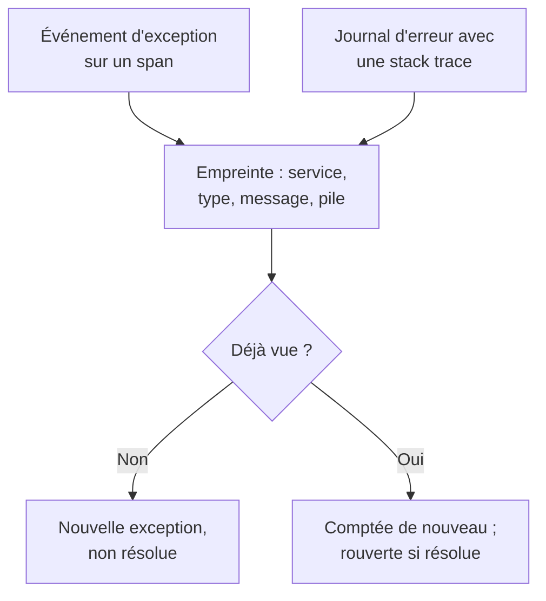

# Suivi des exceptions

Le suivi des exceptions recueille les erreurs que votre code lève et regroupe chaque occurrence d'une même erreur en une seule exception, avec sa stack trace, sa tendance et les requêtes où elle s'est produite. Traitez-les comme une liste de tâches : corrigez, résolvez ou archivez le bruit, et laissez l'IA ouvrir une pull request pour celles qu'elle sait corriger.

:::cards
- [D'où viennent les exceptions](#doù-viennent-les-exceptions): Des spans et des journaux que vos services envoient déjà.
- [Trier la liste](#trier-la-liste): Le non résolu d'abord, le bruit masqué.
- [La page d'une exception](#la-page-dune-exception): Stack trace, occurrences et contexte.
- [La corriger avec l'IA](#la-corriger-avec-lia): Une pull request avec le correctif, ou un test de régression.
:::

## D'où viennent les exceptions

Vous n'envoyez pas les exceptions à part. OneUptime les trouve dans la télémétrie que vos services envoient déjà :

- un événement d'exception sur un span, c'est-à-dire ce qu'écrit `recordException()` d'OpenTelemetry ;
- un journal avec les attributs `exception.type`, `exception.message` ou `exception.stacktrace` ;
- un journal de gravité Error ou Fatal dont le message contient une stack trace, quand le journal n'a pas été écrit à l'intérieur d'un span (le span la signale déjà).

Chaque occurrence est regroupée avec les précédentes de la même erreur en une seule exception :

- **Une exception par service et par erreur.** L'empreinte est calculée à partir du service, du type d'exception, du message et de la stack trace. Les valeurs qui changent d'un appel à l'autre en sont d'abord retirées : UUID et autres identifiants, horodatages, adresses IP et e-mail, et nombres de sept chiffres ou plus. Ainsi `Order id=1042 not found` et `Order id=2077 not found` forment une seule exception.
- **Une nouvelle occurrence rouvre une exception résolue.** Si elle se reproduit après que vous l'avez résolue, le correctif n'a pas tenu.
- **Une exception archivée reste archivée.** Ses nouvelles occurrences sont toujours comptées, mais elles ne déclenchent plus de notification.

> [!TIP]
> Pour tenir une erreur attendue à l'écart du suivi des exceptions, comme une saisie invalide que votre service a refusée, mettez l'attribut `error.class` à `user-error` ou `expected-denial` sur l'événement d'exception du span. OneUptime n'enregistre alors aucune exception pour elle.

## Avant de commencer

- **Des spans ou des journaux qui arrivent.** Instrumentez vos services avec [OpenTelemetry](/docs/telemetry/open-telemetry). L'onglet **Guide de configuration** montre le code pour votre langage.
- **Un rôle qui peut lire la télémétrie.** Project Owner, Project Admin, Project Member, Viewer, Telemetry Admin, Telemetry Member ou Telemetry Viewer, ou un rôle personnalisé avec la permission Read Telemetry Service Exception. Résoudre et archiver demande Project Owner ou Project Admin, ou la permission Edit Telemetry Service Exception.

## Trier la liste

:::steps
### Ouvrir les exceptions

Ouvrez **Produits → Observabilité → Exceptions**. Le badge de l'onglet **Exceptions** compte les problèmes non résolus, et la liste s'ouvre sur les exceptions **Non résolu**.

### Choisir un statut

Passez de **Non résolu** à **Résolu**, **Archivé** et **Tous**. Le graphique au-dessus de la liste montre combien d'occurrences étaient **Non géré** et combien **Géré** au fil du temps.

### Choisir ce qui compte comme un problème

**Problèmes**, la vue par défaut, masque les erreurs d'utilisateur et les refus attendus, pour que la liste montre ce qui demande un correctif. **User errors** ne montre qu'eux, et **Tous** montre chaque exception.

### Chercher et filtrer

Tapez une requête comme `type:TypeError env:production`, voir [Syntaxe de recherche](/docs/telemetry/search-syntax#exceptions), ou cliquez sur une valeur de la barre latérale **Filtres** : un service, un hôte ou une autre ressource, un **Type d'exception**, un **Environnement** ou une **Classe d'erreur**.

### Ouvrir une exception

Cliquez sur une ligne pour ouvrir la page de l'exception.
:::

## La page d'une exception

Le menu latéral de la page regroupe ce que vous faites d'une exception :

| Page | Ce qu'elle montre |
| --- | --- |
| **Vue d'ensemble** | Le message, le service, combien de fois elle s'est produite et quand elle a été vue la première et la dernière fois, sa tendance dans le temps, et sa dernière occurrence : la version, l'environnement, le span, la trace et la session utilisateur. |
| **Stack trace** | Les frames de la pile. Pour le code de navigateur, les fichiers et lignes d'origine, une fois que vous avez envoyé les [Source maps](/docs/telemetry/source-maps) de la version. |
| **Occurrences** | Chaque occurrence, avec son heure, son message et la trace où elle s'est produite. |
| **Contexte** | Les attributs de la dernière occurrence, son enregistrement de session s'il y en a un, et les étapes qui y ont mené. |
| **Journaux** | Les journaux écrits autour de la dernière occurrence. |
| **Assistance IA** | Des tâches IA qui corrigent l'exception ou la testent. |
| **Paramètres** | Résoudre ou archiver l'exception. Elle se trouve sous **Gérer**, replié au départ. |

## Résoudre, rouvrir et archiver

Les boutons en haut de la page de l'exception, et sa page **Paramètres**, changent son statut :

| Action | Quand l'utiliser | Ce qui se passe ensuite |
| --- | --- | --- |
| **Résoudre** | Vous avez déployé le correctif. | Elle quitte la liste **Non résolu**. Une nouvelle occurrence la rouvre. |
| **Reopen** | Le correctif n'a pas marché. | Elle est de nouveau non résolue. |
| **Archiver** | C'est du bruit que vous ne comptez pas corriger. | Elle quitte la liste. Les nouvelles occurrences sont comptées mais ne déclenchent plus de notification. |
| **Désarchiver** | Vous voulez de nouveau en entendre parler. | Elle revient dans la liste qui lui correspond. |

**Paramètres** indique qui a résolu ou archivé l'exception en dernier, et quand. Ses boutons s'intitulent **Marquer comme résolu** ou **Marquer comme non résolu**, et **Archiver** ou **Désarchiver**.

## Classes d'erreur

Chaque exception a une classe d'erreur, qui dit à qui revient le problème. OneUptime AI la définit quand il trie un insight sur l'exception, comme une exception nouvelle ou en forte hausse : voir [AI SRE](/docs/ai/ai-sre#analyses-détection-proactive). Une exception qu'il n'a pas triée reste `unknown`.

| Classe | Ce qu'elle signifie | Dans **Problèmes** |
| --- | --- | --- |
| `code-fault` | Un défaut dans le code. La seule classe que l'IA corrige d'elle-même. | Oui |
| `infrastructure` | Un délai dépassé, une connexion coupée ou des ressources épuisées. | Oui |
| `unknown` | Pas encore classée. | Oui |
| `user-error` | La conséquence d'une saisie invalide d'un utilisateur. | Non |
| `expected-denial` | Un contrôle qui fait son travail, comme une connexion refusée. | Non |

Avec **Archiver les exceptions attendues** activé, dans les paramètres des insights IA, les exceptions que le tri identifie comme des refus attendus sont archivées pour vous.

## La corriger avec l'IA

La page **Assistance IA** propose trois tâches. Chacune s'exécute comme une tâche IA qui ouvre une pull request dans votre dépôt de code :

| Tâche | Ce que fait la pull request |
| --- | --- |
| **Corriger cette exception avec l'IA** | Corrige la cause. Lancez-la avec **Corriger avec l'IA**. |
| **Générer un test de régression** | Ajoute un test qui échoue tant que le bug n'est pas corrigé. |
| **Améliorer la gestion des erreurs** | Pour les erreurs attendues : valide les saisies plus tôt, garde les données utilisateur hors des messages et marque l'erreur comme gérée. |

L'IA a d'abord besoin de trois choses : un fournisseur LLM, un dépôt connecté (sur GitHub, GitLab, Forgejo ou Gitea, ou tout serveur Git), et un agent IA en ligne pour exécuter la tâche. La page vérifie chacune et renvoie vers ce qui manque. Les tâches sont en pause tant que l'exception est résolue ou archivée. Voir [Code](/docs/ai/ai-agent).

## Analyses des exceptions

L'onglet **Analyses** compte vos exceptions **Non résolu**, **Résolu** et **Archivé** ainsi que votre taux de résolution, et liste les exceptions les plus fréquentes, les services qu'elles touchent et les plus récemment vues.

## Dépannage

:::details Une exception que je viens de lever n'est pas dans la liste
Vérifiez d'abord la vue : **Problèmes** masque les erreurs d'utilisateur et les refus attendus, choisissez donc **Tous**. Élargissez ensuite la plage de temps, et vérifiez que l'exception a bien été enregistrée sur un span, ou dans un journal avec une stack trace.
:::

:::details Une erreur apparaît comme plusieurs exceptions
L'empreinte inclut le message et la stack trace. Quand ils diffèrent, par exemple quand un message contient un petit nombre ou un nom qui change à chaque appel, chaque variante est sa propre exception.
:::

:::details Une exception résolue revient sans cesse
Une nouvelle occurrence rouvre volontairement une exception résolue : l'erreur se produit encore. Vérifiez que le correctif a atteint la version qui la signale, ou archivez l'exception si vous ne voulez plus en entendre parler.
:::

## Étapes suivantes

:::cards
- [Surveillance des exceptions](/docs/monitor/exceptions-monitor): Être alerté quand les exceptions s'envolent.
- [Source maps](/docs/telemetry/source-maps): Des stack traces lisibles pour le code de navigateur.
- [Code](/docs/ai/ai-agent): Comment l'IA corrige du code et ouvre des pull requests.
- [Explorateur de traces](/docs/telemetry/traces-explorer): Voir la requête où une exception s'est produite.
:::
