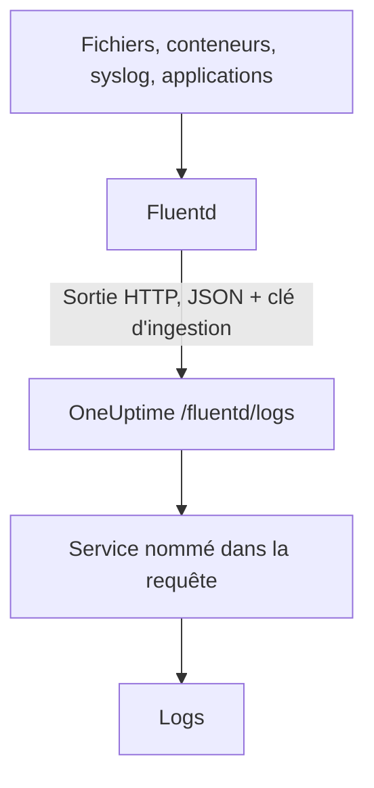

# Fluentd

[Fluentd](https://www.fluentd.org/) collecte des logs depuis des fichiers, des conteneurs, syslog, des applications et [bien d'autres sources](https://www.fluentd.org/datasources). Sa [sortie HTTP](https://docs.fluentd.org/output/http) intégrée les envoie au point de terminaison Fluentd de OneUptime, où ils deviennent consultables sous **Produits → Journaux**.

:::cards
- [Configurer Fluentd](#configurer-fluentd): Ajouter une sortie HTTP qui pointe vers OneUptime.
- [Comment les enregistrements sont lus](#comment-les-enregistrements-sont-lus): Quels champs deviennent le message, la sévérité et les attributs.
- [OneUptime auto-hébergé](#oneuptime-auto-hébergé): Pointer Fluentd vers votre propre instance.
:::

## Fonctionnement



Fluentd envoie les enregistrements par lots en JSON, avec votre clé d'ingestion dans l'en-tête `x-oneuptime-token` et le nom du service dans `x-oneuptime-service-name`. OneUptime fait de chaque enregistrement un log de ce service, et crée le service au premier envoi.

## Avant de commencer

- **Installer Fluentd** — voir le [guide d'installation](https://docs.fluentd.org/installation).
- **Un projet OneUptime.** Sur OneUptime Cloud, la télémétrie est facturée par Go ingéré — voir les [tarifs](https://oneuptime.com/pricing) — et un projet du forfait Free a besoin d'un moyen de paiement avant de pouvoir envoyer de la télémétrie.
- **Une clé d'ingestion de télémétrie.** Si vous n'en avez pas :

:::steps
### Ouvrir les clés d'ingestion

Allez dans **Produits → Paramètres du projet**, ouvrez **Télémétrie & APM** dans le menu latéral et sélectionnez **Clés d'ingestion**.


### Créer une clé

Cliquez sur **Créer une clé d'ingestion**. La fenêtre a déjà rempli le nom de la clé et choisi **Serveur** — le type de clé avec lequel une application ou un collector envoie —, donc cliquez sur **Créer une clé d'ingestion** pour la créer, ou renommez-la d'abord.

### Copier le secret

La nouvelle clé s'ouvre sur sa propre page. Copiez sa **Clé secrète** : c'est le `YOUR_SERVICE_TOKEN` de la configuration ci-dessous.


:::

## Configurer Fluentd

Le fichier de configuration de Fluentd est en général `/etc/fluent/fluentd.conf`, ou `/etc/td-agent/td-agent.conf` pour l'ancien paquet td-agent.

:::steps
### Ajouter une sortie HTTP

Ajoutez une section `<match>` qui envoie les enregistrements à OneUptime. Remplacez `YOUR_SERVICE_TOKEN` par votre clé d'ingestion, et `YOUR_SERVICE_NAME` par le nom sous lequel les logs doivent apparaître — le nom de votre choix :

```text title="fluentd.conf"
# Send the time Fluentd gave each event: the HTTP output sends only the record
<filter **>
  @type record_transformer
  enable_ruby true
  <record>
    fluentd_time ${time.utc.strftime("%Y-%m-%dT%H:%M:%S.%NZ")}
  </record>
</filter>

# Match all patterns
<match **>
  @type http

  endpoint https://oneuptime.com/fluentd/logs
  open_timeout 2

  headers {"x-oneuptime-token":"YOUR_SERVICE_TOKEN", "x-oneuptime-service-name":"YOUR_SERVICE_NAME"}

  content_type application/json
  json_array true

  # Send a batch again when OneUptime is busy (429) or restarting (502, 503, 504)
  retryable_response_codes 429,502,503,504

  <format>
    @type json
  </format>
  <buffer>
    # Keep the batches on disk until OneUptime takes them: a restart of Fluentd loses none
    @type file
    path /var/log/fluent/buffer/oneuptime
    total_limit_size 512m
    flush_interval 10s
    chunk_limit_size 900k
    # Try again at least every 30 seconds, for up to 72 hours
    retry_max_interval 30s
    retry_timeout 72h
  </buffer>
</match>

# Keep Fluentd's own logs out of OneUptime
<label @FLUENT_LOG>
  <match **>
    @type null
  </match>
</label>
```

`json_array true` envoie chaque bloc du tampon comme un seul tableau JSON, et `flush_interval 10s` envoie le tampon toutes les 10 secondes. `chunk_limit_size 900k` maintient chaque requête sous 1 Mo, le maximum qu'accepte OneUptime sur ce point de terminaison.

Le réglage par défaut de Fluentd fonctionne aussi : sans `content_type` ni `json_array true`, Fluentd envoie du JSON délimité par des sauts de ligne, un enregistrement par ligne, et OneUptime lit chaque ligne comme l'enregistrement qu'elle est, avec `compress gzip` ou sans.

`@type file` garde les lots encore à envoyer dans le dossier que nomme `path`, si bien qu'un redémarrage de Fluentd n'en perd aucun ; un tampon en mémoire, celui de Fluentd par défaut, perd ce qu'il contient. L'utilisateur de Fluentd doit pouvoir écrire dans ce dossier : `/var/log/fluent` est celui de fluent-package, `/var/log/td-agent` celui de td-agent, et `/fluentd/log` celui de l'image `fluent/fluentd`. `total_limit_size 512m` y garde au plus 512 Mo ; quand il est plein, Fluentd ne prend plus d'enregistrements avant qu'un lot soit envoyé.

`retryable_response_codes 429,502,503,504` renvoie un lot quand OneUptime est surchargé (`429`) ou redémarre (`502`, `503`, `504`) ; sans ce réglage, Fluentd abandonne un lot pour toute réponse autre que `503`. `retry_max_interval 30s` attend au plus 30 secondes entre deux tentatives, et `retry_timeout 72h` abandonne un lot qu'il ne parvient toujours pas à envoyer après 72 heures. Le filtre `record_transformer` ajoute l'heure que Fluentd a donnée à chaque enregistrement, sous `fluentd_time` : la sortie HTTP n'envoie que l'enregistrement, et OneUptime y lit l'heure d'un log.

### Redémarrer Fluentd

Redémarrez le service Fluentd pour qu'il charge la nouvelle sortie.

### Vérifier que les logs arrivent

Quelques secondes après le vidage suivant, les logs apparaissent sous **Produits → Journaux**. Le service figure sous **Produits → Services** — s'il n'existait pas encore, OneUptime le crée.
:::

## Exemple complet

Cette configuration reçoit des enregistrements par le protocole forward de Fluentd sur le port `24224`, depuis cet hôte seulement, et les envoie tous à OneUptime :

```text title="fluentd.conf"
####
## Source descriptions:
##

## built-in TCP input
## @see https://docs.fluentd.org/input/forward
<source>
  @type forward
  port 24224
  # This host alone: see "Take records from other hosts" to open it
  bind 127.0.0.1
</source>

# Send the time Fluentd gave each event: the HTTP output sends only the record
<filter **>
  @type record_transformer
  enable_ruby true
  <record>
    fluentd_time ${time.utc.strftime("%Y-%m-%dT%H:%M:%S.%NZ")}
  </record>
</filter>

<match **>
  @type http

  endpoint https://oneuptime.com/fluentd/logs
  open_timeout 2

  headers {"x-oneuptime-token":"YOUR_SERVICE_TOKEN", "x-oneuptime-service-name":"YOUR_SERVICE_NAME"}

  content_type application/json
  json_array true

  # Send a batch again when OneUptime is busy (429) or restarting (502, 503, 504)
  retryable_response_codes 429,502,503,504

  <format>
    @type json
  </format>
  <buffer>
    # Keep the batches on disk until OneUptime takes them: a restart of Fluentd loses none
    @type file
    path /var/log/fluent/buffer/oneuptime
    total_limit_size 512m
    flush_interval 10s
    chunk_limit_size 900k
    # Try again at least every 30 seconds, for up to 72 hours
    retry_max_interval 30s
    retry_timeout 72h
  </buffer>
</match>

# Keep Fluentd's own logs out of OneUptime
<label @FLUENT_LOG>
  <match **>
    @type null
  </match>
</label>
```

`bind 127.0.0.1` ne prend les enregistrements que de cet hôte, comme ceux du pilote de logs `fluentd` de Docker, qui envoie à `localhost:24224`. Pour envoyer différentes sources comme différents services, utilisez une section `<match>` par tag, chacune avec son propre `x-oneuptime-service-name` et son propre `path` de tampon : Fluentd ne démarre pas avec deux tampons sur un même chemin.

## Recevoir des enregistrements d'autres hôtes

Avec `bind 0.0.0.0` et sans section `<security>`, quiconque atteint le port `24224` peut envoyer des logs à OneUptime avec votre clé d'ingestion. Pour recevoir des enregistrements de Fluentd ou de Fluent Bit sur d'autres hôtes, écoutez sur toutes les adresses, demandez à chaque expéditeur une clé partagée et utilisez TLS. Remplacez la section `<source>` de l'exemple complet par :

```text title="fluentd.conf on this host"
<source>
  @type forward
  port 24224
  bind 0.0.0.0
  <transport tls>
    cert_path /etc/fluent/certs/fluentd.crt
    private_key_path /etc/fluent/certs/fluentd.key
  </transport>
  <security>
    self_hostname fluentd.example.com
    shared_key YOUR_SHARED_KEY
  </security>
</source>
```

`cert_path` et `private_key_path` sont un certificat pour le nom de cet hôte, ici `fluentd.example.com`, et sa clé, que l'utilisateur de Fluentd doit pouvoir lire. Fluentd avertit quand la clé n'a pas de phrase secrète ; `private_key_passphrase` en définit une. Remplacez `YOUR_SHARED_KEY` par un secret long et aléatoire, par exemple tiré de `openssl rand -base64 32`, et donnez le même à chaque expéditeur :

```text title="fluentd.conf on each sender"
<match **>
  @type forward
  transport tls
  # The certificate of the authority that signed this host's; not needed for a public one
  tls_cert_path /etc/fluent/certs/ca.crt
  <security>
    self_hostname app-1.example.com
    shared_key YOUR_SHARED_KEY
  </security>
  <server>
    host fluentd.example.com
    port 24224
  </server>
  <buffer>
    @type file
    path /var/log/fluent/buffer/forward
  </buffer>
</match>

# Keep Fluentd's own logs out of OneUptime
<label @FLUENT_LOG>
  <match **>
    @type null
  </match>
</label>
```

La sortie `forward` de Fluent Bit accepte les mêmes réglages : `Shared_Key`, `Self_Hostname`, `tls On` et `tls.ca_file`.

Un expéditeur sans la clé, ou sans TLS, est refusé. La clé ne traverse jamais le réseau : chaque côté prouve qu'il la détient. Sans TLS, n'importe qui sur le réseau entre les hôtes peut lire les enregistrements. N'ouvrez le port `24224` dans le pare-feu de l'hôte qu'aux hôtes qui envoient. Si Fluentd tourne depuis le fichier Docker Compose du guide des logs, publiez-y aussi le port sur toutes les adresses, `"24224:24224"`, et montez le dossier du certificat dans le conteneur.

## Comment les enregistrements sont lus

OneUptime lit ces champs dans chaque enregistrement :

| Champ du log | Lu dans le premier champ présent parmi | Remarques |
| --- | --- | --- |
| Corps | `message`, `log`, `msg`, `body`, `text` | La ligne de log. Un enregistrement sans aucun de ces champs est stocké en entier, en JSON. |
| Sévérité | `level`, `severity`, `loglevel`, `log_level`, `priority`, `severityText`, `severity_text` | Des noms comme `trace`, `debug`, `info`, `notice`, `warn`, `error`, `critical` et `fatal`, quelle que soit la casse. Toute autre valeur est stockée comme `Unspecified`. |
| ID de trace | `trace_id`, `traceId`, `traceid` | Relie le log à sa trace. |
| ID de span | `span_id`, `spanId`, `spanid` | Relie le log à son span. |
| Service | l'en-tête `x-oneuptime-service-name` | `Fluentd` quand l'en-tête n'est pas défini. |
| Heure | `time`, `timestamp`, `@timestamp`, `ts`, `fluentd_time` | Une heure ISO 8601, comme `2026-11-14T08:00:00.123Z`, ou des secondes, millisecondes, microsecondes ou nanosecondes depuis l'époque Unix ; une heure sans fuseau est en UTC. Une heure antérieure à 2000, ou en avance de plus d'un jour, n'est pas lue. Le champ dont l'heure est lue n'est pas conservé comme attribut. Un enregistrement sans heure est stocké à l'heure à laquelle OneUptime le reçoit. |

Tout autre champ devient un attribut nommé `fluentd.` suivi du nom du champ, sur lequel vous pouvez chercher et filtrer : un champ `container_name` devient `@fluentd.container_name` dans l'explorateur de journaux. Un objet imbriqué est aplati avec des points, par exemple `fluentd.kubernetes.pod_name`, et une liste est stockée en JSON.

Les logs Fluentd passent par vos [pipelines de journaux](/docs/telemetry/log-pipelines), vos filtres de suppression et vos règles de masquage comme n'importe quel autre log.

## OneUptime auto-hébergé

Remplacez `https://oneuptime.com` dans `endpoint` par l'URL de votre instance OneUptime : `http(s)://YOUR_ONEUPTIME_HOST/fluentd/logs`.

## Dépannage

:::details Fluentd journalise `401` depuis la sortie HTTP
La clé d'ingestion est absente, inconnue ou expirée. Vérifiez la valeur de `x-oneuptime-token` dans `headers`.
:::

:::details Fluentd journalise `402` ou `422`
`402` : sur OneUptime Cloud, le projet est sur le forfait Free et n'a pas de moyen de paiement. Ajoutez-en un sous **Paramètres du projet → Facturation et factures → Facturation**. `422` : la clé est désactivée, ou c'est une clé Navigateur. Réactivez **Activé** dans les réglages de la clé, ou créez une clé **Serveur**.
:::

:::details Fluentd journalise `413`
La requête dépasse 1 Mo, le maximum qu'accepte OneUptime sur ce point de terminaison. Définissez `chunk_limit_size 900k` dans la section `<buffer>`, comme dans la configuration ci-dessus.
:::

:::details Fluentd journalise `429`, `502`, `503` ou `504`
OneUptime est surchargé ou redémarre. Avec `retryable_response_codes 429,502,503,504` dans la section `<match>`, comme dans la configuration ci-dessus, Fluentd garde le lot et le renvoie ; sans ce réglage, Fluentd abandonne le lot. Avec `@type file` dans la section `<buffer>`, Fluentd garde aussi le lot quand il redémarre.
:::

:::details Les logs affichent l'heure à laquelle OneUptime les a reçus, pas la leur
OneUptime lit l'heure d'un log dans son enregistrement, et la sortie HTTP de Fluentd n'envoie que l'enregistrement. Une section `<parse>` retire le champ `time` de l'enregistrement, comme heure de l'événement : ajoutez-y `time_key fluentd_time`, pour qu'elle ne lise l'heure d'aucun enregistrement et laisse `time` tel quel. Ajoutez aussi le filtre `record_transformer` de la configuration ci-dessus : il ajoute l'heure que Fluentd a donnée à chaque enregistrement, sous `fluentd_time`.
:::

:::details Une ligne JSON dont le `time` est `null`, `true`, une liste ou un objet n'arrive jamais
Le parseur `json` de Fluentd lit le champ `time` d'une ligne comme l'heure de l'événement, et abandonne sans avertissement une ligne dont le `time` n'est ni du texte ni un nombre. Ajoutez `time_key fluentd_time` à sa section `<parse>`, comme ci-dessus : Fluentd laisse alors `time` tel quel dans l'enregistrement. Avec le filtre `record_transformer` ci-dessus, OneUptime enregistre le log à l'heure où Fluentd l'a lu, `fluentd_time` ; sans lui, à l'heure où OneUptime le reçoit.
:::

:::details Les logs arrivent sous le service `Fluentd`
L'en-tête `x-oneuptime-service-name` manque. Ajoutez-le à `headers` dans chaque section `<match>`.
:::

:::details Le corps du log affiche tout l'enregistrement en JSON
OneUptime prend le corps dans le premier champ présent parmi `message`, `log`, `msg`, `body` ou `text`, et stocke l'enregistrement entier quand il n'en a aucun. Renommez le champ qui contient votre ligne de log en l'un de ceux-là, par exemple avec le filtre `record_transformer` de Fluentd.
:::

Pour toute question ou si vous avez besoin d'aide avec la configuration, écrivez-nous à support@oneuptime.com.

## Étapes suivantes

:::cards
- [Pipelines de journaux](/docs/telemetry/log-pipelines): Analyser et enrichir les logs qu'envoie Fluentd.
- [Syntaxe de recherche](/docs/telemetry/search-syntax): Trouver les logs dans l'explorateur de journaux.
- [Fluent Bit](/docs/telemetry/fluentbit): Un agent plus léger qui envoie par OpenTelemetry.
- [Surveillance des journaux](/docs/monitor/logs-monitor): Alerter quand des logs correspondants apparaissent.
:::
