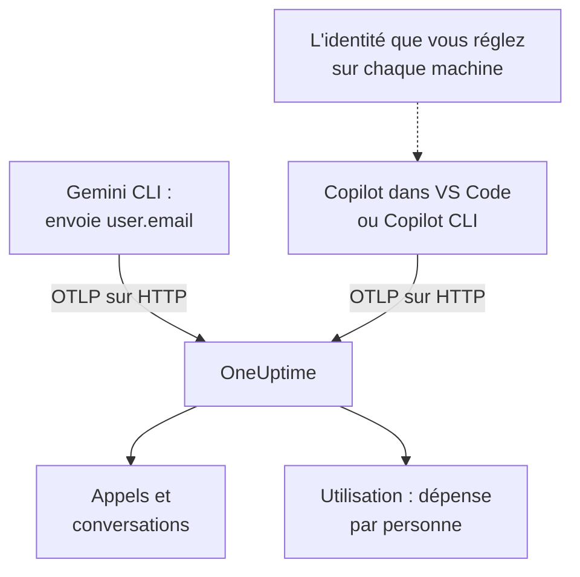

# Gemini CLI et GitHub Copilot

Gemini CLI et GitHub Copilot exportent tous deux OpenTelemetry eux-mêmes : dirigez-les vers OneUptime, et leurs appels au modèle, leurs tokens, leurs coûts et leurs appels d'outils arrivent dans [IA / LLM](/docs/telemetry/ai-llm-observability), à côté des appels IA de vos propres applications. Ils diffèrent sur ce qui compte le plus pour la refacturation : Gemini CLI nomme la personne sur chaque enregistrement, Copilot ne nomme personne, donc c'est vous qui nommez chaque développeur.

:::cards
- [Gemini CLI](#configurer-gemini-cli): Activer la télémétrie, avec les traces, et l'envoyer directement à OneUptime.
- [GitHub Copilot](#configurer-github-copilot): Exporter depuis VS Code ou Copilot CLI.
- [Nommer chaque développeur](#nommer-chaque-développeur): L'identité que Copilot omet.
- [Dépannage](#dépannage): Ce qu'il faut vérifier quand rien n'arrive.
:::

## Fonctionnement



| | Gemini CLI | GitHub Copilot |
| --- | --- | --- |
| Envoie | Traces, métriques et journaux | Traces, métriques et événements, depuis ses surfaces d'agent uniquement |
| Nomme la personne | `user.email`, une fois connecté | Personne : c'est vous qui réglez `enduser.id` et `user.email` |
| Texte des prompts | Envoyé sauf si vous désactivez `logPrompts` | Non envoyé sauf si vous activez `captureContent` |
| Envoie par défaut vers | `http://localhost:4317`, en gRPC | `http://localhost:4318`, en HTTP |

## Avant de commencer

- Une clé d'ingestion : ouvrez **Paramètres du projet → Télémétrie & APM → Clés d'ingestion** et cliquez sur **Créer une clé d'ingestion**.
- Votre URL de base OTLP : `https://oneuptime.com/otlp`, ou `https://YOUR-ONEUPTIME-HOST/otlp` si vous hébergez OneUptime vous-même.
- La clé voyage dans l'en-tête `x-oneuptime-token` de chaque requête d'export.

## Configurer Gemini CLI

Gemini CLI envoie des traces, des métriques et des événements de journal, et met `user.email` sur chaque enregistrement quand quelqu'un est connecté. OneUptime lit `user.email` comme l'employé, donc la dépense de chaque personne apparaît sans table de correspondance ni réglage par machine.

:::steps
### Activer la télémétrie

Ajoutez un bloc `telemetry` au fichier de paramètres utilisateur de chaque machine, ou à `.gemini/settings.json` dans un dépôt :

```json title="~/.gemini/settings.json"
{
  "telemetry": {
    "enabled": true,
    "target": "local",
    "otlpEndpoint": "https://oneuptime.com/otlp",
    "otlpProtocol": "http",
    "otlpHeaders": {
      "x-oneuptime-token": "YOUR_INGESTION_TOKEN"
    },
    "traces": true,
    "logPrompts": false
  }
}
```

### Démarrer une nouvelle session

Gemini CLI lit ses paramètres au démarrage : relancez-le et exécutez un prompt.

### Vérifier que les données arrivent

Ouvrez **Produits → IA / LLM → Appels** : les appels apparaissent sous le service `gemini-cli`, avec le modèle et les tokens.
:::

Trois paramètres de ce bloc comptent plus que les autres :

- `otlpProtocol: "http"`. Sans indication, Gemini CLI utilise gRPC. En HTTP, il ajoute lui-même `/v1/traces`, `/v1/metrics` et `/v1/logs` à l'URL de base. OneUptime accepte aussi gRPC sur le port 443 (voir [OTLP sur gRPC](/docs/telemetry/open-telemetry#otlp-sur-grpc)), mais HTTP est plus simple.
- `traces: true`. Il est désactivé par défaut, et sans lui les spans de Gemini CLI ne portent ni modèle ni nombre de tokens, donc rien ne peut être tarifé. Gemini CLI n'envoie pas non plus de métrique de coût : activez les traces pour voir ce que coûtent ses appels.
- `logPrompts: false`. Lisez l'avertissement ci-dessous.

> [!WARNING]
> `logPrompts` vaut `true` par défaut, donc activer la télémétrie envoie le texte que tapent vos ingénieurs : souvent du code source, des données clients et des identifiants collés. Réglez-le sur `false` dans la même modification qui active la télémétrie. Si vous voulez les prompts pour déboguer, décidez-le délibérément, et masquez ce qu'il faut avec les règles de nettoyage sous **Traces → Paramètres**.

### Paramètres pour une flotte

Chaque paramètre a une variable d'environnement, et les variables l'emportent sur le `.gemini/settings.json` d'un dépôt, ce qui en fait l'endroit idéal pour une politique de flotte déployée par MDM :

```bash
export GEMINI_TELEMETRY_ENABLED=true
export GEMINI_TELEMETRY_TARGET=local
export GEMINI_TELEMETRY_OTLP_ENDPOINT="https://oneuptime.com/otlp"
export GEMINI_TELEMETRY_OTLP_PROTOCOL=http
export GEMINI_TELEMETRY_OTLP_HEADERS="x-oneuptime-token=YOUR_INGESTION_TOKEN"
export GEMINI_TELEMETRY_TRACES_ENABLED=true
export GEMINI_TELEMETRY_LOG_PROMPTS=false
```

| Paramètre | Variable | Par défaut | Ce qu'il fait |
| --- | --- | --- | --- |
| `enabled` | `GEMINI_TELEMETRY_ENABLED` | `false` | Active la télémétrie |
| `target` | `GEMINI_TELEMETRY_TARGET` | `local` | `local` envoie vers l'endpoint que vous réglez ; `gcp` envoie vers Google Cloud |
| `otlpEndpoint` | `GEMINI_TELEMETRY_OTLP_ENDPOINT` | `http://localhost:4317` | Où va la télémétrie |
| `otlpProtocol` | `GEMINI_TELEMETRY_OTLP_PROTOCOL` | `grpc` | `grpc` ou `http` |
| `otlpHeaders` | `GEMINI_TELEMETRY_OTLP_HEADERS` | Aucun | En-têtes de chaque export : un objet dans le fichier, des paires `key=value` ou du JSON dans la variable |
| `traces` | `GEMINI_TELEMETRY_TRACES_ENABLED` | `false` | Met le modèle, les tokens et les contenus sur les spans |
| `logPrompts` | `GEMINI_TELEMETRY_LOG_PROMPTS` | `true` | Met le texte des prompts dans les événements de journal |
| `outfile` | `GEMINI_TELEMETRY_OUTFILE` | Aucun | Écrit plutôt la télémétrie dans un fichier, pour voir ce qui serait envoyé |

Les options de ligne de commande l'emportent sur les variables `GEMINI_TELEMETRY_*`, qui l'emportent sur les variables standard `OTEL_EXPORTER_OTLP_*`, qui l'emportent sur `settings.json`. Gemini CLI lit aussi `OTEL_EXPORTER_OTLP_HEADERS`, donc un en-tête déjà réglé pour d'autres outils lui parvient.

:::details Passer plutôt par un OpenTelemetry Collector
Un collecteur sur chaque machine, ou un par équipe, peut regrouper, relancer et router la télémétrie avant qu'elle n'atteigne OneUptime. Laissez Gemini CLI sur ses valeurs par défaut, qui envoient du gRPC vers `http://localhost:4317`, et laissez le collecteur ajouter la clé :

```yaml title="otel-collector-config.yaml"
receivers:
  otlp:
    protocols:
      grpc:
        endpoint: 0.0.0.0:4317
      http:
        endpoint: 0.0.0.0:4318

exporters:
  otlphttp:
    endpoint: "https://oneuptime.com/otlp"
    headers:
      "x-oneuptime-token": "YOUR_INGESTION_TOKEN"

service:
  pipelines:
    traces:
      receivers: [otlp]
      exporters: [otlphttp]
    metrics:
      receivers: [otlp]
      exporters: [otlphttp]
    logs:
      receivers: [otlp]
      exporters: [otlphttp]
```

Voir [OpenTelemetry](/docs/telemetry/open-telemetry) pour exécuter un collecteur.
:::

### Ce que Gemini CLI envoie

| Métrique | Ce qu'elle porte |
| --- | --- |
| `gen_ai.client.token.usage` | Tokens d'entrée et de sortie : la série que compte OneUptime |
| `gemini_cli.token.usage` | Les mêmes tokens sous le nom propre de Gemini CLI, plus ses tokens `thought`, `cache` et `tool` ; non comptée, pour que les tokens ne soient jamais comptés deux fois |
| `gen_ai.client.operation.duration` | La durée de chaque appel au modèle |
| `gemini_cli.api.request.count` | Appels au modèle |
| `gemini_cli.tool.call.count` | Appels d'outils |
| `gemini_cli.session.count` | Sessions démarrées |
| `gemini_cli.lines.changed` | Lignes modifiées par l'agent |

Ses événements de journal comprennent `gemini_cli.user_prompt`, `gemini_cli.api_request`, `gemini_cli.api_response`, `gemini_cli.api_error`, `gemini_cli.tool_call` et `gemini_cli.file_operation`. Chaque enregistrement porte `session.id`, `installation.id`, `active_approval_mode` et, quand quelqu'un est connecté, `user.email`. OneUptime lit `session.id` comme un ID de conversation, donc une session entière de Gemini CLI apparaît comme une seule conversation sous **Conversations**, quel que soit le nombre de traces qu'elle a demandé.

Les métriques sont des métriques OpenTelemetry ordinaires : affichez n'importe laquelle sur un tableau de bord, ou alertez sur l'une d'elles avec un [moniteur de métriques](/docs/monitor/metrics-monitor).

## Configurer GitHub Copilot

GitHub ne documente OpenTelemetry que pour les surfaces d'agent de Copilot :

| Surface | Envoie OpenTelemetry |
| --- | --- |
| Copilot Chat et le mode agent dans VS Code | Oui |
| Copilot CLI | Oui |
| Copilot SDK | Oui |
| Flux d'agent dans les IDE JetBrains | Oui, réglé dans les paramètres du plugin Copilot |
| Complétions en ligne, Copilot sur github.com, revue de code Copilot | Non documenté |

Une équipe qui utilise surtout les complétions en ligne paraît donc inactive dans OneUptime, quelle que soit la configuration de l'export.

:::tabs
@tab VS Code
```json title="settings.json"
{
  "github.copilot.chat.otel.enabled": true,
  "github.copilot.chat.otel.exporterType": "otlp-http",
  "github.copilot.chat.otel.otlpEndpoint": "https://oneuptime.com/otlp",
  "github.copilot.chat.otel.captureContent": false
}
```
@tab Copilot CLI
```bash
export COPILOT_OTEL_ENABLED=true
export OTEL_EXPORTER_OTLP_ENDPOINT="https://oneuptime.com/otlp"
export OTEL_EXPORTER_OTLP_HEADERS="x-oneuptime-token=YOUR_INGESTION_TOKEN"
```
@tab Paramètres gérés
```json
{
  "telemetry": {
    "enabled": true,
    "endpoint": "https://oneuptime.com/otlp",
    "protocol": "http/protobuf",
    "serviceName": "github-copilot",
    "captureContent": false,
    "lockCaptureContent": true,
    "headers": {
      "x-oneuptime-token": "YOUR_INGESTION_TOKEN"
    }
  }
}
```
:::

- Les paramètres de VS Code n'ont pas de clé pour les en-têtes : réglez `OTEL_EXPORTER_OTLP_HEADERS` dans l'environnement depuis lequel VS Code démarre, comme pour Copilot CLI. Les variables d'environnement l'emportent sur les paramètres de VS Code.
- Les paramètres gérés, poussés par une entreprise vers VS Code et Copilot CLI, portent la clé dans `headers` et l'emportent sur ce que règle chaque développeur. `lockCaptureContent` garde la capture des prompts désactivée pour tout le monde. `protocol` y désigne le format sur le fil, `http/protobuf` ou `http/json`.
- `captureContent` est désactivé par défaut, donc les prompts et les réponses ne sont pas envoyés sauf si vous l'activez.

## Nommer chaque développeur

Copilot n'envoie aucune identité exploitable par OneUptime. Son paramètre `captureIdentity` ajoute `user.name`, et Copilot CLI peut ajouter `enduser.pseudo.id`, mais OneUptime ne lit ni l'un ni l'autre comme l'employé. Sans identité, toute la dépense de Copilot tombe dans une seule ligne **Non attribué** de l'onglet **Utilisation**.

Réglez l'identité sur chaque machine, dans l'environnement depuis lequel démarrent VS Code et Copilot CLI : un profil de shell, ou un script exécuté par votre MDM.

```bash
export OTEL_RESOURCE_ATTRIBUTES="enduser.id=alice@example.com,user.email=alice@example.com,team.id=platform,cost_center=eng-tools"
```

| Attribut | OneUptime le lit comme |
| --- | --- |
| `enduser.id` | L'ID de l'employé |
| `user.email` | L'e-mail de l'employé : le nom qu'affiche l'onglet **Utilisation** |
| `team.id`, `team`, `cost_center`, `department` | L'équipe ou le centre de coûts |

Ce sont des attributs de ressource, donc ils arrivent sous la forme `resource.enduser.id`, `resource.user.email` et ainsi de suite : OneUptime lit chaque clé d'identité et d'équipe avec ou sans le préfixe `resource.`. Gemini CLI envoie déjà `user.email` ; donnez-lui `OTEL_RESOURCE_ATTRIBUTES` uniquement pour l'équipe.

- Réglez l'identité avant le premier appel : les appels arrivés sans elle ne peuvent pas être attribués après coup.
- Laissez `resourceAttributes` hors des paramètres gérés de Copilot : ils l'emportent sur `OTEL_RESOURCE_ATTRIBUTES` et remplaceraient l'identité réglée sur chaque machine.
- N'utilisez pas `gen_ai.user` ni `llm.user`. Dans une application qui sert des clients, ils nomment le client, donc OneUptime ne les lit jamais comme l'employé.

## À quoi ressemblent les données de Copilot

Copilot suit les conventions GenAI d'OpenTelemetry, donc ses appels apparaissent dans **Appels**, **Conversations** et **Utilisation** comme ceux de vos propres applications.

| Span | Un par |
| --- | --- |
| `invoke_agent` | Tour de l'agent |
| `chat` | Appel au modèle |
| `execute_tool` | Appel d'outil |
| `execute_hook` | Exécution de hook |

Ses spans portent le modèle, `gen_ai.usage.input_tokens`, `gen_ai.usage.output_tokens` et `gen_ai.conversation.id`, donc un tour entier de l'agent apparaît comme une seule conversation. Les deux surfaces envoient aussi les métriques `gen_ai.client.token.usage` et `gen_ai.client.operation.duration`, et des événements sur le signal de journaux OTLP : gardez un pipeline `logs` dans tout collecteur placé entre les deux.

OneUptime tarife chaque appel à partir de son modèle et de ses tokens, aux tarifs de **Tarifs**. C'est ce que coûteraient les tokens au prix catalogue, pas ce que GitHub vous facture : Copilot se paie par licence et par requête premium.

Les licences, leur activité et la facturation des requêtes premium ne sont pas du tout dans OpenTelemetry : elles sont dans l'API REST de GitHub, que OneUptime ne lit pas. Prenez les chiffres de licences et de facturation chez GitHub.

## Dépannage

:::details Rien n'arrive de Gemini CLI
La cause habituelle est `otlpProtocol` laissé sur sa valeur par défaut `grpc` alors que l'endpoint est l'URL HTTP. Réglez `otlpProtocol` sur `http`, et vérifiez que `otlpEndpoint` est l'URL de base, terminée par `/otlp`, et que l'en-tête `x-oneuptime-token` est réglé. Réglez `outfile` un instant pour voir ce que Gemini CLI enverrait.
:::

:::details Les appels de Gemini CLI arrivent sans modèle, tokens ni coût
`traces` est désactivé. Activez-le : sans lui, les spans de Gemini CLI ne portent ni modèle ni nombre de tokens, et il n'envoie aucune métrique de coût.
:::

:::details La dépense de Copilot apparaît comme non attribuée
L'identité n'a pas atteint l'exporteur. Vérifiez que `OTEL_RESOURCE_ATTRIBUTES` est réglé dans l'environnement depuis lequel VS Code ou Copilot CLI a démarré, et que les paramètres gérés de Copilot ne règlent pas `resourceAttributes`, qui la remplacerait.
:::

:::details Copilot n'envoie rien du tout
Vérifiez que les personnes attendues utilisent une surface d'agent, pas les complétions en ligne, et que `OTEL_EXPORTER_OTLP_HEADERS` porte la clé : les paramètres propres de VS Code ne le peuvent pas.
:::

:::details La clé est refusée
OneUptime répond `401` pour une clé absente, inconnue ou expirée, et `422` pour une clé désactivée ou une clé de navigateur. Utilisez une clé serveur, envoyée dans `x-oneuptime-token`.
:::

## Étapes suivantes

:::cards
- [Assistants de code IA](/docs/telemetry/ai-coding-assistants): Qui utilise quel outil, et ce que dépensent chaque personne et chaque équipe.
- [Observabilité IA / LLM](/docs/telemetry/ai-llm-observability): Les attributs que lit OneUptime, le calcul du coût et les budgets quotidiens.
- [Passerelles IA](/docs/telemetry/ai-gateways): Les outils sans export propre, via une passerelle.
:::
