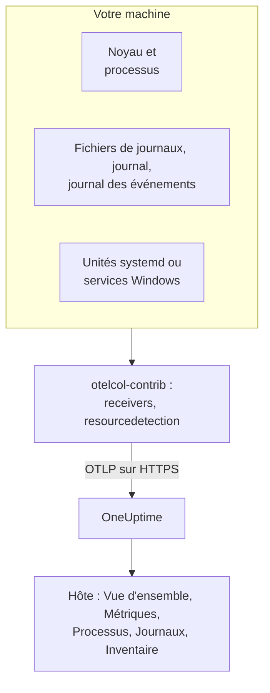

# Collecteur OpenTelemetry sur l'hôte

Exécutez l'OpenTelemetry Collector sur une machine Linux, macOS ou Windows pour envoyer ses métriques, ses processus, ses journaux et l'état de ses services à OneUptime. La machine apparaît sous **Produits → Infrastructure → Hôtes** avec ses propres pages, sans agent OneUptime à installer : le collecteur est la version upstream `otelcol-contrib`. Les [moniteurs d'hôtes](/docs/monitor/host-monitor) déclenchent des alertes à partir de ce qu'il envoie.

:::cards
- [Installer le collecteur](#installer-le-collecteur): Trois étapes sur Linux, macOS ou Windows.
- [Choisir ce qu'il faut collecter](#choisir-ce-quil-faut-collecter): Métriques, journaux de fichiers, le journal systemd, les journaux d'événements et l'état des services.
- [Attributs d'inventaire](#attributs-dinventaire-ip-mac-numéro-de-série-fabricant-modèle-firmware): IP, MAC, numéro de série, fabricant, modèle et firmware pour votre CMDB.
- [Envoyer moins](#réduire-le-volume-de-données-collectées): Moins de lignes de journaux, des intervalles plus longs, moins de séries.
:::

## Fonctionnement

Le collecteur lit la machine au moyen de ses receivers, appose l'identité de la machine sur chaque enregistrement et l'envoie à OneUptime via OTLP avec votre clé d'ingestion. OneUptime enregistre l'hôte à partir de ses premières métriques et remplit ses pages au fur et à mesure que les données arrivent.



| Ce que vous voyez sur l'hôte | D'où cela vient |
| --- | --- |
| **Vue d'ensemble** et **Métriques** | Le receiver `hostmetrics` : CPU, mémoire, disques, systèmes de fichiers, réseau, charge, pagination. |
| **Processus** | Le scraper `process` de `hostmetrics` : un ensemble de séries par processus. |
| **Journaux** | Les receivers `filelog`, `journald` et `windowseventlog`. |
| **Systemd Units** (Linux) | Le receiver `systemd`. |
| **Services** (Windows) | Le receiver `windows_service`. |
| L'élément d'inventaire | Le processeur `resourcedetection`, plus les [attributs que vous apposez](#attributs-dinventaire-ip-mac-numéro-de-série-fabricant-modèle-firmware). |
| **Version de l'agent** | `oneuptime.agent.version` dans le processeur `resource`. |

Un hôte est enregistré dès qu'un lot portant `host.name` porte aussi des métriques `hostmetrics` ou `process`, ou un attribut `os.type`. Le processeur `resourcedetection` les définit tous, c'est pourquoi chaque configuration le place en premier. `host.id` ou `host.arch` seuls n'enregistrent pas d'hôte, et la télémétrie qui porte une identité Kubernetes (`k8s.cluster.name`, `k8s.node.name`, `k8s.pod.name`) est classée sous son cluster : surveillez les nœuds Kubernetes avec l'[agent Kubernetes](/docs/telemetry/kubernetes-agent).

## Avant de commencer

- Une clé d'ingestion. Créez-en une sous **Paramètres du projet → Télémétrie & APM → Clés d'ingestion** et copiez sa valeur. Le collecteur l'envoie dans l'en-tête `x-oneuptime-token`.
- Des droits d'administrateur sur la machine : `sudo` sous Linux et macOS, une invite PowerShell élevée sous Windows.
- Du HTTPS sortant de la machine vers votre URL OneUptime.
- La distribution contrib du collecteur, `otelcol-contrib`. La version core `otelcol` ne contient pas les receivers ni les processeurs qu'utilisent ces configurations. Le receiver `systemd` (Linux) fonctionne à partir de la v0.143.0 et le receiver `windows_service` (Windows) à partir de la v0.155.0 ; les commandes ci-dessous installent la v0.161.0, la version qu'épingle OneUptime.

## Installer le collecteur

:::steps
### Enregistrer la configuration

Enregistrez ceci sous le nom `config.yaml` dans le dossier depuis lequel vous exécuterez les commandes d'installation, et remplacez `YOUR_TELEMETRY_INGESTION_TOKEN` par votre clé d'ingestion (et l'endpoint par votre propre URL si vous auto-hébergez).

:::tabs
@tab Linux
```yaml title="config.yaml"
receivers:
  hostmetrics:
    collection_interval: 30s
    scrapers:
      cpu:
        metrics:
          system.cpu.utilization:
            enabled: true
          system.cpu.logical.count:
            enabled: true
      memory:
        metrics:
          system.memory.utilization:
            enabled: true
      disk:
      filesystem:
        metrics:
          system.filesystem.utilization:
            enabled: true
      load:
      network:
      paging:
      processes:
      process:
        mute_process_name_error: true
        mute_process_exe_error: true
        mute_process_io_error: true
        metrics:
          process.cpu.utilization:
            enabled: true
          process.memory.utilization:
            enabled: true

  # The systemd journal: every unit's logs, info and above.
  journald:
    directory: /var/log/journal
    priority: info

  # Powers the Systemd Units tab (otelcol-contrib v0.143.0+).
  systemd:
    collection_interval: 30s
    units: ["*.service"]
    metrics:
      systemd.service.cpu.time:
        enabled: false

processors:
  # Stamps host.name, host.id and os.type: this is how OneUptime attaches
  # telemetry to the host. Without it the host's pages stay empty.
  resourcedetection:
    detectors: [system, env]
    system:
      hostname_sources: [os]
      resource_attributes:
        host.name:
          enabled: true
        host.id:
          enabled: true
        host.arch:
          enabled: true
        host.ip:
          enabled: true
        host.mac:
          enabled: true
        os.type:
          enabled: true
        os.description:
          enabled: true
        os.version:
          enabled: true
  # The collector release this config is for: the host's Agent Version.
  resource:
    attributes:
      - key: oneuptime.agent.version
        value: "0.161.0"
        action: upsert
  batch:

exporters:
  otlphttp/oneuptime:
    endpoint: https://oneuptime.com/otlp
    headers:
      x-oneuptime-token: YOUR_TELEMETRY_INGESTION_TOKEN

service:
  pipelines:
    metrics:
      receivers: [hostmetrics, systemd]
      processors: [resourcedetection, resource, batch]
      exporters: [otlphttp/oneuptime]
    logs:
      receivers: [journald]
      processors: [resourcedetection, resource, batch]
      exporters: [otlphttp/oneuptime]
```
@tab macOS
```yaml title="config.yaml"
receivers:
  hostmetrics:
    collection_interval: 30s
    scrapers:
      cpu:
        metrics:
          system.cpu.utilization:
            enabled: true
          system.cpu.logical.count:
            enabled: true
      memory:
        metrics:
          system.memory.utilization:
            enabled: true
      disk:
      filesystem:
        metrics:
          system.filesystem.utilization:
            enabled: true
      load:
      network:
      paging:
      processes:
      process:
        mute_process_name_error: true
        mute_process_exe_error: true
        mute_process_io_error: true
        metrics:
          process.cpu.utilization:
            enabled: true
          process.memory.utilization:
            enabled: true

  filelog/system:
    include:
      - /var/log/install.log
      - /var/log/wifi.log
    start_at: end

processors:
  # Stamps host.name, host.id and os.type: this is how OneUptime attaches
  # telemetry to the host. Without it the host's pages stay empty.
  resourcedetection:
    detectors: [system, env]
    system:
      hostname_sources: [os]
      resource_attributes:
        host.name:
          enabled: true
        host.id:
          enabled: true
        host.arch:
          enabled: true
        host.ip:
          enabled: true
        host.mac:
          enabled: true
        os.type:
          enabled: true
        os.description:
          enabled: true
        os.version:
          enabled: true
  # The collector release this config is for: the host's Agent Version.
  resource:
    attributes:
      - key: oneuptime.agent.version
        value: "0.161.0"
        action: upsert
  batch:

exporters:
  otlphttp/oneuptime:
    endpoint: https://oneuptime.com/otlp
    headers:
      x-oneuptime-token: YOUR_TELEMETRY_INGESTION_TOKEN

service:
  pipelines:
    metrics:
      receivers: [hostmetrics]
      processors: [resourcedetection, resource, batch]
      exporters: [otlphttp/oneuptime]
    logs:
      receivers: [filelog/system]
      processors: [resourcedetection, resource, batch]
      exporters: [otlphttp/oneuptime]
```
@tab Windows
```yaml title="config.yaml"
receivers:
  hostmetrics:
    collection_interval: 30s
    scrapers:
      cpu:
        metrics:
          system.cpu.utilization:
            enabled: true
          system.cpu.logical.count:
            enabled: true
      memory:
        metrics:
          system.memory.utilization:
            enabled: true
      disk:
      filesystem:
        metrics:
          system.filesystem.utilization:
            enabled: true
      load:
      network:
      paging:
      processes:
      process:
        mute_process_name_error: true
        mute_process_exe_error: true
        mute_process_io_error: true
        metrics:
          process.cpu.utilization:
            enabled: true
          process.memory.utilization:
            enabled: true

  windowseventlog/system:
    channel: System
    start_at: end

  windowseventlog/application:
    channel: Application
    start_at: end

  windowseventlog/security:
    channel: Security
    start_at: end

  # Powers the Services tab (otelcol-contrib v0.155.0+).
  windows_service:
    collection_interval: 30s

processors:
  # Stamps host.name, host.id and os.type: this is how OneUptime attaches
  # telemetry to the host. Without it the host's pages stay empty.
  resourcedetection:
    detectors: [system, env]
    system:
      hostname_sources: [os]
      resource_attributes:
        host.name:
          enabled: true
        host.id:
          enabled: true
        host.arch:
          enabled: true
        host.ip:
          enabled: true
        host.mac:
          enabled: true
        os.type:
          enabled: true
        os.description:
          enabled: true
        os.version:
          enabled: true
  # The collector release this config is for: the host's Agent Version.
  resource:
    attributes:
      - key: oneuptime.agent.version
        value: "0.161.0"
        action: upsert
  batch:

exporters:
  otlphttp/oneuptime:
    endpoint: https://oneuptime.com/otlp
    headers:
      x-oneuptime-token: YOUR_TELEMETRY_INGESTION_TOKEN

service:
  pipelines:
    metrics:
      receivers: [hostmetrics, windows_service]
      processors: [resourcedetection, resource, batch]
      exporters: [otlphttp/oneuptime]
    logs:
      receivers:
        - windowseventlog/system
        - windowseventlog/application
        - windowseventlog/security
      processors: [resourcedetection, resource, batch]
      exporters: [otlphttp/oneuptime]
```
:::

Chaque configuration est celle que le tableau de bord écrit sous **Produits → Infrastructure → Hôtes → Documentation**, avec un pipeline de journaux en plus : ses processeurs sont `resourcedetection`, `resource` et `batch`, et son exporter est `otlphttp/oneuptime`. Elle ne définit aucun `service.name`, si bien que la télémétrie de l'hôte appartient à l'hôte lui-même, classée sous `host/<hostname>`. N'ajoutez un `service.name` au processeur `resource` que si vous voulez plutôt la classer sous un service de télémétrie portant ce nom.

### Installer et démarrer le collecteur

:::tabs
@tab Linux
Sur Debian ou Ubuntu :

```bash
VERSION=0.161.0                      # the release OneUptime pins
ARCH=$(dpkg --print-architecture)   # amd64 or arm64

curl -fL -o /tmp/otelcol-contrib.deb \
  "https://github.com/open-telemetry/opentelemetry-collector-releases/releases/download/v${VERSION}/otelcol-contrib_${VERSION}_linux_${ARCH}.deb"
sudo dpkg -i /tmp/otelcol-contrib.deb
```

Sur RHEL, CentOS, Fedora ou Amazon Linux :

```bash
VERSION=0.161.0
ARCH=$(uname -m | sed 's/x86_64/amd64/;s/aarch64/arm64/')

curl -fL -o /tmp/otelcol-contrib.rpm \
  "https://github.com/open-telemetry/opentelemetry-collector-releases/releases/download/v${VERSION}/otelcol-contrib_${VERSION}_linux_${ARCH}.rpm"
sudo rpm -Uvh /tmp/otelcol-contrib.rpm
```

Le paquet installe `/usr/bin/otelcol-contrib` et une unité systemd, et la démarre avec une configuration par défaut. Mettez la vôtre en place, autorisez l'utilisateur du collecteur à lire le journal, puis redémarrez-le :

```bash
sudo install -m 0644 config.yaml /etc/otelcol-contrib/config.yaml
sudo usermod -aG systemd-journal otelcol-contrib
sudo systemctl enable otelcol-contrib
sudo systemctl restart otelcol-contrib
sudo systemctl status otelcol-contrib
```

L'unité fournie par le paquet exécute le collecteur sous l'utilisateur non privilégié `otelcol-contrib`. Le groupe `systemd-journal` lui permet de lire le journal ; pour suivre des fichiers dans `/var/log` (lisibles par le groupe `adm` sous Debian et Ubuntu), ajoutez aussi ce groupe. Pour que le scraper `process` voie les processus des autres utilisateurs, accordez-lui la capacité `CAP_SYS_PTRACE`.
@tab macOS
```bash
VERSION=0.161.0
ARCH=$(uname -m | sed 's/x86_64/amd64/')   # arm64 on Apple silicon, amd64 on Intel

curl -fL -o /tmp/otelcol-contrib.tar.gz \
  "https://github.com/open-telemetry/opentelemetry-collector-releases/releases/download/v${VERSION}/otelcol-contrib_${VERSION}_darwin_${ARCH}.tar.gz"

sudo mkdir -p /usr/local/otelcol-contrib /usr/local/bin /etc/otelcol-contrib
sudo tar -xzf /tmp/otelcol-contrib.tar.gz -C /usr/local/otelcol-contrib
sudo ln -sf /usr/local/otelcol-contrib/otelcol-contrib /usr/local/bin/otelcol-contrib
sudo install -m 0644 config.yaml /etc/otelcol-contrib/config.yaml
```

Créez `/Library/LaunchDaemons/com.oneuptime.otelcol-contrib.plist` pour que launchd démarre le collecteur avec le Mac et le relance s'il s'arrête :

```xml title="/Library/LaunchDaemons/com.oneuptime.otelcol-contrib.plist"
<?xml version="1.0" encoding="UTF-8"?>
<!DOCTYPE plist PUBLIC "-//Apple//DTD PLIST 1.0//EN" "http://www.apple.com/DTDs/PropertyList-1.0.dtd">
<plist version="1.0">
<dict>
  <key>Label</key><string>com.oneuptime.otelcol-contrib</string>
  <key>ProgramArguments</key>
  <array>
    <string>/usr/local/bin/otelcol-contrib</string>
    <string>--config=/etc/otelcol-contrib/config.yaml</string>
  </array>
  <key>RunAtLoad</key><true/>
  <key>KeepAlive</key><true/>
  <key>StandardOutPath</key><string>/var/log/otelcol-contrib.out.log</string>
  <key>StandardErrorPath</key><string>/var/log/otelcol-contrib.err.log</string>
</dict>
</plist>
```

Chargez-le :

```bash
sudo launchctl load -w /Library/LaunchDaemons/com.oneuptime.otelcol-contrib.plist
sudo launchctl list | grep otelcol-contrib
```

Utilisez cette archive tarball, pas Homebrew : la formule Homebrew est la version core, qui refuse de démarrer avec cette configuration.
@tab Windows
Depuis une invite PowerShell élevée, dans le dossier qui contient `config.yaml`, exécutez ce bloc d'un seul tenant : chaque ligne dépend des variables définies au-dessus.

```powershell
$VERSION = "0.161.0"                          # the release OneUptime pins; v0.155.0+ has the Services tab
$ARCH    = "amd64"                            # use "arm64" on ARM hosts
$dest    = "C:\Program Files\otelcol-contrib"
$tar     = "$env:TEMP\otelcol-contrib.tar.gz"

# Note the "-contrib" in the asset name; otelcol_... is the wrong archive.
$url = "https://github.com/open-telemetry/opentelemetry-collector-releases/releases/download/v$VERSION/otelcol-contrib_${VERSION}_windows_${ARCH}.tar.gz"

New-Item -ItemType Directory -Force -Path $dest | Out-Null
Invoke-WebRequest -Uri $url -OutFile $tar
tar -xf $tar -C $dest                          # tar.exe ships with Windows 10 1803+ / Server 2019+
Get-ChildItem $dest                            # expect otelcol-contrib.exe, not otelcol.exe
Copy-Item config.yaml "$dest\config.yaml" -Force

# --% hands the rest of the line to sc.exe unchanged, so its quoting
# survives PowerShell — keep the command on one line.
sc.exe --% create "otelcol-contrib" binPath= "\"C:\Program Files\otelcol-contrib\otelcol-contrib.exe\" --config=\"C:\Program Files\otelcol-contrib\config.yaml\"" start= auto DisplayName= "OpenTelemetry Collector (OneUptime)"
sc.exe description "otelcol-contrib" "Collects host telemetry and forwards it to OneUptime over OTLP."
sc.exe start "otelcol-contrib"
sc.exe query "otelcol-contrib"
```

Le service s'exécute sous `LocalSystem`, qui peut lire le journal des événements `Security` et tous les services Windows. Sous Windows, le scraper `load` ne fait qu'émuler une charge moyenne à partir du compteur *Processor Queue Length*, en partant de 0.

Le nom de la ressource doit commencer par `otelcol-contrib_`. L'archive core `otelcol_<version>_windows_amd64.tar.gz` décompresse `otelcol.exe`, qui n'a pas de receiver `windowseventlog` ni `windows_service` ; le renommer en `otelcol-contrib.exe` ne les ajoute pas. Vous préférez un programme d'installation ? La même [page des versions](https://github.com/open-telemetry/opentelemetry-collector-releases/releases) propose un `otelcol-contrib_<version>_windows_x64.msi` signé, qui enregistre le service pour vous : pointez-le vers ce `config.yaml` et gardez le service sous `LocalSystem`.
:::

### Vérifier que l'hôte apparaît

Ouvrez **Produits → Infrastructure → Hôtes → Tous les hôtes**. L'hôte apparaît sous son nom d'hôte dès l'arrivée des premières métriques, généralement en 30 secondes, et ses pages **Vue d'ensemble**, **Métriques**, **Processus** et **Journaux** se remplissent. Sinon, lisez les journaux du collecteur lui-même :

:::tabs
@tab Linux
```bash
sudo journalctl -u otelcol-contrib -f
```
@tab macOS
```bash
tail -f /var/log/otelcol-contrib.err.log
```
@tab Windows
```powershell
Get-WinEvent -LogName Application -MaxEvents 20 | Where-Object ProviderName -eq "otelcol-contrib"
```
:::
:::

Pour générer une ligne de journal de test, exécutez `logger "hello from oneuptime"` (Linux, macOS) ou `eventcreate /T INFORMATION /ID 999 /L APPLICATION /SO OneUptimeTest /D "hello from oneuptime"` (Windows, en mode élevé), puis consultez la page **Journaux** de l'hôte.

## Choisir ce qu'il faut collecter

Toutes les configurations suivent la même forme : des receivers pour ce qu'il faut lire, les processeurs `resourcedetection`, `resource` et `batch`, et l'exporter `otlphttp/oneuptime`. Ajoutez les receivers ci-dessous à `receivers:` et à leur pipeline, puis redémarrez le collecteur (`sudo systemctl restart otelcol-contrib`, `launchctl unload` puis `load` sur un Mac, `Restart-Service otelcol-contrib` sous Windows). Fusionnez chaque extrait dans les sections que votre configuration possède déjà : une deuxième clé `processors:` ou `service:` remplace la première.

### Métriques de l'hôte

`hostmetrics` fonctionne sur tous les systèmes d'exploitation. Il lit le CPU, la mémoire, les disques, les systèmes de fichiers, le réseau, la charge, la pagination et les processus depuis le noyau, à chaque `collection_interval`. Les métriques `*.utilization` et `system.cpu.logical.count` sont désactivées par défaut dans le receiver, et les graphiques de l'hôte ainsi que les modèles d'alerte Host les lisent : gardez-les donc activées comme le font les configurations ci-dessus. Le scraper `process` alimente la page **Processus** ; c'est aussi la plus grande source de séries (voir [Envoyer moins](#réduire-le-volume-de-données-collectées)).

Sous Linux, le collecteur lit `/proc` et `/sys`. Un collecteur dans un conteneur doit monter ceux de l'hôte et définir `HOST_PROC` et `HOST_SYS` (voir [Dans un conteneur Docker](#dans-un-conteneur-docker)) ; une installation native n'a besoin de rien.

### Journaux de fichiers

Suivez n'importe quel fichier de journaux sur le disque avec un receiver `filelog`, et ajoutez-le au pipeline `logs` :

```yaml
receivers:
  filelog/app:
    include:
      - /var/log/myapp/*.log
    start_at: end
    multiline:
      # A new entry starts with a timestamp; continuation lines (the
      # "at ...", "File ...", "Caused by: ..." frames) are folded into it.
      line_start_pattern: '^\d{4}-\d{2}-\d{2}[ T]\d{2}:\d{2}:\d{2}'
```

`start_at: end` ne lit que les nouvelles lignes ; utilisez `beginning` pour lire les fichiers depuis le début lors de la première exécution. Le collecteur mémorise sa position dans chaque fichier, il reprend donc correctement après un redémarrage.

OneUptime recherche des stack traces dans les lignes de journaux d'erreur et fatales et les regroupe en **Exceptions**, sous l'hôte. Pour cela, une stack trace sur plusieurs lignes (Java, Python, .NET, Ruby) doit arriver en un seul enregistrement, ce que fait `multiline` ; sans lui, chaque frame devient un journal distinct. Si votre application peut écrire elle-même les attributs OpenTelemetry `exception.type`, `exception.message` et `exception.stacktrace`, c'est encore plus fiable.

Sur un hôte systemd, `/var/log/syslog` et `/var/log/messages` répètent ce que le journal contient déjà : lisez l'un ou l'autre.

### Journal systemd

Sur un hôte systemd, le receiver `journald` lit les journaux de toutes les unités en un seul endroit, avec leurs champs structurés. La configuration Linux ci-dessus les lit tous à partir de `info` ; limitez-la à certaines unités :

```yaml
receivers:
  journald:
    directory: /var/log/journal
    units:
      # Drop this list to ingest everything; restrict it to limit volume.
      - ssh.service
      - cron.service
      - nginx.service
    priority: info
```

Le receiver exécute `journalctl`, présent sur tout hôte systemd, et l'utilisateur du collecteur doit faire partie du groupe `systemd-journal`.

### Services Linux (unités systemd, métriques)

La page **Systemd Units** de l'hôte liste chaque unité et son état, à partir du [`systemdreceiver`](https://github.com/open-telemetry/opentelemetry-collector-contrib/tree/main/receiver/systemdreceiver) (type de configuration `systemd`), l'équivalent Linux de la page **Services** sous Windows. La configuration Linux ci-dessus l'active :

```yaml
receivers:
  systemd:
    collection_interval: 30s
    # The service manager to read: "system" (default) or "user".
    scope: system
    # Which units to scrape, as systemctl unit patterns. The default is
    # every service; widen it to include timers, sockets or mounts, or
    # narrow it to cut volume on hosts with hundreds of units:
    units: ["*.service"]
    # units: [nginx.service, postgresql.service, "*.timer"]
    metrics:
      # Per-service CPU time is on by default and doubles this receiver's
      # datapoint count. The Systemd Units tab does not use it, so turn it
      # off unless you chart it. On v0.142.0 the key is
      # systemd.unit.cpu.time — naming a metric the running build does not
      # have stops the collector at startup.
      systemd.service.cpu.time:
        enabled: false

service:
  pipelines:
    metrics:
      receivers: [hostmetrics, systemd]
      processors: [resourcedetection, resource, batch]
```

Le receiver est apparu dans `otelcol-contrib` v0.142.0, et la v0.143.0 est la première version qui vaille la peine d'être utilisée. Sur toute version antérieure, l'ajout de `systemd` échoue au démarrage avec `'receivers' unknown type: "systemd"` ; seule la v0.142.0 nomme sa métrique CPU `systemd.unit.cpu.time` et cherche des statistiques cgroup sur chaque unité, ce qui journalise une erreur de scrape pour chaque unité qui n'est pas un `.service`.

Il émet `systemd.unit.state` sous forme d'ensemble d'états : à chaque scrape, chaque unité reçoit un point de données par état possible (`active`, `reloading`, `inactive`, `failed`, `activating`, `deactivating`, `maintenance`, `refreshing`), `1` pour l'état dans lequel elle se trouve et `0` pour les autres. Le nom de l'unité est l'attribut de ressource `systemd.unit.name` et l'état, l'attribut de point de données `systemd.unit.active_state`. Comme le nom de l'unité est un attribut de ressource, `resourcedetection` doit rester dans le pipeline de métriques : il appose `host.name` sur la ressource de chaque unité et, sans lui, les échantillons ne sont jamais rattachés à un hôte.

Il lit l'état des unités via le D-Bus système, avec les appels en lecture seule qu'effectue `systemctl list-units` et que systemd autorise sans privilèges. Le service fourni par le paquet, qui s'exécute sous l'utilisateur `otelcol-contrib` et non sous root, n'a donc besoin d'aucun droit supplémentaire. Il a en revanche besoin du bus : un collecteur dans un conteneur n'a pas de `/run/dbus/system_bus_socket` sauf si vous montez celui de l'hôte, utilisez donc une installation native. Le receiver est en version alpha et réservé à Linux.

> [!WARNING]
> L'ensemble d'états coûte huit points de données par unité et par scrape, et `systemd.service.cpu.time`, activée par défaut, en ajoute deux (`user` et `system`) : 10 points de données par unité et par scrape. Un hôte qui suit 300 unités toutes les 30 secondes envoie environ 6 000 points de données par minute avec ce seul receiver, ou environ 4 800 avec la métrique CPU désactivée. Limitez `units:` aux services sur lesquels vous alertez, ou augmentez `collection_interval`, avant de l'activer sur toute une flotte.

### Apple Unified Log

macOS écrit ses journaux système dans l'Apple Unified Log, lu avec `log show` et `log stream`, plutôt que dans `/var/log/system.log`. Pour le collecter, diffusez-le dans un fichier avec un petit script, `/usr/local/otelcol-contrib/log-stream.sh` :

```bash title="/usr/local/otelcol-contrib/log-stream.sh"
#!/bin/bash
exec /usr/bin/log stream --style ndjson --level info \
  --predicate 'subsystem != "com.apple.cfnetwork"' \
  >> /var/log/apple-unified.log
```

Rendez-le exécutable et lancez-le sous launchd (ou avec `nohup` pour un test rapide), puis pointez un receiver `filelog` vers le fichier :

```yaml
receivers:
  filelog/apple-unified:
    include:
      - /var/log/apple-unified.log
    start_at: end
    operators:
      - type: json_parser
        timestamp:
          parse_from: attributes.timestamp
          layout: "%Y-%m-%d %H:%M:%S.%f%j"
```

Beaucoup de parcs de Mac se contentent très bien des métriques de l'hôte et de quelques journaux de fichiers, sans le journal unifié.

### Journaux d'événements Windows

La configuration Windows ci-dessus s'abonne aux canaux `System`, `Application` et `Security`. Pour limiter le canal `Security`, très volumineux, à certains ID d'événement :

```yaml
windowseventlog/security:
  channel: Security
  start_at: end
  query: "*[System[(EventID=4625 or EventID=4740)]]"
```

Pour lire un autre canal (tout ce qui se trouve sous *Event Viewer → Applications and Services Logs*), utilisez son nom exact :

```yaml
windowseventlog/iis:
  channel: Microsoft-IIS-Logging/Logs
  start_at: end
```

### Services Windows (métriques)

La page **Services** de l'hôte liste chaque service Windows avec son état et son type de démarrage, à partir du [`windowsservicereceiver`](https://github.com/open-telemetry/opentelemetry-collector-contrib/tree/main/receiver/windowsservicereceiver) (type de configuration `windows_service`). Il est fourni dans `otelcol-contrib` depuis la v0.155.0 : sur les versions antérieures, l'ajout de `windows_service` échoue au démarrage avec `'receivers' unknown type: "windows_service"`. La configuration Windows ci-dessus l'active :

```yaml
receivers:
  windows_service:
    collection_interval: 30s
    # Collect every service by default. To cut volume — and avoid the
    # "access denied" noise from services the collector can't open —
    # list just the ones you care about:
    # include_services: [Spooler, W3SVC, MSSQLSERVER]
    # Or collect everything except a few:
    # exclude_services: [TrustedInstaller]

service:
  pipelines:
    metrics:
      receivers: [hostmetrics, windows_service]
```

Il émet une gauge `windows.service.status` par service, l'état du service Win32 (`4` signifie en cours d'exécution, `1` arrêté), avec les attributs `name` et `startup_mode`. Le collecteur lit tous les services en tant que `LocalSystem` et ignore ceux qu'il ne peut pas ouvrir. Le receiver est en version alpha et réservé à Windows ; si une erreur de scrape ou un `access denied` sur un service affecte les autres, restreignez-le avec `include_services`.

`include_services` ne peut que réduire l'ensemble. Si vous listez des services et les voyez pourtant tous, la configuration modifiée n'a pas atteint le collecteur en cours d'exécution : redémarrez le service, vérifiez que `include_services` est une liste remplie, au même niveau d'indentation que `collection_interval`, et laissez quelques minutes à la page **Services**, le temps que les services signalés avant la modification sortent de sa fenêtre glissante. Les noms sont les noms de clé exacts des services, sensibles à la casse (`Spooler`, `W3SVC`), que liste `Get-Service | Select-Object Name`.

### Étiquettes

Tout attribut de ressource qui commence par `oneuptime.label.` devient une étiquette de projet sur l'hôte : `oneuptime.label.<dimension>=<value>` correspond à l'étiquette `<dimension>:<value>`. Ajoutez-leur un processeur et nommez-le dans les pipelines :

```yaml
processors:
  resource/oneuptime-labels:
    attributes:
      - key: oneuptime.label.team
        value: payments
        action: upsert
      - key: oneuptime.label.env
        value: production
        action: upsert

service:
  pipelines:
    metrics:
      processors: [resourcedetection, resource, resource/oneuptime-labels, batch]
```

Les étiquettes sont comparées sans tenir compte de la casse, si bien qu'une étiquette `Production` existante est réutilisée plutôt que dupliquée, et le collecteur ne supprime jamais les étiquettes ajoutées dans OneUptime.

### Attributs d'inventaire (IP, MAC, numéro de série, fabricant, modèle, firmware)

Chaque hôte reçoit aussi un élément d'inventaire : l'enregistrement que lit un export vers une CMDB. Ses détails sont remplis directement à partir des attributs de ressource de la télémétrie que vous envoyez : ce qui arrive est donc ce qu'une synchronisation CMDB peut récupérer.

| Ce que vous voulez | Attribut | D'où cela vient |
| --- | --- | --- |
| Adresses IP | `host.ip` | `resourcedetection`, séparées par des virgules quand la machine en a plusieurs |
| Adresses MAC | `host.mac` | `resourcedetection`, une par interface active, séparées par des virgules |
| Architecture | `host.arch` | `resourcedetection` |
| ID de la machine | `host.id` | `resourcedetection` : le GUID de la machine sous Windows, `/etc/machine-id` sous Linux |
| Système d'exploitation | `os.type`, `os.description`, `os.version` | `resourcedetection` |
| Numéro de série | `host.serial_number` | Apposé par vous, depuis WMI ou DMI |
| Fabricant | `device.manufacturer` | Apposé par vous, depuis WMI ou DMI |
| Modèle | `device.model.name` | Apposé par vous, depuis WMI ou DMI |
| Version du firmware (BIOS ou UEFI) | `device.firmware.version` | Apposée par vous, depuis WMI ou DMI |

Les configurations ci-dessus activent tous les attributs détectés : dans le détecteur system, seuls `host.name` et `os.type` sont activés par défaut, c'est pourquoi elles listent les autres sous `resource_attributes`. Si vous écrivez votre propre configuration, conservez ce bloc `resourcedetection` : sans lui, il n'y a pas de `host.name`, donc ni hôte ni élément d'inventaire.

#### Le numéro de série, le fabricant, le modèle et la version du firmware n'ont pas de détecteur

Ils se trouvent dans le firmware de la machine, que le collecteur ne lit pas. Sous Linux, ce n'est pas un réglage que vous pouvez modifier : le collecteur fourni par le paquet s'exécute sous l'utilisateur non privilégié `otelcol-contrib`, et `/sys/class/dmi/id/product_serial` n'est lisible que par root. Lisez-les donc une fois, lors du provisionnement de la machine, et apposez-les sur la ressource avec un processeur dédié :

```yaml
processors:
  resource/oneuptime-hardware:
    attributes:
      - key: host.serial_number
        value: "7XYZ123"
        action: upsert
      - key: device.manufacturer
        value: "Dell Inc."
        action: upsert
      - key: device.model.name
        value: "OptiPlex 7090"
        action: upsert
      - key: device.firmware.version
        value: "1.21.0"
        action: upsert

service:
  pipelines:
    metrics:
      processors: [resourcedetection, resource, resource/oneuptime-hardware, batch]
```

Ajoutez `resource/oneuptime-hardware` à la liste de processeurs que vous avez déjà au lieu de coller cette ligne par-dessus : retirez `resource` et l'hôte perd sa **Version de l'agent**. Dans tous les cas, gardez `resourcedetection` en premier : c'est lui qui rattache le lot à l'hôte.

`host.manufacturer`, `host.model.name`, `host.firmware.version` et `host.bios.version` sont acceptés comme orthographes alternatives et stockés sous les clés `device.*` ci-dessus : une configuration écrite d'une façon ou de l'autre aboutit au même endroit ; quand les deux sont présentes, la valeur `device.*` l'emporte. Le numéro de série va dans l'autre sens : `device.serial_number` est accepté et stocké sous `host.serial_number`.

> [!NOTE]
> Sur une ressource sans identité d'hôte, `device.manufacturer` signifie « application mobile » : c'est l'un des attributs qui marquent un lot comme du Real User Monitoring mobile. La ressource d'un hôte porte toujours `host.name` ou `host.id`, si bien qu'une configuration de collecteur comme celle ci-dessus n'est jamais prise pour un téléphone, mais ne réutilisez pas le même bloc dans la configuration du SDK d'une application mobile.

#### Lire les valeurs

Sous Windows, depuis une invite PowerShell élevée. Elle affiche le bloc YAML de la machine sur laquelle vous l'exécutez :

```powershell
$bios = Get-CimInstance -ClassName Win32_BIOS
$cs   = Get-CimInstance -ClassName Win32_ComputerSystem

# Quote for YAML: trim, escape any embedded quote, wrap in single quotes.
# The cast to string first is what keeps this working on machines whose
# firmware leaves a field empty — .Trim() on $null throws.
function Format-YamlValue($value) {
  "'" + ("$value".Trim() -replace "'", "''") + "'"
}

@"
  resource/oneuptime-hardware:
    attributes:
      - key: host.serial_number
        value: $(Format-YamlValue $bios.SerialNumber)
        action: upsert
      - key: device.manufacturer
        value: $(Format-YamlValue $cs.Manufacturer)
        action: upsert
      - key: device.model.name
        value: $(Format-YamlValue $cs.Model)
        action: upsert
      - key: device.firmware.version
        value: $(Format-YamlValue $bios.SMBIOSBIOSVersion)
        action: upsert
"@
```

Elle affiche une entrée de processeur, déjà indentée : ajoutez-la à l'intérieur du bloc `processors:` que vous avez, pas sous forme d'une deuxième clé `processors:`. Utilisez `Get-CimInstance`, et non l'obsolète `Get-WmiObject`, qui n'existe plus dans PowerShell 7 et les versions ultérieures. Un champ que le firmware laisse vide s'affiche sous la forme `''` : supprimez cet attribut plutôt que d'en envoyer un vide. Les machines virtuelles n'ont souvent aucun numéro de série.

Sous Linux, en tant que root :

```bash
cat /sys/class/dmi/id/product_serial   # host.serial_number
cat /sys/class/dmi/id/sys_vendor       # device.manufacturer
cat /sys/class/dmi/id/product_name     # device.model.name
cat /sys/class/dmi/id/bios_version     # device.firmware.version
```

`bios_version` est le seul des quatre que tout utilisateur peut lire. Sur les machines sans `/sys/class/dmi`, `dmidecode -s system-serial-number`, `-s system-manufacturer`, `-s system-product-name` et `-s bios-version` renvoient les mêmes valeurs. Les machines virtuelles indiquent ici leur hyperviseur (`QEMU`, `VMware, Inc.`, `Amazon EC2`), ce qui est généralement ce que vous voulez dans une CMDB.

Sur un Mac :

```bash
ioreg -l | awk -F'"' '/IOPlatformSerialNumber/{print $4}'   # host.serial_number
sysctl -n hw.model                                          # device.model.name
system_profiler SPHardwareDataType | awk -F': ' '/System Firmware Version/{print $2}'   # device.firmware.version
```

Le fabricant est `Apple Inc.` `hw.model` renvoie l'identifiant du modèle, comme `Mac14,7` ou `MacBookPro18,3`, et non le nom commercial, que le Mac n'indique pas : faites la correspondance de l'identifiant dans votre CMDB si vous en avez besoin. Mettez-le tout de même dans `device.model.name` : `device.model.identifier` marque un lot comme une application mobile quoi qu'il contienne d'autre, si bien qu'un Mac portant cet attribut est classé comme un téléphone et détaché de son hôte.

#### Utiliser plutôt des variables d'environnement

Le détecteur `env` est activé, donc `OTEL_RESOURCE_ATTRIBUTES` fonctionne à la place du processeur :

```text
OTEL_RESOURCE_ATTRIBUTES=host.serial_number=7XYZ123,device.manufacturer=Dell%20Inc.,device.model.name=OptiPlex%207090
```

Encodez chaque valeur en pourcentage. La variable est lue comme une liste `key=value` W3C Baggage, où `,` et `=` séparent les entrées et où les espaces ne sont pas portables d'une version du collecteur à l'autre ; les guillemets n'y changent rien, et `device.manufacturer="Dell Inc."` peut arriver avec les guillemets dans la valeur. Sous Windows, `[System.Uri]::EscapeDataString($value)` encode une valeur.

Définissez-la sur le service du collecteur lui-même, jamais pour toute la machine :

- **Linux:** `sudo systemctl edit otelcol-contrib`, puis une section `[Service]` avec `Environment="OTEL_RESOURCE_ATTRIBUTES=…"`.
- **Windows:** la valeur `Environment` (de type `REG_MULTI_SZ`) sous `HKLM\SYSTEM\CurrentControlSet\Services\otelcol-contrib`. `sc.exe create` ne peut pas définir de variables d'environnement de service, et `setx` définit une variable que le service en cours d'exécution ne relit jamais.

> [!WARNING]
> Ne la définissez pas pour toute la machine (`setx /M`, `/etc/environment`). Chaque processus doté d'un SDK OpenTelemetry sur la machine hérite de `OTEL_RESOURCE_ATTRIBUTES` : vos applications signaleraient alors le `device.manufacturer` de la machine comme le leur, et une ressource d'application avec `device.manufacturer` mais sans `host.name` ni `host.id` est lue comme une application mobile, ce qui la détache de son service.

Le processeur est plus facile à bien configurer : il est limité au collecteur par construction, et les valeurs ne changent jamais pour une machine donnée. Préférez-le, sauf si vous générez déjà des fichiers d'environnement à partir de modèles.

#### Une adresse MAC n'est pas une valeur apposée

`host.mac` vient du détecteur `system`, comme `host.ip` : une adresse par interface réseau active, loopback exclue, sous la forme IEEE que spécifie OpenTelemetry (`AC-DE-48-23-45-67`). Une machine qui exécute Docker ou Hyper-V signale aussi ses commutateurs virtuels, c'est pourquoi la valeur est une liste. Une interface qui signale l'adresse fictive entièrement à zéro (`00-00-00-00-00-00`) est ignorée.

Rien sur la machine n'indique de version de firmware disponible en mise à jour : OneUptime enregistre donc la version installée.

#### Vérifier que cela a fonctionné

Ouvrez l'élément de l'hôte sous **Produits → Inventaire** et regardez sa carte **Détails de l’actif**. Les valeurs apparaissent quelques minutes après le lot suivant ; un détail que le collecteur n'a pas signalé s'affiche comme inconnu, avec un lien vers cette section. Comme elles sont apposées et non détectées, elles ne se mettent pas à jour toutes seules : apposez-les de nouveau après un changement de carte mère, une mise à jour du firmware ou une réinstallation.

## Autres façons d'exécuter le collecteur

### Dans un conteneur Docker

Exécutez le collecteur dans un conteneur qui voit les processus et les systèmes de fichiers de l'hôte, depuis le dossier qui contient `config.yaml` :

```bash
docker run -d \
  --name otel-collector \
  --restart unless-stopped \
  --network host \
  --pid host \
  -v $(pwd)/config.yaml:/etc/otelcol-contrib/config.yaml:ro \
  --volume /:/hostfs:ro,rslave \
  -e HOST_PROC=/hostfs/proc \
  -e HOST_SYS=/hostfs/sys \
  -e HOST_ETC=/hostfs/etc \
  -e HOST_VAR=/hostfs/var \
  -e HOST_RUN=/hostfs/run \
  -e HOST_DEV=/hostfs/dev \
  otel/opentelemetry-collector-contrib:0.161.0 \
  --config /etc/otelcol-contrib/config.yaml
```

`--network host`, `--pid host`, le montage `/hostfs` et les variables `HOST_*` permettent à `hostmetrics` et `process` de lire le noyau de l'hôte plutôt que celui du conteneur. N'utilisez que le pipeline de métriques de la configuration : l'image n'a pas de `journalctl`, et le receiver `systemd` a besoin du D-Bus de l'hôte.

### À partir de l'archive de la version

Là où les paquets ne sont pas envisageables, décompressez le binaire statique et donnez-lui sa propre unité systemd :

```bash
VERSION=0.161.0
ARCH=$(uname -m | sed 's/x86_64/amd64/;s/aarch64/arm64/')

curl -fL -o /tmp/otelcol.tar.gz \
  "https://github.com/open-telemetry/opentelemetry-collector-releases/releases/download/v${VERSION}/otelcol-contrib_${VERSION}_linux_${ARCH}.tar.gz"
sudo mkdir -p /opt/otelcol-contrib
sudo tar -xzf /tmp/otelcol.tar.gz -C /opt/otelcol-contrib
sudo install -m 0644 config.yaml /opt/otelcol-contrib/config.yaml
```

```ini title="/etc/systemd/system/otelcol-contrib.service"
[Unit]
Description=OpenTelemetry Collector
After=network.target

[Service]
ExecStart=/opt/otelcol-contrib/otelcol-contrib --config /opt/otelcol-contrib/config.yaml
Restart=on-failure
RestartSec=5s
User=root

[Install]
WantedBy=multi-user.target
```

```bash
sudo systemctl daemon-reload
sudo systemctl enable --now otelcol-contrib
```

`User=root` permet à cette unité de lire tous les fichiers de journaux et tous les processus ; l'installation par paquet ci-dessus est l'alternative non privilégiée.

### Sur les nœuds Kubernetes

Les nœuds Kubernetes ne sont pas des hôtes dans OneUptime : leur télémétrie porte une identité Kubernetes et est classée sous le cluster. Installez l'[agent Kubernetes](/docs/telemetry/kubernetes-agent) : chaque nœud apparaît sur la page **Nœuds** de son cluster, à côté de ses pods.

## Mettre à jour le collecteur

Chaque configuration de cette page appose la version du collecteur à laquelle elle est destinée sous la forme `oneuptime.agent.version`, dans son processeur `resource`. OneUptime l'affiche comme **Version de l'agent** dans la **Vue d'ensemble** de l'hôte, avec un signe d'avertissement à côté lorsque OneUptime épingle une version plus récente. Sélectionnez le signe pour voir comment mettre à jour selon votre mode d'installation.

Pour mettre à jour à la main, installez la nouvelle version de la même façon que celle-ci, avec la nouvelle `VERSION` (sous Debian et Ubuntu, `sudo dpkg -i --force-confold` conserve votre configuration sans poser de question), définissez `oneuptime.agent.version` dans `config.yaml` sur la même version et redémarrez le collecteur. Un collecteur dont la configuration n'appose aucune version n'en affiche aucune, et jamais de signe.

## Réduire le volume de données collectées

La configuration vous appartient : rien ne quitte la machine si aucun receiver que vous avez ajouté ne le lit. Si un hôte envoie plus que vous ne le souhaitez (ce qui se traduit par plus d'ingestion et, sur OneUptime Cloud, par un coût plus élevé), réduisez-le ici. Les deux plus grands leviers sont les journaux que vous lisez et la fréquence à laquelle vous collectez les métriques ; un processeur `filter` fait le reste. Changez un levier à la fois et redémarrez le collecteur après chaque modification.

### D'où vient le volume

| Signal | Principal facteur | Pour le réduire |
| --- | --- | --- |
| Journaux | Chaque ligne de chaque fichier, unité du journal ou canal d'événements | Moins de receivers, un `units:` ou un `query:` plus restreint, un `filter` sur la gravité |
| Métriques de l'hôte | La fréquence de collecte, multipliée par le nombre de séries | Un `collection_interval` plus long, moins de scrapers |
| Cardinalité des métriques | Métriques par processus : un ensemble de séries par processus | Omettre ou restreindre le scraper `process` |
| Unités systemd | 10 points de données par unité et par scrape (ensemble d'états et CPU) | Un `units:` plus restreint, la métrique CPU désactivée, un `collection_interval` plus long |

### Ne lire que les journaux nécessaires

Les journaux représentent presque toujours la plus grande part, et le collecteur ne lit que ce que vous listez : listez donc moins :

- Pointez `filelog` vers des fichiers précis, pas vers des globs larges : `/var/log/myapp/error.log` plutôt que `/var/log/**`.
- Limitez `journald` aux unités qui vous intéressent, et augmentez `priority` pour écarter `info` et `debug` avant qu'ils ne quittent la machine :

```yaml
receivers:
  journald:
    directory: /var/log/journal
    units:
      - ssh.service
      - nginx.service
    priority: warning # info and debug are dropped before export
```

- Limitez le canal d'événements `Security`, très volumineux, aux ID d'événement que vous auditez avec un `query:` (comme dans [Journaux d'événements Windows](#journaux-dévénements-windows)), ou supprimez ce canal.

### Collecter les métriques moins souvent

Le volume de `hostmetrics` évolue avec `collection_interval` : si une résolution de 30 secondes dépasse vos besoins, 60 secondes divisent les points de données par deux.

```yaml
receivers:
  hostmetrics:
    collection_interval: 60s
```

### Restreindre le scraper par processus

Le scraper `process` émet un ensemble de séries pour chaque processus en cours d'exécution : sur une machine chargée, c'est donc la plus grande source de séries. Omettez-le si vous n'avez pas besoin de la page **Processus**, ou limitez-le aux processus qui comptent (gardez `processes`, une poignée de compteurs de processus, dans tous les cas) :

```yaml
receivers:
  hostmetrics:
    collection_interval: 60s
    scrapers:
      cpu:
      memory:
      disk:
      filesystem:
      network:
      load:
      paging:
      processes: # aggregate counts only — cheap
      process:
        mute_process_name_error: true
        mute_process_exe_error: true
        mute_process_io_error: true
        include:
          names: [nginx, postgres, node]
          match_type: strict
```

Cela réduit le receiver à ses métriques par défaut : remettez les blocs `metrics:` des configurations ci-dessus sous `cpu`, `memory`, `filesystem` et `process` si vous utilisez les graphiques de l'hôte et les modèles d'alerte Host.

### Restreindre les unités systemd

Le receiver `systemd` envoie un point de données par état et par unité à chaque scrape, soit huit par unité, plus deux pour `systemd.service.cpu.time`, activée par défaut : son volume dépend donc du nombre d'unités auxquelles correspond `units:`. La valeur par défaut `["*.service"]` inclut les dizaines d'unités ponctuelles qui ne changent jamais d'état. Listez les unités sur lesquelles vous alertez et désactivez la métrique CPU, sauf si vous l'affichez dans un graphique :

```yaml
receivers:
  systemd:
    collection_interval: 60s
    units: [nginx.service, postgresql.service, ssh.service]
    metrics:
      # On otelcol-contrib v0.142.0 this key is systemd.unit.cpu.time.
      systemd.service.cpu.time:
        enabled: false
```

Ensemble, ces réglages font passer un hôte de 300 unités d'environ 6 000 points de données par minute à bien moins de 100. Les unités retirées de la liste disparaissent de la page **Systemd Units** quelques minutes plus tard, une fois leurs derniers échantillons sortis de sa fenêtre glissante.

### Supprimer des enregistrements avec un processeur filter

Quand vous voulez un receiver mais pas toute sa sortie, ajoutez un processeur [`filter`](https://github.com/open-telemetry/opentelemetry-collector-contrib/tree/main/processor/filterprocessor). Il évalue une condition [OTTL](https://github.com/open-telemetry/opentelemetry-collector-contrib/blob/main/pkg/ottl/README.md) et supprime chaque enregistrement qui y correspond, avant tout envoi.

Supprimer les journaux en dessous d'une gravité :

```yaml
processors:
  filter/drop-low-severity:
    error_mode: ignore
    logs:
      log_record:
        # Drop anything less severe than WARN (info, debug, trace).
        # The UNSPECIFIED guard is required — see the warning below.
        - "severity_number != SEVERITY_NUMBER_UNSPECIFIED and severity_number < SEVERITY_NUMBER_WARN"
```

> [!WARNING]
> Conservez la garde `UNSPECIFIED`. `SEVERITY_NUMBER_UNSPECIFIED` vaut `0` et `SEVERITY_NUMBER_WARN` vaut `13`, si bien qu'un simple `severity_number < SEVERITY_NUMBER_WARN` est vrai pour tout enregistrement dont la gravité n'a jamais été analysée. Un receiver `filelog` de base n'analyse aucune gravité dans la ligne : sans la garde, la condition supprime donc silencieusement chaque ligne qu'il lit, sans la moindre erreur. Avec la garde, les enregistrements non analysés sont conservés et arrivent avec la gravité `Unspecified`, ce qui vous indique qu'il vous faut un analyseur de gravité.

Pour filtrer correctement les journaux de fichiers par gravité, analysez-la d'abord avec un opérateur [`severity_parser`](https://github.com/open-telemetry/opentelemetry-collector-contrib/blob/main/pkg/stanza/docs/operators/severity_parser.md) sur le receiver :

```yaml
receivers:
  filelog/app:
    include:
      - /var/log/myapp/*.log
    start_at: end
    operators:
      # Pull a level out of lines like "2026-01-01 ERROR something broke".
      - type: regex_parser
        regex: '(?i)(?P<level>TRACE|DEBUG|INFO|WARN(?:ING)?|ERROR|FATAL)'
        parse_from: body
        # Lines with no recognisable level fall through unparsed rather
        # than being discarded, and are then kept by the guard above.
        on_error: send
      - type: severity_parser
        parse_from: attributes.level
        preset: default
        mapping:
          warn: warning
          error: err
          fatal: panic
```

Sur un hôte systemd, le journal n'a besoin de rien de tout cela : le `priority:` de `journald` filtre par niveau dans `journalctl` lui-même.

Supprimer les métriques que vous n'affichez pas dans un graphique, par nom exact ou par motif :

```yaml
processors:
  filter/drop-metrics:
    error_mode: ignore
    metrics:
      metric:
        # Exact metric name.
        - 'name == "system.paging.faults"'
        # Or a whole family. IsMatch is RE2 and UNANCHORED, so anchor it
        # yourself with ^ when you mean "starts with".
        - 'IsMatch(name, "^system\\.paging\\.")'
```

Pour n'envoyer qu'un ensemble fixe de métriques, inversez la condition : `filter` supprime ce qui correspond, donc `not (...)` supprime tout ce que vous n'avez pas nommé. Gardez la condition sur une seule ligne :

```yaml
processors:
  filter/allowlist:
    error_mode: ignore
    metrics:
      metric:
        - 'not (name == "system.cpu.utilization" or name == "system.memory.utilization" or name == "system.filesystem.utilization")'
```

Une liste d'autorisation est un gros marteau : tout ce que vous oubliez de nommer disparaît, avec les moniteurs qui en dépendent. Préférez supprimer les quelques métriques dont vous ne voulez pas, ou omettre le scraper qui les produit : une métrique jamais collectée ne coûte rien à filtrer.

Ajoutez ensuite le processeur à son pipeline, avant `batch` :

```yaml
service:
  pipelines:
    metrics:
      receivers: [hostmetrics]
      processors: [filter/drop-metrics, resourcedetection, resource, batch]
      exporters: [otlphttp/oneuptime]
    logs:
      receivers: [journald]
      processors: [filter/drop-low-severity, resourcedetection, resource, batch]
      exporters: [otlphttp/oneuptime]
```

Un pipeline qui nomme un processeur ou un exporter que la configuration ne définit pas arrête le collecteur au démarrage. Gardez `resourcedetection`, qui rattache la télémétrie à l'hôte, et `resource`, qui signale la version du collecteur. `filter` est un processeur contrib, la version core refuse donc cette configuration.

### Un point de départ léger

Un hôte limité aux métriques, avec un intervalle long et sans séries par processus, constitue la plus petite empreinte utile :

```yaml title="config.yaml"
receivers:
  hostmetrics:
    collection_interval: 60s
    scrapers:
      cpu:
        metrics:
          system.cpu.utilization:
            enabled: true
          system.cpu.logical.count:
            enabled: true
      memory:
        metrics:
          system.memory.utilization:
            enabled: true
      disk:
      filesystem:
        metrics:
          system.filesystem.utilization:
            enabled: true
      load:
      network:
      paging:
      processes:

processors:
  # Stamps host.name, host.id and os.type: this is how OneUptime attaches
  # telemetry to the host. Without it the host's pages stay empty.
  resourcedetection:
    detectors: [system, env]
    system:
      hostname_sources: [os]
      resource_attributes:
        host.name:
          enabled: true
        host.id:
          enabled: true
        host.arch:
          enabled: true
        host.ip:
          enabled: true
        host.mac:
          enabled: true
        os.type:
          enabled: true
        os.description:
          enabled: true
        os.version:
          enabled: true
  # The collector release this config is for: the host's Agent Version.
  resource:
    attributes:
      - key: oneuptime.agent.version
        value: "0.161.0"
        action: upsert
  batch:

exporters:
  otlphttp/oneuptime:
    endpoint: https://oneuptime.com/otlp
    headers:
      x-oneuptime-token: YOUR_TELEMETRY_INGESTION_TOKEN

service:
  pipelines:
    metrics:
      receivers: [hostmetrics]
      processors: [resourcedetection, resource, batch]
      exporters: [otlphttp/oneuptime]
```

Rajoutez un pipeline `logs`, avec un receiver `filelog` ou `journald` restreint, quand vous en avez besoin.

> [!CAUTION]
> Faites attention à ce que vous supprimez. Un moniteur de journaux a besoin que ses journaux arrivent : filtrer une gravité ou un canal rend donc muets les moniteurs qui le surveillent, et les modèles d'alerte Host ont besoin des métriques `*.utilization`. Supprimez les données sur lesquelles vous n'agissez pas, pas celles qu'un moniteur surveille, et vérifiez la baisse sous **Paramètres du projet → Historique d'utilisation** un jour ou deux plus tard (l'utilisation est comptée par jour) avant d'actionner le levier suivant.

## OneUptime auto-hébergé et proxys

Sur un OneUptime auto-hébergé, pointez l'exporter vers votre propre instance ; utilisez `http://` et son port si elle ne parle que HTTP :

```yaml
exporters:
  otlphttp/oneuptime:
    endpoint: https://your-oneuptime-host.example.com/otlp
    headers:
      x-oneuptime-token: YOUR_TELEMETRY_INGESTION_TOKEN
```

Derrière un proxy, le collecteur utilise les variables standard `HTTPS_PROXY`, `HTTP_PROXY` et `NO_PROXY`. Définissez-les sur son service :

- **Linux:** un fichier drop-in, `/etc/systemd/system/otelcol-contrib.service.d/proxy.conf`, avec une section `[Service]` et `Environment="HTTPS_PROXY=http://proxy.example.com:3128"` ; puis `sudo systemctl daemon-reload` et redémarrez le collecteur.
- **macOS:** un dictionnaire `EnvironmentVariables` dans le plist.
- **Windows:** la valeur `Environment` sous `HKLM\SYSTEM\CurrentControlSet\Services\otelcol-contrib`.

## Agent IA

Le collecteur envoie ce qu'un hôte signale ; l'**Agent IA d'hôte** permet à OneUptime AI d'interroger l'hôte lui-même pendant qu'elle enquête sur un incident ou une alerte qui le concerne. Il exécute des commandes en lecture seule — `systemctl status nginx --no-pager -n 50`, `journalctl -u nginx -n 200 --no-pager`, `df -h`, `free -m`, `ps aux --sort=-%cpu`, `ss -tulpn` — et, uniquement si vous l'autorisez, applique des corrections comme le redémarrage d'une unité systemd donnée. C'est un conteneur Linux (image `oneuptime/resource-ai-agent:release`) doté de son propre programme d'installation, qui a besoin de Docker (le moteur système, pas Docker rootless) et du plugin Docker Compose :

```bash
curl -fsSL https://raw.githubusercontent.com/OneUptime/oneuptime/master/agents/HostAIAgent/install.sh -o install.sh
sudo bash install.sh
```

- **Les enquêtes IA sont activées par défaut.** Dès que l'agent se connecte, OneUptime AI enquête avec lui sur les incidents et les alertes de cet hôte, et la **Vue d'ensemble** de l'hôte affiche l'état de l'agent. Pour arrêter, définissez `ONEUPTIME_AI_INVESTIGATION=false` là où l'agent s'exécute (**Modifier**, sous **Ce que l'IA peut faire** sur la page de l'agent IA, montre comment), ou supprimez l'agent.
- Il s'enregistre sous `HOST_NAME` ; laissez-le vide pour utiliser le nom d'hôte de la machine, qui est ce que ce collecteur signale comme `host.name`, sauf si vous définissez un autre nom. Les deux doivent correspondre, pour que l'agent serve l'hôte que ce collecteur a créé. Il apparaît sur la page **Agent IA** de l'hôte dans OneUptime.
- Il exécute les programmes de l'hôte lui-même en entrant dans les namespaces de l'hôte avec `nsenter` : il s'exécute donc en mode privilégié, en tant que root, avec `pid: host`, et il est root sur l'hôte. La limite est la politique de commandes de l'agent : des commandes en lecture seule sauf si vous définissez `ONEUPTIME_AI_ALLOW_WRITES=true`, jamais un shell, `sudo` ni un programme hors de sa liste, et jamais lui-même, l'unité de ce collecteur ni quoi que ce soit dans `ONEUPTIME_AI_PROTECTED_TARGETS`.
- Avec `ONEUPTIME_AI_ALLOW_WRITES=true`, `ONEUPTIME_AI_WRITE_TARGETS` (des noms d'unités complets comme `nginx.service,app-*`) limite les unités qu'une correction peut toucher. `ONEUPTIME_AI_FIXES` indique comment les corrections s'exécutent — `ask-for-approval` (une personne approuve chacune), `automatic` ou `bypass-approval` — et la page de l'agent IA l'affiche en lecture seule ; le programme d'installation écrit les deux, depuis son environnement, dans le `.env` de l'agent ([Ce que l'IA peut faire, défini par l'agent](/docs/ai/infrastructure-ai-agents#what-ai-may-do-set-by-the-agent)).

Ce qu'il peut exécuter, comment fonctionnent les corrections et comment le dépanner : [Infrastructure AI Agents](/docs/ai/infrastructure-ai-agents#hosts).

## Dépannage

:::details Aucun hôte n'apparaît dans OneUptime
1. Lisez les journaux du collecteur à la recherche d'erreurs d'export (voir [Vérifier que l'hôte apparaît](#vérifier-que-lhôte-apparaît)). Ajoutez `service.telemetry.logs.level: debug` à la configuration pour plus de détails.
2. Un HTTP `401` signifie que la clé d'ingestion est absente, erronée ou expirée ; `422` signifie qu'elle a été désactivée, ou qu'il s'agit d'une clé de navigateur, qui ne peut pas envoyer de télémétrie d'hôte. Créez une clé sous **Paramètres du projet → Télémétrie & APM → Clés d'ingestion** et mettez à jour `x-oneuptime-token`.
3. Vérifiez que la machine peut joindre OneUptime : `curl -v https://oneuptime.com/otlp` (ou votre URL auto-hébergée) depuis la même machine.
4. Gardez `resourcedetection` dans le pipeline de métriques : il définit `host.name`, qui permet à OneUptime de reconnaître l'hôte.
:::

:::details Le collecteur ne peut pas lire le journal ou un fichier de journaux
Le collecteur fourni par le paquet s'exécute sous l'utilisateur non privilégié `otelcol-contrib`. Ajoutez-le au groupe qui peut lire les journaux, puis redémarrez-le : `sudo usermod -aG systemd-journal otelcol-contrib` pour le journal, et le groupe `adm` pour la plupart de `/var/log` sous Debian et Ubuntu. Pour `journald`, `journalctl` doit se trouver dans le `PATH` du collecteur et `/var/log/journal` doit exister (`sudo systemd-tmpfiles --create --prefix /var/log/journal` le crée).
:::

:::details Le service Windows échoue avec Error 2: The system cannot find the file specified
Le Service Control Manager ne trouve pas le programme avec lequel le service a été enregistré. Exécutez `sc.exe qc "otelcol-contrib"` et comparez `BINARY_PATH_NAME` avec ce qui se trouve dans `C:\Program Files\otelcol-contrib`. Presque toujours, c'est l'archive core `otelcol_<version>_windows_amd64.tar.gz` qui a été téléchargée : elle décompresse `otelcol.exe`, alors que le service nomme `otelcol-contrib.exe`, que seule l'archive `otelcol-contrib_<version>_...` contient. Téléchargez de nouveau la ressource contrib ; ne renommez pas `otelcol.exe`, ce qui donne à la place le `1064` ci-dessous. L'autre cause est un `binPath=` sans guillemets : un chemin passant par `C:\Program Files` est coupé à l'espace, sauf s'il est entre guillemets exactement comme le montre l'étape d'installation.
:::

:::details Le service Windows échoue avec Error 1064
Le gestionnaire de services a démarré le programme, mais le collecteur s'est arrêté pendant le démarrage. Un `otelcol.exe` renommé produit cela : la version core n'a pas de receiver `windowseventlog` ni `windows_service`, elle rejette donc la configuration. Un chemin `--config` sans guillemets fait de même, car il est coupé à l'espace de `Program Files`. Vérifiez ce que vous avez :

- `otelcol-contrib.exe --version` doit afficher `otelcol-contrib version ...` ; `otelcol version ...` correspond à la version core, renommée.
- `otelcol-contrib.exe components` doit lister `windowseventlog` et `windows_service` parmi les receivers (pas `hostmetrics`, que la version core possède aussi).
- Exécutez-le au premier plan pour voir l'erreur réelle : `& "C:\Program Files\otelcol-contrib\otelcol-contrib.exe" --config="C:\Program Files\otelcol-contrib\config.yaml"`.
- *Event Viewer → Windows Logs → Application*, source `otelcol-contrib`, enregistre l'erreur de démarrage que le gestionnaire de services a avalée.
:::

:::details Le journal des événements Security renvoie un accès refusé
Le service n'a pas les droits nécessaires. Exécutez-le sous `LocalSystem` (la valeur par défaut de `sc.exe create`), ou accordez à son compte le droit utilisateur *Manage auditing and security log*.
:::

:::details Le receiver systemd signale une erreur D-Bus, ou la page Systemd Units est vide
- Le collecteur ne peut pas joindre le bus système : vérifiez que `/run/dbus/system_bus_socket` existe et que l'utilisateur du collecteur peut l'ouvrir ; `systemctl list-units` exécuté sous cet utilisateur est la vérification la plus rapide. Root n'est pas nécessaire. Un collecteur dans un conteneur ne voit aucun bus sauf si vous montez le socket de l'hôte.
- La page reste vide alors que le receiver fonctionne : gardez `resourcedetection` dans le même pipeline de métriques. Le receiver ne rattache que `systemd.unit.name` à la ressource de chaque unité : sans `resourcedetection`, il n'y a pas de `host.name` et les échantillons ne sont jamais rattachés à un hôte.
- Une erreur de scrape par unité, ou un collecteur qui refuse de démarrer à cause d'une métrique inconnue, vient d'un écart de version : la v0.142.0 lit les statistiques cgroup sur chaque unité et nomme sa métrique CPU `systemd.unit.cpu.time` ; la v0.143.0 et les versions ultérieures ne lisent que les services et la nomment `systemd.service.cpu.time`. Utilisez la v0.143.0 ou une version ultérieure, et nommez la clé de votre version dans toute surcharge `metrics:`.
:::

:::details Les graphiques de CPU et de mémoire ou les modèles d'alerte Host n'affichent aucune donnée
Ils lisent `system.cpu.utilization`, `system.memory.utilization` et `system.filesystem.utilization`, que `hostmetrics` laisse désactivées sauf si vous les activez. Copiez les blocs `metrics:` sous `cpu`, `memory` et `filesystem` des configurations ci-dessus dans la vôtre, et redémarrez le collecteur.
:::

:::details Trop de données, ou une facture élevée
Voir [Réduire le volume de données collectées](#réduire-le-volume-de-données-collectées) : restreignez les receivers (canaux Windows, unités systemd, fichiers de journaux), collectez moins souvent, restreignez le scraper par processus, ou supprimez des enregistrements avec un processeur `filter` avant leur envoi.
:::

## Étapes suivantes

:::cards
- [Surveillance des hôtes](/docs/monitor/host-monitor): Alerter sur le CPU, la mémoire, le disque et les processus.
- [Surveillance des journaux](/docs/monitor/logs-monitor): Alerter sur des motifs de journaux, comme des échecs de connexion sur une fenêtre de 5 minutes.
- [Exporter vers une CMDB](/docs/inventory/cmdb-sync): Transmettre les attributs d'inventaire à votre CMDB.
- [Surveillance de serveur / VM](/docs/monitor/server-monitor): Surveiller aussi la joignabilité d'un serveur depuis l'extérieur.
:::
