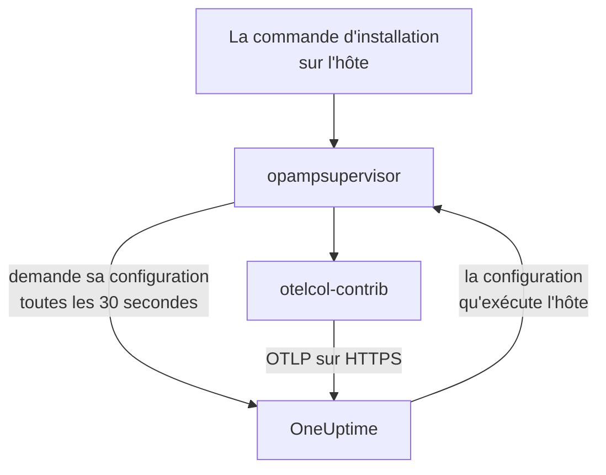

# Hôtes

Ajoutez une machine Linux, Windows ou macOS à OneUptime avec une seule commande. La commande installe l'OpenTelemetry Collector sur l'hôte, et OneUptime envoie au collecteur sa configuration et la tient à jour : aucun `config.yaml` à écrire, à copier sur chaque hôte ou à garder synchronisé. Pour changer ce que vos hôtes collectent, modifiez une seule fois une configuration du collecteur, et chaque hôte auquel elle s'applique reçoit le changement dans la minute.

:::cards
- [Ajouter un hôte](#ajouter-un-hôte): Une commande sous Linux, Windows ou macOS.
- [Changer ce que collectent les hôtes](#changer-ce-que-collectent-les-hôtes): Des configurations du collecteur par système et par étiquette, chaque version conservée.
- [Vérifier le collecteur d'un hôte](#vérifier-le-collecteur-dun-hôte): La configuration qu'il exécute, sa version, et pourquoi une configuration n'a pas démarré.
- [Ce qu'une configuration peut faire](#ce-quune-configuration-peut-faire): Lire l'hôte, et n'envoyer qu'à cette instance de OneUptime.
:::

## Fonctionnement

La commande installe deux programmes issus des versions publiées de l'OpenTelemetry Collector, chacun vérifié contre le SHA-256 que publie sa version : `otelcol-contrib`, le collecteur qui lit l'hôte, et `opampsupervisor`, qui exécute le collecteur et le maintient sur la configuration que OneUptime envoie via OpAMP, l'OpenTelemetry Agent Management Protocol. Les deux tournent en tant que service `oneuptime-collector`.



Le superviseur demande à OneUptime la configuration de l'hôte environ toutes les 30 secondes, avec votre clé d'ingestion, et indique quelle configuration l'hôte exécute et si elle a démarré. L'hôte est enregistré dans **Hôtes** dès la première connexion du superviseur, sous le nom de sa machine, et ses pages se remplissent à mesure que ses métriques et ses logs arrivent.

Chaque hôte exécute une seule configuration, choisie dans cet ordre :

| L'hôte exécute | Quand |
| --- | --- |
| La configuration choisie pour lui sur sa page **Collecteur** | Quelqu'un en a choisi une. |
| La première des **Configurations du collecteur** qui s'applique à lui | Une configuration s'applique quand elle est pour le système de l'hôte et, si elle nomme des étiquettes, que l'hôte en porte une. |
| La configuration par défaut de OneUptime pour son système | Aucune configuration ne s'applique. |

La configuration par défaut de OneUptime lit le processeur, la mémoire, les disques, les systèmes de fichiers, le réseau et les processus sur tout système ; le journal et les unités systemd sous Linux, là où l'hôte en a ; les journaux d'événements System, Application et Security et les services Windows sous Windows ; et les logs d'installation et Wi-Fi de `/var/log` sous macOS. Elle laisse de côté les systèmes de fichiers pleins par conception, comme les paquets snap et le `/dev` de macOS, afin qu'ils ne maintiennent jamais le modèle High Filesystem Usage déclenché. Elle suit les versions de OneUptime, si bien qu'un hôte sur la configuration par défaut profite des améliorations que OneUptime y apporte.

## Avant de commencer

- Une clé d'ingestion. **Ajouter un hôte** en crée une pour vous, ou choisissez-en une créée sous **Paramètres du projet → Télémétrie & APM → Clés d'ingestion**.
- Des droits d'administrateur sur l'hôte : `sudo` sous Linux et macOS, PowerShell exécuté en tant qu'administrateur sous Windows.
- Linux avec systemd, Windows 10 ou Windows Server 2019 et versions ultérieures, ou macOS sur Apple Silicon ou Intel.
- Un accès HTTPS sortant de l'hôte vers votre URL OneUptime, direct ou via un proxy.

## Ajouter un hôte

:::steps
### Ouvrir Ajouter un hôte

Ouvrez **Produits → Infrastructure → Hôtes** et sélectionnez **Ajouter un hôte**. Choisissez ce qu'exécute l'hôte : Linux, Windows ou macOS. Les nœuds d'un cluster Kubernetes sont plutôt surveillés par le [Kubernetes Agent](/docs/telemetry/kubernetes-agent).

### Choisir une clé d'ingestion

Choisissez une clé, ou créez-en une depuis la boîte de dialogue. La commande ci-dessous la renseigne.

### Exécuter la commande sur l'hôte

Copiez la commande depuis la boîte de dialogue et exécutez-la sur l'hôte. Cela prend environ une minute. Voici les mêmes commandes, avec votre URL OneUptime et votre clé à la place des exemples :

:::tabs
@tab Linux
```bash
curl -fsSL https://oneuptime.com/docs/static/scripts/host-collector/install.sh | sudo sh -s -- --url https://oneuptime.com --key YOUR_INGESTION_KEY
```
@tab macOS
```bash
curl -fsSL https://oneuptime.com/docs/static/scripts/host-collector/install.sh | sudo sh -s -- --url https://oneuptime.com --key YOUR_INGESTION_KEY
```
@tab Windows
```powershell
[Net.ServicePointManager]::SecurityProtocol = [Net.ServicePointManager]::SecurityProtocol -bor [Net.SecurityProtocolType]::Tls12; & ([scriptblock]::Create((Invoke-RestMethod -Uri 'https://oneuptime.com/docs/static/scripts/host-collector/install.ps1'))) -Url 'https://oneuptime.com' -Key 'YOUR_INGESTION_KEY'
```
:::

Chaque instance de OneUptime sert ses propres programmes d'installation, si bien qu'une instance auto-hébergée fournit le programme d'installation de sa propre version : remplacez `https://oneuptime.com` par votre URL aux deux endroits.

### Attendre l'hôte

La dernière étape de la boîte de dialogue indique quand l'hôte se connecte, avec un lien vers lui. Dans la liste, il apparaît en **Démarrage** jusqu'à l'arrivée de ses premières métriques, en général dans la minute, puis comme connecté, avec son collecteur **En cours d'exécution**. La page **Topologie** de l'hôte dessine sur une seule carte ce qui tourne dessus, ce qui l'appelle et ce qu'il appelle : voir [Topologie](/docs/telemetry/topology#ouvrir-la-carte-propre-à-une-ressource).
:::

## Étiqueter les hôtes

Ajoutez des étiquettes à la commande, et l'hôte les porte dès sa connexion :

:::tabs
@tab Linux
```bash
curl -fsSL https://oneuptime.com/docs/static/scripts/host-collector/install.sh | sudo sh -s -- --url https://oneuptime.com --key YOUR_INGESTION_KEY --label env=production --label team=payments
```
@tab macOS
```bash
curl -fsSL https://oneuptime.com/docs/static/scripts/host-collector/install.sh | sudo sh -s -- --url https://oneuptime.com --key YOUR_INGESTION_KEY --label env=production --label team=payments
```
@tab Windows
```powershell
[Net.ServicePointManager]::SecurityProtocol = [Net.ServicePointManager]::SecurityProtocol -bor [Net.SecurityProtocolType]::Tls12; & ([scriptblock]::Create((Invoke-RestMethod -Uri 'https://oneuptime.com/docs/static/scripts/host-collector/install.ps1'))) -Url 'https://oneuptime.com' -Key 'YOUR_INGESTION_KEY' -Label 'env=production','team=payments'
```
:::

`env=production` devient l'étiquette `env:production`. Les étiquettes s'ajoutent, sans jamais être retirées : relancez la commande avec une autre étiquette et l'hôte porte les deux. Vous pouvez aussi étiqueter les hôtes dans la liste **Hôtes** ou avec les **Règles d'étiquettes**. Une configuration du collecteur qui nomme des étiquettes ne vaut que pour les hôtes qui en portent une, si bien que la même commande avec des étiquettes différentes donne à chaque groupe d'hôtes sa propre configuration.

## Changer ce que collectent les hôtes

:::steps
### Créer une configuration du collecteur

Ouvrez **Produits → Infrastructure → Hôtes → Configurations du collecteur** et sélectionnez **Créer : Configuration du collecteur**. Donnez-lui un nom, le système des hôtes auxquels elle est destinée et, pour n'en atteindre que certains, leurs étiquettes. Sa configuration part de la configuration par défaut de OneUptime pour ce système.

### Modifier son config.yaml

Sur la page de la configuration, sélectionnez **Modifier la configuration**, changez le YAML et enregistrez. OneUptime le vérifie d'abord et refuse, en expliquant pourquoi, une configuration qu'il ne peut pas envoyer : voir [Ce qu'une configuration peut faire](#ce-quune-configuration-peut-faire).

### La voir arriver sur les hôtes

Chaque modification enregistrée est une nouvelle version, et les hôtes auxquels elle s'applique la reçoivent dans la minute. La liste **Hôtes** de la configuration montre chaque hôte, l'état de son collecteur et la version qu'il exécute.
:::

Un hôte exécute la première configuration de la liste qui s'applique à lui : faites glisser les lignes dans **Configurations du collecteur** pour changer l'ordre. Placez en premier les configurations les plus ciblées, comme une pour les serveurs web en `env:production`, et les plus larges, comme une pour tous les hôtes Linux, après elles. La carte **Configurations par défaut de OneUptime** sous la liste montre ce qu'exécute un hôte quand aucune configuration ne s'applique.

### Versions et retour en arrière

La liste **Versions** d'une configuration conserve chaque modification enregistrée, la plus récente en premier, avec qui l'a enregistrée et quand. Sélectionnez **Voir** pour lire une version, et **Rétablir** pour l'envoyer de nouveau aux hôtes : elle est enregistrée comme une nouvelle version qui indique laquelle elle a rétablie, si bien que la liste dit toujours ce que chaque hôte a reçu.

### Choisir une configuration pour un seul hôte

Sur la page **Collecteur** d'un hôte, sélectionnez **Changer de configuration** et choisissez une configuration pour cet hôte seulement. Les configurations proposées sont celles du système de l'hôte et celles de tout système. Choisissez Automatique pour rendre l'hôte à la liste. Un hôte dont la configuration choisie est supprimée revient de lui-même à la liste.

### Quand une configuration ne démarre pas

Le superviseur vérifie une nouvelle configuration avec le collecteur avant d'y passer, et revient à la dernière configuration qui fonctionnait quand une configuration ne démarre pas. L'hôte continue d'envoyer pendant tout ce temps. Sa page **Collecteur** affiche **Échec de la configuration** avec la raison donnée par le collecteur, comme un fichier de log que le collecteur n'a pas le droit de lire, et OneUptime ne renvoie pas cette configuration à l'hôte tant qu'elle ne change pas. Une fois la cause corrigée sur l'hôte, sélectionnez **Réessayer** pour l'envoyer une fois de plus.

## Ce qu'une configuration peut faire

Une configuration envoyée par OneUptime s'exécute sur chaque hôte auquel elle s'applique, si bien que OneUptime la vérifie à chaque enregistrement et refuse celle qui enfreint une règle :

| Règle | Pourquoi |
| --- | --- |
| Uniquement les receivers, processors, exporters, extensions et connectors de la liste de OneUptime | Elle lit l'hôte et les services qui s'y trouvent. Un composant qui exécute des programmes ou lit des identifiants de cloud ou de cluster n'est pas sur la liste. |
| Les données ne quittent l'hôte que par l'exporter `otlp_http`, vers `${env:ONEUPTIME_URL}/otlp` avec l'en-tête `x-oneuptime-token: ${env:ONEUPTIME_INGESTION_KEY}` | Chaque hôte envoie à cette instance de OneUptime, avec la clé utilisée pour l'installer. Aucune configuration ne contient de clé. |
| `${env:NAME}` est le seul `${...}` qu'elle peut utiliser | Un `${file:...}` ou `${https:...}` serait lu sur chaque hôte et pourrait être transmis. |
| Aucun paramètre qui exécute un programme ou envoie un fichier qu'il lit, comme `journalctl_path` de journald | Une configuration ne peut pas aller plus loin que lire l'hôte. |

Une configuration peut malgré tout être impossible à exécuter sur un hôte, comme un receiver pour un autre système ou un fichier de log qui n'y existe pas. Le collecteur de chaque hôte le vérifie avant de changer, comme l'explique [Quand une configuration ne démarre pas](#quand-une-configuration-ne-démarre-pas).

## Vérifier le collecteur d'un hôte

Ouvrez l'hôte et sa page **Collecteur**. Elle montre où en est le collecteur, la configuration qu'il exécute et **Pourquoi cette configuration**, la version qu'il exécute, son **Dernier rapport** et sa **Version du collecteur**. Sous **Sur l'hôte** figurent les commandes pour le vérifier depuis un shell sur l'hôte : si son service tourne, son log, et un redémarrage.

:::tabs
@tab Linux
```bash
sudo systemctl status oneuptime-collector
sudo journalctl -u oneuptime-collector -n 50
sudo systemctl restart oneuptime-collector
```
@tab macOS
```bash
sudo launchctl print system/com.oneuptime.collector
sudo tail -n 50 /usr/local/oneuptime-collector/log/collector.log
sudo launchctl kickstart -k system/com.oneuptime.collector
```
@tab Windows
```powershell
Get-Service oneuptime-collector
Get-WinEvent -FilterHashtable @{ LogName = 'Application'; ProviderName = 'oneuptime-collector' } -MaxEvents 50 | Format-List TimeCreated, Message
Restart-Service oneuptime-collector
```
:::

Sous Linux, le collecteur s'exécute en tant qu'utilisateur non privilégié `oneuptime-collector`, dans les groupes `systemd-journal` et `adm` pour pouvoir lire le journal et les logs de `/var/log`. Sous macOS, il s'exécute en tant que root, comme les démons launchd, et sous Windows en tant que LocalSystem, pour pouvoir lire chaque journal d'événements et chaque service Windows.

## Hôtes configurés manuellement

Un hôte dont vous avez installé le collecteur vous-même, avec le guide [OpenTelemetry Collector pour hôtes](/docs/telemetry/host-otel-collector), continue d'envoyer comme avant, et OneUptime ne lui envoie pas de configuration. Pour le transférer, ouvrez la page **Collecteur** de l'hôte : sa commande ajoute `--replace-existing`, qui arrête et désactive le collecteur installé manuellement (le service `otelcol-contrib`), pour que l'hôte n'envoie pas tout en double. L'hôte garde son nom, son historique et ses étiquettes.

## Options d'installation

Relancez la commande pour changer l'une de ces options, ou pour passer à une version plus récente : elle remplace ce qu'elle a installé et garde l'hôte tel qu'il est dans OneUptime.

| Linux et macOS | Windows | Effet |
| --- | --- | --- |
| `--url URL` | `-Url URL` | Où se trouve OneUptime. |
| `--key KEY` | `-Key KEY` | Une clé d'ingestion de télémétrie de votre projet. |
| `--label KEY=VALUE` | `-Label KEY=VALUE` | Étiquette l'hôte. Répétez-la pour d'autres étiquettes ; sous Windows, listez-les séparées par des virgules. |
| `--env NAME=VALUE` | `-EnvVar NAME=VALUE` | Donne au collecteur une variable d'environnement, pour les configurations qui lisent `${env:NAME}`. |
| `--version VERSION` | `-Version VERSION` | La version du collecteur à installer, 0.161.0 par défaut. |
| `--download-url URL` | `-DownloadUrl URL` | Télécharge les versions depuis un miroir qui reprend l'arborescence de GitHub. |
| `--proxy URL` | `-Proxy URL` | Fait passer les téléchargements et tout le trafic du collecteur par un proxy HTTP. |
| `--replace-existing` | `-ReplaceExisting` | Arrête et désactive un collecteur installé manuellement. |
| `--uninstall` | `-Uninstall` | Retire le collecteur et tout ce que la commande a installé. |

## Désinstaller

:::tabs
@tab Linux
```bash
curl -fsSL https://oneuptime.com/docs/static/scripts/host-collector/install.sh | sudo sh -s -- --uninstall
```
@tab macOS
```bash
curl -fsSL https://oneuptime.com/docs/static/scripts/host-collector/install.sh | sudo sh -s -- --uninstall
```
@tab Windows
```powershell
& ([scriptblock]::Create((Invoke-RestMethod -Uri 'https://oneuptime.com/docs/static/scripts/host-collector/install.ps1'))) -Uninstall
```
:::

L'hôte reste dans OneUptime avec son historique : archivez-le ou supprimez-le dans la liste **Hôtes**.

## Dépannage

:::details La commande indique que OneUptime a refusé la clé
HTTP `401` : la clé est erronée, a expiré ou a été supprimée. HTTP `422` : elle est désactivée, c'est une clé de navigateur, ou elle est rattachée à un seul service. Choisissez une clé serveur active dans **Ajouter un hôte** et relancez la commande : elle remplace la clé sur l'hôte.
:::

:::details L'hôte n'apparaît pas
Vérifiez que l'hôte peut joindre votre URL OneUptime en HTTPS, puis lisez le log du collecteur avec la commande de son système dans [Vérifier le collecteur d'un hôte](#vérifier-le-collecteur-dun-hôte).
:::

:::details L'hôte indique que sa configuration a échoué
Sa page **Collecteur** montre pourquoi la configuration n'a pas démarré. L'hôte continue d'exécuter la dernière configuration qui fonctionnait, et reçoit de nouveau celle qui a échoué quand la configuration change ou quand vous sélectionnez **Réessayer**.
:::

:::details L'hôte affiche « Ne remonte plus de données »
OneUptime n'a pas eu de nouvelles du superviseur de l'hôte depuis plus de 15 minutes. Vérifiez que le service `oneuptime-collector` tourne et que l'hôte peut toujours joindre OneUptime.
:::

## Étapes suivantes

:::cards
- [OpenTelemetry Collector pour hôtes](/docs/telemetry/host-otel-collector): Installer le collecteur et écrire sa configuration vous-même à la place.
- [Moniteur d'hôte](/docs/monitor/host-monitor): Être alerté sur ce que remontent vos hôtes.
- [Clés d'ingestion](/docs/telemetry/ingestion-keys): Créer, restreindre et renouveler les clés avec lesquelles les hôtes envoient.
- [Kubernetes Agent](/docs/telemetry/kubernetes-agent): Surveiller les nœuds et les workloads d'un cluster.
:::
