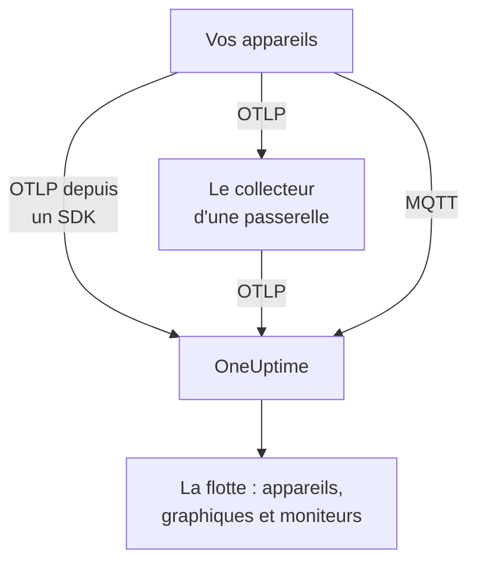

# Appareils IoT

OneUptime surveille des flottes d'appareils IoT — capteurs, passerelles, contrôleurs et boîtiers edge — à partir d'un petit ensemble de métriques `iot_*` qu'ils envoient. Il regroupe les appareils en flottes, tient un inventaire des appareils de chaque flotte et affiche dans des graphiques leur batterie, leur signal, leur température, leur CPU, leur mémoire et leur disponibilité. Aucun agent OneUptime n'est à installer sur un appareil : les appareils envoient de l'OpenTelemetry standard, ou publient sur l'endpoint MQTT de OneUptime. Les [moniteurs d'appareils IoT](/docs/monitor/iot-device-monitor) déclenchent des alertes à partir de ce qu'ils envoient.

:::cards
- [Choisir le mode d'envoi](#choisir-le-mode-denvoi): Un SDK OpenTelemetry, un collecteur sur une passerelle, ou MQTT.
- [Envoyer des métriques via MQTT](#envoyer-des-métriques-via-mqtt): Topics, identifiants par appareil et Last Will.
- [Conventions de métriques](#conventions-de-métriques): Les noms `iot_*` que OneUptime affiche dans ses graphiques et sur lesquels il alerte.
- [Dépannage](#dépannage): Flottes manquantes, appareils manquants, passages hors ligne.
:::

## Fonctionnement

Chaque relevé appartient à une flotte et à un appareil. OneUptime crée la flotte à partir de son premier relevé, ajoute chaque nouvel appareil à l'inventaire de la flotte et met à jour les dernières valeurs de l'appareil à chaque relevé suivant. Les relevés envoyés via OpenTelemetry et via MQTT alimentent les mêmes flottes, le même inventaire, les mêmes graphiques et les mêmes moniteurs.



## Comment OneUptime modélise l'IoT

- **Flotte** : un groupe d'appareils, comme `building-a-sensors` ou `field-gateways`. Elle provient de l'attribut de ressource `iot.fleet.name` et apparaît dans OneUptime comme le service de télémétrie `iot/<fleet>`. Définissez aussi `service.name=iot/<fleet>`, pour que les journaux et les métriques se retrouvent sous le même service.
- **Appareil** : un appareil d'une flotte, nommé par l'attribut `device.id` de chaque point de données. L'inventaire de la flotte est indexé sur `device.id`.

| Attribut | Défini sur | Obligatoire | Description |
| --- | --- | --- | --- |
| `iot.fleet.name` | Ressource | Oui | La flotte à laquelle appartient l'appareil. Elle devient le service OneUptime `iot/<fleet>`. |
| `device.id` | Chaque point de données | Oui | Un ID stable pour l'appareil, unique dans sa flotte. |
| `iot.device.kind` | Chaque point de données | Non | La classe de l'appareil, comme `Device`, `Sensor` ou `Gateway`. Par défaut `Device`. |
| `iot.device.type` | Chaque point de données | Non | Un type ou un modèle plus précis pour filtrer les moniteurs, comme `temp-sensor`. |
| `iot.device.firmware` | Chaque point de données | Non | La version du firmware que signale l'appareil. |

Avec MQTT, le topic définit la flotte et l'appareil pour vous.

## Choisir le mode d'envoi

| Mode | À utiliser quand | Prérequis |
| --- | --- | --- |
| [SDK OpenTelemetry](#envoyer-des-métriques-via-le-sdk-opentelemetry) | L'appareil exécute un SDK OpenTelemetry et joint OneUptime lui-même. | Une clé d'ingestion sur l'appareil. |
| [OpenTelemetry Collector](#envoyer-des-métriques-via-un-opentelemetry-collector) | De nombreux appareils remontent leurs données via une passerelle. | Une passerelle qui exécute le collecteur. |
| [MQTT](#envoyer-des-métriques-via-mqtt) | L'appareil parle déjà MQTT, ou doit apparaître hors ligne dès qu'il décroche. | N'importe quel client MQTT qui se connecte via WebSocket. |

## Avant de commencer

- Une clé d'ingestion. Créez-en une sous **Paramètres du projet → Télémétrie & APM → Clés d'ingestion** et copiez sa valeur. Les appareils l'envoient dans l'en-tête `x-oneuptime-token`, ou comme mot de passe MQTT.
- Un accès réseau de l'appareil ou de la passerelle vers votre URL OneUptime.
- Un nom de flotte pour chaque groupe d'appareils, et un ID stable pour chaque appareil.

## Envoyer des métriques via le SDK OpenTelemetry

:::steps
### Pointer le SDK vers OneUptime

Définissez les variables d'environnement OpenTelemetry standard sur l'appareil. Remplacez la clé, le nom de la flotte et l'ID de l'appareil par les vôtres :

```bash
export OTEL_EXPORTER_OTLP_ENDPOINT=https://oneuptime.com/otlp
export OTEL_EXPORTER_OTLP_PROTOCOL=http/protobuf
export OTEL_EXPORTER_OTLP_HEADERS=x-oneuptime-token=YOUR_TELEMETRY_INGESTION_TOKEN
export OTEL_RESOURCE_ATTRIBUTES=iot.fleet.name=building-a-sensors,device.id=sensor-001,service.name=iot/building-a-sensors
```

Gardez `iot.fleet.name` stable : le modifier enregistre une nouvelle flotte.

### Enregistrer les relevés sous forme de métriques IoT

Émettez chaque relevé sous forme de métrique portant l'un des [noms conventionnels](#conventions-de-métriques), et donnez à chaque point de données un attribut `device.id` :

| Métrique | Valeur | Attribut du point de données |
| --- | --- | --- |
| `iot_device_up` | `1` | `device.id=sensor-001` |
| `iot_battery_percent` | `87` | `device.id=sensor-001` |
| `iot_temperature_celsius` | `21.5` | `device.id=sensor-001` |

L'inventaire est indexé sur le `device.id` du point de données, pas sur celui de la ressource : définissez-le donc sur chaque mesure en plus de `OTEL_RESOURCE_ATTRIBUTES`.
:::

Ensuite, [vérifiez que la flotte apparaît](#vérifier-que-la-flotte-apparaît).

## Envoyer des métriques via un OpenTelemetry Collector

Lorsque de nombreux appareils remontent leurs données via une passerelle, exécutez un OpenTelemetry Collector sur la passerelle. Il reçoit l'OTLP de vos appareils, appose la flotte sur chaque relevé et les transmet à OneUptime.

:::steps
### Enregistrer la configuration de la passerelle

Enregistrez ceci sous le nom `config.yaml` sur la passerelle :

```yaml title="config.yaml"
receivers:
  otlp:
    protocols:
      grpc:
        endpoint: 0.0.0.0:4317
      http:
        endpoint: 0.0.0.0:4318

processors:
  batch:
    send_batch_size: 512
    timeout: 5s
  resource:
    attributes:
      - key: iot.fleet.name
        value: field-gateways
        action: upsert
      - key: service.name
        value: iot/field-gateways
        action: upsert

exporters:
  otlphttp:
    endpoint: "https://oneuptime.com/otlp"
    headers:
      "x-oneuptime-token": "YOUR_TELEMETRY_INGESTION_TOKEN"

service:
  pipelines:
    metrics:
      receivers: [otlp]
      processors: [resource, batch]
      exporters: [otlphttp]
```

- `otlp` reçoit les données de vos appareils via gRPC (`4317`) et HTTP (`4318`). Recevez les relevés par tout autre moyen que le collecteur prend en charge (un pont MQTT, des journaux de fichiers) et envoyez-les dans le même pipeline.
- `resource` appose la flotte sur chaque relevé. Définissez `iot.fleet.name`, et le `service.name=iot/<fleet>` correspondant, par passerelle, pour que les appareils de chaque passerelle arrivent dans leur flotte.
- Gardez `device.id`, et le cas échéant `iot.device.kind`, `iot.device.type` et `iot.device.firmware`, sur chaque point de données, pour que OneUptime puisse distinguer les appareils de la flotte.
- `otlphttp` envoie à OneUptime via HTTPS avec la clé d'ingestion. L'encodage protobuf par défaut et `encoding: json` sont tous deux acceptés.

### Exécuter le collecteur sur la passerelle

:::tabs
@tab Docker
Exécutez-le depuis le dossier qui contient `config.yaml` :

```bash
docker run -d \
  --name otel-collector \
  --restart unless-stopped \
  -p 4317:4317 \
  -p 4318:4318 \
  -v $(pwd)/config.yaml:/etc/otelcol-contrib/config.yaml:ro \
  otel/opentelemetry-collector-contrib:0.161.0 \
  --config /etc/otelcol-contrib/config.yaml
```
@tab otelcol-contrib
Si la passerelle dispose déjà de `otelcol-contrib`, pointez-le vers le fichier :

```bash
otelcol-contrib --config config.yaml
```
:::

Les appareils envoient alors l'OTLP à la passerelle, par exemple avec `OTEL_EXPORTER_OTLP_ENDPOINT=http://<gateway-host>:4318` dans le SDK de chaque appareil.
:::

Ensuite, [vérifiez que la flotte apparaît](#vérifier-que-la-flotte-apparaît).

## Envoyer des métriques via MQTT

OneUptime dispose de son propre endpoint MQTT : les appareils qui parlent MQTT y publient donc directement leurs relevés, sans SDK, collecteur ni pont. Ce qui arrive via MQTT passe par le même pipeline que l'OTLP : les flottes sont créées, l'inventaire est mis à jour, et chaque moniteur et modèle d'alerte IoT fonctionne de la même façon.

### Endpoints

| Transport | Adresse | Remarques |
| --- | --- | --- |
| MQTT sur WebSocket | `wss://<your-host>/mqtt` | Fonctionne sur tous les déploiements, via le port HTTPS habituel. |
| MQTT sur TCP | `<app-host>:1883` | Auto-hébergé uniquement, et interne au réseau du cluster ou de Compose tant que vous ne l'exposez pas. Le port est `MQTT_INGEST_PORT`. |

### Authentification

- **Avec la clé d'ingestion** : envoyez-la comme mot de passe MQTT. Le nom d'utilisateur est ignoré ; si votre client n'a qu'un champ de nom d'utilisateur, mettez-y la clé. Cela convient à une passerelle qui publie pour de nombreux appareils.
- **Avec des identifiants par appareil** : recommandé pour les appareils qui se connectent directement. Ouvrez la page **Registre des appareils** de la flotte et enregistrez l'appareil, avec l'**ID de l'appareil** qu'il utilise comme `device.id`. Le **Nom d'utilisateur MQTT** de l'appareil est son nom d'utilisateur, et son **Mot de passe MQTT (secret)** son mot de passe.

Les identifiants d'un appareil ne peuvent publier que sous ses propres topics `oneuptime/<fleet>/<device>/`. Vous pouvez révoquer un appareil sans toucher au reste de la flotte : désactivez son interrupteur **Activé**, ou supprimez-le, et un appareil connecté est déconnecté en une minute environ. Un appareil enregistré qui se tait reste dans l'inventaire comme hors ligne, et le modèle d'alerte Device Offline se déclenche pour lui, même s'il meurt sans Last Will.

OneUptime refuse les identifiants erronés au CONNECT avec le code de retour 4 (nom d'utilisateur ou mot de passe incorrect) : un appareil mal configuré échoue donc de façon visible. Les clés de navigateur sont refusées via MQTT.

### Topics et payloads

Publiez sous le préfixe fixe `oneuptime/`. Les segments de flotte et d'appareil ne doivent pas contenir `/`, `+` ni `#`, ne doivent pas commencer par `$` et font au plus 100 caractères.

| Topic | Payload |
| --- | --- |
| `oneuptime/<fleet>/<device>/telemetry` | Un objet JSON de relevés : `{"metrics":{"iot_temperature_celsius":21.5}}`, ou un objet plat dont les champs numériques sont les métriques. |
| `oneuptime/<fleet>/<device>/metrics/<metricName>` | Une valeur : un nombre seul (`23.4`) ou `{"value":23.4}`. |
| `oneuptime/<fleet>/<device>/status` | `online` ou `offline` (ou aussi `1` ou `0`, `true` ou `false`, `up` ou `down`). Il définit `iot_device_up`. |

Un payload de télémétrie peut aussi contenir `"attributes"`, une map de chaînes apposée sur chaque point de données (utilisez-la pour `iot.device.kind`, `iot.device.type`, `iot.device.firmware` ou vos propres étiquettes), et `"timestamp"`, au format ISO 8601 ou en secondes ou millisecondes Unix. Les deux sont optionnels : sans `timestamp`, c'est l'heure à laquelle OneUptime reçoit le relevé qui est utilisée.

### Détection hors ligne avec Last Will

Enregistrez un Last Will MQTT sur `oneuptime/<fleet>/<device>/status` avec le payload `offline`. Si l'appareil meurt ou disparaît du réseau, OneUptime publie `iot_device_up = 0` pour lui dès la fin de sa session, ce qui déclenche le modèle d'alerte Device Offline fourni et marque l'appareil comme indisponible dans l'inventaire, sans interrogation périodique. Publiez `online` sur le même topic après la connexion, pour que l'appareil apparaisse de nouveau comme disponible.

### Exemples

:::tabs
@tab mosquitto_pub
En TCP brut, sur une instance auto-hébergée :

```bash
mosquitto_pub -h YOUR-ONEUPTIME-APP-HOST -p 1883 \
  -u oneuptime -P "YOUR_TELEMETRY_INGESTION_TOKEN" \
  -t "oneuptime/building-a-sensors/sensor-001/telemetry" \
  -m '{"metrics":{"iot_device_up":1,"iot_battery_percent":87,"iot_temperature_celsius":21.5},"attributes":{"iot.device.type":"temp-sensor","iot.device.firmware":"1.4.2"}}'
```
@tab Node.js
Avec le paquet `mqtt`, via WebSocket, vers oneuptime.com ou n'importe quelle instance auto-hébergée :

```javascript
const mqtt = require("mqtt");

const client = mqtt.connect("wss://oneuptime.com/mqtt", {
  username: "oneuptime", // ignored — the token below is what authenticates
  password: "YOUR_TELEMETRY_INGESTION_TOKEN",
  will: {
    topic: "oneuptime/building-a-sensors/sensor-001/status",
    payload: "offline",
  },
});

client.on("connect", () => {
  client.publish("oneuptime/building-a-sensors/sensor-001/status", "online");
  setInterval(() => {
    client.publish(
      "oneuptime/building-a-sensors/sensor-001/telemetry",
      JSON.stringify({
        metrics: {
          iot_device_up: 1,
          iot_battery_percent: readBattery(),
          iot_temperature_celsius: readTemperature(),
        },
      }),
    );
  }, 60 * 1000);
});
```
@tab Python
Avec `paho-mqtt`, via WebSocket :

```python
import json
import paho.mqtt.client as mqtt

client = mqtt.Client(transport="websockets")
client.username_pw_set("oneuptime", "YOUR_TELEMETRY_INGESTION_TOKEN")
client.tls_set()
client.will_set("oneuptime/building-a-sensors/sensor-001/status", "offline")
client.ws_set_options(path="/mqtt")
client.connect("oneuptime.com", 443)

client.publish("oneuptime/building-a-sensors/sensor-001/status", "online")
client.publish(
    "oneuptime/building-a-sensors/sensor-001/telemetry",
    json.dumps({"metrics": {"iot_device_up": 1, "iot_temperature_celsius": 21.5}}),
)
```
:::

### Limites et remise

- L'endpoint n'accepte que des relevés : les abonnements sont refusés (un échec SUBACK), et les messages retenus ne sont pas conservés.
- L'ingestion se fait au moins une fois. Utilisez QoS 1 pour que OneUptime accuse réception de chaque publication ; un renvoi en QoS 1 ou 2 après la perte d'un accusé de réception peut produire des points de données en double.
- Une publication de plus de 128 KB, ou contenant plus de 100 métriques, est supprimée, et un paquet qui annonce davantage ferme la connexion.
- Une publication hors de ces topics, ou avec un payload mal formé, est acceptée puis supprimée, car MQTT 3.1.1 n'a pas d'erreur par message. OneUptime journalise un avertissement avec la raison (`MQTT: dropped publish to …`).
- Sur l'endpoint WebSocket, gardez le keepalive MQTT sous 5 minutes. L'ingress ferme un WebSocket inactif pendant 300 secondes, ce qui déclenche le Last Will et une fausse alerte Device Offline. Les valeurs par défaut des bibliothèques clientes (60 secondes pour `mqtt` et `paho-mqtt`) conviennent, et l'endpoint TCP n'a pas cette limite.

## Conventions de métriques

OneUptime reconnaît ces noms de métriques `iot_*`. N'envoyez que ceux qui ont un sens pour votre appareil : ceux qui manquent n'apparaissent simplement pas dans les graphiques. Chaque point de données porte le `device.id` de l'appareil (avec MQTT, c'est le topic qui nomme l'appareil).

| Nom de la métrique | Signification |
| --- | --- |
| `iot_device_up` | Disponibilité : `1` signifie disponible et joignable, `0` indisponible. Le moniteur IoT Device la lit. |
| `iot_device_info` | Identité uniquement. Elle porte `device.id`, la classe, le type et le firmware, pour qu'un appareil apparaisse dans l'inventaire avant de signaler des relevés. |
| `iot_battery_percent` | Charge de la batterie, de `0` à `100` (%). |
| `iot_signal_strength_dbm` | Force du signal sans fil en dBm, comme le RSSI Wi-Fi, LoRa ou cellulaire. |
| `iot_temperature_celsius` | Température de l'appareil ou du capteur, en °C. |
| `iot_cpu_usage_ratio` | Utilisation du CPU sous forme de ratio de `0` à `1`. OneUptime la stocke et l'affiche en pourcentage. |
| `iot_memory_usage_bytes` | Mémoire utilisée, en octets. |
| `iot_memory_size_bytes` | Mémoire totale de l'appareil, en octets. |
| `iot_uptime_seconds` | Secondes écoulées depuis le dernier démarrage de l'appareil. |

## Vérifier que la flotte apparaît

1. Vérifiez que l'appareil, le collecteur de la passerelle ou le client MQTT envoie sans erreur : recherchez dans ses journaux des échecs d'export et des réponses HTTP `401` ou `422`, ou une connexion refusée avec le code de retour 4.
2. Ouvrez **Produits → Infrastructure → IoT → Toutes les flottes**. La flotte apparaît sous la forme `iot/<fleet>` en une minute environ après ses premiers relevés.
3. Ouvrez la page **Appareils** de la flotte. Chaque appareil que vous avez envoyé doit y figurer avec ses dernières valeurs de batterie, de signal, de température, de CPU, de mémoire et son état disponible ou indisponible.
4. Ouvrez la page **Métriques** de la flotte pour afficher n'importe laquelle des séries `iot_*` dans un graphique.

## OneUptime auto-hébergé

Pointez l'endpoint vers votre propre instance :

```bash
export OTEL_EXPORTER_OTLP_ENDPOINT=https://your-oneuptime-host.example.com/otlp
```

Ou, dans un collecteur :

```yaml
exporters:
  otlphttp:
    endpoint: https://your-oneuptime-host.example.com/otlp
    headers:
      "x-oneuptime-token": "YOUR_TELEMETRY_INGESTION_TOKEN"
```

Pour MQTT, connectez-vous à `wss://your-oneuptime-host.example.com/mqtt`, ou exposez le port TCP MQTT brut du service app (`MQTT_INGEST_PORT`, `1883` par défaut) pour les appareils qui ne peuvent pas utiliser WebSocket. Définissez `MQTT_INGEST_ENABLED=false` sur le service app pour désactiver les deux écouteurs MQTT. Si l'instance ne parle que HTTP, utilisez `http://` (et `ws://` pour MQTT) et son port.

## Dépannage

:::details La flotte n'apparaît pas
1. Vérifiez que `iot.fleet.name` est un attribut de ressource (et non une étiquette de point de données) et que `service.name` vaut `iot/<fleet>`.
2. Vérifiez que l'endpoint est `https://oneuptime.com/otlp` (ou votre `…/otlp` auto-hébergé) et que l'en-tête `x-oneuptime-token` contient une clé d'ingestion valide.
3. Avec MQTT, vérifiez que le topic suit exactement `oneuptime/<fleet>/<device>/…` : c'est le segment de flotte du topic qui crée la flotte.
:::

:::details Des appareils manquent dans l'inventaire
1. Donnez à chaque point de données une étiquette `device.id` : les appareils sont indexés dessus. Avec MQTT, c'est le segment d'appareil du topic.
2. Pour un appareil qui n'a pas encore signalé de relevés, envoyez `iot_device_info` (ou, avec MQTT, un message `status`) pour qu'il apparaisse dans l'inventaire.
3. Gardez les valeurs de `device.id` stables : un ID qui change crée des appareils en double.
:::

:::details HTTP 401 ou 422 de l'exporteur
`401` signifie que la clé d'ingestion est absente, erronée ou expirée ; `422` signifie qu'elle a été désactivée, ou qu'il s'agit d'une clé de navigateur, qui ne peut pas envoyer de télémétrie d'appareils. Créez-en une nouvelle sous **Paramètres du projet → Télémétrie & APM → Clés d'ingestion** et mettez à jour l'en-tête `x-oneuptime-token`.
:::

:::details La connexion MQTT est refusée avec "bad username or password"
OneUptime refuse les identifiants erronés au CONNECT avec le code de retour 4. Vérifiez que le mot de passe est une clé d'ingestion valide qui n'a été ni désactivée ni n'a expiré, ou, pour un appareil enregistré, le secret de ses identifiants avec son **Nom d'utilisateur MQTT** comme nom d'utilisateur. Les clés de navigateur sont refusées via MQTT.
:::

:::details Les appareils passent hors ligne alors qu'ils fonctionnent
Sur l'endpoint WebSocket, l'ingress ferme une connexion inactive pendant 300 secondes, ce qui déclenche le Last Will et une fausse alerte Device Offline. Gardez le keepalive MQTT sous 5 minutes : les valeurs par défaut des bibliothèques clientes, 60 secondes, conviennent.
:::

:::details Les relevés n'apparaissent pas dans les graphiques de la flotte
1. Utilisez les noms `iot_*` exacts de [Conventions de métriques](#conventions-de-métriques) : les autres noms sont stockés comme des métriques génériques et ne remplissent pas les graphiques IoT.
2. Envoyez `iot_cpu_usage_ratio` sous forme de ratio de `0` à `1` ; OneUptime l'affiche en pourcentage.
3. Comptez jusqu'à une minute pour que les premiers points de données apparaissent après qu'un appareil a commencé à envoyer.
:::

## Étapes suivantes

:::cards
- [Surveillance des appareils IoT](/docs/monitor/iot-device-monitor): Alerter lorsqu'un appareil passe hors ligne, que sa batterie faiblit ou qu'il surchauffe.
- [OpenTelemetry](/docs/telemetry/open-telemetry): Comment OneUptime reçoit l'OTLP de n'importe quel SDK ou collecteur.
- [Collecteur OpenTelemetry sur l'hôte](/docs/telemetry/host-otel-collector): Surveiller la passerelle Linux, macOS ou Windows elle-même.
:::
