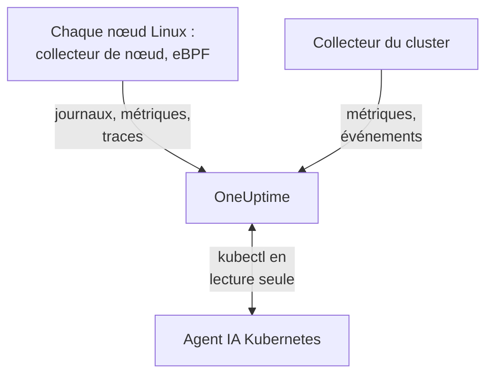

# Agent Kubernetes

L'agent Kubernetes de OneUptime est un chart Helm qui collecte les métriques, les événements et les journaux de pods de votre cluster et, avec eBPF, les traces, les métriques de requêtes, le graphe de services et les flux réseau de chaque pod, sans modification du code ni SDK. Il exécute aussi l'[agent IA Kubernetes](#agent-ia-kubernetes), qui permet à OneUptime AI d'exécuter `kubectl` en lecture seule pendant qu'elle enquête sur un incident ou une alerte. Un seul `helm install` le met en place ; les [moniteurs Kubernetes](/docs/monitor/kubernetes-monitor) déclenchent des alertes à partir de ce qu'il envoie.

:::cards
- [Installer l'agent](#installer-lagent): Quatre étapes avec Helm.
- [Options de configuration](#options-de-configuration): Filtres, échantillonnage, plan de contrôle, maillage de services, coûts et étiquettes.
- [Agent IA Kubernetes](#agent-ia-kubernetes): `kubectl` en lecture seule pour OneUptime AI, et des corrections si vous les autorisez.
- [Envoyer moins](#réduire-le-volume-de-données-collectées): Les leviers, par ordre d'impact.
:::

## Fonctionnement

Le chart exécute quelques charges de travail dans son propre namespace. Chacune envoie ce qu'elle collecte à votre URL OneUptime via OTLP, avec la clé d'ingestion que vous lui donnez, et le cluster s'enregistre sous le nom que vous lui donnez dans `clusterName`.



| Charge de travail | Type | Rôle | S'exécute |
| --- | --- | --- | --- |
| Collecteur du cluster | Deployment | Métriques du cluster, événements Kubernetes et spécifications des pods, des nœuds et des charges de travail, depuis l'API Kubernetes. | Toujours |
| Collecteur de nœud | DaemonSet | Journaux de pods depuis `/var/log/pods`, métriques kubelet et cAdvisor, et métriques système du nœud. | Partout sauf sur EKS Fargate |
| Instrumentation eBPF (OBI) | DaemonSet | Traces et métriques de requêtes HTTP, gRPC, SQL et Redis de chaque pod, et la carte des services. | Par défaut, sauf sur GKE Autopilot et EKS Fargate |
| Agent IA Kubernetes | Deployment | `kubectl` en lecture seule pour OneUptime AI pendant qu'elle enquête sur un incident ou une alerte. | Par défaut |
| Lecteur de journaux | Deployment | Journaux de pods via l'API Kubernetes, là où le collecteur de nœud ne peut pas les lire. | Avec les presets `gke-autopilot` et `eks-fargate` |
| Moteur de coûts et collecteur de coûts | Deployments | Dépenses par namespace, charge de travail et pod. | Avec `cost.enabled=true` |

Toutes les images de l'agent sont réservées à Linux : chaque charge de travail est donc épinglée sur des nœuds Linux.

## Avant de commencer

- Un cluster Kubernetes en v1.23 ou ultérieure, et `kubectl` configuré pour l'atteindre.
- Helm 3. Les mises à jour utilisent `--reset-then-reuse-values`, qui nécessite Helm 3.14 ou ultérieur.
- Une clé d'ingestion. Créez-en une sous **Paramètres du projet → Télémétrie & APM → Clés d'ingestion**. L'agent l'envoie dans l'en-tête `x-oneuptime-token` : une clé d'API de projet ne fonctionne donc pas ici.
- Un nom pour le cluster, unique dans votre projet et stable, comme `prod-us-east-1` : c'est sous ce nom que le cluster apparaît dans OneUptime.
- Du HTTPS sortant du cluster vers votre URL OneUptime.

## Installer l'agent

:::steps
### Ajouter le dépôt Helm

```bash
helm repo add oneuptime https://helm-chart.oneuptime.com
helm repo update
```

### Installer le chart

Remplacez `YOUR_ONEUPTIME_URL`, `YOUR_ONEUPTIME_API_KEY` (la clé d'ingestion) et le nom du cluster par vos valeurs, et choisissez l'onglet de votre plateforme (voir [Choisir un preset](#choisir-un-preset)).

:::tabs
@tab Standard
Clusters autogérés, EKS on EC2, GKE Standard, AKS, minikube, kind et k3s :

```bash
helm install kubernetes-agent oneuptime/kubernetes-agent \
  --namespace oneuptime-agent \
  --create-namespace \
  --set oneuptime.url="YOUR_ONEUPTIME_URL" \
  --set oneuptime.apiKey="YOUR_ONEUPTIME_API_KEY" \
  --set clusterName="my-cluster" \
  --set aiAgent.enabled=true
```
@tab GKE Autopilot
```bash
helm install kubernetes-agent oneuptime/kubernetes-agent \
  --namespace oneuptime-agent \
  --create-namespace \
  --set oneuptime.url="YOUR_ONEUPTIME_URL" \
  --set oneuptime.apiKey="YOUR_ONEUPTIME_API_KEY" \
  --set clusterName="my-cluster" \
  --set aiAgent.enabled=true \
  --set preset=gke-autopilot
```
@tab EKS Fargate
```bash
helm install kubernetes-agent oneuptime/kubernetes-agent \
  --namespace oneuptime-agent \
  --create-namespace \
  --set oneuptime.url="YOUR_ONEUPTIME_URL" \
  --set oneuptime.apiKey="YOUR_ONEUPTIME_API_KEY" \
  --set clusterName="my-cluster" \
  --set aiAgent.enabled=true \
  --set preset=eks-fargate
```
:::

**Les enquêtes IA sont activées par défaut.** `aiAgent.enabled=true` exécute l'[agent IA Kubernetes](#agent-ia-kubernetes) à côté du collecteur : lorsqu'un incident ou une alerte survient sur ce cluster, OneUptime AI enquête avec `kubectl` en lecture seule (`get`, `describe`, `logs`, `events`, `top`) et ne modifie rien. Les corrections restent désactivées tant que vous ne les autorisez pas. Pour installer sans lui, utilisez plutôt `--set aiAgent.enabled=false`.

### Vérifier que les pods s'exécutent

```bash
kubectl get pods -n oneuptime-agent
```

Chaque pod devrait atteindre `Running` en une minute ou deux :

:::tabs
@tab Standard
Le collecteur du cluster, l'agent IA et, sur chaque nœud, un collecteur de nœud et un pod eBPF :

```text
NAME                                          READY   STATUS    RESTARTS   AGE
kubernetes-agent-xxxxxxxxxx-xxxxx             1/1     Running   0          1m
kubernetes-agent-ai-agent-xxxxxxxxxx-xxxxx    1/1     Running   0          1m
kubernetes-agent-ebpf-xxxxx                   1/1     Running   0          1m
kubernetes-agent-logs-xxxxx                   1/1     Running   0          1m
```
@tab GKE Autopilot
Le collecteur de nœud s'exécute toujours et lit les métriques kubelet et cAdvisor sans `hostPath`, et un Deployment lecteur de journaux lit les journaux de pods via l'API Kubernetes :

```text
NAME                                          READY   STATUS    RESTARTS   AGE
kubernetes-agent-xxxxxxxxxx-xxxxx             1/1     Running   0          1m
kubernetes-agent-ai-agent-xxxxxxxxxx-xxxxx    1/1     Running   0          1m
kubernetes-agent-logs-yyyyyyyyyy-yyyyy        1/1     Running   0          1m
kubernetes-agent-logs-xxxxx                   1/1     Running   0          1m
```
@tab EKS Fargate
Trois Deployments et aucun DaemonSet : Fargate donne à chaque pod sa propre micro-VM et ne planifie jamais de DaemonSets, les métriques de nœud n'y sont donc pas disponibles :

```text
NAME                                          READY   STATUS    RESTARTS   AGE
kubernetes-agent-xxxxxxxxxx-xxxxx             1/1     Running   0          1m
kubernetes-agent-ai-agent-xxxxxxxxxx-xxxxx    1/1     Running   0          1m
kubernetes-agent-logs-yyyyyyyyyy-yyyyy        1/1     Running   0          1m
```
:::

### Trouver le cluster dans OneUptime

Ouvrez **Produits → Infrastructure → Kubernetes → Tous les clusters**. Le cluster apparaît sous son `clusterName` en quelques minutes, et ses nœuds, ses pods et ses charges de travail se remplissent. L'agent IA Kubernetes apparaît comme connecté sur la page **Agent** du cluster, sous **IA**.
:::

## Choisir un preset

`preset` choisit les valeurs par défaut qui fonctionnent sur votre plateforme : si les journaux de pods sont lus depuis le nœud via `hostPath` ou via l'API Kubernetes, et quelles charges de travail peuvent s'exécuter en mode privilégié.

| `preset` | À utiliser pour | Journaux de pods | Métriques de nœud |
| --- | --- | --- | --- |
| `standard` (par défaut) | Clusters autogérés, **EKS on EC2**, **GKE Standard**, **AKS**, minikube, kind, k3s | Le collecteur de nœud lit `/var/log/pods` via `hostPath` (la surcharge la plus faible) | Kubelet, cAdvisor et les métriques système du nœud |
| `gke-autopilot` | **GKE Autopilot** | Le lecteur de journaux les lit via l'API Kubernetes (sans `hostPath`, sans accès à l'hôte) | Kubelet et cAdvisor, sans `hostPath` |
| `eks-fargate` | **EKS Fargate** | Le lecteur de journaux les lit via l'API Kubernetes (sans `hostPath`, sans accès à l'hôte) | Aucune : Fargate n'exécute aucun DaemonSet |

En cas de doute, commencez par `standard`. Si l'installation échoue avec une erreur Pod Security qui mentionne `hostPath`, réinstallez avec `preset=gke-autopilot` (ou `eks-fargate` sur Fargate). GKE Autopilot et EKS Fargate refusent aussi les pods privilégiés, dont eBPF et le profileur ont besoin : ces deux presets les omettent donc tous les deux.

## Ce qui est collecté

| Catégorie | Données |
| --- | --- |
| Métriques de nœud | Utilisation du CPU, de la mémoire, du système de fichiers et du réseau |
| Métriques de pod | CPU, mémoire, réseau et redémarrages |
| Métriques de conteneur | CPU et mémoire par conteneur |
| Métriques du cluster | Conditions des nœuds, ressources allouables, nombre de pods |
| Événements Kubernetes | Avertissements, erreurs et événements de planification |
| Journaux de pods | stdout et stderr de chaque conteneur (via `hostPath` sur les clusters standard, via l'API Kubernetes sur Autopilot et Fargate) |
| Traces applicatives (eBPF, activées par défaut) | Spans HTTP, gRPC, SQL et Redis de chaque pod, sans SDK ni modification du code |
| Métriques RED HTTP (eBPF) | `http.server.request.duration`, ainsi que la taille des corps de requête et de réponse, par service |
| Graphe de services (eBPF) | Arêtes de débit de requêtes, de latence et d'erreurs entre appelant et appelé, qui dessinent la carte des services |
| Métriques de flux réseau (eBPF) | Compteurs d'octets et de paquets TCP et UDP de pod à pod, avec les métadonnées Kubernetes |
| Statistiques TCP (eBPF) | Compteurs de temps aller-retour, de connexions échouées et de retransmissions par nœud |
| Coûts des charges de travail (optionnel, `cost.enabled=true`) | Dépenses par namespace, charge de travail et pod, avec la capacité inutilisée et l'efficacité, ainsi que le coût horaire des nœuds et des volumes : voir [Observabilité des coûts Kubernetes](/docs/telemetry/kubernetes-cost) |

## Options de configuration

Chaque option ci-dessous est une valeur Helm. Définissez-la à l'installation, ou sur un agent installé avec `helm upgrade ... --reset-then-reuse-values --set <value>`.

### Filtrage par namespace

`namespaceFilters.rules` applique des motifs de namespace à quatre périmètres, chacun indépendamment :

| Périmètre | Où il filtre | Ce qu'il affecte |
| --- | --- | --- |
| `podLogs` | Au niveau du receiver filelog hostPath ou du lecteur de journaux de l'API | Uniquement stdout et stderr des pods ; les événements Kubernetes et les journaux d'audit ne sont pas affectés |
| `ebpfDiscovery` | Lors de la découverte des processus par OBI | Les traces eBPF comme les métriques eBPF des charges de travail correspondantes |
| `metrics` | Dans le collecteur, après l'ajout des métadonnées Kubernetes | Les séries de métriques avec namespace ; les séries de nœud et de cluster sans namespace sont conservées |
| `traces` | Dans le collecteur, après l'ajout des métadonnées Kubernetes | Les spans eBPF comme les spans que les applications envoient via OTLP |

Un motif correspond au nom complet du namespace et peut utiliser `*` (`team-*`). Si un périmètre a une règle `include`, seuls les namespaces correspondants sont conservés pour ce périmètre, et les règles `exclude` l'emportent toujours. La règle par défaut exclut `kube-system` de `podLogs` et `ebpfDiscovery` uniquement.

Pour limiter les journaux de pods et la découverte eBPF à certains namespaces :

```bash
helm install kubernetes-agent oneuptime/kubernetes-agent \
  --namespace oneuptime-agent \
  --create-namespace \
  --set oneuptime.url="YOUR_ONEUPTIME_URL" \
  --set oneuptime.apiKey="YOUR_ONEUPTIME_API_KEY" \
  --set clusterName="my-cluster" \
  --set-json 'namespaceFilters.rules=[{"action":"include","namespaces":["default","production","staging"],"scopes":["podLogs","ebpfDiscovery"]}]'
```

Pour arrêter les journaux d'un namespace bruyant tout en conservant ses traces eBPF, sa carte des services et ses métriques, limitez l'exclusion à `podLogs` :

```bash
  --set-json 'namespaceFilters.rules=[{"action":"exclude","namespaces":["kube-system"],"scopes":["podLogs","ebpfDiscovery"]},{"action":"exclude","namespaces":["noisy-*"],"scopes":["podLogs"]}]'
```

Les règles `podLogs` et `ebpfDiscovery` filtrent à la source : les fichiers de journaux exclus ne sont jamais ouverts, et les charges de travail exclues ne sont jamais instrumentées. Les règles `metrics` et `traces` agissent plus tard, dans le collecteur, une fois le namespace rattaché aux données.

#### Filtrer les métriques et les traces par namespace

Ajoutez ces périmètres à une règle pour filtrer aussi les métriques ou les spans avec namespace :

```bash
  --set-json 'namespaceFilters.rules=[{"action":"exclude","namespaces":["kube-system","noisy-*"],"scopes":["podLogs","ebpfDiscovery","metrics","traces"]}]'
```

> [!NOTE]
> Les métriques au niveau du nœud et du cluster sont toujours conservées. Un namespace appartient à un pod, pas à un nœud : des séries comme le CPU du nœud, la mémoire du nœud et l'utilisation du système de fichiers n'ont rien à quoi correspondre et ne sont jamais supprimées. Une règle limitée à `metrics` réduit les séries par pod sans masquer un nœud qui se dégrade.

Les événements Kubernetes ne peuvent pas être filtrés par namespace au niveau de l'agent : ils arrivent du receiver `k8sobjects` sans attribut `k8s.namespace.name` (le namespace se trouve dans le corps de l'événement), un filtre n'a donc rien à faire correspondre. Supprimez-les plutôt dans OneUptime, avec **Journaux → Paramètres → Filtres de suppression**.

### Filtrage par gravité des journaux

`filters.logs.minSeverity` supprime les enregistrements de journaux de pods en dessous d'une gravité, au niveau de l'agent, avant tout envoi :

```bash
  --set filters.logs.minSeverity=WARN
```

Il accepte `TRACE`, `DEBUG`, `INFO`, `WARN`, `ERROR` et `FATAL`. `WARN` conserve WARN, ERROR et FATAL et supprime INFO, DEBUG et TRACE ; la valeur par défaut (`""`) conserve tout. Il s'applique dans les deux modes de journaux (via le collecteur en mode `daemonset`, dans le lecteur de journaux en mode `api`), si bien qu'un preset ne le désactive jamais à votre insu.

Les runtimes de conteneurs n'enregistrent aucune gravité : l'agent la lit donc dans le texte du journal lui-même (`[ERROR]`, `WARN:`, `"level":"info"`, …). Ce qu'il advient d'une ligne sans niveau reconnaissable dépend du mode de journaux, car les deux modes ne savent pas les mêmes choses :

| Mode | Une ligne sans niveau | Pourquoi |
| --- | --- | --- |
| `daemonset` | `stderr` compte comme ERROR (conservée), `stdout` comme INFO (supprimée par un seuil WARN) | Le runtime de conteneurs enregistre de quel flux provient chaque ligne. |
| `api` | Toujours conservée | L'API `pods/log` de Kubernetes fusionne stdout et stderr en un seul flux sans marqueur par ligne : plutôt que de deviner, l'agent conserve la ligne. |

Le mode `api` supprime donc strictement moins que le mode `daemonset`, et c'est voulu : une traceback Python ou un `npm ERR!` ne porte aucun mot-clé de gravité, et le supprimer en silence est précisément l'erreur dont un seuil doit vous protéger. En mode hybride (`logs.windowsPods.enabled`), les deux lignes s'appliquent, selon le système du nœud : les pods Linux suivent `daemonset`, les pods Windows `api`.

Les événements sur plusieurs lignes sont reconstitués avant le filtrage dans les deux modes : une stack trace Java est donc jugée sur sa première ligne et conservée ou supprimée en entier.

> [!IMPORTANT]
> Les événements Kubernetes et les spécifications de ressources ne sont jamais filtrés par ce réglage. Ils arrivent de l'API Kubernetes sans gravité propre : un seuil supprimerait donc tout le flux, y compris les avertissements `FailedScheduling`, `BackOff` et `OOMKilling` dont vous avez le plus besoin. Ils sont peu nombreux et précieux, l'agent les envoie donc toujours ; pour les réduire, utilisez **Journaux → Paramètres → Filtres de suppression** dans OneUptime.

### Inclure ou exclure des métriques par nom

`filters.metrics` décide quelles métriques quittent le cluster, pour tous les receivers.

Supprimer quelques métriques bruyantes (une liste de refus, généralement ce que vous voulez) :

```bash
  --set-json 'filters.metrics.exclude=["k8s.volume.available","k8s.volume.capacity"]'
```

N'envoyer qu'un ensemble fixe (une liste d'autorisation : tout le reste est supprimé) :

```bash
  --set-json 'filters.metrics.include=["k8s.pod.cpu.utilization","k8s.pod.memory.usage"]'
```

Faire correspondre par motif plutôt que par nom exact :

```bash
  --set filters.metrics.matchType=regexp \
  --set-json 'filters.metrics.exclude=["^container_network_"]'
```

| Clé | Signification |
| --- | --- |
| `filters.metrics.exclude` | Noms de métriques à supprimer. Appliqué après `include`, si bien qu'une exclusion l'emporte toujours. |
| `filters.metrics.include` | Lorsqu'elle n'est pas vide, seules ces métriques sont envoyées. |
| `filters.metrics.matchType` | `strict` (le nom exact, par défaut) ou `regexp` (RE2, non ancrée). |

- `regexp` n'est pas ancrée : `system.cpu` correspond aussi à `system.cpu.time`. Ancrez-la (`^system\.cpu$`) quand vous visez exactement une métrique.
- RE2 ne gère pas le lookahead : `^(?!container_)` ne compile donc pas. Exprimez « tout sauf » avec `include`, pas avec un motif négatif.
- `include` couvre tous les receivers à la fois. Une liste d'autorisation qui oublie une métrique supprime silencieusement les moniteurs qui en dépendent : préférez `exclude`, sauf si vous voulez un ensemble fermé.
- Utilisez `--set-json` (ou un fichier de valeurs) pour les listes : un simple `--set` remplace une liste au lieu de la compléter.

> [!WARNING]
> Testez un motif avant de le déployer. Le collecteur compile les motifs au démarrage : un motif invalide ne se comporte donc pas mal en silence, le collecteur refuse de démarrer et redémarre en boucle, emportant avec lui les journaux de ce collecteur en plus de ses métriques. Helm ne sait pas compiler RE2, `helm upgrade` accepte donc un motif erroné sans broncher.

### Échantillonnage des traces

Les filtres ci-dessus retirent une catégorie de télémétrie : un namespace, une gravité, un nom de métrique. L'échantillonnage conserve toutes les catégories et réduit plutôt la population. Définissez `sampling.traces.percentage` sur la part de traces à conserver :

```bash
helm upgrade kubernetes-agent oneuptime/kubernetes-agent \
  --namespace oneuptime-agent --reset-then-reuse-values \
  --set sampling.traces.percentage=10
```

Cela conserve une trace sur dix et supprime les neuf autres au niveau de l'agent, avant qu'elles ne quittent votre cluster.

- **Vous obtenez des traces complètes, pas des fragments.** La décision repose sur un hachage de l'ID de trace, pas sur un tirage à pile ou face par span : tous les spans d'une trace sont donc conservés ou supprimés ensemble, et les traces qui subsistent se lisent de bout en bout.
- **Vos moniteurs basés sur les métriques ne bougent pas.** OBI calcule les métriques RED eBPF (débit de requêtes, taux d'erreurs, durée) à partir de chaque requête, et elles passent par le pipeline de métriques, où l'échantillonneur ne se trouve pas. À 10 %, vous obtenez un dixième des traces, avec un débit, des erreurs et une latence exacts.
- **Vos moniteurs basés sur les spans, eux, bougent.** Tout ce que OneUptime compte à partir des spans eux-mêmes diminue avec le taux : voir l'avertissement ci-dessous.

| Clé | Signification |
| --- | --- |
| `sampling.traces.percentage` | Le pourcentage de traces à conserver, de 0 à 100. Par défaut `100` (tout conserver). |
| `sampling.traces.hashSeed` | La graine du hachage de l'ID de trace. Par défaut `22`. |

- `0` ne conserve aucune trace. C'est un taux, pas un interrupteur : il supprime toutes les traces pendant que le DaemonSet eBPF continue de tourner et de vous coûter. Pour n'avoir aucune trace, utilisez `ebpf.enabled=false` ; pour n'avoir aucune trace mais garder les métriques RED et la carte des services, laissez eBPF activé et définissez `0` délibérément.
- Il ne s'applique que si `ebpf.enabled` est activé : sinon, il n'y a pas de pipeline de traces et la valeur n'a aucun effet.
- Il n'échantillonne que les traces. Il n'y a délibérément ni `sampling.logs` ni `sampling.metrics` : voir la note ci-dessous.
- Les fractions nécessitent `--set-json`, et elles ont un plancher. `--set sampling.traces.percentage=0.5` échoue, car Helm lit `0.5` comme une chaîne : utilisez `--set-json 'sampling.traces.percentage=0.5'` ou un fichier de valeurs. En dessous d'environ `0.0061`, le taux est arrondi à zéro et se comporte exactement comme `0`, sans erreur ; `0.01` (une sur dix mille) est la plus petite valeur qui fait ce qu'elle annonce.
- Plusieurs clusters fonctionnent par défaut. Deux agents ne conservent la même trace que s'ils sont d'accord à la fois sur `hashSeed` et sur `percentage`, et les deux ont les mêmes valeurs par défaut partout : une trace qui traverse deux clusters subsiste donc en entier. Ne modifiez `hashSeed` que pour rendre deux niveaux d'échantillonnage indépendants : avec la même graine, un taux plus faible conserve un sous-ensemble des traces du taux plus élevé.
- Les journaux de pods ne sont jamais échantillonnés : avec `ebpf.logToTraceCorrelation: true`, chaque enregistrement de journal porte donc toujours un ID de trace alors que seule la part conservée de ces traces existe. Environ (100 − `percentage`) % des enregistrements de journaux renvoient alors vers une trace qui n'existe pas ; remonter d'une trace à ses journaux n'est pas affecté.

> [!WARNING]
> Réajustez vos moniteurs basés sur les spans lorsque vous définissez ce réglage. L'échantillonnage réduit les spans qui atteignent OneUptime : tout ce qui les compte compte donc moins. Un moniteur **Traces** sur `Span Count` et un moniteur **Exceptions** sur `Exception Count` voient environ `percentage` % du volume de la veille. Un seuil réglé sur un trafic non échantillonné cesse silencieusement d'être franchi : le moniteur ne signale pas d'erreur, il devient simplement muet. Divisez ces seuils par le même facteur ; le taux s'applique à tout le cluster, aucun service ne peut donc en être exempté. Le regroupement des erreurs se dégrade plus que linéairement : une exception fréquente apparaît toujours, mais une exception rare et isolée a plus de chances de disparaître que d'apparaître dix fois moins souvent.

> [!NOTE]
> Pourquoi il n'y a pas d'échantillonnage des journaux ni des métriques : l'échantillonneur du collecteur ne sait pas du tout échantillonner les métriques. Il sait échantillonner les journaux, mais il tire son aléa de l'ID de trace, que les journaux de pods n'ont pas : chaque enregistrement de journal aurait donc le même hachage, et un taux de journaux conserverait tout ou supprimerait tout selon la graine. Plutôt que de proposer un réglage qui supprime silencieusement vos journaux, le chart n'en propose aucun. Réduisez les journaux avec [Filtrage par gravité des journaux](#filtrage-par-gravité-des-journaux) et [Filtrage par namespace](#filtrage-par-namespace), qui sont précis sur ce qu'ils retirent.

### Désactiver la collecte des journaux

Si vous n'avez pas besoin des journaux de pods :

```bash
helm install kubernetes-agent oneuptime/kubernetes-agent \
  --namespace oneuptime-agent \
  --create-namespace \
  --set oneuptime.url="YOUR_ONEUPTIME_URL" \
  --set oneuptime.apiKey="YOUR_ONEUPTIME_API_KEY" \
  --set clusterName="my-cluster" \
  --set logs.enabled=false
```

Vos métriques ne sont pas affectées : le collecteur de nœud continue de tourner pour les métriques kubelet, cAdvisor et de l'hôte, et cesse seulement de lire les journaux de pods. Les alertes basées sur les journaux s'arrêtent, rien d'autre.

### Forcer un mode de collecte des journaux

`logs.mode` remplace le choix du preset et l'emporte toujours :

- `logs.mode=daemonset` : le DaemonSet hostPath (la surcharge la plus faible ; nécessite `hostPath`).
- `logs.mode=api` : le Deployment lecteur de journaux de l'API Kubernetes (fonctionne sur n'importe quel cluster).
- `logs.mode=disabled` : aucun journal de pod.

Le mode ne décide que de l'origine des journaux de pods : les métriques de nœud sont collectées dans tous les cas, si bien que `api` et `disabled` conservent vos métriques kubelet, cAdvisor et de l'hôte. L'exception, c'est la plateforme : EKS Fargate ne peut pas du tout planifier de DaemonSets, il n'a donc ni collecteur de nœud ni métriques de nœud, de pod ou de conteneur. GKE Autopilot exécute le collecteur de nœud mais bloque `hostPath` : il collecte donc les métriques kubelet et cAdvisor sans celles de `hostmetrics` (E/S disque, inodes, erreurs de carte réseau), qui lisent `/proc` et `/sys` de l'hôte.

Sur les clusters dotés de pools de nœuds Windows, le mode `daemonset` ne couvre que les nœuds Linux, car toutes les images de l'agent sont réservées à Linux. Ajoutez `--set logs.windowsPods.enabled=true` pour exécuter à côté le lecteur de journaux de l'API, uniquement pour les pods des nœuds Windows : les pods Linux gardent la lecture des fichiers locale au nœud, et les deux n'envoient jamais deux fois la même ligne. Cela nécessite une image `kubernetes-log-tailer` au moins aussi récente que le chart : une image plus ancienne ignore la restriction et envoie deux fois les journaux Linux.

### Activer la surveillance du plan de contrôle

La page **Plan de contrôle** du cluster affiche des graphiques pour etcd, l'API server, le scheduler et le controller manager. L'agent collecte les quatre lorsque `controlPlane.enabled` vaut `true` :

```bash
helm upgrade kubernetes-agent oneuptime/kubernetes-agent \
  --namespace oneuptime-agent \
  --reset-then-reuse-values \
  --set controlPlane.enabled=true
```

Chaque composant est collecté aux adresses de sa propre liste : `controlPlane.etcd.endpoints`, `controlPlane.apiServer.endpoints`, `controlPlane.scheduler.endpoints` et `controlPlane.controllerManager.endpoints`. La collecte s'exécute dans le pod de l'agent, qui n'a pas de réseau hôte : les valeurs par défaut (`https://localhost:<port>/metrics`) pointent donc vers ce pod lui-même. Définissez chaque liste sur une adresse que le pod peut atteindre. Dans n'importe quel cluster, l'API server répond sur `https://kubernetes.default.svc:443/metrics` :

```bash
helm upgrade kubernetes-agent oneuptime/kubernetes-agent \
  --namespace oneuptime-agent \
  --reset-then-reuse-values \
  --set controlPlane.enabled=true \
  --set "controlPlane.apiServer.endpoints={https://kubernetes.default.svc:443/metrics}"
```

`controlPlane.enabled` active les quatre collectes à la fois. Là où un composant n'est pas joignable à ses endpoints (etcd, le scheduler et le controller manager sur un cluster managé, ou à leurs valeurs par défaut `localhost`), sa collecte échoue à chaque intervalle : le collecteur journalise une erreur de scrape et signale la cible comme indisponible, et rien d'autre ne change.

L'agent ne collecte qu'en HTTPS, avec le jeton du compte de service et sans certificat client. Par conséquent :

- **etcd** a besoin d'une adresse de métriques HTTPS qui ne demande pas de certificat client. Les ports de métriques habituels d'etcd sont hors de portée : le HTTP simple sur `2381` (le `--listen-metrics-urls` de kubeadm) est collecté en HTTPS et échoue, et `2379` exige des certificats client.
- **Le scheduler** (`10259`) et **le controller manager** (`10257`) servent du HTTPS et acceptent le jeton, mais kubeadm les lie à `127.0.0.1` sur les nœuds du plan de contrôle : ils ont besoin d'un `--bind-address` que le pod de l'agent peut atteindre.

Les services Kubernetes managés (EKS, GKE, AKS) n'exposent ni etcd, ni le scheduler, ni le controller manager : ces onglets y restent donc vides. Tant que les métriques d'un onglet n'arrivent pas, la page **Plan de contrôle** affiche à la place de ses graphiques ce qu'il faut définir, avec la commande à copier.

### Activer les métriques CoreDNS

L'onglet **CoreDNS** de la page **Plan de contrôle** affiche des graphiques pour les requêtes DNS, la latence, le cache et le transfert. Leur collecte est désactivée par défaut :

```bash
helm upgrade kubernetes-agent oneuptime/kubernetes-agent \
  --namespace oneuptime-agent \
  --reset-then-reuse-values \
  --set coreDns.enabled=true
```

L'agent collecte le port `9153` des pods portant l'étiquette `k8s-app=kube-dns` dans `kube-system`, ce qui correspond au fonctionnement de CoreDNS sur les clusters kubeadm, EKS et AKS. Si le vôtre fonctionne autrement, définissez aussi `coreDns.namespace`, `coreDns.service` (l'étiquette `k8s-app`) et `coreDns.port`. GKE utilise kube-dns (dnsmasq) ou Cloud DNS au lieu de CoreDNS : l'onglet y reste donc vide.

### Activer les métriques du maillage de services

La page **Maillage de services** du cluster affiche des graphiques pour Istio et Linkerd. L'agent collecte un seul maillage, celui que nomme `serviceMesh.provider` (`istio` ou `linkerd`) :

```bash
helm upgrade kubernetes-agent oneuptime/kubernetes-agent \
  --namespace oneuptime-agent \
  --reset-then-reuse-values \
  --set serviceMesh.enabled=true \
  --set serviceMesh.provider=istio
```

Pour Istio, il lit les statistiques Envoy de chaque sidecar `istio-proxy` (port `15090`) ; pour Linkerd, le port d'administration de chaque `linkerd-proxy`. Le plan de contrôle d'aucun des deux maillages n'est collecté : istiod (la carte **Pilot**) et les composants identity, destination et proxy-injector de Linkerd (la carte **Plan de contrôle**) servent leurs métriques sur leurs propres ports d'administration, et ces cartes l'indiquent à la place de leurs graphiques.

### Métriques que l'agent ne collecte pas

Certains graphiques affichent des métriques que l'agent ne collecte pas : **kube-proxy** sur la page **Plan de contrôle** ; **Cilium** (avec Hubble) sur la page **Maillage de services** ; et, sur les onglets Istio et Linkerd, les plans de contrôle propres aux maillages (**istiod** et les composants identity, destination et proxy-injector de Linkerd). Ils se remplissent lorsque ces métriques atteignent OneUptime par un autre chemin, par exemple depuis votre propre [OpenTelemetry Collector](/docs/telemetry/open-telemetry) qui les collecte, avec l'attribut de ressource `k8s.cluster.name` défini sur le nom du cluster (le `clusterName` de l'agent). Les clusters qui fonctionnent sans kube-proxy n'ont aucune métrique kube-proxy.

### Activer l'observabilité des coûts

Voyez sur la page **Coûts** du cluster ce que coûte chaque namespace, chaque charge de travail et chaque pod, avec la capacité inutilisée et la part de chaque requête effectivement utilisée :

```bash
helm upgrade kubernetes-agent oneuptime/kubernetes-agent \
  --namespace oneuptime-agent \
  --reset-then-reuse-values \
  --set cost.enabled=true
```

Cela suffit pour une installation complète : le chart embarque le moteur open source [OpenCost](https://opencost.io) (avec le petit Prometheus dont il a besoin) et calcule le prix de vos nœuds et de vos volumes à partir des prix catalogue publics de votre fournisseur cloud, sans identifiants. Cela ajoute deux petits pods, et les premiers coûts apparaissent après la première heure clôturée. Vous utilisez déjà Kubecost ou OpenCost ? Ajoutez plutôt `--set cost.engine.url=<its service URL>`, et rien n'est embarqué. Les clusters sur site peuvent définir une grille tarifaire avec `cost.opencost.customPricing`. Le guide complet, avec la tarification sur site et le dépannage, se trouve dans [Observabilité des coûts Kubernetes](/docs/telemetry/kubernetes-cost).

### Étiqueter automatiquement avec des étiquettes de projet

Chaque attribut de ressource qui commence par `oneuptime.label.` devient une étiquette de projet, rattachée au cluster ainsi qu'aux services et aux hôtes que cet agent signale : `oneuptime.label.<dimension>=<value>` correspond à l'étiquette `<dimension>:<value>`. Passez des étiquettes à l'installation avec `--set oneuptime.labels.<key>=<value>` :

```bash
helm install kubernetes-agent oneuptime/kubernetes-agent \
  --namespace oneuptime-agent \
  --create-namespace \
  --set oneuptime.url="YOUR_ONEUPTIME_URL" \
  --set oneuptime.apiKey="YOUR_ONEUPTIME_API_KEY" \
  --set clusterName="prod" \
  --set oneuptime.labels.team=payments \
  --set oneuptime.labels.env=production \
  --set oneuptime.labels.region=us-east-1
```

Ou conservez-les dans un fichier de valeurs :

```yaml title="values.yaml"
oneuptime:
  url: YOUR_ONEUPTIME_URL
  apiKey: YOUR_ONEUPTIME_API_KEY
  labels:
    team: payments
    env: production
    region: us-east-1
clusterName: prod
```

Les étiquettes sont comparées sans tenir compte de la casse : une étiquette `Production` existante que vous avez créée à la main est donc réutilisée plutôt que dupliquée, et l'agent ne supprime jamais les étiquettes ajoutées dans OneUptime.

## Traces applicatives et métriques HTTP via eBPF (activées par défaut)

Le chart exécute un DaemonSet avec [OpenTelemetry eBPF Instrumentation (OBI)](https://opentelemetry.io/docs/zero-code/obi/) sur chaque nœud. Il charge des programmes eBPF dans le noyau et capture le trafic HTTP et HTTPS, gRPC, SQL et Redis de chaque runtime pris en charge (Go, .NET, Java, Node.js, Python, Ruby, Rust), sans SDK ni sidecar. Les traces et les métriques de requêtes transitent ensuite par le collecteur du cluster jusqu'à OneUptime.

Il nécessite un noyau Linux 5.8 ou ultérieur avec BTF (le cas par défaut sur Debian 11+, Ubuntu 20.10+, Fedora 34+, RHEL et Stream 9+), et son DaemonSet s'exécute en mode privilégié, car le chargement de programmes eBPF l'exige.

### À quoi ressemblent les traces eBPF

eBPF voit les appels réseau, pas votre code : une trace est donc construite à partir des requêtes que traite un service et des appels qu'il effectue pendant leur traitement :

- **Une requête et ses appels forment une trace.** La requête entrante d'un service est le span racine, nommé `<METHOD> <route>`, et les appels HTTP, gRPC, SQL et Redis que le service effectue pendant son traitement sont ses enfants. (Pour Node.js, cela repose sur l'agent Node.js d'OBI, que le chart active avec `ebpf.nodejs.enabled`.) Les appels que des requêtes concurrentes envoient sur une connexion partagée, ce qui est courant avec les clients Redis, ne peuvent pas toujours être distingués : certains ne sont donc pas placés dans la trace de leur requête.
- **Un appel vers un service situé sur un autre nœud démarre une nouvelle trace**, sauf si quelque chose transporte le contexte de trace : un SDK OpenTelemetry, ou la propagation de contexte optionnelle décrite plus bas. Lorsque les deux extrémités s'exécutent sur le même nœud, OBI voit les deux et les relie lui-même.
- **Le travail qu'aucune requête n'a déclenché reste isolé.** Un worker de file d'attente qui interroge Redis, ou une tâche cron, n'a aucune requête à laquelle rattacher ses appels.
- **Les serveurs de bases de données restent généralement isolés.** Les protocoles réseau des bases de données ne transportent aucun contexte de trace : sauf si l'appelant s'exécute sur le même nœud, le span qu'OBI enregistre dans un serveur de bases de données pour chaque commande est une trace d'un seul span.

Ces appels de base de données isolés arrivent sous forme de traces d'un seul span portant le nom d'une simple commande (`set`, `evalsha`, `SELECT`), et sur un cluster chargé, ils peuvent représenter l'essentiel de ce que capture OBI. Par défaut, l'agent les supprime avant qu'ils ne quittent le cluster : le span propre d'un serveur de bases de données, qui duplique toujours celui de l'appelant (`ebpf.dropDatabaseServerSpans=true`), et l'appel d'une application qui n'appartient à aucune trace (`ebpf.dropUnlinkedDatabaseCalls=true`). Les appels de base de données d'une application à l'intérieur de la trace d'une requête sont conservés, les spans que vos applications envoient depuis leurs propres SDK ne sont jamais touchés, et les métriques de bases de données comptent toujours chaque commande.

Un compromis : OneUptime découvre les bases de données, et les dessine sur la carte des services, à partir des spans client de bases de données. Une base de données à laquelle seul du travail d'arrière-plan s'adresse (la file d'un worker, l'entrepôt d'une tâche cron) n'est alors plus découverte à partir des traces et apparaît sur la carte des services comme un endpoint distant. Ses métriques ne sont pas affectées. Définissez `ebpf.dropUnlinkedDatabaseCalls=false` pour conserver ces spans.

Les appels HTTP et gRPC du travail d'arrière-plan (un worker qui interroge ClickHouse en HTTP, un contrôleur qui renouvelle son bail Kubernetes) arrivent aussi sous forme de traces d'un seul span (`POST /`, `PUT /apis/*/...`). Définissez `ebpf.dropUnlinkedClientCalls=true` pour les supprimer aussi, ainsi que les appels qu'OBI n'a pas pu placer dans la trace de leur requête et qui leur ressemblent ; il ne supprime jamais les appels de bases de données, de messagerie ni de GenAI (MCP compris). Il est désactivé par défaut, car il coûte des données : lorsque le service appelé s'exécute sur le même nœud, OBI rattache la requête qu'il a traitée sous l'appel, si bien que l'appel est la racine de cette trace, et le supprimer laisse la trace sans racine. Avec `ebpf.contextPropagation` activé, cela se produit sur n'importe quel nœud, et aussi pour un service doté de son propre SDK OpenTelemetry. La carte des services lit aussi ces appels : une dépendance que seul le travail d'arrière-plan appelle est alors dessinée uniquement à partir des métriques du graphe de services d'OBI, et une arête également vue à l'intérieur de requêtes ne compte que ces appels. La vue d'ensemble d'un service compte ses spans : un worker ou une sonde dont les spans sont surtout de tels appels affiche donc bien moins de requêtes, avec un taux d'erreurs et une latence p95 calculés sur les spans restants. Les métriques de requêtes client d'OBI comptent toujours chaque appel.

Sur un OneUptime auto-hébergé, mettez à jour le serveur avant l'agent : le traceur eBPF qu'exécute ce chart (OBI v0.14) nomme les services appelés et signale les spans propres aux brokers de messages d'une manière que les anciens serveurs OneUptime ne lisent pas.

Les noms viennent du trafic. Les spans HTTP utilisent le modèle de route de l'application quand OBI peut le lire, et sinon un motif construit à partir de l'URL, dans lequel les segments qui ressemblent à des ID sont remplacés par `*` ; définissez `ebpf.routes.patterns` pour les nommer vous-même. OBI lit les modèles de route des applications Go (net/http, Gorilla mux, Gin), Java (Spring, JAX-RS), Node.js (Express, Fastify, Koa, NestJS, Next.js), Python (Django, FastAPI, Flask), Ruby (Rails), .NET (routes par attributs d'ASP.NET Core) et PHP (Symfony, Laravel, Slim). Les noms au niveau de l'application, comme `OrderService.charge`, n'existent que dans le code et nécessitent un SDK OpenTelemetry.

Si une application exporte déjà des traces avec un SDK OpenTelemetry, OBI le remarque et cesse d'envoyer des traces eBPF pour elle, afin qu'elle ne soit pas tracée deux fois (`ebpf.excludeOtelInstrumentedServices=true`, la valeur par défaut d'OBI). Définissez-le sur `false` si ce SDK envoie vers un autre projet et que vous voulez aussi des traces eBPF de l'application dans celui-ci.

### Désactiver l'auto-instrumentation eBPF

Désactivez eBPF lorsque :

- Vous installez sur **GKE Autopilot** ou **EKS Fargate** : ces plateformes refusent les pods privilégiés, si bien que `preset=gke-autopilot` et `preset=eks-fargate` omettent déjà eBPF pour vous, et le profileur avec lui.
- Les nœuds exécutent un noyau antérieur à 5.8 sans rétroportages BTF.
- Vous envoyez déjà des traces depuis des SDK OpenTelemetry dans chaque application et ne voulez pas non plus des métriques eBPF. (Pour les traces seules, ce n'est pas nécessaire : OBI cesse d'envoyer des traces eBPF pour une application qu'il voit exporter les siennes, comme indiqué plus haut.)

```bash
helm install kubernetes-agent oneuptime/kubernetes-agent \
  --namespace oneuptime-agent \
  --create-namespace \
  --set oneuptime.url="YOUR_ONEUPTIME_URL" \
  --set oneuptime.apiKey="YOUR_ONEUPTIME_API_KEY" \
  --set clusterName="my-cluster" \
  --set ebpf.enabled=false
```

### Activer ou désactiver des familles de signaux

Toutes sont activées par défaut, sauf une. Désactivez-en une avec `--set ebpf.features.<name>=false` :

| `ebpf.features.*` | Par défaut | Ce qu'elle ajoute |
| --- | --- | --- |
| `httpMetrics` | activée | Métriques RED HTTP et gRPC (débit de requêtes, latence, erreurs) par service |
| `spanMetrics` | activée | Nombre d'appels et durée des spans (`traces.span.metrics.*`) |
| `serviceGraph` | activée | Métriques d'arêtes entre appelant et appelé, qui dessinent la carte des services |
| `networkMetrics` | activée | Compteurs de flux TCP et UDP de pod à pod |
| `networkInterZoneMetrics` | désactivée | La variante inter-zones des métriques réseau (double leur cardinalité) |
| `tcpStats` | activée | Compteurs de temps aller-retour TCP, de connexions échouées et de retransmissions par nœud |

La propagation du contexte de trace entre services, où OBI injecte un `traceparent` W3C pour qu'une requête passant du pod A au pod B apparaisse comme une seule trace sans aucun SDK, est désactivée par défaut. Activez-la avec `--set ebpf.contextPropagation=true`. Elle ne nécessite aucun noyau au-delà de ce dont le reste de l'agent a besoin, et aucune version du noyau ne la rend inopérante.

Elle est désactivée, car injecter l'en-tête signifie réécrire du trafic déjà en transit : les requêtes HTTP en clair sont agrandies sur place dans le noyau, tandis qu'une option TCP est ajoutée à TLS et au TCP brut depuis un hook Traffic Control. Si la comptabilité des octets de la connexion n'est pas corrigée exactement, le flux se désynchronise ; le symptôme signalé est celui de transferts via un proxy L7 comme nginx qui se bloquent au milieu du corps dès que la réponse dépasse environ 64KB, alors que les petites requêtes continuent de fonctionner. Ne l'écartez pas en raison de l'âge du noyau : en dessous du noyau 5.17, OBI se rabat sur des programmes à balayage borné et réécrit le trafic de la même façon. Les traces, les métriques RED et la carte des services n'en dépendent pas ; pour relier les services entre eux, un SDK OpenTelemetry propage `traceparent` dans l'espace utilisateur, sans réécriture dans le noyau, et c'est le choix le plus sûr.

## Agent IA Kubernetes

Lorsqu'un incident ou une alerte survient sur ce cluster, OneUptime AI enquête. L'**Agent IA Kubernetes** du chart lui donne un terminal : il exécute `kubectl` en lecture seule comme le ferait un ingénieur d'astreinte (décrire le pod défaillant, lire ses événements, suivre les journaux du conteneur qui plante, vérifier la capacité des nœuds) et cite chaque commande sur la page de l'incident.

L'agent est **activé par défaut** et **en lecture seule** : un petit Deployment (`kubernetes-agent-ai-agent`, étiquette de pod `component=ai-agent`, image `oneuptime/kubernetes-ai-agent`) dont le ServiceAccount ne peut que lire. Il s'enregistre avec les mêmes `oneuptime.apiKey` et `clusterName` que le collecteur : il n'y a donc rien à configurer dans le tableau de bord. La page **Agent IA** du cluster (Kubernetes → cluster → IA → Agent) l'affiche comme connecté en une minute, et **Tester la connexion**, dans le menu **⋯** à côté de cet état, exécute `kubectl version` et `kubectl auth can-i --list` à travers lui. Tout ce que l'IA a fait avec lui figure sur la page **Journaux IA** du cluster (IA → Journaux), et ce qu'il faut savoir du cluster — les problèmes qui reviennent sans cesse et pourquoi, le nœud ou la charge de travail derrière la plupart d'entre eux, ce que l'IA a corrigé — sur la page **Analyses IA** (IA → Analyses). L'agent embarque un kubectl épinglé (v1.36.4). Ce n'est pas un Runner et il n'apparaît jamais sous Runbooks → Runners : OneUptime ne lui transmet jamais d'identifiants, n'exécute jamais de runbooks sur lui, et il n'est jamais accepté comme Runner de commandes d'une règle de remédiation automatique.

Sur un agent installé avant l'existence de l'agent IA, actualisez d'abord votre index de charts, puis mettez à jour (sur un OneUptime auto-hébergé, mettez d'abord OneUptime à jour — voir [Mettre à jour l'agent](#mettre-à-jour-lagent)) :

```bash
helm repo update
helm upgrade kubernetes-agent oneuptime/kubernetes-agent \
  --namespace oneuptime-agent --reset-then-reuse-values \
  --set aiAgent.enabled=true
```

Utilisez le nom de release et le namespace avec lesquels vous avez installé l'agent, s'ils diffèrent (`helm list -A | grep kubernetes-agent` les affiche). Sans `helm repo update`, Helm peut résoudre le chart à partir duquel vous avez installé, qui ne connaît pas `aiAgent` et échoue avec `Additional property aiAgent is not allowed`. Les versions publiées du chart suivent la version de OneUptime : si `helm show values oneuptime/kubernetes-agent | grep aiAgent` n'affiche rien, votre index est encore ancien. Pour exécuter le chart sans l'agent IA, passez `--set aiAgent.enabled=false`.

### Ce que l'IA peut faire

Ce que OneUptime AI peut faire sur le cluster se définit dans le chart, avec deux valeurs, et la page de l'agent IA du cluster les affiche sous **Ce que l'IA peut faire**, sans possibilité de les modifier à cet endroit :

- `aiAgent.investigation` — `true` : l'IA exécute `kubectl` en lecture seule pendant qu'elle enquête sur un incident ou une alerte sur le cluster. `false` : elle enquête quand même, avec les données dont OneUptime dispose déjà.
- `aiAgent.fixes` — `off`, `ask-for-approval`, `automatic` ou `bypass-approval` (voir ci-dessous). Chaque niveau sauf `off` donne à l'agent IA un accès en écriture ; `off` n'en donne aucun, et l'agent refuse alors lui-même toute écriture.

L'agent IA signale les deux à OneUptime, qui les applique au cluster et refuse toute modification faite ailleurs — sur la page de l'agent IA, via l'API ou Terraform. **Modifier** sur cette page affiche la commande correspondant à l'option que vous choisissez. Aucune des deux n'est définie dans `values.yaml` : une release qui ne définit ni l'une ni l'autre laisse l'agent utiliser ses valeurs par défaut (enquête activée, corrections désactivées), et OneUptime ne les applique qu'à un cluster dont personne n'a choisi les réglages sur sa page de l'agent IA — les réglages choisis à cet endroit sont conservés tels quels, et la page indique comment les reporter dans le chart.

### Laisser l'IA corriger ce qu'elle trouve

Les corrections sont désactivées tant que vous ne les activez pas avec `aiAgent.fixes` — une étape distincte et optionnelle qui donne aussi à l'agent IA un accès en écriture. La forme recommandée ne l'accorde que dans les namespaces où l'IA peut corriger, avec les opérations sur les nœuds désactivées :

```bash
helm repo update
helm upgrade kubernetes-agent oneuptime/kubernetes-agent \
  --namespace oneuptime-agent --reset-then-reuse-values \
  --set aiAgent.enabled=true \
  --set aiAgent.investigation=true \
  --set aiAgent.fixes=ask-for-approval \
  --set "aiAgent.remediation.namespaces={web,api}" \
  --set aiAgent.remediation.nodeOperations=false
```

Ou pour tout le cluster :

```bash
helm repo update
helm upgrade kubernetes-agent oneuptime/kubernetes-agent \
  --namespace oneuptime-agent --reset-then-reuse-values \
  --set aiAgent.enabled=true \
  --set aiAgent.investigation=true \
  --set aiAgent.fixes=ask-for-approval \
  --set-json 'aiAgent.remediation.namespaces=[]'
```

Chaque namespace que vous listez doit déjà exister : le chart crée un RoleBinding dans chacun et ne crée jamais de namespace, si bien qu'un namespace manquant fait échouer toute la mise à jour — celle du collecteur comprise — avec `namespaces "api" not found`. Créez-le d'abord, ou retirez-le de la liste, et retirez un namespace de la liste avant de le supprimer. Omettre l'option lors d'une mise à jour conserve la liste enregistrée ; `--set-json 'aiAgent.remediation.namespaces=[]'` (Helm 3.10+) revient à tout le cluster — et non `={}`, que Helm lit comme un nom vide. `--set aiAgent.remediation.namespaces=null` ne réinitialise pas une liste enregistrée avec `--reuse-values` : Helm conserve la liste enregistrée. `aiAgent.remediation.nodeOperations=false` tient les corrections à l'écart des nœuds ; définissez-le sur `true` pour permettre à l'IA d'isoler (cordon), de réintégrer (uncordon), de vider (drain) et d'appliquer des taints aux nœuds.

`aiAgent.fixes` choisit la façon dont les corrections s'exécutent ; pour les désactiver de nouveau, mettez à jour avec `--set aiAgent.fixes=off`, ce qui retire aussi l'accès en écriture :

- **ask-for-approval** — OneUptime AI compose le plan `kubectl` exact, et une personne l'approuve d'un clic sur l'incident ;
- **automatic** — les modifications sûres s'exécutent d'elles-mêmes ; une modification plus risquée, jamais. Lorsque la ronde n'a pu trouver que des corrections plus risquées, elle se termine en proposant exactement celles-ci pour une approbation en un clic ; lorsqu'elle a aussi exécuté une correction sûre, la plus risquée n'est proposée que si la vérification montre que la correction sûre n'a pas rétabli le signal (la ronde de suivi, qui demande) ;
- **bypass-approval** — l'IA ne demande pas : chaque modification que la politique autorise s'exécute d'elle-même, rondes de suivi comprises, sauf qu'une ronde demande lorsque le disjoncteur horaire se déclenche, lorsqu'une autre ronde OneUptime AI sans surveillance modifie ou vérifie encore le même cluster, ou lorsqu'elle fait suite à une correction dont le rollback n'a pas abouti.

Quel que soit le mode, une écriture dans kube-system, kube-public ou kube-node-lease exige toujours une personne, tout comme un `drain`, un `taint` et un `patch` d'un nœud (un drain évince les pods de tous les namespaces, y compris celui de l'agent, et un taint `NoExecute` aussi, qu'il soit posé par `kubectl taint` ou par un `patch` du nœud) ; une ressource personnalisée est jugée selon son namespace, même si elle porte le nom d'un type intégré ; et l'agent IA ne modifie jamais rien dans son propre namespace, en dehors de `aiAgent.remediation.namespaces`, ni sur un nœud avec `aiAgent.remediation.nodeOperations=false`. OneUptime lit ce périmètre à partir de ce que signale l'agent IA et refuse une telle correction lorsqu'elle est proposée ou approuvée, pas seulement dans l'agent. Dans les deux modes sans surveillance, une ronde propose son plan pour approbation au lieu de l'exécuter lorsque le disjoncteur horaire se déclenche ou qu'une autre ronde sans surveillance détient déjà le cluster. Voir [AI SRE — Accès au cluster](/docs/ai/ai-sre) pour ce que chaque mode peut exécuter et ce que la politique de commandes refuse catégoriquement.

**Ce que représente l'accès en écriture.** Patch/update sur les charges de travail, les pods et les CronJobs, et create sur les Jobs, dans un namespace équivaut à exécuter n'importe quelle image sous n'importe quel ServiceAccount de ce namespace et à lire ses Secrets — un modèle de pod peut nommer n'importe quelle image, n'importe quel ServiceAccount et n'importe quel volume de Secret. Le RBAC du chart limite donc *où* l'agent IA peut écrire, pas ce qu'une écriture peut faire : la politique de commandes refuse les patchs de sécurité des modèles de pod, les patchs qui remplacent la spécification du pod ou une liste `containers` entière, `set serviceaccount`, `create … --image`, `expose --overrides` (qui peut créer un Job ou tout autre type d'objet au lieu d'un Service) et les corps de patch qui ne sont pas du JSON. Elle ne refuse pas `set image` ni le patch d'un champ d'image : c'est une modification plus risquée — la nouvelle image s'exécute sous le propre ServiceAccount de la charge de travail, avec ses Secrets — qu'une personne approuve, sauf si le cluster contourne les approbations ou si sa liste d'autorisation nomme la commande. Avec `aiAgent.remediation.namespaces` vide, le rôle d'écriture est lié à tout le cluster, ce que le RBAC ne peut pas tenir à l'écart de kube-system, kube-public, kube-node-lease ni du namespace de l'agent ; là, ce sont la politique et l'agent IA qui tiennent la ligne. Listez des namespaces et le chart ne le lie que dans ceux-ci, et une écriture ailleurs est refusée lorsqu'elle est proposée ou approuvée, puis de nouveau par l'agent IA.

### Valeurs de l'agent IA

`aiAgent.remediation.*` et `aiAgent.extraEnv` ne sont pas définis dans `values.yaml` : une valeur enregistrée sous l'ancienne clé `aiAccess` continue donc de s'appliquer tant que vous ne les définissez pas (voir [Mettre à jour l'agent](#mettre-à-jour-lagent)). Les valeurs par défaut que le tableau leur donne ne s'appliquent que lorsque ni la clé `aiAgent` ni la clé `aiAccess` n'est définie. `aiAgent.investigation` et `aiAgent.fixes` ne sont pas définis non plus : les réglages IA choisis sur la page de l'agent IA d'un cluster restent donc en place tant que vous ne définissez pas l'un d'eux.

| Valeur | Par défaut | Effet |
| --- | --- | --- |
| `aiAgent.enabled` | `true` | Exécute l'agent IA Kubernetes avec un RBAC en lecture seule (sur tout le cluster). `false` le retire. |
| `aiAgent.investigation` | non défini (`true`) | Indique si OneUptime AI exécute `kubectl` en lecture seule pendant qu'elle enquête. La page de l'agent IA du cluster l'affiche en lecture seule. |
| `aiAgent.fixes` | non défini (`off`) | `off`, `ask-for-approval`, `automatic` ou `bypass-approval`. Chaque niveau sauf `off` accorde les verbes d'écriture ci-dessous. La page de l'agent IA du cluster l'affiche en lecture seule. |
| `aiAgent.remediation.enabled` | `false` | Remplacé par `aiAgent.fixes`, et lu uniquement tant que celui-ci n'est pas défini. Accorde en plus les verbes d'écriture qu'utilisent les corrections de OneUptime AI : patch/update sur les Deployments, StatefulSets, DaemonSets, ReplicaSets (et leur sous-ressource scale), Jobs, CronJobs, Pods et HPA ; create sur les Jobs et les HPA ; delete sur les Pods et les Jobs uniquement. Il n'accorde jamais les Secrets, `exec`, `attach`, `port-forward`, les CRD ni les écritures RBAC : une modification de tout autre type — supprimer un Deployment, étiqueter un Service ou un ConfigMap — échoue donc avec `Forbidden`, même approuvée. |
| `aiAgent.remediation.namespaces` | `[]` | Lie le rôle d'écriture uniquement dans ces namespaces, avec un RoleBinding chacun ; une écriture ailleurs est refusée lorsqu'elle est proposée ou approuvée, et par l'agent IA. Chacun doit déjà exister, sinon la mise à jour échoue. Vide, le rôle est lié à tout le cluster ; `--set-json 'aiAgent.remediation.namespaces=[]'` réinitialise une liste enregistrée (`--set aiAgent.remediation.namespaces=null` ne réinitialise pas une liste enregistrée avec `--reuse-values`). Le namespace de l'agent lui-même ne peut pas être listé. |
| `aiAgent.remediation.nodeOperations` | `true` | Avec `remediation.enabled`, accorde en plus cordon/uncordon/taint (patch sur les nœuds) et drain (évictions de pods), sur tout le cluster. Définissez `false` pour tenir les corrections à l'écart des nœuds : aucun RBAC sur les nœuds, les opérations sur les nœuds sont refusées lorsqu'elles sont proposées ou approuvées, et l'agent IA les refuse (`ONEUPTIME_KUBECTL_ALLOW_NODE_OPERATIONS=false`). |
| `aiAgent.image.repository` | `oneuptime/kubernetes-ai-agent` | L'image de l'agent. Pointez-la vers votre miroir si les nœuds ne peuvent pas tirer depuis Docker Hub. |
| `aiAgent.image.tag` | `release` | `release` suit chaque version de OneUptime ; épinglez une version pour la figer. |
| `aiAgent.image.pullPolicy` | `Always` pour `release`, `IfNotPresent` pour un tag épinglé | Laissez vide pour cette valeur par défaut, afin que l'agent en cache sur un nœud ne survive jamais à une mise à jour. |
| `aiAgent.imagePullSecrets` | `[]` | Secrets de récupération pour un registre privé ou un miroir, sous la forme `[{name: <secret>}]`. |
| `aiAgent.resources` | Requests `50m` / `64Mi`, limits `500m` / `256Mi` | L'agent est inactif entre les commandes. |
| `aiAgent.extraEnv` | `[]` | Objets `EnvVar` supplémentaires pour le conteneur de l'agent — par ex. `HTTPS_PROXY` / `NO_PROXY` derrière un proxy de sortie, que l'agent respecte. Les noms que le chart définit lui-même (comme `ONEUPTIME_KUBECTL_ALLOW_WRITES`, `ONEUPTIME_KUBECTL_WRITE_NAMESPACES`, `ONEUPTIME_KUBECTL_ALLOW_NODE_OPERATIONS` ou `ONEUPTIME_KUBERNETES_CLUSTER_NAME`) font échouer le rendu au lieu de remplacer silencieusement la valeur du chart. |

### Si l'agent IA ne se connecte pas

Si la page de l'agent IA indique toujours que l'agent n'est pas connecté au bout de quelques minutes, lisez son journal :

```bash
kubectl logs -n oneuptime-agent -l component=ai-agent --tail=100
```

- **"This OneUptime server does not have the Kubernetes AI agent API"** — le chart est plus récent que votre serveur OneUptime. Mettez OneUptime à jour, ou installez la version du chart qui correspond à votre serveur (`--version <your OneUptime version>`). L'agent réessaie toutes les 5 minutes.
- **Un refus qui se résout tout seul** — un ancien pod de l'agent qui se signale encore (un pod remplacé sans arrêt propre), ou l'ancien Runner du cluster encore en cours d'arrêt pendant une mise à jour. L'agent réessaie après le délai indiqué par le serveur.
- **Un refus qui demande votre intervention** — un `clusterName` vide ou trop long, ou un projet qui a atteint sa limite d'agents IA ; le journal indique ce qu'il faut changer. Si un agent ne se connecte jamais et que son journal indique `Another Kubernetes AI agent for cluster "<name>" is online`, deux installations partagent un même `clusterName` (la page de l'agent IA le signale aussi) : celui qui est déjà connecté le garde tant qu'il s'exécute. Donnez donc à chaque cluster son propre `clusterName`, ou supprimez la release en trop. Une clé d'ingestion avec un **Pinned Service Name** ne peut pas enregistrer l'agent — donnez au chart une clé qui n'en a pas.

**Réinitialiser l'agent**, dans le menu **⋯** à côté de l'état de l'agent sur la page de l'agent IA, fait oublier au serveur la clé de l'agent une fois que vous confirmez (un Project Owner, un Project Admin ou **Edit Auto Remediation Rule** peut le faire) ; le pod se reconnecte de lui-même en quelques minutes. La disponibilité de l'agent ne dépend pas de OneUptime : un agent IA mal configuré ne fait donc jamais échouer `helm upgrade --wait` — seul un pod qui ne peut pas tirer son image le fait.

## Mettre à jour l'agent

Lorsque l'agent est plus ancien que votre OneUptime, un signe d'avertissement apparaît à côté de **Version de l'agent** dans les **Détails du cluster** du cluster. Sélectionnez-le pour voir cette commande.

```bash
helm repo update
helm upgrade kubernetes-agent oneuptime/kubernetes-agent \
  --namespace oneuptime-agent \
  --reset-then-reuse-values
```

`--reset-then-reuse-values` (Helm 3.14+) conserve les valeurs que vous avez définies (preset, nom du cluster, filtres) et reprend toutes les autres valeurs du nouveau chart ; passez vos nouvelles surcharges `--set` en plus. Avec Helm 3.13 ou antérieur, mettez plutôt à jour avec les valeurs que vous avez définies :

```bash
helm repo update
helm get values kubernetes-agent --namespace oneuptime-agent -o yaml > values.yaml && \
  helm upgrade kubernetes-agent oneuptime/kubernetes-agent \
  --namespace oneuptime-agent -f values.yaml
```

N'utilisez pas `--reuse-values` : il conserve aussi les valeurs par défaut du chart à partir duquel vous mettez à jour, si bien que les valeurs par défaut d'un chart plus récent (dont son image eBPF) ne s'appliquent jamais. Lorsqu'une release tourne avec les valeurs par défaut d'un chart plus ancien, les notes que Helm affiche après l'installation ou la mise à jour se terminent par un avertissement et la commande qui corrige le problème.

Si la mise à jour échoue avec `namespaces "<name>" not found`, `aiAgent.remediation.namespaces` (ou l'ancien `aiAccess.remediation.namespaces`) liste un namespace qui n'existe pas (ou plus) : le chart place un RoleBinding dans chaque namespace listé et n'en crée jamais. Créez le namespace, ou mettez à jour avec la liste privée de ce namespace (`--set "aiAgent.remediation.namespaces={web}"`), ou avec `--set-json 'aiAgent.remediation.namespaces=[]'` pour revenir à la liaison sur tout le cluster. `--set aiAgent.remediation.namespaces=null` ne réinitialise pas une liste enregistrée avec `--reuse-values` et échoue donc avec la même erreur.

> **Les métriques de spans eBPF ont de nouveaux noms.** `ebpf.features.spanMetrics` envoie désormais `traces.span.metrics.calls` et `traces.span.metrics.duration` (en secondes) au lieu de `traces_spanmetrics_calls_total` et `traces_spanmetrics_latency` : les mêmes séries, sous les noms qu'OBI conserve (il a rendu les anciens obsolètes). Un tableau de bord, un graphique ou un moniteur de métriques portant sur un ancien nom ne reçoit plus de nouvelles données après la mise à jour, sans erreur — basculez-le sur le nouveau nom, et mettez à jour toute entrée `filters.metrics` qui nomme un ancien.

### Passer à l'agent IA Kubernetes

Le chart exécute désormais l'[agent IA Kubernetes](#agent-ia-kubernetes) par défaut. Il remplace le Runner du cluster (`component=ai-runner`) qu'installait `aiAccess.enabled=true` dans les versions précédentes. Avant de mettre à jour :

- **OneUptime auto-hébergé : mettez d'abord à jour le serveur OneUptime.** L'agent IA a besoin d'une API que les anciens serveurs n'ont pas. Face à l'un d'eux, il journalise "This OneUptime server does not have the Kubernetes AI agent API" et réessaie toutes les 5 minutes — et la mise à jour a déjà retiré l'ancien Runner du cluster, si bien que OneUptime AI n'a aucun accès kubectl tant que le serveur n'est pas mis à jour. Si vous ne pouvez pas encore mettre à jour le serveur, installez la version du chart qui lui correspond (`--version <your OneUptime version>`).
- **La mise à jour ajoute un pod qui tire `docker.io/oneuptime/kubernetes-ai-agent`.** Si vos nœuds tirent via un miroir ou une liste d'images autorisées, et que vous mettez à jour avec `--wait` ou `--atomic`, avec Terraform ou avec Flux (qui attendent tous deux par défaut), répliquez d'abord l'image et définissez `aiAgent.image.repository` (et `aiAgent.imagePullSecrets` pour un registre privé) — ou passez `--set aiAgent.enabled=false`. Sinon, le pod n'est jamais prêt, la mise à jour expire, et `--atomic` annule toute la release, collecteur compris.

Vos réglages `aiAccess` sont conservés :

- L'accès en écriture (`aiAccess.enabled` avec `aiAccess.remediation.enabled`), `aiAccess.remediation.namespaces`, `aiAccess.remediation.nodeOperations` et `aiAccess.extraEnv` continuent de s'appliquer tant que vous ne définissez pas la valeur `aiAgent.*` correspondante, qui l'emporte toujours. Retirez l'accès en écriture avec `--set aiAgent.fixes=off`, revenez à tout le cluster avec `--set-json 'aiAgent.remediation.namespaces=[]'`, et effacez un réglage de proxy enregistré avec `--set-json 'aiAgent.extraEnv=[]'`.
- `aiAccess.enabled=false` ne désactive pas l'agent IA ; `--set aiAgent.enabled=false`, si.
- `aiAccess.image` et `aiAccess.resources` ne sont pas conservés : l'agent IA est une autre image, avec ses propres `aiAgent.image` et `aiAgent.resources`.
- Dans OneUptime, chaque cluster conserve ses réglages IA, avec deux changements appliqués lors de la mise à jour du serveur : un cluster dont quelqu'un avait délié ou supprimé le Runner (le Runner du cluster ou un autre) démarre avec **Investiguer avec kubectl** et les corrections désactivées (réactivez-les sur sa page de l'agent IA), et **Automatique** ou **Contourner l'approbation** sur un cluster dont le projet n'a jamais activé **Enable AI Command Execution** devient **Demander une approbation** — cet interrupteur retenait auparavant ces corrections, et les corrections passant par l'agent IA n'en ont plus besoin.

Pour revenir en arrière, utilisez `helm rollback kubernetes-agent <revision> --namespace oneuptime-agent` (`helm history` liste les révisions), et non `helm upgrade --version <older version>` : le schéma d'un chart plus ancien refuse les valeurs `aiAgent` enregistrées sur la release. Dans la semaine qui suit la mise à jour, le rollback ramène le Runner du cluster, et il se reconnecte de lui-même une fois l'agent IA arrêté. Passé ce délai, OneUptime a peut-être supprimé l'ancien Runner (le **Fil d'activité** du cluster indique quand). Le Runner restauré se connecte alors, mais n'est pas utilisé tant que vous ne le liez pas de nouveau au cluster avec l'API ou Terraform (l'**Agent Runbook d'accès IA** du cluster ; un Project Owner, un Project Admin ou **Edit Auto Remediation Rule** peut le faire), ou que vous ne mettez pas à jour le chart de nouveau.

L'agent IA Kubernetes n'a aucun rapport avec l'AI Agent retiré dans OneUptime 12.

## Désinstaller l'agent

```bash
helm uninstall kubernetes-agent --namespace oneuptime-agent
kubectl delete namespace oneuptime-agent
```

Le cluster reste dans OneUptime avec les données qu'il a envoyées, affiché comme déconnecté. Si vous n'en avez plus besoin, supprimez-le avec **Supprimer le cluster** dans son menu.

## Réduire le volume de données collectées

Par défaut, l'agent est réglé pour la couverture : il envoie les métriques, les journaux de pods et les traces eBPF de tout le cluster, pour que chaque tableau de bord et chaque moniteur fonctionne dès le premier jour. Sur un cluster grand ou chargé, cela peut dépasser vos besoins, ce qui se traduit par plus d'ingestion (et, sur OneUptime Cloud, par un coût plus élevé). Rien de tout cela n'est obligatoire, mais si un cluster envoie plus que vous ne le souhaitez, voici les réglages à modifier, à peu près par ordre d'impact. Chacun est une valeur Helm : appliquez-la avec `--set` lors d'un `helm upgrade --reset-then-reuse-values`, et annulez-la de la même façon.

### D'où vient le volume

| Signal | Principal facteur | Pour le réduire |
| --- | --- | --- |
| Journaux de pods | Chaque ligne de chaque conteneur, sur tout le cluster | `namespaceFilters`, `filters.logs.minSeverity`, `logs.enabled`, `logs.mode` |
| Traces eBPF et métriques de spans | Une trace par requête de chaque processus instrumenté | `sampling.traces.percentage`, `ebpf.enabled`, `ebpf.features.*`, `ebpf.autoTargetExe`, `ebpf.excludeExePaths` |
| Points de données de métriques | La fréquence de collecte de l'agent, multipliée par les pods et les conteneurs | `collectionInterval`, `hostMetrics.collectionInterval`, `cadvisor.scrapeInterval` |
| Cardinalité des métriques | Le nombre de séries distinctes (par conteneur, par PVC, …) | `filters.metrics.exclude`, `namespaceFilters.rules` avec le périmètre `metrics`, `cadvisor.metricsAllowlist`, `kubeletstats.volumeMetrics` |
| Options supplémentaires | Profilage, journaux d'audit, le plan de contrôle, métriques inter-zones | Les laisser désactivées, comme par défaut |

Il existe trois façons de réduire le volume, et il vaut la peine de savoir laquelle vous utilisez :

- **Au niveau du receiver** : les données ne sont jamais collectées. `namespaceFilters` sur les journaux de pods, `cadvisor.metricsAllowlist`, un `collectionInterval` plus long. Cela ne coûte rien à l'exécution et économise à la fois du CPU, du trafic sortant et de l'ingestion : préférez cette façon lorsqu'elle couvre votre cas.
- **Au niveau du processeur filter** : les données sont collectées, puis supprimées avant l'envoi. `filters.logs.minSeverity`, `filters.metrics.*` et `namespaceFilters.rules` limités à `metrics` ou `traces`. Un peu plus de CPU dans le collecteur, mais cela fonctionne pour tous les receivers et peut exprimer ce qu'un receiver ne peut pas.
- **Au niveau de l'échantillonneur** : les données sont collectées, puis une part représentative est conservée. `sampling.traces.percentage`. Les deux autres façons retirent une catégorie entière de télémétrie ; l'échantillonnage conserve toutes les catégories et les réduit, si bien que ce qui subsiste reste complet et représentatif.

Les trois sont irréversibles : ce que vous supprimez n'atteint jamais OneUptime, et toutes trois peuvent rendre un moniteur muet. Les deux premières rendent un moniteur muet en retirant ce qu'il surveille. L'échantillonnage est plus ciblé : les métriques RED eBPF sont calculées avant l'échantillonneur, si bien que les moniteurs de métriques restent exacts, mais les moniteurs qui comptent des spans (**Traces** sur `Span Count`, **Exceptions** sur `Exception Count`) en voient proportionnellement moins et ont besoin de seuils réajustés. Pour décider plus tard, supprimez plutôt les données dans OneUptime (**Journaux → Paramètres → Filtres de suppression**, **Métriques → Paramètres → Règles de pipeline**) : cela coûte toujours du trafic sortant, mais vous modifiez le réglage sans redéployer.

### Réduire d'abord les journaux de pods

Les journaux de conteneurs représentent presque toujours la plus grande part de l'ingestion : un enregistrement par ligne, pour chaque conteneur du cluster.

- Vous ne voulez que les journaux de certains namespaces ? Utilisez une règle include sur `podLogs`. La correspondance se fait à la source : les namespaces filtrés ne sont jamais lus, et la télémétrie eBPF n'est pas affectée :

```bash
helm upgrade kubernetes-agent oneuptime/kubernetes-agent \
  --namespace oneuptime-agent --reset-then-reuse-values \
  --set-json 'namespaceFilters.rules=[{"action":"include","namespaces":["default","production"],"scopes":["podLogs"]}]'
```

- Pour conserver tous les namespaces sauf une famille de namespaces bruyants, utilisez une règle exclude avec `"namespaces":["noisy-*"]` et `"scopes":["podLogs"]`.
- Seuls les avertissements et les erreurs vous intéressent ? `filters.logs.minSeverity` supprime le reste au niveau de l'agent. Sur un cluster bavard, c'est souvent la plus grosse réduction à elle seule, car INFO et DEBUG représentent l'essentiel de ce qu'écrivent les applications (voir [Filtrage par gravité des journaux](#filtrage-par-gravité-des-journaux) pour la façon dont la gravité est lue) :

```bash
helm upgrade kubernetes-agent oneuptime/kubernetes-agent \
  --namespace oneuptime-agent --reset-then-reuse-values \
  --set filters.logs.minSeverity=WARN
```

- Vous n'avez pas du tout besoin des journaux de pods dans OneUptime ? Désactivez-les :

```bash
helm upgrade kubernetes-agent oneuptime/kubernetes-agent \
  --namespace oneuptime-agent --reset-then-reuse-values \
  --set logs.enabled=false
```

Cela n'arrête que les journaux de pods. Les métriques de nœuds, de pods et de conteneurs continuent d'affluer, et les moniteurs qui en dépendent (OOM kills, throttling du CPU, espace disque PVC faible) continuent de fonctionner : le collecteur de nœud reste en place, il cesse simplement de lire `/var/log/pods`. Il en va de même pour `logs.mode: api` et `logs.mode: disabled`.

### Alléger l'auto-instrumentation eBPF

eBPF vous donne des traces, des métriques RED, la carte des services et des métriques de flux réseau sans modification du code, mais c'est aussi la deuxième source de données : un span par requête, et plusieurs familles de métriques par service.

- Vous envoyez déjà des traces depuis des SDK OpenTelemetry, ou vous ne voulez pas de traces automatiques ? Désactivez eBPF :

```bash
helm upgrade kubernetes-agent oneuptime/kubernetes-agent \
  --namespace oneuptime-agent --reset-then-reuse-values \
  --set ebpf.enabled=false
```

- Conservez les traces et supprimez les familles de métriques lourdes. Le [tableau des familles de signaux](#activer-ou-désactiver-des-familles-de-signaux) liste chaque option `ebpf.features.*` ; les métriques réseau et de spans sont les plus volumineuses, et les désactiver conserve les traces, les métriques RED HTTP et la carte des services :

```bash
helm upgrade kubernetes-agent oneuptime/kubernetes-agent \
  --namespace oneuptime-agent --reset-then-reuse-values \
  --set ebpf.features.networkMetrics=false \
  --set ebpf.features.tcpStats=false \
  --set ebpf.features.spanMetrics=false
```

- Laissez `ebpf.features.networkInterZoneMetrics` désactivée, sa valeur par défaut : elle double les séries de flux réseau.
- N'instrumentez que les runtimes qui vous intéressent. Par défaut, OBI s'attache à chaque processus qu'il reconnaît (`ebpf.autoTargetExe: "*"`) ; restreignez cela, ou ajoutez des binaires à la liste d'exclusion (`ebpf.excludeExePaths` dans les valeurs du chart), pour réduire les services et les traces que produit l'agent. `--set` découpe sur les virgules : échappez donc celle qui sépare les deux motifs :

```bash
helm upgrade kubernetes-agent oneuptime/kubernetes-agent \
  --namespace oneuptime-agent --reset-then-reuse-values \
  --set 'ebpf.autoTargetExe=*/python\,*/java'
```

### Collecter moins souvent

Le volume de métriques est proportionnel à la fréquence de collecte de l'agent. Doubler un intervalle divise à peu près par deux les points de données de la métrique concernée, avec la même couverture et une résolution plus grossière. Si une résolution de 30 secondes dépasse vos besoins, 60 ou 120 secondes constituent une réduction importante et sans risque :

```bash
helm upgrade kubernetes-agent oneuptime/kubernetes-agent \
  --namespace oneuptime-agent --reset-then-reuse-values \
  --set collectionInterval=60s \
  --set hostMetrics.collectionInterval=60s \
  --set cadvisor.scrapeInterval=60s
```

- `collectionInterval` (par défaut `30s`) pilote les métriques de nœuds, de pods et de conteneurs (`kubeletstats`) et les métriques d'état du cluster (`k8s_cluster`) : l'essentiel du volume de métriques.
- `hostMetrics.collectionInterval` et `cadvisor.scrapeInterval` couvrent les métriques système des nœuds ainsi que les compteurs de throttling et d'OOM.
- `resourceSpecs.interval` (par défaut `300s`) définit la fréquence de lecture des spécifications complètes des ressources (étiquettes, annotations, état) : augmentez-le si les changements de spécification n'ont pas besoin d'apparaître rapidement.
- Les collectes optionnelles ont les leurs : `kubeStateMetrics.scrapeInterval`, `serviceMesh.*.scrapeInterval`, `coreDns.scrapeInterval`, `csi.scrapeInterval`.

### Garder la cardinalité des métriques bornée

La cardinalité, c'est-à-dire le nombre de séries distinctes, compte autant que la fréquence, car chaque série est stockée et facturée séparément.

- cAdvisor est délibérément soumis à une liste d'autorisation. Le receiver cAdvisor (activé par défaut) peut émettre des centaines de métriques ; le chart ne transmet que les quelques-unes qu'utilisent les moniteurs (`cadvisor.metricsAllowlist`). Gardez la liste courte : chaque entrée est conservée par conteneur, si bien qu'une métrique de plus est multipliée par le nombre de conteneurs du cluster. kube-state-metrics est désactivé par défaut ; si vous l'activez (`kubeStateMetrics.enabled=true`), sa `kubeStateMetrics.metricsAllowlist` fonctionne de la même façon.
- Les métriques de volume par PVC (`kubeletstats.volumeMetrics.enabled`, activées par défaut) émettent une série par PVC et par pod : c'est acceptable pour la plupart des clusters, mais beaucoup pour les charges de travail avec état (Kafka, bases de données) dotées de milliers de PVC. Désactivez-les-y si vous ne surveillez pas l'espace disque des PVC, avec `--set kubeletstats.volumeMetrics.enabled=false`.
- Les métriques de saturation (`kubeletstats.utilizationMetrics.enabled`, activées par défaut) ajoutent 8 familles dérivées « % de la request ou de la limit ». Elles ne coûtent aucune collecte supplémentaire, mais si vous n'utilisez pas les moniteurs de CPU et de mémoire par rapport à la limit, supprimez-les avec `--set kubeletstats.utilizationMetrics.enabled=false`.
- Supprimez des métriques par nom avec `filters.metrics.exclude`, qui couvre tous les receivers, pour tout ce que les listes d'autorisation des receivers ne savent pas exprimer (voir [Inclure ou exclure des métriques par nom](#inclure-ou-exclure-des-métriques-par-nom)) :

```bash
helm upgrade kubernetes-agent oneuptime/kubernetes-agent \
  --namespace oneuptime-agent --reset-then-reuse-values \
  --set filters.metrics.matchType=regexp \
  --set-json 'filters.metrics.exclude=["^container_network_"]'
```

- Supprimez les métriques de tout un namespace avec une règle exclude limitée à `metrics`. Les séries par pod et par conteneur sont filtrées, et les séries de nœud et de cluster sans namespace sont toujours conservées :

```bash
helm upgrade kubernetes-agent oneuptime/kubernetes-agent \
  --namespace oneuptime-agent --reset-then-reuse-values \
  --set-json 'namespaceFilters.rules=[{"action":"exclude","namespaces":["noisy-*"],"scopes":["metrics"]}]'
```

### Laisser désactivées les options lourdes

Elles sont désactivées par défaut, car elles ajoutent de la charge. N'en activez une que lorsque vous utilisez ce qu'elle apporte, et désactivez-la de nouveau si vous ne faisiez que l'essayer :

| Valeur | Ajoute |
| --- | --- |
| `profiling.enabled` | Un DaemonSet de profilage CPU continu, plus lourd que les traces eBPF |
| `auditLogs.enabled` | Chaque requête à l'API Kubernetes sous forme d'enregistrement de journal (volume élevé) |
| `controlPlane.enabled` | Les métriques d'etcd, de l'API server, du scheduler et du controller manager |
| `kubeStateMetrics.enabled` | Des métriques sur CrashLoop, ImagePull et les motifs de planification (ajoute un Deployment kube-state-metrics et une collecte) |
| `ebpf.features.networkInterZoneMetrics` | Double les séries de flux réseau |
| `serviceMesh.enabled` / `csi.enabled` / `coreDns.enabled` | Davantage de jobs de collecte Prometheus |
| `cost.enabled` | Coûts des charges de travail (embarque OpenCost et un petit Prometheus ; des lignes de coûts horaires et une collecte de métriques strictement limitée par liste d'autorisation ; une ingestion modeste, deux pods de plus) |

### Échantillonner les traces plutôt que les supprimer

Chaque réglage ci-dessus réduit le volume en renonçant à quelque chose : un namespace que vous cessez de surveiller, une gravité que vous cessez de conserver, une famille de métriques que vous cessez de collecter. L'échantillonnage est l'exception, et sur un cluster chargé c'est souvent la plus grosse réduction pour la plus petite perte :

```bash
helm upgrade kubernetes-agent oneuptime/kubernetes-agent \
  --namespace oneuptime-agent --reset-then-reuse-values \
  --set sampling.traces.percentage=10
```

Cela représente 90 % de volume de traces en moins, et les traces que vous conservez sont complètes, tandis que vos métriques RED restent exactes. Vous renoncez surtout à des traces d'exemple : lorsqu'un moniteur se déclenche, vous en avez dix fois moins à ouvrir. Sur un cluster qui traite des milliers de requêtes identiques par seconde, c'est généralement un bon compromis ; sur un cluster calme, non, car vous risquez de n'avoir aucun exemple de la requête rare qui a échoué. Vérifiez d'abord les moniteurs qui comptent des spans (voir [Échantillonnage des traces](#échantillonnage-des-traces)), et préférez désactiver des fonctionnalités eBPF lorsque vous voulez cesser complètement d'instrumenter quelque chose.

### Un point de départ léger

Pour envoyer moins tout en gardant chaque moniteur fonctionnel, ce profil conserve une couverture complète des métriques et réduit les deux éléments qui font le volume, les lignes de journaux et les spans eBPF :

```yaml title="lean-values.yaml"
# lean-values.yaml
oneuptime:
  url: YOUR_ONEUPTIME_URL
  apiKey: YOUR_ONEUPTIME_API_KEY
clusterName: my-cluster

# Halve the metric data points. Coarser resolution, same coverage.
collectionInterval: 60s
hostMetrics:
  collectionInterval: 60s
cadvisor:
  scrapeInterval: 60s

# Keep pod logs, but only ship the ones worth alerting on. (Metrics do
# not depend on this — the node collector runs either way.)
logs:
  enabled: true
  mode: daemonset

filters:
  logs:
    minSeverity: WARN # drop INFO / DEBUG / TRACE at the agent

namespaceFilters:
  rules:
    - action: exclude
      namespaces: [kube-system]
      scopes: [podLogs, ebpfDiscovery]
    - action: exclude
      namespaces: [noisy-*]
      scopes: [podLogs]

ebpf:
  enabled: true
  features:
    networkMetrics: false # the heaviest eBPF families
    tcpStats: false
    spanMetrics: false
```

```bash
helm upgrade --install kubernetes-agent oneuptime/kubernetes-agent \
  --namespace oneuptime-agent --create-namespace \
  -f lean-values.yaml
```

Resserrez davantage si besoin : passez `minSeverity` à `ERROR`, ajoutez `metrics` aux périmètres d'une règle de namespace, ou définissez `ebpf.enabled=false` si vous envoyez déjà des traces depuis des SDK OpenTelemetry.

> [!CAUTION]
> Faites attention à ce que vous supprimez. Certains moniteurs dépendent de signaux précis : désactiver `cadvisor` retire les moniteurs d'OOM kills et de throttling du CPU, désactiver `kubeletstats.volumeMetrics` retire le moniteur d'espace disque PVC faible, et désactiver les journaux retire les alertes basées sur les journaux. `sampling.traces.percentage` ne retire aucun moniteur, mais réduit ceux qui reposent sur les spans (**Traces** sur `Span Count`, **Exceptions** sur `Exception Count`) : réajustez donc leurs seuils. Supprimez les signaux sur lesquels vous n'agissez pas, pas ceux qu'un moniteur surveille.

### Mesurer l'effet

L'utilisation de la télémétrie est comptée par jour : vérifiez donc la tendance sous **Paramètres du projet → Historique d'utilisation** sur un jour ou deux, car elle ne bouge pas au moment où vous appliquez un changement. Changez un réglage à la fois (journaux désactivés, puis intervalle allongé, puis eBPF allégé) pour savoir ce qu'a fait chacun, plutôt que de tout réduire d'un coup et de perdre un moniteur sur lequel vous comptiez.

## Dépannage

Commencez par le script de diagnostic. Il vérifie l'état des pods, décode et valide la clé d'ingestion, vérifie que le cluster peut joindre OneUptime et demande à OneUptime s'il accepte votre clé, puis affiche un verdict qui nomme la cause la plus probable :

```bash
curl -fsSL https://raw.githubusercontent.com/OneUptime/oneuptime/master/HelmChart/Public/kubernetes-agent/troubleshoot.sh \
  | bash -s -- -n oneuptime-agent
```

Il se contente de lire l'état du cluster et d'exécuter quelques sondes ; il ne modifie rien. Pour le test de sortie le plus précis, installez d'abord avec `--set debug.enabled=true` : cela ajoute un petit sidecar d'outils réseau aux pods de l'agent, afin que le script teste le chemin de sortie du collecteur lui-même.

:::details L'installation échoue avec "hostPath volumes are not allowed" ou une erreur Pod Security
Votre cluster refuse `hostPath`, comme GKE Autopilot et EKS Fargate. Passez au preset en mode API. Il omet aussi eBPF et le profileur, qui nécessitent des pods privilégiés que ces plateformes refusent :

```bash
helm repo update
helm upgrade kubernetes-agent oneuptime/kubernetes-agent \
  --namespace oneuptime-agent \
  --reset-then-reuse-values \
  --set preset=gke-autopilot   # or eks-fargate
```
:::

:::details Le cluster apparaît comme déconnecté
L'état de connexion d'un cluster suit la télémétrie qui arrive : si aucune donnée n'arrive pendant environ 15 minutes, le cluster apparaît comme déconnecté. « Déconnecté » et « aucune métrique » ont donc presque toujours la même cause : OneUptime n'accepte pas la télémétrie de l'agent.

La raison la plus courante, surtout après une réinstallation, est une clé d'ingestion erronée ou révoquée. OneUptime refuse une telle clé : les endpoints OTLP répondent HTTP `401` pour une clé absente, inconnue ou expirée, et `422` pour une clé désactivée ou une clé de navigateur. Aucune des deux réponses n'est retentée : le collecteur supprime donc chaque lot et journalise une erreur `Exporting failed. Dropping data.` par lot, tandis que les pods restent Running et Ready, ce qui rend la ligne facile à manquer.

1. Vérifiez que les pods de l'agent s'exécutent : `kubectl get pods -n oneuptime-agent`
2. Consultez les journaux du collecteur de métriques : `kubectl logs -n oneuptime-agent -l component=metrics-collector -c otel-collector` (une ligne `Exporting failed` qui signale `HTTP Status Code 401` ou `422` signifie que la clé a été refusée)
3. Demandez à OneUptime si votre clé est acceptée (`200` signifie valide, `401` inconnue ou révoquée) :

```bash
curl -i -H "x-oneuptime-token: <YOUR_API_KEY>" https://oneuptime.com/otlp/v1/validate
```

4. S'il répond `401`, la clé de votre release est erronée ou a été révoquée. Copiez une clé active depuis **Paramètres du projet → Télémétrie & APM → Clés d'ingestion** et déployez-la :

```bash
helm upgrade kubernetes-agent oneuptime/kubernetes-agent \
  --namespace oneuptime-agent --reset-then-reuse-values \
  --set oneuptime.apiKey=<LIVE_KEY>
```

5. Vérifiez que `oneuptime.url` est correcte et que le cluster peut la joindre sur le réseau.
6. Si vous avez changé `clusterName` lors d'une réinstallation, l'agent apparaît comme un nouveau cluster, et l'ancien reste déconnecté : c'est normal, il est obsolète.
:::

:::details Aucune métrique n'apparaît
1. Écartez d'abord une clé d'ingestion refusée : c'est la cause la plus courante, et elle est difficile à voir du côté de l'agent. Voir *Le cluster apparaît comme déconnecté* ci-dessus, ou exécutez le script de diagnostic.
2. Vérifiez que le **Nom du cluster (clusterName)** du cluster correspond au `clusterName` que vous avez passé. Il se trouve sur la page **Paramètres** du cluster, dans **Détails du cluster** ; pour le corriger, choisissez **Modifier les détails** et ouvrez **Plus de champs**.
3. Vérifiez les autorisations RBAC : `kubectl get clusterrolebinding | grep kubernetes-agent`
4. Recherchez des erreurs d'export dans les journaux du collecteur.
:::

:::details Aucun journal de pod n'apparaît (mode API)
1. Vérifiez que le pod du lecteur de journaux est Ready : `kubectl get pods -n oneuptime-agent -l component=log-collector`
2. Vérifiez son `/healthz` : le lecteur de journaux répond sur le port `13133` avec son nombre de flux actifs et sa dernière erreur d'export.
3. Lisez ses journaux : `kubectl logs -n oneuptime-agent deployment/kubernetes-agent-logs`
4. Sur un très grand cluster, une seule réplique peut devenir un goulot d'étranglement : répartissez les namespaces entre plusieurs releases avec des règles include limitées à `podLogs` dans `namespaceFilters.rules`.
:::

:::details Les pods eBPF redémarrent en boucle ou ne démarrent pas
Lisez leurs journaux :

```bash
kubectl logs -n oneuptime-agent -l component=ebpf-instrument --tail=200
```

- **Le noyau est trop ancien ou n'a pas BTF.** OBI nécessite Linux 5.8 ou ultérieur avec BTF ; exécutez `uname -r` sur un nœud. Si vous ne pouvez pas mettre à jour, désactivez eBPF avec `--set ebpf.enabled=false`.
- **Les pods privilégiés sont refusés.** Sur GKE Autopilot et EKS Fargate, leurs presets omettent déjà eBPF ; sur d'autres clusters verrouillés, désactivez eBPF.
- **`debugfs` ou `tracefs` n'est pas monté sur l'hôte.** La famille `tcpStats` s'attache à des tracepoints du noyau qui en ont besoin. Le chart monte les deux via `hostPath` ; si vos hôtes ne les ont pas, désactivez uniquement cette famille avec `--set ebpf.features.tcpStats=false`.
:::

:::details Aucune trace applicative n'apparaît
1. Vérifiez que le DaemonSet eBPF est en bonne santé : `kubectl get pods -n oneuptime-agent -l component=ebpf-instrument`
2. Activez l'affichage des traces d'OBI pour vérifier qu'il capture du trafic : `--set ebpf.printTraces=true --set ebpf.logLevel=debug`, puis lisez `kubectl logs -n oneuptime-agent -l component=ebpf-instrument --tail=200`.
3. Si OBI affiche des spans que le tableau de bord ne montre pas, le problème vient de l'export du collecteur vers OneUptime : lisez les journaux du collecteur de métriques.
:::

## Étapes suivantes

:::cards
- [Surveillance Kubernetes](/docs/monitor/kubernetes-monitor): Alerter sur les redémarrages en boucle, les OOM kills, le throttling du CPU et les disques pleins.
- [Observabilité des coûts Kubernetes](/docs/telemetry/kubernetes-cost): Voir ce que coûte chaque charge de travail et quelles requests réduire.
- [Bases de données](/docs/telemetry/databases): Les charges de travail de bases de données du cluster sont détectées et ont leurs propres pages.
- [Collecteur OpenTelemetry sur l'hôte](/docs/telemetry/host-otel-collector): Surveiller les machines Linux, macOS et Windows hors de Kubernetes.
:::
