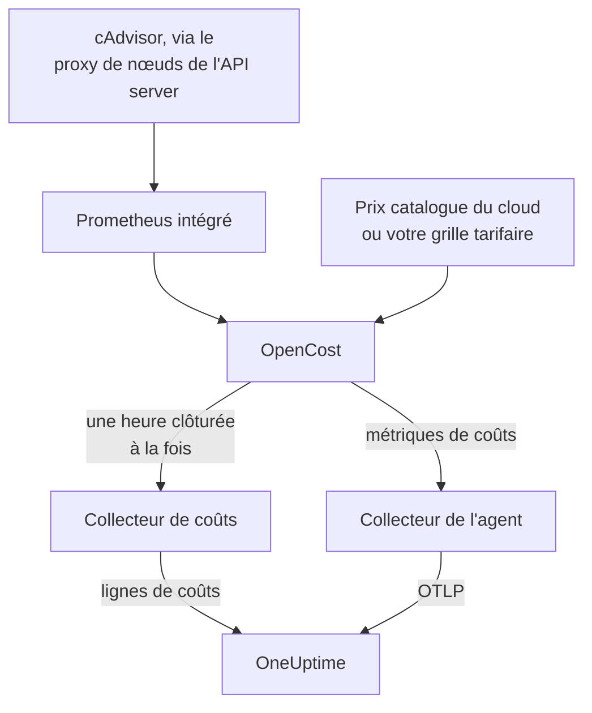

# Observabilité des coûts Kubernetes

Voyez ce que coûte chaque charge de travail Kubernetes — les dépenses par namespace, charge de travail et pod, la capacité inutilisée et la part de chaque requête effectivement utilisée — à côté des métriques, des journaux et des traces que l'[agent Kubernetes](/docs/telemetry/kubernetes-agent) collecte déjà. L'observabilité des coûts est activée par défaut, sans identifiants cloud : la vue d'ensemble du cluster affiche ce qu'il coûte, sa page **Coûts** vous indique quelles requests réduire, et les métriques de coûts se prêtent aux graphiques et aux alertes comme toutes les autres.

:::cards
- [L'activer](#activer-lobservabilité-des-coûts): Activée par défaut ; un seul `helm upgrade` là où elle ne l'est pas.
- [Alertes sur les coûts](#alertes-sur-les-coûts): Le coût par cluster, namespace et charge de travail, sous forme de métriques.
- [Votre propre moteur](#vous-utilisez-déjà-kubecost-ou-opencost): Le Kubecost ou l'OpenCost que vous utilisez déjà est détecté et lu.
- [Right-sizing](#right-sizing): Les recommandations de requests, et comment elles sont établies.
- [Dépannage](#dépannage): Pages vides, recommandations manquantes.
:::

## Fonctionnement

Lorsque la surveillance des coûts est activée, comme c'est le cas par défaut (`cost.enabled: auto`), le chart exécute quatre éléments à côté de l'agent :



1. **OpenCost**, le moteur de coûts open source (Apache-2.0, CNCF ; le [cost-model](https://github.com/kubecost/cost-model) qui fait aussi tourner Kubecost). Il surveille le cluster, calcule le prix de vos nœuds, de vos volumes et de vos load balancers, et détermine ce que coûte chaque charge de travail.
2. **Un petit Prometheus**, dont OpenCost a besoin pour l'historique d'utilisation et de prix. Il tourne avec une seule réplique, conserve 7 jours d'historique et collecte exactement deux cibles : cAdvisor via le proxy de nœuds de l'API server, en ne gardant que les séries que lit OpenCost, et OpenCost lui-même (qui émet ses propres métriques de requests de ressources, si bien que kube-state-metrics n'intervient pas). Il n'est jamais exposé hors du cluster, et ses données n'en sortent jamais.
3. **Le collecteur de coûts** (`cost.agent`). Une fois par heure clôturée, il lit l'Allocation API d'OpenCost et envoie à OneUptime une ligne de coûts par charge de travail : CPU, mémoire, GPU, volumes, réseau, load balancers et capacité inutilisée, avec l'efficacité. Chaque heure est envoyée une seule fois ; le serveur ignore une heure qu'il possède déjà, si bien qu'un redémarrage ne peut pas compter deux fois une dépense. OneUptime écrit aussi les [métriques de coûts](#alertes-sur-les-coûts) à partir de ces lignes.
4. **Une collecte des métriques de coûts** (`cost.metrics`). Le collecteur de l'agent collecte les métriques de prix d'OpenCost, ce que coûte chaque nœud, volume et load balancer par heure, et les envoie avec les autres métriques du cluster.

OpenCost calcule le prix des nœuds à partir des prix catalogue publics de votre fournisseur cloud (AWS, Google Cloud, Azure), sans identifiants. Ailleurs, il applique ses tarifs par défaut, que votre propre [grille tarifaire](#tarification-sur-site-et-bare-metal) remplace.

Les trois pods demandent ensemble environ 150m de CPU et 450Mi de mémoire. La surveillance des coûts est désactivée par défaut avec les presets `gke-autopilot` et `eks-fargate` : ces plateformes facturent chaque pod selon ce qu'il demande, si bien que les pods de coûts alourdiraient la facture qu'ils mesurent, et OpenCost calcule le prix des nœuds, alors qu'aucune des deux plateformes ne facture ainsi.

## Activer l'observabilité des coûts

Une nouvelle installation n'a besoin de rien : la surveillance des coûts est activée par défaut. Mettez à jour un agent installé avant qu'elle ne le soit, ou activez-la avec le preset `gke-autopilot` ou `eks-fargate` :

:::steps
### Mettre à jour l'agent

```bash
helm upgrade kubernetes-agent oneuptime/kubernetes-agent \
  --namespace oneuptime-agent \
  --reset-then-reuse-values \
  --set cost.enabled=true
```

C'est une installation complète : trois petits pods supplémentaires, OpenCost, son Prometheus et l'agent de coûts. Si vous avez installé l'agent sous un autre nom de release ou dans un autre namespace, utilisez les vôtres (`helm list -A | grep kubernetes-agent` les affiche). Pour désactiver la surveillance des coûts, définissez `--set cost.enabled=false` de la même manière.

### Attendre la première heure clôturée

Les premiers coûts apparaissent après la clôture de la première heure complète, et OpenCost a besoin de quelques minutes après son démarrage pour calculer le prix de sa première heure.

### Ouvrir les pages des coûts

- **Produits → Infrastructure → Kubernetes → Coûts** affiche les dépenses de tous les clusters du projet.
- Sur un cluster, la vue d'ensemble affiche ses dépenses des dernières 24 heures, une projection mensuelle, les dépenses inutilisées, l'efficacité et ses namespaces et charges de travail les plus coûteux.
- Sur un cluster, **Coûts** affiche l'évolution de ses dépenses, **Spend by Namespace** avec la répartition entre CPU, mémoire et stockage, **Spend by Workload**, les dépenses inutilisées, l'efficacité et la carte **Right-Sizing**.
:::

Les métriques de coûts (`node_total_hourly_cost`, `pv_hourly_cost` et les autres) sont des métriques ordinaires : elles se trouvent dans l'explorateur de métriques, sur les tableaux de bord personnalisés et dans les moniteurs de métriques. Pour un tableau de bord prêt à l'emploi, allez dans **Produits → Tableaux de bord**, sélectionnez **Créer un tableau de bord** et choisissez **Kubernetes Cost Dashboard** : l'évolution du coût horaire des nœuds, les coûts unitaires du CPU et de la mémoire, et les dépenses de volumes et de load balancers.

Sous les chiffres, la vue d'ensemble et la page **Coûts** indiquent d'où viennent leurs prix : les prix catalogue d'un cloud, votre grille tarifaire ou les tarifs par défaut d'OpenCost. L'efficacité est un seul et même chiffre partout, métrique d'efficacité comprise : la part du CPU et de la mémoire demandés qui a été utilisée, chaque heure de conteneur étant pondérée par ce que coûtent son CPU et sa mémoire, si bien qu'un job peu coûteux qui n'utilise rien ne peut pas tirer vers le bas un cluster bien utilisé, et la capacité inutilisée n'est pas comptée.

## Vous utilisez déjà Kubecost ou OpenCost ?

L'agent de coûts détecte votre moteur et le lit à la place de l'OpenCost embarqué, si bien que le prix du cluster est calculé comme vous l'avez configuré : votre grille tarifaire, ou votre facture cloud derrière Kubecost. Au démarrage, puis toutes les heures, il recherche via l'API Kubernetes, dans n'importe quel namespace, les Services que créent les charts des moteurs eux-mêmes (`cost-analyzer` ou `frontend` pour Kubecost, celui du chart d'OpenCost, et le Service `opencost` que crée son manifeste), Kubecost en premier. Il écarte un moteur qui ne répond pas, qui exige une connexion ou qui répond pour plusieurs clusters, et lit alors le moteur embarqué.

La vue d'ensemble du cluster nomme alors votre moteur et indique que l'OpenCost embarqué n'est pas nécessaire. Arrêtez-le :

```bash
helm upgrade kubernetes-agent oneuptime/kubernetes-agent \
  --namespace oneuptime-agent \
  --reset-then-reuse-values \
  --set cost.engine.url=auto
```

Avec `cost.engine.url=auto`, rien n'est embarqué, et l'agent lit votre moteur où qu'il tourne ; sans moteur installé, aucun prix n'est calculé. Le chart ne peut pas chercher de moteur lui-même : le `lookup` de Helm ne voit rien avec `helm template`, avec Argo CD ou lors d'une simulation. Pour garder l'OpenCost embarqué à côté de votre propre moteur, définissez `cost.engine.preferExisting=false` ; pour désigner le moteur à lire, définissez `cost.engine.url` sur son Service :

| Moteur | URL de service habituelle |
| --- | --- |
| OpenCost | `http://opencost.opencost.svc.cluster.local:9003` |
| Kubecost | `http://kubecost-cost-analyzer.kubecost.svc.cluster.local:9090` |

Le chemin de l'Allocation API est trouvé automatiquement (`/model/allocation` pour Kubecost, `/allocation/compute` ou `/allocation` pour OpenCost). Ne définissez `cost.engine.allocationPath` que pour une installation inhabituelle. Avec `auto` ou une URL, rien n'est embarqué : pour les recommandations de mémoire, définissez donc aussi `cost.engine.prometheusUrl` (voir [Les données sous-jacentes](#les-données-sous-jacentes)).

## Tarification sur site et bare metal

Les clusters dont les nœuds n'ont pas de prix catalogue cloud public peuvent définir une grille tarifaire. Sans elle, OpenCost calcule le prix de ces nœuds à ses tarifs par défaut (sur site, bare metal, kind, k3s), qui peuvent être très éloignés de ce que coûte votre matériel, et la vue d'ensemble et la page **Coûts** du cluster le signalent ; sur un cloud qu'il reconnaît, un nœud garde son prix catalogue, et une grille tarifaire ne fixe que le prix de ce qui manque au catalogue. Avec une grille tarifaire, OpenCost calcule alors le prix de chaque ressource à partir de ces chiffres, tous en USD par heure de ressource :

```yaml title="values.yaml"
cost:
  enabled: true
  opencost:
    customPricing:
      enabled: true
      cpuPerCoreHour: "0.031611"       # ~$23 per core-month
      ramPerGiBHour: "0.004237"        # ~$3 per GiB-month
      storagePerGBHour: "0.00005479452" # ~$0.04 per GB-month
      gpuPerHour: "0.95"
```

Ce sont les tarifs par défaut d'OpenCost lui-même : mettez-y vos propres chiffres, sinon la page **Coûts** indique toujours que le prix du cluster est calculé aux tarifs par défaut d'OpenCost.

## Réglages utiles

Tous sont optionnels ; le `values.yaml` du chart contient la liste complète :

```yaml title="values.yaml"
cost:
  enabled: auto           # on, except with the gke-autopilot and eks-fargate presets
  agent:
    windowSeconds: 3600   # allocation window length (hourly = native)
    includeIdle: true     # ship the engine's __idle__ allocation
    currency: USD         # currency code shown in the UI (informational)
  prometheus:
    retention: 7d         # bundled TSDB history; right-sizing reads peaks back over days
    persistence:
      enabled: false      # set true for a small PVC; emptyDir otherwise
  metrics:
    enabled: true         # cost metrics for dashboards / Metric Explorer
    scrapeInterval: 60s
```

## Right-sizing

La carte **Right-Sizing** de la page **Coûts** d'un cluster recommande une request de CPU et une request de mémoire pour chaque conteneur dont elle a suffisamment d'historique, classées selon l'économie mensuelle de chaque changement.

Une recommandation correspond à la demande observée plus 25 % de marge, arrondie à une valeur que vous pouvez coller dans un manifeste (10m de CPU, 16Mi de mémoire) :

- Le CPU est dimensionné à partir du 95e centile de l'utilisation moyenne horaire : assez haut pour couvrir la charge réelle, assez bas pour qu'un pic isolé ne gonfle pas la request pendant un mois.
- La mémoire est dimensionnée à partir du working set maximal, jamais d'une moyenne (voir [Les données sous-jacentes](#les-données-sous-jacentes)).

Les requests sont recommandées ; les limits, non. Une request est ce que le scheduler réserve et ce sur quoi la facture est calculée : c'est donc le chiffre qui fait bouger le coût. Une limit est une décision sur le fait qu'un conteneur au comportement anormal doive être bridé ou arrêté, et les données d'utilisation ne peuvent pas la prendre à votre place.

Chaque conteneur est comparé à sa request actuelle :

| Verdict | Signification |
| --- | --- |
| Surdimensionné | Il réserve nettement plus qu'il n'utilise. C'est là que se trouvent les économies. |
| Sous-dimensionné | Il réserve moins qu'il n'utilise : il est donc bridé ou risque un OOM kill. Le corriger coûte de l'argent, et la carte l'affiche comme une augmentation. |
| Aucune request définie | Il n'y a rien à réduire, mais le scheduler ne peut pas placer le conteneur en toute sécurité, et c'est le premier évincé sous pression. |

Un conteneur à moins de 15 % de sa recommandation est considéré comme correctement dimensionné et omis : personne ne devrait modifier un manifeste pour gagner 3 % sur une request.

Deux garde-fous gardent les conseils honnêtes. Une charge de travail a besoin d'au moins 24 heures de fenêtres de coûts avant d'être dimensionnée, car une fenêtre de quatre heures peut surprendre un traitement par lots nocturne au repos et conseiller de le réduire à rien. Et les économies sont projetées à partir de la durée de la fenêtre que vous consultez, et non du nombre de lignes : l'économie d'un Deployment n'est donc pas multipliée par son nombre de répliques. L'estimation suppose que les dépenses évoluent avec ce que le moteur a alloué, c'est-à-dire `max(request, usage)` ; pour un conteneur surdimensionné, c'est la request, si bien que le chiffre d'économie est exact.

### Les données sous-jacentes

En plus des dépenses, le collecteur de coûts récupère ce dont une recommandation a besoin : les requests, les limits et l'utilisation de CPU et de mémoire de chaque conteneur.

La mémoire nécessite une source de plus. L'Allocation API ne fournit qu'une moyenne sur chaque fenêtre, et une moyenne horaire masque le pic qui provoque l'OOM kill d'un conteneur : dimensionner la mémoire à partir d'elle serait dangereux. Le collecteur de coûts lit plutôt le pic de mémoire de chaque conteneur dans Prometheus, joint sur `(namespace, pod, container)` :

- Avec le moteur embarqué (par défaut), il utilise le Prometheus du chart. Rien à définir.
- Lorsque `cost.engine.url` est définie (`auto` ou l'URL de votre moteur), pointez `cost.engine.prometheusUrl` vers un Prometheus qui collecte cAdvisor, et définissez `cost.engine.prometheusCadvisorJob` si son job de collecte ne s'appelle pas `kubernetes-nodes-cadvisor`.
- Sans Prometheus, les recommandations de CPU fonctionnent toujours, à partir des moyennes horaires stockées, et les recommandations de mémoire sont omises plutôt que devinées.

Une panne de Prometheus n'arrête jamais la collecte des dépenses : les pics sont un plus, et une heure est envoyée sans eux. Le CPU n'utilise délibérément pas Prometheus : une request de CPU trop élevée ne fait que brider, là où une request de mémoire trop faible arrête le conteneur. Les moyennes horaires sont donc sûres pour le CPU, et interroger le débit CPU de chaque conteneur sur tout un cluster est assez lourd pour faire tomber un petit Prometheus.

## Alertes sur les coûts

OneUptime écrit quatre métriques à partir des lignes de coûts de chaque heure, chiffrées et nommées d'après ce qu'elles représentent, si bien que le coût peut être représenté dans des graphiques, placé sur un tableau de bord et surveillé par des alertes dans un [moniteur Kubernetes](/docs/monitor/kubernetes-monitor) ou un [moniteur de métriques](/docs/monitor/metrics-monitor) :

| Métrique | Ce qu'elle représente | Attributs |
| --- | --- | --- |
| `oneuptime.kubernetes.cost.total` | Ce que le cluster a coûté à chaque heure, capacité inutilisée comprise | `k8s.cluster.name` |
| `oneuptime.kubernetes.cost.idle` | La part de ce coût qu'aucune charge de travail n'a utilisée : la capacité inutilisée et non allouée | `k8s.cluster.name` |
| `oneuptime.kubernetes.cost.workload` | Ce que chaque charge de travail a coûté à chaque heure ; additionné par namespace, ce que le namespace a coûté | `k8s.cluster.name`, `k8s.namespace.name`, et le nom de la charge de travail sous son type, comme `k8s.deployment.name` |
| `oneuptime.kubernetes.cost.efficiency` | La part de son CPU et de sa mémoire demandés que chaque charge de travail a utilisée, en pourcentage, pondérée par le coût | Ceux de la charge de travail, comme ci-dessus |

Chaque point correspond au coût d'une heure, dans la devise de l'agent (USD par défaut), horodaté au début de l'heure et écrit environ une heure après sa fin : additionnez les points sur une fenêtre de plusieurs heures, et ceux d'une journée donnent le coût de la journée. Ils proviennent de ce que le cluster a déjà envoyé : ils ne sont donc pas facturés comme des métriques ingérées, et ils sont conservés aussi longtemps que les autres métriques du cluster.

Le moniteur Kubernetes propose trois modèles pour ces métriques : Cluster Daily Cost Over Budget, Namespace Daily Cost Over Budget et High Idle Spend, chacun avec un budget à ajuster au vôtre. Les métriques de prix d'OpenCost sont elles aussi des métriques ordinaires : un moniteur de métriques peut déclencher une alerte lorsque la moyenne de `node_total_hourly_cost` dépasse un budget, ou lorsque `pv_hourly_cost` apparaît pour une classe de volume qui ne devrait pas exister dans un cluster.

## Modèle de données et rétention

Les lignes de coûts sont stockées dans ClickHouse, une par cluster, fenêtre, namespace, contrôleur, pod et conteneur. Elles suivent la rétention de télémétrie du cluster : le `retainTelemetryDataForDays` du cluster, ou la rétention des données du projet lorsqu'il n'est pas défini. La capacité inutilisée et non allouée est stockée sous forme de lignes ordinaires dans les namespaces `__idle__` et `__unallocated__` : elles se regroupent et se filtrent donc comme les dépenses des charges de travail.

## Dépannage

:::details Les pages des coûts sont vides
Avec les presets `gke-autopilot` et `eks-fargate`, la surveillance des coûts est désactivée par défaut : activez-la avec `--set cost.enabled=true`. Sinon, lisez les journaux du collecteur de coûts : `kubectl logs -n oneuptime-agent deploy/kubernetes-agent-cost`. (Le deployment s'appelle `<release>-kubernetes-agent-cost` lorsque le nom de la release ne contient pas `kubernetes-agent` ; `kubectl get deploy -n oneuptime-agent` les liste.) `HTTP 401` signifie que OneUptime a refusé la clé d'ingestion. `did not answer any known allocation path` signifie que le moteur n'est pas encore prêt (l'OpenCost embarqué a besoin de quelques minutes pour calculer le prix de ses premières heures) ou que `cost.engine.url` est erronée.
:::

:::details L'OpenCost intégré n'est pas prêt
Lisez ses journaux : `kubectl logs -n oneuptime-agent deploy/kubernetes-agent-opencost`. Ils indiquent quel fournisseur cloud il a détecté et si ses données de prix ont été chargées.
:::

:::details La vue d'ensemble indique que l'OpenCost embarqué n'est pas nécessaire
Le cluster exécute son propre Kubecost ou OpenCost, et l'agent de coûts lit celui-ci : l'OpenCost et le Prometheus embarqués par le chart ne calculent donc aucun prix. Mettez à jour avec `--set cost.engine.url=auto` pour les arrêter, ou définissez `cost.engine.preferExisting=false` pour lire plutôt le moteur embarqué.
:::

:::details L'agent de coûts ne lit pas votre moteur
Son journal indique quel moteur il lit, et pourquoi il a écarté les autres : `kubectl logs -n oneuptime-agent deploy/kubernetes-agent-cost`. Il écarte un moteur qui ne répond pas (à cause d'une NetworkPolicy entre les namespaces, par exemple), qui exige une connexion, ou qui répond pour plusieurs clusters, comme le fait un Kubecost qui en fédère d'autres. Désignez le moteur à lire avec `cost.engine.url`.
:::

:::details Le journal d'OpenCost indique mkdir /var/configs: permission denied
Un ancien chart exécutait OpenCost sans répertoire de configuration accessible en écriture : `Error downloading default pricing data` laissait donc son Allocation API incapable de répondre et le collecteur de coûts bloqué, alors que le pod restait `Running`, que `/healthz` restait au vert et que les métriques de coûts des nœuds continuaient d'être publiées. Les charts actuels corrigent ce problème : exécutez `helm repo update`, puis mettez à jour avec `--reset-then-reuse-values`. Les lignes de coûts apparaissent à la collecte suivante.
:::

:::details Le Kubernetes Cost Dashboard n'affiche aucune donnée
Le modèle lit les métriques de coûts collectées : vérifiez que `cost.metrics.enabled` vaut `true`.
:::

:::details La carte Right-Sizing est vide
Soit la plage de temps est plus courte que les 24 heures nécessaires à une recommandation (élargissez-la), soit chaque conteneur est déjà à moins de 15 % de sa request recommandée, ce que la carte indique.
:::

:::details Les recommandations de mémoire affichent -, mais celles de CPU fonctionnent
Aucun pic de mémoire n'est parvenu à OneUptime : la mémoire n'a donc pas été dimensionnée plutôt que d'être devinée à partir d'une moyenne. Avec votre propre moteur, définissez `cost.engine.prometheusUrl`. La carte indique combien de conteneurs sont concernés.
:::

:::details Les chiffres diffèrent de l'interface du moteur
OneUptime inclut les ajustements de rapprochement du moteur dans chaque composante du coût, et envoie des heures entières et clôturées : les dépenses de l'heure en cours apparaissent après sa clôture.
:::

:::details Le Prometheus intégré a redémarré
Avec le stockage `emptyDir` par défaut, un redémarrage fait perdre quelques heures d'historique d'utilisation : les coûts de ces heures peuvent donc ressortir plus bas. Définissez `cost.prometheus.persistence.enabled=true` si cela compte pour vous.
:::

## Étapes suivantes

:::cards
- [Agent Kubernetes](/docs/telemetry/kubernetes-agent): Installer l'agent, et tout ce qu'il collecte d'autre.
- [Surveillance des métriques](/docs/monitor/metrics-monitor): Alerter lorsque les dépenses dépassent un budget.
- [Surveillance Kubernetes](/docs/monitor/kubernetes-monitor): Alerter aussi sur la santé du cluster.
:::
