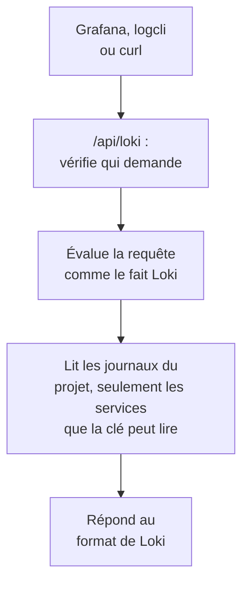

# Interroger les journaux avec LogQL

LogQL est le langage de requête de Grafana Loki. OneUptime répond à l'API de requête de Loki sur les journaux de votre projet : la source de données Loki de Grafana, logcli ou tout client Loki les lit, et les tableaux de bord et requêtes enregistrées que vous avez écrits pour Loki continuent de fonctionner.

:::cards
- [Connecter Grafana](#connecter-grafana): Ajouter OneUptime comme source de données Loki.
- [Les labels des journaux](#les-labels-des-journaux): Ce que trouve un sélecteur de flux.
- [Ce que couvre LogQL](#ce-que-couvre-logql): Requêtes de journaux, analyseurs et requêtes de métriques.
- [Limites](#limites): Ce qu'une requête peut lire, et à quelle fréquence.
:::

## Fonctionnement

Grafana interroge OneUptime comme il interroge Loki. OneUptime vérifie que la clé API peut lire les journaux du projet, ne lit que les services qu'elle peut lire, et évalue la requête comme le fait Loki.



## Avant de commencer

- **Des journaux qui arrivent.** Envoyez-les avec [OpenTelemetry](/docs/telemetry/open-telemetry), ou depuis Promtail, Grafana Alloy, Fluent Bit ou Vector par [l'API push de Loki](/docs/telemetry/compatible-endpoints).
- **Une clé API du projet qui lit les journaux**, avec le rôle Propriétaire du projet, Administrateur du projet, Membre du projet, Lecteur, Administrateur de la télémétrie, Membre de la télémétrie ou Lecteur de la télémétrie, ou la permission Read Logs. Une clé limitée à certains services ne lit que leurs journaux. Voir [Créer une clé API](/docs/api-reference/api-reference#créer-une-clé-api). Sur OneUptime Cloud, les clés API nécessitent l'offre **Growth**.
- **Pas une clé d'ingestion.** Une clé d'ingestion envoie de la télémétrie et n'en lit aucune : Grafana ne peut donc pas se connecter avec.

## Connecter Grafana

:::steps
### Créer une clé API

Dans OneUptime, ouvrez **Paramètres du projet → Avancé → Clés API** et cliquez sur **Créer : Clé API**. Donnez à la clé un rôle qui peut lire la télémétrie, ou la permission Read Logs.

### Ajouter une source de données Loki

Dans Grafana, ouvrez **Connections → Data sources → Add data source** et choisissez **Loki**.

### Saisir l'URL

Réglez **URL** sur votre adresse OneUptime suivie de `/api/loki`. Sur OneUptime Cloud, c'est `https://oneuptime.com/api/loki`.

### Envoyer la clé API

Sous **HTTP headers**, ajoutez l'en-tête `Authorization` avec la valeur `Bearer` suivie d'un espace et de votre clé API. L'authentification basique fonctionne aussi : n'importe quel nom d'utilisateur, avec la clé API comme mot de passe.

### Enregistrer et tester

Cliquez sur **Save & test**. Grafana exécute une requête et indique que la source de données fonctionne.
:::

Explore, le volume de journaux au-dessus des lignes, les navigateurs de labels et les tableaux de bord lisent alors OneUptime comme ils lisent Loki. logcli et tout autre client Loki fonctionnent de la même façon. Avec curl :

```bash title="Query OneUptime's Loki API"
curl -G -H "Authorization: Bearer $ONEUPTIME_API_KEY" \
  "https://oneuptime.com/api/loki/loki/api/v1/query_range" \
  --data-urlencode 'query={service_name="checkout"} |= "error"'
```

## Les labels des journaux

Un sélecteur de flux trouve les attributs d'un journal, nommés comme Loki 3 nomme les journaux OpenTelemetry :

| Dans OneUptime | Dans LogQL |
| --- | --- |
| Un attribut de ressource `service.name` | Le label `service_name` |
| Un attribut de ressource `k8s.pod.name` | Le label `k8s_pod_name` |
| Un attribut `http.method` | Le label `http_method` |
| Un label envoyé par un client Loki, comme `job` | Le label `job` |
| La gravité du journal | Le label `detected_level` : `trace`, `debug`, `info`, `warn`, `error`, `fatal` ou `unknown` |

- **Chaque attribut est un label.** Une requête de journaux répond par un flux par ensemble de labels : des journaux aux attributs différents sont des flux différents, comme Loki 3 répond pour des journaux avec des métadonnées structurées.
- **L'attribut propre d'un journal passe en premier** quand sa ressource en a un du même nom.
- **Un sélecteur nomme une valeur**, comme Loki le demande : au moins un sélecteur qu'un journal sans le label ne satisfait pas, comme `{service_name="checkout"}` ou `{service_name=~"check.+"}`.

Quelques requêtes pour commencer :

```text title="LogQL"
# The checkout service's lines that say error
{service_name="checkout"} |= "error"

# Requests slower than 250ms, read from JSON lines
{service_name="checkout"} | json | duration > 250ms

# Error logs per second, by service
sum by (service_name) (rate({detected_level="error"} [5m]))
```

## Ce que couvre LogQL

- **Requêtes de journaux** : sélecteurs de flux avec `=`, `!=`, `=~` et `!~` ; filtres de ligne `|=`, `!=`, `|~` et `!~`, avec `or` ; les analyseurs `json` et `logfmt` ; filtres de labels sur du texte, des nombres, des durées et des tailles, avec `and`, `or` et `__error__` ; `line_format` avec `{{.label}}` ; `drop`, `keep` et `decolorize`.
- **Requêtes de métriques** : `count_over_time`, `rate`, `bytes_over_time`, `bytes_rate` et `absent_over_time` ; sur un label pris avec `unwrap` (avec `duration()` ou `bytes()`), `rate`, `sum_over_time`, `avg_over_time`, `min_over_time`, `max_over_time`, `first_over_time`, `last_over_time`, `stddev_over_time`, `stdvar_over_time` et `quantile_over_time` ; et `offset`.
- **Autour d'elles** : `sum`, `avg`, `min`, `max`, `count`, `stddev`, `stdvar`, `topk` et `bottomk`, avec `by` ou `without` ; l'arithmétique, les comparaisons (avec `bool`), `and`, `or` et `unless`, avec `on`, `ignoring`, `group_left` et `group_right` ; `sort`, `sort_desc`, `label_replace` et `vector()`.

Les analyseurs `pattern`, `regexp` et `unpack`, `label_format`, `json` avec des champs nommés, les filtres `ip()` et les modèles `line_format` au-delà de `{{.label}}` ne sont pas encore disponibles. Une requête qui en utilise un est refusée avec un message qui le nomme.

## L'API

L'API répond aux routes de l'API HTTP de Loki, en `GET` ou en `POST`, sous `/api/loki` :

| Route | Ce qu'elle renvoie |
| --- | --- |
| `/loki/api/v1/query_range` | Les lignes d'une requête de journaux de `start` à `end`, ou une requête de métriques à chaque `step`. |
| `/loki/api/v1/query` | Une requête de métriques à un instant (`time`, par défaut maintenant). |
| `/loki/api/v1/labels` | Les noms de labels, des journaux que `query` sélectionne ou de tous les journaux. |
| `/loki/api/v1/label/<name>/values` | Les valeurs d'un label. |
| `/loki/api/v1/series` | Les ensembles de labels des journaux que `match[]` sélectionne. |

Les instants sont des nanosecondes depuis 1970, des secondes Unix ou du RFC 3339, et une plage est l'heure qui précède `end` sauf indication contraire. Une requête de journaux renvoie `limit` lignes, 100 par défaut, les plus récentes d'abord sauf avec `direction=forward`. Les réponses sont au format de Loki, et les erreurs en texte brut, comme Loki les écrit. `/loki/api/v1/status/buildinfo` répond comme un serveur Loki 3.

## Limites

Chaque requête est bornée, pour qu'un tableau de bord de nombreux panneaux ne puisse pas surcharger OneUptime :

| Limite | Valeur |
| --- | --- |
| Lignes que renvoie une requête de journaux | 5 000 |
| Journaux que lit une requête de journaux, quand des filtres après ses analyseurs en écartent | 20 000 |
| Journaux que lit elle-même une requête de métriques, quand ClickHouse ne peut pas les compter | 100 000 |
| Séries que renvoie une requête de métriques | 500 |
| Points dans une série d'une requête de plage | 11 000 |
| Journaux que renvoie une lecture | 64 Mo |
| Durée maximale d'une lecture | 30 secondes |
| Requêtes qu'un projet peut envoyer chaque minute | 1 200 |

Une requête de métriques dont le pipeline ne compte que des filtres de ligne, comme `sum(count_over_time({service_name="checkout"} |= "error" [5m]))`, est comptée là où se trouvent les journaux : elle ne lit donc aucune ligne.

## Dépannage

:::details Grafana indique que la source de données ne fonctionne pas
Vérifiez que l'URL se termine par `/api/loki`, et que l'en-tête `Authorization` contient `Bearer`, un espace et la clé API. Une clé d'ingestion, ou une clé API sans rôle qui lit les journaux, est refusée : donnez à la clé un tel rôle dans **Paramètres du projet → Avancé → Clés API**.
:::

:::details "queries require at least one regexp or equality matcher that does not have an empty-compatible value"
Le sélecteur trouve des journaux sans nommer de valeur, comme `{service_name=~".*"}`. Ajoutez un sélecteur qui en nomme une, comme `{service_name="checkout"}`.
:::

:::details "This project sent more queries this minute than OneUptime answers."
Les tableaux de bord et les clients du projet ont envoyé plus de 1 200 requêtes à l'API cette minute. Les panneaux se rechargent à la minute suivante ; actualisez les tableaux de bord moins souvent pour rester en dessous.
:::

## Étapes suivantes

:::cards
- [Explorateur de journaux](/docs/telemetry/logs-explorer): Chercher et filtrer les journaux sans écrire de requête.
- [PromQL](/docs/telemetry/promql): Interroger les métriques avec PromQL, y compris depuis la source de données Prometheus de Grafana.
- [Surveillance des journaux](/docs/monitor/logs-monitor): Être alerté sur le volume et le contenu des journaux.
:::
