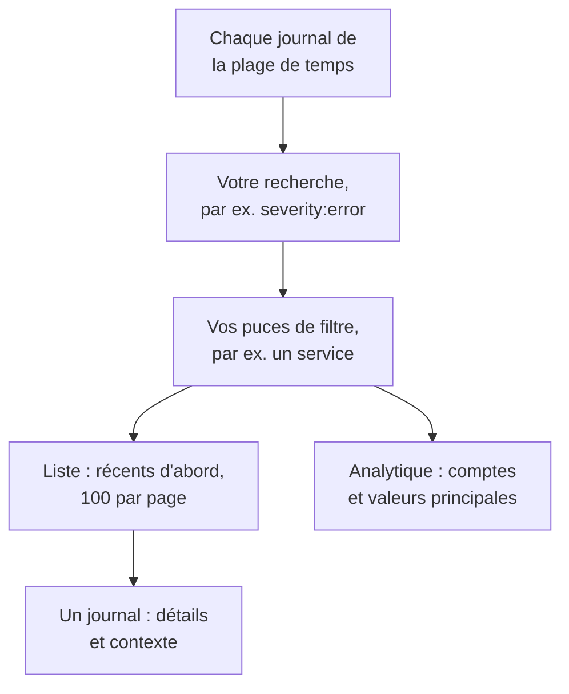

# Explorateur de journaux

L'explorateur de journaux est l'endroit où vous cherchez et lisez les journaux que vos services, vos hôtes et vos agents envoient à OneUptime. Réduisez des millions de lignes aux quelques-unes qui comptent, suivez les nouvelles à mesure qu'elles arrivent, représentez-les en graphiques et enregistrez les vues auxquelles votre équipe revient.

:::cards
- [Trouver une ligne de journal](#trouver-une-ligne-de-journal): Une plage de temps, une recherche et quelques filtres.
- [Lire un journal](#lire-un-journal): Ses attributs, sa trace et les lignes qui l'entourent.
- [Suivre les journaux en direct](#suivre-les-journaux-en-direct): De nouvelles lignes toutes les 10 secondes.
- [Enregistrer une vue](#enregistrer-une-vue): Garder une recherche, ses filtres et ses colonnes pour tout le monde.
- [Analyses des journaux](#analyses-des-journaux): Erreurs principales, gravités et qui journalise quoi.
- [Trouver et corriger avec l'IA les journaux d'erreur, manquants ou bruyants](#trouver-et-corriger-avec-lia-les-journaux-derreur-manquants-ou-bruyants): Des pull requests qui corrigent les erreurs, journalisent ce qui ne l'est pas et font taire les lignes bruyantes.
:::

## Comment l'explorateur réduit vos journaux

Tout l'onglet **Lecteur** travaille sur un seul ensemble de journaux : ceux de la plage de temps qui correspondent à votre recherche et à chaque puce de filtre. Changez l'un d'eux, et la liste, le graphique de volume et les compteurs de la barre latérale changent ensemble.

L'explorateur a cinq onglets :

| Onglet | À quoi il sert |
| --- | --- |
| **Lecteur** | Chercher, filtrer et lire les journaux. Il s'ouvre sur la dernière heure, les plus récents d'abord, 100 journaux par page. |
| **Analyses** | Ce que vos services ont journalisé sur une plage de temps, et ce qui a mal tourné. |
| **IA** | Les journaux d'erreur, la journalisation manquante et les journaux bruyants qu'OneUptime trouve dans vos journaux, et ce qu'OneUptime AI en a fait. Voir [Trouver et corriger avec l'IA les journaux d'erreur, manquants ou bruyants](#trouver-et-corriger-avec-lia-les-journaux-derreur-manquants-ou-bruyants). |
| **Guide de configuration** | Comment envoyer des journaux avec OpenTelemetry, Fluent Bit ou Fluentd, avec l'une de vos [clés d'ingestion](/docs/telemetry/ingestion-keys). |
| **Paramètres** | Ce qui arrive aux journaux à leur arrivée : **Pipelines**, **Filtres de suppression**, **Règles de masquage** et **Règles d'enregistrement**. |

## Avant de commencer

- **Des journaux qui arrivent.** Envoyez-les avec [OpenTelemetry](/docs/telemetry/open-telemetry), [Fluent Bit](/docs/telemetry/fluentbit), [Fluentd](/docs/telemetry/fluentd) ou [Syslog](/docs/telemetry/syslog). L'onglet **Guide de configuration** montre la configuration pour votre langage ou votre collecteur.
- **Un rôle qui peut lire la télémétrie.** Project Owner, Project Admin, Project Member, Viewer, Telemetry Admin, Telemetry Member ou Telemetry Viewer, ou un rôle personnalisé avec la permission Read Telemetry Service Log. Sa portée décide de quels journaux vous voyez : voir [Télémétrie](/docs/permissions/index#télémétrie).

## Trouver une ligne de journal

:::steps
### Ouvrir le Lecteur

Ouvrez **Produits → Observabilité → Journaux**. Le **Lecteur** liste les journaux de la dernière heure, les plus récents d'abord, avec leur **Heure**, leur **Service**, leur **Gravité** et leur **Message**.

### Choisir la plage de temps

Choisissez une plage dans le sélecteur de temps, ou faites glisser la souris sur le graphique de volume au-dessus de la liste pour zoomer sur un pic. Double-cliquez sur le graphique pour dézoomer. Voir [Zoomer sur une plage temporelle](/docs/telemetry/charts-and-time-ranges).

### Chercher

Tapez une requête dans la zone de recherche et appuyez sur Entrée, par exemple `severity:error service:checkout timeout`. Les mots seuls cherchent dans le message, et `@key:value` cherche dans un attribut. Voir [Syntaxe de recherche](/docs/telemetry/search-syntax#journaux).

### Affiner avec des filtres

Cliquez sur une valeur de la barre latérale **Filtres** pour l'ajouter comme puce : une gravité, un service, ou un hôte, un cluster ou une autre ressource qui a envoyé des journaux. Chaque valeur indique combien de journaux la portent. Sur un téléphone, touchez **Filtres** pour ouvrir la barre latérale.

### Ouvrir un journal

Cliquez sur une ligne. Ses détails s'ouvrent à côté de la liste.
:::

Votre recherche, vos puces et la plage de temps sont gardées dans l'adresse de la page : un rafraîchissement, un favori ou un lien partagé ouvre les mêmes journaux.

## Lire un journal

Le panneau de détails a deux onglets :

| Onglet | Ce qu'il montre |
| --- | --- |
| **Détails** | Le **Corps du journal**, son **ID de trace**, son **ID du span** et sa **Session** quand il en a, et ses **Attributs**, en liste ou en JSON. |
| **Contexte** | Le journal parmi ses voisins. **À proximité (service + heure)** montre les cinq lignes avant et après lui du même service, et **This trace** montre jusqu'à 100 journaux de sa trace. |

- Cliquez sur l'ID de trace pour ouvrir toute la requête dans l'[Explorateur de traces](/docs/telemetry/traces-explorer).
- Pointez un attribut et cliquez sur son icône de filtre pour chercher cette valeur, ou copiez-la. Vous pouvez copier tous les attributs d'un coup en JSON.
- **This trace** n'apparaît que pour un journal écrit à l'intérieur d'une trace.

## Suivre les journaux en direct

Cliquez sur **En direct** au-dessus de la liste. L'explorateur passe à la première page, triée des plus récents aux plus anciens, et cherche de nouveaux journaux toutes les 10 secondes, si bien que les lignes apparaissent à mesure que vos services les écrivent.

Le mode direct se coupe tout seul quand vous changez la recherche, un filtre ou la plage de temps, ou passez à une autre page de résultats : il ne montre que les journaux les plus récents. Cliquez de nouveau sur **En direct** pour reprendre.

## Choisir les colonnes et exporter

- **Colonnes** choisit ce que la liste affiche. **Heure**, **Service**, **Gravité** et **Message** viennent en premier ; ajoutez **ID de trace**, **ID du span** ou n'importe quel attribut, déplacez les colonnes vers le haut ou le bas, ou revenez aux valeurs par défaut avec **Réinitialiser**.
- **Export** télécharge les journaux de la page que vous regardez. **Exporter en CSV** écrit les colonnes affichées ; **Exporter en JSON** écrit chaque champ de chaque journal, avec tous ses attributs.

## Enregistrer une vue

Une vue enregistrée garde une recherche, ses puces de filtre, la plage de temps, les colonnes, le tri et la taille de page, sous un nom.

:::steps
### Préparer la vue

Cherchez, filtrez et choisissez les colonnes que vous voulez garder.

### L'enregistrer

Ouvrez **Saved Views** et cliquez sur **+ Enregistrer la vue actuelle**. Saisissez un **Nom**, cochez **Définir par défaut** si cette vue doit s'ouvrir chaque fois que quelqu'un ouvre les journaux, et cliquez sur **Enregistrer la vue**.

### L'utiliser

Choisissez la vue dans **Saved Views** pour l'appliquer, et **Effacer la vue** pour revenir à la dernière heure sans filtre. Pointez une vue de la liste pour la **Modifier** ou la **Supprimer**, ou, tant qu'elle est appliquée, pour la **Mettre à jour** avec vos changements.
:::

Les vues enregistrées appartiennent au projet : tout le monde y voit la même liste. Une plage glissante comme la dernière heure reste glissante : la vue montre l'heure qui précède son ouverture, pas l'heure où vous l'avez enregistrée. Tant que le projet n'a pas de vue par défaut, la prochaine vue enregistrée le devient, et un projet n'a qu'une vue par défaut à la fois.

## Représenter vos journaux en graphiques

Passez la liste en **Analytique** pour compter les journaux au lieu de les lire. Choisissez une série temporelle, un classement ou un tableau ; comptez chaque journal, ou les valeurs uniques d'un champ ; et regroupez par gravité, service, trace, span ou n'importe quel attribut, puis par un second champ. Un classement ou un tableau montre les 5, 10, 25 ou 50 premiers groupes.

Cliquez sur **Liste** pour revenir aux lignes elles-mêmes.

## Ouvrir les traces et les métriques liées

Les boutons **Traces** et **Métriques** à côté de **Saved Views** ouvrent l'[Explorateur de traces](/docs/telemetry/traces-explorer) ou l'[Explorateur de métriques](/docs/telemetry/metrics-explorer) sur la même fenêtre de temps, avec autant de votre filtrage que cet explorateur peut en utiliser. Pointez un bouton pour voir ce qu'il ne peut pas reprendre.

## Analyses des journaux

L'onglet **Analyses** montre ce que vos services ont journalisé sur une plage de temps, et ce qui a mal tourné. Limitez-le à certains services, hôtes ou clusters avec la liste déroulante à côté du sélecteur de temps.

| Panneau | Ce qu'il montre |
| --- | --- |
| Cartes de synthèse | **Total des journaux**, **Erreurs**, **Erreurs distinctes** et **Reporting sources**. |
| **Severity distribution** | La répartition des journaux par gravité. |
| **Top errors** | Les messages distincts journalisés avec la gravité Error ou Fatal, les plus fréquents d'abord. |
| **Sources reporting logs** | Le volume et le signal d'erreur de chaque service, hôte ou autre source. |

Sélectionnez une erreur principale pour voir ce qui se passait autour : quand elle s'est produite, ce que ses occurrences ont en commun, où elle se produit, les traces qui la portent et ses lignes les plus récentes. **Ouvrir les journaux correspondants** les ouvre dans le **Lecteur**, et **Explain with AI** ouvre [Ask AI](/docs/ai/ask-ai) avec l'erreur et ses éléments de preuve comme invite modifiable.

## Trouver et corriger avec l'IA les journaux d'erreur, manquants ou bruyants

Chaque heure, OneUptime parcourt les journaux de la dernière heure de chaque service à la recherche d'erreurs qu'il journalise encore et encore, d'échecs qu'il ne journalise pas et de lignes qui inondent ses journaux, et enregistre ce qu'il trouve comme analyses IA, avec les preuves. OneUptime AI examine ensuite chacune d'elles et ouvre une pull request pour la corriger. Rien n'est jamais fusionné : votre équipe relit chaque pull request.

OneUptime enregistre trois types de constats :

| Constat | Quand OneUptime l'enregistre | La pull request |
| --- | --- | --- |
| **Journal d'erreur** | Un service a journalisé un même message en Error ou Fatal 20 fois ou plus dans l'heure, un message avec des mots à lui et sans exception. Un message journalisé avec une exception, ou contenant une trace de pile, est suivi dans le [Suivi des exceptions](/docs/telemetry/exceptions) à la place. | Corrige la raison pour laquelle l'erreur est journalisée, ou la journalise au niveau qu'elle mérite. |
| **Journalisation manquante** | Au moins 20 spans d'une opération ont échoué dans l'heure, 5 % ou plus d'entre eux, alors qu'au moins 100 journaux du service portent un identifiant de trace, et aucune des 20 requêtes en échec les plus récentes de l'opération n'a écrit de ligne de journal. Ou un service a envoyé 500 journaux ou plus et 100 spans ou plus dans l'heure, et moins de 1 % de ses journaux portent un identifiant de trace. | Journalise l'échec là où il se produit, ou fait porter l'identifiant de trace aux journaux du service. |
| **Journal bruyant** | Un message journalisé sous Error représente 25 % ou plus des lignes d'un service dans l'heure, soit quelque 10 000 lignes ou plus. | Journalise la ligne moins souvent : en Debug, une fois par lot, ou plus du tout. |

Un constat garde un message sous forme de modèle : les parties qui changent d'une ligne à l'autre, comme les nombres et les identifiants, sont masquées. La pull request est demandée avec ce modèle, jamais avec une ligne telle qu'elle a été journalisée, et OneUptime AI a pour consigne de ne jamais journaliser de secrets ni de données personnelles, ni de copier des lignes de journal dans la pull request.

OneUptime AI n'ouvre de lui-même la pull request d'un journal d'erreur qu'une fois qu'il a trouvé le code en cause. Une erreur qui vient d'ailleurs, comme une dépendance en panne, n'obtient aucune pull request, sauf si quelqu'un en demande une avec **Corriger avec l'IA**.

### L'activer

**Journaux → IA → Paramètres** contient l'interrupteur **Trouver et corriger les journaux d'erreur, manquants ou bruyants**, activé pour les nouveaux projets. Avec **Activer l'IA** désactivé, les journaux d'erreur, manquants ou bruyants sont toujours trouvés, mais OneUptime AI n'en fait rien. Pour ouvrir des pull requests, OneUptime AI a besoin d'un dépôt connecté dans [Code](/docs/ai/ai-agent) : la page indique d'abord ce qui manque. Le code de chaque dépôt est modifié sur le Runner que le dépôt choisit dans Code.

OneUptime AI ouvre de lui-même au plus 5 pull requests par jour (UTC), pour toute la télémétrie qu'il corrige, une par constat, et jamais plus que la limite de pull requests IA ouvertes d'un dépôt.

### Règles IA

Sans règle, OneUptime AI examine immédiatement chaque problème qu'il trouve dans vos journaux et ouvre une pull request pour chacun de ceux qu'il peut corriger. Les **Règles IA** sous **Plus de paramètres** restreignent cela, en trois étapes :

| Étape | Ce qu'elle décide |
| --- | --- |
| **Correspondance** | Quels services : ceux choisis, ceux qui portent certaines étiquettes, ou ceux dont le nom correspond à un motif. |
| **Investiguer** | **Immédiatement**, ou **Seulement s'il est encore trouvé après une attente** : un problème qui disparaît pendant l'attente n'est pas examiné. |
| **Correction** | **Ne pas corriger**, **Demander avant de corriger** ou **Corriger sans demander**. Demander d'abord laisse la pull request à une personne : le constat propose **Corriger avec l'IA**. |

Sous **Plus de champs**, une règle choisit les dépôts de code, les serveurs MCP et le fournisseur de LLM qu'OneUptime AI peut utiliser pour elle. Si rien n'est choisi, il peut tous les utiliser, ainsi que le fournisseur de LLM par défaut du projet.

### Voir ce qu'il a fait

- **Journaux → IA → Analyses** liste ce qu'OneUptime a trouvé, chaque constat avec ses preuves et **Ouvrir dans Journaux**, qui ouvre les lignes concernées, de l'heure où il a été trouvé, dans le **Lecteur**. Un échec qui n'écrit aucune ligne de journal n'a pas de lignes à ouvrir : **Ouvrir dans Traces** ouvre plutôt ses spans en échec. Sur un journal d'erreur, **Créer un moniteur** configure un moniteur de journaux qui compte les lignes du message.
- **Journaux → IA → Activité** liste chaque investigation et chaque pull request, de la plus récente à la plus ancienne, avec l'état de chacune.
- Dans Code, la tâche indique qu'OneUptime l'a lancée, avec un lien vers son constat, et la pull request explique pourquoi elle a été ouverte.

## Ce qui arrive aux journaux à leur arrivée

L'onglet **Paramètres** contient les règles que OneUptime applique à chaque journal avant de le stocker. Elles agissent sur les journaux qui arrivent ensuite, pas sur ceux déjà stockés. La durée de conservation de chaque journal est elle aussi décidée à son arrivée : voir [Rétention des données](/docs/telemetry/data-retention).

| Règle | Ce qu'elle fait |
| --- | --- |
| **Filtres de suppression** | Écarter les journaux que vous ne voulez pas garder, ou n'en garder qu'un échantillon. Voir [Supprimer ou échantillonner des enregistrements](/docs/telemetry/drop-filters-and-scrub-rules#supprimer-ou-échantillonner-des-enregistrements). |
| **Règles de masquage** | Masquer les données sensibles, comme les adresses e-mail et les numéros de carte. Voir [Masquer les données sensibles](/docs/telemetry/drop-filters-and-scrub-rules#masquer-les-données-sensibles). |
| **Pipelines** | Extraire des champs du message, corriger la gravité, renommer des attributs. Voir [Pipelines de journaux](/docs/telemetry/log-pipelines). |
| **Règles d'enregistrement** | Transformer les journaux correspondants en métriques. Voir [Règles d'enregistrement de journaux](/docs/telemetry/log-recording-rules). |

## Raccourcis clavier

Appuyez sur `?` dans le Lecteur pour les voir.

| Touche | Ce qu'elle fait |
| --- | --- |
| `j` / `k` | Passer au journal suivant ou précédent. |
| Enter | Ouvrir ou fermer le journal sélectionné. |
| Esc | Fermer le panneau de détails. |
| `/` | Aller à la zone de recherche. |
| ⌘ + Enter ou Ctrl + Enter | Appliquer la recherche. |
| `?` | Afficher ou masquer les raccourcis. |

## Dépannage

:::details Aucun journal n'apparaît
Élargissez d'abord la plage de temps : le Lecteur s'ouvre sur la dernière heure. Si la liste reste vide, comparez votre configuration avec le **Guide de configuration**, et vérifiez que la portée de votre rôle couvre le service qui envoie les journaux.
:::

:::details La recherche indique qu'elle a manqué de temps
Une recherche qui dure plus de 45 secondes est arrêtée. Choisissez une plage de temps plus courte, ou ajoutez une valeur exacte comme un service, pour que OneUptime puisse utiliser son index. Voir [Syntaxe de recherche](/docs/telemetry/search-syntax#bon-à-savoir).
:::

:::details Le mode direct se coupe sans cesse
Le mode direct ne suit que les journaux les plus récents : changer la recherche, un filtre, la plage de temps ou la page le coupe. Cliquez de nouveau sur **En direct** une fois vos filtres en place.
:::

## Étapes suivantes

:::cards
- [Syntaxe de recherche](/docs/telemetry/search-syntax): Chaque filtre que comprend la zone de recherche.
- [Surveillance des journaux](/docs/monitor/logs-monitor): Être alerté quand les journaux que vous cherchez apparaissent.
- [Pipelines de journaux](/docs/telemetry/log-pipelines): Transformer des parties d'une ligne de journal en attributs filtrables.
- [Explorateur de traces](/docs/telemetry/traces-explorer): Suivre la requête d'un journal à travers vos services.
:::
