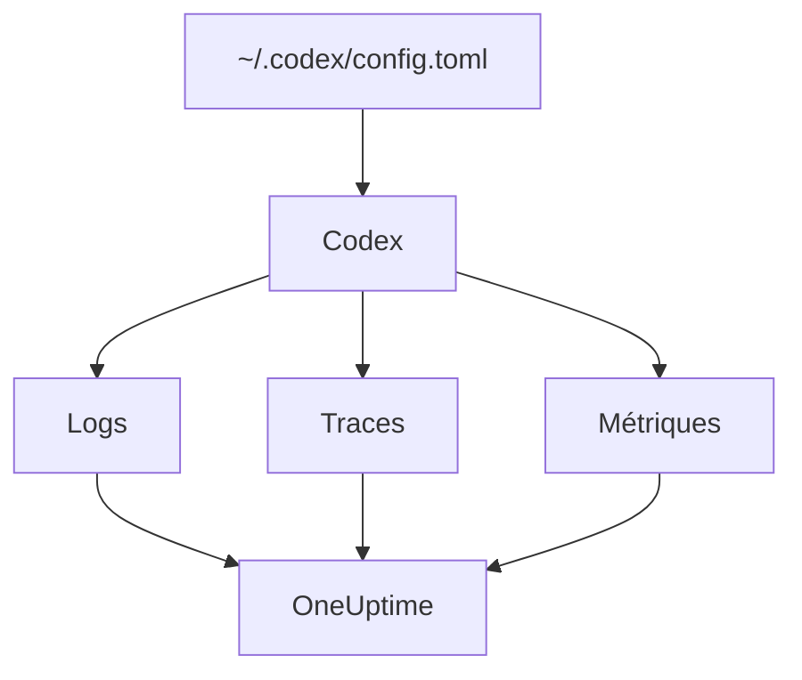

# OpenAI Codex

La CLI Codex intègre trois exportateurs OpenTelemetry, un pour les logs, un pour les traces et un pour les métriques. Dirigez-les vers OneUptime dans `~/.codex/config.toml`, et chaque tour de Codex arrive avec ses jetons et son coût, sans wrapper ni proxy entre les deux.

:::cards
- [Configurer Codex](#configurer-codex): Un bloc `[otel]`, avec une URL complète par signal.
- [Attribuer l'usage à une personne](#attribuer-lusage-de-codex-à-une-personne): Codex ne nomme personne dans les spans ni les métriques, alors c'est à vous de le faire.
- [Jetons et coût](#jetons-et-coût): Quel signal OneUptime lit, et ce que cela montre.
- [Dépannage](#dépannage): Que vérifier quand rien n'arrive.
:::

## Fonctionnement

Chaque exportateur envoie un signal vers sa propre URL. Les traces et les logs sont désactivés tant que vous ne les configurez pas ; les métriques, non.



> [!WARNING]
> Codex envoie ses métriques à OpenAI tant que vous ne changez pas ceci. Dans une version de production, `metrics_exporter` vaut `statsig` par défaut, ce qui les envoie à `https://ab.chatgpt.com/otlp/v1/metrics`. Régler `metrics_exporter` sur un exportateur OTLP, comme ci-dessous, ou sur `none` y met fin. `[analytics]` avec `enabled = false` arrête aussi la valeur par défaut Statsig, mais laisse fonctionner un exportateur de métriques OTLP que vous avez configuré.

## Avant de commencer

1. Créez une clé d'ingestion de télémétrie sous **Paramètres du projet → Télémétrie & APM → Clés d'ingestion**.
2. Votre point de terminaison OTLP est `https://oneuptime.com/otlp`, ou `https://YOUR-ONEUPTIME-HOST/otlp` si vous hébergez OneUptime vous-même.
3. Chaque export envoie la clé dans l'en-tête `x-oneuptime-token`.

## Configurer Codex

:::steps
### Ajouter le bloc otel

Mettez ceci dans `~/.codex/config.toml`. Cela active les trois signaux, et remplace au passage la valeur par défaut Statsig :

```toml title="~/.codex/config.toml"
[otel]
environment = "prod"
log_user_prompt = false

[otel.exporter.otlp-http]
endpoint = "https://oneuptime.com/otlp/v1/logs"
protocol = "binary"
headers = { "x-oneuptime-token" = "YOUR_INGESTION_TOKEN" }

[otel.trace_exporter.otlp-http]
endpoint = "https://oneuptime.com/otlp/v1/traces"
protocol = "binary"
headers = { "x-oneuptime-token" = "YOUR_INGESTION_TOKEN" }

[otel.metrics_exporter.otlp-http]
endpoint = "https://oneuptime.com/otlp/v1/metrics"
protocol = "binary"
headers = { "x-oneuptime-token" = "YOUR_INGESTION_TOKEN" }

[otel.span_attributes]
"user.id" = "dev@example.com"
"user.email" = "dev@example.com"
"team" = "platform"
```

### Donner à chaque exportateur son URL complète

Codex utilise chaque `endpoint` exactement tel qu'il est écrit : il n'ajoute pas `/v1/logs`, `/v1/traces` ou `/v1/metrics` comme le font la plupart des SDK. Trois exportateurs réglés sur le simple `https://oneuptime.com/otlp` n'envoient rien nulle part, sans erreur.

### Lancer un tour

Démarrez une session interactive `codex`, posez une petite question et laissez le tour se terminer. Ouvrez ensuite **Journaux** dans OneUptime : les événements de Codex, comme `codex.conversation_starts`, `codex.api_request` et `codex.turn_cost`, y apparaissent.
:::

> [!IMPORTANT]
> Codex ignore les clés qu'il ne connaît pas sous `[otel]`, sans avertissement. Ses clés sont en snake_case (`trace_exporter`, `metrics_exporter`, `span_attributes`), mais ses noms d'exportateurs et ses champs TLS sont en kebab-case (`otlp-http`, `ca-certificate`). Un `trace-exporter` désactive les traces sans aucune erreur.

## Clés de configuration

| Clé | Défaut | Ce qu'elle fait |
| --- | --- | --- |
| `environment` | `"dev"` | Définit l'attribut de ressource `env` |
| `log_user_prompt` | `false` | Envoie le texte du prompt dans `codex.user_prompt` ; sinon on y lit `[REDACTED]` |
| `log_agent_responses` | `false` | Envoie les réponses finales de l'agent à l'exportateur de logs |
| `exporter` | `none` | L'exportateur de logs |
| `trace_exporter` | `none` | L'exportateur de traces |
| `metrics_exporter` | `statsig` | L'exportateur de métriques : définissez-le |
| `span_attributes` | — | Des attributs ajoutés à chaque span exporté |
| `tracestate` | — | Les membres du `tracestate` W3C |
| `tool_result` | `{ max_bytes = 2048 }` | Ce qu'un enregistrement de log garde du résultat d'un outil, en octets UTF-8 |

Un exportateur vaut `none`, `statsig`, `otlp-http` ou `otlp-grpc`. `otlp-http` prend `endpoint`, `headers`, `protocol` (`"binary"` ou `"json"`, que OneUptime accepte tous deux) et `tls` (`ca-certificate`, `client-certificate`, `client-private-key`) ; `otlp-grpc` prend les mêmes sans `protocol`.

## Attribuer l'usage de Codex à une personne

Codex ne nomme le développeur qu'à un seul endroit :

- **Les enregistrements de log** portent `user.account_id` et `user.email`.
- **Les spans** non : Codex les garde volontairement hors de ses traces.
- **Les métriques** non plus : elles portent `auth_mode`, `session_source`, `originator`, `service_name`, `model` et `app.version`, et aucune personne.

OneUptime lit les personnes sur les spans et les points de métriques, jamais sur les enregistrements de log. Apposez donc vous-même l'identité sur chaque span, dans `[otel.span_attributes]` :

```toml title="~/.codex/config.toml"
[otel.span_attributes]
"user.id" = "dev@example.com"
"user.email" = "dev@example.com"
"team" = "platform"
"cost_center" = "eng-123"
```

`user.id` est la clé que préfère OneUptime, et `user.email` remplit la colonne de l'e-mail. Codex n'a pas d'attributs de ressource, définissez donc les clés d'équipe (`team.id`, `team`, `cost_center`, `department`) ici aussi. Ce bloc vit dans le fichier de configuration propre à chaque développeur : provisionnez-le par développeur, via vos dotfiles ou un profil MDM. Un fichier partagé avec une seule identité imputerait les dépenses de tout le monde à une seule personne.

## Jetons et coût

| Signal | Ce que Codex envoie | Ce qu'en fait OneUptime |
| --- | --- | --- |
| Traces | `gen_ai.usage.input_tokens`, `gen_ai.usage.output_tokens` et les jetons de cache, mais aucun modèle | Compte les jetons par personne ; ne peut pas les tarifer |
| Métriques | `codex.turn.token_usage` par `token_type`, et `codex.turn.cost_microusd`, en millionièmes d'USD | Convertit le coût en USD ; ne lit les métriques que là où les spans ne fournissent rien |
| Logs | `codex.turn_cost`, avec `usage.estimated_usd` et la personne | Le stocke dans l'explorateur **Journaux** ; non relié aux dépenses |

Avec la configuration ci-dessus, voici ce que cela donne dans l'onglet **Utilisation** :

- Les jetons viennent des spans, par personne, et `codex.turn.token_usage` ne s'y ajoute pas : les deux ne sont jamais additionnés ([pourquoi](/docs/telemetry/ai-llm-observability#les-spans-dabord-les-métriques-en-relais)).
- Les spans de Codex ne nomment aucun modèle, donc OneUptime ne peut pas les tarifer, et leur coût vaut 0. Les totaux de coût prennent alors le coût de Codex dans `codex.turn.cost_microusd`, converti en USD pour vous.
- Les tableaux **Employé**, **Équipe** et **Modèle** affichent les lignes des spans : des jetons par personne, mais aucun coût par personne.
- Sans traces, ce sont les métriques qui remplissent ces tableaux, avec le coût seulement, le tout sous **Non attribué**, car les métriques de Codex ne nomment personne.

Le coût le plus précis par tour, avec la personne, se trouve dans l'enregistrement de log `codex.turn_cost`. OneUptime ne relie pas encore les enregistrements de log aux dépenses, mais gardez l'exportateur de logs activé : l'historique sera là quand ce sera le cas.

## Codex en CI et comme serveur MCP

`codex`, `codex exec` et `codex mcp-server` construisent tous leur télémétrie à partir du même bloc `[otel]`, avec les trois exportateurs. Les exécutions de `codex exec` portent l'`originator` `codex_exec`, et `codex mcp-server` exporte sous `codex_mcp_server`, pour que vous puissiez distinguer les exécutions CI et MCP des sessions interactives grâce à ces valeurs.

## Confidentialité

`log_user_prompt` et `log_agent_responses` valent `false` par défaut : laissez-les désactivés. L'événement `codex.user_prompt` arrive quand même, avec le prompt remplacé par `[REDACTED]`, si bien que vous gardez le tour, ses jetons et son coût sans le texte du prompt. La personne (`user.email`, `user.account_id`) figure sur les enregistrements de log quoi que disent ces interrupteurs.

Si vous activez le contenu pour une investigation, les **Règles de masquage** et les **Filtres de suppression** des traces, sous **Traces → Paramètres**, le masquent ou l'écartent avant son stockage.

## Utiliser l'API OpenAI plutôt que Codex

L'API de la plateforme OpenAI n'envoie pas d'OpenTelemetry propre : chaque span vient de l'instrumentation de votre propre client. Trois instrumentations fonctionnent avec OneUptime :

- **OpenTelemetry** : `opentelemetry-instrumentation-genai-openai` pour Python, qui remplace `opentelemetry-instrumentation-openai-v2`. `OTEL_INSTRUMENTATION_GENAI_CAPTURE_MESSAGE_CONTENT` décide si les messages sont enregistrés.
- **OpenLLMetry** (Traceloop) : `opentelemetry-instrumentation-openai`.
- **OpenInference** (Arize) : `openinference-instrumentation-openai`.

Dirigez n'importe laquelle vers OneUptime comme le montre [Observabilité IA / LLM](/docs/telemetry/ai-llm-observability). Aucune ne sait qui est votre employé : définissez `user.id` vous-même.

L'**OpenAI Agents SDK** envoie ses traces vers le point de terminaison propre d'OpenAI, pas en OTLP. Faites le pont avec `opentelemetry-instrumentation-openai-agents-v2` ou `openinference-instrumentation-openai-agents`, qui transmettent les spans du SDK à un exportateur OTLP.

## Dépannage

:::details Rien n'arrive
Vérifiez d'abord les trois valeurs `endpoint` : chacune doit se terminer par `/v1/logs`, `/v1/traces` ou `/v1/metrics`. Vérifiez ensuite l'en-tête `x-oneuptime-token` : OneUptime refuse une clé erronée.
:::

:::details Les traces n'arrivent jamais, mais les logs oui
Cherchez une clé mal orthographiée sous `[otel]` : Codex l'ignore en silence. `trace-exporter` au lieu de `trace_exporter` est le cas habituel.
:::

:::details Le coût de Codex apparaît dans les totaux, mais chaque personne affiche 0 $
C'est attendu : les spans de Codex portent des jetons mais aucun modèle, donc ils ne peuvent pas être tarifés, et la métrique de coût ne nomme personne. Voir [Jetons et coût](#jetons-et-coût).
:::

:::details Les dépenses de tout le monde apparaissent sous une seule personne
La même identité `[otel.span_attributes]` est présente sur chaque poste. Donnez à chaque développeur la sienne.
:::

## Étapes suivantes

:::cards
- [Assistants de code IA](/docs/telemetry/ai-coding-assistants): Comment les dépenses sont attribuées pour chaque assistant de code.
- [Observabilité IA / LLM](/docs/telemetry/ai-llm-observability): Conversations, alertes, coûts et budgets pour vos propres appels d'IA.
- [Passerelles IA](/docs/telemetry/ai-gateways): Une passerelle qui trace et tarife chaque appel de modèle.
:::
