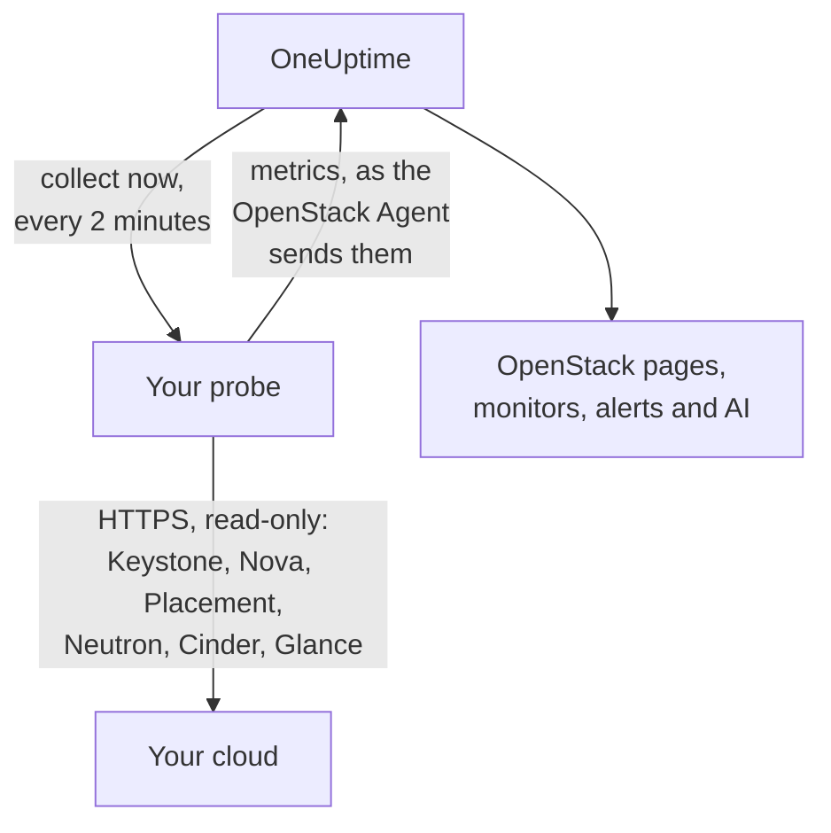

# OpenStack sans agent

Surveillez un cloud OpenStack sans rien installer : saisissez l'adresse de Keystone et un identifiant d'application dans OneUptime, choisissez la sonde qui peut joindre le cloud, et la sonde collecte les mêmes données que l'[agent OpenStack](/docs/telemetry/openstack). Il n'y a aucun agent à installer, à mettre à jour ou à maintenir en fonctionnement, et aucune machine dédiée à provisionner.

> [!IMPORTANT]
> Une sonde ne parle à un cloud qu'en HTTPS. Un identifiant ou son jeton n'est jamais envoyé en HTTP non chiffré, alors que DevStack et Kolla-Ansible exposent leurs API en HTTP par défaut. Pour un tel cloud, activez TLS sur ses API, ou utilisez l'[agent OpenStack](/docs/telemetry/openstack), qui s'exécute à ses côtés. Le test de connexion l'indique lorsqu'il trouve une adresse en HTTP.

:::cards
- [Avant de commencer](#avant-de-commencer): Une sonde qui joint les API, et un identifiant.
- [Connecter un cloud](#connecter-un-cloud): L'adresse, un identifiant, un test et un nom.
- [Dépannage](#dépannage): Ce que signifie chaque message et comment le corriger.
:::

## Fonctionnement



Toutes les deux minutes, la sonde lit chaque service de chaque région choisie et envoie ce qu'elle a trouvé à OneUptime. Les données arrivent exactement comme celles de l'agent OpenStack, de sorte que chaque page OpenStack, chaque [moniteur OpenStack](/docs/monitor/openstack-monitor) et chaque modèle d'alerte les lit de la même façon.

Chaque service est lu séparément, en même temps que les autres. Un Neutron qui échoue ou se bloque coûte les séries de Neutron, et les données de Nova arrivent comme d'habitude, avec une réserve que Nova s'impose à lui-même : il interroge Neutron pour chaque instance qu'il liste. Tant que Neutron est en panne, une sonde conserve donc les instances lues en dernier et ne demande que ce qui a changé. Si une instance a changé, ou si la sonde vient de démarrer, Nova ne peut pas non plus répondre à cette liste : Nova apparaît en échec, ses autres séries arrivent toujours, et chaque instance reste sur sa page dans son dernier état connu jusqu'au retour de Neutron.

Heat, Magnum, Manila, Trove, Gnocchi, Designate, Swift et Barbican sont lus là où le catalogue de Keystone les nomme. Un cloud qui n'exécute ni l'un ni l'autre ne coûte rien pour eux, n'en entend pas parler dans le test de connexion, et [n'en montre aucune trace](/docs/telemetry/openstack#heat-et-magnum).

Sur un cloud dont le catalogue contient Octavia, une sonde lit ses équilibreurs de charge, pools, listeners et amphores avec une liste chacun, puis les membres de chaque pool et les compteurs de trafic de chaque équilibreur de charge et de chaque listener à l'état `ACTIVE`, une requête chacun. Un cloud avec 3 équilibreurs de charge, 1 pool et 1 listener coûte 9 requêtes par collecte ; le vrai DevStack enregistré par le banc d'essai a coûté exactement cela. Au plus 25 pools de membres et 50 compteurs sont lus par collecte, les plus anciennement lus d'abord, et les autres indiquent ce qu'ils indiquaient à leur dernière lecture. Les compteurs d'Octavia sont cumulatifs : une sonde garde la dernière lecture de chacun et trace la différence par seconde entre deux lectures. Un graphique commence à la deuxième collecte, et un compteur qui diminue (un listener reconstruit) ne trace rien pour cet intervalle. Le fournisseur OVN renvoie 0 pour chaque compteur, ce qui donne une ligne plate et non une panne.

Les amphores exigent la règle admin d'Octavia pour chaque lecture. Un identifiant inférieur à admin voit les équilibreurs de charge, pools, listeners et membres de son propre projet, ainsi que ses propres compteurs, et aucune amphore : la page Load Balancers l'indique, et rien n'avertit. Le rôle de supervision, sur un projet sans équilibreur de charge, n'en voit aucun. `load-balancer_global_observer` se voit tout refuser dans cette version.

Une API Octavia arrêtée est `up 0` pour une sonde, ce que l'exportateur de l'agent ne peut pas dire.

## Sonde ou agent ?

| | Une sonde (cette page) | L'agent OpenStack |
|---|---|---|
| Ce que vous exécutez | Une sonde que vous exécutez déjà, ou une nouvelle | L'agent, sur une machine dédiée |
| Où l'identifiant est conservé | Chiffré dans OneUptime, envoyé uniquement à la sonde | Dans le fichier `clouds.yaml` de l'agent |
| Ce qu'il doit joindre | Keystone et l'API de chaque service, en HTTPS | Keystone et l'API de chaque service |
| API en HTTP | Non collectées : un jeton n'est jamais envoyé en clair | Collectées |
| Plus grand cloud | Testé à [200 000 instances](/docs/telemetry/openstack-very-large-clouds) sur un cloud simulé, pas un vrai, en jusqu'à dix envois de 48 MiB | Testé à rien pour l'instant : [son scrape expire](/docs/telemetry/openstack-very-large-clouds#avec-lagent) bien avant |
| Journaux des services et agent IA | Non inclus | Inclus |
| Ce sur quoi repose le cloud : RabbitMQ, MariaDB, Memcached, HAProxy, OVN, libvirt | Non inclus : une sonde lit les API du cloud | Inclus, avec ses cibles nommées |
| CPU, mémoire et disque réels de chaque instance, depuis libvirt ou Ceilometer | Non inclus | Inclus, avec leurs exportateurs nommés |
| Connexions à Keystone | Une pour la durée de vie d'un jeton, généralement une heure | Une par scrape |
| Un simple `reader` sur un projet | Les instances, volumes et réseaux de ce projet | Les volumes et réseaux de ce projet, et aucune instance |

Les deux envoient les mêmes séries, donc les pages et les moniteurs fonctionnent avec l'un comme avec l'autre. Une sonde envoie aussi ce que seul un client natif peut lire : les adresses d'une instance, son état de tâche et son message d'erreur, l'image depuis laquelle elle a démarré, le fait qu'un opérateur ait forcé l'arrêt d'un service Nova, les réseaux servis par un agent DHCP, le pool qui contient un volume, la date de dernière modification d'une instance, d'un volume ou d'une image, et l'état de chaque instantané et sauvegarde de volume. Cinder n'indique le pool d'un volume qu'à un identifiant qu'il traite comme admin. Sur un cloud qui exécute [Heat ou Magnum](/docs/telemetry/openstack#heat-et-magnum), elle envoie aussi la raison de l'échec d'une pile ou d'un cluster, les instances et volumes qu'une pile possède, le projet, le modèle et la version de Kubernetes de chaque cluster, et si chaque moteur de Heat et chaque conductor de Magnum est actif.

Choisissez l'agent pour les journaux des services, pour l'agent IA, pour ce sur quoi repose le cloud et l'utilisation réelle de chaque instance, pour un cloud dont les API ne parlent qu'en HTTP, comme DevStack et Kolla-Ansible par défaut, ou pour un cloud si grand qu'il doit être [lu depuis ses bases de données](/docs/telemetry/openstack-very-large-clouds#le-chemin-par-la-base-de-données). Choisissez une sonde pour tout le reste : il n'y a rien à installer, et elle lit davantage de ce que disent Nova et Cinder. [Très grands clouds OpenStack](/docs/telemetry/openstack-very-large-clouds) indique ce que coûte chacune à toute taille.

Vous pouvez faire passer un cloud de l'une à l'autre à tout moment depuis sa page **Paramètres**.

## Avant de commencer

- **Une sonde qui peut joindre Keystone et l'API de chaque service en HTTPS.** Il s'agit généralement d'une [sonde personnalisée](/docs/probe/custom-probe) dans le réseau du cloud. Le catalogue de Keystone indique où répond chaque service, et la sonde se connecte à ces adresses : chacune doit donc être joignable depuis la sonde, et chacune doit être en HTTPS. Sur OneUptime Cloud, les sondes partagées ne reçoivent jamais d'identifiant OpenStack ; ajoutez donc une sonde à vous. Sur une instance auto-hébergée, les sondes de l'instance peuvent aussi collecter.
- **Un identifiant.** Un identifiant d'application est préférable, car il peut être limité à la lecture et peut expirer. Un nom d'utilisateur et un mot de passe fonctionnent aussi, et peuvent faire tout ce que leur compte peut faire.

OpenStack n'a pas de rôle global en lecture seule : ce que la sonde voit dépend donc de l'identifiant.

| Niveau | Ce qu'il exige | Ce que la sonde lit |
|---|---|---|
| Vue complète | Un identifiant d'application sur un compte avec `admin` sur un projet qui lui est propre, limité en lecture par des règles d'accès | Tout, sauf les utilisateurs et groupes de Keystone, que les règles excluent volontairement |
| Infrastructure uniquement | Les rôles `oneuptime_monitoring` et `reader` sur un projet qui lui est propre, qui ne contient rien et a un quota nul, et les fichiers de politique livrés avec l'agent OpenStack | Hyperviseurs, services de Nova, agents de Neutron, pools d'adresses, Placement, liste des projets et instances de chaque projet. Volumes, réseaux et routeurs uniquement là où le rôle est attribué. Pas l'état de `cinder-volume` et `cinder-scheduler` ni les pools de stockage : le code de Cinder exige un admin |
| Vue du projet | Un simple `reader` sur un projet | Les instances, volumes et réseaux de ce projet, et aucune infrastructure |

Le test de connexion indique à quel niveau correspond un identifiant, et avertit lorsque son propre projet contient des ressources : là où Cinder a `enforce_new_defaults` désactivé, ce qui est sa valeur par défaut, n'importe quel rôle sur un projet peut créer les volumes de ce projet, `reader` compris.

> [!IMPORTANT]
> Un identifiant d'application limité par des règles d'accès est refusé avec un `401` par tout service dont le `keystonemiddleware` n'a pas `service_type` défini. Le test de connexion l'indique pour chaque lecture. Définissez-le dans la configuration de chaque service, puis redémarrez-le. [Créer l'identifiant](/docs/telemetry/openstack#créer-lidentifiant) donne les règles, les fichiers de politique et les paramètres de chaque service, et [ce que lit chaque niveau](/docs/telemetry/openstack#ce-que-lit-chaque-niveau) correspond aux réponses de vrais clouds.

## Connecter un cloud

:::steps
### Ouvrir vos clouds
Dans OneUptime, ouvrez **OpenStack → All Clouds** et cliquez sur **Connecter le cloud**.

### Saisir l'adresse et l'identifiant
Saisissez l'`auth_url` de votre fichier `clouds.yaml` ou `openrc`, par exemple `https://keystone.example.com:5000/v3`, ainsi que l'ID et le secret de l'identifiant d'application. Choisissez la sonde qui joint le cloud.

### Tester la connexion
Cliquez sur **Tester la connexion**. La sonde se connecte, essaie chaque lecture qu'effectue une collecte dans chaque région, puis se déconnecte. Elle indique les régions que nomme le catalogue, ce que l'identifiant peut lire, ce qui lui est refusé, les pages qui s'en passent, et la ligne qui les débloque. Une lecture en échec n'arrête pas le test.

### Approuver le certificat du cloud
Un cloud doté de sa propre autorité de certification présente un certificat auquel la sonde ne fait pas confiance. Le test affiche alors le certificat et l'hôte qui l'a présenté. Comparez son empreinte à celle de l'API elle-même, puis cliquez sur **Approuver ce certificat**. Un cloud avec un hôte par service peut avoir un certificat par service, et vous pouvez en approuver jusqu'à 32.

### Choisir les régions et se connecter
Choisissez les régions à lire, nommez le cloud et cliquez sur **Connecter le cloud**. La page du cloud s'ouvre.
:::

La **Vue d'ensemble** du cloud affiche une carte **Collecte des données**. Elle indique **Vérification** jusqu'à la première collecte, qui démarre dans la minute, puis **Collecte en cours**, et les pages se remplissent. Lorsque certains services ont été lus et pas un autre, elle précise lequel. Si aucune sonde ne vient pour le cloud pendant 15 minutes, parce qu'elle est hors ligne ou trop ancienne, elle indique **Pas de collecte** et le précise, quel qu'ait été le résultat de la dernière collecte.

La carte **Collecte des données** de la page **Paramètres** du cloud contient ce avec quoi vous l'avez connecté :


## Connecter un cloud depuis l'API ou Terraform

Les paramètres de connexion d'un cloud sont des champs ordinaires de la [ressource OpenStack Cloud](/reference/open-stack-cloud) de l'API, à `/api/openstack-cloud` : un cloud peut donc être connecté sans aucun tableau de bord. Avec Terraform, il s'agit de `oneuptime_openstack_cloud` :

```hcl
resource "oneuptime_openstack_cloud" "prod_eu" {
  name                      = "prod-eu"
  collection_method         = "Probe"
  auth_url                  = "https://keystone.example.com:5000/v3"
  credential_kind           = "applicationCredential"
  application_credential_id = var.openstack_application_credential_id
  credential_secret         = var.openstack_application_credential_secret
  collection_probe_id       = oneuptime_probe.eu_west.id
  collection_regions        = jsonencode(["RegionOne"])

  # A cloud with its own certificate authority: the fingerprints it presents.
  trusted_certificate_fingerprints = jsonencode(["AB:CD:EF:..."])
}
```

Pour un nom d'utilisateur et un mot de passe, définissez `credential_kind` sur `password`, avec `keystone_username`, `project_name` et, lorsqu'ils ne valent pas `Default`, `user_domain_name` et `project_domain_name`. `endpoint_interface`, `collection_interval_in_minutes` et `collection_options` sont ce que le formulaire regroupe sous **Plus de champs**. Seul `name` est obligatoire, car un cloud envoyé par l'agent n'a aucun de ces champs.

`credential_secret` est en écriture seule : aucune lecture ne le renvoie et Terraform le garde hors des plans et des sorties. [Les règles d'un identifiant enregistré](#lidentifiant-enregistré) s'appliquent aussi ici : modifier l'adresse, la sonde ou les certificats approuvés exige le secret dans la même requête. Ce que la sonde rapporte, comme `collection_status`, `collection_error` et `presented_certificate`, peut être lu mais pas défini.

## Ce que cela coûte à votre cloud

La supervision ne doit jamais être ce qui fait tomber un cloud : une collecte est donc douce par construction :

- **Une seule connexion, conservée.** Le jeton est utilisé jusqu'à cinq minutes avant son expiration. Une connexion est ce qu'un Keystone en difficulté peut le moins se permettre.
- **Des listes paginées.** Chaque liste est lue mille lignes à la fois, avec `limit` et `marker`.
- **Les instances selon ce qui a changé.** Entre deux lectures complètes, toutes les demi-heures, la sonde ne demande à Nova que ce qui a changé depuis la dernière lecture, avec `changes-since`.
- **Les inventaires d'un hyperviseur une seule fois.** Placement fait avancer la génération d'un fournisseur chaque fois qu'ils changent, ce qu'un seul appel de liste indique pour tous : ils ne sont donc relus qu'à ce moment-là.
- **Une charge déterminée.** Ce qui demande un appel par élément se fait par roulement au-delà de 2 000 par collecte, et au-delà de 250 projets pour les limites. Ce qui n'a pas été lu cette fois est envoyé tel que lu la dernière fois, de sorte qu'aucune série n'a de trou, et la charge cesse de croître avec le cloud.
- **Seulement les champs lus.** Les listes de Neutron nomment leurs champs, et l'on ne demande aux groupes de sécurité que leurs ID.
- **Jamais empilées.** Une collecte qui dure plus longtemps que son intervalle est ignorée, et non exécutée à côté de la suivante.
- **Un budget de temps.** Une collecte dispose de neuf dixièmes de son intervalle, et de dix minutes au plus. Ce qui a été lu à ce moment est envoyé, et le service qui a manqué de temps l'indique.
- **Temporisation.** Lorsqu'on lui demande d'attendre avec un `429` ou `Retry-After`, la sonde attend. Un service qui répond `429`, `503` ou rien du tout est laissé tranquille pendant une minute, puis deux, puis quatre, jusqu'à une demi-heure, et ses séries continuent d'indiquer qu'il est en panne pendant l'attente.
- **Ralentissement.** Une réponse trois fois plus lente que celle que ce service donne d'habitude, et d'au moins une seconde, ou de cinq secondes quelle que soit la norme, retient la requête suivante de ce service d'autant. La carte **Collecte des données** l'indique lorsque c'est arrivé.
- **Un identifiant refusé attend le plus longtemps.** En répéter un est ce qui verrouille un compte : la sonde attend donc cinq minutes, puis dix, jusqu'à une heure. Un identifiant que vous avez corrigé est essayé aussitôt.

- **Moins d'un grand cloud.** Au-delà de 5 000 instances, un cloud conserve les décomptes et ses composants, et aucune série par instance ou par volume, sauf si vous choisissez autrement sous **Utilisation réelle par instance** sur sa page **Paramètres**. Ce qui a changé, ce que vous avez choisi de conserver et ce qu'une alerte surveille continue d'être envoyé à chaque collecte. Le reste va par roulement, et la carte **Collecte des données** indique la durée d'un tour.

À chaque collecte, avec les valeurs par défaut, une région coûte 7 appels à Nova, 7 à Neutron et 5 à Cinder, un appel à Placement et deux de plus par hyperviseur, jusqu'à 4 de plus pour demander à Placement [combien de chaque gabarit tiennent](/docs/telemetry/openstack#capacité), et, environ toutes les cinq minutes, 5 à Keystone et 1 à Glance. L'inventaire d'un hyperviseur est lu une fois, puis relu seulement quand Placement indique qu'il a changé. Une liste de plus de mille lignes demande un appel par millier. Chaque instance modifiée demande un appel de plus à Nova, pour lire ce qu'elle a traversé, et 25 au plus sont lues par collecte : un cloud calme n'en fait aucun. Sur ML2/OVS, Neutron demande un appel de plus par routeur, pour savoir quels agents L3 le détiennent, et toutes les dix minutes un appel par agent DHCP, 20 au plus, pour savoir quels réseaux il sert. Un cloud avec davantage d'agents DHCP les parcourt par roulement, un cloud au-delà de la taille de synthèse omet cette lecture, et un Neutron lent n'est pas interrogé du tout. Un cloud sous OVN n'en a aucun à interroger. [Très grands clouds OpenStack](/docs/telemetry/openstack-very-large-clouds#la-charge-sur-votre-plan-de-contrôle) indique ce que cela représente en requêtes par minute, à chaque taille.

Un cloud qui exécute Manila paie, environ toutes les cinq minutes, 2 appels vers lui, un qui exécute Trove en paie 1, Gnocchi 1 et Barbican 3. Designate en demande 2, et un de plus pour chaque zone qui n'est pas `ACTIVE`, 50 au plus par collecte. Swift en demande 1 pour le projet propre à l'identifiant, et avec `ResellerAdmin` un de plus pour chaque autre projet, 200 au plus par collecte. Un cloud qui exécute Heat ou Magnum paie, environ toutes les cinq minutes, 2 appels à Heat et 3 à Magnum. Aucune des deux listes ne dit tout : celle de Magnum n'indique ni à qui appartient un cluster ni pourquoi il a échoué, et celle de Heat n'indique pas ce que possède une pile. La sonde lit donc aussi un cluster ou une pile à part lorsque son état a changé, 25 de chaque au plus par collecte. Un cloud qui en compte davantage continue de se compléter au fil des collectes suivantes, et un qui reste immobile n'est jamais lu deux fois.

Trois choses sont désactivées sauf si vous les activez, sous **Ce qu'elle lit au-delà des valeurs par défaut** dans la carte **Collecte des données** de la page **Paramètres** du cloud, ou sous **Plus de champs** lors de la connexion, car chacune coûte davantage à votre cloud :

| Option | Ce que vous obtenez | Ce que cela coûte |
|---|---|---|
| Ports | Une série par port, et le nombre de ports sans adresse ou d'équilibreurs de charge à l'arrêt | Une liste paginée par réseau ou projet nommé, ou de tous les ports si vous n'en nommez aucun. Une liste de ports sans filtre peut saturer Neutron sur un grand cloud |
| Limites de projet | Quotas et limites par projet | Quatre appels par projet, 250 projets au plus par collecte |
| Serveurs de stockage de Swift | Si chacun répond, sa réplication et si tous ont les mêmes anneaux, là où vous nommez le port `/recon` de chaque serveur sous la forme `host:port`. Seul un cloud qui exécute Swift propose cette option, sur sa page **Paramètres** une fois que sa première collecte a lu Swift | 5 appels par serveur à chaque collecte. Aucun identifiant ne leur est envoyé |

## Certificats

La sonde ne saute jamais la vérification des certificats. Chaque connexion effectue une négociation TLS complète, puis :

- sans certificat approuvé, le certificat d'une API doit provenir d'une autorité à laquelle la machine de la sonde fait confiance, pour l'adresse sur laquelle elle répond ;
- avec des certificats approuvés, une API doit en présenter exactement un parmi eux, identifiés par leurs empreintes SHA-256. Rien d'autre n'est accepté, pas même un certificat approuvé publiquement.

Pour vérifier une empreinte, exécutez ceci depuis la machine de la sonde :

```bash
openssl s_client -connect keystone.example.com:5000 </dev/null | openssl x509 -noout -fingerprint -sha256
```

Lorsqu'un certificat est renouvelé, la collecte s'arrête avec **Le certificat de l'API a changé** et le nouveau certificat est affiché. Rien n'est envoyé tant que vous ne l'avez pas approuvé, depuis la **Vue d'ensemble** ou la page **Paramètres** du cloud.

## L'identifiant enregistré

Le secret est chiffré et en écriture seule : personne ne peut le relire, et l'API ne le renvoie jamais. Il n'est envoyé qu'à la sonde qui collecte le cloud, qui le garde en mémoire.

Un identifiant enregistré n'est jamais envoyé qu'à l'adresse, par la sonde et aux certificats pour lesquels il a été saisi. Modifier l'adresse, la sonde ou les certificats approuvés redemande le secret, de sorte que personne pouvant modifier le cloud ne puisse l'envoyer ailleurs. Approuver le certificat que la sonde a trouvé à l'adresse enregistrée le conserve, tout comme en approuver moins.

Le catalogue est soumis aux mêmes règles que l'adresse que vous avez saisie, car un jeton va où il le dit. La sonde ne se connecte pas à une adresse de bouclage, de lien local ou de métadonnées cloud, que le catalogue la nomme ou qu'un nom d'hôte s'y résolve, et elle se connecte aux adresses qu'elle a vérifiées, pas à ce que le DNS indique un instant plus tard. Elle ne suit pas les redirections.

## Passer de l'agent à une sonde

Ouvrez la page **Paramètres** du cloud. Sa carte **Collecte des données** propose **Collecter avec une sonde** pour un cloud que l'agent envoie, et **Utiliser l'agent OpenStack** pour un cloud qu'une sonde collecte. Passer à l'agent fait oublier l'identifiant enregistré.

> [!WARNING]
> Arrêtez l'agent OpenStack dès que la première collecte de la sonde réussit. Tant que les deux fonctionnent, chaque métrique arrive en double.

Au-delà de [5 000 instances](/docs/telemetry/openstack-very-large-clouds#mode-synthèse), la première collecte d'une sonde connaît tout le cloud et en envoie une part : les listes d'un nouveau cloud se remplissent donc pendant son premier cycle, et la carte **Collecte des données** indique quand elles seront toutes là.

## Bare metal

Sur un cloud dont le catalogue contient Ironic, une sonde lit ses nœuds, en demandant chaque champ par son nom : le `driver_info` d'un nœud n'est donc jamais lu lors d'une collecte. Elle ajoute ce que l'exportateur de l'agent n'a pas : le pilote d'un nœud, son conductor, son incident et la raison de son échec. Ironic peut vider `last_error` en moins d'une minute environ : une page conserve donc la dernière valeur vue lors d'une collecte, et indique quand.

Une sonde lit d'abord le catalogue, et peut donc dire que l'API d'Ironic est en panne, ce que l'exportateur de l'agent ne peut pas faire. Un cloud sans Ironic n'est interrogé sur rien à son sujet.

Ironic ne montre à un projet que les nœuds qu'il possède, et lui refuse la liste des conductors. Avec la politique par défaut d'Ironic, seul un identifiant à portée système les lit, et l'identifiant d'une sonde ne peut pas être à portée système, car il lit les listes de Nova avec le même. Sauf si la politique du cloud donne à son rôle `baremetal:node:list_all` et `baremetal:conductor:get`, une sonde voit donc les nœuds que son projet possède et aucun conductor, et les pages le précisent. [Bare metal](/docs/telemetry/openstack#bare-metal) donne le reste.

## Référence

| Paramètre | Valeur par défaut | Remarques |
|---|---|---|
| Collecter toutes les | 2 minutes | De 1 à 60 minutes. Collectez un grand cloud moins souvent pour le ménager. Keystone et Glance sont lus environ toutes les cinq minutes, quelle que soit la fréquence des autres. |
| Interface des points de terminaison | public | Laquelle des URL du catalogue utiliser : public, internal ou admin. |
| Collectes simultanées | 4 par sonde | Une collecte plus lente que son intervalle est ignorée, jamais empilée. |
| Plus gros envoi | 48 MiB | Une collecte part en autant d'envois que nécessaire, jusqu'à dix. Au-delà de [5 000 instances](/docs/telemetry/openstack-very-large-clouds#mode-synthèse), ce qui n'a pas changé part par roulement. |
| Requêtes vers chaque service | Une à la fois | Les appels par fournisseur de Placement se font quatre à la fois. |
| Attente d'une réponse | 60 secondes | Essayé trois fois au total en cas de `429` ou d'erreur serveur. |
| Test de connexion | 90 secondes pour démarrer | Un test qu'aucune sonde ne prend en charge à temps, ou qui dure plus de 3 minutes, reçoit la réponse « échec ». Cinq peuvent attendre ou s'exécuter en même temps dans un projet. |

## Dépannage

:::details Le certificat de l'API n'est pas approuvé
Le cloud présente un certificat de sa propre autorité. Comparez l'empreinte affichée au certificat de l'API, puis cliquez sur **Approuver ce certificat**.
:::

:::details Le certificat de l'API a changé
Le certificat a été renouvelé, ou quelqu'un s'est interposé. Rien n'est envoyé tant que vous n'avez pas approuvé le nouveau. Vérifiez son empreinte, puis approuvez-le.
:::

:::details L'URL d'authentification n'est pas valide
Saisissez l'adresse de Keystone en HTTPS, par exemple `https://keystone.example.com:5000/v3`. Une adresse en HTTP simple est refusée avant que quoi que ce soit soit envoyé. Pour un cloud dont les API ne parlent qu'en HTTP simple, activez TLS, ou utilisez l'[agent OpenStack](/docs/telemetry/openstack).
:::

:::details Le catalogue nomme un point de terminaison en HTTP simple
Le jeton d'un identifiant n'est jamais envoyé en clair. Activez TLS pour cette API, choisissez une autre interface de point de terminaison, ou utilisez l'[agent OpenStack](/docs/telemetry/openstack) pour ce cloud. Le test de connexion échoue tant que chaque API qu'il lit n'est pas en HTTPS. Lors d'une collecte, seul le service ayant ce point de terminaison en est privé : les autres sont lus comme d'habitude.
:::

:::details Keystone a refusé l'identifiant
L'ID, le secret ou le mot de passe est erroné, il a expiré ou été supprimé, ou son compte a perdu son rôle sur le projet. Créez-en un nouveau et saisissez-le avec **Modifier la connexion** sur la page **Paramètres** du cloud.
:::

:::details Le compte n'a aucun rôle sur ce projet
Un nom d'utilisateur et un mot de passe ont permis la connexion, mais pas sur ce projet. Vérifiez le nom du projet et les deux domaines. Un identifiant d'application évite cela : sa portée est fixée à sa création.
:::

:::details L'identifiant ne peut pas lire ce dont la supervision a besoin
Le test liste chaque lecture refusée, ce dont on se passe sans elle, et la ligne qui la débloque. Un `401` sur un identifiant avec des règles d'accès signifie qu'elles ne listent pas ce chemin, ou que le `keystonemiddleware` de ce service n'a pas `service_type` défini et n'a pas été redémarré.
:::

:::details La sonde n'obtient aucune réponse du cloud
Le réseau de la sonde ne peut pas joindre cette API. Autorisez-la dans le pare-feu, ou choisissez une sonde dans le réseau du cloud. L'adresse de chaque service lui est propre : le message nomme celui qui n'a pas répondu.
:::

:::details Rien ne répond sur ce port
Vérifiez l'adresse et le port. Keystone répond généralement sur 5000, ou sur 443 derrière un chemin tel que `/identity`.
:::

:::details La connexion sécurisée a échoué
L'adresse pointe probablement vers un port qui ne parle pas HTTPS. Vérifiez-la. Si les API du cloud ne parlent qu'en HTTP simple, activez TLS, ou utilisez l'agent OpenStack.
:::

:::details OneUptime ne se connecte pas à cette adresse
L'adresse, ou quelque chose que nomme le catalogue, est ou se résout en une adresse de bouclage, de lien local ou de métadonnées cloud. Utilisez l'adresse sur laquelle l'API répond dans votre réseau.
:::

:::details Cette adresse n'est pas Keystone
Saisissez le point de terminaison Identity de votre fichier `clouds.yaml` ou `openrc` : son `auth_url`.
:::

:::details Une région n'est pas dans le catalogue
Choisissez parmi les régions que nomme le catalogue. Le test de connexion les liste.
:::

:::details Keystone est en échec
Keystone a répondu par une erreur serveur. La sonde attend plus longtemps entre deux connexions jusqu'à son rétablissement, et rien d'autre ne peut être lu sans connexion. Vérifiez le service de Keystone et la base de données derrière lui.
:::

:::details Un service est arrêté ou trop occupé pour répondre
Il a continué de répondre `429` ou une erreur serveur : la sonde attend donc plus longtemps entre deux collectes jusqu'à son rétablissement. Vérifiez qu'il fonctionne, puis sa charge. Collecter moins souvent aide un service occupé.
:::

:::details La collecte a pris trop de temps
Le cloud a répondu trop lentement pour cet intervalle. Collectez moins souvent, ou vérifiez sa charge.
:::

:::details La sonde n'a pas pris en charge cette demande
La sonde est hors ligne, ou exécute une version de OneUptime antérieure à la collecte OpenStack. Vérifiez qu'elle est connectée sur la page **Sondes**, et mettez-la à jour. La carte d'un cloud l'indique aussi lorsqu'une collecte a 15 minutes de retard, quel qu'ait été le résultat de la dernière, et revient d'elle-même quand la sonde revient.
:::

:::details Ce cloud est trop grand pour être collecté par une sonde
Ses métriques dépassent ce qu'une collecte peut envoyer, et ce cloud est réglé pour conserver les séries de chaque instance. Laissez-le conserver des décomptes à la place, sous **Utilisation réelle par instance** sur sa page **Paramètres**, ou utilisez l'[agent OpenStack](/docs/telemetry/openstack). Le [mode synthèse](/docs/telemetry/openstack-very-large-clouds#mode-synthèse) indique ce à quoi l'on renonce.
:::

## Étapes suivantes

:::cards
- [Moniteur OpenStack](/docs/monitor/openstack-monitor): Alertez sur les services, hyperviseurs, instances, réseaux et volumes.
- [Sonde personnalisée](/docs/probe/custom-probe): Exécutez une sonde dans le réseau du cloud.
- [Agent OpenStack](/docs/telemetry/openstack): Collectez un cloud avec l'agent à la place.
:::
