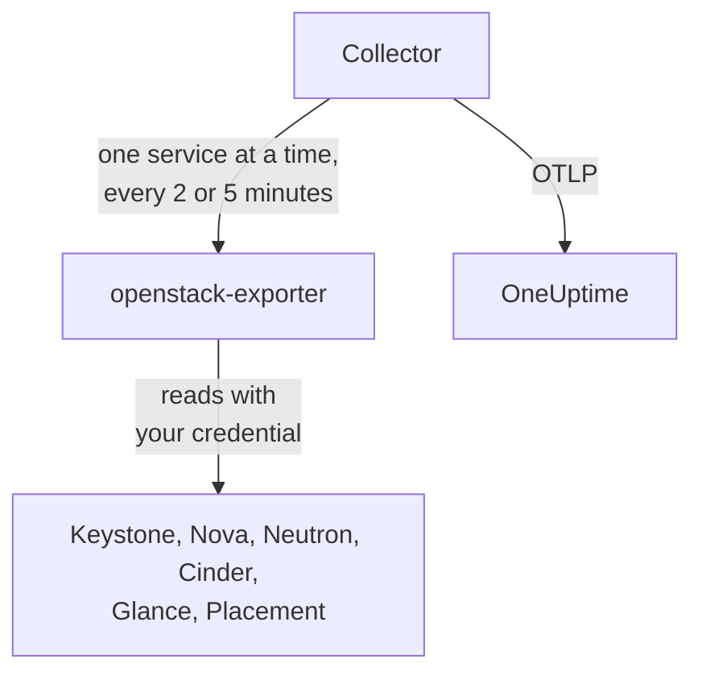

# Agent OpenStack

L'agent OpenStack de OneUptime surveille un cloud OpenStack : ses services et ses agents, ses hyperviseurs, ses instances, ses réseaux, ses routeurs, ses volumes, ses pools de stockage, ses images et ses projets, dans chaque région. Il lit les API du cloud avec un identifiant que vous choisissez et envoie ce qu'il trouve à OneUptime, où le cloud apparaît avec ses régions, ses hyperviseurs et ses projets. Les [moniteurs OpenStack](/docs/monitor/openstack-monitor) alertent sur ce qui arrive, et une [sonde](/docs/telemetry/openstack-agentless) peut collecter un cloud sans rien installer.

:::cards
- [Sonde ou agent ?](/docs/telemetry/openstack-agentless#sonde-ou-agent): lequel choisir, pour un cloud qui pourrait utiliser l'un ou l'autre.
- [Choisir ce qu'il voit](#choisir-ce-que-lagent-voit): OpenStack n'a pas de rôle global en lecture seule, il y a donc trois niveaux.
- [Installer l'agent](#installer-lagent): un identifiant, puis le script d'installation, Docker Compose ou aucun Docker du tout.
- [Ce qu'il coûte à votre cloud](#ce-quil-coûte-à-votre-cloud): ce que lit chaque paramètre, et comment le modifier.
- [Capacité](#capacité): combien d'instances de plus de chaque flavor tiennent, et combien de jours avant que chaque ressource soit pleine.
- [Dépenses](#dépenses): qui utilise quoi, ce que cela représente à vos tarifs ou tel que CloudKitty l'a valorisé, et ce qui pourrait être récupéré.
- [Pages de statut et information des projets](#pages-de-statut-et-information-des-projets): une page par région en une seule étape, et n'informer que les projets qu'une panne atteint.
- [Journaux de service](#journaux-de-service): analysés, avec une requête suivie à travers les services.
- [Événements de cycle de vie](#événements-de-cycle-de-vie): les actions sur les instances dans le fil d'activité et sur les graphiques, à partir des notifications ou d'une sonde.
- [Qui a fait quoi](#qui-a-fait-quoi): des pistes d'audit vers les événements de sécurité.
- [Tracer une requête](#tracer-les-requêtes-à-travers-le-plan-de-contrôle): une requête signée, suivie à travers le plan de contrôle.
- [Vérifier depuis l'extérieur](#vérifier-le-cloud-depuis-lextérieur): si quelqu'un peut réellement démarrer une instance, depuis une sonde extérieure au cloud.
- [Sans internet](#sans-internet): les quatre images de l'agent, et comment les copier dans un registre à vous.
- [Par outil de déploiement](/docs/telemetry/openstack-deployment-tools): Kolla-Ansible, OpenStack-Ansible, OpenStack-Helm, Atmosphere, Sunbeam, Red Hat et Mirantis.
- [Dépannage](#dépannage): un script de diagnostic, et les problèmes habituels.
:::

## Fonctionnement

L'agent se compose de deux programmes amont figés et de leur configuration, sur une seule machine : [openstack-exporter](https://github.com/openstack-exporter/openstack-exporter) lit les API du cloud et les transforme en séries `openstack_*`, et un OpenTelemetry Collector lui demande un service OpenStack à la fois, marque chaque série du cloud et de la région dont elle provient, puis les envoie à OneUptime. Rien ne s'exécute sur vos contrôleurs ni sur vos nœuds de calcul, sauf si vous ajoutez le [profil de journaux](#journaux-de-service) facultatif, qui lit leurs journaux.



Le cloud s'enregistre avec ses premières données, sous le nom que l'agent appose sur chaque métrique en tant que `openstack.cloud.name`. Un agent surveille un cloud : un Keystone, avec une ou plusieurs régions.

## Avant de commencer

- Docker Engine 20.10 ou version ultérieure avec le plugin Docker Compose v2 ou, pour fonctionner sans Docker, une machine Linux (x86_64 ou arm64) avec systemd 235 ou version ultérieure, glibc 2.34 ou version ultérieure (RHEL 9, Ubuntu 22.04, Debian 12) et root.
- Une route depuis cette machine vers Keystone et vers le point de terminaison public de chaque service.
- La ligne de commande `openstack`, en tant que quelqu'un qui peut créer l'identifiant ci-dessous.
- Une clé d'ingestion. Créez-en une sous **Paramètres du projet → Télémétrie & APM → Clés d'ingestion** et copiez sa valeur.
- HTTPS sortant depuis cette machine vers l'URL de votre OneUptime.

### Où exécuter l'agent

Exécutez l'agent en dehors du cloud qu'il surveille : une petite VM sur du matériel distinct, un hôte de gestion, un autre cloud. Un agent situé dans un cloud en panne devient silencieux avec lui, et ce silence ressemble à un cloud sain qui a cessé de rapporter.

## Choisir ce que l'agent voit

OpenStack n'a pas de rôle global en lecture seule, et c'est la chose la plus difficile quand on le surveille :

- `reader` est limité à un projet partout sauf dans Keystone et Ironic.
- Les hyperviseurs, les services, les agents, les pools et Placement exigent par défaut admin.
- Une surcharge de politique ne peut pas ouvrir les listes de tous les projets dans Neutron ou Cinder, qui les limitent par contexte admin dans leur propre code.
- Les services et les pools de stockage de Cinder répondent `403` à tout autre qu'un admin, depuis le code même de Cinder, une fois la politique déjà passée. Aucune surcharge ne les ouvre non plus.
- Neutron et Cinder répondent `200` à un simple reader, avec seulement le projet de ce reader. Cela semble avoir fonctionné, et ce n'est pas le cas.
- Là où Cinder a `enforce_new_defaults` désactivé, ce qui est la valeur par défaut de Cinder, n'importe quel rôle sur un projet peut créer les volumes de ce projet, y compris `reader` et `oneuptime_monitoring`. Sur Epoxy, Flamingo et Gazpacho, un simple reader et le rôle sur un vrai projet ont tous deux créé un volume (`202`). Sur Hibiscus, les deux ont été refusés (`403`), car DevStack n'y active `enforce_new_defaults` que là. Un rôle en lecture seule sur un vrai projet n'est pas en lecture seule.

Il y a donc trois niveaux, et chacun a un coût. Commencez par le premier si vous le pouvez.

| Niveau | Ce qu'il exige | Ce qu'il voit | Ce qui manque |
| --- | --- | --- | --- |
| **1. Vue complète** | Un identifiant d'application sur un compte avec `admin` sur un projet qui lui est propre, limité par des règles d'accès à la lecture, avec `service_type` défini sur chaque service | Chaque lecture que fait l'agent, ainsi que l'état de `cinder-volume` et `cinder-scheduler` et les pools de stockage, que seul ce niveau voit | Les utilisateurs et groupes de Keystone, volontairement. Il ne peut pas écrire : chaque écriture a répondu `401` |
| **2. Infrastructure uniquement** | Les rôles `oneuptime_monitoring` et `reader` sur un projet qui lui est propre, qui ne contient rien et a un quota nul, et les surcharges de politique livrées avec l'agent | Tous les projets, domaines, services et points de terminaison de Keystone, tout Nova y compris les serveurs de chaque projet, tout Placement, ainsi que les agents et les disponibilités d'IP de Neutron | Les réseaux, sous-réseaux, routeurs, IP flottantes et ports de Neutron, ainsi que les volumes et instantanés de Cinder, sont uniquement ceux de son propre projet, donc sur un projet vide seulement les partagés et les externes. Pas d'état `cinder-volume` ou `cinder-scheduler` ni de pools de stockage. Il ne peut pas écrire : chaque écriture a répondu `403`, ou `409` et `413` à cause du quota |
| **3. Vue du projet** | Un simple `reader` sur un vrai projet, pour une équipe qui surveille sa propre partie d'un cloud géré par quelqu'un d'autre | Les volumes, réseaux et routeurs de ce projet, depuis Cinder et Neutron | Toute l'infrastructure : pas d'hyperviseurs, de services, d'agents, de pools ni de capacité. Via l'agent, pas d'instances non plus, car la lecture de tous les projets par l'exporter est refusée. Et sur de nombreux clouds, `reader` peut y écrire |

Les modèles **Block Storage Service Down**, **Storage Pool Warning** et **Storage Pool Critical** exigent le niveau 1. **Compute Service Down**, **Network Agent Down** et les modèles Placement et hyperviseur exigent le niveau 1 ou 2, et rien au niveau 3 ne lit une instance.

### Ce que lit chaque niveau

Voici ce que cinq vrais clouds ont répondu, sur Epoxy, Flamingo, Gazpacho (OVN et OVS) et Hibiscus. Chaque cellule est écrite d'après ces enregistrements.

| Lecture | Niveau 1 : Vue complète | Niveau 2 : Infrastructure uniquement | Niveau 3 : Vue du projet |
| --- | --- | --- | --- |
| Keystone : projets | tout | tout | refusé |
| Keystone : domaines | tout | tout | refusé |
| Keystone : régions | tout | ce que tout le monde voit | ce que tout le monde voit |
| Keystone : services | tout | tout | refusé |
| Keystone : points de terminaison | tout | tout | refusé |
| Nova : serveurs, tous les projets | tout | tout | refusé |
| Nova : services | tout | tout | refusé |
| Nova : hyperviseurs | tout | tout | refusé |
| Nova : agrégats | tout | tout | refusé |
| Nova : zones de disponibilité, détail | tout | tout | refusé |
| Nova : flavors | tout | ce que tout le monde voit | ce que tout le monde voit |
| Nova : utilisation par projet | tout | tout | refusé |
| Placement : fournisseurs de ressources | tout | tout | refusé |
| Neutron : agents | tout | tout | rien |
| Neutron : réseaux | tout | son projet uniquement | son projet uniquement |
| Neutron : sous-réseaux | tout | son projet uniquement | son projet uniquement |
| Neutron : routeurs | tout | son projet uniquement | son projet uniquement |
| Neutron : IP flottantes | tout | son projet uniquement | son projet uniquement |
| Neutron : disponibilités d'IP | tout | tout | rien |
| Neutron : groupes de sécurité | tout | 409, attendu | son projet uniquement |
| Neutron : ports | tout | son projet uniquement | son projet uniquement |
| Neutron : quotas | tout | refusé | refusé |
| Cinder : volumes, tous les projets | tout | son projet uniquement | son projet uniquement |
| Cinder : services | tout | refusé | refusé |
| Cinder : pools | tout | refusé | refusé |
| Cinder : instantanés, tous les projets | tout | son projet uniquement | son projet uniquement |
| Cinder : sauvegardes, tous les projets | tout | aucun enregistré | aucun enregistré |
| Cinder : types de volume | tout | ce que tout le monde voit | ce que tout le monde voit |
| Glance : images | tout | ce que tout le monde voit | ce que tout le monde voit |

- **toutes les** lignes : les mêmes que celles vues par un admin.
- **son projet uniquement** : les lignes de ce projet, et tout ce qui est partagé ou externe. Sur un projet qui ne contient rien, ce sont seulement les partagées et les externes.
- **refusé** : un `401` ou un `403`.
- **ce que tout le monde voit** : tous les identifiants ont vu toutes les lignes, sur des clouds qui ne contiennent que des flavors, des types de volume et des images publics. Un élément privé dans un autre projet exige le niveau 1.
- **rien** : un `200` sans ligne, sur un projet qui a pourtant des réseaux. Cela semble avoir fonctionné, et ce n'est pas le cas.
- **aucun enregistré** : un `200` sans ligne là où un admin n'en voyait pas non plus, il n'y avait donc rien pour les distinguer.
- **409, attendu** : Neutron essaie de créer le groupe de sécurité par défaut du projet quand il les liste, et le quota nul ne le lui permet pas, il répond donc `409 Quota exceeded`. C'est sans conséquence, et il n'y a rien à corriger.

Octavia, Ironic, Heat, Magnum, Manila, Designate, Barbican, Swift, Trove et Gnocchi ne figurent pas ici parce que ces clouds ne les exécutent pas. Le [script de diagnostic](#dépannage) les interroge aussi, quand un cloud les exécute, et il lit chaque chemin avec votre vrai identifiant et indique ce que cet identifiant peut voir.

Ce que l'exporter de l'agent a obtenu avec chacun, en séries par service. Les nombres suivent ce qu'un cloud contient au moment où on l'interroge ; comparez-les donc entre eux et non avec les vôtres :

| Service de l'exporter | Admin | Niveau 1 : Vue complète | Niveau 2 : Infrastructure uniquement | Niveau 3 : Vue du projet |
| --- | --- | --- | --- | --- |
| identity | 14 | 13 | 13 | 4 |
| compute | 33 | 33 | 33 | 15 |
| placement | 25 | 25 | 25 | 1 |
| network | 36 à 40 | 36 à 40 | 24 à 26 | 14 |
| volume | 33 | 33 à 41 | 23 | 29 à 37 |
| image | 4 | 4 | 4 | 4 |

## Installer l'agent

Chaque OneUptime sert le script d'installation de l'agent et ses fichiers pour sa propre version : les commandes ci-dessous les téléchargent depuis `https://oneuptime.com`, donc sur un OneUptime auto-hébergé, remplacez-le par votre URL. Le script d'installation est d'abord enregistré sous `install.sh`, pour que vous puissiez le lire avant de l'exécuter.

:::steps
### Créer l'identifiant

Choisissez le niveau que vous avez retenu. Chacun crée un identifiant d'application, qui affiche un `id` et un `secret` : le secret n'est montré qu'une seule fois. Donnez-lui une expiration et jamais `--unrestricted`, qui lui permettrait de créer d'autres identifiants.

:::tabs
@tab Level 1: Full view
En tant qu'admin, créez un projet et un compte pour l'agent :

```bash
openstack project create --domain default oneuptime-monitoring
openstack user create --domain default --password-prompt oneuptime-monitoring
openstack role add --project oneuptime-monitoring --user oneuptime-monitoring admin
```

Ensuite, connecté avec ce compte sur ce projet, créez l'identifiant. Les règles sont les chemins `GET` exacts que l'agent utilise, ajustés à votre cloud :

```bash
curl -fsSLO https://oneuptime.com/install/openstack-agent/access/application-credential-access-rules.json
curl -fsSLO https://oneuptime.com/install/openstack-agent/access/access-rules-for-cloud.py
openstack catalog list -f json | python3 access-rules-for-cloud.py \
  application-credential-access-rules.json > access-rules-for-this-cloud.json
openstack application credential create oneuptime-agent \
  --role admin \
  --access-rules "$(cat access-rules-for-this-cloud.json)" \
  --expiration 2027-11-01T00:00:00
```

Une règle d'accès est comparée au chemin que voit le service. Un service placé derrière un préfixe de chemin, comme `https://cloud.example/compute/v2.1`, voit `/compute/v2.1/servers`, et refuse avec un `401` la règle livrée pour `/v2.1/servers`. `access-rules-for-cloud.py` ajoute chaque règle une seconde fois sous le préfixe de son service, lu dans votre catalogue.

Deux des lectures de l'exporter exigent des règles faciles à oublier à la main. Il lit la racine d'Octavia avant toute autre chose, et derrière Apache un service la voit comme `/load-balancer//`, avec deux barres obliques. Refusée, l'exporter répond par un `200` vide, et le cloud semble donc ne pas exécuter Octavia. Et il liste le compte Swift avec une barre oblique finale, que `/v1/*` ne couvre pas. Refusée, `openstack_object_store_up` vaut `0`. Les règles ajustées portent les deux. Les règles d'un identifiant ne peuvent pas être modifiées ; si le vôtre a été créé à partir d'une ancienne copie, créez-en un nouveau.

Les règles d'accès exigent aussi que `service_type` soit défini pour keystonemiddleware sur chaque service, et un redémarrage de ce service. Sans cela, le service refuse l'identifiant avec un `401` :

```ini title="nova.conf"
[keystone_authtoken]
service_type = compute
```

| Fichier de configuration | `service_type` |
| --- | --- |
| `nova.conf` | `compute` |
| `neutron.conf` | `network` |
| `cinder.conf` | `block-storage`. Les règles portent aussi `volume` et `volumev3`, pour un Cinder configuré ainsi |
| `glance-api.conf` | `image` |
| `placement.conf` | `placement` |
| `octavia.conf` | `load-balancer` |
| `ironic.conf` | `baremetal` |
| `heat.conf` | `orchestration` |
| `magnum.conf` | `container-infra` |
| `manila.conf` | `sharev2`. Les règles portent aussi `shared-file-system`, pour un Manila configuré ainsi |
| `designate.conf` | `dns` |
| `barbican.conf` | `key-manager` |
| `trove.conf` | `database` |
| `gnocchi.conf` | `metric` |
| `cloudkitty.conf` | `rating` |
| `proxy-server.conf`, sous `[filter:authtoken]` | `object-store`, et `include_service_catalog = True` à côté. keystonemiddleware vérifie les règles par rapport au catalogue du jeton ; avec `False`, que DevStack définit, Swift répond `500` à l'identifiant |

Seuls les services que votre cloud exécute ont besoin d'une ligne.

Sur les services qu'un cloud peut ne pas exécuter, ce que chaque niveau a obtenu sur de vrais clouds diffère des tableaux ci-dessus de quatre façons :

- **Ironic** répond à l'identifiant d'un projet, y compris celui d'un admin, avec seulement les nœuds que ce projet possède, et refuse ses conducteurs. Seule la portée système lit tous les nœuds et les conducteurs, et l'identifiant de l'agent est sur un projet. Pour lire un nœud avec lui, faites de son projet le propriétaire : `openstack baremetal node set --owner`.
- **Swift** liste les conteneurs du projet de l'identifiant, et aucun autre. Le compte d'un autre projet répond `403` sauf si l'identifiant a `ResellerAdmin`.
- **Barbican** répond à un identifiant uniquement à propos de son propre projet, et refuse un simple reader. OneUptime ne lit aucun secret.
- **Gnocchi** permet à n'importe quel rôle sur un projet de créer une métrique ; sur un cloud qui l'exécute, les niveaux 2 et 3 peuvent donc y écrire.

Keystone n'exige rien. Avec les règles ajustées, `service_type` défini et les API redémarrées, chaque lecture a répondu `200` et chaque écriture `401`, sur chaque version que nous enregistrons. L'exporter obtient ce qu'obtient un admin, sauf les utilisateurs et groupes de Keystone, volontairement. Cela vaut aussi pour les services qu'un cloud peut ne pas exécuter : enregistré sur DevStack, le niveau 1 a obtenu les mêmes séries que l'identifiant d'un admin pour chacun de ceux que l'exporter lit, et chaque écriture a répondu `401`.

Si vous ne voulez pas faire ce changement, créez le même identifiant sans `--access-rules` : un identifiant d'application admin ordinaire. Il fonctionne, et il peut écrire ; le script de diagnostic l'étiquette donc comme tel.
@tab Level 2: Infrastructure only
En tant qu'admin, créez le rôle, un projet qui ne contient rien et a un quota nul, et un compte :

```bash
openstack role create oneuptime_monitoring
openstack project create --domain default --description "OneUptime monitoring: holds nothing" oneuptime-monitoring
openstack quota set --instances 0 --cores 0 --ram 0 --key-pairs 0 oneuptime-monitoring
openstack quota set --volumes 0 --gigabytes 0 --snapshots 0 --backups 0 --backup-gigabytes 0 oneuptime-monitoring
openstack quota set --networks 0 --subnets 0 --ports 0 --routers 0 --floating-ips 0 --secgroups 0 --secgroup-rules 0 oneuptime-monitoring
openstack user create --domain default --password-prompt oneuptime-monitoring
openstack role add --project oneuptime-monitoring --user oneuptime-monitoring oneuptime_monitoring
openstack role add --project oneuptime-monitoring --user oneuptime-monitoring reader
```

Le projet ne contient rien et a un quota nul volontairement. Là où Cinder a `enforce_new_defaults` désactivé, n'importe quel rôle sur un projet peut créer les volumes de ce projet. Sans rien à toucher et sans quota pour créer quoi que ce soit, il n'y a rien à écrire : sur chaque version que nous enregistrons, chaque écriture a répondu `403`, ou `409` et `413` à cause du quota.

Téléchargez les surcharges de politique, et fusionnez chaque fichier, sur chaque contrôleur, dans le fichier désigné par `[oslo_policy] policy_file` dans la configuration de ce service (`nova.conf`, `neutron.conf` et ainsi de suite). C'est `/etc/nova/policy.yaml`, et ainsi de suite, sauf si votre déploiement dit autre chose : DevStack dit `policy.json`. Chaque règle conserve la valeur par défaut du service et y ajoute le rôle, et oslo.policy remarque seul un fichier modifié, aucun redémarrage n'est donc nécessaire.

```bash
curl -fsSLO https://oneuptime.com/install/openstack-agent/access/policy/nova.yaml
curl -fsSLO https://oneuptime.com/install/openstack-agent/access/policy/neutron.yaml
curl -fsSLO https://oneuptime.com/install/openstack-agent/access/policy/keystone.yaml
curl -fsSLO https://oneuptime.com/install/openstack-agent/access/policy/placement.yaml
```

Il n'y a pas de fichier pour Cinder. Ses `os-services` et `scheduler-stats/get_pools` répondent au rôle par `403 User does not have admin privileges`, sur les cinq clouds que nous enregistrons. Cela vient du code même de Cinder qui exige un contexte admin, une fois la politique déjà passée, aucune surcharge ne peut donc les ouvrir.

**Pour retirer à nouveau les surcharges, videz le fichier (`{}`) et ne le supprimez jamais.** Sur Flamingo (2025.2) et Epoxy (2025.1), oslo.policy lève une erreur à chaque vérification dès qu'un fichier de politique qu'il a lu a disparu, de sorte que ce service échoue à chaque requête. Quand ce service est Keystone, il cesse de valider les jetons et tout le cloud répond `503`. Si c'est déjà arrivé, redémarrez le service.

Ensuite, connecté avec ce compte sur ce projet, créez l'identifiant :

```bash
openstack application credential create oneuptime-agent --expiration 2027-11-01T00:00:00
```

Mettre le rôle sur un vrai projet pour voir ses volumes et ses routeurs permet aussi au compte d'y écrire, sur un cloud où Cinder a `enforce_new_defaults` désactivé. Le script de diagnostic avertit quand le projet de l'identifiant contient des éléments.
@tab Level 3: Project view
Donnez à un compte le rôle `reader` ordinaire sur le projet, puis, connecté avec ce compte sur ce projet, créez l'identifiant :

```bash
openstack role add --project my-team --user my-monitoring-account reader
openstack application credential create oneuptime-agent --expiration 2027-11-01T00:00:00
```

L'agent voit les lignes de ce projet dans Cinder et Neutron, et aucune infrastructure. Trois choses à savoir avant de choisir ce niveau :

- **Via l'agent, il n'affiche aucune instance.** L'exporter demande à Nova les serveurs de tous les projets, Nova refuse un simple reader, et cette lecture échoue entièrement. Seule une sonde OneUptime, qui collecte sans cet agent, peut lister les instances d'un projet.
- **Il peut être capable d'écrire.** Sur un cloud où Cinder a `enforce_new_defaults` désactivé, un simple `reader` peut aussi créer des volumes dans son projet. Sur Epoxy, Flamingo et Gazpacho, il l'a fait (`202`), et sur Hibiscus c'était refusé (`403`), car DevStack n'y active `enforce_new_defaults` que là. La valeur par défaut de Cinder est désactivée.
- **Placement apparaît comme ne répondant pas.** Chaque appel qu'il fait est refusé, et l'exporter le signale comme il signale un Placement arrêté : `openstack_placement_up 0`, sur les cinq clouds que nous enregistrons. Les pages peuvent le distinguer, d'après ce qui est fermé par ailleurs à cet identifiant, et le disent. Le modèle [Placement API Down](/docs/monitor/openstack-monitor#modèles-dalerte-prédéfinis) ne le peut pas ; laissez donc celui-là de côté à ce niveau.
:::

### Installer et démarrer l'agent

:::tabs
@tab install.sh
Téléchargez le script d'installation et exécutez-le sur la machine qui hébergera l'agent :

```bash
curl -fsSL https://oneuptime.com/install/openstack-agent -o install.sh
bash install.sh
```

Le script demande l'URL de votre OneUptime, la clé d'ingestion, un nom stable pour le cloud, l'URL d'authentification Keystone, les noms des régions, l'identifiant d'application (un nom d'utilisateur et un mot de passe si vous répondez non) et un fichier d'AC privée si le cloud a sa propre autorité de certification. Rien de secret n'est affiché en écho ni placé sur une ligne de commande. Il vérifie l'identifiant auprès de Keystone avant d'écrire ou de démarrer quoi que ce soit, s'installe dans `/opt/oneuptime-openstack-agent`, ou dans `oneuptime-openstack-agent` dans votre dossier personnel si vous n'avez aucun droit sur `/opt` (il n'a besoin que du groupe `docker`), écrit `.env` et `clouds.yaml` avec le mode `0600`, et démarre l'agent avec Docker Compose. Chaque réponse fonctionne aussi comme variable d'environnement, et relancer le script les réutilise au lieu de les redemander, ce qui est la façon de [mettre à niveau l'agent](#mettre-à-niveau-lagent).
@tab Docker Compose
Téléchargez `docker-compose.yml` et `otel-collector-config.yaml` depuis votre OneUptime dans un nouveau dossier :

```bash
mkdir oneuptime-openstack-agent && cd oneuptime-openstack-agent
curl -fsSLO https://oneuptime.com/install/openstack-agent/docker-compose.yml
curl -fsSLO https://oneuptime.com/install/openstack-agent/otel-collector-config.yaml
```

Créez à côté un `clouds.yaml`, avec une entrée par région, **nommée d'après la région**, parce que les séries de l'exporter n'indiquent pas de quelle région elles viennent et que le collector appose le nom de l'entrée dessus sous la forme `openstack.region.name` :

```yaml title="clouds.yaml"
clouds:
  RegionOne:
    region_name: RegionOne
    identity_api_version: 3
    auth_type: v3applicationcredential
    auth:
      auth_url: https://keystone.example.com:5000/v3
      application_credential_id: your-credential-id
      application_credential_secret: your-credential-secret
```

Puis un fichier `.env` :

```bash title=".env"
ONEUPTIME_URL=YOUR_ONEUPTIME_URL
ONEUPTIME_TELEMETRY_INGESTION_KEY=YOUR_TELEMETRY_INGESTION_TOKEN
OPENSTACK_CLOUD_NAME=my-cloud
OPENSTACK_EXPORTER_CLOUDS=[RegionOne,RegionTwo]
COMPOSE_PROFILES=openstack-exporter,openstack-ai-agent
```

`OPENSTACK_EXPORTER_CLOUDS` liste chaque région, entre crochets, et `COMPOSE_PROFILES` démarre l'exporter intégré et l'[agent IA](#agent-ia). Les deux fichiers contiennent des secrets. L'exporter s'exécute sous l'uid 65532, et doit être le seul compte pouvant lire `clouds.yaml`. Démarrez l'agent :

```bash
chmod 600 .env
sudo chown 65532:65532 clouds.yaml
sudo chmod 600 clouds.yaml
docker compose up -d
```
@tab Without Docker
Sur Linux (x86_64 ou arm64) avec systemd 235 ou version ultérieure et glibc 2.34 ou version ultérieure, le script d'installation exécute les versions amont des mêmes deux programmes comme services systemd. RHEL 8 et ses dérivés ont une glibc plus ancienne, sur laquelle la version de l'exporter ne peut pas s'exécuter : le script le dit et ne change rien, utilisez donc Docker dans ce cas.

```bash
curl -fsSL https://oneuptime.com/install/openstack-agent -o install.sh
sudo bash install.sh --without-docker
```

Les mêmes questions, la même vérification auprès de Keystone et les mêmes fichiers. Chaque archive de version est comparée à un sha256 figé dans `install.sh`, et un téléchargement qui ne correspond pas arrête l'installation avant que quoi que ce soit change. Le collector s'exécute sous un utilisateur jetable sans privilèges qui ne voit jamais l'identifiant OpenStack, et l'exporter sous l'utilisateur système `oneuptime-openstack`, le seul compte pouvant lire `clouds.yaml`, en écoutant uniquement sur `127.0.0.1:9180`.

Exécutez un agent par cloud : si vous quittez une installation Docker, exécutez d'abord `docker compose down`, sinon chaque métrique arrive en double.
:::

Vous exécutez déjà openstack-exporter avec `--multi-cloud` ? Pointez l'agent vers lui, et celui qui est intégré ne démarre jamais : `OPENSTACK_EXPORTER_ADDRESS=10.0.0.5:9180 bash install.sh`, ou omettez `COMPOSE_PROFILES` dans `.env` et définissez-y `OPENSTACK_EXPORTER_ADDRESS`. Son `clouds.yaml` a besoin d'une entrée nommée d'après chaque région, et il doit désactiver ce que celui qui est intégré désactive : voir [Ce qu'il coûte à votre cloud](#ce-quil-coûte-à-votre-cloud). Utilisez une adresse que le conteneur de l'agent peut joindre : `localhost` est le conteneur lui-même.

L'exporter de Kolla-Ansible s'exécute sans `--multi-cloud`, il n'a donc pas de `/probe`, et il est figé sur une version qui en dit moins. [Utiliser l'exporter que vous exécutez déjà](/docs/telemetry/openstack-deployment-tools#utiliser-lexportateur-que-vous-exécutez-déjà) explique comment le lire, et exactement ce dont les pages se passent. [OpenStack par outil de déploiement](/docs/telemetry/openstack-deployment-tools) donne le reste des étapes de chaque outil.

### Vérifier que l'agent s'exécute

```bash
cd /opt/oneuptime-openstack-agent    # or the folder the script said it installed to
docker compose ps
docker logs oneuptime-openstack-agent
```

`docker compose ps` liste le collector (`oneuptime-openstack-agent`), l'exporter intégré (`oneuptime-openstack-exporter`) et l'[agent IA](#agent-ia) (`oneuptime-openstack-ai-agent`). Les journaux du collector devraient afficher cette ligne une fois démarré :

```text
Everything is ready. Begin running and processing data.
```

Sans Docker, interrogez `systemctl status oneuptime-openstack-agent oneuptime-openstack-exporter` et `journalctl -u oneuptime-openstack-agent`.

### Trouver le cloud dans OneUptime

Ouvrez **Produits → Infrastructure → OpenStack**. Le cloud apparaît sous son `OPENSTACK_CLOUD_NAME` après sa première collecte, en quelques minutes. Compute, network, volume et Placement sont lus toutes les 2 minutes, identity et image toutes les 5.
:::

La **Vue d'ensemble** du cloud indique si ses données arrivent à OneUptime, ce qui demande d'abord de l'**Attention requise**, et comment va chaque service :


Les **Hyperviseurs** indiquent ce que Nova et Placement ont promis sur chaque hôte de calcul :


**Instances** liste chaque instance avec son statut dans les mots mêmes de Nova, son projet, sa flavor et son hyperviseur :


## Variables d'environnement

Le script d'installation les écrit dans `/opt/oneuptime-openstack-agent/.env` ; une installation Docker Compose les lit dans le `.env` situé à côté de `docker-compose.yml`. Après en avoir modifié une, exécutez `docker compose up -d` dans ce dossier, ou `sudo systemctl restart oneuptime-openstack-agent` sans Docker. `clouds.yaml` seul contient l'identifiant.

| Variable | Obligatoire | Description |
| --- | --- | --- |
| `ONEUPTIME_URL` | Oui | L'URL de votre OneUptime, comme `https://oneuptime.com` ou votre instance auto-hébergée. |
| `ONEUPTIME_TELEMETRY_INGESTION_KEY` | Oui | La clé d'ingestion de **Paramètres du projet → Télémétrie & APM → Clés d'ingestion**. |
| `OPENSTACK_CLOUD_NAME` | Oui | Le nom du cloud dans OneUptime, apposé sur chaque métrique comme attribut de ressource `openstack.cloud.name`. Gardez-le stable : le changer enregistre un nouveau cloud. Vaut `openstack` par défaut. |
| `OPENSTACK_AUTH_URL` | Exporter intégré | Une réponse au script d'installation : l'URL d'authentification Keystone. `/v3` est ajouté s'il manque. |
| `OPENSTACK_EXPORTER_CLOUDS` | Oui | Les régions, entre crochets, comme `[RegionOne,RegionTwo]`, chacune étant le nom d'une entrée de `clouds.yaml`. Vaut `[RegionOne]` par défaut. |
| `OPENSTACK_EXPORTER_ADDRESS` | Non | `host:port`, sans schéma, de votre propre exporter. Omettez-le pour utiliser celui qui est intégré. |
| `OPENSTACK_CA_FILE` | Non | Un fichier PEM avec l'autorité de certification d'un cloud qui a la sienne. Le script d'installation en garde une copie sous le nom `ca.pem` à côté de `clouds.yaml`. |
| `OPENSTACK_EXPORTER_USER` | Non | L'`uid:gid` sous lequel s'exécute le conteneur de l'exporter, qui doit être propriétaire de `clouds.yaml`. Vaut `65532:65532` par défaut. |
| `COMPOSE_PROFILES` | Exporter intégré | `openstack-exporter` démarre l'exporter intégré, et `openstack-ai-agent` l'[agent IA](#agent-ia). |
| `OPENSTACK_LIBVIRT_EXPORTER_TARGETS` | Non | Les nœuds de calcul dont lire l'[utilisation réelle](#utilisation-réelle) via `prometheus-libvirt-exporter`, entre crochets, comme `[compute-01:9177,compute-02:9177]`. Aucun par défaut. |
| `OPENSTACK_CEILOMETER_EXPORTER_TARGETS` | Non | La même chose via l'exporter propre à Ceilometer, comme `[compute-01:9101]`. Aucun par défaut. |
| `OPENSTACK_SINGLE_CLOUD_EXPORTER_TARGETS` | Non | Un exporter déjà exécuté sans `--multi-cloud`, comme celui de Kolla-Ansible : `[10.0.0.254:9198]`. Voir [Utiliser l'exporter que vous exécutez déjà](/docs/telemetry/openstack-deployment-tools#utiliser-lexportateur-que-vous-exécutez-déjà). |
| `OPENSTACK_RABBITMQ_TARGETS` | Non | Le plugin Prometheus de RabbitMQ sur chaque nœud, pour [ce sur quoi repose le cloud](#ce-sur-quoi-repose-le-cloud) : `[10.0.0.11:15692,10.0.0.12:15692]`. Aucun par défaut. |
| `OPENSTACK_MARIADB_TARGETS` | Non | mysqld_exporter à côté de chaque nœud MariaDB, généralement sur `9104`. Aucun par défaut. |
| `OPENSTACK_MEMCACHED_TARGETS` | Non | memcached_exporter à côté de chaque Memcached, généralement sur `9150`. Aucun par défaut. |
| `OPENSTACK_HAPROXY_TARGETS` | Non | L'exporter Prometheus propre à HAProxy. Aucun par défaut. |
| `OPENSTACK_NETWORK_EXPORTER_TARGETS` | Non | openstack-network-exporter sur chaque nœud, pour OVN et Open vSwitch, généralement sur `1981`. Aucun par défaut. |
| `OPENSTACK_LIBVIRT_HEALTH_TARGETS` | Non | prometheus-libvirt-exporter sur chaque nœud de calcul, généralement sur `9177`, pour savoir si libvirt répond et rien par instance. Aucun par défaut. |
| `OPENSTACK_CONTROL_PLANE_REGION` | Non | La région d'une cible ci-dessus qui n'indique pas la sienne. Une cible peut le faire : `RegionTwo@10.1.0.11:15692`. Vaut la première région par défaut. |
| `OPENSTACK_AGENT_SERVICES` | Non | Quels services cet agent lit, pour [partager un cloud entre des agents](/docs/telemetry/openstack-very-large-clouds#partager-un-cloud-entre-plusieurs-collecteurs), comme `compute\|placement`. Tous par défaut. |
| `OPENSTACK_AGENT_MEMORY_LIMIT_MIB` | Non | Ce que le collector peut garder en mémoire. La collecte d'un très grand cloud demande plus que la valeur par défaut de `512`. |
| `OPENSTACK_DATABASE_EXPORTER_TARGETS` | Non | `openstack_database_exporter`, pour [le chemin par la base de données](/docs/telemetry/openstack-very-large-clouds#le-chemin-par-la-base-de-données) : `[openstack-database-exporter:9180]`. Aucun par défaut. Les autres paramètres de ce chemin y sont listés. |

Le script d'installation lit aussi l'identifiant dans l'environnement, pour sauter ses questions : `OPENSTACK_APPLICATION_CREDENTIAL_ID` et `OPENSTACK_APPLICATION_CREDENTIAL_SECRET`, ou `OPENSTACK_USERNAME`, `OPENSTACK_PASSWORD`, `OPENSTACK_PROJECT_NAME`, `OPENSTACK_USER_DOMAIN_NAME` et `OPENSTACK_PROJECT_DOMAIN_NAME`. Ils ont des noms propres plutôt que les `OS_*` que définit un fichier openrc, de sorte que l'openrc d'un admin, chargé dans l'environnement, ne devienne jamais l'identifiant de l'agent sans que personne n'ait été interrogé. Un identifiant d'application vaut mieux qu'un nom d'utilisateur et un mot de passe : il peut être limité à la lecture et peut expirer.

## Ce sur quoi repose le cloud

La plupart des pannes OpenStack commencent en dessous : un RabbitMQ disparu, Galera sans quorum, une base OVN sans leader. L'agent peut lire chaque minute les exporters que ceux-ci ont déjà, et c'est désactivé tant que vous ne les nommez pas. Rien ici n'écrit dans aucun d'eux, et seules quelques séries de chacun sont conservées.

Nommez chacun dans le `.env` de l'agent, chaque membre d'un cluster, puis exécutez `docker compose up -d` :

```bash
OPENSTACK_RABBITMQ_TARGETS=[10.0.0.11:15692,10.0.0.12:15692,10.0.0.13:15692]
OPENSTACK_MARIADB_TARGETS=[10.0.0.11:9104,10.0.0.12:9104,10.0.0.13:9104]
OPENSTACK_MEMCACHED_TARGETS=[10.0.0.11:9150,10.0.0.12:9150]
OPENSTACK_HAPROXY_TARGETS=[10.0.0.11:9101,10.0.0.12:9101]
OPENSTACK_NETWORK_EXPORTER_TARGETS=[10.0.0.21:1981,10.0.0.22:1981,RegionTwo@10.1.0.21:1981]
OPENSTACK_LIBVIRT_HEALTH_TARGETS=[10.0.0.21:9177,10.0.0.22:9177]
OPENSTACK_CONTROL_PLANE_REGION=RegionOne
```

Une cible peut indiquer dans quelle région elle se trouve, comme le fait la dernière de cette liste. Celle qui ne le fait pas est dans `OPENSTACK_CONTROL_PLANE_REGION`. Sur Kolla-Ansible, dont le Prometheus les connaît déjà tous, `control-plane-targets.py` affiche ces lignes pour vous, et [OpenStack par outil de déploiement](/docs/telemetry/openstack-deployment-tools) dit où se trouve chaque exporter sur les autres.

Ce que lit chacun, et ce dont l'agent a besoin :

| Paramètre | Lit | À activer avec |
| --- | --- | --- |
| `OPENSTACK_RABBITMQ_TARGETS` | Le plugin propre à RabbitMQ, `/metrics` et chaque file depuis `/metrics/detailed` | `rabbitmq-plugins enable rabbitmq_prometheus` sur chaque nœud |
| `OPENSTACK_MARIADB_TARGETS` | mysqld_exporter à côté de chaque nœud. Ses valeurs par défaut rapportent déjà Galera | Rien de plus que l'exporter |
| `OPENSTACK_MEMCACHED_TARGETS` | memcached_exporter à côté de chaque Memcached | Rien de plus que l'exporter |
| `OPENSTACK_HAPROXY_TARGETS` | L'exporter propre à HAProxy | `http-request use-service prometheus-exporter` sur un `frontend` dédié |
| `OPENSTACK_NETWORK_EXPORTER_TARGETS` | openstack-network-exporter sur chaque machine avec Open vSwitch ou les bases de données d'OVN | Ses collecteurs par défaut. Une machine rapporte ce qu'elle exécute |
| `OPENSTACK_LIBVIRT_HEALTH_TARGETS` | prometheus-libvirt-exporter sur chaque nœud de calcul, et seulement si libvirt répond | Rien de plus que l'exporter |

La carte **Plan de contrôle** du cloud a alors une ligne pour chacun, et une page par dépendance avec une ligne par machine. **Non surveillée** sur cette carte signifie que vous ne l'avez pas nommée : elle n'apparaît jamais comme saine. Les problèmes qui s'y trouvent vont dans **Attention requise** du cloud. La page **Recommandations** du cloud propose [les modèles d'alerte](/docs/monitor/openstack-monitor#ce-sur-quoi-repose-le-cloud), et `troubleshoot.sh` vérifie que chaque cible répond et qu'elle est bien ce que vous avez dit.

Pour en savoir plus sur un RabbitMQ ou une base de données que la santé d'un cloud n'en demande, les produits [Files d'attente](/docs/telemetry/queues) et [Bases de données](/docs/telemetry/databases) les lisent par leurs propres agents, ce qui représente plus de données que cela et selon leurs propres termes. Les pages du plan de contrôle y renvoient. Les installer est une opération distincte, car ces produits lisent les séries de ces agents et non celles-ci.

Deux choses à savoir sur openstack-network-exporter 0.3.0, la version avec laquelle cela a été enregistré :

- **Il ne se connecte qu'une fois à la base de données d'Open vSwitch.** Après un redémarrage d'Open vSwitch, `ovs_build_info`, ses ponts, ses interfaces et toutes les séries d'ovn-controller restent absents jusqu'à ce que l'exporter redémarre aussi, alors que les séries propres à Open vSwitch reviennent aussitôt. **Exporter Lost Open vSwitch's Database** signale que c'est arrivé.
- **Il lit l'état du cluster d'une seule base OVN sur une machine.** C'est Southbound là où une machine a les deux sockets, comme celles de Kolla-Ansible. Le leader de Northbound n'apparaît donc que là où une machine n'a pas de Southbound à lire.

## Ce que l'agent collecte

Le collector crée un job de collecte par service OpenStack, via le `/probe?cloud=<region>&include_services=<service>` de l'exporter, de sorte qu'un Nova défaillant ne fait manquer que les séries de Nova :

| Job de collecte | Toutes les | Délai d'expiration | Séries |
| --- | --- | --- | --- |
| `oneuptime-openstack-compute` | 2 minutes | 110 s | `openstack_nova_agent_state`, `openstack_nova_running_vms`, `openstack_nova_vcpus_used`, `openstack_nova_memory_used_bytes`, `openstack_nova_local_storage_used_bytes`, `openstack_nova_total_vms`, `openstack_nova_server_status`, `openstack_nova_flavors`, `openstack_nova_availability_zones` |
| `oneuptime-openstack-network` | 2 minutes | 110 s | `openstack_neutron_agent_state`, `openstack_neutron_networks`, `openstack_neutron_subnets`, `openstack_neutron_routers`, `openstack_neutron_router`, `openstack_neutron_l3_agent_of_router`, `openstack_neutron_floating_ips`, `openstack_neutron_security_groups`, `openstack_neutron_network_ip_availabilities_total`, `openstack_neutron_network_ip_availabilities_used` |
| `oneuptime-openstack-volume` | 2 minutes | 110 s | `openstack_cinder_agent_state`, `openstack_cinder_volumes`, `openstack_cinder_volume_gb`, `openstack_cinder_snapshots`, `openstack_cinder_pool_capacity_free_gb`, `openstack_cinder_pool_capacity_total_gb` |
| `oneuptime-openstack-placement` | 2 minutes | 110 s | `openstack_placement_resource_total`, `openstack_placement_resource_usage`, `openstack_placement_resource_allocation_ratio`, `openstack_placement_resource_reserved` |
| `oneuptime-openstack-identity` | 5 minutes | 120 s | `openstack_identity_projects`, `openstack_identity_project_info`, `openstack_identity_domains`, `openstack_identity_regions` |
| `oneuptime-openstack-image` | 5 minutes | 120 s | `openstack_glance_images`, `openstack_glance_image_bytes`, `openstack_glance_image_created_at` |
| `oneuptime-openstack-load-balancer` | 5 minutes | 120 s | `openstack_loadbalancer_total_loadbalancers`, `openstack_loadbalancer_loadbalancer_status`, `openstack_loadbalancer_total_amphorae`, `openstack_loadbalancer_amphora_status`, `openstack_loadbalancer_total_pools`, `openstack_loadbalancer_pool_status` |
| `oneuptime-openstack-baremetal` | 5 minutes | 120 s | `openstack_ironic_node`, `openstack_ironic_node_updated_at`, `openstack_ironic_node_provision_updated_at` |
| `oneuptime-openstack-orchestration` | 5 minutes | 120 s | `openstack_heat_stack_status`, `openstack_heat_stack_status_counter` |
| `oneuptime-openstack-container-infra` | 5 minutes | 120 s | `openstack_container_infra_total_clusters`, `openstack_container_infra_cluster_masters`, `openstack_container_infra_cluster_nodes`, `openstack_container_infra_cluster_status` |
| `oneuptime-openstack-sharev2` | 5 minutes | 120 s | `openstack_sharev2_shares_counter`, `openstack_sharev2_share_gb`, `openstack_sharev2_share_status`, `openstack_sharev2_share_status_counter` |
| `oneuptime-openstack-dns` | 5 minutes | 120 s | `openstack_designate_zones`, `openstack_designate_zone_status`, `openstack_designate_recordsets`, `openstack_designate_recordsets_status` |
| `oneuptime-openstack-object-store` | 5 minutes | 120 s | `openstack_object_store_objects`, `openstack_object_store_bytes` |
| `oneuptime-openstack-database` | 5 minutes | 120 s | `openstack_trove_total_instances`, `openstack_trove_instance_status`, `openstack_trove_instance_volume_size_gb`, `openstack_trove_instance_volume_used_gb` |
| `oneuptime-openstack-gnocchi` | 5 minutes | 120 s | `openstack_gnocchi_status_metricd_processors`, `openstack_gnocchi_status_metric_having_measures_to_process`, `openstack_gnocchi_status_measures_to_process` |

Les neuf derniers sont des services qu'un cloud peut ne pas exécuter. Interrogé sur un service absent de son catalogue, l'exporter se connecte à Keystone, journalise une ligne (`No suitable endpoint could be found in the service catalog`) et répond par rien, et ce cloud n'affiche aucune trace du service. C'est une connexion toutes les 5 minutes par service et par région, ce qui explique que ceux-ci soient tous à 5 minutes. Pour ne demander que les services que vous exécutez, définissez `OPENSTACK_AGENT_SERVICES`, comme `identity|compute|placement|network|volume|image`.

Chaque service rapporte aussi `openstack_<service>_up`, comme `openstack_nova_up`. Le [moniteur OpenStack](/docs/monitor/openstack-monitor#métriques-collectées) liste chaque série avec sa signification. Chaque série porte :

| Attribut | Ce qu'il indique |
| --- | --- |
| `openstack.cloud.name` | Le nom du cloud, un attribut de ressource |
| `oneuptime.agent.version` | La version des fichiers de l'agent, un attribut de ressource : la version du collector qu'ils figent, dont le dernier numéro augmente à chaque modification des fichiers sur ce collector |
| `openstack.region.name` | La région, d'après le nom de l'entrée de `clouds.yaml`, sur chaque point de données |
| `openstack_service` | Le service OpenStack du job (`compute`, `network`, ...), sur chaque point de données |

Les filtres de moniteur comparent par égalité ; conservez donc le processeur `transform/openstack-identity` si vous personnalisez la configuration, ainsi que les deux suppressions de `service.name` et `service.instance.id` dans le processeur `resource` : sans ces suppressions, les données enregistrent un Service fantôme au lieu d'atteindre le cloud.

## Ce qu'il coûte à votre cloud

La surveillance ne doit jamais être ce qui fait tomber un cloud ; les valeurs par défaut sont donc douces. Chaque collecte se reconnecte à Keystone et effectue de vrais appels d'API. [Très grands clouds OpenStack](/docs/telemetry/openstack-very-large-clouds) donne ce que cela représente, en requêtes par minute et en gigaoctets par jour, à chaque taille.

| Paramètre | Par défaut | L'activer ou le changer vous donne | Ce qu'il coûte |
| --- | --- | --- | --- |
| Quotas de projet | Désactivé | La part de chaque quota qu'un projet a utilisée, sur sa page et sous **Attention requise**, ainsi que l'alerte Project Quota Nearly Reached | Quatre appels d'API par projet, par région, une fois par heure (Nova un, Cinder deux, Neutron un), depuis un exporter dédié |
| Métriques lentes | Désactivé | Les listes de quotas propres à Nova et l'utilisation par serveur | Un appel par projet à chaque collecte, ce qui croît avec le nombre de projets |
| Séries par port | Désactivé | `openstack_neutron_port`, `openstack_neutron_ports`, `openstack_neutron_ports_no_ips`, `openstack_neutron_ports_lb_not_active` | Une liste sans portée de tous les ports. Sur un grand cloud, cela [peut saturer Neutron et provoquer des défaillances en cascade](https://github.com/openstack-exporter/openstack-exporter/issues/540) ; laissez donc désactivé sauf si vous savez que votre nombre de ports est faible |
| Services qu'un cloud peut ne pas exécuter | Activé | Répartiteurs de charge, bare metal, stacks, clusters, partages, DNS, stockage d'objets, bases de données et Gnocchi, là où le cloud les a | Un cloud qui n'en a pas paie une connexion toutes les 5 minutes. Designate coûte un appel par zone à chaque collecte, ce qui croît avec le nombre de zones |
| Intervalles de collecte | 2 et 5 minutes | Des données plus fraîches, ou moins de charge | Deux fois plus souvent, c'est deux fois plus d'appels d'API. Gardez chaque `scrape_timeout` sous son `scrape_interval`, pour qu'une collecte lente ne s'empile jamais sur la précédente |

**Quotas de projet :** relancez `install.sh` avec `OPENSTACK_COLLECT_QUOTAS=true`. Sur une installation Docker Compose, ajoutez `openstack-quotas` à `COMPOSE_PROFILES` dans `.env`, et donnez à `OPENSTACK_QUOTA_CLOUDS` la valeur de `OPENSTACK_EXPORTER_CLOUDS`. L'un ou l'autre démarre un second exporter, `openstack-quota-exporter`, qui ne lit rien d'autre, et le collector l'interroge une fois par heure pour `openstack_nova_limits_*`, `openstack_neutron_quota_*`, `openstack_cinder_limits_*` et `openstack_cinder_volume_type_quota_gigabytes`. Ils changent lentement, et un exporter lit les mêmes choses quel que soit le job qui le demande ; les lire moins souvent exige donc un exporter dédié. Votre propre exporter n'a rien de tel : l'agent lit ce qu'il dit, à chaque collecte.

**Métriques lentes :** supprimez la ligne `--disable-metric` correspondant à ce que vous voulez, dans le `command` de l'exporter dans `docker-compose.yml`, ou dans `ExecStart` de `oneuptime-openstack-exporter.service` sans Docker. Le coût est d'un appel par projet à chaque collecte.

| Supprimer | Pour collecter |
| --- | --- |
| `--disable-metric=nova-quota_cores` | `openstack_nova_quota_*` |
| `--disable-metric=nova-server_local_gb` | `openstack_nova_server_local_gb`, l'utilisation par serveur. Celle-ci est un unique rapport d'utilisation qui parcourt chaque serveur plutôt qu'un appel par projet, et elle est tout de même lente sur un grand cloud |

Les trois lignes qui écartent les quotas de projet de cet exporter (`--disable-metric=nova-limits_vcpus_max`, `--disable-metric=neutron-quota_network`, `--disable-metric=cinder-limits_volume_max_gb`) restent en place. Les supprimer les lit aussi toutes les deux minutes.

Chaque option nomme la série qui lit le reste de sa ligne, ce qui explique qu'une seule ligne les désactive toutes. N'utilisez pas à la place le `--disable-slow-metrics` de l'exporter : il retire aussi `openstack_glance_image_*`, la liste d'images que la page Images lit en un seul appel. La liste des quotas de Neutron est réservée à un admin à tous les niveaux sauf le niveau 1, donc `openstack_neutron_quota_*` exige ce niveau.

**Séries par port :** supprimez les quatre lignes `--disable-metric=neutron-port*`, au même endroit.

**Intervalles :** modifiez `scrape_interval` et `scrape_timeout` sous un job dans `otel-collector-config.yaml`.

Puis exécutez `docker compose up -d --force-recreate`, ou `sudo systemctl daemon-reload` et redémarrez les deux services sans Docker. Une mise à niveau remplace ces fichiers et garde votre copie sous le nom `<file>.bak.<timestamp>` ; refaites donc votre modification ensuite.

Trois autres lignes restent en place, parce qu'elles ne vous manqueront pas. `--disable-metric=neutron-subnets_total` écarte de nombreuses séries disant ce que disent déjà les pools d'adresses (`openstack_neutron_subnets_total`, `openstack_neutron_subnets_used`, `openstack_neutron_subnets_free`). `--disable-metric=nova-security_groups` écarte la lecture d'une route que Nova n'a plus, qui ne ferait que remplir le journal de l'exporter. `--disable-metric=gnocchi-total_metrics` écarte la lecture de chaque métrique de Gnocchi, page par page, pour un seul total (`openstack_gnocchi_total_metrics`) : un Gnocchi peut en contenir des millions.

Pour lire les points de terminaison internes plutôt que publics, ajoutez `--endpoint-type=internal` au même endroit.

Trois problèmes amont encore ouverts façonnent tout cela, et le projet a aussi [demandé des mainteneurs](https://github.com/openstack-exporter/openstack-exporter/issues/443) :

- [Issue 660](https://github.com/openstack-exporter/openstack-exporter/issues/660) : un seul service défaillant vide toute une collecte. Il y a donc un job de collecte par service. Ne les fusionnez pas.
- [Issue 540](https://github.com/openstack-exporter/openstack-exporter/issues/540) : une liste de ports sans portée peut saturer Neutron. Les séries par port sont donc désactivées, et le script de diagnostic demande une seule petite page de ports.
- [Issue 244](https://github.com/openstack-exporter/openstack-exporter/issues/244) : les collectes expirent sur les clouds plus grands. Les intervalles sont donc en minutes plutôt qu'en secondes, chacun avec un délai d'expiration en dessous. Si `openstack_*_up` disparaît pour un service sur un grand cloud, augmentez d'abord l'intervalle et le délai d'expiration de ce job.

## Bare metal

Si votre cloud exécute Ironic, il obtient une section **Bare Metal** avec chaque nœud qu'Ironic montre à l'identifiant : où il en est dans la machine à états d'Ironic, son alimentation, si quelqu'un l'a mis en maintenance et pourquoi, sa classe de ressource, et la dernière fois qu'Ironic l'a vu bouger. Un cloud sans Ironic n'a pas cette section, aucune alerte à ce sujet et aucune ligne sur aucune page.

Un nœud n'est pas un hyperviseur, même si Nova et Placement le listent tous deux comme tel sous son UUID ; il n'est donc pas compté comme un endroit où exécuter une machine virtuelle. Le nombre de nœuds de chaque classe de ressource qui pourraient accueillir une instance figure sur la page Bare Metal, pour les nœuds qu'Ironic montre à cet identifiant, et sur la page [Capacité](#capacité), pour chaque nœud que détient Placement.

Ce qui demande quelqu'un, aux mêmes lignes que les [modèles d'alerte](/docs/monitor/openstack-monitor#modèles-dalerte-prédéfinis) :

| Lit | Signifie |
| --- | --- |
| Un état d'échec, comme `clean failed` ou `deploy failed`, ou `error` | Il reste en échec tant que quelqu'un n'agit pas : Ironic ne réessaie aucun de ceux-ci, et ne met pas toujours le nœud en maintenance |
| Le même état transitoire, comme `wait call-back`, pendant 2 heures | Ironic renonce à attendre au bout de 30 minutes par défaut, donc autre chose le retient. Un long effacement de disque peut honnêtement durer aussi longtemps : la page lit le temps propre à Ironic, que les battements de cœur d'un effacement font avancer, alors qu'une alerte ne lit que le mot |
| En maintenance depuis 7 jours | Planifié jusque-là, comme un service que quelqu'un a désactivé, donc rien ne dit qu'il demande de l'attention avant |
| `active` avec son alimentation coupée | Tout ce qui s'y exécute s'est arrêté. Si son propriétaire a arrêté l'instance qui s'y trouve, la page du nœud dit que c'est prévu. Une alerte lit une seule série et ne peut pas le savoir |

### Ce qu'il ne peut pas voir

Chacun de ces points a été enregistré sur un vrai DevStack, et chaque page le dit là où cela compte :

- **Ironic ne montre à un projet que les nœuds qu'il possède.** Placement répond à tout le monde ; là où il détient un nœud qu'Ironic n'a pas listé, la page dit que la liste n'est pas celle de tout le cloud. Avec la politique par défaut d'Ironic, seul un identifiant à portée système lit tous les nœuds, ou un identifiant dont le rôle a `baremetal:node:list_all`.
- **L'exporter ne transmet pas pourquoi un nœud a échoué.** Il a une raison de maintenance et pas de `last_error`, et Ironic peut de toute façon vider `last_error` en une minute environ, alors que le nœud est toujours en échec : c'est ce qu'il a fait pour un nettoyage échoué, et il a laissé celui d'un déploiement échoué. Regardez donc tout de suite avec `openstack baremetal node show <node> -c last_error`, ou dans le journal du conductor. Une [sonde](/docs/telemetry/openstack-agentless) lit `last_error` et garde le dernier qu'elle a vu.
- **L'exporter n'a pas de conducteurs.** Seule une sonde les lit, et Ironic refuse la liste à l'identifiant d'un projet sauf si sa politique dit le contraire (`baremetal:conductor:get`).
- **Un Ironic arrêté se lit comme l'absence d'Ironic.** Interrogé sur un Ironic arrêté, l'exporter répond par un 200 vide, comme pour un cloud qui n'en a jamais eu. Une page dit donc seulement qu'elle n'a pas eu de nouvelles d'Ironic, et que les nœuds sont tels qu'ils ont été lus la dernière fois. Elle ne dit jamais qu'il est en panne. Deux semaines après que le reste du cloud a rapporté pour la dernière fois sans lui, ces lignes disparaissent, et elles reviennent s'il revient.

## Capacité

« Peut-on y faire tenir ceci ? » est la question qu'on pose le plus souvent à un opérateur OpenStack, et les compteurs libres de Nova n'y répondent pas : les ratios d'allocation, les réservations et la fragmentation comptent tous, si bien qu'un cloud peut avoir des milliers de vCPU libres et pas de place pour une grande instance. La page **Capacité** d'un cloud indique combien d'instances de plus de chaque flavor tiennent, et ce qui manque, le plus proche en premier. Elle lit un seul résumé, calculé toutes les deux minutes, si bien que ce qu'elle charge ne croît pas avec le nombre d'hôtes. **Exporter en CSV** sur son tableau de flavors télécharge tout ce que contient la page.

Tout ce qu'elle contient est de l'allocation : ce qui a été promis, pas ce qui est occupé. Une instance inactive en détient la totalité.

**Ce qu'est la capacité.** Pour chaque fournisseur de ressources et chaque classe de ressource, la capacité vaut `(total - reserved) x allocation_ratio`, et l'alloué est ce que Placement a promis. Cela s'additionne par zone, agrégat, région et cloud. Un hôte dont `nova-compute` est arrêté continue de rapporter ses derniers chiffres, et un hôte désactivé n'accueille plus rien, donc aucun des deux ne compte comme de la place. Ce qu'ils contiennent est toujours là, et une prévision le compte.

**Bare metal.** Un nœud accueille une instance entière, un cloud avec Ironic obtient donc un tableau à part, par classe de ressource : combien de nœuds, combien pourraient accueillir une instance, combien sont utilisés, et combien sont mis de côté, parce que le pilote Ironic de Nova ne peut pas les utiliser pour le moment. Ce sont les chiffres propres à Placement ; ils sont donc ceux de tout le cloud, même là où Ironic ne montre à un projet que ce qu'il possède, et ils ne figurent pas dans les vCPU et la mémoire ci-dessus. Une sonde lit quelle classe demande une flavor et la compte par rapport à ceux-ci. L'exporter de l'agent ne le dit pas ; sur l'agent, une flavor bare metal compte donc pour ses vCPU, sa mémoire et son disque, sur des hôtes.

**Combien de plus tiennent.** Chaque flavor est comptée hôte par hôte, car une instance a besoin de tout ce qu'elle demande sur un seul hôte. À côté du nombre figure ce qu'il serait si tout ce qui est libre se trouvait sur un seul hôte, ce qui permet de distinguer un cloud plein d'un cloud fragmenté. Une flavor qu'aucun hôte ne pourrait contenir, même vide, indique **Trop grand pour chaque hôte**, et aucune alerte ne se déclenche jamais dessus. Les nombres valent pour une instance démarrée depuis une image : une instance démarrée depuis un volume ne demande aucun disque racine.

La page indique d'où vient chaque nombre :

| | Via une sonde | Via l'agent |
| --- | --- | --- |
| **Compté à partir de** | `GET /allocation_candidates`, ce que demande le planificateur de Nova, comme le fait [os-capacity de StackHPC](https://github.com/stackhpc/os-capacity). Les inventaires se remplissent jusqu'à ce que vienne le tour d'une flavor | Les séries Placement que l'exporter envoie déjà : `openstack_placement_resource_{total,reserved,allocation_ratio,usage}` |
| **Voit les traits et les fournisseurs imbriqués** | Oui. Les extra specs d'une flavor sont aussi demandées, donc `trait:` et `resources:` comptent | Non : la série de flavors de l'exporter n'a pas d'extra specs, donc une flavor qui exige un trait compte chaque hôte, et la page le dit |
| **Le `max_unit` d'un hôte** | Celui de Placement | Pris comme le total de l'hôte, ce que définit Nova |

Une sonde demande avec douceur, parce que c'est la seule lecture qui fait travailler Placement. Elle interroge une forme de flavor à la fois, si bien que les flavors qui demandent la même chose forment une seule question, et au plus 4 par collecte, à tour de rôle, quel que soit le nombre de flavors. Un cloud de 40 flavors collecté toutes les 2 minutes coûte donc 2 appels par minute et fait le tour en 20 minutes. Chaque réponse est limitée à 1 000 hôtes, ce qui est le `max_placement_results` de Nova : le travail d'un seul démarrage. Un nombre issu d'une réponse aussi longue est un plancher, et la page indique **Au moins**. Elle ne demande rien lors de sa première collecte, rien quand Placement a été lent pendant cette collecte, et rien pendant une heure une fois qu'un identifiant a été refusé, car le nombre issu des inventaires est là de toute façon. Un identifiant d'application ou le rôle `oneuptime_monitoring` exige que `/allocation_candidates` soit autorisé : il figure dans `access/application-credential-access-rules.json` et `access/policy/placement.yaml`.

**À côté de ce que les hôtes utilisent réellement.** Là où l'[utilisation réelle](#utilisation-réelle) atteint OneUptime, la page place le ratio que vous avez défini à côté de ce que les hôtes utilisent réellement à leur pic sur une journée, et du ratio auquel ils atteindraient la ligne des 90 % que tracent **Hypervisor CPU Saturated** et **Hypervisor Memory Pressure**. C'est une droite tracée à partir d'une journée d'une charge de travail, elle dit donc jusqu'où un ratio pourrait bouger, pas que vous devriez le bouger. Elle ne dit rien tant que plus de la moitié des hôtes d'une zone ne rapportent pas.

**Quand les choses se remplissent.** Les classes de ressource de chaque zone, les adresses IPv4 de chaque réseau externe et chaque pool de stockage ont une prévision : une droite tracée à travers ce qui a été alloué la semaine dernière, par rapport à ce qui existe aujourd'hui. Un nouveau cloud indique **Historique insuffisant** jusqu'à ce qu'il en ait une journée.

**Si une zone peut perdre un hôte.** Ce qui est alloué dans la zone, y compris sur un hôte perdu, par rapport à ce que ses autres hôtes pourraient promettre une fois le plus grand retiré, comme le demande Host failure de VMware pour un cluster. Elle compare des quantités plutôt que l'endroit où atterrirait chaque instance ; une zone qui réussit a donc de la place pour une évacuation, sans promesse que chaque instance trouve un hôte : le tableau des flavors montre ce qui est fragmenté. Une zone d'un seul hôte n'a rien à dire, ni une zone avec un hôte que quelqu'un a désactivé, car c'est un travail planifié.

**Allocations qu'aucune instance n'explique.** Quand Placement détient sur un hôte plus que le total des flavors de ses instances, pendant plus d'une demi-heure, la page nomme l'hôte. C'est généralement une [allocation orpheline](https://docs.openstack.org/nova/latest/admin/troubleshooting/orphaned-allocations.html), laissée par une suppression ou un déplacement qui a échoué à mi-chemin, et elle consomme silencieusement de la capacité. Elle compare les vCPU et la mémoire, car une instance démarrée depuis un volume ne détient rien du disque de sa flavor. Elle ne dit rien d'un hôte sur lequel quoi que ce soit est en train de bouger, ni d'une instance d'une flavor que le cloud ne liste plus. Pour voir ce qu'elles sont, et pour les supprimer une fois que vous avez vérifié que chacune n'appartient vraiment à aucune instance ni migration :

```bash
nova-manage placement audit --verbose
nova-manage placement audit --verbose --delete
```

**Alertes.** **Flavor Can No Longer Be Placed**, **Capacity Forecast Under 14 Days** et **Reserved Headroom Gone** lisent des séries que OneUptime écrit à partir du même résumé. Elles figurent dans les [modèles du moniteur](/docs/monitor/openstack-monitor#modèles-dalerte-prédéfinis) et sur la page **Recommandations** du cloud.

**Ce qu'elle coûte.** Rien sur l'agent. Une sonde ajoute les appels ci-dessus. OneUptime écrit environ 2 séries pour chaque classe de ressource de zone, chaque réseau externe et chaque pool de stockage, et une pour chaque flavor que l'on peut demander, toutes les deux minutes, facturées comme n'importe quelle autre métrique.

## Dépenses

Les clouds privés coûtent toujours de l'argent, et celui qui en gère un se voit demander qui utilise quoi et ce qui pourrait être récupéré. La page **Dépenses** d'un cloud répond aux deux, et fonctionne sans aucune configuration. Elle montre l'utilisation et des estimations pour planifier. OneUptime ne facture personne, et rien ici n'est un montant dû par un locataire.

**Ce mois-ci par rapport au précédent** figure en haut, puis ceux qui augmentent, puis chaque projet, du plus grand au plus petit, avec **Exporter en CSV**. Les domaines, et ce qui a été utilisé sur quelle flavor et quel type de volume, figurent en dessous. La page propre à un projet contient son mois ligne par ligne et les mois précédents.

### Comment l'utilisation est calculée

Toutes les 15 minutes, un worker lit ce que chaque projet détient dans l'inventaire du cloud, et l'ajoute pour le temps écoulé depuis la dernière lecture : heures de vCPU et heures de mémoire par flavor, Go-heures de volume par type, heures d'IP flottante, et stockage d'images et d'instantanés. Aucune série par instance n'est lue ni écrite, ce qui ne coûte donc rien au stockage de métriques ni à la facture de télémétrie, et cela fonctionne de la même façon sur un cloud en [mode résumé](/docs/telemetry/openstack-very-large-clouds#mode-synthèse).

Ce que cela signifie pour les chiffres :

- **Un redimensionnement déplace des heures d'une flavor à l'autre**, et une suppression les arrête. Un changement est compté à partir de la première lecture qui le montre, chacun peut donc être décalé de 15 minutes au plus. Une instance qui a vécu moins longtemps que cela peut ne jamais être vue.
- **Un élément compte jusqu'à ce que l'inventaire le lâche,** soit au plus 15 minutes après son départ. Sur un grand cloud lu à tour de rôle, un changement met le temps que son tour arrive.
- **Une instance détient sa flavor depuis son placement jusqu'à sa suppression.** Une instance éteinte compte toujours, sur sa propre ligne, car Nova garde ses vCPU et sa mémoire de côté sur son hôte. Une instance qui n'a jamais atteint d'hôte ne compte pas, ni une instance mise en réserve (shelved) hors de son hôte.
- **Un volume ou un instantané en erreur, ou encore en cours de création, ne compte pas,** car aucun espace n'est derrière lui dans l'ensemble.
- **Les heures où OneUptime ne lisait pas ne sont pas devinées.** Un écart de plus d'une heure compte sa dernière heure, et la page indique combien d'heures n'ont pas été comptées.
- **L'exporter de l'agent rapporte combien d'instantanés il y a, pas lesquels,** donc le stockage d'instantanés n'est compté que sur un cloud [connecté sans agent](/docs/telemetry/openstack-agentless).

### Tarifs

Les tarifs sont les vôtres et ils sont facultatifs. Sans eux, la page montre l'utilisation. Sous **Tarifs**, définissez une devise et un prix par heure pour un vCPU, un Go de mémoire, un Go de volume, une IP flottante, un Go d'image et un Go d'instantané. **Avancé** contient un prix par heure d'instance selon la flavor, qui constitue alors la totalité du prix de cette flavor, un prix par type de volume, et un interrupteur pour exclure les instances éteintes. Un mois fait environ 730 heures.

Un prix de zéro signifie aucun prix, pas un cloud gratuit. Ce qui n'a pas de prix est signalé comme n'en ayant pas, et un projet qui a utilisé quelque chose sans prix est compté sur la page, si bien qu'un total de ce qui est tarifé n'est jamais présenté comme le total de tout. Les tarifs d'aujourd'hui s'appliquent à la totalité de chaque période affichée, celle du mois dernier comprise, de sorte que changer un prix ne se lit pas comme un déplacement de l'utilisation d'un projet. Un prix modifié maintenant apparaît dans les 15 minutes.

### CloudKitty

Si le cloud exécute [CloudKitty](https://github.com/openstack/cloudkitty), ce qu'il a valorisé remplace le calcul, projet par projet, et la page indique lequel elle a utilisé. Une sonde interroge une fois par heure, pour ce mois-ci et le précédent, via `GET /v2/summary`, ou `GET /v1/report/summary` sur un CloudKitty trop ancien pour cela. Cela fait au plus deux requêtes par 1 000 projets et par heure, plus une requête pour sa version à chaque lecture.

- **Seule une [sonde](/docs/telemetry/openstack-agentless) peut le lire.** L'exporter de l'agent n'a pas de série pour CloudKitty ; un cloud connecté via un agent calcule donc, et le dit.
- **Ce qu'il voit est ce que l'identifiant peut voir.** La politique propre à CloudKitty montre à l'identifiant d'un admin chaque projet, avec ou sans règles d'accès, et à tout identifiant moindre seulement le sien. Les projets qu'il ne valorise pas continuent d'être calculés à partir de vos tarifs.
- **Les CloudKitty de chaque région s'additionnent.** Chacun est lu à son propre rythme, et le chiffre d'un projet est ce qu'ils ont valorisé à eux tous. Un CloudKitty que le catalogue liste pour plusieurs régions n'est interrogé qu'une fois.
- **Ses chiffres sont la seule partie de tout cela qui relève de la télémétrie.** Ils atteignent OneUptime sous la forme `openstack_cloudkitty_rated`, un point de données par projet et par mois, une fois par heure : 20 000 par heure pour 10 000 projets, ce qui est négligeable à côté du reste d'un cloud de cette taille.
- **Il n'indique pas de devise.** Un tarif est affiché dans la devise de votre liste de prix si vous en avez défini une, et sous forme de nombre seul sinon.
- **S'il cesse de répondre,** ce que chaque projet avait valorisé reste là où c'était, et la page indique quand il a été lu pour la dernière fois. **Rating API Down** alerte à ce sujet.
- **Un vrai CloudKitty y a répondu,** sur `stable/2026.1`, avec InfluxDB derrière lui, valorisant ce que Ceilometer avait écrit dans Gnocchi. C'est la seule configuration sur laquelle il a été lu. Sans règle activée, il valorise chaque projet à `0`, et sans rien encore valorisé il répond sans ligne. Dans les deux cas, ces projets continuent d'être calculés à partir de vos tarifs.

### Budgets

Un budget dit ce qu'un projet, ou un cloud entier, peut atteindre en un mois, dans la devise de vos tarifs. Comme pour [les budgets d'un cloud connecté](/docs/telemetry/cloud-costs), il déclenche une alerte la première fois dans un mois que l'estimation dépasse chaque part de celui-ci (80 % et 100 % sauf indication contraire), et une autre quand conserver ce qui est détenu maintenant le dépasserait avant la fin du mois. Un nouveau mois repart de rien, et les alertes du mois dernier sont résolues. Un budget ne fait qu'alerter : il n'arrête rien. Sans tarifs ni CloudKitty, il n'y a rien à comparer, il reste donc silencieux et sa ligne indique qu'il n'a pas été vérifié.

### Ce qui pourrait être récupéré

La page **Recommandations** du cloud liste ce qui est resté inutilisé, ce que chaque élément libérerait, et la commande qui le liste, une fois par heure. OneUptime ne supprime jamais rien, et chacun de ces éléments est une question pour celui à qui il appartient.

| Quoi | Quand il est nommé | Ce qu'il libère | La commande qui les liste |
|---|---|---|---|
| Hyperviseurs qui pourraient être vidés | 20 % ou moins de ses vCPU et de sa mémoire sont alloués, tout ce qu'il contient tient sur les autres hôtes de sa zone et de ses agrégats, et la zone pourrait encore perdre un hôte ensuite | L'hôte entier | `openstack hypervisor list --long` |
| Instances éteintes depuis longtemps | Éteintes depuis 30 jours | Leurs vCPU, leur mémoire et leur disque local | `openstack server list --all-projects --status SHUTOFF --long` |
| Volumes attachés à rien | Disponibles depuis 30 jours, attachés à rien, et pas l'un des volumes `image-<id>` propres à Cinder, que la commande liste aussi | Leur stockage | `openstack volume list --all-projects --status available --long` |
| Anciens instantanés de volume | Créés il y a 90 jours. Sonde uniquement | Leur stockage | `openstack volume snapshot list --all-projects --long` |
| Images dont rien n'a démarré | Privées ou partagées, âgées de 30 jours, non protégées, et dont aucune instance ni aucun volume n'est issu. Sonde uniquement | Leur stockage | `openstack image list --long` |
| IP flottantes que rien n'utilise | Non associées depuis 7 jours | Une adresse | `openstack floating ip list --status DOWN --long` |

Rien d'utilisé n'est jamais nommé. Depuis combien de temps une chose est dans cet état vient de l'horloge propre au cloud là où une sonde en rapporte une. Via un agent, c'est depuis combien de temps OneUptime la voit ainsi ; le jour où vous connectez un cloud, rien n'est donc encore ancien. Une règle qui ne peut pas être sûre le dit au lieu de deviner : l'agent ne peut pas dire de quelle image une instance a démarré, si bien qu'une image utilisée paraîtrait inutilisée, et il ne peut pas lister les instantanés, ces deux règles attendent donc une sonde. Un hôte est nommé d'après ce qui est alloué plutôt que son niveau d'occupation, il n'est jamais nommé dans une zone avec un hôte perdu ou désactivé, et les hôtes sont pris du plus vide au moins vide pour que tout ce qui est nommé puisse être fait. Elle ne peut pas voir les traits ni rien d'autre dont une instance a besoin de la part d'un hôte.

### À chaque taille

Une lecture coûte la même chose quelle que soit la fréquence à laquelle les instances changent, et ce qu'elle coûte croît avec ce qui est nommé ici. Cela est testé sur Postgres, avec les instructions comptées exactement et le temps de la plus grande taille tenu dans un budget.

| Hyperviseurs | Instances | Projets | Instructions par lecture | Lignes conservées | Ce que lit la page |
|---|---|---|---|---|---|
| 10 | 100 | 10 | 13 | 750 | Une ligne du cloud, une page de projets |
| 500 | 20 000 | 1 000 | 14 | 75 000 | Une ligne du cloud, une page de projets |
| 5 000 | 200 000 | 10 000 | 37 | 750 000 | Une ligne du cloud, une page de projets |

Dès qu'un cloud a un mois précédent, une lecture le lit aussi, à raison d'une instruction par 2 000 projets. Les règles horaires lisent cinq listes d'au plus 5 000 lignes, et parcourent une fois la ligne de chaque instance pour voir ce qui est utilisé.

À la plus grande taille, ce que détient chaque projet est lu en moins de 5 secondes, une lecture complète prend moins de 30, et la ligne que lit la page reste sous 2 Mo. Les lignes conservées sont une par projet pour chacun des 13 mois, et une par projet pour chacun des 62 derniers jours. Elles ne dépendent pas du nombre d'instances, et rien de cela ne compte comme de la télémétrie.

## Utilisation réelle

Nova et Placement disent ce qui est promis sur un hyperviseur, pas ce qui est occupé : une instance inactive détient tous ses vCPU. Rien dans OneUptime n'appelle donc ces chiffres de l'utilisation. Pour voir ce qui est réellement occupé, pointez l'agent vers celui de ces outils que votre cloud exécute déjà. L'OpenTelemetry Collector n'a pas de récepteur libvirt propre.

| Source | Où il s'exécute | Pour l'activer |
| --- | --- | --- |
| [`prometheus-libvirt-exporter`](https://github.com/inovex/prometheus-libvirt-exporter) | Port 9177 sur chaque nœud de calcul. Kolla-Ansible l'exécute quand Prometheus et KVM sont activés. | Définissez `OPENSTACK_LIBVIRT_EXPORTER_TARGETS=[compute-01:9177,compute-02:9177]` |
| L'exporter propre à Ceilometer, depuis 2025.1 | Port 9101 sur chaque nœud de calcul, à côté de son agent de polling. | Dans `ceilometer.conf`, sous `[polling]`, définissez `enable_prometheus_exporter = true`, `prometheus_listen_addresses` sur une adresse que l'agent peut joindre, et `batch_size` à une valeur supérieure au plus grand nombre d'instances sur un nœud. Puis définissez `OPENSTACK_CEILOMETER_EXPORTER_TARGETS=[compute-01:9101]` |

Après avoir modifié l'un ou l'autre, exécutez `docker compose up -d`. Chaque exporter parle pour un seul nœud de calcul ; nommez donc chaque nœud que vous voulez lire.

Ceilometer ne dit que ce que demande son `polling.yaml`, et le fichier qu'il livre en omet une partie. Ajoutez-y ces meters pour avoir le tableau complet :

| Meter | Sans lui |
| --- | --- |
| `vcpus` | Le CPU d'une instance est mesuré par rapport à ce que dit sa flavor. Epoxy n'a pas un tel meter. |
| `memory.resident` | Rien ne dit ce que les instances détiennent sur leur hyperviseur, donc pas de **Hypervisor Memory Pressure** |
| `disk.device.read.latency`, `disk.device.write.latency` | Pas de latence disque, donc pas de **Instance Disk Latency High** |

OneUptime transforme les deux en un seul jeu de séries à leur arrivée, à côté des originales : `openstack.instance.*` pour chaque instance, d'après son UUID, et `openstack.hypervisor.instances.*` pour ce que représentent ensemble les instances d'un hyperviseur. Le [moniteur OpenStack](/docs/monitor/openstack-monitor#métriques-collectées) les liste. Les pages et les alertes veulent donc dire la même chose quelle que soit la source dont dispose un cloud :

| Ce qu'il lit | libvirt | Ceilometer |
| --- | --- | --- |
| CPU utilisé | Combien de temps CPU s'est écoulé, sur le temps entre deux lectures | La même chose, à partir d'un nombre cumulatif en nanosecondes |
| CPU en attente, ce que l'invité appelle steal | `libvirt_domain_vcpu_delay_seconds_total` | `ceilometer_cpu_delay`, dès qu'une version l'a. Aucun Ceilometer publié ne l'a encore, d'Epoxy à Hibiscus, donc ceux-ci n'affichent aucune lecture |
| Mémoire utilisée | Ce que dit le pilote balloon de l'invité : disponible moins utilisable | `ceilometer_memory_usage`, qui est la même somme. Sans pilote balloon, aucun des deux ne l'a, et elle est omise plutôt que devinée |
| Mémoire sur l'hyperviseur | `libvirt_domain_memory_stats_rss_bytes` | `ceilometer_memory_resident`. Elle contient plus que la taille de la flavor, car QEMU lui-même y figure |
| Disque et réseau | Des débits par disque et par interface, et la latence comme le temps pris par les requêtes sur leur nombre | La même chose |

Les lectures de Ceilometer ne changent qu'une fois par cycle de polling, cinq minutes par défaut, quelle que soit la fréquence à laquelle on les lit. Un débit est calculé entre les moments où une lecture a changé, si bien qu'il ne vaut pas 0, 0, puis cinq fois la réalité, et une lecture qui n'a pas changé n'ajoute aucune donnée. La première valeur vue ne dit rien de l'instant où elle a été interrogée, le premier débit demande donc deux polls. Une fois qu'un poll a fait bouger quelque chose d'une instance, ce qu'il a laissé tel quel se lit 0, et une lecture sur une instance où rien ne bouge se lit 0 après 11 minutes. Un compteur qui recule a redémarré, après un redémarrage ou un déplacement de l'instance, et compte à partir de zéro. `libvirt_domain_info_memory_usage_bytes` n'est pas lu comme de l'utilisation : c'est la taille du balloon, qui sur une instance inactive est la mémoire de sa flavor.

Une instance éteinte n'a de lecture d'aucune des deux sources : libvirt rapporte un temps CPU de 0 et Ceilometer ne dit rien, et aucun des deux ne signifie qu'une instance ne fait rien. Un config drive est un CD-ROM, que l'exporter de libvirt omet et que Ceilometer n'omet pas ; avec Ceilometer, une instance qui en a un affiche donc un disque de plus, généralement `hda`, qui ne lit rien.

La page d'une instance montre le CPU, la mémoire, le disque et le réseau à côté de la taille de sa flavor, avec leurs graphiques sous **Utilisation**. La page d'un hyperviseur montre ce que ses instances utilisent, mesuré par rapport à ce qu'il a avant tout ratio d'allocation, et nomme les plus occupées à côté de ce que chacune a reçu, avec leurs graphiques sous **Métriques**. Au-delà d'un seuil, elle dit quelles instances en sont responsables, et lesquelles sont forcées d'attendre. Sans source, chaque page le dit, ainsi que ce qu'il faut ajouter. Là où l'[agent d'hôte](/docs/telemetry/hosts) de OneUptime s'exécute sur un hyperviseur, sa page y lit le CPU, la mémoire, le disque et le réseau de cette machine, ce qui inclut les processus propres à l'hôte ; il peut donc dépasser le seuil sans que ses instances le fassent.

Le script de dépannage de l'agent lit chaque exporter que vous avez nommé, dit combien d'instances il connaît et quels meters Ceilometer n'interroge pas, et ce que chacun vous coûte.

Quatre [modèles d'alerte](/docs/monitor/openstack-monitor#modèles-dalerte-prédéfinis) les lisent : **Hypervisor CPU Saturated**, **Hypervisor Memory Pressure**, **Instance CPU Saturated** et **Instance Disk Latency High**. Sans source, ils restent silencieux.

### Ce que cela coûte

Les séries par instance se multiplient vite ; les conserver est donc un choix, sous les **Paramètres** du cloud, dans **Utilisation réelle par instance** :

| Choix | Ce qu'il conserve |
| --- | --- |
| Automatique, la valeur par défaut | Chaque instance tant que le cloud en a 500 ou moins, et aucune au-delà |
| Chaque instance | Chaque instance, à toute taille |
| Seulement les projets et agrégats que je choisis | Les instances de ces projets, et celles qui sont sur les hyperviseurs de ces agrégats |
| Aucune | Aucune série d'instance |

Une instance non conservée perd aussi ses séries d'origine, le choix arrête donc tout le coût, et elle compte toujours dans les totaux de son hyperviseur, qui sont cinq séries par hyperviseur quel que soit votre choix. Les jobs de collecte de l'agent ne conservent que ce que OneUptime lit de chaque exporter. Au-delà de 5 000 instances, le même choix décide aussi qui conserve une [série de son statut](/docs/telemetry/openstack-very-large-clouds#mode-synthèse).

Ce que coûte une instance, avec deux vCPU, un disque et une interface réseau :

| Source | Séries par instance | Lignes par heure | Lignes par mois, 100 instances | Lignes par mois, 1 000 instances |
| --- | --- | --- | --- | --- |
| `prometheus-libvirt-exporter`, lu chaque minute | 30 | 1,800 | 131,400,000 | 1,314,000,000 |
| L'exporter de Ceilometer, lu chaque minute et interrogé toutes les 5 | 24 | 864 | 63,072,000 | 630,720,000 |

Chaque disque supplémentaire ajoute 12 séries à l'un ou l'autre, et chaque interface supplémentaire 4. Chaque vCPU supplémentaire en ajoute 1 avec libvirt. Le collector de l'agent les garde en mémoire avant de les envoyer, un grand cloud peut donc vouloir plus que ses 512 Mio par défaut. Le calculateur du guide, sous **OpenStack → Documentation**, met un prix dessus pour un cloud de votre taille.

## Projets et domaines

Un cloud contient de nombreux locataires, OneUptime garde donc la trace de à qui appartient chaque chose.

- **Projets** liste chaque projet avec son domaine, ce qu'il exécute, ce qui demande de l'attention en son sein, et les incidents et alertes ouverts sur ses éléments. La page d'un projet dit la même chose en détail, et nomme tout hôte en panne sous lui.
- **Domaines** indique combien de projets contient chaque domaine.
- **Chaque liste de ce que possède un projet** peut être restreinte à un projet, et à un domaine sur un cloud qui en a plusieurs. Les deux passent par l'ID ; renommer un projet ou un domaine ne casse donc rien.

### Envoyer les alertes d'un projet à son équipe

Sur la page d'un projet, ajoutez une règle sous **Qui est prévenu** ou **Étiquettes sur ce qui s'ouvre à ce sujet**. **Domaines** a les deux mêmes pour un domaine entier. À partir de là, chaque alerte et chaque incident qui atteint ce projet ou ce domaine reçoit ces propriétaires ou ces étiquettes.

Une règle ici est une **Règle de propriétaire de cloud OpenStack** ou une **Règle d'étiquette de cloud OpenStack** portant l'ID du projet ou du domaine, elle apparaît donc aussi dans les paramètres **Règles de propriétaire** ou **Règles d'étiquettes** du cloud, où vous pouvez en écrire une à la main sous **Un projet ou domaine**. Une règle avec l'un ou l'autre ID n'ajoute rien au cloud lui-même. Les conditions sur le cloud s'appliquent toujours, et une règle créée depuis **Domaines** nomme son cloud, car chaque cloud a un domaine appelé `default`. Si vous renommez ce cloud, mettez à jour la condition de nom de la règle.

Une alerte ou un incident sur une partie du cloud atteint chaque projet qui a quelque chose sur cette partie, quel qu'en soit le nombre. Seul un moniteur peut dire ce qu'il atteint ; une règle comme celle-ci n'atteint donc pas un incident que quelqu'un déclare à la main. Les étiquettes sont posées à l'ouverture de l'alerte, et les propriétaires juste après.

Les règles écrites auparavant sous forme d'une paire de règles d'alerte et d'incident, qui correspondent à ``OpenStack project `<id>` `` or ``OpenStack domain `<id>` `` dans la description, continuent de fonctionner et sont aussi listées ici. Une description nomme au plus 50 des projets qu'elle atteint, une paire comme celle-là s'arrête donc là. Supprimez-la et ajoutez à nouveau la règle pour lever cette limite.

### Quotas

Avec les quotas activés, la page d'un projet montre combien de chacun il a utilisé : instances, cœurs, RAM, gigaoctets de volumes, réseaux, ports et IP flottantes. Un projet à 90 % de l'un d'eux, ou au-delà, apparaît sous **Attention requise**. Une limite de -1 signifie aucune limite, il n'est donc jamais à rien. Ils sont lus une fois par heure. Une lecture vieille de plus de trois heures est affichée mais n'est plus jugée, car les quotas ont pu être désactivés.

Ils sont désactivés par défaut à cause de ce qu'ils coûtent : voir [Ce qu'il coûte à votre cloud](#ce-quil-coûte-à-votre-cloud). Le quota OpenStack sur le nombre de volumes qu'un projet peut détenir n'est pas affiché, car l'exporter ne lit que ses gigaoctets.

### Étiquettes issues des métadonnées Nova

Pour voir une clé de métadonnées Nova comme une étiquette, ajoutez `--nova.metadata-extra-labels=team` à la commande de l'exporter, avec d'autres clés après une virgule. La page d'un projet montre les valeurs que portent ses instances.

## Topologie et rayon d'impact

La page **Topologie** d'un cloud le dessine région par région : zones de disponibilité, hyperviseurs et les instances qui s'y trouvent, pools de stockage et volumes, réseaux, routeurs et IP flottantes, ainsi que les API et les services. Chaque élément est coloré selon les mêmes règles que **Attention requise**, si bien qu'un hyperviseur dont `nova-compute` s'est arrêté est rouge, avec ses instances en dessous.

Au-delà de 5 000 éléments, la carte lit ce qui a échoué et ce que cela emporte avec soi plutôt que tout, s'ouvre sur les hôtes en échec et indique ce qu'elle a laissé de côté. **Attention requise** la restreint à tout le reste. [Infrastructure](/docs/telemetry/topology) dessine le cloud à côté de vos hôtes et clusters.

Avec `nova-compute` arrêté sur un hôte, l'hôte devient rouge avec ses instances en dessous, et la page compte l'incident et l'alerte ouverts :


Le rayon d'impact d'un élément est ce qu'il emporte avec lui, par nombre et par projet :

| Quand ceci échoue | Cela atteint |
| --- | --- |
| Un hyperviseur, ou son `nova-compute` | Ses instances |
| Un pool de stockage | Ses volumes, et les instances auxquelles ils sont attachés |
| Un agent L3 | Les routeurs qu'aucun autre agent ne peut reprendre, et leurs IP flottantes |
| L'API d'une région | Tout ce que cette API sert dans la région, dans chaque projet |

La page d'un élément l'affiche. Une alerte ou un incident sur cet élément le dit dans sa description, comme « 3 instances dans 2 projets », avec leurs noms.

L'exporter ne dit pas sur quel réseau se trouve une instance, ni quel pool détient un volume ; aucun des deux n'est donc dessiné pour un cloud que l'agent collecte. La carte le dit, et le rayon d'impact d'un pool de stockage dit qu'il ne peut pas savoir plutôt que de répondre aucun. Une [sonde](/docs/telemetry/openstack-agentless) dit les deux. La carte relie alors un volume à son pool, quand Cinder traite son identifiant comme celui d'un admin, et le rayon d'impact d'un pool compte ses volumes et les instances auxquelles ils sont attachés. Elle relie aussi une instance à chaque réseau sur lequel elle a une adresse. Nova ne nomme ces réseaux que par leur nom, et Neutron en autorise deux avec le même nom ; la carte en cherche donc un dans le projet de l'instance, puis un partagé avec lui, puis n'importe lequel portant ce nom, et ne dessine aucun lien quand deux sont également probables. Ce qui reste inconnu demeure dans l'avis de la carte.

## Pages de statut et information des projets

De nombreux clouds sont gérés pour d'autres personnes. Quand un hôte tombe, elles veulent prévenir exactement les projets qu'il affecte, et publier l'état de chaque région. Tout ce qui suit est construit à partir de ce que OneUptime a déjà, et chaque chose qu'il crée reste modifiable là où elle l'a toujours été. Ouvrez la page **Pages de statut** d'un cloud pour commencer.

### Une page de statut en une étape

**Créer une page de statut** montre d'abord ce qu'il va créer, moniteur par moniteur, et ne crée rien tant que vous ne l'avez pas dit. Chaque région est un groupe, et chaque service qu'exécute la région est une ligne : Compute, Networking, Block Storage, Images, Identity et Load Balancing, chacun reposant sur les moniteurs qui disent s'il fonctionne. Un service que votre cloud n'exécute pas n'a pas de ligne.

Un moniteur qui surveille déjà une ligne est utilisé tel quel, si bien qu'une défaillance ouvre toujours un seul incident. Sur un cloud à plusieurs régions, un moniteur que vous avez créé pour tout le cloud ne peut pas être la ligne d'une seule région, car une défaillance ailleurs la ferait passer au rouge. Cette ligne obtient un moniteur à elle, qui dit seulement comment la ligne se lit, et le vôtre continue d'ouvrir l'incident.

La page est privée tant que vous ne dites pas le contraire. C'est une page de statut ordinaire : ses groupes, ses lignes et qui peut la lire se trouvent tous sur ses propres pages.

**Créer des objectifs** crée un objectif par ligne, dans les [objectifs de niveau de service](/docs/slo/introduction) : 99,9 % des 30 derniers jours, d'après la disponibilité de ses moniteurs et, là où une [vérification depuis l'extérieur](#vérifier-le-cloud-depuis-lextérieur) est activée, le moniteur de cette vérification aussi. Relancez-le et il laisse tranquilles ceux qu'il a déjà créés.

### Qui un incident nomme

Un incident sur une partie du cloud reprend son [rayon d'impact](#topologie-et-rayon-dimpact) et, via les [règles de propriétaire d'un projet](#envoyer-les-alertes-dun-projet-à-son-équipe), ajoute les équipes qui possèdent les projets affectés. Un hyperviseur en panne dit « 42 instances dans 7 projets », et les nomme.

Tout cela se trouve sous la ligne **Dans ce cloud** de la description de l'incident, et n'est jamais destiné qu'à votre équipe. Une page de statut et ses abonnés lisent la description jusqu'à cette ligne, si bien que le nom d'un client n'atteint jamais la page d'un autre.

### Prévenir un projet

Un **avis de projet** est une adresse e-mail ou un webhook qui est prévenu quand une partie affectant ce projet a un incident ou une maintenance planifiée. Ajoutez-en un sur la page **Pages de statut** du cloud ou sur la page propre à un projet.

Un avis démarre désactivé. Il n'est jamais activé qu'à partir de son aperçu, qui montre qui il prévient, le projet concerné et ce que dirait une défaillance. Changez l'adresse et il est de nouveau désactivé, car ce n'est plus la personne que vous avez vue.

Ce qui est communiqué concerne uniquement ce projet : ce qu'il détient sur cette partie, dans nos mots. Un avis ne dit jamais le nom d'un hôte, qu'OpenStack lui-même cache à un projet, et ne dit jamais rien d'un autre projet. Chaque mot venant de votre cloud est traité comme du texte, si bien qu'un projet nommé de façon étrange n'a aucun effet dans un client de messagerie ni sur ce qui lit un webhook, et un e-mail ne charge rien depuis l'extérieur.

| Ligne | Qui est prévenu |
| --- | --- |
| Trois projets sur un hôte, un seul activé | Celui-là, avec ce qu'il y détient |
| Un projet dont les avis sont désactivés | Personne, et le fil de l'incident le dit |
| Une partie qui atteint 500 projets | Chacun de ceux qui sont activés, au-delà des 50 que nomme la description d'un incident |
| Une instance sans projet | Personne. Elle compte dans le total, et l'aperçu le dit |
| Un projet supprimé, avec une instance restée derrière | Personne, quel que soit le réglage de son avis |
| Un deuxième incident sur une partie déjà notifiée | Personne, jusqu'à ce que les deux soient terminés. Il est alors prévenu une seule fois que c'est terminé |
| Un avis désactivé dans la minute avant son envoi | Personne, et **Ce qui a été envoyé** dit pourquoi |
| Un hôte que quelqu'un a désactivé, sans événement de maintenance | Personne. Cela alerte votre équipe, et ce qu'un projet y exécute continue |

Chaque avis part au plus une fois. Si un worker s'arrête en cours d'envoi, cet avis n'est pas renvoyé, et **Ce qui a été envoyé** dit qu'il est peut-être parti ou non. Un webhook est un POST de JSON avec un `id` qui ne change pas, et seule une réponse disant qu'il n'a pas été pris en compte (`429` ou un `5xx`) est réessayée.

### La page privée d'un projet

**Créer une page privée**, sur la page d'un projet, crée une page de statut privée pour les personnes qui utilisent ce projet : une ligne pour chaque service qu'il utilise, dans chaque région où il se trouve. Une ligne ne passe au rouge que lorsqu'une défaillance atteint ce projet, et une annonce dit ce qui s'est passé, dans les mêmes mots qu'un avis.

Personne ne peut la lire tant que vous ne l'avez pas ajouté sous ses **Utilisateurs privés**, et une session sur la page d'un projet ne lit celle d'aucun autre. La page ne liste que des moniteurs qui lui sont propres, sur lesquels aucun incident n'est jamais ouvert, si bien que rien sur un autre projet ne peut être lu à travers elle, ni sur la page ni via son API.

### Travaux planifiés sur un hôte ou une zone

**Planifier une maintenance**, sur la page d'un hyperviseur ou d'une zone de disponibilité, crée un événement de maintenance sur cela seulement. Il montre d'abord qui il préviendrait. Quand il est créé, son fil nomme les projets qu'il atteint, et ceux qui ont demandé à être informés de ces projets sont prévenus. Tant qu'il est en cours, ce que disent cet hôte ou les hôtes de cette zone reste silencieux, y compris sur la ligne d'une page de statut, et chaque autre partie continue d'alerter.

Un événement lié au cloud sans hôtes ni zones nommés concerne tout le cloud.

`openstack compute service set --disable` est attendu pendant un événement sur cet hôte, et la page de l'hyperviseur le dit. En dehors d'un événement, personne n'a dit pourquoi, donc le modèle **Compute Service Disabled** alerte à ce sujet. Ajoutez ce moniteur si un hôte désactivé à la main est quelque chose dont vous voulez être informé. Il vous alerte et ne prévient aucun projet, car ce qu'un projet y exécute déjà continue. Un `nova-compute` qui s'est désactivé lui-même parce que libvirt est tombé est une seule défaillance et un seul incident : **libvirt Service Down** le dit, et ceci reste silencieux tant que celui-là est ouvert.

## Intégration avec le reste de OneUptime

Un incident reste rarement dans OpenStack. Un pod est lent parce que l'instance de son nœud se trouve sur un hyperviseur plein dont les volumes reposent sur un pool Ceph dégradé. Chacun d'eux rapporte à OneUptime de son côté, et voici les jointures.

Aucun lien n'est fait au hasard. Un nom qui correspond à deux éléments ne se lie à aucun, quelle que soit l'extrémité par laquelle vous le lisez : un hôte appelé `compute-01` à côté de deux hyperviseurs appelés `compute-01.east.example` et `compute-01.west.example` n'est sur aucun, et un hyperviseur que deux hôtes pourraient être n'a pas d'hôte. Le même UUID dans deux clouds, comme une copie restaurée, ne se lie à aucun, sauf si l'un d'eux est archivé.

| Quoi | Se lie à | Comment |
| --- | --- | --- |
| Un [hôte](/docs/telemetry/hosts) exécutant l'agent de OneUptime sur un nœud de calcul | Son hyperviseur | Par le nom, là où exactement un hôte et un hyperviseur correspondent. Un nom court correspond à un nom complet, et deux noms complets de domaines différents sont deux machines |
| Un hôte à l'intérieur d'un invité | Son instance | Son `host.id` est l'UUID de l'instance, que rapporte le détecteur de ressources `nova` du collector. Placez-le en premier, pour qu'il l'emporte sur `system` : `detectors: [nova, system, env]`. Laissez `host.name` à `system` avec `nova: { resource_attributes: { host.name: { enabled: false } } }`, sinon le nom de l'hôte devient celui de l'instance |
| Un nœud Kubernetes | Son instance | Son `spec.providerID`, `openstack:///<uuid>` ou `openstack://<region>/<uuid>`, que définit `openstack-cloud-controller-manager` |
| Un service | L'instance ou l'hyperviseur sur lequel il s'exécute | L'hôte que nomme sa télémétrie, ou le nœud Kubernetes sur lequel se trouvent ses pods |
| Un pool de stockage Cinder | Son cluster Ceph | Voir ci-dessous |

Chaque page renvoie à la suivante : un hôte, un nœud Kubernetes et un service disent où ils s'exécutent, une instance dit ce qu'elle est aussi, et [Infrastructure](/docs/telemetry/topology) dessine les services d'un hôte lié sous leur instance. Le lien d'un hôte est fait une fois et laissé tel quel. Il est vérifié toutes les cinq minutes jusqu'à ce qu'il puisse être fait, et n'est jamais écrasé. Quand plus d'un cloud pourrait correspondre, choisissez-en un sous **Cloud OpenStack** dans la page Paramètres de l'hôte.

Les pages RabbitMQ et MariaDB sous **Ce sur quoi il repose** mènent à [Files d'attente](/docs/telemetry/queues) et [Bases de données](/docs/telemetry/databases), qui vont plus loin dès que leur propre agent les lit.

Quand un hyperviseur tombe, son rayon d'impact dépasse le cloud, et la description d'une alerte et l'IA de OneUptime lisent la même réponse : ses instances, la machine elle-même, les hôtes et nœuds Kubernetes que sont ses instances, les clusters dans lesquels ils se trouvent, et les services sur ces hôtes et nœuds. Une investigation qui part d'un service lent peut descendre jusqu'à son hyperviseur.

### Un pool de stockage et Ceph

Ce que dit chaque source à propos d'un pool décide de la façon dont il se lie :

| Source | Ce qu'elle dit | Ce qui se passe |
| --- | --- | --- |
| Une [sonde](/docs/telemetry/openstack-agentless) au niveau Vue complète | Le pilote RBD de Cinder nomme le fsid et le pool du cluster Ceph dans `location_info` | Il se lie tout seul, quand un [cluster Ceph](/docs/telemetry/ceph) d'ici rapporte ce fsid. Un cluster Ceph ne le rapporte que si `ceph.cluster.fsid` est défini dans la configuration de son agent |
| L'exporter de l'agent | Le nom du pool, le nom de son backend et son fournisseur, qui vaut `Open Source` aussi bien pour LVM que pour RBD | Rien ne dit qu'il est sur Ceph. Un pool Ceph du même nom dans exactement un cluster est proposé, pour que quelqu'un le confirme une fois sur la page du pool, sauf si un autre pool Cinder porte aussi ce nom. Sans telle correspondance, on peut choisir un cluster, ou dire qu'il n'est pas sur Ceph |

Une fois lié, la page du pool indique comment se lit son cluster, et `HEALTH_WARN` ou `HEALTH_ERR` apparaît dans **Attention requise** du cloud. Une suggestion que personne n'a confirmée ne déclenche rien. Une réponse donnée par quelqu'un peut être modifiée sur la page du pool. Seul l'identifiant Vue complète peut voir les pools : voir [Choisir ce que l'agent voit](#choisir-ce-que-lagent-voit).

## Heat et Magnum

Si votre cloud exécute Heat ou Magnum, ils apparaissent d'eux-mêmes : il n'y a rien à activer. Un cloud qui n'exécute ni l'un ni l'autre n'en montre aucune trace, sans entrée de menu, sans carte dans **Services** et sans alerte à choisir. Ce qui l'indique est la réponse du cloud lui-même, jamais un paramètre : l'agent interroge chacun à chaque collecte, et un service que le catalogue de Keystone ne nomme pas répond par rien.

Un cloud avec Heat obtient **Stacks** sous **Orchestration**, et un cloud avec Magnum obtient **Clusters Kubernetes**. Chacun liste chaque stack ou cluster avec son statut dans le mot du service lui-même, et chacun a une page. Une stack ou un cluster dans un état d'échec atteint **Attention requise** par son nom, ainsi que celui qui est encore en cours après deux heures, soit le double de ce que chaque service accorde de lui-même. Magnum construit un cluster avec une stack Heat, si bien qu'un cluster en échec et sa stack en échec se lisent comme une seule ligne, par le nom du cluster, et chaque page renvoie à l'autre.

### Ce que voit chaque mode de collecte

L'exporter en dit moins sur ces services qu'une lecture de leurs API, et aucun des deux services ne montre tout le cloud à autre qu'un admin. Chaque page dit donc ce que le collecteur de votre cloud ne peut pas voir.

| Quoi | Agent, Vue complète | Sonde, Vue complète | Moins que cela |
| --- | --- | --- | --- |
| Les stacks de chaque projet et leur statut | Oui | Oui | Celles de son propre projet au plus, sans projet dessus, et aucune erreur ne le dit |
| À qui appartient une stack | Oui | Oui | Non |
| Pourquoi une stack a échoué | Non. Exécutez `openstack stack failures list` | Oui | Non |
| Les clusters Kubernetes de chaque projet et leur statut | Oui | Oui | Aucun de ceux d'un autre projet, et aucune erreur ne le dit |
| À qui appartient un cluster | D'après sa stack Heat | D'après Magnum | Non |
| Pourquoi un cluster a échoué, son modèle et sa version de Kubernetes | Non. Exécutez `openstack coe cluster show` | Oui | Non |
| Les moteurs de Heat et les conducteurs de Magnum dans **Services** | Non | Oui | Non |
| Quelles instances et quels volumes possède une stack | Non | Oui | Ceux de son propre projet au plus |

Deux défaillances se lisent différemment, et toutes deux sont ce que fait un vrai cloud :

- **Un `heat-engine` arrêté** se lit comme **Orchestration API Down**, sur l'un ou l'autre collecteur. L'API de Heat demande ses listes à un moteur ; sans aucun, elle ne peut y répondre, après une minute d'attente d'expiration RPC. Une stack qu'un moteur a laissée en cours peut le rester après le retour du moteur, et se lit **Stack Stuck In Progress** une fois deux heures écoulées.
- **Un `magnum-conductor` arrêté** n'est affiché nulle part sur un cloud que l'agent collecte, car l'API de Magnum continue de répondre sans lui et l'exporter ne lit pas les conducteurs. Ses clusters cessent simplement de bouger. Une sonde avec un identifiant Vue complète les lit, ce qui est le seul moyen de le voir, ou exécutez `openstack coe service list`.

Quelles instances et quels volumes possède une stack se trouve dans une lecture de plus de cette stack, que l'exporter de l'agent ne fait pas. Sur un cloud qu'une sonde collecte, la page d'une stack les liste, et la page et les alertes d'une instance ou d'un volume nomment la stack. Un identifiant Vue complète obtient une réponse sur les stacks de chaque projet. Tout ce qui est moindre se voit refuser celles d'un autre projet, et la page d'une stack dit quand rien ne l'a lue. Sur un cloud que l'agent collecte, exécutez `openstack stack resource list`.

### Un cluster avec l'agent Kubernetes

Installez l'[agent Kubernetes](/docs/telemetry/kubernetes-agent) sur un cluster construit par Magnum et les deux se lient dans les deux sens, sans rien à configurer : la page du cluster Magnum nomme le cluster Kubernetes, et la page du cluster Kubernetes nomme le cluster Magnum et le cloud dans lequel il se trouve. La page de chaque nœud dit déjà de quelle instance et de quel hyperviseur il s'agit.

Ce qui en fait un lien, c'est que le `spec.providerID` des nœuds nomme des instances, et que les noms de ces instances sont ceux que le pilote Heat de Magnum donne aux serveurs de la stack de ce cluster : `<stack>-master-0`, `<stack>-node-0`. Il faut donc trois choses, et sans l'une d'elles il n'y a ni lien ni erreur :

- Le fournisseur de cloud OpenStack sur le cluster, qui définit `spec.providerID`, et que Magnum active par défaut.
- Un identifiant capable de lire Heat, car le nom de la stack vient de là.
- Un cluster construit avec le pilote Heat. Un pilote qui ne construit aucune stack Heat n'a rien sur quoi se joindre.

Un lien n'est jamais une supposition. Un agent installé deux fois sous deux noms, ou un cluster contenant des serveurs de deux clusters Magnum, ne se lie à aucun. Une machine que vous avez jointe au cluster à la main, ou un groupe de nœuds avec une stack à lui, ne dit rien dans un sens ni dans l'autre.

Un serveur d'un cluster Magnum nomme son cluster sur sa propre page et dans toute alerte le concernant, et **Ce qu'il emporte avec lui** pour un hyperviseur nomme chaque cluster Magnum ayant un serveur dessus.

Si un service quitte le catalogue de Keystone, ses lignes disparaissent environ 15 minutes après que l'exporter commence à répondre par rien à son sujet, à condition que le reste du cloud réponde toujours. Une collecte en échec, ou un Keystone sur lequel personne ne peut se connecter, n'enlève rien. Un incident qu'un moniteur avait ouvert dessus reste ouvert jusqu'à ce que quelqu'un le résolve, car le silence ne ferme jamais un incident.

## Manila

Si votre cloud exécute Manila, un cloud obtient **Partages** sous **Stockage** de lui-même, et un cloud qui ne l'exécute pas n'en montre aucune trace. Chaque partage a son statut dans le mot de Manila lui-même, la place qu'il réserve, son protocole et à qui il appartient, ainsi qu'une page à lui. Un partage dans un état d'erreur atteint **Attention requise** par son nom, ainsi que celui qui est encore en cours après une heure : Manila n'a pas de délai d'expiration propre pour un backend lent, donc un partage bloqué se lit comme un partage lent jusque-là. Un partage en cours de migration ou de sauvegarde est laissé tranquille, car ces opérations durent aussi longtemps que la copie de ses données.

| Quoi | Agent, Vue complète | Sonde, Vue complète | Moins que cela |
| --- | --- | --- | --- |
| Les partages de chaque projet et leur statut | Oui | Oui | Ceux de son propre projet au plus, et le rôle de surveillance aucun, et aucune erreur ne le dit |
| Quel backend détient un partage, et si ses règles d'accès sont en vigueur | Non. Exécutez `openstack share show` | Oui | Non |
| Pourquoi un partage a échoué | Non. Exécutez `openstack share message list` | Non. Exécutez la même | Non |
| Quelle part d'un partage est utilisée | Non : seul son backend le sait | Non | Non |
| `manila-share`, `manila-scheduler` et `manila-data` dans **Services** | Non. Exécutez `openstack share service list` | Oui | Non |

L'API de Manila continue de répondre sans ses autres services ; sur un cloud que l'agent collecte, un `manila-share` arrêté n'est donc affiché nulle part : ses partages cessent simplement de changer, et **Share Stuck** est ce qui finit par le dire. Une sonde avec un identifiant Vue complète les lit, et **Manila Service Down** le dit alors. Manila dit `stopped` pour un service qui s'est arrêté proprement, et `down` seulement pour un service qui est mort, une fois son battement de cœur devenu ancien.

Un cloud sans Manila ne coûte rien pour lui : l'exporter répond par rien, et cela ne crée aucune ligne. Si Manila quitte le catalogue de Keystone, ses lignes disparaissent environ 15 minutes après que cela commence, comme [celles de Heat et de Magnum](#heat-et-magnum).

## Octavia

Si votre cloud exécute Octavia, un cloud obtient **Répartiteurs de charge** sous **Réseau** de lui-même, et un cloud qui ne l'exécute pas n'en montre aucune trace. Chaque répartiteur de charge a son statut de provisionnement et son statut opérationnel dans les mots d'Octavia, son fournisseur (`amphora` ou `ovn`), son IP virtuelle et à qui il appartient. Les pools et les amphorae ont leurs propres pages, et une amphora renvoie à l'instance dans laquelle elle s'exécute.

Un répartiteur de charge en `ERROR`, un autre bloqué en `PENDING_UPDATE` ou `PENDING_CREATE` pendant une heure, un pool dont chaque membre échoue à sa vérification de santé, une amphora en `ERROR`, une paire actif-veille avec deux masters, et une amphora dont le certificat a moins de 14 jours restants atteignent tous **Attention requise** par leur nom. Le certificat d'une amphora dure exactement 30 jours à partir du jour de sa construction (enregistré), et le ménage d'Octavia en renouvelle un à 14 jours restants par défaut ; un seuil à 30 jours se déclencherait donc sur chaque amphora pendant toute sa vie.

| Quoi | Agent, Vue complète | Moins que cela |
| --- | --- | --- |
| Les répartiteurs de charge et pools de chaque projet, avec les deux statuts | Oui | Ceux de son propre projet au plus, et le rôle de surveillance aucun |
| Les amphorae, leur rôle, leur instance et leur certificat | Oui | Non : Octavia ne laisse que l'admin les lister |
| Écouteurs et membres | Non : l'exporter n'a pas de série pour eux. Une [sonde](/docs/telemetry/openstack-agentless) les lit | Une sonde : ceux de son propre projet |
| Trafic : connexions, octets, erreurs de requête | Non : l'exporter n'a pas de série `stats_*`, et l'API d'Octavia est le seul endroit qui le dise. Une sonde le lit et trace le débit entre deux lectures | Une sonde : celui de son propre projet |
| Les workers propres à Octavia dans **Services** | Non : rien de ce que lit l'agent ne les liste | Non |

Un pool dont tous les membres échouent à leur vérification de santé est `ERROR` en statut opérationnel alors que lui et son répartiteur de charge restent `ACTIVE` en provisionnement, enregistré ; une page qui ne lirait que le provisionnement ne montrerait donc rien d'anormal. Un répartiteur de charge en provisionnement `ERROR` se lit `OFFLINE` en opérationnel. Le fournisseur OVN rapporte 0 pour chaque compteur de trafic, ce qui n'est pas une défaillance.

Une API Octavia arrêtée donne à l'exporter une réponse vide plutôt que `openstack_loadbalancer_up 0`, comme pour un cloud sans Octavia. Sur un cloud que l'agent collecte, le modèle Load Balancers API Down reste donc silencieux et les pages disent quand Octavia a donné des nouvelles pour la dernière fois. Si Octavia quitte le catalogue de Keystone, ses lignes disparaissent bien plus tard que celles de Heat, car une réponse vide ne peut pas distinguer un service parti d'un service arrêté.

## Designate

Un cloud qui exécute Designate obtient **Zones DNS** sous **Réseau** de lui-même, et un cloud qui ne l'exécute pas n'en montre aucune trace. Chaque zone a son statut dans le mot de Designate lui-même, le nombre de recordsets qu'elle contient et à qui elle appartient, ainsi qu'une page à elle, qui liste ceux de ses recordsets qui ne sont pas `ACTIVE`. Seuls ceux-là ont des lignes : une zone peut contenir un nombre quelconque de recordsets, et la question est de savoir lesquels ont mal tourné. Un recordset sort de la liste dès qu'il se lit de nouveau `ACTIVE`, au prochain balayage de l'inventaire.

Une zone en `ERROR` atteint **Attention requise** par son nom, ainsi qu'une zone `PENDING` après une demi-heure. Le worker de Designate abandonne de lui-même bien avant, donc ce qui reste `PENDING` n'a rien qui travaille dessus. Les `SOA` et `NS` propres à une zone se lisent `ERROR` avec elle, ce qui est donc dit une fois, par la zone.

| Quoi | Agent, Vue complète | Sonde, Vue complète | Moins que cela |
| --- | --- | --- | --- |
| Les zones de chaque projet et leur statut | Oui | Oui | Rien : voir ci-dessous |
| Recordsets qui ne sont pas `ACTIVE` | Oui | Oui, d'au plus 50 zones par collecte | Non |
| Combien de recordsets contient chaque zone | Oui | Seulement d'une zone qui n'est pas `ACTIVE` | Non |
| Pourquoi une zone a échoué | Non : consultez le journal de `designate-worker` | Non | Non |
| Les services de Designate | Non. Exécutez `openstack dns service list` | Oui | Non |

Deux choses se lisent différemment de tous les autres services ici, toutes deux enregistrées :

- **Une API Designate arrêtée ne dit rien du tout.** L'exporter lit d'abord ses versions, n'obtient aucune réponse et répond par un `200` vide, exactement comme pour un cloud sans Designate. Rien de ce que dit l'exporter ne permet donc de distinguer les deux, et OneUptime ne prétend pas le faire. Un cloud qui avait Designate se lit comme devenu silencieux au bout de 20 minutes, dans **Services** et dans **Attention requise**. Ses lignes disparaissent après deux semaines de cela, et reviennent s'il revient. Aucune alerte ne peut le dire sur un cloud que l'agent collecte. Une sonde lit elle-même le catalogue de Keystone, **DNS API Down** le peut donc.
- **`openstack_designate_up` valant 0 signifie un refus.** L'exporter demande les zones de chaque projet, ce que seul un admin peut faire. Un identifiant qui ne les a jamais lues se voit donc dire cela, plutôt que Designate est en panne, et ne se voit pas proposer les alertes de Designate.

Un `designate-worker` arrêté laisse l'API de Designate répondre et sa propre liste se lire `UP` pendant un temps, car elle va selon un battement de cœur. Les changements sont acceptés mais non exécutés, et **DNS Zone Stuck Pending** est ce qui le dit.

## Trove

Un cloud qui exécute Trove obtient **Bases de données** de lui-même, et un cloud qui ne l'exécute pas n'en montre aucune trace. Chaque base de données a son statut dans le mot de Trove lui-même, ce qu'elle exécute, son volume et à qui elle appartient, ainsi qu'une page à elle. Une base dans un état d'erreur atteint **Attention requise** par son nom, ainsi que celle qui est encore en cours après une heure, ou celle qui dépasse 85 % de son volume.

| Quoi | Agent, Vue complète | Sonde, Vue complète | Moins que cela |
| --- | --- | --- | --- |
| Les bases de données de chaque projet et leur statut | Oui | Oui | Rien du tout : voir ci-dessous |
| Quel est le taux de remplissage du volume d'une base en cours d'exécution | Oui | Oui | Non |
| Pourquoi une base de données a échoué, et ce qu'elle faisait | Non. Exécutez `openstack database instance show` | Oui | Non |
| `trove-taskmanager` et `trove-conductor` | Non : Trove n'en a pas de liste | Non | Non |

L'exporter lit l'API mgmt de Trove, que seul un admin peut utiliser. Trove refuse tout ce qui est moindre, et l'exporter lit un refus exactement comme il lit un Trove arrêté : `openstack_trove_up` vaut 0 et rien d'autre n'est dit. Un identifiant qui n'a jamais lu Trove une seule fois se voit donc dire cela, plutôt que Trove est en panne, et ne se voit pas proposer les alertes de Trove. Une sonde lit la même liste et distingue les deux : Trove a répondu, son API se lit donc comme active, et le test de connexion dit qu'elle a été refusée. Une fois qu'elle a lu Trove, un 0 se lit comme une panne, ce qui est aussi comment se lit un identifiant qui a depuis perdu son accès.

Un `trove-taskmanager` arrêté n'est affiché nulle part, car les listes de Trove répondent sans lui et il n'a pas de liste de workers : ce sur quoi il travaillait cesse simplement de bouger, et **Database Instance Stuck** est ce qui le dit. Trove abandonne un invité de lui-même bien avant cette heure.

Rien n'a été enregistré d'une base de données atteignant `ACTIVE`, car Nova a refusé l'invité à chaque exécution de test ; le taux de remplissage d'un volume n'a donc été vérifié que sur des chiffres inventés. Une instance qui ne s'exécute pas se lit 0 utilisé, et cela se lit comme rien plutôt que comme vide.

## Gnocchi

Un cloud qui exécute Gnocchi obtient son API dans **Services** de lui-même, et un cloud qui ne l'exécute pas n'en montre aucune trace. Gnocchi n'a pas d'éléments que l'on ouvre un par un, ce qu'il dit va donc sur la page propre à cette API : combien de mesures et de métriques attendent, et combien de processeurs il a.

Aucun processeur atteint **Attention requise**, ainsi qu'un arriéré de plus de 10 000 mesures. L'API de Gnocchi continue de répondre et d'accepter des mesures avec `gnocchi-metricd` arrêté, enregistré ; ses processeurs sont donc le seul endroit qui le montre. Rien n'est perdu tant que cela dure, mais rien de plus récent ne peut être lu.

| Quoi | Agent, Vue complète | Sonde, Vue complète | Moins que cela |
| --- | --- | --- | --- |
| Si son API répond | Oui | Oui | Rien : voir ci-dessous |
| Combien de mesures et de métriques attendent, et combien de processeurs il a | Oui | Oui | Non |

L'exporter lit le statut de Gnocchi, que seul un admin peut lire. Gnocchi refuse tout ce qui est moindre, et l'exporter lit un refus exactement comme il lit un Gnocchi arrêté : `openstack_gnocchi_up` vaut 0. Un identifiant qui n'a jamais lu Gnocchi une seule fois se voit donc dire cela, plutôt que Gnocchi est en panne, et ne se voit pas proposer ses alertes. Une sonde distingue les deux : Gnocchi a répondu, son API se lit donc comme active, et le test de connexion dit qu'elle a été refusée.

**Gnocchi Backlog Growing** lit une droite sur les deux dernières heures. L'arriéré d'un cloud occupé ne vaut jamais 0, un arriéré important qui diminue est donc correct, et un arriéré qui ne diminue pas est ce qu'elle signale. Nos clouds de test n'ont jamais atteint qu'un arriéré de 10 mesures, sa droite n'a donc été vérifiée que sur des chiffres inventés.

## Swift

Un cloud qui exécute Swift obtient **Stockage d'objets** sous **Stockage** de lui-même, et un cloud qui ne l'exécute pas n'en montre aucune trace. Il liste les conteneurs du projet propre à l'identifiant, ce que chacun contient et combien d'objets, et chacun a une page à lui.

| Quoi | Agent, Vue complète | Sonde, Vue complète | Sonde, avec `ResellerAdmin` | Moins que cela |
| --- | --- | --- | --- | --- |
| Les conteneurs du projet propre à cet identifiant, et ce que chacun contient | Oui, sans projet | Oui | Oui | Rien : voir ci-dessous |
| Si son proxy répond | Oui | Oui | Oui | Non |
| Les conteneurs d'un autre projet | Non | Non | Oui, jusqu'à 200 projets par collecte | Non |
| Un serveur d'objets, de conteneurs ou de comptes arrêté | Non | Non | Non | Non |

Swift protège le compte de chaque projet contre les identifiants de tous les autres, enregistré ; sans `ResellerAdmin`, cette liste n'est donc jamais celle de tout le cloud. L'exporter ne demande que son propre compte dans les deux cas. Une sonde dont l'identifiant a ce rôle lit tour à tour celui de chaque projet, une lecture par compte, et dit à qui appartient chaque conteneur.

Un identifiant que Swift refuse lit `openstack_object_store_up` 0, tout comme un proxy arrêté. Un identifiant qui n'a jamais lu Swift une seule fois se voit donc dire cela, plutôt que Swift est en panne, et ne se voit pas proposer ses alertes. Une sonde distingue les deux : Swift a répondu, son API se lit donc comme active, et le test de connexion dit qu'elle a été refusée. Un identifiant d'application avec des règles d'accès a aussi besoin de `include_service_catalog = True` dans `proxy-server.conf`.

Un serveur d'objets arrêté ne change rien à ce que dit l'exporter, enregistré : les listes de Swift viennent de ses serveurs de comptes et de conteneurs, et son proxy continue de répondre. Seul ce que dit chaque serveur de stockage par son propre `/recon` le montre, et celui-ci n'est pas dans le catalogue de Keystone.

Une sonde le lit donc là où vous les nommez : sous **Ce qu'elle lit au-delà des valeurs par défaut** dans la carte **Collecte des données**, listez le port `/recon` de chaque serveur de stockage sous la forme `host:port`. Cela prend 5 appels par serveur à chaque collecte, et aucun identifiant ne leur est envoyé. Vous obtenez alors **Swift Storage Server Not Answering**, **Swift Rings Differ** et **Swift Replication Stale**, et leur total sur la page propre à Swift. Un enregistrement n'avait qu'un serveur à lire, les anneaux qui diffèrent n'ont donc été vérifiés que sur des chiffres inventés. Il en va de même de la réplication devenue obsolète, qui sur un cloud de test se termine toutes les quelques minutes.

**Object Container Growth Forecast** lit une droite sur la dernière semaine de chaque conteneur, et regarde une semaine devant. Swift ne dit ici rien de la place dont dispose un cloud, son seuil de 1 Tio est donc un seuil dont il faut être informé plutôt qu'un seuil où quoi que ce soit casse. Modifiez-le pour l'adapter à votre cloud. Aucun cloud de test ne détient une semaine de croissance, il n'a donc été vérifié que sur des chiffres inventés.

## Barbican

L'exporter n'a pas de lecteur pour Barbican : lui demander `key-manager` donne un `400`, enregistré. Un cloud que l'agent collecte n'en montre donc aucune trace, qu'il l'exécute ou non, et seule une [sonde](/docs/telemetry/openstack-agentless) en dit quelque chose.

Une sonde lit Barbican là où le catalogue de Keystone le nomme, et le place dans **Services** : si son API répond, et combien de secrets, d'ordres et de conteneurs détient le projet propre à cet identifiant. Barbican répond à propos d'un seul projet à la fois, même à un admin, ces chiffres ne sont donc jamais ceux du cloud. OneUptime ne lit aucun secret : une liste dit seulement qu'il en existe un, et il demande la seule ligne qu'il faut pour obtenir le total.

Barbican refuse un simple reader, et cela se lit pour ce que c'est : son API a répondu, elle se lit donc comme active, et les nombres ne disent rien.

## Journaux de service

L'agent ci-dessus lit les API d'un cloud de l'extérieur. La raison pour laquelle une instance n'a pas pu être construite se trouve ailleurs : dans `nova-api`, `nova-conductor`, `nova-scheduler`, `nova-compute`, Neutron et Cinder, sur plusieurs machines. Un profil de journaux facultatif envoie ces lignes à OneUptime, analysées, avec une trace de pile comme un seul enregistrement. Contrairement à l'agent, il s'exécute sur les propres contrôleurs et nœuds de calcul du cloud, et il ne fait que lire.

:::cards
- [Installer le profil de journaux](#installer-le-profil-de-journaux): une commande par machine, ou une valeur de chart.
- [Suivre une requête](#suivre-une-requête): de la page d'une instance à sa ligne du planificateur en deux clics.
- [Alertes de journaux](#alertes-de-journaux): les défaillances que tout opérateur connaît par leurs mots.
- [Ce qu'il conserve et ce qu'il coûte](#ce-quil-conserve-et-ce-quil-coûte): les filtres avec lesquels il démarre, et ce qu'ils économisent.
- [Secrets](#secrets-dans-les-journaux): ce qui n'est jamais stocké, et comment c'est fait.
:::

### Installer le profil de journaux

L'endroit où les services d'un cloud écrivent leurs journaux dépend de ce qui l'a déployé :

| Déployé avec | Où ses services journalisent | Quoi exécuter |
| --- | --- | --- |
| Kolla-Ansible | Des fichiers dans `/var/log/kolla`, dans le volume Docker `kolla_logs` | `install-logs.sh files` sur chaque nœud. Un conteneur qui peut lire ces fichiers et rien d'autre |
| OpenStack-Ansible | Le journal, celui de ses conteneurs relayé vers l'hôte | `install-logs.sh journald` sur chaque hôte. Un service systemd dans le groupe `systemd-journal` |
| DevStack | Le journal, sous les unités `devstack@*` | `install-logs.sh journald` |
| OpenStack-Helm, Atmosphere, la distribution de Red Hat | Des pods | L'[agent Kubernetes](/docs/telemetry/kubernetes-agent), avec les valeurs de chart ci-dessous |

```bash
curl -fsSLO https://oneuptime.com/install/openstack-agent/install-logs.sh
sudo bash install-logs.sh
```

Sans argument, le script regarde la machine, et demande s'il ne peut pas le déterminer. Il demande l'URL de votre OneUptime, la clé d'ingestion, le nom du cloud, qui doit être le nom que le cloud a dans OneUptime, et la région que sert cette machine. Chaque réponse fonctionne aussi comme variable d'environnement, si bien qu'une exécution sur toute une flotte ne demande rien : `ONEUPTIME_URL`, `ONEUPTIME_TELEMETRY_INGESTION_KEY`, `OPENSTACK_CLOUD_NAME`, `OPENSTACK_REGION_NAME`, `OPENSTACK_NODE_NAME` et `OPENSTACK_LOGS_PROFILE`. Le relancer est la mise à niveau, et il conserve chaque réponse.

| Variable | À quoi elle sert |
| --- | --- |
| `OPENSTACK_REGION_NAME` | La région que sert cette machine, selon laquelle la page Journaux du cloud filtre. Vaut `RegionOne` par défaut. Une machine configurée avant cela n'indique aucune région, ses journaux n'apparaissent donc que sous **Toutes les régions** jusqu'à ce que vous relanciez le script |
| `OPENSTACK_NODE_NAME` | Le nom de cette machine, selon lequel les pages d'un hyperviseur et d'un service lisent les journaux. Vaut par défaut celui de la machine elle-même |
| `OPENSTACK_LOGS_DIRECTORY` | L'endroit où se trouvent les journaux de Kolla-Ansible, s'ils ne sont pas dans son volume Docker habituel |
| `OPENSTACK_LOGS_TIMEZONE` | Le fuseau dans lequel oslo.log écrit ses heures. Vaut `UTC` par défaut |
| `OPENSTACK_LOGS_UNITS` | Les unités du journal à lire, entre crochets. Vaut par défaut celles de chaque service OpenStack |

Le profil de fichiers lit les services d'OpenStack par leur nom ; RabbitMQ, MariaDB, HAProxy et libvirt dans le même dossier sont donc laissés tranquilles. Un collector redémarré plus tard reprend à la ligne qu'il avait atteinte.

Sur un cluster, nommez le cloud dans les valeurs de l'agent Kubernetes, avec les espaces de noms dans lesquels s'exécutent ses services. Les pods de ces espaces de noms voient alors leurs traces de pile jointes, et leurs journaux vont sous le cloud aussi bien que sous le cluster. Cela demande le mode de journaux DaemonSet de l'agent : le lecteur de journaux qu'utilisent les préréglages restreints ne le lit pas.

```yaml title="values.yaml"
logs:
  openStack:
    cloudName: my-cloud
    namespaces:
      - openstack
```

### Suivre une requête

Chaque ligne que lit OneUptime a son niveau, son service, sa machine, sa requête, son utilisateur, son projet et son instance comme attributs, quelle que soit la configuration du service : le format par défaut d'oslo.log, le format de journal de DevStack, `use_json` et `use_journal` sont tous lus comme la même chose. Ainsi :

- L'onglet **Journaux** d'une instance montre ce qui nomme son UUID, en commençant par les requêtes auxquelles ces lignes appartiennent, celles qui ont échoué d'abord. Celui d'un hyperviseur montre ce qui est venu de cette machine, et celui d'un service les siens.
- Toute ligne qui a un ID de requête affiche **Suivre la requête**, ce qui ouvre cette requête dans la page Journaux du cloud : chaque ligne contenant son ID ou son ID global, à travers chaque service, dans l'ordre du temps.

Les services se joignent quand celui qui les appelle envoie un ID de requête global. Nova en envoie un à Neutron, Cinder et Glance, et quelque chose que vous avez écrit peut ne pas le faire. La page dit donc quels services se sont joints, et nomme ceux qui ont écrit des lignes d'autres requêtes au même moment, dont OneUptime ne peut pas dire s'ils y ont pris part ou non.

### Alertes de journaux

La page **Recommandations** du cloud propose celles-ci à côté des autres [modèles d'alerte](/docs/monitor/openstack-monitor#ce-que-disent-les-services) :

| Alerte | Se déclenche sur |
| --- | --- |
| **No Valid Host** | `No valid host was found` |
| **RabbitMQ Connection Lost** | `AMQP server on <host> is unreachable`, ou `MessagingTimeout` |
| **Database Connection Lost** | `DBConnectionError`, ou les `Lost connection` et `Can't connect` de MySQL |
| **Too Many Errors from a Service** | Un service sur une machine qui écrit de nombreuses lignes `ERROR` |
| **Token Validation Failing** | Un service qui dit `Authorization failed for token`, ou Keystone `not a recognized Fernet token` : ce à quoi ressemble un contrôleur dont les clés Fernet diffèrent de celles des autres |

### Ce qu'il conserve et ce qu'il coûte

Un cloud écrit énormément de choses que personne ne lit. La première fois que les journaux OpenStack d'un projet arrivent, il reçoit ceux-ci sous forme de [filtres d'exclusion](/docs/telemetry/drop-filters-and-scrub-rules), où ils peuvent être comptés, modifiés ou désactivés. Désactivés, ils le restent, et il en va de même de celui que vous supprimez tant que l'un des deux autres demeure. Supprimez les trois et les prochains journaux ramènent les trois ; désactivez donc ce que vous ne voulez pas.

| Filtre | Ce qu'il exclut | Ce qu'il économise | Ce qu'il vous coûte |
| --- | --- | --- | --- |
| **OpenStack: DEBUG lines** | Chaque ligne `DEBUG`. C'est là que les secrets d'un cloud ont fui | Avec `debug = True`, la plus grande part de ce qu'écrit un cloud : 85 à 87 % des lignes et 70 à 76 % des octets sur nos clouds de test, sur trois versions. Rien avec `debug = False` | Le détail que vous activez `debug` pour lire. Désactivez ce filtre pendant que vous déboguez un service |
| **OpenStack: health checks** | Un répartiteur de charge qui demande `/` ou `/healthcheck` à chaque API : une ligne toutes les quelques secondes, par API, par contrôleur | À une vérification toutes les 2 secondes, 43 200 lignes par jour pour chaque API sur chaque contrôleur. À raison des 220 à 490 octets que faisaient ces lignes sur nos clouds de test, cela fait 10 à 21 Mo par jour. C'est de l'arithmétique à partir de la taille d'une ligne : nos clouds de test n'ont pas de répartiteur de charge | Rien qu'une personne lise. La même ligne venant d'une personne a le même aspect |
| **OpenStack: routine notifications** | `metrics.update`, et chaque `*.exists` et `*.usage`. Voir [Événements de cycle de vie](#événements-de-cycle-de-vie) | Non mesuré : nos enregistrements sont trop courts pour en contenir beaucoup. Cela croît avec le nombre d'instances | Rien qui dise que quelque chose a changé. Désactivez ce filtre pour conserver chaque notification |

Ces filtres ne correspondent qu'à ce que OneUptime a lu dans les journaux d'un cloud ; rien d'autre dans un projet n'est touché.

### Secrets dans les journaux

Les journaux de débogage d'OpenStack ont déjà laissé fuir des jetons et des mots de passe, et un jeton Fernet dans un journal est une connexion. Avant qu'une ligne d'un cloud soit stockée, quelles que soient les règles qu'un projet a définies, OneUptime retire les jetons Fernet, JWS et PKI d'après leur forme, la valeur de tout ce qui est nommé comme un secret (`password`, `token`, `X-Auth-Token`, `adminPass`, et leurs semblables), le mot de passe dans une URL comme un `transport_url`, et les clés privées. Une ligne trop longue pour être conservée entière est d'abord coupée, et un secret à l'intérieur duquel tombe la coupure part aussi. Rien ne désactive cela. Quatre [règles de masquage](/docs/telemetry/drop-filters-and-scrub-rules) couvrent les mêmes formes sur les autres journaux d'un projet, comme ceux d'un pod sans cloud nommé. Celles-là sont à vous de les modifier.

oslo.log masque beaucoup de choses lui-même, mais pas tout : le Cinder de nos clouds de test écrivait `connection_info` en clair, mot de passe CHAP compris. OneUptime retire cela aussi, bien que quiconque peut lire le journal propre du service puisse toujours le lire là.

## Événements de cycle de vie

« Qu'est-ce qui a changé juste avant ? » est la première question dans tout incident, et OpenStack le dit par ses notifications : instances migrées, hyperviseur désactivé, volume détaché. Elles vont vers un bus de messages que personne ne lit, et attacher un consommateur à un RabbitMQ de production est un risque que les opérateurs refusent à juste titre. OneUptime ne demande donc aucun consommateur. Le pilote `log` d'oslo.messaging écrit chaque notification en JSON, avec les mots de passe masqués, dans le journal propre du service, et le [profil de journaux](#installer-le-profil-de-journaux) la transporte.

Chacune devient :

- Une ligne dans le **Fil d'activité** de l'élément, et dans celui du cloud.
- Un repère sur les graphiques de l'élément, et un suspect quand l'IA de OneUptime investigue un incident qui le concerne.
- L'heure réelle à laquelle l'état d'un élément a changé, plutôt que celle où la collecte suivante l'a remarqué.
- Pour ce qui a échoué, des alertes **Instance Action Failed** et **Scheduling Failed**, chacune avec la raison qu'elle donne.

### Activer les notifications

Chaque service prend le même paramètre, et Nova un de plus, car il vaut par défaut `unversioned` :

```ini title="nova.conf"
[oslo_messaging_notifications]
driver = log

[notifications]
notification_format = versioned
```

Définissez aussi `driver = log` dans `neutron.conf`, `cinder.conf` et `glance-api.conf`. Chaque service a besoin d'un redémarrage pour le lire, et ce que cela demande dépend de ce qui l'a déployé :

| Déployé avec | Où cela va | Ce qui le redémarre |
| --- | --- | --- |
| Kolla-Ansible | `/etc/kolla/config/global.conf` pour chaque service, et `/etc/kolla/config/nova.conf` pour celui de Nova | `kolla-ansible reconfigure -i <inventory> -t nova,neutron,cinder,glance` |
| OpenStack-Ansible | `nova_nova_conf_overrides`, `neutron_neutron_conf_overrides`, `cinder_cinder_conf_overrides` et `glance_glance_api_conf_overrides` dans `user_variables.yml` | `openstack-ansible openstack.osa.nova`, et de même pour chaque service. Une version plus ancienne nomme ses playbooks `os-nova-install.yml` |
| OpenStack-Helm | `conf.nova.oslo_messaging_notifications.driver` et `conf.nova.notifications.notification_format` dans les valeurs du chart, et de même pour le chart de chaque service | `helm upgrade`, qui redémarre les pods dont la configuration a changé |
| La distribution de Red Hat | `customServiceConfig` pour chaque service dans la ressource `OpenStackControlPlane`. Cela vient de la documentation de Red Hat : nous ne l'avons pas exécuté | Ses opérateurs, quand la ressource change |
| DevStack | Le fichier de chaque service dans `/etc`. `iniset` s'en charge | `sudo systemctl restart "devstack@n-*" "devstack@q-*" "devstack@c-*" "devstack@g-*"` |

Un cloud qui les envoie aussi à Ceilometer peut en nommer deux : `driver` peut être défini plusieurs fois. Si ce Ceilometer lit l'ancienne forme de Nova, utilisez `notification_format = both`. OneUptime lit la forme versionnée de chaque paire, rien n'apparaît donc en double.

Laissez `notify_on_state_change` tel quel. Il n'ajoute que des lignes `instance.update`, qui sont des [étapes en chemin](#ce-qui-est-conservé), et les autres événements de Nova disent déjà quand l'état d'un élément a changé.

### Sans notifications

Un cloud dont la configuration n'est pas à vous peut quand même avoir des actions en échec. Une [sonde](/docs/telemetry/openstack-agentless) lit `os-instance-actions` pour les instances qui ont changé depuis sa dernière consultation, et dit chaque chose comme la notification que Nova aurait envoyée, avec la raison que Nova donne. Cela coûte un appel par instance modifiée, quelques-uns par collecte au plus, et aucun sur un cloud calme. Elle reste silencieuse dès que les notifications propres au cloud arrivent, rien n'est donc dit deux fois.

Nova ne conserve cela que par instance, et sans enregistrement qui ait changé, rien ne le fait remonter. Un attachement de volume en échec peut laisser son instance telle quelle, une sonde ne peut donc pas le voir. Les notifications le peuvent.

Nova peut aussi radier une construction sans rien sur son action : sur nos clouds de test, une construction qui a échoué sur son hôte de calcul laissait l'action d'apparence correcte et la raison dans la faute de l'instance. L'action la plus récente d'une instance en `ERROR` compte donc comme échouée, avec cette faute comme raison.

### Ce qui est conservé

Trois niveaux d'événement, tels que les lit le [filtre d'exclusion](#ce-quil-conserve-et-ce-quil-coûte) :

| Niveau | Quoi | Où cela va |
| --- | --- | --- |
| Routine | `metrics.update`, `*.exists` et `*.usage`, qui disent que rien ne s'est passé | Exclus, à un paramètre d'être conservés. Conservés, ce sont des journaux et ils ne vont nulle part ailleurs |
| Piste | Des étapes en chemin : `*.start`, un port mis à jour pendant le démarrage d'une instance, `instance.update` | Journaux, pour suivre une requête |
| Changement | Quelque chose s'est passé | Journaux, fil d'activité, repères de graphique et IA de OneUptime |

## Qui a fait quoi

Les équipes de sécurité ont besoin de savoir qui a modifié quoi dans un cloud : attributions de rôle, connexions échouées et actions d'admin. OpenStack peut tout écrire, et cela suit le même chemin que tout ce qui précède : vers les journaux, sans bus. OneUptime le lit comme une source d'[événements de sécurité](/docs/telemetry/security-events).

Quoi que vous activiez, OneUptime le lit dès que **Trouver des événements de sécurité dans vos journaux** est activé, sous **Événements de sécurité → Connexions**. [Le guide de chaque outil](/docs/telemetry/openstack-deployment-tools) dit où vont ces paramètres sur lui.

### Activer la piste d'audit de Keystone

```ini title="keystone.conf"
[DEFAULT]
notification_format = cadf
notification_opt_out = identity.authenticate.pending

[oslo_messaging_notifications]
driver = log
```

Nommez vous-même `notification_opt_out`. La documentation de Keystone dit que chaque connexion est exclue par défaut. Sur Epoxy, Flamingo et Hibiscus, sa valeur par défaut envoie les connexions échouées et exclut celles qui ont réussi : 24 mauvaises connexions ont envoyé 24 notifications, que l'utilisateur existe ou non, et les bonnes connexions n'en ont envoyé aucune. Nommer `pending` seul envoie une ligne pour chaque connexion, échouée ou non. **OpenStack admin credential used from a new address** lit celles qui ont réussi. Pour n'envoyer que les connexions échouées, ajoutez `identity.authenticate.success`, et cette détection lit alors ce qu'a vu le filtre d'audit.

### Activer le filtre d'audit

Les notifications de Keystone couvrent l'identité. Pour savoir qui a fait quoi via Nova, Neutron, Cinder et Glance, le filtre d'audit de keystonemiddleware enregistre chaque appel. Il va dans le fichier paste du service, avec un fichier de correspondance de pyCADF, dans `etc/pycadf` sous l'environnement Python dans lequel s'exécute le service :

```ini title="api-paste.ini"
[filter:audit]
paste.filter_factory = keystonemiddleware.audit:filter_factory
audit_map_file = /path/to/venv/etc/pycadf/nova_api_audit_map.conf
```

```ini title="nova.conf"
[audit_middleware_notifications]
driver = log
```

Dans chaque pipeline, `audit` va juste après `authtoken` et le filtre de contexte qui le suit. Pas à la fin : le filtre `extensions` de Neutron répond pour ses routeurs et groupes de sécurité, et un filtre placé après lui ne les voit jamais.

Le filtre écrit deux lignes pour chaque appel, et la plupart des appels sont des lectures. Une lecture ne dit rien sauf si elle a été refusée, OneUptime conserve donc ce qui a changé quelque chose, et ce qui a été refusé, ce à quoi ressemble quelqu'un qui sonde un cloud. `ignore_req_list = GET, HEAD` dans la section du filtre exclut aussi les lectures des journaux, et les lectures refusées avec elles.

### Ce qui atteint les événements de sécurité

| Quoi | Qui, quoi, et sur quoi |
| --- | --- |
| Une connexion, échouée ou non | Qui, depuis quelle adresse, auprès de Keystone |
| Un rôle accordé ou retiré | Qui, quel rôle, à qui, sur quel projet ou domaine |
| Une modification des enregistrements de Keystone | Qui, quelle modification, et quel projet, utilisateur ou identifiant d'application |
| Un appel via le filtre d'audit | Qui, quelle action, sur quel élément, et s'il a été refusé |
| Un groupe de sécurité ouvert au monde | Qui, quel groupe, quel projet, et le port sensible qu'il a ouvert |
| Une image rendue publique | Qui, quelle image, et à qui elle était |

Keystone n'envoie rien pour un rôle accordé sur le système, rien ici n'en voit donc un. Quand un utilisateur rejoint un groupe, il dit seulement que le groupe a changé, et pas qui l'a rejoint. Une connexion pour un utilisateur qui n'existe pas nomme ce qui a été saisi, dans quoi quelqu'un peut avoir tapé un mot de passe par erreur. Pour l'écarter, ajoutez une [règle de masquage](/docs/telemetry/drop-filters-and-scrub-rules) pour le `user_name` dans ces lignes.

Un projet et un élément sont nommés d'après l'inventaire du cloud là où OneUptime les connaît, si bien qu'un cas se lit `project payments` et `instance web-1` et non leurs ID. Le projet d'un élément est celui que dit sa ligne, quel que soit le projet auquel le jeton qui l'a touché était destiné. Les utilisateurs de Keystone ne sont pas dans l'inventaire, car l'accès que demande l'agent les exclut volontairement. Un utilisateur est nommé dès qu'un des événements du cloud a dit son nom, et par ID jusque-là. Un rôle est nommé par ID, car aucun événement ne dit son nom.

La page du cloud dit ce que les événements de sécurité ont trouvé à son sujet, un cas nomme le cloud, et la page de chaque élément a **Qui a modifié ceci** : qui a fait quoi autour du moment où son état a changé pour la dernière fois. Elle lit la piste d'audit, et l'acteur propre à une notification sans elle, et elle n'est pas là quand ni l'une ni l'autre ne dit rien.

Ces six [détections](/docs/telemetry/security-events) viennent de la bibliothèque de règles :

| Détection | Ce qu'elle dit |
| --- | --- |
| **OpenStack failed logins burst** | Dix connexions échouées ou plus depuis une même adresse en cinq minutes |
| **OpenStack role granted on a protected project** | Un rôle accordé sur `admin` ou `service`. Ajoutez vos propres projets à la liste de la règle. Elle lit le nom d'un projet, elle a donc besoin de l'inventaire du cloud |
| **OpenStack admin credential used from a new address** | Le compte `admin` utilisé depuis une adresse qu'il n'a pas utilisée depuis trente jours : une connexion, une modification ou un appel via le filtre d'audit. Derrière un répartiteur de charge qui ne transmet pas l'adresse du client, chaque adresse est celle du répartiteur de charge |
| **OpenStack application credential created** | Un a été créé. La notification de Keystone se lit pareil pour un identifiant sans restriction, elle se déclenche donc sur chacun et le dit. `openstack application credential show` dit lequel c'était |
| **OpenStack security group opened to the world** | `0.0.0.0/0`, `::/0` ou aucune adresse du tout, en entrée, sur un port sensible ou sur tous les ports |
| **OpenStack public image published** | Une image vue publique pour la première fois en trente jours. Une modification d'une image déjà connue reste silencieuse, car Glance dit ce qu'est une image et non ce qu'elle était. Une image rendue privée puis de nouveau publique dans ces trente jours n'est donc pas signalée deux fois |

### Ce qui n'est jamais stocké

Un événement CADF peut contenir ce qui ne devrait pas être conservé : l'identifiant de son initiateur contient une partie d'un jeton, la pièce jointe d'un mot de passe invalide contient une partie de son hash, et une requête d'API peut contenir n'importe quoi. OneUptime tient une liste de champs nommés, et rien d'autre d'un événement, si bien que ce qu'ajoute une nouvelle version reste dehors jusqu'à ce que quelqu'un le lise et l'ajoute. Un chemin de requête ne garde aucune chaîne de requête. Les corps de requête et de réponse restent dehors : le filtre d'audit ne les écrit pas, et ils ne seraient pas conservés s'il le faisait. Les enregistrements d'audit suivent la rétention propre aux [événements de sécurité](/docs/telemetry/security-events), et une ligne passe par les règles de masquage des journaux d'un projet avant d'être lue.

## Tracer les requêtes à travers le plan de contrôle

« Pourquoi le démarrage d'une instance prend-il quatre minutes ? » traverse Nova, Neutron, Keystone et Glance, et les journaux n'en montrent que des morceaux. Une trace montre où le temps est passé. La façon qu'a OpenStack d'en produire une est [OSProfiler](https://docs.openstack.org/osprofiler/latest/), et OneUptime montre ce qu'il envoie dans les [Traces](/docs/telemetry/traces-explorer), joint aux éléments du cloud et à ses journaux.

Soyez clair sur ce que vous activez :

- **C'est désactivé tant que vous ne le demandez pas, et c'est par requête.** Un span n'existe que pour une requête [signée avec une clé HMAC](https://docs.openstack.org/osprofiler/latest/user/integration.html) que détiennent vos services. Sans rien de signé, rien n'est envoyé, ce n'est donc jamais un flux permanent.
- **Son [pilote OTLP](https://github.com/openstack/osprofiler/blob/master/osprofiler/drivers/otlp.py) est marqué expérimental** par OpenStack ; essayez-le donc d'abord sur un cloud qui peut l'encaisser.
- **Il ne peut envoyer qu'en HTTP simple**, c'est pourquoi un collector sur chaque machine prend ses spans et les transmet à OneUptime en TLS.
- **Il a besoin de `opentelemetry-sdk` et de `opentelemetry-exporter-otlp` dans chaque service**, que les images d'aucun outil de déploiement ne contiennent.

> [!WARNING]
> Restez en dessous de la version 1.44 du SDK d'OpenTelemetry. Cette version bloque un service quand il démarre un sous-processus ([son bug](https://github.com/open-telemetry/opentelemetry-python/issues/5789)). Sur notre cloud de test 2026.2, dont les contraintes nomment 1.44.0, l'API de Neutron ne répondait plus jamais, et cinder-volume a cessé de fonctionner. Les commandes ici demandent moins que 1.44, et cela a tenu sur le même cloud : avec 1.43.0, chaque service est revenu avec le pilote activé, et Neutron figure dans la trace. Le fichier de contraintes de 2026.2 nomme 1.44.0, il les refuse donc : laissez-le de côté pour cette seule installation.

:::cards
- [Ce que montre une trace](#ce-que-montre-une-trace): ce qui est tracé, et ce qui ne l'est pas, sur un cloud standard.
- [Activer les traces](#activer-les-traces): le collector, les bibliothèques et la configuration.
- [Tracer une requête](#tracer-une-requête): la commande pour votre cloud, et où se trouve sa trace.
- [Ce que coûte le traçage](#ce-que-coûte-le-traçage): ce qui a été compté, et ce que personne n'a mesuré.
:::

### Ce que montre une trace

Tout ici a été lu d'après ce que le pilote a réellement envoyé pour un démarrage signé sur DevStack, sur OpenStack 2025.2 et 2026.2, et non d'après sa documentation. Une requête est une trace, quels que soient les services qu'elle traverse, et son ID de trace est celui qu'affiche le client. Chaque service est nommé comme vous le connaissez, et joint à sa page. Une trace est aussi liée à ce que ses requêtes ont nommé : un démarrage à l'instance qu'il a créée, à son image et à son réseau.

| Service | Sur un cloud standard | Ce que vous pouvez faire |
| --- | --- | --- |
| `nova-api`, `nova-compute`, `neutron-server`, `keystone`, `glance-api`, `cinder-api`, `cinder-scheduler` | Dans la trace | |
| Placement | N'envoie rien. Il garde une configuration à lui sans `[profiler_otlp]`, si bien que le pilote s'arrête dès qu'il démarre, avec `no such option profiler_otlp` dans son journal | [Une ligne](#placement-une-ligne) de son code. Avec `trace_requests` activé, `nova-compute` montre sans cela ses propres appels à Placement |
| `nova-conductor`, `nova-scheduler` | Sur 2025.2, ils n'envoient rien tant qu'ils exécutent plus d'un worker : ils créent le pilote puis forkent sur eventlet, et rien de ce qu'a créé un worker forké n'est arrivé. Sur 2026.2, ils s'exécutent sur des threads et sont dans la trace | Sur 2025.2, [un worker chacun](#le-conductor-et-le-scheduler-de-nova-un-worker-chacun) |
| `cinder-volume` | N'envoie rien : il exécute toujours chaque backend dans un worker forké, sur 2026.2 aussi | Rien à définir |
| Le serveur RPC de Neutron | N'envoie rien. Il ne dit jamais qu'il a démarré OSProfiler, alors que l'API de Neutron le fait | Rien à définir |

Ainsi, sur un cloud 2025.2 standard, un span qu'un de ceux-ci a appelé arrive avec un parent qui n'arrive jamais. Le `build_and_run_instance` de `nova-compute` est appelé par `nova-conductor`, donc tout ce que `nova-compute` a fait pour un démarrage se trouve sous un span dont le parent manque. La trace est complète par ailleurs, elle indique **Pas dans cette trace** au-dessus de la cascade, et les lignes de ces services sont toujours dans [les journaux de cette requête](#dune-trace-à-ses-journaux).

Sur 2026.2, une trace peut aussi contenir ce qui n'est pas celui de sa requête, et manquer ce qui l'est. Les workers de Nova y gardent le contexte d'une requête signée sur leurs threads, si bien que la partie de `nova-compute` dans l'attachement d'un volume est arrivée sous le démarrage qui l'a précédé, plus d'une minute après ce démarrage, et non sous l'attachement. Les spans du conductor d'un démarrage en échec ont fait de même. Lisez les temps d'une trace aussi bien que ses services.

### Activer les traces

Ouvrez la page **Traces** de votre cloud. Elle contient ces étapes pour l'outil qui a déployé votre cloud, avec ses chemins et ses variables. Aucun des guides de ces outils n'a été suivi sur un vrai déploiement de cet outil : ce qui a été exécuté, c'est la même configuration sur DevStack, et chaque guide le dit.

:::steps
#### Exécuter le collector sur chaque machine

Sur chaque contrôleur et nœud de calcul dont vous voulez tracer les services. Il écoute sur cette seule machine, retire ce qu'un appel a reçu, indique de quel cloud et de quelle machine vient un span, et transmet le reste en TLS.

```bash
curl -fsSLO https://oneuptime.com/install/openstack-agent/install-traces.sh
sudo -E bash install-traces.sh
```

#### Donner les bibliothèques à chaque service

Dans l'environnement depuis lequel s'exécute chaque service. Sans elles, un service le dit dans son journal et continue, sans être tracé. Sur 2026.2, laissez de côté son fichier de contraintes pour cette seule installation, car il nomme 1.44.0.

```bash
pip install 'opentelemetry-sdk<1.44' 'opentelemetry-exporter-otlp<1.44'
```

#### Activer OSProfiler

Créez une clé avec `openssl rand -hex 32`, et donnez cette même clé à chaque service. Quiconque la détient peut faire tracer n'importe quelle requête ; gardez-la donc comme vous gardez un mot de passe. Si vous laissez `hmac_keys` non défini, OSProfiler utilise la valeur littérale `SECRET_KEY`. Ajoutez ceci à `nova.conf`, `neutron.conf`, `cinder.conf`, `glance-api.conf` et `keystone.conf`, et redémarrez-les.

```ini
[profiler]
enabled = True
hmac_keys = <your key>
connection_string = otlp://127.0.0.1:4318
trace_sqlalchemy = False
```

#### Vérifier que chaque service l'a démarré

Le journal propre à chaque service devrait contenir cette ligne à son démarrage, et aucun `Could not initialize driver` :

```text
osprofiler is enabled with connection string: otlp://127.0.0.1:4318
```
:::

### Placement, une ligne

Sans cela, une requête signée atteint toujours Placement et fonctionne, et la part de Placement n'est pas dans la trace. Avec cela, un démarrage traverse Placement, `allocation_candidates` et les allocations de l'instance comprises : cela a été exécuté sur 2025.2 et sur 2026.2. C'est une modification du code d'OpenStack sur vos machines, c'est donc à vous de la conserver à travers les mises à niveau. Exécutez-la avec le Python de l'environnement de Placement, ajoutez la même section `[profiler]` à `placement.conf`, et redémarrez-le :

```bash
sed -i '/profiler\.set_defaults(config)/a\        config.register_opts(profiler._OTLP_OPTS, group="profiler_otlp")' "$(python3 -c 'import placement.wsgi as module; print(module.__file__)')"
```

### Le conductor et le scheduler de Nova, un worker chacun

Sur 2026.2, ceux-ci s'exécutent sur des threads et envoient leurs spans tels quels ; cela concerne donc 2025.2. Avec un worker chacun, ils s'exécutent dans le processus qui a créé le pilote. Cela a été exécuté sur 2025.2 : avec la ligne de Placement aussi, la trace d'un démarrage n'avait aucun span privé de son parent, de `nova-api` jusqu'à `nova-compute` en passant par les deux, et un échec de planification apparaissait comme un span en échec, `No valid host was found`. Un seul worker est aussi toute la capacité qu'a alors chacun de ces processus ; c'est donc pour un cloud de test, ou une heure calme d'investigation, et non pour qu'un cloud occupé s'exécute dessus.

```ini title="nova.conf"
[conductor]
workers = 1

[scheduler]
workers = 1
```

Le chart Nova d'OpenStack-Helm définit déjà les deux à 1 et monte en charge par pods.

### Tracer une requête


**Tracer une requête**, sur la page **Traces** de votre cloud, contient les commandes pour ce cloud. Elles demandent votre clé sans l'afficher en écho, ce qui la garde hors de l'historique de votre shell et de la liste des processus de la machine :

```bash
read -rs OS_PROFILE && export OS_PROFILE
openstack server list
openstack server create --wait --flavor <flavor> --image <image> --network <network> oneuptime-trace-test
openstack server delete --wait oneuptime-trace-test
unset OS_PROFILE
```

`openstack --os-profile <key> server create ...` fait la même chose, avec la clé dans votre historique. Chaque commande affiche `Trace ID: ...`, que quoi que ce soit ait été tracé ou non ; collez-le donc dans la page pour ouvrir cette trace. Laissez-lui quelques secondes, car les spans sont envoyés par lots. Sur 2025.2, les spans d'une API peuvent attendre la requête suivante de ce worker : 15 secondes après un `server list` signé, ceux de `nova-api` n'étaient pas arrivés sur notre cloud de test, et ils sont arrivés avec la requête suivante.

Un `server list` signé traverse `nova-api`, `keystone`, `neutron-server` et `glance-api`. Un démarrage signé ajoute `nova-compute`, lié à l'instance qu'il a créée. Si ceux-ci sont là, cela fonctionne.

| Ce que vous voyez | Ce que cela signifie |
| --- | --- |
| Pas de ligne `Trace ID` | Le client n'a pas OSProfiler, et ignore votre clé sans lui. `pip install osprofiler` là où vous exécutez `openstack` |
| Un `Trace ID`, et pas de trace | Une mauvaise clé n'est pas une erreur : la requête n'est tout simplement pas tracée. Vérifiez la clé, que le service a été redémarré, son journal, et que le collector répond à `curl -i -X POST http://127.0.0.1:4318/v1/traces` |
| Un span privé de son parent | Il a été appelé par un service qui n'envoie rien. Voir [Ce que montre une trace](#ce-que-montre-une-trace) |
| Un service se bloque ou ne répond pas après un redémarrage | `pip list \| grep opentelemetry-sdk` là où il s'exécute. La version 1.44 le bloque dès qu'il exécute une commande. Installez une version inférieure, ou retirez `[profiler]` de ce service. `py-spy dump --pid <worker>` le montre bloqué dans `TracerProvider._handle_fork`. S'il s'était déjà bloqué, redémarrez à nouveau après avoir installé une version inférieure : sur notre cloud de test, le premier redémarrage ne répondait toujours pas, car l'API de Nova attendait les workers bloqués de Neutron, et le suivant a répondu. Ce qui s'est bloqué peut aussi survivre à un redémarrage ; tuez donc ce qui reste |

Vos traces sont sur la page **Traces** du cloud ; celles d'une instance, d'un volume et d'un réseau sont dans son onglet **Traces**, et celles d'un service et d'une API dans les leurs. Une instance créée par une requête se retrouve grâce aux requêtes qui l'ont nommée : le `POST` d'un démarrage ne peut pas la nommer, et ce qui suit le fait.

### Le plan de contrôle

La page **Traces** du cloud dessine le plan de contrôle à partir de vos traces les plus récentes : quel service a appelé lequel, à quelle fréquence et en combien de temps. C'est ce que ces requêtes ont traversé et rien de plus ; un service qu'aucune requête tracée n'a atteint n'y figure donc pas, et un appel venant d'un service qui n'envoie rien n'est pas dessiné.

### D'une trace à ses journaux

Aucun span ne contient d'ID de requête, et aucune ligne de journal ne contient celui d'une trace, car OSProfiler et oslo.log ne se connaissent pas. Avec le [profil de journaux](#journaux-de-service) activé, la carte au-dessus d'une trace trouve ses requêtes d'après ce que les deux ont en commun, et dit à quel point chacune est sûre :

| Elle dit | Ce qui signifie |
| --- | --- |
| Ses lignes nomment une instance que cette trace a touchée | Aussi bon qu'un ID : sur un vrai démarrage, cela donne l'ID de requête que donnent les actions d'instance propres à Nova |
| Une API a journalisé le même appel au même moment | Sûr, sauf si quelqu'un d'autre a fait le même appel à ce moment-là |
| Seulement les mêmes services au même moment | Sur un cloud calme, c'est la requête, et sur un cloud occupé, ce n'est peut-être pas elle |

Chacune ouvre [cette requête](#suivre-une-requête), à travers chaque service, y compris ceux qui n'envoient aucun span.

### Ce que coûte le traçage

Rien tant qu'une requête n'est pas signée. Avec OSProfiler activé et rien de signé, une requête coûte une vérification échouée d'un en-tête. OpenStack [ne donne aucun chiffre](https://docs.openstack.org/osprofiler/latest/user/integration.html) pour ce que coûte une requête signée, et nous non plus, car personne ne l'a mesuré. Une requête signée fait plus de travail dans chaque service qu'elle traverse, envoie chaque span en HTTP depuis chacun d'eux, et transporte votre clé à travers le bus de messages dans son contexte. Signez ce que vous examinez, pas le trafic.

Ce qui a été compté, c'est ce qu'envoie un démarrage signé, sur le DevStack d'une seule machine :

| Paramètres | Sur 2025.2 : spans, et ce que le collector envoie plus loin | Sur 2026.2 : spans, et ce que le collector envoie plus loin |
| --- | --- | --- |
| Les valeurs par défaut ci-dessus | Environ 100, 50 Ko | Environ 180, 80 Ko |
| `trace_requests = True` | Environ 150, 90 Ko | Environ 320, 170 Ko |
| `trace_sqlalchemy = True` | Environ 900, 1 Mo | Environ 1 000, 1 Mo |

Sur 2026.2, `nova-conductor` envoie aussi, et le travail ultérieur atterrit dans la trace ; sur ces 180, environ 130 étaient arrivés 15 secondes après le démarrage.

Avec le collector arrêté, un démarrage signé fonctionnait toujours et ses spans étaient perdus, le traçage n'a donc pas gêné la requête.

### Ce que contient un span

Le pilote d'OSProfiler copie dans son span ce qu'un appel tracé a reçu, écrit comme Python l'afficherait : le mot de passe admin et les données utilisateur d'une instance, et les informations de connexion d'un volume. Le collector retire `args`, `kwargs`, `result` et `db.params` avant qu'ils quittent la machine, et OneUptime les retire à l'arrivée pour un span venu d'une autre façon. Rien ne désactive cela. Une instruction issue de `trace_sqlalchemy` est conservée avec ses paramètres substituables, et sans ses valeurs.

Votre clé n'est dans aucun des deux. Elle voyage bien entre les parties propres d'un service, dans le contexte de chaque message sur votre bus de messages, tant qu'une requête signée dure.

### Traces planifiées

Une trace n'existe que lorsqu'une requête est signée, rien ici ne trace donc un cloud de lui-même. [Le contrôle du cycle de vie](#le-contrôle-du-cycle-de-vie) signe ses propres écritures quand on lui donne la clé, chaque étape dans une trace à elle, si bien qu'un démarrage lent qu'il voit a une trace. La clé est le seul endroit où OneUptime en détient une : chiffrée, en écriture seule, et pour ce seul contrôle.

## Vérifier le cloud depuis l'extérieur

Chaque service peut se déclarer sain alors que personne ne peut démarrer une instance, le test le plus fidèle est donc de faire ce que font les utilisateurs, d'où ils sont. Une sonde le fait depuis l'extérieur du cloud, car une vérification à l'intérieur d'un cloud en panne ne dit rien. Exécutez-les sur [une sonde à vous](/docs/probe/custom-probe), quelque part qui atteint les points de terminaison publics du cloud comme vos utilisateurs le font. Sur OneUptime Cloud, les sondes partagées ne reçoivent jamais d'identifiants OpenStack.

Les deux sont sur la page **Vérifications** du cloud. [Les modèles du moniteur OpenStack](/docs/monitor/openstack-monitor#vérifications-depuis-lextérieur) transforment ce qu'ils trouvent en incidents.

### Vérifications d'API

Chaque minute par défaut, et en lecture seule. Keystone émet un jeton, chaque service du catalogue répond à une lecture authentifiée d'une ligne, et le certificat de chaque point de terminaison est lu pour savoir quand il expire. Ce que nomme le catalogue est ce qui est interrogé, il n'y a donc pas de liste à tenir.

Un cloud qu'une sonde collecte déjà demande un clic : **Activer les contrôles d'API** utilise la même sonde, la même adresse et le même identifiant. Un cloud que l'agent collecte n'a rien de cela sur une sonde, il les demande donc. N'importe quel identifiant capable de se connecter convient, car un service qui le refuse a quand même répondu.

Cela coûte une connexion et une petite lecture par service et par région, chaque minute, sans nouvelles tentatives. Un identifiant que Keystone refuse est redemandé plus tard plutôt que chaque minute, car en répéter un est ce qui verrouille un compte.

### Le contrôle du cycle de vie

Toutes les 30 minutes par défaut, et seulement si vous l'activez. Dans un projet qu'il a pour lui seul, avec un identifiant à lui, il crée un serveur, attend `ACTIVE`, attache éventuellement une IP flottante et la pinge, crée et attache éventuellement un volume, puis supprime tout. La durée de chaque étape est une série, et une exécution en échec nomme son étape et la faute donnée par Nova ou Cinder.

:::warning
Ce contrôle écrit dans votre cloud. Tout ce qui suit est ce qui limite cela à un seul projet, et c'est vérifié avant chaque exécution.
:::

Créez le projet, avec de la place pour trois exécutions simultanées, car ce qu'une exécution morte a laissé derrière elle compte dans le quota jusqu'à ce que le janitor le retire :

```bash
openstack project create --domain default --description "OneUptime lifecycle check" oneuptime-checks
openstack quota set --instances 3 --cores 3 --ram 2048 --volumes 3 --gigabytes 3 \
  --floating-ips 3 --secgroups 6 --secgroup-rules 20 --ports 8 oneuptime-checks
openstack user create --domain default --password-prompt oneuptime-check
openstack role add --project oneuptime-checks --user oneuptime-check member
```

Donnez au projet un réseau sur lequel démarrer, en tant que cet utilisateur sur ce projet. Le routeur ne sert que pour la partie IP flottante :

```bash
openstack network create oneuptime-check-net
openstack subnet create --network oneuptime-check-net --subnet-range 192.168.250.0/24 oneuptime-check-subnet
openstack router create oneuptime-check-router
openstack router set --external-gateway public oneuptime-check-router
openstack router add subnet oneuptime-check-router oneuptime-check-subnet
```

Créez ensuite son identifiant, toujours en tant que cet utilisateur :

```bash
openstack application credential create --role member oneuptime-check
```

Sur la page **Vérifications**, choisissez **Activer le contrôle du cycle de vie**, nommez le projet, et collez l'ID et le secret de l'identifiant. Laissez la flavor, l'image et le réseau vides et chaque exécution les choisit : la petite image de test s'il y en a une, la plus petite flavor qui lui convient, et l'unique réseau du projet. S'il ne peut pas savoir lequel vous voulez dire, il le dit plutôt que de deviner.

#### Ce qu'il crée

Tout a un nom exactement de cette forme, dans le projet du contrôle, et rien d'autre n'est jamais créé :

```text
oneuptime-check-<key>-<when>-<random>-<part>
```

`<key>` est composé de douze caractères hexadécimaux d'un hash de ce contrôle, si bien que deux contrôles partageant un projet ne touchent jamais ceux de l'autre. `<when>` est le moment où l'exécution a démarré, en UTC. `<part>` dit de quoi il s'agit :

| Partie | Ce que c'est | Quand |
| --- | --- | --- |
| `server` | Un serveur, de la plus petite flavor qui convient | À chaque exécution |
| `sg` | Un groupe de sécurité, laissant entrer l'ICMP de partout | Avec la partie IP flottante |
| `fip` | Une IP flottante. Une IP flottante n'a pas de nom, c'est donc sa description | Avec la partie IP flottante |
| `volume` | Un volume, 1 Gio sauf indication contraire | Avec la partie volume |

Nova crée aussi le port du serveur, et le supprime avec le serveur.

#### Ce qu'il peut toucher

Il supprime ce qu'une exécution vient de créer, et ce que trouve le janitor. Le janitor ne supprime quelque chose que si tout ceci est vrai, et rien qui y ressemble seulement :

- Son nom est exactement de la forme ci-dessus, pour la clé de ce contrôle, et pour ce que c'est : `oneuptime-check-web`, une copie appelée `...-server-old` ou un volume portant le nom d'un serveur sont tous laissés tranquilles.
- Il ne nomme aucun autre projet.
- Il est plus vieux que deux intervalles, d'après ce que dit son nom comme d'après ce que dit le service. Une exécution encore en cours est plus jeune qu'un intervalle.
- Pour un volume, il n'est attaché à rien que ce contrôle n'a pas créé.

Chaque exécution démarre par le janitor, de sorte que ce qu'un plantage a laissé derrière lui a disparu en deux intervalles plus une exécution. Jusque-là, une exécution se saute elle-même si quelque chose nommé pour le contrôle est plus jeune que ce que peut durer une exécution, car une exécution peut encore être en cours, et une exécution ne démarre jamais tant qu'une autre l'est.

#### Ce qu'il refuse

Avant chaque exécution, et à nouveau avant chaque écriture, il refuse de continuer avec un identifiant qui pourrait aller plus loin que le projet qui lui a été donné. Une exécution refusée n'écrit rien, et la page dit pourquoi.

- Son jeton n'est pas limité à un projet, ou est limité à un autre. Après la première exécution, l'ID du projet est épinglé ; un nouveau projet du même nom est donc refusé aussi.
- L'un de ses rôles a `admin` ou `service` dans son nom, ou Keystone appelle cela son projet admin.
- C'est un identifiant d'application créé `--unrestricted`, qui pourrait créer d'autres identifiants.
- Il peut lire ce que seul un admin peut lire : chaque projet, chaque hyperviseur ou chaque agent réseau. Un rôle peut porter n'importe quel nom ; on pose donc cette question en plus des noms.

Un identifiant d'application vaut mieux qu'un mot de passe ici, car il ne peut être limité à aucun autre projet.

#### Tracer un démarrage lent

Enregistrez votre clé [OSProfiler](#tracer-les-requêtes-à-travers-le-plan-de-contrôle) sur la page **Vérifications** et les écritures de chaque étape sont signées, chaque étape dans une trace à elle, si bien qu'un démarrage lent a une trace contenant le démarrage et rien d'autre. Les attentes ne sont pas signées, car une requête signée fait plus de travail dans chaque service qu'elle traverse. La clé est chiffrée et en écriture seule, comme l'identifiant : elle va à cette sonde et dans chaque signature, et ne revient de nulle part.

#### L'arrêter

Désactivez le contrôle et plus aucune exécution ne démarre. Jusqu'à ce que plus rien nommé pour lui ne reste, la sonde continue d'exécuter le janitor seul, ce qui explique que l'identifiant soit conservé aussi longtemps. Ensuite OneUptime oublie l'identifiant et la clé, et vous pouvez supprimer le projet. Supprimer le cloud dans OneUptime les oublie aussitôt et ne nettoie rien ; désactivez donc d'abord le contrôle et attendez que la page cesse de dire qu'elle nettoie. Si l'identifiant a disparu avant, trouvez ce qui reste par son nom :

```bash
openstack server list --name '^oneuptime-check-'
openstack volume list --name 'oneuptime-check-'
```

### Le traçage propre à OpenStack

oslo.middleware 8.2.0 et oslo.messaging 18.3.1, sur 2026.2, peuvent tracer sans que rien soit signé ; ils pourraient donc un jour être un flux permanent. Nous les avons exécutés, et OneUptime ne les lit pas encore, car tels que livrés ils ne suivent pas une requête à travers les services :

- oslo.messaging seul n'envoie rien, et journalise `has no attribute 'trace_exporter'` pour chaque appel.
- Avec le filtre d'oslo.middleware ajouté au pipeline de chaque API, un appel d'API est une trace à lui seul. Un démarrage a produit 83 traces, et aucune n'a traversé deux services, car rien ne transmet la trace sur un appel HTTP sortant. Keystone et Placement n'ont pas de pipeline où l'ajouter.
- Ces spans ne contiennent aucun ID de requête, alors que les spans RPC en contiennent.

Si vous les activez, leurs spans atteignent quand même la page **Traces** de ce cloud via le collector, sous leurs propres noms.

## Agent IA

Le `docker-compose.yml` de l'agent exécute aussi l'**Agent IA OpenStack**, `oneuptime-openstack-ai-agent` (image `oneuptime/resource-ai-agent:release`). Pendant que l'IA de OneUptime investigue un incident ou une alerte sur ce cloud, elle exécute par son intermédiaire des commandes `openstack` en lecture seule — `openstack compute service list --host compute-01`, `openstack server list --all-projects --limit 50 --host compute-01`, `openstack server event list ID`, `openstack network agent list`, `openstack volume service list` — et cite ce qu'elle a exécuté. Il n'y a pas de binaire `openstack` dans l'agent et pas de shell : chaque commande devient un `GET` vers le service qui y répond, avec l'identifiant propre à l'agent. L'agent s'enregistre avec le même `OPENSTACK_CLOUD_NAME` que celui que rapporte le collector, il sert donc ce cloud.

- **Les investigations par IA sont activées par défaut.** Dès que l'agent se connecte, l'IA de OneUptime investigue avec lui les incidents et alertes de ce cloud, et la **Vue d'ensemble** du cloud montre l'état de l'agent. Pour l'arrêter, définissez `ONEUPTIME_AI_INVESTIGATION=false` là où s'exécute l'agent. **IA → Agent IA** contient l'état de l'agent, **Tester la connexion**, **Réinitialiser l'agent** et les instructions d'installation, **IA → Analyses** ce qu'il a fait, et **IA → Journaux** les commandes qu'il a exécutées.
- **Il lit, jusqu'à ce que vous disiez le contraire.** Les correctifs sont désactivés jusqu'à ce que vous les activiez deux fois, et utilisent un identifiant à eux : voir [Correctifs](#correctifs). Les utilisateurs, identifiants et attributions de rôle de Keystone, les consoles, ce qu'un invité a affiché et les secrets de Barbican lui sont interdits, en lecture comme en modification.
- **L'identifiant est la limite stricte.** Il utilise l'identifiant de `clouds.yaml` que lit l'exporter, il voit donc ce que le niveau que vous avez choisi dans [Choisir ce que l'agent voit](#choisir-ce-que-lagent-voit) lui permet de voir. Si vous avez créé cet identifiant avec des règles d'accès, créez-en un nouveau à partir des [règles](https://oneuptime.com/install/openstack-agent/access/application-credential-access-rules.json) actuelles : elles ont gagné quelques chemins `GET` pour l'agent (les actions d'une instance, un réseau, un sous-réseau, un routeur, une IP flottante, un port ou une image), et les anciennes fonctionnent toujours pour tout le reste. Pour utiliser un identifiant à lui, définissez `ONEUPTIME_AI_OPENSTACK_APPLICATION_CREDENTIAL_ID`, `ONEUPTIME_AI_OPENSTACK_APPLICATION_CREDENTIAL_SECRET` et `OPENSTACK_AUTH_URL`, ainsi que `OPENSTACK_AI_CLOUDS_FILE=/dev/null` s'il n'y a pas de `clouds.yaml` à côté de l'agent, comme avec votre propre exporter.
- **Les secrets restent dehors.** Le `user_data` d'une instance, son mot de passe admin, le `direct_url` d'une image et le `provider_auth` d'un volume, ainsi que les secrets génériques que masque chaque agent IA, sont retirés de la sortie avant qu'elle atteigne le modèle ou un journal.
- `install.sh` le démarre avec l'exporter qu'il intègre (le profil Compose `openstack-ai-agent`). Avec votre propre exporter, il n'y a pas de `clouds.yaml` à côté de lui, il lui faut donc un identifiant à lui et il démarre quand vous ajoutez ce profil à `COMPOSE_PROFILES` dans `.env`. `install.sh --without-docker` ne l'exécute pas : utilisez l'installation Docker si vous voulez que l'IA de OneUptime lise ce cloud.
- Il s'exécute sous le propriétaire de `clouds.yaml`, sans aucune capability et avec un système de fichiers racine en lecture seule. Supprimez le service `oneuptime-openstack-ai-agent` de `docker-compose.yml` si vous n'utilisez pas l'IA de OneUptime. Une nouvelle exécution de `install.sh` le remet et garde votre fichier modifié sous le nom `docker-compose.yml.bak.<timestamp>`, supprimez-le donc à nouveau après une [mise à niveau](#mettre-à-niveau-lagent).

Ce qu'il peut exécuter et comment le dépanner : [Agents IA d'infrastructure](/docs/ai/infrastructure-ai-agents#clouds-openstack). Les investigations de l'IA de OneUptime lisent aussi l'Attention requise de ce cloud, son rayon d'impact, ses journaux de service et ses événements de cycle de vie, là où vous les avez activés.

### Correctifs

L'IA de OneUptime peut effectuer dix modifications sur un cloud, et seulement dix. Elle ne supprime jamais rien, et ne touche jamais à Keystone, aux quotas ni aux groupes de sécurité.

| Niveau | La modification |
| --- | --- |
| Sûr | `openstack server start SERVER-ID`, `openstack server reboot --soft SERVER-ID`, `openstack compute service set --enable HOST nova-compute`, `openstack network agent set --enable AGENT-ID` |
| Plus risqué | `openstack server reboot --hard SERVER-ID`, `openstack server migrate SERVER-ID [--host HOST]`, `openstack server migrate live SERVER-ID [--host HOST]`, `openstack compute service set --disable --disable-reason "REASON" HOST nova-compute`, `openstack network agent set --disable AGENT-ID` |
| Demande toujours à une personne | `openstack server evacuate SERVER-ID... [--host HOST]`, dans tous les modes, quoi que dise la liste d'autorisation. Le nombre d'instances qu'une évacuation peut toucher sans demander est zéro : Nova n'en accepte une que lorsque l'hôte est hors service, si bien que toute évacuation qui peut s'exécuter concerne un hyperviseur mort |
| Refusé, quel que soit l'approbateur | Tout ce qui supprime (`server delete`, `volume delete`, `project delete`...), tout ce qui est dans Keystone, les quotas, les groupes de sécurité, `--state` et `--down`, et chaque commande absente de ce tableau |

Chaque modification a une seule graphie, dans cet ordre : un autre ordre de drapeaux, une abréviation ou un drapeau que le vrai client accepte aussi est refusé. Ce qu'approuve une personne, ce que nomme une entrée de la liste d'autorisation et ce qui s'exécute sont donc les mêmes mots. Un `server migrate` à froid laisse l'instance en `VERIFY_RESIZE` jusqu'à ce qu'une personne le confirme, ce que l'IA de OneUptime ne fait jamais.

**Les correctifs sont désactivés jusqu'à ce que vous les activiez deux fois.** Sur l'agent, `ONEUPTIME_AI_ALLOW_WRITES=true` et un identifiant pour les modifications. Sur le cloud, **Ce que l'IA peut faire** autre que Off, ou `ONEUPTIME_AI_FIXES` sur l'agent. Une première connexion les laisse désactivés, contrairement aux autres types de ressource.

**Avant qu'une personne approuve une modification,** l'agent lit ce qu'elle touche, et la carte dit combien d'instances et de projets, et lesquels. La carte d'une évacuation dit aussi dans quel état est l'hôte, et ce qu'il contient d'autre que le plan ne nomme pas. Une évacuation que l'agent ne peut pas lire en entier n'est pas proposée. Chaque correctif est un événement de changement dans le fil d'activité de chaque élément qu'il a touché, et dans celui du cloud, avec la personne qui l'a approuvé.

**Où une modification peut atterrir.** Les deux paramètres acceptent `project:ID`, `host:NAME` et `instance:ID`, séparés par des virgules, chacun pouvant contenir un `*`. Un projet et une instance se désignent par leur ID, car un nom peut être réutilisé : une entrée qui en nomme un autrement garde l'agent en lecture seule tant qu'elle n'est pas corrigée.

- `ONEUPTIME_AI_PROTECTED_TARGETS` est ce qui n'est jamais touché. Il l'emporte sur tout autre paramètre, y compris une cible d'écriture nommant la même chose et l'approbation d'une personne. Mettez-y l'instance sur laquelle s'exécute cet agent, s'il s'exécute sur ce cloud.
- `ONEUPTIME_AI_WRITE_TARGETS` limite où les modifications peuvent atterrir. Un déplacement qui ne nomme aucun `--host` est refusé quand un hôte figure dans l'un ou l'autre : le planificateur pourrait le placer n'importe où.

L'agent lit dans quel projet et sur quel hôte se trouve une instance juste avant de la modifier, avec son identifiant de lecture. Ce qu'il ne peut pas lire, il ne le modifie pas.

#### L'identifiant pour les modifications

Les modifications utilisent un identifiant à elles, et jamais celui avec lequel l'agent lit : l'agent refuse de s'exécuter avec le même aux deux endroits.

Nova ne remet l'instance d'un autre projet qu'à un contexte admin, dans son propre code une fois la politique passée, aucun rôle plus étroit ne peut donc redémarrer une instance dans le projet de quelqu'un d'autre. Le rôle de cet identifiant est donc `admin`, et ce qui le limite, c'est tout ce qui entoure ce rôle :

1. **Son propre compte, sur un projet vide sans quota.** Il n'y a rien à y toucher, et aucun quota pour créer quoi que ce soit.

   ```bash
   openstack role create oneuptime_remediation
   openstack project create --domain default --description "OneUptime fixes: holds nothing" oneuptime-remediation
   openstack quota set --instances 0 --cores 0 --ram 0 --key-pairs 0 oneuptime-remediation
   openstack quota set --volumes 0 --gigabytes 0 --snapshots 0 --backups 0 --backup-gigabytes 0 oneuptime-remediation
   openstack quota set --networks 0 --subnets 0 --ports 0 --routers 0 --floating-ips 0 --secgroups 0 --secgroup-rules 0 oneuptime-remediation
   openstack user create --domain default --password-prompt oneuptime-remediation
   openstack role add --project oneuptime-remediation --user oneuptime-remediation admin
   openstack role add --project oneuptime-remediation --user oneuptime-remediation oneuptime_remediation
   ```

2. **Règles d'accès : quatre chemins, et rien d'autre.** Connecté avec ce compte sur ce projet, ajustées à votre cloud :

   ```bash
   curl -fsSLO https://oneuptime.com/install/openstack-agent/access/write-application-credential-access-rules.json
   curl -fsSLO https://oneuptime.com/install/openstack-agent/access/access-rules-for-cloud.py
   openstack catalog list -f json | python3 access-rules-for-cloud.py \
     write-application-credential-access-rules.json > write-access-rules-for-this-cloud.json
   openstack application credential create oneuptime-agent-fixes \
     --role admin --role oneuptime_remediation \
     --access-rules "$(cat write-access-rules-for-this-cloud.json)" \
     --expiration 2027-11-01T00:00:00
   ```

   Les règles d'accès exigent que `service_type` soit défini pour keystonemiddleware sur Nova (`compute`) et Neutron (`network`), et un redémarrage de chacun.

3. **Un fichier de politique, pour ce que les règles d'accès ne peuvent pas voir.** `POST /servers/{id}/action` est un seul chemin pour un démarrage et une suppression forcée. `https://oneuptime.com/install/openstack-agent/access/policy/write-nova.yaml` retire au rôle `oneuptime_remediation` chaque action sur ce chemin que l'agent ne fait jamais, et laisse intactes les valeurs par défaut de tous les autres. Un identifiant volé démarre, redémarre, déplace et évacue alors, et rien d'autre.

Mettez ensuite son ID et son secret dans le `.env` de l'agent, et exécutez `docker compose up -d` :

```bash
ONEUPTIME_AI_ALLOW_WRITES=true
ONEUPTIME_AI_OPENSTACK_WRITE_APPLICATION_CREDENTIAL_ID=...
ONEUPTIME_AI_OPENSTACK_WRITE_APPLICATION_CREDENTIAL_SECRET=...
```

Où chaque façon de déployer un cloud garde ces deux paramètres. Seule la première ligne a été exécutée, sur un vrai DevStack, où cet identifiant a réactivé un vrai `nova-compute` et où Nova a pris l'évacuation des instances d'un hôte mort, et tout le reste qu'il a essayé a été refusé : lectures et autres services avec un 401, et autres actions sur un serveur avec un 403. Les autres disent ce que dit la documentation propre à chaque outil, et n'ont pas été suivies sur un vrai déploiement :

| Déploiement | `service_type` | Le fichier de politique |
| --- | --- | --- |
| À la main, paquets, ou DevStack | `[keystone_authtoken] service_type` dans `/etc/nova/nova.conf` et `/etc/neutron/neutron.conf`, puis redémarrez leurs API | Fusionnez dans `/etc/nova/policy.yaml` |
| Kolla-Ansible | La même section dans `/etc/kolla/config/nova.conf` et `/etc/kolla/config/neutron.conf`, puis `kolla-ansible reconfigure -t nova,neutron` | `/etc/kolla/config/nova/policy.yaml`, avec le même `reconfigure` |
| OpenStack-Ansible | `nova_nova_conf_overrides` et `neutron_neutron_conf_overrides` dans `user_variables.yml`, puis exécutez le playbook de chaque service | `nova_policy_overrides` dans `user_variables.yml` |
| OpenStack-Helm | `conf.nova.keystone_authtoken.service_type` et `conf.neutron.keystone_authtoken.service_type` dans les valeurs de chaque chart, puis `helm upgrade` | `conf.policy` dans les valeurs de Nova |
| Atmosphere | Les mêmes valeurs, via `openstack_helm_nova_values` et `openstack_helm_neutron_values` | `conf.policy`, via `openstack_helm_nova_values` |
| Canonical Sunbeam | Non proposé par les charms, les règles d'accès ne le sont donc pas non plus : c'est l'identifiant ordinaire ci-dessous | Non proposé par les charms |
| Red Hat OpenStack on OpenShift | `customServiceConfig` des modèles d'API de Nova et de Neutron dans l'`OpenStackControlPlane` | `defaultConfigOverwrite` du modèle d'API de Nova, sous la forme `policy.yaml` |
| Mirantis MOSK | Les valeurs `services` pour Nova et Neutron dans l'`OpenStackDeployment` | `features.policies` dans l'`OpenStackDeployment` |

Un cloud où vous ne faites aucune de ces modifications peut quand même utiliser un identifiant d'application sur ce compte sans `--access-rules`. Il fonctionne, et il peut faire tout ce que fait un admin, avec pour seul rempart entre lui et cela la politique propre à l'agent. Gardez-le à l'esprit quand vous décidez qui peut lire le `.env` de l'agent.

### Runbooks pour les défaillances courantes

La page **Agent IA** du cloud propose un runbook pour chacune de ces défaillances, à ajouter et à faire vôtre : quoi vérifier, avec la lecture pour le vérifier, et à quel correctif il peut mener et de quel niveau est ce correctif. Chacun est une suite d'étapes manuelles, qu'une personne coche. Rien dans l'un d'eux ne s'exécute seul, car une modification du cloud passe par un correctif et sa politique.

| Défaillance | Le correctif auquel il peut mener |
| --- | --- |
| Service de calcul en panne | Sûr : l'activer. Plus risqué : le désactiver. Demande toujours à une personne : évacuer ce qu'il détenait |
| Instance bloquée | Sûr : la démarrer, ou la redémarrer en douceur. Plus risqué : la redémarrer de force, ou la déplacer |
| Volume bloqué | À la main : rien ici ne modifie un volume, et réinitialiser son état revient à une personne qui a lu les journaux |
| Routeur sans agent | Sûr : activer l'agent. Plus risqué : le désactiver |
| Partition RabbitMQ | À la main, sur les machines : RabbitMQ est en dessous d'OpenStack, et aucune commande dont dispose l'IA de OneUptime ne l'atteint |
| Galera a perdu le quorum | À la main, sur les machines, à partir du nœud ayant le `wsrep_last_committed` le plus élevé |

### Correctifs à partir d'un workflow

Un workflow peut partir d'une alerte OpenStack et proposer un correctif : l'étape **Propose an OpenStack fix** prend l'alerte ou l'incident, et la commande. Elle passe par la même politique, la même portée d'écriture et la même lecture de ce qu'une modification touche qu'un correctif proposé par l'IA de OneUptime, n'a besoin d'aucun modèle d'IA, et une personne l'approuve sur l'alerte. Un workflow ne peut ni effectuer la modification lui-même ni approuver ce qu'il propose, quel que soit le mode de correctif du cloud. Le modèle **Propose taking a failing OpenStack compute service out of scheduling** est un point de départ.

## Exécuter comme service systemd

Pour démarrer l'agent avec la machine et le redémarrer en cas d'échec, installez son unité systemd. Elle suppose que l'agent se trouve dans `/opt/oneuptime-openstack-agent`, où le place le script d'installation. Une installation sans Docker est déjà un service systemd.

```bash
sudo curl -fsSL https://oneuptime.com/install/openstack-agent/systemd/oneuptime-openstack-agent.service -o /etc/systemd/system/oneuptime-openstack-agent.service
sudo systemctl daemon-reload
sudo systemctl enable --now oneuptime-openstack-agent
```

## Mettre à niveau l'agent

L'agent rapporte la version de ses fichiers comme sa **Version de l'agent** : la version du collector qu'ils figent, dont le dernier numéro augmente à chaque modification des fichiers sur ce collector. Quand elle est plus ancienne que celle que fige cette version de OneUptime, un panneau d'avertissement apparaît à côté. Sélectionnez-le pour voir ces commandes.

L'image du collector est figée dans `docker-compose.yml` et sa configuration est un fichier à côté, donc un simple pull ne fait pas avancer l'agent. Relancez `install.sh`, avec `sudo` si vous avez installé sans Docker : il réutilise chaque valeur de votre `.env` existant et l'identifiant de `clouds.yaml` (rien n'est redemandé), vérifie l'identifiant auprès de Keystone, rafraîchit les fichiers de l'agent (un fichier que vous avez modifié est conservé sous le nom `<file>.bak.<timestamp>`), récupère les images et recrée l'agent pour que le collector lise sa nouvelle configuration.

```bash
curl -fsSL https://oneuptime.com/install/openstack-agent -o install.sh
bash install.sh
```

Vous l'avez installé avec Docker Compose à la place ? Dans le dossier de l'agent, téléchargez à nouveau les deux fichiers (et refaites toute modification que vous y aviez faite), puis récupérez les images et recréez l'agent :

```bash
curl -fsSLO https://oneuptime.com/install/openstack-agent/docker-compose.yml
curl -fsSLO https://oneuptime.com/install/openstack-agent/otel-collector-config.yaml
docker compose pull
docker compose up -d --force-recreate
```

Pour changer ce que contient `clouds.yaml`, mettez le fichier de côté et relancez le script, qui ne demande que l'identifiant. Ou exportez ce qui change, comme `OPENSTACK_EXPORTER_CLOUDS=RegionOne,RegionTwo` pour ajouter une région. L'ancien fichier est conservé sous le nom `clouds.yaml.bak.<timestamp>`, aussi privé qu'il l'était. Il contient l'ancien identifiant, supprimez-le donc dès que l'agent rapporte avec le nouveau. Pour remplacer un identifiant, créez le second avant de supprimer le premier, pour que l'agent ne se retrouve jamais sans.

## Désinstaller l'agent

```bash
cd /opt/oneuptime-openstack-agent
docker compose down
cd /
sudo rm -r /opt/oneuptime-openstack-agent
```

S'il a été installé dans votre dossier personnel, utilisez `~/oneuptime-openstack-agent` dans ces commandes, sans `sudo`. Si vous l'[exécutez comme service systemd](#exécuter-comme-service-systemd), retirez d'abord l'unité :

```bash
sudo systemctl disable --now oneuptime-openstack-agent
sudo rm -f /etc/systemd/system/oneuptime-openstack-agent.service
sudo systemctl daemon-reload
```

Sans Docker :

```bash
sudo systemctl disable --now oneuptime-openstack-agent oneuptime-openstack-exporter
sudo rm -f /etc/systemd/system/oneuptime-openstack-agent.service /etc/systemd/system/oneuptime-openstack-exporter.service
sudo systemctl daemon-reload
sudo rm -r /opt/oneuptime-openstack-agent
sudo userdel oneuptime-openstack
```

Supprimez ensuite l'identifiant : `openstack application credential delete oneuptime-agent`. Si vous avez utilisé les surcharges de politique, retirez-les du fichier de chaque service, ou videz le fichier (`{}`). Ne supprimez jamais le fichier.

## Sans internet

Un agent derrière un air gap a besoin de deux choses venues de l'extérieur : le script d'installation et ses fichiers, que sert votre propre OneUptime, et les images qu'exécute son `docker-compose.yml`, que vous copiez dans un registre de votre côté. L'agent n'envoie jamais qu'à l'URL de votre OneUptime et ne lit que votre cloud.

Les images sont figées dans `docker-compose.yml`, ce que vous mettez en miroir est donc exactement ce que l'agent exécute :

| Image | D'où elle vient | À quoi elle sert |
| --- | --- | --- |
| `otel/opentelemetry-collector-contrib:0.161.0` | Docker Hub | Le collector. Toujours, et les profils de [journaux](#journaux-de-service) et de [traces](#tracer-les-requêtes-à-travers-le-plan-de-contrôle) exécutent le même |
| `ghcr.io/openstack-exporter/openstack-exporter:2.0.0-alpha@sha256:2a864f41db28a1656a5034e8a17831fb37986e8856fd3f5361586a05f928950a` | GitHub Container Registry | L'exporter intégré, et celui qui lit les quotas de projet. Inutile si vous [exécutez votre propre exporter](#installer-et-démarrer-lagent) |
| `oneuptime/resource-ai-agent:release` | Docker Hub | L'[agent IA](#agent-ia). Inutile si vous retirez son service de `docker-compose.yml`. Le tag `release` bouge à chaque version de OneUptime, copiez-le donc à nouveau quand vous mettez à niveau |
| `ghcr.io/vexxhost/openstack-database-exporter:v1.2.0@sha256:cae2c794f14f84f697d802a60b866ce69a99ebcffade7dd5e6e0e46f44457508` | GitHub Container Registry | Seulement le [chemin par la base de données](/docs/telemetry/openstack-very-large-clouds#le-chemin-par-la-base-de-données) |

Les deux qui nomment un digest sont copiées par digest, un miroir qui conserve le digest contient donc les mêmes octets. Sur une machine qui atteint internet et votre registre, `crane copy` le conserve (`skopeo copy --all --preserve-digests` aussi). Ou enregistrez-les dans un fichier avec `docker save`, transportez-le de l'autre côté, et faites `docker load` sur la machine de l'agent.

```bash
crane copy otel/opentelemetry-collector-contrib:0.161.0 registry.example.com/otel/opentelemetry-collector-contrib:0.161.0
crane copy ghcr.io/openstack-exporter/openstack-exporter:2.0.0-alpha@sha256:2a864f41db28a1656a5034e8a17831fb37986e8856fd3f5361586a05f928950a registry.example.com/openstack-exporter/openstack-exporter:2.0.0-alpha
crane copy oneuptime/resource-ai-agent:release registry.example.com/oneuptime/resource-ai-agent:release
```

Ensuite, sur la machine de l'agent, exécutez [le script d'installation](#installer-et-démarrer-lagent) comme d'habitude, depuis votre propre OneUptime. Il essaie de récupérer les images, le dit quand il ne le peut pas, et démarre avec celles que la machine possède. Avec un registre, changez chaque `image:` de `docker-compose.yml` pour votre copie et exécutez `docker compose up -d`. `install.sh` remplace `docker-compose.yml` à chaque exécution et garde le vôtre modifié sous le nom `docker-compose.yml.bak.<timestamp>`, refaites donc la modification après une [mise à niveau](#mettre-à-niveau-lagent).

N'utilisez pas `--without-docker` derrière un air gap. Il télécharge depuis GitHub les archives de version du collector et de l'exporter, sans option pour télécharger depuis un miroir à la place.

Les images propres à OneUptime traversent le gap d'une autre façon : [Installation en environnement isolé](/docs/installation/air-gapped) couvre celles de la plateforme, et non celles de l'agent. Les images de l'agent ne sont pas dans ce lot.

## Dépannage

:::details Exécutez d'abord le script de diagnostic
L'agent est livré avec un script, [`troubleshoot.sh`](https://oneuptime.com/install/openstack-agent/troubleshoot.sh), qui vérifie toute la chaîne sur le chemin réseau qu'utilise l'agent : les conteneurs ou services, `clouds.yaml`, l'exporter, le DNS, le TLS, Keystone, chaque service du catalogue, le nom du cloud, et si OneUptime accepte la clé d'ingestion. OneUptime refuse une mauvaise clé avec `401` (`422` pour une clé désactivée ou une clé de navigateur), et le collector abandonne chaque lot refusé avec une seule ligne de journal `Exporting failed` facile à manquer.

```bash
curl -fsSL https://oneuptime.com/install/openstack-agent/troubleshoot.sh -o troubleshoot.sh
sudo bash troubleshoot.sh    # add -d <dir> if you installed outside /opt/oneuptime-openstack-agent
```

Il lit chaque chemin dont l'agent a besoin avec le vrai identifiant, une petite page à la fois, et rapporte chacun comme **reads everything**, **may be own project only**, **refused** ou **not deployed**, avec les pages et alertes qui s'en passent et ce qu'il faut faire. Puis il dit à quel niveau les réponses correspondent, avertit quand le projet propre à l'identifiant contient des éléments, et se termine par un verdict nommant la cause la plus probable.
:::

:::details Aucun cloud n'apparaît dans OneUptime
1. Lisez les journaux du collector : `docker logs oneuptime-openstack-agent`, ou `journalctl -u oneuptime-openstack-agent` sans Docker. Un `401` à l'export signifie une mauvaise clé d'ingestion ; une connexion refusée signifie un mauvais `ONEUPTIME_URL`.
2. Vérifiez que l'exporter répond. L'exporter intégré ne publie pas son port sur l'hôte, interrogez-le donc depuis l'intérieur de son réseau : `docker run --rm --network container:oneuptime-openstack-exporter curlimages/curl -s "http://localhost:9180/probe?cloud=RegionOne&include_services=identity" | head` devrait afficher des lignes `openstack_identity_*`.
3. Laissez passer un intervalle de collecte : 2 minutes pour compute, 5 pour identity.
:::

:::details L'exporter redémarre sans cesse, ou dit qu'il ne peut pas lire sa configuration
L'exporter doit être le propriétaire de `clouds.yaml`. Son image s'exécute sous l'uid 65532. Exécuté en root, `install.sh` donne le fichier à cet utilisateur ; exécuté par quelqu'un d'autre, il exécute à la place l'exporter sous cet utilisateur, et le dit dans `OPENSTACK_EXPORTER_USER`. Relancez `install.sh` pour remettre les choses en ordre, ou `sudo chown 65532:65532 clouds.yaml` quand la variable n'est pas définie.
:::

:::details Erreurs x509 ou TLS de Keystone
L'image de l'exporter fait confiance aux autorités de certification publiques, pas à celles de votre machine. Donnez-lui celle du cloud : `OPENSTACK_CA_FILE=/path/to/ca.pem bash install.sh`.
:::

:::details Chaque lecture répond 401 avec un identifiant à règles d'accès
Un service placé derrière un préfixe de chemin refuse les règles livrées : ajustez-les à votre cloud avec `access-rules-for-cloud.py`. Chaque service a aussi besoin que `service_type` soit défini pour keystonemiddleware, et d'un redémarrage. Les deux se trouvent sous [Créer l'identifiant](#installer-lagent), au niveau 1.
:::

:::details Les hyperviseurs ou les services sont vides
Un identifiant de niveau 3 ne peut pas les lire, ni un rôle sans les surcharges de politique. Utilisez le niveau 1, ou le niveau 2 avec les fichiers de politique fusionnés dans le fichier que nomme `[oslo_policy] policy_file`. Un fichier que le service ne lit pas ne change rien : le script de diagnostic dit quelles lectures ont été refusées.
:::

:::details Les services ou pools de stockage de Cinder sont vides
Seul le niveau 1 voit l'état de `cinder-volume` et `cinder-scheduler` et les pools de stockage. Le code même de Cinder répond à tout autre par `403 User does not have admin privileges`, une fois la politique déjà passée, aucune surcharge ne les ouvre donc.
:::

:::details Les groupes de sécurité répondent 409 Quota exceeded
C'est attendu au niveau 2, et sans conséquence. Neutron essaie de créer le groupe de sécurité par défaut d'un projet quand il les liste, et un projet avec un quota nul ne peut en contenir un. Il n'y a rien à corriger.
:::

:::details Les volumes et les routeurs n'affichent qu'un seul projet
Neutron et Cinder répondent à tout autre qu'un admin par un `200` et seulement son propre projet, ce qui donne l'impression que cela a fonctionné. Voir chaque projet exige le niveau 1. Un rôle sur un vrai projet montre ce projet, et sur de nombreux clouds permet au compte d'y écrire.
:::

:::details Aucune instance au niveau 3
L'exporter demande à Nova les serveurs de tous les projets, Nova refuse un simple reader, et cette lecture échoue entièrement. Utilisez le niveau 1 ou 2, ou une [sonde](/docs/telemetry/openstack-agentless), qui peut lister les instances d'un projet.
:::

:::details Les données d'un service manquent
C'est la conception qui fonctionne : les autres continuent de rapporter. Le script de diagnostic dit si le service répond. Lisez ensuite le journal de l'exporter : `docker logs oneuptime-openstack-exporter`, ou `journalctl -u oneuptime-openstack-exporter` sans Docker. Un identifiant à règles d'accès créé à partir d'une ancienne copie des règles provoque cela sur Swift, et sur Octavia derrière un chemin, même si les lectures propres au script réussissent : créez-en un nouveau.
:::

:::details Chaque service OpenStack échoue après le retrait d'un fichier de politique
Sur Flamingo et Epoxy, oslo.policy lève une erreur à chaque vérification dès qu'un fichier de politique qu'il a lu a disparu, et quand le service est Keystone, tout le cloud répond `503`. Redémarrez le service. Pour retirer les surcharges, videz le fichier (`{}`) et ne le supprimez jamais.
:::

:::details Les journaux de service d'un cloud n'arrivent pas
Lisez le journal du collector : `docker logs oneuptime-openstack-logs` pour le profil de fichiers, ou `journalctl -u oneuptime-openstack-logs` pour celui du journal. Un `401` signifie une mauvaise clé d'ingestion. Si des lignes arrivent sous aucun cloud, `OPENSTACK_CLOUD_NAME` n'est pas le nom que le cloud a dans OneUptime : relancez `install-logs.sh` avec le bon.
:::

:::details Des lignes arrivent sans niveau, requête ni service
OneUptime lit les formats propres à oslo.log. Un cloud qui a changé `logging_context_format_string` ou `logging_default_format_string` écrit autre chose, et ces lignes sont conservées telles quelles, sans rien en être lu. Remettez le format, ou activez `use_json`, qui se lit de la même façon quel que soit le format.
:::

:::details Le Fil d'activité reste vide
Chaque service a besoin de `driver = log` et d'un redémarrage, et Nova de `notification_format = versioned` aussi : voir [Activer les notifications](#activer-les-notifications). Pour vérifier un service, faites un grep de son journal pour `oslo.messaging.notification`. S'il n'y a rien, regardez `default_log_levels` : un niveau supérieur à `INFO` pour `oslo.messaging` en fait taire la plupart. Un cloud dont la configuration n'est pas à vous peut utiliser une [sonde](#sans-notifications).
:::

## Étapes suivantes

:::cards
- [Moniteur OpenStack](/docs/monitor/openstack-monitor): alertez sur les services, hyperviseurs, instances, réseaux et pools de stockage.
- [OpenStack sans agent](/docs/telemetry/openstack-agentless): collectez un cloud depuis une sonde, sans rien installer.
- [OpenTelemetry Collector d'hôte](/docs/telemetry/host-otel-collector): la vue au niveau du système d'exploitation de chaque contrôleur et hyperviseur.
:::
