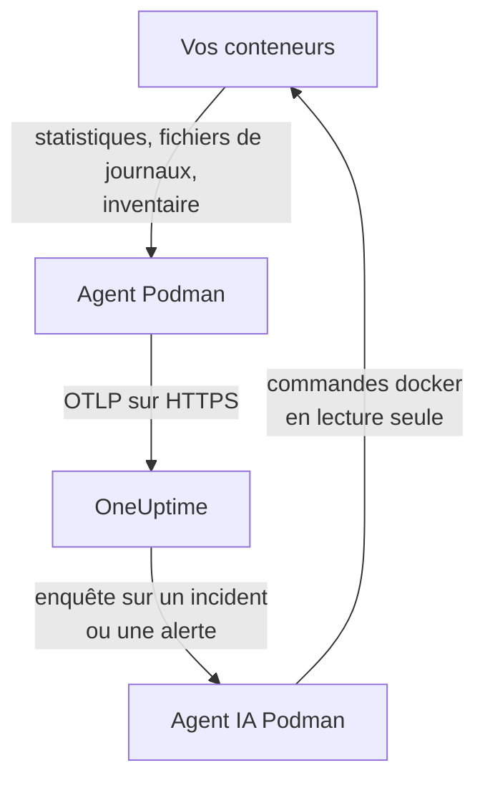

# Agent Podman

L'agent Podman de OneUptime est un conteneur que vous exécutez sur un hôte Podman. Il lit les statistiques et les fichiers de journaux de chaque conteneur de l'hôte et les envoie à OneUptime, où l'hôte apparaît avec ses conteneurs, ses métriques et ses journaux. Un deuxième conteneur, l'agent IA Podman, permet à OneUptime AI d'enquêter sur l'hôte. Les [moniteurs Podman](/docs/monitor/podman-monitor) déclenchent des alertes à partir de ce qu'envoie l'agent.

:::cards
- [Installer l'agent](#installer-lagent): Deux conteneurs, avec `podman run` ou Podman Compose.
- [Ce que collecte l'agent](#ce-que-collecte-lagent): Métriques, journaux et un inventaire de chaque conteneur.
- [Les journaux de conteneurs nécessitent k8s-file](#les-journaux-de-conteneurs-nécessitent-le-pilote-k8s-file): Podman journalise dans journald, sauf si vous changez de pilote.
- [Dépannage](#dépannage): Redémarrages en boucle, métriques manquantes, journaux manquants.
:::

## Fonctionnement

L'agent est un OpenTelemetry Collector avec la configuration de OneUptime intégrée. Via le socket d'API compatible Docker de Podman, il lit les statistiques de chaque conteneur toutes les 30 secondes et liste chaque conteneur, image, réseau et volume toutes les 5 minutes. Il suit les fichiers de journaux des conteneurs et envoie le tout à votre URL OneUptime via OTLP, avec la clé d'ingestion que vous lui donnez.



L'hôte s'enregistre avec ses premières données, sous le nom que vous lui donnez dans `PODMAN_HOST_NAME`. L'agent IA est optionnel : sans lui, le collecteur fonctionne de la même façon.

## Avant de commencer

- Podman 4.0 ou ultérieur, et un accès root sur l'hôte.
- Le socket d'API de Podman sur `/run/podman/podman.sock`. Activez-le avec `sudo systemctl enable --now podman.socket`.
- Une clé d'ingestion. Créez-en une sous **Paramètres du projet → Télémétrie & APM → Clés d'ingestion** et copiez sa valeur.
- Du HTTPS sortant de l'hôte vers votre URL OneUptime.
- Pour les journaux de conteneurs, des conteneurs qui utilisent le pilote de journalisation `k8s-file`. Podman en mode root journalise par défaut dans `journald`, que l'agent ne peut pas lire. Voir [Les journaux de conteneurs nécessitent le pilote k8s-file](#les-journaux-de-conteneurs-nécessitent-le-pilote-k8s-file).

## Installer l'agent

:::steps
### Démarrer l'agent

Remplacez `YOUR_ONEUPTIME_URL` par votre URL OneUptime, `YOUR_TELEMETRY_INGESTION_TOKEN` par la clé d'ingestion, et `my-podman-host` par un nom pour cet hôte, comme `prod-podman-01`. C'est sous ce nom que l'hôte apparaît dans OneUptime : gardez-le donc stable, car un nouveau nom enregistre un nouvel hôte.

:::tabs
@tab Podman CLI
```bash
podman run -d \
  --name oneuptime-podman-agent \
  --user 0:0 \
  --restart unless-stopped \
  -v /run/podman/podman.sock:/run/podman/podman.sock:ro \
  -v /var/lib/containers/storage:/var/lib/containers/storage:ro \
  -e ONEUPTIME_URL="YOUR_ONEUPTIME_URL" \
  -e ONEUPTIME_SERVICE_TOKEN="YOUR_TELEMETRY_INGESTION_TOKEN" \
  -e PODMAN_HOST_NAME="my-podman-host" \
  oneuptime/podman-agent:release
```

Démarrez ensuite l'[agent IA](#agent-ia) à côté, avec les mêmes valeurs. **Les enquêtes IA sont activées par défaut** : pendant que OneUptime AI enquête sur un incident ou une alerte sur cet hôte, elle exécute des commandes `docker` en lecture seule via l'agent IA, sur l'API compatible Docker de Podman, et ne modifie rien tant que vous n'autorisez pas de corrections. Pour installer sans enquêtes IA, ignorez cette commande.

```bash
podman run -d \
  --name oneuptime-podman-ai-agent \
  --user 0:0 \
  --restart unless-stopped \
  --read-only --tmpfs /tmp \
  -v /run/podman/podman.sock:/run/podman/podman.sock:ro \
  -e ONEUPTIME_URL="YOUR_ONEUPTIME_URL" \
  -e ONEUPTIME_SERVICE_TOKEN="YOUR_TELEMETRY_INGESTION_TOKEN" \
  -e ONEUPTIME_AI_AGENT_RESOURCE_TYPE=podman \
  -e PODMAN_HOST_NAME="my-podman-host" \
  oneuptime/resource-ai-agent:release
```
@tab Podman Compose
Enregistrez ceci sous le nom `docker-compose.yml` dans un dossier de l'hôte. Le second service est l'[agent IA](#agent-ia) : retirez-le pour exécuter le collecteur sans enquêtes IA.

```yaml title="docker-compose.yml"
services:
  oneuptime-podman-agent:
    image: oneuptime/podman-agent:release
    container_name: oneuptime-podman-agent
    user: "0:0"
    restart: unless-stopped
    volumes:
      - /run/podman/podman.sock:/run/podman/podman.sock:ro
      - /var/lib/containers/storage:/var/lib/containers/storage:ro
    environment:
      - ONEUPTIME_URL=YOUR_ONEUPTIME_URL
      - ONEUPTIME_SERVICE_TOKEN=YOUR_TELEMETRY_INGESTION_TOKEN
      - PODMAN_HOST_NAME=my-podman-host
    logging:
      driver: json-file
      options:
        max-size: "10m"
        max-file: "3"
  oneuptime-podman-ai-agent:
    image: oneuptime/resource-ai-agent:release
    container_name: oneuptime-podman-ai-agent
    user: "0:0"
    restart: unless-stopped
    read_only: true
    tmpfs:
      - /tmp
    volumes:
      - /run/podman/podman.sock:/run/podman/podman.sock:ro
    environment:
      - ONEUPTIME_URL=YOUR_ONEUPTIME_URL
      - ONEUPTIME_SERVICE_TOKEN=YOUR_TELEMETRY_INGESTION_TOKEN
      - ONEUPTIME_AI_AGENT_RESOURCE_TYPE=podman
      - PODMAN_HOST_NAME=my-podman-host
```

Démarrez-le dans ce dossier :

```bash
podman compose up -d
```
:::

### Vérifier que l'agent s'exécute

```bash
podman ps --filter name=oneuptime-podman-agent
podman logs -f oneuptime-podman-agent
```

Les journaux doivent afficher cette ligne une fois le collecteur démarré :

```text
Everything is ready. Begin running and processing data.
```

### Trouver l'hôte dans OneUptime

Ouvrez **Produits → Infrastructure → Podman → Tous les hôtes**. L'hôte apparaît sous son `PODMAN_HOST_NAME` en une minute environ, avec ses conteneurs, ses métriques et ses journaux. L'agent IA apparaît comme connecté sur la page **Agent IA** de l'hôte, et en bas de sa **Vue d'ensemble**.
:::

## Variables d'environnement

| Variable | Obligatoire | Description |
| --- | --- | --- |
| `ONEUPTIME_URL` | Oui | Votre URL OneUptime, comme `https://oneuptime.com` ou votre instance auto-hébergée. Utilisez `http://` et son port si l'instance ne parle que HTTP. |
| `ONEUPTIME_SERVICE_TOKEN` | Oui | La clé d'ingestion de **Paramètres du projet → Télémétrie & APM → Clés d'ingestion**. |
| `PODMAN_HOST_NAME` | Non | Le nom de l'hôte dans OneUptime. Par défaut `podman-host` : donnez donc le sien à chaque hôte. |
| `DOCKER_API_VERSION` | Non | La version de l'API Docker que l'agent parle avec le socket Podman. Par défaut `1.44`. Baissez-la si le socket signale un maximum plus ancien, ou définissez une valeur vide pour la négocier (voir [Dépannage](#dépannage)). |

Pour modifier une valeur, supprimez l'agent et exécutez de nouveau sa commande (Podman CLI), ou modifiez `docker-compose.yml` et exécutez `podman compose up -d` (Podman Compose).

## Ce que collecte l'agent

| Données | Contenu |
| --- | --- |
| Métriques des conteneurs | CPU (utilisation, pourcentage, bridage), mémoire (utilisation, limite, pourcentage), E/S réseau et bloc, durée de fonctionnement, redémarrages et nombre de processus, par conteneur, toutes les 30 secondes. |
| Journaux des conteneurs | stdout et stderr de chaque conteneur, depuis le fichier `ctr.log` qu'écrit le pilote de journalisation `k8s-file`. |
| Inventaire | Chaque conteneur, quel que soit son état, ainsi que chaque image, réseau et volume, toutes les 5 minutes. |

Les métriques et les journaux de chaque conteneur sont classés sous un service portant le nom du conteneur. Chaque ligne de journal reçoit une gravité d'après le niveau qu'elle mentionne, comme `[ERROR]`, `level=warn` ou `{"level":"info"}` ; une ligne qui n'en mentionne aucun prend celle de son flux : stderr vaut `ERROR`, stdout vaut `INFO`. Les lignes qui commencent par un espace ou un crochet fermant sont rattachées à la ligne précédente : une stack trace arrive donc en un seul enregistrement. Les journaux de l'agent lui-même sont ignorés.

[Surveillance Podman](/docs/monitor/podman-monitor#métriques-collectées) liste chaque métrique et sa signification.

## Les journaux de conteneurs nécessitent le pilote k8s-file

L'agent suit `/var/lib/containers/storage/overlay-containers/*/userdata/ctr.log`, les fichiers qu'écrit le pilote de journalisation `k8s-file` de Podman (`json-file` est le même pilote dans Podman). Le pilote par défaut de Podman en mode root est `journald`, qui ne laisse aucun fichier à lire, tout comme un pilote distant tel que `syslog`. Les métriques d'un tel conteneur arrivent toujours ; ses journaux, non.

Vérifiez le pilote de journalisation d'un conteneur, et celui de Podman par défaut :

```bash
podman inspect <container> --format '{{.HostConfig.LogConfig.Type}}'
podman info --format '{{.Host.LogDriver}}'
```

Exécutez un conteneur avec `k8s-file`, ou passez-y un service Compose :

```bash
podman run --log-driver k8s-file --log-opt max-size=100m ... <image>
```

```yaml
services:
  my-app:
    image: my-app:latest
    logging:
      driver: "k8s-file"
      options:
        max-size: "100m"
```

Ou faites-en la valeur par défaut pour chaque conteneur créé ensuite, dans `containers.conf` (`/etc/containers/containers.conf` en mode root, `~/.config/containers/containers.conf` en mode rootless) :

```toml title="containers.conf"
[containers]
log_driver = "k8s-file"
log_size_max = 104857600
```

Recréez ensuite les conteneurs. Un conteneur garde le pilote de journalisation avec lequel il a été créé : le redémarrer ne suffit donc pas.

## Mettre à jour l'agent

Lorsque l'agent est plus ancien que votre OneUptime, un signe d'avertissement apparaît à côté de **Version de l'agent** dans la **Vue d'ensemble** de l'hôte. Sélectionnez-le pour voir ces commandes.

:::tabs
@tab Podman CLI
```bash
podman pull oneuptime/podman-agent:release
podman pull oneuptime/resource-ai-agent:release
podman rm -f oneuptime-podman-agent oneuptime-podman-ai-agent
```

Exécutez ensuite de nouveau les deux commandes `podman run` de [Démarrer l'agent](#démarrer-lagent).
@tab Podman Compose
```bash
podman compose pull
podman compose up -d
```
:::

Le tag `release` pointe toujours vers la version la plus récente. Pour épingler une version, utilisez `oneuptime/podman-agent:<version>`, comme `oneuptime/podman-agent:10.0.31`. La même image se trouve sur GitHub Container Registry sous `ghcr.io/oneuptime/podman-agent:release`.

## Désinstaller l'agent

:::tabs
@tab Podman CLI
```bash
podman rm -f oneuptime-podman-agent
podman rm -f oneuptime-podman-ai-agent
```
@tab Podman Compose
```bash
podman compose down
```
:::

L'hôte reste dans OneUptime avec les données qu'il a envoyées. Si vous n'en avez plus besoin, supprimez-le avec **Supprimer l'hôte** dans son menu.

## Agent IA

Les commandes et le fichier Compose ci-dessus, l'`install.sh` de l'agent Podman et le `docker-compose.yml` de son [répertoire PodmanAgent](https://github.com/OneUptime/oneuptime/tree/master/agents/PodmanAgent) exécutent tous l'**Agent IA Podman** : un deuxième conteneur, `oneuptime-podman-ai-agent` (image `oneuptime/resource-ai-agent:release`), qui exécute les commandes en lecture seule que demande OneUptime AI pendant qu'elle enquête sur un incident ou une alerte sur cet hôte — via l'API compatible Docker de Podman, avec la CLI `docker` : `docker ps -a`, `docker logs --tail 200 web`, `docker container inspect web` — et, uniquement si vous l'autorisez, applique des corrections comme le redémarrage d'un conteneur donné. Il lit les mêmes `ONEUPTIME_URL`, `ONEUPTIME_SERVICE_TOKEN` et `PODMAN_HOST_NAME` que le collecteur : il sert donc exactement cet hôte, et apparaît sur la page **Agent IA** de l'hôte dans OneUptime.

- **Les enquêtes IA sont activées par défaut.** Dès que l'agent se connecte, OneUptime AI enquête avec lui sur les incidents et les alertes de cet hôte, et la **Vue d'ensemble** de l'hôte affiche l'état de l'agent. Pour arrêter, définissez `ONEUPTIME_AI_INVESTIGATION=false` là où l'agent s'exécute (**Modifier**, sous **Ce que l'IA peut faire** sur la page de l'agent IA, montre comment), ou ne lancez pas l'agent.
- Il est en lecture seule, sauf si vous le démarrez avec `ONEUPTIME_AI_ALLOW_WRITES=true` ; `ONEUPTIME_AI_WRITE_TARGETS` (par exemple `web-*,api-*`) limite les conteneurs qu'une correction peut toucher. Démarrez-le aussi avec `ONEUPTIME_AI_FIXES` pour indiquer comment les corrections s'exécutent — `ask-for-approval` (une personne approuve chacune), `automatic` ou `bypass-approval` — et la page de l'agent IA l'affiche en lecture seule ([Ce que l'IA peut faire, défini par l'agent](/docs/ai/infrastructure-ai-agents#what-ai-may-do-set-by-the-agent)).
- Il a besoin du même socket que le collecteur et s'exécute en tant que root avec ce socket monté, car le socket appartient à root — et, pour Podman en mode root, quiconque peut utiliser le socket est root sur cet hôte, `:ro` ou non. La limite est la politique de commandes de l'agent : il n'exécute jamais `exec`, `run`, `rm` ni `prune`, et ne modifie jamais lui-même, le collecteur ni quoi que ce soit dans `ONEUPTIME_AI_PROTECTED_TARGETS` (des globs de noms de conteneurs).
- `install.sh --no-ai-agent` l'omet ; `podman rm -f oneuptime-podman-ai-agent` le supprime. Mettez-le à jour comme le collecteur : `podman pull oneuptime/resource-ai-agent:release`, supprimez-le, puis redémarrez-le.

Ce qu'il peut exécuter, comment fonctionnent les corrections et comment le dépanner : [Infrastructure AI Agents](/docs/ai/infrastructure-ai-agents#docker-and-podman-hosts).

## Dépannage

:::details L'agent redémarre avec "client version is too new"
Les journaux de l'agent affichent :

```text
Error: cannot start pipelines: failed to start "docker_stats" receiver:
Error response from daemon: client version 1.44 is too new.
Maximum supported API version is 1.41
```

Un serveur d'API Docker qui impose une version maximale de client en refuse une plus récente : le receiver ne démarre donc jamais, et le collecteur s'arrête avec lui. Vérifiez la version de l'API que signale le socket Podman :

```bash
curl -s -o /dev/null -D - --unix-socket /run/podman/podman.sock http://localhost/_ping | grep -i '^api-version'
```

Ajoutez ensuite `-e DOCKER_API_VERSION=1.41` (ou la valeur obtenue) à `podman run`, ou définissez `DOCKER_API_VERSION` dans Compose. Les serveurs plus récents servent toujours les anciennes versions de l'API : le réglage reste donc valable après une mise à jour.

Vous préférez ne pas chercher le numéro ? Définissez `DOCKER_API_VERSION` sur la chaîne vide. L'agent négocie alors la version avec le socket (un `HEAD /_ping`, puis le maximum que signale le socket) au lieu d'en épingler une :

```bash
podman run -d ... -e DOCKER_API_VERSION= ...
```
:::

:::details Accès refusé au socket Podman, ou pas de socket
L'agent doit s'exécuter en tant que root pour lire `/run/podman/podman.sock`. Vérifiez que `--user 0:0` figure dans votre commande `podman run`, ou `user: "0:0"` dans Compose, et que le socket est activé : `sudo systemctl enable --now podman.socket`. Podman en mode rootless a plutôt son socket sur `/run/user/<uid>/podman/podman.sock` (`systemctl --user enable --now podman.socket`) : montez ce chemin à la place de `/run/podman/podman.sock`.
:::

:::details L'hôte apparaît comme déconnecté
1. Vérifiez que l'agent s'exécute : `podman ps --filter name=oneuptime-podman-agent`
2. Recherchez des erreurs dans ses journaux : `podman logs oneuptime-podman-agent 2>&1 | grep -i error`
3. Vérifiez `ONEUPTIME_URL` et `ONEUPTIME_SERVICE_TOKEN` : la clé doit être une clé d'ingestion valide qui n'a pas été désactivée.
4. Vérifiez que l'hôte peut joindre votre URL OneUptime sur le réseau.
:::

:::details Aucune métrique n'apparaît
1. Vérifiez que le socket Podman est monté dans l'agent. Son image n'a pas de shell : regardez donc depuis un conteneur jetable qui partage ses montages : `podman run --rm --volumes-from oneuptime-podman-agent alpine:3.19 ls -la /run/podman/podman.sock`
2. Recherchez des erreurs d'export dans ses journaux : `podman logs oneuptime-podman-agent 2>&1 | tail -100`
3. Vérifiez que la clé d'ingestion est valide et n'a pas expiré.
:::

:::details Les métriques arrivent, mais pas les journaux des conteneurs
Vos conteneurs utilisent très probablement `journald`, le pilote de journalisation par défaut de Podman. Vérifiez quels fichiers l'agent surveille, et quel pilote utilise un conteneur :

```bash
podman logs oneuptime-podman-agent 2>&1 | grep -E "Started watching file|no files match"
podman inspect <container> --format '{{.HostConfig.LogConfig.Type}}'
```

Si l'agent signale `no files match the configured criteria`, passez les conteneurs à `k8s-file` et recréez-les, comme le montre [Les journaux de conteneurs nécessitent le pilote k8s-file](#les-journaux-de-conteneurs-nécessitent-le-pilote-k8s-file).
:::

:::details Les journaux sont sur un autre hôte, ou l'hôte s'appelle podman-host
Le nom de l'hôte vient de `PODMAN_HOST_NAME`. Un agent démarré sans lui signale `podman-host` : tous les hôtes configurés ainsi semblent donc être le même. Changez le nom plus tard, et OneUptime enregistre un second hôte, qui reçoit alors les nouvelles données. Définissez `PODMAN_HOST_NAME` sur un nom propre à chaque hôte, et recréez l'agent. Pour vérifier le nom que signale l'agent :

```bash
podman inspect oneuptime-podman-agent --format '{{range .Config.Env}}{{println .}}{{end}}' | grep PODMAN_HOST_NAME
```
:::

## Étapes suivantes

:::cards
- [Surveillance Podman](/docs/monitor/podman-monitor): Alerter sur le CPU, la mémoire et les redémarrages des conteneurs.
- [Bases de données](/docs/telemetry/databases): Les conteneurs de bases de données de l'hôte sont détectés et ont leurs propres pages.
- [Agent Kubernetes](/docs/telemetry/kubernetes-agent): Surveiller plutôt un cluster Kubernetes.
- [Collecteur OpenTelemetry sur l'hôte](/docs/telemetry/host-otel-collector): Surveiller la machine elle-même : CPU, disques, processus et journaux.
:::
