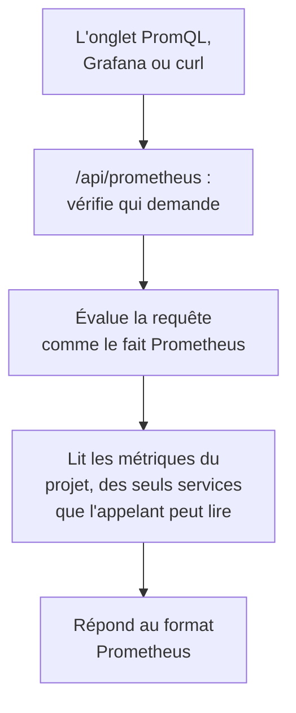

# Interroger les métriques avec PromQL

PromQL est le langage de requête de Prometheus, celui que connaissent déjà la plupart des gens qui représentent des métriques en graphiques. OneUptime s'en sert pour lire les métriques de votre projet : dans l'onglet **PromQL** de la page Métriques, et via une API compatible Prometheus vers laquelle Grafana, ou tout outil doté d'une source de données Prometheus, peut pointer.

:::cards
- [Écrire une requête](#écrire-une-requête): Exécuter du PromQL sur la page Métriques et voir un graphique ou un tableau.
- [Comment les métriques sont nommées](#comment-les-métriques-sont-nommées): Comment les noms et les attributs OpenTelemetry se lisent en PromQL.
- [Connecter Grafana](#connecter-grafana): Ajouter OneUptime comme source de données Prometheus.
- [Limites](#limites): Ce qu'une requête peut lire, et pendant combien de temps.
:::

## Fonctionnement

L'onglet PromQL et Grafana interrogent la même API. OneUptime vérifie que l'appelant peut lire les métriques du projet, ne lit que les services qu'il peut lire, et évalue la requête comme le fait Prometheus.



## Avant de commencer

- **Des métriques qui arrivent.** Envoyez-les avec [OpenTelemetry](/docs/telemetry/open-telemetry), ou depuis un agent comme le [Collecteur OpenTelemetry sur l'hôte](/docs/telemetry/host-otel-collector).
- **Un rôle qui peut lire les métriques.** Project Owner, Project Admin, Project Member, Viewer, Telemetry Admin, Telemetry Member ou Telemetry Viewer, ou un rôle personnalisé avec la permission Read Metrics. Un rôle limité à certains services ne lit que leurs métriques.
- **Pour Grafana ou un script : une clé API du projet** avec l'un de ces rôles ou la permission Read Metrics. Voir [Créer une clé API](/docs/api-reference/api-reference#créer-une-clé-api). Sur OneUptime Cloud, les clés API nécessitent l'offre **Growth**.

## Écrire une requête

:::steps
### Ouvrir PromQL

Ouvrez **Métriques** et cliquez sur l'onglet **PromQL**.

### Écrire la requête

Tapez-la dans l'éditeur, choisissez un exemple sous **Exemples**, ou commencez avec **Ajouter un nom de métrique**, qui liste les métriques de votre projet telles que PromQL les nomme.

### L'exécuter

Cliquez sur **Exécuter la requête**, ou appuyez sur Ctrl+Entrée (⌘+Entrée sur un Mac). **Graphique** trace la requête sur la plage de temps ; **Tableau** montre la valeur de chaque série à la fin de celle-ci.
:::

Quelques requêtes pour commencer :

```text title="PromQL"
# Requests per second, by service
sum by (job) (rate(http_requests_total[5m]))

# The 95th percentile of a latency histogram
histogram_quantile(0.95, sum by (le) (rate(http_server_request_duration_bucket[5m])))

# The five hosts using the most memory
topk(5, system_memory_usage)
```

Pour une requête qui ne s'exécute pas, l'éditeur montre ce qui n'a pas marché, et où : `rate(http_requests_total)`, par exemple, indique que la fonction a besoin d'une plage comme `[5m]`.

## Comment les métriques sont nommées

OneUptime stocke les métriques à la manière d'OpenTelemetry. PromQL les lit avec les noms que leur donne la prise en charge d'OpenTelemetry intégrée à Prometheus, si bien qu'une requête écrite pour Prometheus fonctionne ici :

| Dans OneUptime | En PromQL |
| --- | --- |
| Une jauge `system.cpu.utilization` | `system_cpu_utilization` |
| Un compteur `http.requests` | `http_requests`, ou `http_requests_total` |
| Un histogramme `http.server.request.duration` | `http_server_request_duration_bucket` (avec `le`), `_count` et `_sum` |
| Un summary `rpc.latency` | `rpc_latency` (avec `quantile`), `_count` et `_sum` |
| Un attribut `http.route` | L'étiquette `http_route` |
| Un attribut de ressource `service.name` | L'étiquette `resource_service_name`, et `job` |
| Un attribut de ressource `service.instance.id` | L'étiquette `resource_service_instance_id`, et `instance` |

- **Les points et les tirets deviennent des tirets bas** dans les noms de métriques et d'étiquettes. Pour nommer une métrique ou une étiquette exactement comme elle est stockée, mettez son nom entre guillemets, comme le fait Prometheus 3 : `{"http.server.request.duration", "http.route"="/checkout"}`.
- **Les compteurs delta sont additionnés** depuis le début de la plage de temps de la requête, si bien que `rate()` et `increase()` les lisent comme n'importe quel autre compteur.
- **Les histogrammes exponentiels** ont `_count` et `_sum`, mais pas de buckets.

## Connecter Grafana

:::steps
### Créer une clé API

Dans OneUptime, ouvrez **Paramètres du projet → Avancé → Clés API** et cliquez sur **Créer : Clé API**. Donnez à la clé un rôle qui peut lire la télémétrie, ou la permission Read Metrics.

### Ajouter une source de données Prometheus

Dans Grafana, ouvrez **Connections → Data sources → Add data source** et choisissez **Prometheus**.

### Saisir l'URL du serveur

Réglez **Prometheus server URL** sur votre adresse OneUptime suivie de `/api/prometheus`. Sur OneUptime Cloud, c'est `https://oneuptime.com/api/prometheus`. L'onglet **PromQL** affiche l'adresse de votre propre serveur, avec un bouton pour la copier.

### Envoyer la clé API

Sous **HTTP headers**, ajoutez l'en-tête `Authorization` avec la valeur `Bearer` suivie d'un espace et de votre clé API. L'authentification basique fonctionne aussi : n'importe quel nom d'utilisateur, avec la clé API comme mot de passe.

### Enregistrer et tester

Cliquez sur **Save & test**. Grafana exécute une requête et indique que la source de données fonctionne.
:::

Tout autre client Prometheus fonctionne de la même façon. Avec curl :

```bash title="Query OneUptime's Prometheus API"
curl -H "Authorization: Bearer $ONEUPTIME_API_KEY" \
  "https://oneuptime.com/api/prometheus/api/v1/query?query=up"
```

## L'API

L'API répond aux routes de l'API HTTP de Prometheus, en `GET` ou en `POST`, sous `/api/prometheus` :

| Route | Ce qu'elle renvoie |
| --- | --- |
| `/api/v1/query` | Une requête à un instant donné (`time`, maintenant par défaut). |
| `/api/v1/query_range` | Une requête à chaque `step` de `start` à `end`. |
| `/api/v1/series` | Les séries que `match[]` sélectionne. |
| `/api/v1/labels` | Les noms d'étiquettes, des séries que `match[]` sélectionne ou de toutes les métriques. |
| `/api/v1/label/<name>/values` | Les valeurs d'une étiquette. `__name__` liste les noms de métriques. |
| `/api/v1/metadata` | Le type, l'aide et l'unité de chaque métrique. |

Les instants s'écrivent en secondes Unix ou en RFC 3339, les durées en secondes ou sous forme de durée comme `15s`, et les réponses sont au format de Prometheus. `/api/v1/status/buildinfo` répond comme un serveur Prometheus 3 ; les règles et les alertes sont vides, car OneUptime alerte avec des [moniteurs](/docs/monitor/metrics-monitor).

## Ce que couvre PromQL

- **Sélecteurs** avec tous les comparateurs (`=`, `!=`, `=~`, `!~`), plages, `offset`, `@` (avec `start()` et `end()`) et sous-requêtes.
- **Opérateurs** : arithmétique, comparaisons (avec `bool`), `and`, `or`, `unless`, et correspondance de vecteurs avec `on`, `ignoring`, `group_left` et `group_right`.
- **Agrégations** : `sum`, `avg`, `min`, `max`, `count`, `group`, `stddev`, `stdvar`, `topk`, `bottomk`, `quantile` et `count_values`, avec `by` ou `without`.
- **Fonctions** : `rate`, `irate`, `increase`, `delta`, `idelta`, `deriv`, `predict_linear`, `histogram_quantile`, toutes les fonctions `*_over_time`, `changes`, `resets`, `absent`, `label_replace`, `label_join`, `sort`, `clamp`, `round`, les fonctions mathématiques et de date, et plus encore.

Les fonctions d'histogrammes natifs de Prometheus, comme `histogram_count()`, ne sont pas disponibles : OneUptime stocke les histogrammes avec des buckets, que lisent `histogram_quantile()` et les séries `_count` et `_sum`.

## Limites

Chaque requête est bornée, pour qu'un tableau de bord aux nombreux panneaux ne puisse pas surcharger OneUptime :

| Limite | Valeur |
| --- | --- |
| Points dans une série d'une requête de plage | 11 000 |
| Échantillons qu'une requête peut lire et garder en mémoire | 5 000 000 |
| Points de métrique qu'un sélecteur peut lire | 1 000 000 |
| Durée maximale d'une lecture | 30 secondes |
| Durée maximale de l'évaluation | 30 secondes |
| Jusqu'où un sélecteur remonte pour trouver le dernier échantillon d'une série | 5 minutes |
| Le pas d'une sous-requête, quand la requête l'omet | 1 minute |

## Dépannage

:::details Grafana indique que la source de données ne fonctionne pas
Vérifiez que l'URL se termine par `/api/prometheus`, et que l'en-tête `Authorization` contient `Bearer`, un espace et la clé API. Une clé sans rôle qui peut lire les métriques est refusée : donnez-lui-en un dans **Paramètres du projet → Avancé → Clés API**.
:::

:::details Une métrique de l'explorateur ne renvoie rien
Son nom PromQL a des tirets bas là où le nom stocké a des points, et un histogramme se lit via `_bucket`, `_count` ou `_sum`. **Ajouter un nom de métrique** dans l'onglet PromQL liste chaque nom tel que PromQL l'écrit.
:::

:::details "The query reads more than 1,000,000 metric points"
La requête demande plus qu'une lecture ne peut en contenir. Ajoutez des comparateurs d'étiquettes, raccourcissez la plage de temps, ou utilisez un pas plus grand.
:::

## Étapes suivantes

:::cards
- [Explorateur de métriques](/docs/telemetry/metrics-explorer): Représenter des métriques en graphique sans écrire de requête.
- [Surveillance des métriques](/docs/monitor/metrics-monitor): Être alerté quand une métrique franchit un seuil.
- [Sources de données externes](/docs/dashboards/data-sources): Représenter un Prometheus externe sur vos tableaux de bord.
:::
