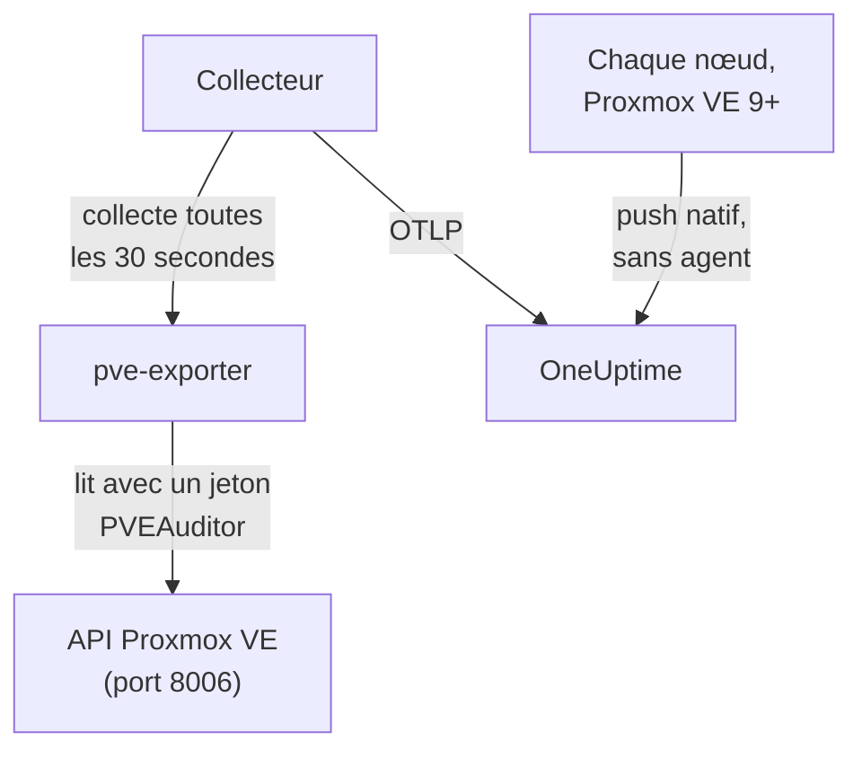

# Agent Proxmox

L'agent Proxmox de OneUptime surveille un cluster Proxmox VE : ses nœuds, ses VM QEMU, ses conteneurs LXC, son stockage, l'état HA, la couverture des sauvegardes et la réplication. Il lit le cluster via l'API Proxmox VE avec un jeton en lecture seule et envoie ce qu'il trouve à OneUptime, où le cluster apparaît avec ses nœuds, ses invités et son stockage. Sur Proxmox VE 9 et les versions ultérieures, les nœuds peuvent aussi pousser eux-mêmes leurs métriques, sans rien installer. Les [moniteurs Proxmox](/docs/monitor/proxmox-monitor) déclenchent des alertes à partir de ce qui arrive.

:::cards
- [Choisir le mode de connexion](#choisir-le-mode-de-connexion): L'agent, ou le push propre à Proxmox VE 9.
- [Installer l'agent](#installer-lagent): Un jeton d'API, puis le script d'installation ou Docker Compose.
- [Push natif](#alternative-sans-installation-push-opentelemetry-natif-de-proxmox-ve-9): Proxmox VE 9 envoie lui-même ses métriques.
- [Dépannage](#dépannage): Un script de diagnostic, et les problèmes habituels.
:::

## Fonctionnement

L'agent est un ensemble de conteneurs que vous exécutez avec Docker Compose sur une machine : [prometheus-pve-exporter](https://github.com/prometheus-pve/prometheus-pve-exporter) lit l'API Proxmox VE sur le port 8006, un OpenTelemetry Collector collecte l'exporteur toutes les 30 secondes et appose le nom de votre cluster sur chaque métrique, et l'agent IA Proxmox permet à OneUptime AI de lire le cluster pendant qu'elle enquête. Le push natif de Proxmox VE 9 envoie plutôt les métriques de chaque nœud directement à OneUptime.



Le cluster s'enregistre avec ses premières données, sous le nom que l'agent appose sur chaque métrique en tant que `proxmox.cluster.name`.

## Choisir le mode de connexion

| | L'agent | Push natif |
| --- | --- | --- |
| Proxmox VE | Toute version prise en charge | 9.0 ou ultérieure |
| À installer | Docker Compose sur une machine | Rien : un serveur de métriques dans l'interface web de Proxmox |
| Nœuds, invités et stockage | Oui | Oui |
| État HA, démarrage au boot, couverture des sauvegardes et réplication | Oui | Non |
| Agent IA Proxmox | Oui | Non |

Les modèles **HA Resource in Error State**, **Guest Down**, **Guest Not Backed Up** et **Replication Failing** nécessitent l'agent. Utilisez l'un ou l'autre pour un cluster : exécuter les deux signale chaque ressource deux fois.

## Avant de commencer

- Docker Engine 20.10 ou ultérieur avec le plugin Docker Compose v2, sur une machine qui peut joindre l'API Proxmox VE sur le port 8006.
- Un shell root sur n'importe quel nœud Proxmox VE, ou l'interface web de Proxmox, pour créer un jeton d'API.
- Une clé d'ingestion. Créez-en une sous **Paramètres du projet → Télémétrie & APM → Clés d'ingestion** et copiez sa valeur.
- Du HTTPS sortant de cette machine vers votre URL OneUptime.

### Où exécuter l'agent

L'agent interroge l'API Proxmox VE sur le réseau : il n'a donc pas besoin de résider sur un nœud du cluster, et il ne le devrait pas. Exécutez-le sur une machine qui survit à la panne d'un nœud (une petite VM de supervision sur un matériel distinct, un hôte d'administration), ou pointez `PVE_HOST` vers une IP virtuelle ou un nom DNS en round-robin plutôt que vers l'adresse d'un seul nœud. Si la cible d'API de l'agent est le nœud qui vient de tomber, votre supervision tombe avec lui. La seule exception est le pipeline optionnel des journaux journald, qui doit s'exécuter sur un nœud Proxmox VE (voir [Envoyer les journaux des services Proxmox](#optionnel-envoyer-les-journaux-des-services-proxmox)).

## Installer l'agent

:::steps
### Créer un jeton d'API en lecture seule

L'agent lit le cluster avec un jeton d'API doté du rôle **PVEAuditor**, qui peut lire et rien d'autre.

:::tabs
@tab Shell
En tant que root sur n'importe quel nœud Proxmox VE :

```bash
pveum user add monitoring@pam
pveum acl modify / --roles PVEAuditor --users monitoring@pam
pveum user token add monitoring@pam oneuptime --privsep 1
pveum acl modify / --roles PVEAuditor --tokens 'monitoring@pam!oneuptime'
```

La première commande n'échoue, sans conséquence, que si `monitoring@pam` existe déjà : les jetons d'API portent leur propre secret, l'utilisateur n'a donc besoin ni de mot de passe ni de compte système. `pveum user token add` affiche le secret du jeton une seule fois ; l'ID du jeton est `monitoring@pam!oneuptime`.
@tab Proxmox web UI
1. Allez dans *Datacenter → Permissions → API Tokens* et cliquez sur **Add**.
2. Choisissez (ou créez) un utilisateur, donnez au jeton un ID comme `oneuptime`, et laissez **Privilege Separation** cochée.
3. Copiez l'ID du jeton (`user@realm!tokenname`) et le secret : le secret n'est affiché qu'une seule fois.
4. Sous *Datacenter → Permissions*, ajoutez deux fois le rôle **PVEAuditor** sur le chemin `/` : une fois en tant que **API Token Permission** pour le jeton, une fois en tant que **User Permission** pour son utilisateur.
:::

Le rôle va sur l'utilisateur comme sur le jeton, car un jeton à privilèges séparés n'obtient que les permissions que son utilisateur possède aussi. Il doit se trouver sur le chemin racine `/`, car l'exporteur lit chaque objet nœud, invité et stockage : un chemin plus restreint masque le reste du cluster et échoue avec `401`/`403 Permission check failed (/, Sys.Audit)`.

### Installer et démarrer l'agent

:::tabs
@tab install.sh
Téléchargez le script d'installation et exécutez-le sur la machine qui hébergera l'agent :

```bash
curl -sSL https://raw.githubusercontent.com/OneUptime/oneuptime/master/agents/ProxmoxAgent/install.sh -o install.sh
bash install.sh
```

Le script demande votre URL OneUptime, la clé d'ingestion, un nom pour le cluster, l'hôte de l'API Proxmox VE, s'il faut exécuter l'exporteur fourni, ainsi que l'ID et le secret du jeton — puis si l'[agent IA](#agent-ia) peut appliquer des corrections et, si oui, un jeton qui lui est propre et les invités qu'il ne doit jamais modifier. Il s'installe dans `/opt/oneuptime-proxmox-agent`, écrit un fichier `.env` en `0600` et démarre l'agent avec Docker Compose. Relancer le script réutilise tout le contenu de ce `.env` au lieu de poser de nouveau les questions, et c'est ainsi que vous [mettez à jour l'agent](#mettre-à-jour-lagent).
@tab Docker Compose
Téléchargez `docker-compose.yml` et `otel-collector-config.yaml` depuis le [répertoire ProxmoxAgent](https://github.com/OneUptime/oneuptime/tree/master/agents/ProxmoxAgent) dans un nouveau dossier :

```bash
mkdir oneuptime-proxmox-agent && cd oneuptime-proxmox-agent
curl -fsSLO https://raw.githubusercontent.com/OneUptime/oneuptime/master/agents/ProxmoxAgent/docker-compose.yml
curl -fsSLO https://raw.githubusercontent.com/OneUptime/oneuptime/master/agents/ProxmoxAgent/otel-collector-config.yaml
```

Créez un fichier `.env` à côté. Il contient le secret du jeton : gardez-le privé avec `chmod 600 .env` :

```bash title=".env"
ONEUPTIME_URL=YOUR_ONEUPTIME_URL
ONEUPTIME_TELEMETRY_INGESTION_KEY=YOUR_TELEMETRY_INGESTION_TOKEN
PROXMOX_CLUSTER_NAME=my-proxmox-cluster
PVE_HOST=192.168.1.10
PVE_API_TOKEN_ID=monitoring@pam!oneuptime
PVE_API_TOKEN_SECRET=your-token-secret
COMPOSE_PROFILES=pve-exporter
```

`COMPOSE_PROFILES=pve-exporter` démarre aussi l'exporteur fourni. Démarrez l'agent :

```bash
docker compose up -d
```
:::

Vous utilisez déjà prometheus-pve-exporter ? Répondez **n** lorsque le script demande s'il faut exécuter celui qui est fourni, ou retirez `COMPOSE_PROFILES` de `.env`, et pointez l'agent vers le vôtre (`host:port`, sans schéma, une adresse que le conteneur de l'agent peut joindre : `localhost` désigne le conteneur lui-même). Gardez `PVE_API_TOKEN_ID` et `PVE_API_TOKEN_SECRET` si vous utilisez l'[agent IA](#agent-ia), qui appelle l'API avec ce jeton :

```bash
PVE_EXPORTER_URL=your-exporter-host:9221
```

### Vérifier que l'agent s'exécute

```bash
docker compose ps
docker logs -f oneuptime-proxmox-agent
```

`docker compose ps` liste le collecteur (`oneuptime-proxmox-agent`), l'exporteur fourni (`oneuptime-pve-exporter`, sauf si vous utilisez le vôtre) et l'agent IA (`oneuptime-proxmox-ai-agent`). Les journaux du collecteur doivent afficher cette ligne une fois qu'il a démarré :

```text
Everything is ready. Begin running and processing data.
```

### Trouver le cluster dans OneUptime

Ouvrez **Produits → Infrastructure → Proxmox → Tous les clusters**. Le cluster apparaît sous son `PROXMOX_CLUSTER_NAME` environ une minute après la première collecte, avec ses nœuds, ses invités et son stockage.
:::

## Variables d'environnement

Le script d'installation les écrit dans `/opt/oneuptime-proxmox-agent/.env` ; une installation Docker Compose les lit dans le `.env` situé à côté de `docker-compose.yml`. Après en avoir modifié une, exécutez `docker compose up -d` dans ce dossier.

| Variable | Obligatoire | Description |
| --- | --- | --- |
| `ONEUPTIME_URL` | Oui | Votre URL OneUptime, comme `https://oneuptime.com` ou votre instance auto-hébergée. Utilisez `http://` et son port si l'instance ne parle que HTTP. |
| `ONEUPTIME_TELEMETRY_INGESTION_KEY` | Oui | La clé d'ingestion de **Paramètres du projet → Télémétrie & APM → Clés d'ingestion**. |
| `PROXMOX_CLUSTER_NAME` | Oui | Le nom du cluster dans OneUptime, apposé sur chaque métrique comme attribut de ressource `proxmox.cluster.name`. Gardez-le stable : le modifier plus tard enregistre un second cluster. Par défaut `proxmox-cluster`. |
| `PVE_HOST` | Oui | L'hôte de l'API Proxmox VE (n'importe quel nœud du cluster) qu'interrogent l'exporteur et l'agent IA, comme `192.168.1.10`. |
| `PVE_EXPORTER_URL` | Non | L'adresse (`host:port`, sans schéma) de prometheus-pve-exporter. Par défaut l'exporteur fourni, `pve-exporter:9221`. |
| `PVE_API_TOKEN_ID` | Exporteur fourni ou agent IA | L'ID complet du jeton d'API Proxmox, comme `monitoring@pam!oneuptime`. L'agent IA lit l'API avec lui, sauf s'il dispose de son propre jeton (`ONEUPTIME_AI_PVE_API_TOKEN_ID` / `ONEUPTIME_AI_PVE_API_TOKEN_SECRET`). |
| `PVE_API_TOKEN_SECRET` | Exporteur fourni ou agent IA | Le secret du jeton d'API Proxmox. |
| `PVE_VERIFY_SSL` | Non | Vérifier le certificat TLS de l'API Proxmox (l'exporteur et l'agent IA). Par défaut `false`, car Proxmox est livré avec des certificats auto-signés. |
| `COMPOSE_PROFILES` | Non | À définir sur `pve-exporter` pour démarrer le conteneur de l'exporteur fourni. |

## Ce que collecte l'agent

Le collecteur collecte l'exporteur toutes les 30 secondes avec ses collectors de cluster et de nœud activés, ce qui couvre aussi les collectors `backup-info` (au niveau du cluster) et `replication` (au niveau du nœud) de l'exporteur, activés par défaut. Chaque série porte une étiquette `id` qui nomme la ressource : `node/<name>`, `qemu/<vmid>`, `lxc/<vmid>` ou `storage/<node>/<storage>`.

| Catégorie | Métriques |
| --- | --- |
| Disponibilité | `pve_up`, `pve_uptime_seconds` |
| Nœud | `pve_node_info`, `pve_cpu_usage_ratio`, `pve_cpu_usage_limit`, `pve_memory_usage_bytes`, `pve_memory_size_bytes` |
| Invité (VM ou LXC) | `pve_guest_info`, et des séries de CPU, de mémoire et de réseau sur les ID `qemu/*` et `lxc/*` (`pve_network_receive_bytes`, `pve_network_transmit_bytes`) |
| Stockage | `pve_disk_usage_bytes`, `pve_disk_size_bytes`, `pve_storage_info` |
| HA | `pve_ha_state` |
| Couverture des sauvegardes | `pve_not_backed_up_total` (les invités qu'aucune tâche de sauvegarde ne couvre ; une seule série au niveau du cluster, sans étiquette `id`) et `pve_not_backed_up_info` (une série par invité non couvert, avec son `id`). Couvert signifie qu'au moins une tâche sélectionne l'invité : l'exporteur n'indique pas si les sauvegardes ont été exécutées récemment ni si elles ont réussi. |
| Réplication | `pve_replication_failed_syncs`, `pve_replication_duration_seconds`, `pve_replication_last_sync_timestamp_seconds`, `pve_replication_last_try_timestamp_seconds`, `pve_replication_next_sync_timestamp_seconds`, `pve_replication_info`, par tâche de réplication de stockage. Leur étiquette `id` est l'ID de la tâche (comme `100-0`), et non une ressource. |

Les critères des moniteurs et les filtres d'attributs comparent par égalité, et non par préfixe : le processeur `transform/pve-identity` du collecteur découpe donc aussi `id` en trois attributs. Les modèles d'alerte Proxmox intégrés filtrent dessus : gardez donc ce processeur si vous personnalisez la configuration :

| Attribut | Valeurs | Pour `qemu/100` |
| --- | --- | --- |
| `pve.scope` | `node`, `guest`, `storage`, `cluster` (`qemu` et `lxc` valent tous deux `guest`) | `guest` |
| `pve.type` | `node`, `qemu`, `lxc`, `storage` | `qemu` |
| `pve.id` | Tout ce qui suit le premier `/` de `id` (`pve1`, `100`, `pve1/local`) | `100` |

L'étiquette `id` d'origine est conservée telle quelle.

## Optionnel — Envoyer les journaux des services Proxmox

Par défaut, l'agent n'envoie que des métriques : la page **Journaux** du cluster reste donc vide. Les services Proxmox VE journalisent dans le journal systemd sous huit unités : `pveproxy`, `pvedaemon`, `pve-firewall`, `pve-ha-crm`, `pve-ha-lrm`, `pvescheduler`, `pvestatd` et `qmeventd`. Le `otel-collector-config.yaml` fourni contient un receiver `journald` commenté pour exactement ces unités, relié à un pipeline `logs` commenté qui appose `proxmox.cluster.name`, afin que les journaux arrivent sur votre cluster.

:::steps
### Exécuter l'agent sur un nœud

Le journal est propre à chaque hôte : un agent distant ne peut donc pas le lire. C'est la seule configuration qui va à l'encontre de [Où exécuter l'agent](#où-exécuter-lagent) : pour garder l'agent de métriques hors du cluster, exécutez plutôt sur le nœud un second collecteur dédié aux journaux (copiez la configuration, puis supprimez le receiver `prometheus` et le pipeline `metrics`).

### Activer le receiver

Décommentez le receiver `journald` et le pipeline `logs` dans `otel-collector-config.yaml`, ainsi que les volumes du journal dans `docker-compose.yml`, pour que le conteneur puisse lire le journal de l'hôte :

```yaml
- /var/log/journal:/var/log/journal:ro
- /etc/machine-id:/etc/machine-id:ro
```

### Remplacer l'image du collecteur

L'image standard `otel/opentelemetry-collector-contrib` est construite `FROM scratch` : elle n'a pas de `journalctl`, que le receiver journald exécute, et s'exécute sous un utilisateur qui ne peut pas lire le journal. Construisez ce wrapper et pointez dessus l'`image:` de `docker-compose.yml` :

```dockerfile title="Dockerfile"
FROM otel/opentelemetry-collector-contrib:0.161.0 AS otelcol
FROM debian:stable-slim
RUN apt-get update \
    && apt-get install -y --no-install-recommends systemd \
    && rm -rf /var/lib/apt/lists/*
COPY --from=otelcol /otelcol-contrib /otelcol-contrib
ENTRYPOINT ["/otelcol-contrib"]
CMD ["--config", "/etc/otelcol-contrib/config.yaml"]
```

Le paquet `systemd` n'est là que pour `journalctl`, et cette image s'exécute en tant que root, qui peut lire le journal. Ou bien passez-vous de Docker pour les journaux et exécutez le `.deb` de la version `otelcol-contrib` sur le nœud lui-même, où `journalctl` est déjà présent.
:::

Chaque nœud n'envoie que son propre journal : pour les journaux des services de tous les nœuds, exécutez le collecteur dédié aux journaux sur chaque nœud.

### Solution de repli sans image personnalisée : filelog sur /var/log/syslog

Pour garder l'image standard, suivez plutôt syslog. Installez rsyslog sur le nœud (`apt install rsyslog` ; Debian 12 et Proxmox VE 8 et ultérieurs ne le fournissent plus), montez le répertoire `/var/log` dans le conteneur (`- /var/log:/var/log:ro` ; le répertoire, et non le fichier, pour que la rotation des journaux ne fige pas un fichier obsolète), et utilisez un receiver `filelog` à la place du receiver journald :

```yaml
receivers:
  filelog:
    include:
      - /var/log/syslog
    start_at: end
```

Vous perdez le filtre par unité (syslog contient tout, pas seulement les huit services), et l'utilisateur de l'image standard doit pouvoir lire le fichier. Reliez-le au même pipeline `logs` commenté (`receivers: [filelog]`).

## Alternative sans installation : push OpenTelemetry natif de Proxmox VE 9+

Proxmox VE 9.0 et les versions ultérieures fournissent un serveur de métriques OpenTelemetry qui pousse les métriques des nœuds, des invités et du stockage vers n'importe quel endpoint OTLP/HTTP, sans agent ni exporteur à installer. Dans l'interface web de Proxmox, allez dans *Datacenter → Metric Server → Add → OpenTelemetry* et renseignez :

| Champ | Valeur |
| --- | --- |
| Server | Votre hôte OneUptime, comme `oneuptime.com`, ou votre hôte auto-hébergé |
| Port | `443` |
| Protocol | `https` |
| Path | `/otlp/v1/metrics` |
| Headers | `{"x-oneuptime-token": "YOUR_TELEMETRY_INGESTION_TOKEN"}` |

Ajoutez-le une fois : chaque nœud du cluster pousse ses propres métriques. OneUptime reconnaît le push et le traduit en séries `pve_*` identiques à celles qu'envoie l'agent, si bien que :

- le cluster s'enregistre sous le nom de votre cluster Proxmox (un nœud autonome, sous son nom de nœud), et un `proxmox.cluster.name` que vous définissez sous *Resource Attributes* reste utilisé à la place ;
- les pages Nœuds, Invités et Stockage, les graphiques de la vue d'ensemble, le catalogue de métriques et les modèles d'alerte de CPU, de mémoire et de stockage fonctionnent comme avec l'agent ;
- les séries d'origine `proxmox_node_*`, `proxmox_vm_*` et `proxmox_storage_*` restent dans [Metrics Explorer](/docs/monitor/metrics-monitor) pour tout ce que Proxmox VE signale d'autre (charge moyenne, swap, pressure stall, trafic par carte réseau).

### Quand un nœud cesse de se signaler

Chaque nœud ne pousse que son propre état : un nœud qui tombe ne peut donc pas le signaler lui-même. Ce sont les nœuds encore en vie qui le signalent à sa place :

- Environ 2 minutes après son dernier signalement, le nœud apparaît **Hors ligne** sur la page Nœuds. **Dernière fois vu**, sur la page du nœud lui-même, conserve l'heure de son propre dernier signalement.
- Après environ 5 minutes, **Node Offline** se déclenche pour lui. **Cluster Quorum at Risk** le compte aussi comme hors ligne ; comme ce modèle a besoin d'une fenêtre complète de 5 minutes de signalements, il se déclenche environ 7–9 minutes après que le nœud s'est tu.
- À son signalement suivant, il est de nouveau **En ligne**, et son alerte se rétablit.

Hors ligne signifie ici que le nœud a cessé de se signaler, pas forcément qu'il est en panne. Un nœud en marche mais dont le `pvestatd` est bloqué ou tué, dont le système de fichiers du cluster (`pmxcfs`) est arrêté, ou dont le réseau vers OneUptime est coupé, est signalé de la même façon.

Ce que cela ne couvre pas :

- Un hôte autonome, ou un cluster entier qui se tait d'un coup : il ne reste personne pour le signaler, aucune alerte par nœud ne se déclenche donc. Le cluster passe plutôt à **Déconnecté**, comme lorsque l'agent s'arrête.
- Un nœud silencieux depuis plus de 7 jours n'est plus signalé : son alerte se résout et il disparaît de la page Nœuds. Un OneUptime auto-hébergé modifie ces 7 jours avec `PVE_SILENT_NODE_RETENTION_HOURS`.
- Un nœud que vous retirez du cluster ressemble à un nœud mort. Utilisez **Remove Node** sur sa page : il disparaît et son alerte se résout. Sinon, il reste Hors ligne jusqu'à 7 jours.
- Les invités et le stockage du nœud : seul le nœud lui-même est conservé comme Hors ligne. Ses VM, ses conteneurs et son stockage disparaissent de leurs pages environ 15 minutes après son dernier signalement, et les invités que HA redémarre sur un autre nœud réapparaissent sous ce nœud.

Après une panne d'ingestion de OneUptime, un nœud qui vient de se taire n'est signalé qu'une fois qu'un des autres a de nouveau poussé pendant 2 minutes : la panne elle-même ne déclenche donc jamais d'alerte pour chaque nœud. Un nœud qui était déjà Hors ligne le reste pendant une courte panne et garde son alerte ; après une panne de plus de 5 minutes, il est de nouveau signalé une fois que les autres ont poussé pendant 2 minutes.

Dans [Metrics Explorer](/docs/monitor/metrics-monitor), ces signalements sont les points `pve_up` = 0 portant l'étiquette `oneuptime.proxmox.inferred` = `not-reporting` : vous pouvez donc toujours les distinguer de ce qu'un nœud a dit de lui-même.

### Ce que le push natif ne permet pas

Le push natif n'envoie que ce que chaque nœud sait de lui-même : une partie de ce que collecte l'agent n'a donc pas d'équivalent natif :

| Nécessite l'agent | Pourquoi |
| --- | --- |
| État HA | Non poussé : le modèle **HA Resource in Error State** nécessite l'agent. |
| Indicateur de démarrage au boot | Non poussé : **Guest Down**, qui n'alerte que pour les invités configurés pour démarrer au boot, nécessite l'agent. |
| Couverture des sauvegardes et réplication | Non poussées : **Guest Not Backed Up** et **Replication Failing** nécessitent l'agent. |

Si vous en avez besoin, exécutez plutôt l'agent et supprimez le serveur de métriques : exécuter les deux signale chaque ressource deux fois.

## Exécuter comme service systemd

Pour démarrer l'agent avec la machine et le relancer en cas d'échec, installez son unité systemd. Elle suppose que l'agent se trouve dans `/opt/oneuptime-proxmox-agent`, là où le script d'installation le place :

```bash
sudo cp systemd/oneuptime-proxmox-agent.service /etc/systemd/system/
sudo systemctl daemon-reload
sudo systemctl enable --now oneuptime-proxmox-agent
```

## Mettre à jour l'agent

L'agent signale comme **Version de l'agent** la version du collecteur qu'épinglent ses fichiers. Lorsque celle-ci est plus ancienne que la version qu'épingle cette version de OneUptime, un signe d'avertissement apparaît à côté dans la **Vue d'ensemble** du cluster. Sélectionnez-le pour voir ces commandes. Un agent installé avant que ses fichiers ne signalent une version n'en affiche aucune tant qu'il n'a pas été mis à jour de cette façon.

L'image du collecteur est épinglée dans `docker-compose.yml` et sa configuration est un fichier situé à côté : tirer les images ne suffit donc pas à faire avancer l'agent. Relancez `install.sh` : il réutilise chaque valeur de votre `.env` existant (aucune question n'est reposée), actualise `docker-compose.yml` et `otel-collector-config.yaml` (un fichier que vous avez modifié est conservé sous `<file>.bak.<timestamp>`), tire les images et recrée l'agent pour que le collecteur lise sa nouvelle configuration.

```bash
curl -sSL https://raw.githubusercontent.com/OneUptime/oneuptime/master/agents/ProxmoxAgent/install.sh -o install.sh
bash install.sh
```

Vous l'avez plutôt installé avec Docker Compose ? Dans le dossier de l'agent, téléchargez de nouveau les deux fichiers (et refaites toute modification que vous y aviez apportée), puis tirez les images et recréez l'agent :

```bash
curl -fsSLO https://raw.githubusercontent.com/OneUptime/oneuptime/master/agents/ProxmoxAgent/docker-compose.yml
curl -fsSLO https://raw.githubusercontent.com/OneUptime/oneuptime/master/agents/ProxmoxAgent/otel-collector-config.yaml
docker compose pull
docker compose up -d --force-recreate
```

## Désinstaller l'agent

```bash
cd /opt/oneuptime-proxmox-agent
docker compose down
```

Supprimez ensuite le jeton d'API sous *Datacenter → Permissions → API Tokens* si vous n'en avez plus besoin.

## Agent IA

Le `docker-compose.yml` de l'agent exécute aussi l'**Agent IA Proxmox**, `oneuptime-proxmox-ai-agent` (image `oneuptime/resource-ai-agent:release`). Pendant que OneUptime AI enquête sur un incident ou une alerte sur ce cluster, elle exécute à travers lui des commandes `pvesh` en lecture seule — `pvesh get /cluster/status`, `pvesh get /nodes/pve1/qemu/101/status/current`, `pvesh get /nodes/pve1/tasks --errors 1 --limit 20` — et, uniquement si vous l'autorisez, applique des corrections comme le démarrage ou le redémarrage d'un invité. Il ne contient aucun binaire `pvesh` : chaque commande devient exactement un appel à l'API Proxmox VE sur `PVE_HOST`, avec un jeton du même `.env`. Il s'enregistre comme le cluster nommé `PROXMOX_CLUSTER_NAME`, comme le collecteur, et apparaît sur la page **Agent IA** du cluster dans OneUptime.

- **Les enquêtes IA sont activées par défaut.** Dès que l'agent se connecte, OneUptime AI enquête avec lui sur les incidents et les alertes de ce cluster, et la **Vue d'ensemble** du cluster affiche l'état de l'agent. Pour arrêter, définissez `ONEUPTIME_AI_INVESTIGATION=false` là où l'agent s'exécute (**Modifier**, sous **Ce que l'IA peut faire** sur la page de l'agent IA, montre comment), ou ne lancez pas l'agent.
- Le jeton d'API est la limite stricte. Les enquêtes utilisent le jeton PVEAuditor du collecteur (`PVE_API_TOKEN_ID` / `PVE_API_TOKEN_SECRET`), qui peut lire et rien d'autre ; si vous utilisez votre propre exporteur et n'avez aucun jeton dans `.env`, ajoutez-en un. Les corrections nécessitent un jeton propre à l'agent IA qui peut démarrer et arrêter les invités (`VM.PowerMgmt`, par exemple le rôle `PVEVMUser` sur `/vms` ou sur un pool), défini comme `ONEUPTIME_AI_PVE_API_TOKEN_ID` / `ONEUPTIME_AI_PVE_API_TOKEN_SECRET`.
- Il est en lecture seule, sauf si vous définissez `ONEUPTIME_AI_ALLOW_WRITES=true` ; `ONEUPTIME_AI_WRITE_TARGETS` (des VMID comme `100,101`, et `<node>/<service>` pour les services de nœud) limite ce qu'une correction peut toucher. Si l'agent s'exécute dans un invité de ce cluster, mettez le VMID de cet invité dans `ONEUPTIME_AI_PROTECTED_TARGETS`. `ONEUPTIME_AI_FIXES`, dans le même `.env`, indique comment les corrections s'exécutent — `ask-for-approval` (une personne approuve chacune), `automatic` ou `bypass-approval` — et la page de l'agent IA l'affiche en lecture seule ([Ce que l'IA peut faire, défini par l'agent](/docs/ai/infrastructure-ai-agents#what-ai-may-do-set-by-the-agent)).
- Comme l'exporteur, il ne vérifie pas le certificat auto-signé de l'API, sauf si vous définissez `PVE_VERIFY_SSL=true` ou pointez `PVE_CA_FILE` vers la CA du cluster (`/etc/pve/pve-root-ca.pem`, montée dans le conteneur).
- Il s'exécute sous l'UID 1000, sans capabilities et avec un système de fichiers racine en lecture seule, et ne lit jamais `/access`, n'ouvre jamais de console et ne modifie jamais la configuration. Supprimez le service `oneuptime-proxmox-ai-agent` de `docker-compose.yml` si vous n'utilisez pas OneUptime AI.

Ce qu'il peut exécuter, comment fonctionnent les corrections et comment le dépanner : [Infrastructure AI Agents](/docs/ai/infrastructure-ai-agents#proxmox-clusters). Le README de l'agent donne les commandes `pveum` exactes pour un jeton de corrections.

## Dépannage

:::details Exécutez d'abord le script de diagnostic
L'agent est livré avec un script, [`troubleshoot.sh`](https://github.com/OneUptime/oneuptime/blob/master/agents/ProxmoxAgent/troubleshoot.sh), qui vérifie toute la chaîne : le runtime de conteneurs, la collecte de l'exporteur, le nom du cluster apposé sur chaque métrique, la forme du jeton, les métriques propres au collecteur, et si OneUptime accepte la clé d'ingestion. Cette dernière vérification est la plus importante. OneUptime refuse une clé erronée avec `401` (`422` pour une clé désactivée ou une clé de navigateur), et le collecteur traite les deux comme définitifs : il supprime le lot et journalise une seule erreur `Exporting failed`, facile à manquer alors que le conteneur reste en bonne santé. Le script interroge `GET <url>/otlp/v1/validate` depuis le réseau de l'agent pour obtenir directement `200` (valide) ou `401` (invalide), et se rabat sur `POST /fluentd/v1/logs` avec les serveurs plus anciens.

```bash
curl -sSL https://raw.githubusercontent.com/OneUptime/oneuptime/master/agents/ProxmoxAgent/troubleshoot.sh -o troubleshoot.sh
bash troubleshoot.sh    # add -d <dir> if you installed outside /opt/oneuptime-proxmox-agent
```

Il se termine par un verdict qui nomme la cause la plus probable.
:::

:::details Aucun cluster n'apparaît dans OneUptime
1. Lisez les journaux du collecteur : `docker logs oneuptime-proxmox-agent`. Un `401` à l'export signifie une clé d'ingestion erronée ; une connexion refusée signifie une `ONEUPTIME_URL` erronée.
2. Vérifiez que l'exporteur répond. L'exporteur fourni ne publie pas son port sur l'hôte : interrogez-le donc depuis son réseau : `docker run --rm --network container:oneuptime-pve-exporter curlimages/curl -s "http://localhost:9221/pve?target=YOUR_PVE_HOST" | head` doit afficher des lignes `pve_*`. Pour votre propre exporteur, interrogez directement son `host:9221`.
3. Vérifiez que `PROXMOX_CLUSTER_NAME` est défini : le cluster est trouvé grâce à son attribut de ressource `proxmox.cluster.name`.
:::

:::details L'exporteur renvoie des erreurs 401 ou 595
Le jeton d'API est erroné ou n'a pas les permissions nécessaires. Vérifiez le format de l'ID du jeton (`user@realm!tokenname`), le secret, et que le rôle **PVEAuditor** est sur le chemin `/` pour le jeton et pour son utilisateur. Les journaux de l'exporteur lui-même montrent la réponse de l'API : `docker logs oneuptime-pve-exporter`.
:::

:::details Uniquement des métriques de nœud, aucune métrique d'invité
Les séries d'invités (ID `qemu/*` et `lxc/*`) proviennent du collector de cluster de l'exporteur, que la configuration fournie active avec le paramètre de collecte `cluster=1`. Si vous avez personnalisé `otel-collector-config.yaml`, remettez le paramètre `cluster: ["1"]`.
:::

:::details Les métriques arrivent dans le mauvais cluster
OneUptime enregistre un cluster Proxmox par son `proxmox.cluster.name`, que l'agent tire de `PROXMOX_CLUSTER_NAME`. Le modifier après les premières données crée un second cluster au lieu de renommer le premier.
:::

:::details Avec le push natif, un nœud apparaît Hors ligne
Il a cessé de se signaler : un nœud en panne, un `pvestatd` bloqué, un `pmxcfs` arrêté ou un réseau coupé vers OneUptime se ressemblent. Son prochain signalement le fait revenir. Si vous avez retiré le nœud du cluster, utilisez **Remove Node** sur sa page ; sinon, il reste Hors ligne jusqu'à 7 jours. Voir [Quand un nœud cesse de se signaler](#quand-un-nœud-cesse-de-se-signaler).
:::

:::details Avec le push natif, les alertes Guest Down, HA ou de sauvegarde ne se déclenchent jamais
Le push natif n'envoie ni l'état HA, ni le démarrage au boot, ni la couverture des sauvegardes, ni la réplication. [Installez l'agent](#installer-lagent) pour les obtenir, et supprimez le serveur de métriques : exécuter les deux signale chaque ressource deux fois.
:::

## Étapes suivantes

:::cards
- [Surveillance Proxmox](/docs/monitor/proxmox-monitor): Alerter sur les nœuds, les invités, le stockage, la HA, les sauvegardes et la réplication.
- [Agent Ceph](/docs/telemetry/ceph): Surveiller le stockage Ceph sous votre cluster Proxmox.
- [Infrastructure AI Agents](/docs/ai/infrastructure-ai-agents): Ce que l'agent IA Proxmox peut exécuter, et comment fonctionnent les corrections.
- [Collecteur OpenTelemetry sur l'hôte](/docs/telemetry/host-otel-collector): La vue au niveau système de chaque nœud.
:::
