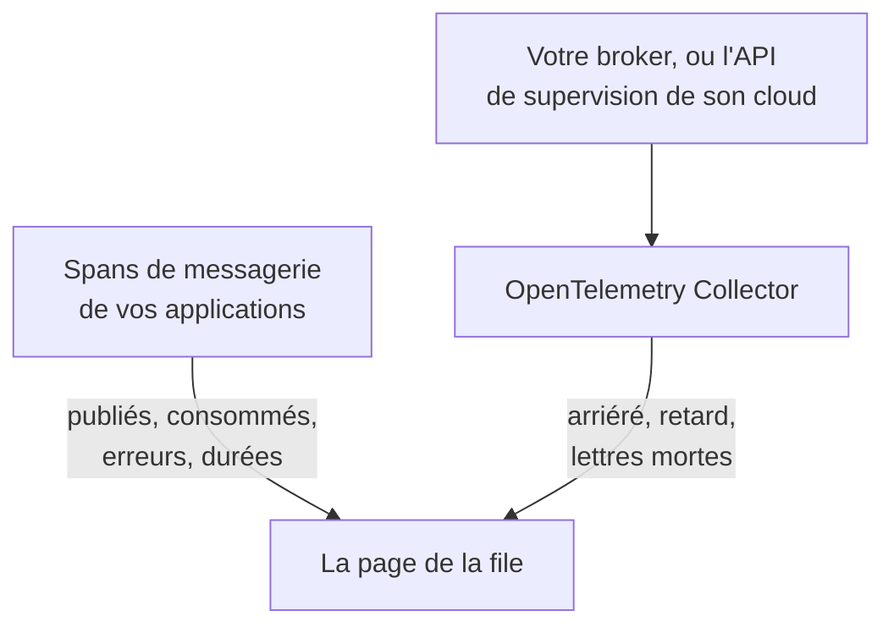

# Files d'attente

**Files d'attente** donne à chaque file de messages, topic et abonnement qu'utilisent vos applications sa propre page : quels services y publient et lesquels y consomment, combien de messages y passent, combien échouent et combien de temps prend le traitement, ses traces et ses métriques — et, dès que les métriques propres du broker atteignent OneUptime, son arriéré, le retard des consommateurs, les lettres mortes et la limitation. Les files ont des étiquettes, des propriétaires, des règles d'étiquettes et de propriétaires et l'archivage, comme toute autre ressource. Ouvrez-les dans **Produits → Ressources → Files d'attente**.

:::cards
- [Instrumenter les applications](#instrumenter-les-applications): Les spans de messagerie que votre instrumentation OpenTelemetry envoie déjà.
- [Métriques de santé du broker](#métriques-de-santé-du-broker): Arriéré, retard et lettres mortes de votre broker, système par système.
- [Alertes](#alertes): Des modèles prêts à l'emploi, et les métriques en retard ou comptées.
- [Dépannage](#dépannage): Une file qui n'a pas été créée, ou une santé du broker qui reste vide.
:::

## Fonctionnement

Cela fonctionne de la même façon pour chaque broker — Apache Kafka, RabbitMQ, Apache ActiveMQ et les autres brokers JMS, Amazon SQS et SNS, Google Cloud Pub/Sub, Azure Service Bus, Event Hubs et Event Grid, Apache Pulsar, Apache RocketMQ, NATS et BullMQ (voir [Systèmes de messagerie pris en charge](#systèmes-de-messagerie-pris-en-charge)) — et pour tout autre broker que vos spans nomment dans `messaging.system`. La plupart des files apparaissent d'elles-mêmes, à partir de deux sources :

| Source | Ce qu'elle vous demande | Ce qu'elle ajoute à la page de la file |
| --- | --- | --- |
| **Traces applicatives** | Des applications instrumentées (OpenTelemetry) — voir [Instrumenter les applications](#instrumenter-les-applications) | Les messages publiés et consommés, les erreurs et le temps de traitement, les services de chaque côté, et les traces elles-mêmes |
| **Métriques du broker** (un OpenTelemetry Collector) | Le récepteur du collecteur ou la collecte pour votre broker — voir [Métriques de santé du broker](#métriques-de-santé-du-broker) | **Santé du broker** : arriéré, retard des consommateurs, lettres mortes, âge du plus ancien message, limitation et débits de messages propres au broker |



Les traces indiquent à OneUptime qu'une file existe et comment les applications l'utilisent, mais pas à quel point elle est pleine. Cela vient du broker lui-même ou de l'API de supervision de son fournisseur cloud — ou, pour [BullMQ](#bullmq), qui garde ses jobs dans Redis et n'a pas de broker à interroger, d'une jauge que l'application rapporte.

Vous pouvez aussi ajouter une file à la main : **Files d'attente → Créer : File d'attente**, avec son système de messagerie et le nom de sa destination — et, pour Azure Service Bus et Event Hubs, son espace de noms. Le formulaire les demande à sa première étape, **Système de messagerie**, puis un nom et une description facultatifs, avec les étiquettes sous **Plus de champs** (**Informations sur la file**). Ne laissez l'espace de noms vide que pour une file que vos applications atteignent via un émulateur ou un nom de domaine personnalisé : leurs spans ne nomment aucun espace de noms, et les métriques d'Azure Monitor n'atteignent jamais une telle file (voir [Limites](#limites)).

## Prise en main

:::steps
### Envoyer les traces de vos applications

Instrumentez les applications qui publient et consomment, et envoyez leurs traces à OneUptime (voir [Instrumenter les applications](#instrumenter-les-applications)). Rien de propre à OneUptime n'est nécessaire : les spans de messagerie que votre instrumentation produit déjà nomment les files.

### Envoyer les métriques de votre broker

Trouvez votre système de messagerie sous [Métriques de santé du broker](#métriques-de-santé-du-broker), et exécutez sa configuration de collecteur avec votre clé d'ingestion. L'onglet **Documentation** de chaque file contient la configuration de cette file, prête à copier.

### Ouvrir la file

Ouvrez **Produits → Ressources → Files d'attente**. La découverte s'exécute toutes les 10 minutes : une file apparaît dès qu'au moins 3 de ses spans sont arrivés en 15 minutes, ou qu'une métrique du broker l'a nommée.
:::

## Systèmes de messagerie pris en charge

OneUptime connaît par leur nom les systèmes de messagerie ci-dessous. Il normalise ce que les instrumentations mettent dans `messaging.system` vers la valeur de la deuxième colonne — la valeur bien connue d'OpenTelemetry quand il y en a une — sans tenir compte de la casse, de sorte que `AmazonSQS`, `aws.sqs` et `aws_sqs` sont un seul système. `nats` et `bullmq` ne sont pas des valeurs bien connues d'OpenTelemetry : `nats` est ce que rapporte l'instrumentation NATS de l'agent Java, et `bullmq` est la valeur à définir pour BullMQ (voir [BullMQ](#bullmq)).

Un système que OneUptime ne connaît pas fonctionne quand même : une valeur bien formée (`ibmmq`, `solace`, `mqtt` — lettres minuscules, chiffres, `.`, `_` et `-`, jusqu'à 64 caractères) est gardée telle qu'elle est arrivée, de sorte que les files de ce broker sont découvertes et affichées sous ce nom ; seules les métriques propres du broker ont besoin d'un système de ce tableau. `spring_integration` est ignoré : les canaux de Spring Integration sont des appels de méthode à l'intérieur d'un processus, pas un broker.

**Métriques du broker** indique d'où viennent les métriques de santé d'un système : un récepteur collector-contrib, un point de terminaison Prometheus (`:port/path`, collecté avec le récepteur `prometheus` du collecteur), l'API de supervision du fournisseur cloud, ou un programme hors du collecteur qui les pousse en OTLP. Chaque système renvoie ci-dessous vers sa configuration, et l'onglet **Documentation** de chaque file en fait une configuration pour cette file.

| Système | `messaging.system` | Également accepté | Métriques du broker |
| --- | --- | --- | --- |
| [Amazon SNS](#amazon-sns) | `aws.sns` | `aws_sns`, `amazonsns`, `sns` | récepteur `aws_cloudwatch` ou `awsfirehose` (supervision cloud) |
| [Amazon SQS](#amazon-sqs) | `aws_sqs` | `aws.sqs`, `amazonsqs`, `sqs` | récepteur `aws_cloudwatch` ou `awsfirehose` (supervision cloud) |
| [Apache ActiveMQ](#apache-activemq) | `activemq` | `artemis`, `activemq_artemis` | OpenTelemetry JMX Scraper (envoie en OTLP) |
| [Apache Kafka](#apache-kafka) | `kafka` | — | récepteur `kafka_metrics` |
| [Apache Pulsar](#apache-pulsar) | `pulsar` | `apache_pulsar` | Prometheus (broker Pulsar), `:8080/metrics/` |
| [Apache RocketMQ](#apache-rocketmq) | `rocketmq` | — | Prometheus (broker RocketMQ), `:5557/metrics` |
| [Azure Event Grid](#azure-event-grid) | `eventgrid` | `azure_eventgrid`, `azure.eventgrid`, `microsoft.eventgrid` | récepteur `azure_monitor` (supervision cloud) |
| [Azure Event Hubs](#azure-event-hubs) | `eventhubs` | `azure_eventhubs`, `azure.eventhubs`, `microsoft.eventhub` | récepteur `azure_monitor` (supervision cloud) |
| [Azure Service Bus](#azure-service-bus) | `servicebus` | `azure_servicebus`, `azure.servicebus`, `microsoft.servicebus` | récepteur `azure_monitor` (supervision cloud) |
| [BullMQ](#bullmq) | `bullmq` | — | Rien d'intégré |
| [Google Cloud Pub/Sub](#google-cloud-pubsub) | `gcp_pubsub` | `gcp.pubsub`, `pubsub`, `google_pubsub` | récepteur `googlecloudmonitoring` (supervision cloud) |
| [JMS](#jms) | `jms` | — | Rien d'intégré |
| [NATS](#nats) | `nats` | `jetstream` | Prometheus (prometheus-nats-exporter), `:7777/metrics` |
| [RabbitMQ](#rabbitmq) | `rabbitmq` | — | récepteur `rabbitmq` |

Une file est une destination d'un système. Pour **Azure Service Bus** et **Azure Event Hubs**, son espace de noms en fait aussi partie, puisque deux espaces de noms peuvent chacun contenir une file appelée `orders`. **JMS** et **Apache ActiveMQ** partagent leurs files : les applications Java atteignent ActiveMQ via l'API JMS, dont les spans disent `jms` quel que soit le broker, tandis que les métriques propres du broker ne peuvent dire que `activemq` — les deux arrivent donc sur une seule file (voir [Ce qui fait de deux observations une seule file](#ce-qui-fait-de-deux-observations-une-seule-file)).

## Comment les files sont découvertes

Chaque file enregistre si ce sont des traces, des métriques du broker ou une personne qui l'ont créée. Tout ce qui nomme ensuite la même file s'y ajoute au lieu d'en créer une autre (voir [Ce qui fait de deux observations une seule file](#ce-qui-fait-de-deux-observations-une-seule-file)).

### À partir des traces applicatives

Toutes les 10 minutes, OneUptime résume les spans que vos applications ont envoyés au cours des 15 dernières minutes et qui portent l'une des clés `messaging.system`, `messaging.destination.name`, `messaging.destination`, `message_bus.destination`, `az.namespace`, `azure.resource_provider.namespace`, `aws.sqs.queue.url`, `aws.queue_url` ou `aws.sns.topic.arn`. Tout span sauf un span SERVER compte : les spans PRODUCER, CONSUMER, CLIENT et INTERNAL, et les spans auxquels le **Remappeur de type de span** d'un pipeline de traces a donné un autre type (comme Unspecified) ou aucun ; un span SERVER ne nomme jamais une file.

Les spans propres d'un broker sont aussi des spans SERVER. Le traceur eBPF de l'[agent Kubernetes](/docs/telemetry/kubernetes-agent#à-quoi-ressemblent-les-traces-ebpf) enregistre le côté d'un broker Kafka, MQTT ou NATS dans chaque échange — un message qu'il reçoit, un message qu'il livre — et envoie la plupart d'entre eux comme PRODUCER ou CONSUMER ; OneUptime les stocke comme SERVER, de sorte qu'un broker n'apparaît pas parmi les producteurs ou les consommateurs des topics qu'il transporte. Un broker MQTT qui transmet un message à un abonné écrit le même PUBLISH qu'un client, et le traceur rapporte les deux de la même façon ; pour les publications MQTT et NATS, OneUptime se fie donc au port de l'autre extrémité de la connexion : à partir du port 32768 — là où les systèmes d'exploitation choisissent le port d'un client qui se connecte (la plage par défaut de Linux commence là ; Windows et macOS utilisent 49152–65535) —, c'est celui d'un abonné, et le span est celui du broker. Une application qui publie vers un broker MQTT ou NATS écoutant lui-même sur un port à partir de 32768, comme un port Docker publié au hasard, n'est donc pas listée comme producteur de ses topics, et un topic que seules de telles applications utilisent peut ne pas être découvert du tout à partir des spans du traceur. Un abonné qui se connecte à un broker depuis un port inférieur à 32768 (une plage de ports réduite, ou un port réécrit par un NAT) voit toujours le broker listé comme producteur des topics qui lui sont livrés.

Chaque attribut de messagerie d'OpenTelemetry est encore marqué comme en développement, si bien que les applications d'un même projet rapportent les mêmes choses sous jusqu'à cinq générations de noms. OneUptime les lit toutes, les plus récentes d'abord, et n'analyse jamais les noms de spans, dont le format a changé avec les conventions sémantiques 1.27 et que les fournisseurs choisissent librement :

- **Le système** : `messaging.system`, normalisé comme dans [Systèmes de messagerie pris en charge](#systèmes-de-messagerie-pris-en-charge). À défaut, `az.namespace` ou `azure.resource_provider.namespace` des SDK Azure (`Microsoft.ServiceBus`, `Microsoft.EventHub`), l'ancienne clé `component` du SDK Azure, un span du SDK AWS (`rpc.system` = `aws-api`) appelant SQS ou SNS — les spans SNS de l'agent Java ne portent pas de `messaging.system` —, ou une clé contenant l'URL d'une file SQS ou l'ARN d'un topic SNS.
- **La destination** : la première des clés `messaging.destination.template`, `messaging.destination.name`, `messaging.source.template`, `messaging.source.name`, `messaging.destination` et `message_bus.destination` que porte le span. Un span qui n'en a aucune se rabat sur les clés propres de son système : l'URL de la file SQS (`aws.sqs.queue.url`, `aws.queue_url`, ou une URL de file dans `messaging.url`, `server.address` ou `net.peer.name`), l'ARN du topic SNS (`aws.sns.topic.arn`) et, pour RabbitMQ, la clé de routage (`messaging.rabbitmq.destination.routing_key` ou `messaging.rabbitmq.routing_key`), qui est le nom de la file quand un message passe par l'échange par défaut.
- **Le sens** : `messaging.operation.type` d'abord, puis le type de span — PRODUCER publie, CONSUMER consomme —, puis l'ancien `messaging.operation`, puis `messaging.operation.name` et, pour SQS et SNS, l'opération du SDK AWS dans `rpc.method` (`SendMessage`, `ReceiveMessage`, …). Le type l'emporte sur les anciennes clés parce que certaines instrumentations les remplissaient mal : confluent-kafka pour Python écrivait `receive` sur ses spans de producteur.

Une file est **créée** à partir des traces dès que ses spans, dans la fenêtre de 15 minutes qu'examine une exécution, sont au moins 3 (`MESSAGE_QUEUE_MIN_SPANS`), afin qu'un script ponctuel n'en crée pas, et seulement tant que le projet reste sous son [budget de création automatique](#le-budget-de-création-automatique). Les spans qui ne créent pas de file comptent quand même pour une file existante.

Chaque span de messagerie est aussi étiqueté avec sa file lors de son ingestion, de sorte que l'onglet **Traces** de la file montre chaque span qui la nomme — y compris les spans envoyés avant que la file ne soit créée.

### À partir des métriques du broker

Une métrique de broker figurant dans les listes sous [Métriques de santé du broker](#métriques-de-santé-du-broker) nomme sa file dans l'attribut propre du broker — `topic` pour Kafka, `rabbitmq.queue.name` pour RabbitMQ, la dimension `EntityName` d'Azure Monitor, `QueueName` pour CloudWatch — et OneUptime l'associe à cette file lors de son ingestion. Les métriques du broker ne portent pas de `messaging.system` : chacune est reconnue à son nom (`kafka.consumer_group.lag_sum`) et, quand deux systèmes en partagent un — Azure Monitor nomme de la même façon les métriques de Service Bus et d'Event Hubs —, au type de ressource que porte le point de données.

L'exécution de découverte suivante crée la file si elle n'existe pas encore : une seule métrique de broker suffit, dans les limites du [budget de création automatique](#le-budget-de-création-automatique). Ainsi, une file qu'aucune application instrumentée ne touche apparaît quand même dès que son broker la rapporte.

Les API de supervision cloud — CloudWatch, Azure Monitor et Cloud Monitoring — publient chaque valeur quelques minutes après l'instant qu'elle mesure, et elle est stockée à cet instant. Chaque exécution lit donc leurs métriques sur la dernière heure, au lieu des 15 dernières minutes sur lesquelles elle lit les spans et les autres métriques : un point de données qui arrive en retard observe quand même sa file, ou la crée.

### À partir des métriques des clients de messagerie

Les clients instrumentés peuvent aussi rapporter des métriques : les métriques de clients de messagerie d'OpenTelemetry `messaging.client.sent.messages`, `messaging.client.consumed.messages`, `messaging.client.operation.duration` et `messaging.process.duration`, leurs anciens noms `messaging.publish.duration`, `messaging.receive.duration`, `messaging.publish.messages`, `messaging.receive.messages`, `messaging.process.messages` et `messaging.client.published.messages`, ainsi que celles du SDK Azure pour Java `messaging.servicebus.messages.sent`, `messaging.servicebus.receiver.lag`, `messaging.servicebus.settlement.request.duration` et `messaging.servicebus.settlement.sequence_number`. Chaque point de données nomme son système et sa destination comme le fait un span — les métriques Service Bus du SDK Azure ne nomment aucun système, leur nom en tient donc lieu — et est associé à cette file lors de son ingestion, de sorte qu'il apparaît dans l'onglet **Métriques** de la file. Il en va de même pour toute métrique à vous qui porte `messaging.system` et `messaging.destination.name` sur chaque point de données — pas sur la ressource, où ils ne sont pas lus —, comme une jauge de profondeur de file (voir [BullMQ](#bullmq)).

Les métriques des clients de messagerie ne créent jamais de file : ce sont les traces, les métriques du broker ou une personne qui le font. Une métrique de client qui nomme une file existante tient à jour son **Vu pour la dernière fois**, comme le font ses spans. Une métrique à vous ne fait ni l'un ni l'autre : elle apparaît seulement dans l'onglet **Métriques** de la file.

### Ce qui fait de deux observations une seule file

L'identité d'une file est son **système** et sa **destination**, comparés sans tenir compte de la casse : `Orders` et `orders` sont une seule file, affichée sous le nom tel qu'il a été vu en premier. Pour Azure Service Bus et Event Hubs, l'identité contient aussi l'**espace de noms** :

- sur un span, le premier label DNS de l'hôte auquel le SDK s'est connecté, pris dans `server.address`, `net.peer.name`, `peer.address` ou `network.peer.address` dans cet ordre, quand cet hôte est un hôte d'espace de noms : `<namespace>.servicebus.windows.net`, ou `.servicebus.usgovcloudapi.net`, `.servicebus.chinacloudapi.cn` ou `.servicebus.cloudapi.de` d'un cloud souverain. Event Hubs partage le domaine de Service Bus ;
- sur une métrique Azure Monitor, le `name` de l'espace de noms sur lequel elle porte.

Rien d'autre n'en fait partie, si bien qu'aucun de ces éléments ne scinde jamais une file : l'adresse du broker (les clients Kafka en rapportent rarement une, et un espace de noms Azure répond sous plusieurs), le groupe de consommateurs ou l'abonnement (les consommateurs d'un topic ne sont pas des files distinctes), la partition et une sous-file de lettres mortes. Parmi eux, une file ne garde que l'adresse du broker, pour l'affichage.

**JMS et ActiveMQ forment une seule famille.** Chaque span JMS dit `jms` quel que soit le broker derrière, et les métriques propres du broker (l'[OpenTelemetry JMX Scraper](#apache-activemq)) ne peuvent dire que `activemq` ; OneUptime identifie donc une file ActiveMQ par sa famille JMS : les spans et les métriques du broker de `orders` arrivent sur une seule file. Elle s'affiche comme JMS jusqu'à l'arrivée des métriques du broker, puis comme Apache ActiveMQ — jamais dans l'autre sens. Une file que vous créez à la main comme Apache ActiveMQ est cette même file.

### Comment les noms de destination sont lus

Les instrumentations nomment une même file de bien des façons, et OneUptime réduit ce qu'elles rapportent au nom propre de la file :

| Système | Rapporté comme | File |
| --- | --- | --- |
| Amazon SQS | `https://sqs.us-east-1.amazonaws.com/123456789012/orders`, une URL de file (`otelaws` pour Go la place dans `server.address`) | `orders` |
| Amazon SNS | `arn:aws:sns:us-east-1:123456789012:order-events`, un ARN de topic | `order-events` |
| Google Cloud Pub/Sub | `projects/shop/topics/orders`, un nom de ressource | `orders` |
| Azure Service Bus | `orders/Subscriptions/billing`, le chemin d'entité de l'abonnement `billing` du topic | `orders` |
| Azure Service Bus | `orders/$DeadLetterQueue`, le chemin d'entité de la sous-file de lettres mortes de la file | `orders` |
| Azure Event Hubs | `telemetry/ConsumerGroups/$Default/Partitions/3`, le chemin d'entité d'un récepteur, pour le groupe de consommateurs `$Default` | `telemetry` |
| Apache Pulsar | `orders-partition-3`, une partition d'un topic à nom court | `persistent://public/default/orders` |
| Apache Pulsar | `acme/shop/orders`, un topic sans son domaine | `persistent://acme/shop/orders` |
| JMS | `queue://orders`, avec son préfixe de type de destination | `orders` |
| RabbitMQ | `shop:new-order:orders`, l'échange, la clé de routage et la file sur un consommateur (conventions sémantiques 1.30 et ultérieures) | `orders` |
| RabbitMQ | `amq.default`, l'échange par défaut, avec la clé de routage `orders` | `orders` |
| RabbitMQ | `,orders`, le `{exchange},{routing key}` d'aio-pika via l'échange par défaut | `orders` |
| RabbitMQ | `shop,new-order`, le `{exchange},{routing key}` d'aio-pika | `shop` |

Une partition Pulsar se replie dans son topic, et un nom sans domaine est complété comme Pulsar le complète lui-même — un nom court dans l'espace de noms `public/default` —, de sorte que les noms de l'agent Java rejoignent les labels de métriques entièrement qualifiés des brokers. Un span RabbitMQ nomme généralement l'échange par lequel un message est passé, côté publication comme côté consommation ; l'échange par défaut (`amq.default`, `<default>` ou un nom vide) représente sa clé de routage, qui est le nom de la file. Les conventions sémantiques 1.30 joignent l'échange, la clé de routage et la file avec `:` — les noms opt-in de l'agent Java —, et OneUptime garde la file du nom joint d'un consommateur et l'échange de celui d'un éditeur. aio-pika joint l'échange et la clé de routage avec une virgule côté publication, et OneUptime les sépare de la même façon.

### Ce qui est ignoré

OneUptime penche du côté de l'absence de file : un nom inventé par requête ou par consommateur créerait sinon, pour chaque message, une file qui n'appartient à personne. Ces éléments ne deviennent jamais des files :

- **Les spans SERVER**, et les spans dont le `messaging.system` est `spring_integration`.
- **Les destinations marquées temporaires ou anonymes** : `messaging.destination.temporary`, `messaging.destination.anonymous`, `messaging.source.temporary` ou `messaging.source.anonymous` défini à `true`. L'ancien `messaging.temp_destination` n'est pas fiable : les instrumentations pika et aio-pika pour Python le définissent à chaque publication.
- **Les substituts que les instrumentations rapportent à la place d'un nom** : `(temporary)`, `(anonymous)`, `<generated>`, `unknown` (un lot Kafka couvrant plusieurs topics), `aws:sqs` (les événements Lambda SQS de l'agent Java), `-NamespaceOnlyMetric-` d'Azure Monitor, et une valeur que le nettoyage de données propre à OneUptime a entièrement remplacée (`[REDACTED]`).
- **Les destinations générées et de réponse** : les files nommées par le serveur de RabbitMQ du style `amq.gen-JzTY20BRgKO-HjmUJj0wLg`, les files `spring.gen-…` de Spring et les files `<destination>.anonymous.<id>` de Spring Cloud Stream pour les consommateurs sans groupe, et le direct reply-to (`amq.rabbitmq.reply-to…`) ; les destinations temporaires JMS (`temp-queue://…`, `temp-topic://…`) et `$TMP$…` de TIBCO ; les topics d'avis d'ActiveMQ (`ActiveMQ.Advisory.…`) ; les boîtes de réception NATS (`_INBOX.…`) et les sujets d'accusé de réception JetStream (`$JS.ACK.…`) ; les topics système de Pulsar (`__change_events`, `__transaction_…`, et tout ce qui se trouve sous un segment `/__`) ; et une destination qui n'est rien d'autre qu'un UUID.
- **Les SMS et les notifications push mobiles de SNS** : un numéro de téléphone (`+15555550123`, ou `phone_number:**` venant de botocore) ou un ARN de point de terminaison de plateforme (`arn:aws:sns:us-east-1:123456789012:endpoint/GCM/shop-app/1234`) est un appareil, pas un topic.
- **Les noms qui ne peuvent pas être une seule file** : une liste de destinations issue d'un lot (`["orders","payments"]`), un nom contenant un caractère de contrôle, et un nom de plus de 255 caractères.

**Les UUID sont transformés en modèle.** Chaque UUID dans une destination est remplacé par `{uuid}`, de sorte que des noms par requête comme `reply-7f1c2a9e-4b1d-4c3e-9f1a-2b3c4d5e6f70` deviennent une seule file, `reply-{uuid}`, au lieu d'une file chacun.

### Le budget de création automatique

Les traces et les métriques du broker ne créent des files d'elles-mêmes que tant que le projet compte moins de 500 files découvertes actives et non archivées (`MESSAGE_QUEUE_AUTO_CREATE_BUDGET`, voir [Réglages pour l'auto-hébergement](#réglages-pour-lauto-hébergement)). Les files que vous créez à la main ne comptent jamais et ne sont jamais bloquées ; les files archivées ne comptent pas, si bien que l'[archivage automatique](#cycle-de-vie-et-archivage) libère du budget ; et les files qui existent déjà continuent d'être associées et mises à jour.

### Cycle de vie et archivage

- **Vu pour la dernière fois** est le moment où la découverte a vu la file pour la dernière fois, dans les traces, les métriques des clients de messagerie ou les métriques du broker.
- **Archiver pour écarter.** Supprimer une file découverte ne la retire que jusqu'à ce qu'elle soit revue : sa prochaine observation la ramène comme une nouvelle file. Pour en écarter une définitivement, **archivez-la**. Une file archivée garde son identité, de sorte que tout ce qui la nomme reste rattaché à la file archivée au lieu d'en créer une nouvelle.
- **Archivage automatique.** Une file découverte qui n'a pas été vue depuis 7 jours (`MESSAGE_QUEUE_AUTO_ARCHIVE_DAYS`) est archivée automatiquement, sauf si une personne l'a renommée, décrite, étiquetée ou lui a donné des propriétaires. Les étiquettes et propriétaires que des règles d'étiquettes ou de propriétaires ont attachés d'elles-mêmes ne comptent pas.
- **Restauration.** Une file archivée automatiquement est restaurée automatiquement quand elle est revue. Les files que vous avez créées à la main, et les files qu'une personne a archivées, ne sont jamais archivées ni restaurées par la découverte. Une file qu'une personne restaure reste restaurée pendant 30 jours (ou la fenêtre d'archivage, si elle est plus longue) même si rien ne la voit ; à partir de sa prochaine observation, la règle des 7 jours s'applique de nouveau.

## Instrumenter les applications

Les files viennent des spans de messagerie que votre instrumentation OpenTelemetry produit déjà ; rien de propre à OneUptime n'est nécessaire. Envoyez les traces à OneUptime comme le décrit [OpenTelemetry](/docs/telemetry/open-telemetry), puis consultez la liste pour votre langage.

:::tabs
@tab Java
L'agent Java OpenTelemetry trace les clients Kafka, RabbitMQ, JMS (ActiveMQ, Artemis, IBM MQ et tous les autres brokers JMS), Amazon SQS et SNS, Pulsar, RocketMQ et NATS sans modification du code. OneUptime lit à la fois les noms d'attributs qu'il émet par défaut et les plus récents qu'il émet avec `OTEL_SEMCONV_STABILITY_OPT_IN=messaging` (agent 2.31.0 et ultérieur). Les spans JMS disent `jms` quel que soit le broker derrière eux (voir [JMS](#jms)).

- **Azure Service Bus et Event Hubs** : le SDK Azure pour Java se trace lui-même, et l'agent Java relie ce traçage à OpenTelemetry.
- **Google Cloud Pub/Sub** : le client se trace lui-même dès que ses builders `Publisher` et `Subscriber` reçoivent une instance OpenTelemetry et l'interrupteur de traçage — `setOpenTelemetry(GlobalOpenTelemetry.get())` et `setEnableOpenTelemetryTracing(true)`. L'un de ces appels seul ne trace rien.
@tab .NET
- **Azure Service Bus et Event Hubs** (`Azure.Messaging.ServiceBus`, `Azure.Messaging.EventHubs`) : leurs spans OpenTelemetry sont expérimentaux dans le SDK Azure. Activez-les avec la variable d'environnement `AZURE_EXPERIMENTAL_ENABLE_ACTIVITY_SOURCE=true` (ou l'interrupteur `Azure.Experimental.EnableActivitySource` ci-dessous), et abonnez-vous aux sources `Azure.*`.
- **RabbitMQ.Client** 7 se trace lui-même : abonnez-vous à `RabbitMQ.Client.*`.
- **MassTransit** se trace lui-même : abonnez-vous à `MassTransit` (voir [Limites](#limites) pour ce que ses spans omettent).
- **Confluent.Kafka** : le package `OpenTelemetry.Instrumentation.ConfluentKafka`.
- **Amazon SQS et SNS** : le package `OpenTelemetry.Instrumentation.AWS`, avec `.AddAWSInstrumentation(opt => opt.SemanticConventionVersion = SemanticConventionVersion.Latest)`. Son jeu d'attributs par défaut (`V1_28_0`) ne nomme une file SQS que par son URL (`aws.queue_url`, que OneUptime lit) et ne nomme pas du tout un topic SNS.

```csharp
// Before any Azure client is created; or set AZURE_EXPERIMENTAL_ENABLE_ACTIVITY_SOURCE=true.
AppContext.SetSwitch("Azure.Experimental.EnableActivitySource", true);

builder.Services.AddOpenTelemetry()
    .WithTracing(tracing => tracing
        .AddSource("Azure.*")
        .AddSource("RabbitMQ.Client.*")
        .AddSource("MassTransit")
        .AddOtlpExporter());
```
@tab Node.js
- `@opentelemetry/auto-instrumentations-node` trace `amqplib` (RabbitMQ), `kafkajs` et le SDK AWS (SQS et SNS).
- **Azure Service Bus et Event Hubs** : enregistrez `createAzureSdkInstrumentation()` depuis `@azure/opentelemetry-instrumentation-azure-sdk`.
- **Google Cloud Pub/Sub** : `new PubSub({ enableOpenTelemetryTracing: true })`.
- **BullMQ** : voir [BullMQ](#bullmq) — sa propre télémétrie a besoin de deux attributs supplémentaires.
@tab Python
- Kafka : `opentelemetry-instrumentation-kafka-python`, `opentelemetry-instrumentation-confluent-kafka` ou `opentelemetry-instrumentation-aiokafka`. RabbitMQ : `opentelemetry-instrumentation-pika` ou `opentelemetry-instrumentation-aio-pika`. SQS et SNS : `opentelemetry-instrumentation-botocore`, ou `opentelemetry-instrumentation-boto3sqs` pour SQS. `opentelemetry-bootstrap -a install` choisit celles dont vos bibliothèques installées ont besoin.
- **Azure Service Bus et Event Hubs** : installez `azure-core-tracing-opentelemetry` et définissez `settings.tracing_implementation = "opentelemetry"` (depuis `azure.core.settings`).
- **Google Cloud Pub/Sub** : `PublisherOptions(enable_open_telemetry_tracing=True)` et `SubscriberOptions(enable_open_telemetry_tracing=True)`.
- Les spans de Celery ne portent pas de `messaging.system` et ne nomment aucun broker, ils ne créent donc pas de files.
@tab Go
- **Amazon SQS et SNS** : `otelaws` (`go.opentelemetry.io/contrib/instrumentation/github.com/aws/aws-sdk-go-v2/otelaws`), ajouté avec `otelaws.AppendMiddlewares(&cfg.APIOptions)`. Ses spans SQS portent l'URL de la file dans `server.address`, que OneUptime lit comme la file.
- **Google Cloud Pub/Sub** : `pubsub.ClientConfig{EnableOpenTelemetryTracing: true}`.
- **Kafka** avec `segmentio/kafka-go` : l'instrumentation automatique OpenTelemetry pour Go (`go.opentelemetry.io/auto`, eBPF, sous Linux) trace ses producteurs et consommateurs sans modification du code.
- Les bibliothèques contrib Go d'OpenTelemetry n'ont pas d'instrumentation pour Kafka, RabbitMQ ou NATS. Pour les autres clients, utilisez la prise en charge OpenTelemetry propre à la bibliothèque cliente, ou définissez `messaging.system`, `messaging.destination.name` et le type de span sur les spans qui entourent vos envois et vos gestionnaires.
:::

## Métriques de santé du broker

Un broker sait ce qu'aucune application ne peut voir : combien de messages attendent, quel retard a chaque groupe de consommateurs, ce qui est parti dans une file de lettres mortes. Chaque section ci-dessous contient la configuration du collecteur pour un système — une configuration complète d'OpenTelemetry Collector qui se termine par l'exportateur OTLP qui envoie à OneUptime. Placez une clé d'ingestion de télémétrie (**Paramètres du projet → Télémétrie & APM → Clés d'ingestion**) dans `x-oneuptime-token`, remplacez `https://oneuptime.com` par votre propre hôte si vous êtes auto-hébergé, et exécutez-la avec `otel/opentelemetry-collector-contrib` 0.161.0 ou ultérieur (chaque configuration ici est validée avec 0.161.0). Les collecteurs récents signalent dans leur journal que `otlphttp` est obsolète au profit de `otlp_http` ; les deux noms désignent le même exportateur. Pour collecter plusieurs systèmes, fusionnez leurs récepteurs dans un seul collecteur.

La section **Santé du broker** de chaque file affiche les métriques listées pour son système — une jauge en tant que valeur, un nombre par période additionné par intervalle, un compteur en tant que débit par seconde — en combinant les séries d'une file comme chaque métrique l'exige (les messages prêts et non acquittés d'une file RabbitMQ s'additionnent ; le groupe de consommateurs le plus en retard donne le retard). Tout ce qu'envoie le collecteur se trouve aussi dans l'explorateur **Métriques**. Tant qu'aucune métrique listée n'est arrivée pour une file, la section indique d'où viennent les métriques de ce système, avec un lien vers sa section ici.

### Amazon SNS

Lisez les métriques CloudWatch des topics avec le récepteur `aws_cloudwatch` du collecteur, ou diffusez-les via un CloudWatch Metric Stream et Amazon Data Firehose vers son récepteur `awsfirehose`.

Le récepteur `aws_cloudwatch` interroge l'API `GetMetricData` de CloudWatch, un espace de noms par récepteur, si bien que SNS a sa propre instance à côté de celle d'[Amazon SQS](#amazon-sqs). Il utilise les identifiants par défaut du SDK AWS (environnement, profil partagé ou rôle d'instance), qui ont besoin de `cloudwatch:ListMetrics` et `cloudwatch:GetMetricData` :

```yaml
receivers:
  aws_cloudwatch/sns:
    region: us-east-1
    metrics:
      collection_interval: 5m
      period: 1m
      delay: 10m
      discovery:
        filters:
          namespace: AWS/SNS
        limit: 500

processors:
  batch: {}

exporters:
  otlphttp:
    endpoint: https://oneuptime.com/otlp
    headers:
      x-oneuptime-token: YOUR_TELEMETRY_INGESTION_TOKEN

service:
  pipelines:
    metrics:
      receivers: [aws_cloudwatch/sns]
      processors: [batch]
      exporters: [otlphttp]
```

Laissez `stats` non défini, comme pour [Amazon SQS](#amazon-sqs). Un Metric Stream transporte SNS et SQS ensemble : ajoutez `AWS/SNS` aux espaces de noms du stream dans la configuration d'[Amazon SQS](#amazon-sqs).

Un topic est nommé de la même façon des deux côtés : les spans rapportent son ARN ou son nom, et OneUptime garde le nom qui suit le dernier `:` de l'ARN.

| Métrique | Affichée comme | Type |
| --- | --- | --- |
| `amazonaws.com/aws/sns/numberofmessagespublished` (flux JSON: `numberofmessagespublished`) | Messages published | Nombre par période |
| `amazonaws.com/aws/sns/numberofnotificationsdelivered` (flux JSON: `numberofnotificationsdelivered`) | Notifications delivered | Nombre par période |
| `amazonaws.com/aws/sns/numberofnotificationsfailed` (flux JSON: `numberofnotificationsfailed`) | Notifications failed | Nombre par période |
| `amazonaws.com/aws/sns/numberofnotificationsredriventodlq` (flux JSON: `numberofnotificationsredriventodlq`) | Redriven to dead-letter queue | Nombre par période |

### Amazon SQS

Lisez les métriques CloudWatch des files avec le récepteur `aws_cloudwatch` du collecteur, ou diffusez-les via un CloudWatch Metric Stream et Amazon Data Firehose vers son récepteur `awsfirehose`.

**Interroger CloudWatch** ne demande rien côté AWS à part des identifiants. Le récepteur utilise les identifiants par défaut du SDK AWS (environnement, profil partagé ou rôle d'instance), qui ont besoin de `cloudwatch:ListMetrics` et `cloudwatch:GetMetricData` :

```yaml
receivers:
  aws_cloudwatch/sqs:
    region: us-east-1
    metrics:
      collection_interval: 5m
      period: 1m
      delay: 10m
      discovery:
        filters:
          namespace: AWS/SQS
        # Metrics per scrape: about nine per queue. Must be set.
        limit: 500

processors:
  batch: {}

exporters:
  otlphttp:
    endpoint: https://oneuptime.com/otlp
    headers:
      x-oneuptime-token: YOUR_TELEMETRY_INGESTION_TOKEN

service:
  pipelines:
    metrics:
      receivers: [aws_cloudwatch/sqs]
      processors: [batch]
      exporters: [otlphttp]
```

- **Laissez `stats` non défini.** Sans lui, chaque métrique arrive sous la forme d'un résumé par période, et c'est ce que lit OneUptime ; avec lui, chaque statistique devient une série à part et les graphiques les mélangent.
- `discovery.limit` doit être défini, et plafonne les métriques lues par collecte — environ neuf par file. Chacune coûte quatre sous-requêtes `GetMetricData` par collecte, qu'AWS facture.
- `delay` attend que CloudWatch publie une période (cela prend quelques minutes), si bien qu'avec cette configuration les métriques de broker d'une file arrivent avec 11 à 17 minutes de retard : un moniteur sur celles-ci a besoin d'une fenêtre plus longue (voir **Métriques en retard** sous [Alertes](#alertes)).
- Un récepteur lit une région et un espace de noms : ajoutez une instance par région.

**Le streaming** pousse les métriques au fur et à mesure que CloudWatch les publie. Créez un CloudWatch Metric Stream pour les espaces de noms `AWS/SQS` (et `AWS/SNS`) avec le format de sortie **OpenTelemetry 1.0**, qui livre à un flux Amazon Data Firehose dont la destination est un point de terminaison HTTP : votre collecteur, avec une clé d'accès. Firehose ne livre qu'à `https://` sur le port 443, le collecteur a donc besoin d'un certificat et d'un port 443 public (par exemple derrière un répartiteur de charge) :

```yaml
extensions:
  awscloudwatchmetricstreams_encoding:
    format: opentelemetry1.0

receivers:
  awsfirehose:
    # Firehose delivers to HTTPS on port 443 only: expose this port as 443,
    # for example behind a load balancer.
    endpoint: 0.0.0.0:4433
    encoding: awscloudwatchmetricstreams_encoding
    access_key: ${env:FIREHOSE_ACCESS_KEY}
    tls:
      cert_file: /etc/otelcol/tls/server.crt
      key_file: /etc/otelcol/tls/server.key

processors:
  batch: {}

exporters:
  otlphttp:
    endpoint: https://oneuptime.com/otlp
    headers:
      x-oneuptime-token: YOUR_TELEMETRY_INGESTION_TOKEN

service:
  extensions: [awscloudwatchmetricstreams_encoding]
  pipelines:
    metrics:
      receivers: [awsfirehose]
      processors: [batch]
      exporters: [otlphttp]
```

Un stream au format de sortie **JSON** (`format: json`) fonctionne aussi : il envoie chaque métrique sous son nom nu, et OneUptime distingue celles de SQS de celles de SNS grâce au `service.name` que le stream appose (`SQS`, `SNS`).

Une file de lettres mortes est une file SQS ordinaire avec ses propres métriques ; c'est donc une file à part dans OneUptime. Les files sont nommées par leur seul nom, pas par leur compte ni leur région (voir [Limites](#limites)).

| Métrique | Affichée comme | Type |
| --- | --- | --- |
| `amazonaws.com/aws/sqs/approximatenumberofmessagesvisible` (flux JSON: `approximatenumberofmessagesvisible`) | Messages visible | Jauge |
| `amazonaws.com/aws/sqs/approximateageofoldestmessage` (flux JSON: `approximateageofoldestmessage`) | Oldest message age | Jauge |
| `amazonaws.com/aws/sqs/approximatenumberofmessagesnotvisible` (flux JSON: `approximatenumberofmessagesnotvisible`) | Messages in flight | Jauge |
| `amazonaws.com/aws/sqs/numberofmessagessent` (flux JSON: `numberofmessagessent`) | Messages sent | Nombre par période |
| `amazonaws.com/aws/sqs/numberofmessagesreceived` (flux JSON: `numberofmessagesreceived`) | Messages received | Nombre par période |
| `amazonaws.com/aws/sqs/numberofmessagesdeleted` (flux JSON: `numberofmessagesdeleted`) | Messages deleted | Nombre par période |

### Apache ActiveMQ

Le collecteur n'a pas de récepteur JMX ; exécutez donc l'OpenTelemetry JMX Scraper avec `OTEL_JMX_TARGET_SYSTEM=activemq` à côté d'un broker ActiveMQ Classic ; il pousse les métriques de destination du broker en OTLP.

1. Laissez le broker accepter les connexions JMX. Avec l'image `apache/activemq-classic` ou le script `bin/activemq`, définissez `ACTIVEMQ_SUNJMX_START` avant de le démarrer. Cet exemple désactive l'authentification : gardez le port sur un réseau privé, ou activez `jmxremote.authenticate` avec un fichier de mots de passe et donnez au scraper `OTEL_JMX_USERNAME` et `OTEL_JMX_PASSWORD`.

```bash
ACTIVEMQ_SUNJMX_START="-Dcom.sun.management.jmxremote.port=1099 -Dcom.sun.management.jmxremote.rmi.port=1099 -Dcom.sun.management.jmxremote.authenticate=false -Dcom.sun.management.jmxremote.ssl=false -Djava.rmi.server.hostname=activemq"
```

2. Exécutez le scraper là où il peut atteindre ce port, avec un environnement d'exécution Java. Il envoie directement à OneUptime ; pour le faire passer plutôt par votre propre collecteur, pointez `OTEL_EXPORTER_OTLP_ENDPOINT` vers le récepteur OTLP du collecteur.

```bash
curl -fsSLo opentelemetry-jmx-scraper.jar https://github.com/open-telemetry/opentelemetry-java-contrib/releases/latest/download/opentelemetry-jmx-scraper.jar

export OTEL_JMX_SERVICE_URL=service:jmx:rmi:///jndi/rmi://activemq:1099/jmxrmi
export OTEL_JMX_TARGET_SYSTEM=activemq
export OTEL_JMX_TARGET_SOURCE=instrumentation
export OTEL_METRIC_EXPORT_INTERVAL=30000
export OTEL_SERVICE_NAME=activemq-prod
export OTEL_EXPORTER_OTLP_PROTOCOL=http/protobuf
export OTEL_EXPORTER_OTLP_ENDPOINT=https://oneuptime.com/otlp
export OTEL_EXPORTER_OTLP_HEADERS=x-oneuptime-token=YOUR_TELEMETRY_INGESTION_TOKEN
java -jar opentelemetry-jmx-scraper.jar
```

`OTEL_JMX_TARGET_SOURCE=instrumentation` garde les noms de métriques que le scraper utilise depuis 1.53.0-alpha (`activemq.message.queue.size`, avec la destination dans `messaging.destination.name`). OneUptime lit aussi les noms des anciens scrapers et de `OTEL_JMX_TARGET_SOURCE=legacy` (`activemq.message.current`, avec la destination dans `destination`).

Les métriques du broker rejoignent la file que les spans de ses clients JMS ont créée — et, à partir de là, la file s'affiche comme Apache ActiveMQ (voir [Ce qui fait de deux observations une seule file](#ce-qui-fait-de-deux-observations-une-seule-file)). Le scraper rapporte chaque destination : OneUptime ignore les topics d'avis, tandis que les files de lettres mortes (`ActiveMQ.DLQ`, ou `DLQ.<destination>` avec une stratégie de lettres mortes individuelle) sont des files à part. ActiveMQ Artemis a d'autres MBeans, que ces règles ne lisent pas : les files Artemis viennent toujours de leurs spans JMS, sans santé du broker.

| Métrique | Affichée comme | Type |
| --- | --- | --- |
| `activemq.message.queue.size` | Queue size | Jauge |
| `activemq.message.current` | Queue size (legacy names) | Jauge |
| `activemq.message.enqueued` | Enqueued | Compteur, affiché par seconde |
| `activemq.message.dequeued` | Dequeued | Compteur, affiché par seconde |
| `activemq.message.expired` | Expired | Compteur, affiché par seconde |
| `activemq.consumer.count` | Consumers | Jauge |
| `activemq.message.enqueue.average_duration` | Average time in queue | Jauge |
| `activemq.message.wait_time.avg` | Average time in queue (legacy names) | Jauge |

### Apache Kafka

Le récepteur `kafka_metrics` du collecteur lit le retard des groupes de consommateurs et les offsets des partitions auprès des brokers ; activez ses scrapers `topics` et `consumers`.

```yaml
receivers:
  kafka_metrics:
    brokers: ["kafka-1:9092", "kafka-2:9092"]
    # topics: each partition's log-end offset; consumers: each group's
    # committed offsets and lag. brokers: the broker count.
    scrapers: [brokers, topics, consumers]
    collection_interval: 30s
    # auth:
    #   sasl:
    #     mechanism: SCRAM-SHA-512
    #     username: ${env:KAFKA_USERNAME}
    #     password: ${env:KAFKA_PASSWORD}
    # tls:
    #   ca_file: /etc/kafka/ca.pem

processors:
  batch: {}

exporters:
  otlphttp:
    endpoint: https://oneuptime.com/otlp
    headers:
      x-oneuptime-token: YOUR_TELEMETRY_INGESTION_TOKEN

service:
  pipelines:
    metrics:
      receivers: [kafka_metrics]
      processors: [batch]
      exporters: [otlphttp]
```

Pour un cluster avec SASL ou TLS, décommentez `auth` et `tls`. Le récepteur nomme chaque topic dans `topic`, et c'est ainsi que les métriques trouvent la file du topic. Il ne rapporte le retard et les offsets validés d'un groupe de consommateurs que pour les topics sur lesquels le groupe a validé un offset, et ignore les topics dont le nom commence par `_` — les topics internes de Kafka (`topic_match` vaut `^[^_].*$` par défaut).

| Métrique | Affichée comme | Type |
| --- | --- | --- |
| `kafka.consumer_group.lag_sum` | Consumer lag | Jauge |
| `kafka.consumer_group.lag` | Partition lag | Jauge |
| `kafka.consumer_group.offset_sum` | Consumed | Compteur, affiché par seconde |
| `kafka.partition.current_offset` | Produced | Compteur, affiché par seconde |

### Apache Pulsar

Chaque broker sert ses métriques de topics et d'abonnements sur le port de son service web ; collectez chaque broker, car un broker ne rapporte que les topics qu'il possède à ce moment-là.

```yaml
receivers:
  prometheus:
    config:
      scrape_configs:
        - job_name: pulsar-broker
          scrape_interval: 30s
          metrics_path: /metrics/
          # Every broker: each one reports only the topics it owns.
          static_configs:
            - targets: ["pulsar-broker-0:8080", "pulsar-broker-1:8080"]
          # Keeps the families the queue page charts; remove it to keep all.
          metric_relabel_configs:
            - source_labels: [__name__]
              regex: "pulsar_(msg_backlog|subscription_back_log|storage_backlog_age_seconds|in_messages_total|out_messages_total)"
              action: keep

processors:
  batch: {}

exporters:
  otlphttp:
    endpoint: https://oneuptime.com/otlp
    headers:
      x-oneuptime-token: YOUR_TELEMETRY_INGESTION_TOKEN

service:
  pipelines:
    metrics:
      receivers: [prometheus]
      processors: [batch]
      exporters: [otlphttp]
```

- Les séries de topics et d'abonnements ont besoin de `exposeTopicLevelMetricsInPrometheus=true` dans `broker.conf`, ce qui est la valeur par défaut.
- Pulsar étiquette chaque série avec le nom complet du topic (`persistent://public/default/orders`), et celles d'une partition avec celui de la partition (`persistent://public/default/orders-partition-3`) : les partitions s'additionnent dans leur topic.
- L'arriéré est compté en entrées, et Pulsar compte un lot de messages comme une seule entrée.
- Pulsar répète `pulsar_out_messages_total` par consommateur quand `exposeConsumerLevelMetricsInPrometheus=true` ; ces séries par consommateur sont exclues des graphiques, si bien qu'aucun message n'est compté deux fois.
- `pulsar_storage_backlog_age_seconds` vaut `-1` tant que le broker ne peut pas le dire.
- Les métriques OpenTelemetry natives de Pulsar 3.3 et ultérieur (expérimentales, désactivées par défaut) utilisent d'autres noms, qui ne sont pas affichés.

| Métrique | Affichée comme | Type |
| --- | --- | --- |
| `pulsar_msg_backlog` | Backlog | Jauge |
| `pulsar_subscription_back_log` | Subscription backlog | Jauge |
| `pulsar_storage_backlog_age_seconds` | Backlog age | Jauge |
| `pulsar_in_messages_total` | Messages in | Compteur, affiché par seconde |
| `pulsar_out_messages_total` | Messages out | Compteur, affiché par seconde |

### Apache RocketMQ

Définissez `metricsExporterType=PROM` dans le `broker.conf` du broker pour que le broker serve ses métriques de retard et de débit.

```text
metricsExporterType=PROM
metricsPromExporterPort=5557
metricsPromExporterHost=0.0.0.0
```

Puis collectez chaque broker :

```yaml
receivers:
  prometheus:
    config:
      scrape_configs:
        - job_name: rocketmq-broker
          scrape_interval: 30s
          metrics_path: /metrics
          static_configs:
            - targets: ["rocketmq-broker-a:5557", "rocketmq-broker-b:5557"]

processors:
  batch: {}

exporters:
  otlphttp:
    endpoint: https://oneuptime.com/otlp
    headers:
      x-oneuptime-token: YOUR_TELEMETRY_INGESTION_TOKEN

service:
  pipelines:
    metrics:
      receivers: [prometheus]
      processors: [batch]
      exporters: [otlphttp]
```

C'est l'exportateur intégré de RocketMQ 5. RocketMQ 4 n'en a pas ; le `rocketmq-exporter` séparé qu'il utilise rapporte d'autres noms de métriques, qui ne sont pas affichés. Le topic de lettres mortes d'un groupe de consommateurs (`%DLQ%<group>`) est une file à part.

| Métrique | Affichée comme | Type |
| --- | --- | --- |
| `rocketmq_consumer_lag_messages` | Consumer lag | Jauge |
| `rocketmq_consumer_ready_messages` | Ready messages | Jauge |
| `rocketmq_send_to_dlq_messages_total` | Sent to dead-letter queue | Compteur, affiché par seconde |
| `rocketmq_messages_in_total` | Messages in | Compteur, affiché par seconde |

### Azure Event Grid

Azure Monitor dispose des métriques de livraison et de lettres mortes des topics, que lit le récepteur `azure_monitor` du collecteur ; elles ne sont pas encore affichées sur une page de file, explorez-les donc sous Métriques.

Le récepteur se connecte via l'extension `azure_auth`. Donnez au principal de service le rôle **Monitoring Reader** sur l'abonnement :

```yaml
extensions:
  azure_auth:
    service_principal:
      tenant_id: ${env:AZURE_TENANT_ID}
      client_id: ${env:AZURE_CLIENT_ID}
      client_secret: ${env:AZURE_CLIENT_SECRET}

receivers:
  azure_monitor/eventgrid:
    subscription_ids: ["${env:AZURE_SUBSCRIPTION_ID}"]
    auth:
      authenticator: azure_auth
    collection_interval: 60s
    services:
      - Microsoft.EventGrid/topics
      - Microsoft.EventGrid/systemTopics
      - Microsoft.EventGrid/domains
    maximum_number_of_records_per_resource: 1000

processors:
  batch: {}

exporters:
  otlphttp:
    endpoint: https://oneuptime.com/otlp
    headers:
      x-oneuptime-token: YOUR_TELEMETRY_INGESTION_TOKEN

service:
  extensions: [azure_auth]
  pipelines:
    metrics:
      receivers: [azure_monitor/eventgrid]
      processors: [batch]
      exporters: [otlphttp]
```

OneUptime n'affiche pas les métriques d'Event Grid sur la page d'une file : Azure Monitor les rapporte par ressource Event Grid et par abonnement aux événements, pas sous une forme qui nomme l'une de vos files. Elles arrivent dans l'explorateur **Métriques** — `azure_publishsuccesscount_total`, `azure_deliverysuccesscount_total`, `azure_deadletteredcount_total` et les autres. Pour les espaces de noms Event Grid, ajoutez `Microsoft.EventGrid/namespaces` à `services`.

### Azure Event Hubs

Lisez les métriques de l'espace de noms depuis Azure Monitor avec le récepteur `azure_monitor` du collecteur, qui les répartit par event hub selon la dimension EntityName.

Le récepteur se connecte via l'extension `azure_auth`. Donnez au principal de service le rôle **Monitoring Reader** sur l'abonnement :

```yaml
extensions:
  azure_auth:
    service_principal:
      tenant_id: ${env:AZURE_TENANT_ID}
      client_id: ${env:AZURE_CLIENT_ID}
      client_secret: ${env:AZURE_CLIENT_SECRET}

receivers:
  azure_monitor/eventhubs:
    subscription_ids: ["${env:AZURE_SUBSCRIPTION_ID}"]
    auth:
      authenticator: azure_auth
    collection_interval: 60s
    services: [Microsoft.EventHub/namespaces]
    maximum_number_of_records_per_resource: 1000
    metrics:
      "Microsoft.EventHub/namespaces":
        IncomingMessages: [Total]
        OutgoingMessages: [Total]
        ServerErrors: [Total]
        UserErrors: [Total]
        QuotaExceededErrors: [Total]
        ThrottledRequests: [Total]

processors:
  batch: {}

exporters:
  otlphttp:
    endpoint: https://oneuptime.com/otlp
    headers:
      x-oneuptime-token: YOUR_TELEMETRY_INGESTION_TOKEN

service:
  extensions: [azure_auth]
  pipelines:
    metrics:
      receivers: [azure_monitor/eventhubs]
      processors: [batch]
      exporters: [otlphttp]
```

Les métriques trouvent leur event hub par l'espace de noms (`name`) et l'event hub (`EntityName`) — l'espace de noms que les spans rapportent comme `<namespace>.servicebus.windows.net`. `maximum_number_of_records_per_resource` indique combien de séries Azure renvoie par métrique et par espace de noms, 10 sauf si vous l'augmentez : gardez-le au-dessus de votre nombre d'event hubs, sinon les autres ne sont pas rapportés. Laissez `use_batch_api` désactivé, comme par défaut : l'API batch échoue pour les espaces de noms Event Hubs depuis le collecteur 0.155.0.

Azure Monitor n'a pas de métrique de retard des consommateurs pour Event Hubs : son `ConsumerLag` n'existe que dans les journaux de métriques d'application des niveaux Premium et Dedicated, que ce récepteur ne lit pas.

| Métrique | Affichée comme | Type |
| --- | --- | --- |
| `azure_incomingmessages_total` | Incoming messages | Nombre par période |
| `azure_outgoingmessages_total` | Outgoing messages | Nombre par période |
| `azure_servererrors_total` | Server errors | Nombre par période |
| `azure_usererrors_total` | User errors | Nombre par période |
| `azure_quotaexceedederrors_total` | Quota exceeded errors | Nombre par période |
| `azure_throttledrequests_total` | Throttled requests | Nombre par période |

### Azure Service Bus

Lisez les métriques de l'espace de noms depuis Azure Monitor avec le récepteur `azure_monitor` du collecteur, qui les répartit par file et par topic selon la dimension EntityName.

Le récepteur se connecte via l'extension `azure_auth`. Donnez au principal de service le rôle **Monitoring Reader** sur l'abonnement :

```yaml
extensions:
  azure_auth:
    service_principal:
      tenant_id: ${env:AZURE_TENANT_ID}
      client_id: ${env:AZURE_CLIENT_ID}
      client_secret: ${env:AZURE_CLIENT_SECRET}

receivers:
  azure_monitor/servicebus:
    subscription_ids: ["${env:AZURE_SUBSCRIPTION_ID}"]
    auth:
      authenticator: azure_auth
    collection_interval: 60s
    services: [Microsoft.ServiceBus/namespaces]
    # Series Azure returns per metric and namespace (default 10): keep it
    # above your number of queues and topics.
    maximum_number_of_records_per_resource: 1000
    metrics:
      "Microsoft.ServiceBus/namespaces":
        ActiveMessages: [Average]
        DeadletteredMessages: [Average]
        IncomingMessages: [Total]
        OutgoingMessages: [Total]
        CompleteMessage: [Total]
        AbandonMessage: [Total]
        ServerErrors: [Total]
        UserErrors: [Total]
        ThrottledRequests: [Total]

processors:
  batch: {}

exporters:
  otlphttp:
    endpoint: https://oneuptime.com/otlp
    headers:
      x-oneuptime-token: YOUR_TELEMETRY_INGESTION_TOKEN

service:
  extensions: [azure_auth]
  pipelines:
    metrics:
      receivers: [azure_monitor/servicebus]
      processors: [batch]
      exporters: [otlphttp]
```

- Les métriques trouvent leur file ou leur topic par l'espace de noms (`name`) et l'entité (`EntityName`) ; les spans des SDK nomment le même espace de noms sous la forme `<namespace>.servicebus.windows.net`. Un span sur `orders/Subscriptions/billing` ou `orders/$DeadLetterQueue` appartient à `orders`, comme les métriques.
- `maximum_number_of_records_per_resource` indique combien de séries Azure renvoie par métrique et par espace de noms, 10 sauf si vous l'augmentez : gardez-le au-dessus de votre nombre de files et de topics — les métriques d'erreurs répartissent en plus chaque entité par résultat —, sinon les autres ne sont pas rapportés.
- Azure Monitor ne répartit pas par abonnement de topic : les nombres d'un topic couvrent tous ses abonnements.
- La liste `metrics` collecte exactement ce qu'affiche la page de la file, chacune avec la seule agrégation qu'elle affiche ; ajoutez une métrique (`ScheduledMessages`, `Size`, …) pour la collecter aussi.
- Le récepteur liste vos espaces de noms une fois par jour, si bien qu'un nouvel espace de noms peut mettre jusqu'à 24 heures à apparaître.

| Métrique | Affichée comme | Type |
| --- | --- | --- |
| `azure_activemessages_average` | Active messages | Jauge |
| `azure_deadletteredmessages_average` | Dead-lettered messages | Jauge |
| `azure_incomingmessages_total` | Incoming messages | Nombre par période |
| `azure_outgoingmessages_total` | Outgoing messages | Nombre par période |
| `azure_completemessage_total` | Completed messages | Nombre par période |
| `azure_abandonmessage_total` | Abandoned messages | Nombre par période |
| `azure_servererrors_total` | Server errors | Nombre par période |
| `azure_usererrors_total` | User errors | Nombre par période |
| `azure_throttledrequests_total` | Throttled requests | Nombre par période |

### BullMQ

BullMQ garde ses jobs dans Redis et n'a pas de broker à collecter ; rapportez la profondeur de la file depuis l'application sous forme de métrique portant `messaging.system` et `messaging.destination.name`, comme le font les propres workers de OneUptime avec `queue.size`.

La télémétrie propre de BullMQ — son option `telemetry`, qu'implémente le package `bullmq-otel` — nomme la file dans `bullmq.queue.name` et ne définit pas de `messaging.system` ; seule, elle ne crée donc aucune file. Un processeur `transform` dans le collecteur auquel vos applications envoient ajoute les deux clés que lit OneUptime, sur les spans qui ajoutent et traitent des jobs et sur les métriques propres de BullMQ :

```yaml
receivers:
  otlp:
    protocols:
      grpc:
        endpoint: 0.0.0.0:4317
      http:
        endpoint: 0.0.0.0:4318

processors:
  # BullMQ names the queue in bullmq.queue.name and sets no
  # messaging.system: copy it into the keys OneUptime reads, on the spans
  # that publish (add) and process jobs, and on BullMQ's own metrics.
  transform/bullmq:
    error_mode: ignore
    trace_statements:
      - set(span.attributes["messaging.system"], "bullmq") where span.attributes["bullmq.queue.name"] != nil and span.attributes["messaging.system"] == nil and (span.kind == SPAN_KIND_PRODUCER or span.kind == SPAN_KIND_CONSUMER)
      - set(span.attributes["messaging.destination.name"], span.attributes["bullmq.queue.name"]) where span.attributes["messaging.system"] == "bullmq" and span.attributes["messaging.destination.name"] == nil
    metric_statements:
      - set(datapoint.attributes["messaging.system"], "bullmq") where datapoint.attributes["bullmq.queue.name"] != nil and datapoint.attributes["messaging.system"] == nil
      - set(datapoint.attributes["messaging.destination.name"], datapoint.attributes["bullmq.queue.name"]) where datapoint.attributes["messaging.system"] == "bullmq" and datapoint.attributes["messaging.destination.name"] == nil
  batch: {}

exporters:
  otlphttp:
    endpoint: https://oneuptime.com/otlp
    headers:
      x-oneuptime-token: YOUR_TELEMETRY_INGESTION_TOKEN

service:
  pipelines:
    traces:
      receivers: [otlp]
      processors: [transform/bullmq, batch]
      exporters: [otlphttp]
    metrics:
      receivers: [otlp]
      processors: [transform/bullmq, batch]
      exporters: [otlphttp]
```

Seuls les spans PRODUCER qui ajoutent des jobs et les spans CONSUMER qui les traitent sont étiquetés : les spans internes de BullMQ (récupérer le job suivant, prolonger les verrous) nomment aussi la file, mais ne sont pas des messages. Pour la profondeur de la file, observez les nombres de jobs dans l'application ; une jauge qui porte elle-même les deux clés n'a pas besoin de transformation :

```ts
import { metrics } from "@opentelemetry/api";
import { Queue } from "bullmq";

const queue = new Queue("orders", { connection: { host: "redis" } });

metrics
  .getMeter("bullmq-queues")
  .createObservableGauge("queue.size", { unit: "{job}" })
  .addCallback(async (result) => {
    const counts = await queue.getJobCounts("waiting", "active", "delayed", "failed");
    for (const [state, count] of Object.entries(counts)) {
      result.observe(count, {
        "messaging.system": "bullmq",
        "messaging.destination.name": queue.name,
        state,
      });
    }
  });
```

Elle apparaît dans l'onglet **Métriques** de la file. OneUptime n'a pas de métriques BullMQ propres à afficher sous **Santé du broker**.

### Google Cloud Pub/Sub

Lisez les métriques des topics et des abonnements depuis Cloud Monitoring avec le récepteur `googlecloudmonitoring` du collecteur, en listant chaque type de métrique sous `metrics_list`.

Le récepteur se connecte avec les Application Default Credentials (`GOOGLE_APPLICATION_CREDENTIALS`, ou le compte de service sous lequel tourne le collecteur), qui ont besoin du rôle **Monitoring Viewer** sur le projet :

```yaml
receivers:
  googlecloudmonitoring:
    project_id: my-gcp-project
    collection_interval: 2m
    # Only the metric types listed here are read.
    metrics_list:
      - metric_name: pubsub.googleapis.com/subscription/num_undelivered_messages
      - metric_name: pubsub.googleapis.com/subscription/oldest_unacked_message_age
      - metric_name: pubsub.googleapis.com/subscription/dead_letter_message_count
      - metric_name: pubsub.googleapis.com/subscription/ack_message_count
      - metric_name: pubsub.googleapis.com/topic/send_request_count

processors:
  batch: {}

exporters:
  otlphttp:
    endpoint: https://oneuptime.com/otlp
    headers:
      x-oneuptime-token: YOUR_TELEMETRY_INGESTION_TOKEN

service:
  pipelines:
    metrics:
      receivers: [googlecloudmonitoring]
      processors: [batch]
      exporters: [otlphttp]
```

- Un type de métrique absent de `metrics_list` n'est jamais lu, et la liste est lue au démarrage du collecteur : redémarrez-le après une modification.
- `collection_interval` vaut au moins une minute. Cloud Monitoring publie les métriques de Pub/Sub avec deux à quatre minutes de retard.
- Les métriques d'abonnement se rattachent à la file de l'abonnement (`subscription_id`), les métriques de topic à celle du topic (`topic_id`) — c'est aussi ainsi que les spans des bibliothèques clientes les nomment (voir [Limites](#limites)).

| Métrique | Affichée comme | Type |
| --- | --- | --- |
| `pubsub.googleapis.com/subscription/num_undelivered_messages` | Undelivered messages | Jauge |
| `pubsub.googleapis.com/subscription/oldest_unacked_message_age` | Oldest unacked message age | Jauge |
| `pubsub.googleapis.com/subscription/dead_letter_message_count` | Dead-lettered messages | Nombre par période |
| `pubsub.googleapis.com/subscription/ack_message_count` | Acknowledged messages | Nombre par période |
| `pubsub.googleapis.com/topic/send_request_count` | Publish requests | Nombre par période |

### JMS

JMS est une API, et ses spans ne nomment pas le broker qui se trouve derrière ; quand le broker est Apache ActiveMQ, exécutez l'OpenTelemetry JMX Scraper contre lui et ses métriques rejoignent la même file, qui s'affiche alors comme une file ActiveMQ, tandis que les autres brokers JMS comme IBM MQ n'ont pas de chemin de métriques prêt à l'emploi.

Les files des applications JMS apparaissent à partir de leurs spans, quel que soit le broker : voir [Apache ActiveMQ](#apache-activemq) pour le scraper. Pour tout autre broker, envoyez ses métriques avec `messaging.system` défini à `jms` et `messaging.destination.name` défini au nom de la file sur chaque point de données : elles se rattachent alors à la même file que les spans, et apparaissent dans son onglet **Métriques**.

### NATS

Exécutez prometheus-nats-exporter avec `-jsz=all` contre le port de supervision du serveur. Ses métriques JetStream sont par stream et par consommateur, pas par sujet, elles ne se rattachent donc pas aux files au niveau des sujets.

Activez le port de supervision du serveur avec `-m 8222` (ou `http_port: 8222` dans sa configuration), puis exécutez l'exportateur :

```bash
prometheus-nats-exporter -varz -jsz=all http://nats:8222
```

Et collectez-le :

```yaml
receivers:
  prometheus:
    config:
      scrape_configs:
        - job_name: nats
          scrape_interval: 30s
          metrics_path: /metrics
          static_configs:
            - targets: ["nats-exporter:7777"]

processors:
  batch: {}

exporters:
  otlphttp:
    endpoint: https://oneuptime.com/otlp
    headers:
      x-oneuptime-token: YOUR_TELEMETRY_INGESTION_TOKEN

service:
  pipelines:
    metrics:
      receivers: [prometheus]
      processors: [batch]
      exporters: [otlphttp]
```

Les files NATS sont des sujets (`orders.created`), nommés par les spans de l'agent Java, et les streams et consommateurs de JetStream ne correspondent pas à un seul sujet ; OneUptime n'en affiche donc aucun sur la page d'une file. Ils arrivent dans l'explorateur **Métriques** : `jetstream_consumer_num_pending`, `jetstream_consumer_num_ack_pending`, `jetstream_stream_total_messages` et les autres.

### RabbitMQ

Le récepteur `rabbitmq` du collecteur lit la profondeur, les consommateurs et les débits de messages de chaque file depuis l'API HTTP du plugin de gestion, en tant qu'utilisateur portant le tag `monitoring` et ayant accès à chaque hôte virtuel.

Activez le plugin de gestion et créez cet utilisateur. Le tag `monitoring` seul ne lui montre aucune file : l'API de gestion ne liste à un utilisateur que les files des hôtes virtuels auxquels il a accès, donnez-lui donc accès à chaque hôte virtuel à surveiller. Des motifs vides accordent cet accès sans aucun droit de configurer, publier ou consommer :

```bash
rabbitmq-plugins enable rabbitmq_management
rabbitmqctl add_user otel 'a-strong-password'
rabbitmqctl set_user_tags otel monitoring
# Once per virtual host to monitor; "/" is the default one.
rabbitmqctl set_permissions -p / otel "" "" ""
```

```yaml
receivers:
  rabbitmq:
    endpoint: http://rabbitmq:15672
    username: ${env:RABBITMQ_USERNAME}
    password: ${env:RABBITMQ_PASSWORD}
    collection_interval: 30s

processors:
  batch: {}

exporters:
  otlphttp:
    endpoint: https://oneuptime.com/otlp
    headers:
      x-oneuptime-token: YOUR_TELEMETRY_INGESTION_TOKEN

service:
  pipelines:
    metrics:
      receivers: [rabbitmq]
      processors: [batch]
      exporters: [otlphttp]
```

- Le récepteur rapporte chaque file sous son nom RabbitMQ. Les spans de la plupart des instrumentations nomment plutôt l'échange, sur les éditeurs comme sur les consommateurs, et arrivent donc sur une file à part dans OneUptime. Les spans nomment la file elle-même pour les messages envoyés via l'échange par défaut, et sur les consommateurs que l'agent Java trace avec `OTEL_SEMCONV_STABILITY_OPT_IN=messaging` (voir [Limites](#limites)).
- Sans accès à un hôte virtuel, le récepteur ne voit aucune de ses files : il n'envoie rien pour elles et ne journalise aucune erreur.
- Les compteurs de messages publiés, livrés, acquittés et abandonnés n'apparaissent qu'une fois que la file a connu cette activité : jusque-là, le récepteur n'envoie rien, pas 0.

| Métrique | Affichée comme | Type |
| --- | --- | --- |
| `rabbitmq.message.current` | Queue depth | Jauge |
| `rabbitmq.message.published` | Published | Compteur, affiché par seconde |
| `rabbitmq.message.delivered` | Delivered | Compteur, affiché par seconde |
| `rabbitmq.message.acknowledged` | Acknowledged | Compteur, affiché par seconde |
| `rabbitmq.message.dropped` | Dropped | Compteur, affiché par seconde |
| `rabbitmq.consumer.count` | Consumers | Jauge |

## Alertes

Les files sont surveillées avec des moniteurs **Métriques** sur leurs métriques de broker (voir [Surveillance des métriques](/docs/monitor/metrics-monitor)).

**Depuis la page de la file.** Chaque jauge et chaque nombre par période de **Santé du broker** a **Créer un moniteur** : il ouvre un nouveau moniteur de métriques sur cette métrique, filtré sur les valeurs d'attributs exactes qui y nomment cette file, avec un seuil de départ quand la métrique mesure quelque chose dont le mauvais sens est évident — arriéré, lettres mortes, retard des consommateurs, âge du plus ancien message, limitation ou erreurs. Quatre d'entre elles démarrent sans seuil, car un seuil fixe sur elles induit en erreur : le retard de partition de Kafka (`kafka.consumer_group.lag`), que couvre déjà le retard de son groupe de consommateurs ; le temps moyen dans la file d'ActiveMQ (`activemq.message.enqueue.average_duration`, `activemq.message.wait_time.avg`), une moyenne depuis le démarrage du broker qui reste élevée longtemps après un blocage ; et l'âge de l'arriéré de Pulsar (`pulsar_storage_backlog_age_seconds`), qui vaut `-1` tant que le broker ne peut pas le dire. Les compteurs n'ont pas de moniteur : leur graphique montre un débit, et un moniteur n'a pas de fonction de débit.

**Compteurs.** Les compteurs de RabbitMQ, d'Apache ActiveMQ et d'Apache RocketMQ atteignent le collecteur sous forme de sommes cumulées, qu'un processeur `cumulative_to_delta` (`cumulativetodelta` dans les anciens collecteurs) transforme en deltas sur lesquels un moniteur peut alerter. Convertissez une copie sous un nom à part, jamais le compteur lui-même : la page de la file lit chacun de ces compteurs comme un total cumulé et affiche la vitesse à laquelle il croît, si bien qu'un compteur transformé en deltas affiche des valeurs absurdes sous **Santé du broker** et dans l'onglet **Métriques** — un trafic régulier apparaît comme 0 message par seconde. Les offsets d'Apache Kafka (`kafka.consumer_group.offset_sum`, `kafka.partition.current_offset`) ainsi que `pulsar_in_messages_total` et `pulsar_out_messages_total` d'Apache Pulsar arrivent sous forme de jauges, que `cumulative_to_delta` laisse telles quelles : alertez plutôt sur les jauges de retard et d'arriéré de ces systèmes.

La configuration [RabbitMQ](#rabbitmq) avec une copie de `rabbitmq.message.published` sur laquelle alerter :

```yaml
receivers:
  rabbitmq:
    endpoint: http://rabbitmq:15672
    username: ${env:RABBITMQ_USERNAME}
    password: ${env:RABBITMQ_PASSWORD}
    collection_interval: 30s

processors:
  # A copy of each counter to alert on, under a name of its own: the queue
  # page keeps charting the original.
  transform/alerting:
    error_mode: ignore
    metric_statements:
      - copy_metric(name="rabbitmq.message.published.delta") where metric.name == "rabbitmq.message.published"
  # Turns only the copies into deltas. `drop` keeps back each copy's first
  # point after a start, which would otherwise be the counter's whole total.
  cumulative_to_delta/alerting:
    initial_value: drop
    include:
      metrics:
        - rabbitmq.message.published.delta
      match_type: strict
  batch: {}

exporters:
  otlphttp:
    endpoint: https://oneuptime.com/otlp
    headers:
      x-oneuptime-token: YOUR_TELEMETRY_INGESTION_TOKEN

service:
  pipelines:
    metrics:
      receivers: [rabbitmq]
      processors: [transform/alerting, cumulative_to_delta/alerting, batch]
      exporters: [otlphttp]
```

Chaque point de `rabbitmq.message.published.delta` est le nombre de messages publiés depuis la collecte précédente ; un moniteur de métriques sur celle-ci, filtré sur `resource.rabbitmq.queue.name` et additionné sur sa fenêtre, compte donc ce qui a été publié dans cette fenêtre : moins de 1 sur 15 minutes, personne ne publie. Après chaque démarrage du collecteur, le processeur n'a aucune valeur antérieure à soustraire du premier point d'une file, et par défaut il envoie ce point tel quel : tout le total cumulé du compteur, comme si chaque message que la file a jamais eu avait été publié en une seule collecte. `initial_value: drop` retient ce point, si bien que la copie d'une file commence avec la deuxième collecte qui rapporte son compteur. Copiez un autre compteur de la même façon, avec une instruction `copy_metric` et une entrée `include` pour chacun. Le JMX Scraper d'ActiveMQ doit alors envoyer via un tel collecteur, vers un récepteur `otlp` au lieu de `rabbitmq` ; les compteurs de RocketMQ prennent les deux mêmes processeurs dans le pipeline de son récepteur `prometheus`.

**À la main**, filtrez sur l'attribut qui nomme la file dans cette métrique — ils sont les mêmes pour chaque file d'un système :

| Alerter quand | Métrique | Filtre | Agrégation |
| --- | --- | --- | --- |
| Un groupe de consommateurs Kafka prend du retard | `kafka.consumer_group.lag_sum` | `topic` = `orders` | Max |
| Le plus ancien message d'une file SQS vieillit | `amazonaws.com/aws/sqs/approximateageofoldestmessage` | `Dimensions.QueueName` = `orders` | Max |
| Des messages atteignent une file de lettres mortes Service Bus | `azure_deadletteredmessages_average` | `name` = `shop-prod`, `metadata_entityname` = `orders` | Max |
| L'arriéré d'un abonnement Pub/Sub augmente | `pubsub.googleapis.com/subscription/num_undelivered_messages` | `resource.subscription_id` = `orders-billing` | Max |
| Personne ne consomme une file RabbitMQ | `rabbitmq.consumer.count` | `resource.rabbitmq.queue.name` = `orders` | Min |

Pour surveiller chaque file d'un système avec un seul moniteur, regroupez par cet attribut au lieu de filtrer dessus : chaque file alerte alors pour son propre compte (voir [Alertes par série](/docs/monitor/metrics-monitor#alertes-par-série-group-by)). La profondeur d'une file RabbitMQ (`rabbitmq.message.current`) arrive sous forme de deux séries, `state` = `ready` et `state` = `unacknowledged`. Le moniteur que construit **Créer un moniteur** les additionne comme le fait la page de la file : une requête par état, `a_ready` et `a_unacknowledged`, et la formule `a_ready + a_unacknowledged`, dont l'alias `a` reçoit son seuil de départ. Un moniteur construit à la main doit faire de même, avec ses critères sur la formule.

**Métriques en retard.** Les API de supervision cloud publient leurs valeurs quelques minutes après les faits : le point le plus récent du récepteur `aws_cloudwatch` a 11 à 17 minutes avec la configuration de cette page, et jusqu'à 25 avec la `period` par défaut de cinq minutes du récepteur ; celui du récepteur `googlecloudmonitoring` jusqu'à 9. Un moniteur sur des métriques SQS, SNS ou Pub/Sub a donc besoin d'une fenêtre plus longue, sinon il ne voit aucune donnée et ne se déclenche jamais ; **Créer un moniteur** démarre ces moniteurs à 30 et 15 minutes.

## Limites

- **Des destinations de même nom sur deux clusters ou comptes forment une seule file.** Un topic Kafka, une file RabbitMQ ou une file SQS est identifié par son seul nom : les spans nomment rarement leur cluster (l'agent Java, kafkajs et le client .NET de Confluent ne rapportent aucune adresse de broker), si bien qu'un cluster dans l'identité scinderait plutôt chaque topic par instrumentation. Deux clusters avec un topic appelé `orders`, ou deux comptes ou régions AWS avec une file appelée `orders`, partagent une seule file dans un projet. Azure Service Bus et Event Hubs font exception : leur espace de noms fait partie de l'identité.
- **Les clients Kafka sur Event Hubs sont du Kafka.** Un client Kafka connecté au point de terminaison Kafka d'Event Hubs rapporte `kafka`, son topic est donc une file Kafka, distincte de la file Azure Event Hubs propre à l'event hub et de ses métriques Azure Monitor.
- **Les spans Service Bus sans hôte d'espace de noms sont identifiés à part.** L'espace de noms vient de l'hôte auquel le SDK s'est connecté. Les spans envoyés à l'émulateur Service Bus ou via un nom de domaine personnalisé ne nomment aucun espace de noms, leur file est donc différente de celle à laquelle se rattachent les métriques d'Azure Monitor.
- **Les spans RabbitMQ nomment généralement des échanges ; les métriques du broker nomment des files.** La plupart des instrumentations — l'agent Java par défaut, amqplib pour Node.js, pika et aio-pika pour Python, RabbitMQ.Client pour .NET — nomment l'échange par lequel un message est passé, côté publication comme côté consommation. Leurs spans arrivent sur une file nommée d'après l'échange, et les métriques du récepteur `rabbitmq` sur la file elle-même. Les deux se rejoignent pour les messages envoyés via l'échange par défaut, dont la clé de routage est le nom de la file, et pour les consommateurs tracés par l'agent Java 2.31.0 ou ultérieur avec `OTEL_SEMCONV_STABILITY_OPT_IN=messaging`, dont les spans nomment l'échange, la clé de routage et la file (`shop:new-order:orders`), d'où OneUptime tire la file. MassTransit nomme un échange par type de message (`Namespace:Type`), gardé entier, et ses spans de réception ne définissent pas de `messaging.system` ; ils ne créent donc aucune file et n'apparaissent pas comme ses consommateurs.
- **Les éditeurs Pub/Sub nomment des topics ; les abonnés nomment des abonnements.** Chaque bibliothèque cliente Google rapporte le topic côté publication et l'abonnement côté consommation, si bien qu'un topic et chacun de ses abonnements sont des files distinctes : les spans de publication et les métriques de topic sur l'une, les spans de consommation et les métriques d'abonnement sur les autres.
- **Les séries par consommateur de Pulsar sont exclues des graphiques**, si bien que les messages livrés à un abonnement ne sont pas comptés deux fois.
- **Les Azure Storage Queues n'ont pas de métriques par file.** Azure Monitor ne rapporte que le nombre de messages d'un compte de stockage entier, une fois par heure ; elles n'ont donc pas de santé du broker.
- **Les topics de nouvelle tentative et système de RocketMQ ne sont pas filtrés hors des métriques du broker.** Les séries que RocketMQ marque avec `is_retry` ou `is_system` comptent comme les autres.

## Réglages pour l'auto-hébergement

Les installations auto-hébergées peuvent régler la découverte avec ces variables d'environnement sur l'application OneUptime :

| Variable | Défaut | Ce qu'elle contrôle |
| --- | --- | --- |
| `MESSAGE_QUEUE_MIN_SPANS` | `3` | Spans dont une destination a besoin dans la fenêtre de 15 minutes qu'examine chaque exécution de 10 minutes, avant que les traces ne créent une file pour elle |
| `MESSAGE_QUEUE_AUTO_CREATE_BUDGET` | `500` | Files découvertes actives et non archivées qu'un projet peut avoir avant que les traces et les métriques du broker cessent d'en créer de nouvelles. Les files créées à la main en sont exemptées ; `0` désactive la création automatique |
| `MESSAGE_QUEUE_AUTO_ARCHIVE_DAYS` | `7` | Jours sans observation avant qu'une file découverte non modifiée soit archivée (minimum 1) |

## Dépannage

### Une file qu'utilisent mes applications n'a pas été créée

- Ses spans ne nomment aucun système de messagerie que OneUptime sait reconnaître : les spans de Celery, la télémétrie propre de BullMQ (voir [BullMQ](#bullmq)) ou un client fait maison. Ajoutez `messaging.system` et `messaging.destination.name`, et donnez aux spans le type PRODUCER ou CONSUMER.
- Son nom fait partie de ceux que OneUptime ignore (voir [Ce qui est ignoré](#ce-qui-est-ignoré)), ou seuls des spans SERVER la nomment.
- Moins de 3 de ses spans sont arrivés au cours des 15 dernières minutes, ou le projet a atteint son [budget de création automatique](#le-budget-de-création-automatique).

Quand ses spans la nomment bien, créez-la à la main avec le même système et la même destination (**Files d'attente → Créer : File d'attente**) : son onglet **Traces** se remplit à partir des spans déjà stockés.

### La santé du broker reste vide

- Consultez le journal du collecteur. OneUptime refuse une clé d'ingestion erronée avec `401` (`422` pour une clé désactivée ou une clé de navigateur), et le collecteur journalise `Exporting failed` pour chaque lot qu'il abandonne.
- La métrique nomme la file autrement que les spans. Les spans RabbitMQ nomment généralement l'échange, tandis que les métriques du broker décrivent des files ; un topic Pub/Sub a les métriques de topic et ses abonnements les métriques d'abonnement ; les spans Service Bus et Event Hubs sans hôte d'espace de noms sont sur une autre file que les métriques d'Azure Monitor (voir [Limites](#limites)).
- Le récepteur ne la rapporte pas. Kafka ne rapporte le retard d'un groupe de consommateurs qu'après que le groupe a validé un offset ; RabbitMQ ne rapporte que les files des hôtes virtuels auxquels son utilisateur a accès, et ne journalise aucune erreur pour les autres (voir [RabbitMQ](#rabbitmq)) ; les compteurs de RabbitMQ apparaissent avec la première activité ; Azure Monitor renvoie 10 files par métrique et par espace de noms sauf si `maximum_number_of_records_per_resource` est augmenté ; Cloud Monitoring ne lit que les types listés dans `metrics_list`.
- Elle est en retard. `aws_cloudwatch` attend `delay` (10 minutes) que CloudWatch publie, ses points arrivent donc avec 11 à 17 minutes de retard, et les métriques de Pub/Sub arrivent avec quelques minutes de retard.
- Le système n'a pas de métriques affichées : Azure Event Grid, NATS, les brokers JMS autres qu'ActiveMQ et BullMQ (voir leurs sections). Leurs métriques sont dans l'explorateur **Métriques**.

### Deux files pour une seule destination

- Deux systèmes la nomment : un client Kafka sur le point de terminaison Kafka d'Event Hubs rapporte `kafka`, le SDK Event Hubs `eventhubs`.
- Une observation Service Bus ou Event Hubs n'a pas d'espace de noms : l'émulateur ou un domaine personnalisé.
- Les spans RabbitMQ nomment généralement l'échange, et les métriques du broker la file : deux files dans OneUptime, sauf si l'échange et la file portent le même nom (voir [Limites](#limites)).

Archivez celle dont vous ne voulez pas : une file archivée reste archivée, et ce qui la nomme n'en crée plus de nouvelle.

### Une nouvelle file pour chaque requête

Une destination nommée par requête ou par consommateur que OneUptime ne reconnaît pas — un suffixe numérique, un hash — crée une file par nom. Les UUID sont déjà regroupés (voir [Ce qui est ignoré](#ce-qui-est-ignoré)). Marquez ces destinations avec `messaging.destination.temporary=true` dans votre instrumentation, ou donnez-leur un nom stable, puis archivez les files déjà créées.

## Étapes suivantes

:::cards
- [Surveillance des métriques](/docs/monitor/metrics-monitor): Alertez sur l'arriéré, le retard ou les lettres mortes d'une file.
- [OpenTelemetry](/docs/telemetry/open-telemetry): Envoyez les traces de vos applications pour que leurs files apparaissent.
- [Fonctions serverless](/docs/telemetry/serverless-functions#azure-functions): Les Azure Functions déclenchées par Service Bus ou Event Hubs.
:::
