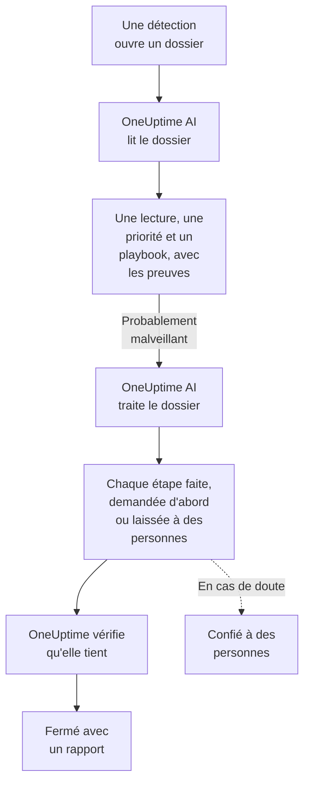

# OneUptime AI dans la sécurité

OneUptime AI lit chaque dossier de sécurité comme le ferait un analyste : ses détections, ses événements, ses entités et le renseignement sur les menaces, ainsi que les hôtes et les personnes autour. Il dit ce qui s'est passé et si cela semble réel, propose une priorité et un playbook, et cite les preuves derrière chaque affirmation. Si vous le lui permettez, il traite ensuite le dossier de bout en bout : il le prend en charge, confine la menace, vérifie que ce qu'il a fait tient, fait corriger le code, et ferme le dossier avec un rapport. Il effectue chaque type d'étape en autonomie, demande d'abord à une personne ou la laisse à une personne, selon vos réglages, et il effectue chaque étape via le même moteur de playbooks que les personnes, si bien que chacune figure dans la chronologie du dossier comme une étape de OneUptime AI et peut être annulée. Il rédige aussi des règles de détection à partir d'une phrase, et répond dans Demander à l'IA à vos questions sur vos données de sécurité.

:::cards
- [Qualifier un dossier](#qualifier-un-dossier): Ce que lit OneUptime AI, ce qu'il conclut et ce qu'il ne fait jamais.
- [Qualifier automatiquement les nouveaux dossiers](#qualifier-automatiquement-les-nouveaux-dossiers): Chaque dossier ouvert par une détection, qualifié dès son ouverture.
- [Traiter un dossier de bout en bout](#traiter-un-dossier-de-bout-en-bout): Confiner, vérifier, corriger et fermer, avec une personne qui approuve ce que vous choisissez.
- [Ce que OneUptime AI peut faire sur un dossier](#ce-que-oneuptime-ai-peut-faire-sur-un-dossier): Désactivé, Demander d'abord ou En autonomie, pour chaque type d'étape.
- [Quand il confie un dossier à des personnes](#quand-il-confie-un-dossier-à-des-personnes): Pourquoi il s'arrête, et qui en est averti.
- [Lancer un playbook après une qualification](#lancer-un-playbook-après-une-qualification): Agir sur un dossier lu comme Probablement malveillant.
- [Rédiger une règle de détection](#rédiger-une-règle-de-détection): Décrivez ce qu'il faut détecter, et lisez la règle Sigma.
- [Demander à l'IA sur les pages de sécurité](#demander-à-lia-sur-les-pages-de-sécurité): Des questions sur les dossiers et les événements, en langage courant.
:::

## Comment ça fonctionne

Une qualification ne fait que lire. Le traitement d'un dossier agit, dans les limites de ce que vous autorisez, et confie le dossier à des personnes dès qu'il a un doute. Les deux s'appuient sur l'IA du projet lui-même : **Activer l'IA**, son fournisseur LLM, ses crédits IA et ses limites quotidiennes d'IA.

## Avant de commencer

- **Activer l'IA** activé, sous **Paramètres du projet → IA → Fonctionnalités IA**. Désactivé, la sécurité n'affiche rien de OneUptime AI et rien ne s'exécute.
- Un fournisseur LLM que OneUptime AI peut utiliser, sous **Paramètres du projet → IA → Fournisseurs LLM**. OneUptime Cloud en fournit un.
- Un rôle qui peut traiter les dossiers de sécurité, pour lancer une qualification : Propriétaire du projet, Administrateur du projet, Administrateur de la sécurité ou Membre de la sécurité. Lecteur de la sécurité lit chaque qualification, mais ne peut pas en lancer. Voir [Rôles](/docs/permissions/reference#rôles).

## Qualifier un dossier

Ouvrez un dossier : la carte **OneUptime AI** se trouve en haut de sa page.

| La carte indique | Ce que cela veut dire |
| --- | --- |
| **Pas encore qualifié** | Aucune qualification n'a eu lieu. **Qualifier avec l'IA** en lance une. |
| **Qualification de ce dossier** | OneUptime AI lit le dossier. Chaque vérification s'affiche pendant qu'elle s'exécute. |
| Une lecture, comme **Probablement malveillant** | La qualification est terminée. **Qualifier à nouveau** relit le dossier depuis le début. |
| **La qualification n'a pas abouti** | L'exécution s'est arrêtée. **Réessayer** en lance une autre. |

Un Lecteur de la sécurité lit la même carte : **Qualifier avec l'IA** et **Réessayer** restent grisés à côté d'une ligne qui dit qui peut lancer une qualification, et **Qualifier à nouveau** et **Définir la priorité** ne sont pas proposés.

Une qualification lit :

- le dossier : son titre, sa priorité, son statut, ses entités et sa correspondance ATT&CK ;
- ses détections, la plus récente d'abord, avec un exemple d'événement pour chacune ;
- les événements de sécurité et le renseignement sur les menaces concernant ses utilisateurs, ses hôtes et ses adresses ;
- le risque de ses utilisateurs, de ses hôtes et de ses adresses, et ce qui l'a augmenté cette semaine ;
- les hôtes de OneUptime auxquels correspondent ses hôtes et ses adresses, et à qui ils appartiennent ;
- l'incident qu'il a déclaré, ses notes, ses entités protégées et les playbooks activés.

Elle peut aussi lire le reste de OneUptime comme le fait l'investigation d'un incident : journaux, traces, métriques, hôtes, et les outils en lecture seule des serveurs MCP du projet.

Tous ceux qui peuvent voir le dossier lisent sa qualification : une qualification ne lit donc que ce que tous peuvent lire. Une équipe, un rôle personnalisé ou une clé d'API qui ne lit un type d'enregistrement que selon le propriétaire ou l'étiquette ne compte que si la clé d'API, ou quelqu'un de l'équipe, peut lire les dossiers de sécurité ou le journal d'audit. Un type d'enregistrement qu'aucun d'eux ne lit que selon le propriétaire ou l'étiquette est lu en entier ; là où certains le font, un hôte, un cluster, un service ou un autre enregistrement qu'un propriétaire ou une étiquette met à part est exclu, et il n'est jamais nommé ni compté. Qui peut lire les dossiers de sécurité est établi à chaque qualification, donc une qualification écrite avant que quelqu'un obtienne cet accès peut nommer des enregistrements mis à part pour cette personne. Le dossier est toujours lu, ainsi que l'incident qu'il a déclaré, sauf si cet incident est privé. Les incidents et alertes privés ne sont jamais lus.

### Ce qu'elle conclut

| Lecture | Signifie | Propose de clore en |
| --- | --- | --- |
| Probablement malveillant | Les preuves désignent une activité malveillante ou non autorisée | True Positive |
| Probablement bénin | L'activité semble réelle mais attendue, comme une tâche d'administration ou une analyse lancée par votre équipe | Benign Positive |
| Probablement un faux positif | La détection semble avoir mal interprété une activité normale | False Positive |
| Non concluant | Les preuves ne suffisaient pas pour trancher, et une personne doit regarder | Rien |

La lecture est celle de OneUptime AI, jamais le verdict du dossier : **Fermer le dossier** part du verdict qu'elle propose, et une personne choisit. Sous la lecture, la carte affiche :

- **Priorité suggérée**, avec **Définir la priorité** quand le dossier a une autre priorité.
- **Playbook suggéré**, avec **Exécuter le playbook**, qui le lance en votre nom, avec chaque approbation dont il a besoin. Quand ce playbook s'exécute déjà sur le dossier, le statut de son exécution, comme **En attente d'approbation**, prend la place de **Exécuter le playbook** : l'exécution est dans **Playbooks** du dossier, et une seconde demanderait à nouveau la même approbation.
- Le rapport : ce qui s'est passé, son degré de certitude et la suite à donner, chaque affirmation suivie d'une référence comme C1.
- **Éléments vérifiés** : chaque requête exécutée par la qualification. Une référence ouvre sa requête, et en déplier une la relance avec vos autorisations, sur la période lue par la qualification.
- **Poser une question sur ce dossier**, qui ouvre Demander à l'IA sur le dossier.

Chaque liste de dossiers affiche la lecture à côté du titre de chaque dossier, et filtre dessus avec **Avis de l'IA**.

### Ce qu'elle ne fait jamais

Une qualification ne change rien au dossier : ni son statut, ni sa priorité, ni la personne assignée, ni son verdict, ni ses notes. Elle ne lance aucun playbook et ne confine personne. Un playbook qu'elle propose s'exécute quand une personne le lance, ou par le déclencheur décrit plus bas. Agir sur le dossier revient à OneUptime AI quand il le traite, ce qui a son propre réglage : voir [Traiter un dossier de bout en bout](#traiter-un-dossier-de-bout-en-bout).

### Texte écrit pour manipuler une IA

Les événements, les alertes et les valeurs des entités viennent de l'extérieur du projet, et un attaquant peut les écrire. OneUptime AI les lit tous comme des données, jamais comme des instructions. Quand une partie des données d'un dossier ressemble à des instructions adressées à une IA, la carte le dit d'abord, une lecture Probablement bénin ou Probablement un faux positif devient Non concluant, cette qualification ne lance aucun playbook, et OneUptime AI ne traite pas le dossier : il le confie à des personnes.

## Qualifier automatiquement les nouveaux dossiers

Ouvrez **Produits → Événements de sécurité → IA → Paramètres** et activez **Qualifier les nouveaux dossiers** : chaque dossier ouvert par une détection est alors qualifié dès son ouverture. L'interrupteur enregistre dès que vous le basculez. Propriétaire du projet et Administrateur du projet peuvent le modifier.

Les nouveaux projets démarrent avec l'option activée ; un projet créé avant la garde désactivée jusqu'à ce que quelqu'un l'active. Un dossier ouvert à la main, et le dossier de l'attaque de test de **Envoyer une attaque de test**, sont qualifiés quand quelqu'un clique sur **Qualifier avec l'IA**.

## Traiter un dossier de bout en bout

Sur la même page, activez **Traiter les dossiers de bout en bout** : OneUptime AI prend alors en charge chaque dossier que sa qualification lit comme Probablement malveillant et le traite, dans les limites de ce que vous autorisez sous **Ce que OneUptime AI peut faire sur un dossier**. Les nouveaux projets démarrent avec l'option activée ; un projet créé avant la garde désactivée jusqu'à ce que quelqu'un l'active. Propriétaire du projet et Administrateur du projet peuvent la modifier.

Tant qu'elle est activée, une personne peut aussi le lancer sur un seul dossier : **Répondre avec l'IA**, sur la carte **OneUptime AI** du dossier, traite un dossier que la qualification de OneUptime AI a lu comme Probablement malveillant, Probablement bénin ou Probablement un faux positif. Ce bouton n'est pas proposé sur un dossier dont la qualification était Non concluant, dont les données ressemblent à des instructions adressées à une IA, ou qui est à votre priorité la plus élevée : ces dossiers reviennent à une personne. Il faut un rôle qui peut traiter les dossiers de sécurité.

### Ce qu'il fait

OneUptime AI exécute le **Plan de réponse** du dossier, le plus urgent d'abord : **Confirmer que la menace est réelle**, **Confiner la menace**, **Corriger ce qui l'a permis** et **Fermer le dossier**. Chaque étape est faite, demandée à une personne, ou laissée à une personne, comme le dit la ligne de **Ce que OneUptime AI peut faire sur un dossier** pour son type.

| Étape | Ce que fait OneUptime AI |
| --- | --- |
| Prendre le dossier en charge | Le prend en charge, et relève sa priorité à celle que la qualification a proposée. Il n'abaisse jamais une priorité, et un dossier qu'il relève à votre priorité la plus élevée revient à des personnes |
| Écarter un faux positif | Marque l'étape comme faite seulement quand les faits propres à OneUptime ne laissent aucun doute : l'adresse n'est pas l'une des vôtres et personne ne s'est connecté depuis celle-ci. Sinon, il laisse l'étape à une personne |
| Bloquer l'adresse | La bloque pendant 24 heures via votre [Liste de blocage](/docs/telemetry/security-cases#liste-de-blocage), puis attend la vérification de OneUptime que le blocage tient. Si rien n'applique votre liste de blocage, il laisse l'étape à une personne |
| Suspendre l'utilisateur, confiner l'hôte | Exécute l'étape d'un de vos playbooks qui le fait, via votre fournisseur d'identité ou votre EDR. Sans un tel playbook, il laisse l'étape à une personne |
| Déclarer un incident | Demande toujours d'abord : un incident alerte des personnes |
| Passer le dossier à Maîtrisé | Une fois que OneUptime a vérifié chaque étape qui confine la menace |
| Corriger la route qu'une attaque a atteinte | Fait ouvrir une pull request par « Corriger avec l'IA ». Une personne la fusionne. Il ferme le dossier une fois que OneUptime a vérifié le correctif en production, demande à une personne quand le correctif semble seulement fait, et continue de traiter le dossier tant qu'il ne tient pas |
| Activer la MFA, examiner les modifications du compte | Laissé à une personne : aucun produit n'indique à OneUptime si elles tiennent |
| Fermer le dossier | Une fois chaque autre étape faite et la détection du dossier calme depuis 24 heures, en Vrai positif, avec un [rapport de clôture](#le-rapport-de-clôture) |

Une étape que la règle de détection du dossier ajoute d'elle-même, et tout ce que OneUptime n'a aucun moyen de faire, comme bloquer un domaine dans votre filtre DNS, est laissé à une personne, avec la raison.

Chaque étape que OneUptime AI effectue passe par le moteur de playbooks, comme une exécution d'une seule étape sur la page **Playbooks** du dossier, avec **OneUptime AI** comme déclencheur. Elle attend donc une approbation, laisse les entités protégées tranquilles, apparaît dans la chronologie du dossier, est conservée dans le journal d'audit et peut être annulée, comme une étape que n'importe qui lance, et la chronologie indique qu'elle vient de OneUptime AI. Une étape sur laquelle il demande attend l'approbation d'une personne, sur le dossier, sur sa page **Playbooks**, ou d'un simple appui dans Slack ou Microsoft Teams.

### Son journal sur le dossier

Sous la qualification, la carte **OneUptime AI** indique comment OneUptime AI traite le dossier, sous **Traitement du dossier** :

| La carte indique | Ce que cela veut dire |
| --- | --- |
| **OneUptime AI ne traite pas ce dossier** | **Répondre avec l'IA** le prend en charge. |
| **Dossier en cours de traitement** | OneUptime AI exécute le plan. **Reprendre la main** l'arrête, et le dossier est à vous. |
| **En attente d'une personne** | Il a demandé à quelqu'un d'approuver une étape, et reprend dès que quelqu'un répond. |
| **Confié à des personnes** | Il s'est arrêté, et dit pourquoi. |
| **Le dossier est fermé** | Il a fermé le dossier, ou une personne l'a fait. Son **Rapport de clôture** figure au-dessus de ses étapes. |

En dessous, chaque étape qu'il a effectuée, demandée ou laissée, la plus récente d'abord, chacune avec sa raison : **Fait en autonomie : vos paramètres le permettent.**, **Selon vos paramètres, ceci attend l'approbation d'une personne.**, **OneUptime n'a aucun moyen de faire cette étape : une personne s'en charge donc.** Une étape sur laquelle il a demandé a **Approuver** et **Refuser** ; une étape qu'il a effectuée renvoie à son exécution, où elle peut être annulée. Une étape que OneUptime vérifie dit ce que la vérification a trouvé, et une étape qu'il a déjà effectuée sur des dossiers de la même règle dit combien de fois elle a tenu : « Sur 15 dossiers similaires, cela a tenu 14 fois. »

### Un dossier qu'il juge bénin ou faux positif

**Répondre avec l'IA** sur un dossier que la qualification a lu comme Probablement bénin ou Probablement un faux positif le ferme en Positif bénin ou en Faux positif, dans la mesure où **Fermer le dossier** le permet. Une fois le dossier fermé, OneUptime AI lève les blocages qu'il a créés, là encore dans la mesure où **Fermer le dossier** le permet, et propose à la règle du dossier une exception pour la valeur qui l'a déclenché. L'exception attend toujours une personne : **Approuver** l'ajoute, en votre nom.

## Ce que OneUptime AI peut faire sur un dossier

Sous **Ce que OneUptime AI peut faire sur un dossier**, sur **Produits → Événements de sécurité → IA → Paramètres**, chaque type d'étape a sa propre ligne, qui s'enregistre dès que vous choisissez :

- **Désactivé** : OneUptime AI laisse cela à une personne, et l'indique sur le dossier.
- **Demander d'abord** : il demande à une personne, avec les preuves, et le fait dès que quelqu'un approuve.
- **En autonomie** : il le fait sans demander, et l'indique dans la chronologie du dossier.

| Ligne | Couvre | Les nouveaux projets démarrent sur |
| --- | --- | --- |
| **Traiter le dossier** | Prendre le dossier en charge, relever sa priorité, marquer des étapes comme faites avec leurs preuves, le passer à Maîtrisé | En autonomie |
| **Bloquer des adresses** | Bloquer l'adresse du dossier en périphérie de votre réseau, pendant 24 heures | Demander d'abord |
| **Confiner des comptes** | Suspendre l'utilisateur du dossier ou mettre fin à ses sessions | Demander d'abord |
| **Confiner des hôtes** | Confiner ou isoler l'hôte du dossier | Demander d'abord |
| **Corriger le code** | Faire ouvrir par « Corriger avec l'IA » une pull request pour la route qu'une attaque a atteinte | En autonomie |
| **Fermer le dossier** | Fermer le dossier avec son rapport de clôture, et lever ses blocages une fois qu'il est fermé comme inoffensif | Demander d'abord |

Les réglages s'appliquent tant que **Traiter les dossiers de bout en bout** est activé, et la carte le signale tant qu'il est désactivé. Propriétaire du projet et Administrateur du projet peuvent les modifier.

Régler **Bloquer des adresses**, **Confiner des comptes** ou **Confiner des hôtes** sur **En autonomie** demande l'autorité d'un Administrateur de la sécurité, que détiennent aussi les Propriétaires du projet et les Administrateurs du projet, et OneUptime conserve qui l'a fait et quand, comme pour une étape de playbook dont l'approbation est désactivée. **Bloquer des adresses** demande d'abord : **Confirmer et activer** est la confirmation d'un Administrateur de la sécurité, et la ligne indique ensuite quand elle a été donnée. Tant qu'un Administrateur de la sécurité ne l'a pas confirmé, OneUptime AI demande avant de bloquer.

Quoi que disent les lignes, OneUptime AI :

- n'agit jamais sur un utilisateur, un hôte ou une adresse protégés : il confie le dossier à des personnes ;
- effectue au plus 10 actions en autonomie par heure, sur l'ensemble de vos dossiers, puis confie le dossier suivant à des personnes ;
- bloque pendant 24 heures au plus ;
- ne fusionne jamais de code : une personne fusionne chaque pull request ;
- demande toujours avant de déclarer un incident ou d'ajouter une exception de règle ;
- traite un dossier une exécution à la fois, et un serveur qui redémarre ne perd jamais une exécution qui agit.

## Quand il confie un dossier à des personnes

OneUptime AI ne se retire jamais en silence. Il confie le dossier à des personnes, en disant pourquoi sur la carte et dans la chronologie, quand :

- une partie des données du dossier ressemble à des instructions adressées à une IA ;
- le dossier est à votre priorité la plus élevée ;
- la cible de sa prochaine étape est protégée ;
- il a agi en autonomie autant de fois qu'il le peut en une heure ;
- l'IA est désactivée pour le projet ou pour les dossiers de sécurité, il n'y a pas de fournisseur LLM, ou le projet n'a plus de crédits IA ou a atteint sa limite quotidienne d'IA ;
- sa qualification n'a pas pu dire si le dossier est réel ;
- une étape qu'il a effectuée ne tient pas, une étape qu'il a lancée n'a pas abouti, ou une personne a refusé ou annulé une étape qu'il a effectuée ;
- il ne sait pas quoi faire ensuite, ou tout ce qui reste à faire sur le dossier revient à une personne.

Les personnes qui s'occupent du dossier en sont averties tout de suite, ou, quand personne ne s'en occupe, les personnes averties des dossiers à sa priorité : **OneUptime AI a confié un dossier de sécurité à des personnes**, sous **Paramètres utilisateur → Paramètres de notification**. Une règle de notification d'espace de travail pour les dossiers de sécurité le publie dans son canal Slack ou Microsoft Teams sous **Dossiers confiés à des personnes par OneUptime AI**. **Reprendre la main** remet le dossier sans prévenir personne, puisque la personne qui a appuyé dessus l'a en main.

**Répondre avec l'IA** demande à OneUptime AI de traiter à nouveau le dossier, là où il en est.

## Le rapport de clôture

Quand OneUptime AI ferme un dossier, ou demande à une personne de le faire, il rédige un rapport de clôture à partir de ce que contient le dossier, pas des mots de la qualification : ce qui s'est passé, l'impact, ce qui a été fait, ce qui a été corrigé et ce qu'il faut surveiller. Le rapport est la note de clôture du dossier, il figure dans la chronologie, et la carte l'affiche sous **Rapport de clôture**. Avec **Fermer le dossier** sur **Demander d'abord**, le dossier attend qu'une personne approuve la fermeture, avec le rapport à lire d'abord.

## Comment il est mesuré

**Produits → Événements de sécurité → Vue d'ensemble** montre comment OneUptime AI a traité les dossiers des 30 derniers jours, dès qu'il en a traité un ou demandé quelque chose sur l'un d'eux : **Résolu par OneUptime AI**, parmi les dossiers qu'il a traités ; **Délai de confinement avec l'IA** et **Délai de clôture avec l'IA**, chacun à côté du délai sans elle ; et **Demandes d'approbation**, la rapidité des réponses des personnes, et combien de ses étapes elles ont annulées.

## Lancer un playbook après une qualification

Un playbook dont le **Déclencheur** est **Qualifié probablement malveillant** s'exécute une fois sur un dossier, quand une qualification le lit comme Probablement malveillant. **Pour les dossiers d'au moins**, **Seulement pour les détections de** et **Seulement pour ces règles de détection** le restreignent comme pour tout déclencheur, et ses étapes de confinement attendent une approbation comme toujours. Il ne s'exécute pas :

- après une qualification qui a trouvé du texte écrit pour manipuler une IA ;
- une deuxième fois sur le même dossier, quel que soit le nombre de qualifications du dossier ;
- sur le dossier de l'attaque de test, sauf si chaque étape du playbook reste dans OneUptime.

Ce déclencheur n'est proposé à un nouveau playbook que tant que l'IA du projet est activée.

## Rédiger une règle de détection

Sur **Règles de détection**, sous le champ **Règle Sigma (YAML)**, cliquez sur **Rédiger avec l'IA** et dites ce que la règle doit détecter, par exemple dix échecs de connexion depuis une même adresse IP en cinq minutes. **Rédiger la règle** place une règle Sigma dans le champ, vérifiée comme une règle enregistrée. Lisez-la, modifiez-la au besoin et enregistrez-la comme d'habitude : rien n'est enregistré tant que vous ne le faites pas. Si le champ contient déjà une règle, le bouton devient **Rédiger à nouveau avec l'IA**, et le brouillon remplace cette règle.

La rédaction demande un rôle qui peut créer des règles de détection.

## Demander à l'IA sur les pages de sécurité

**Demander à l'IA** sait sur quelle page de sécurité vous êtes. Sur un dossier, il lit d'abord le dossier et propose des questions comme **Est-ce réel ?**. Sur les autres pages des événements de sécurité, une question en langage courant cherche dans vos événements de sécurité. Il peut aussi comparer des valeurs à votre renseignement sur les menaces, voir l'activité d'un utilisateur, d'un hôte ou d'une adresse, et lister les playbooks adaptés à un dossier.

Demander à l'IA peut ajouter une note à un dossier et y lancer un playbook, en votre nom, et demande avant chaque action. Un playbook qu'il lance attend une approbation comme tout autre.

Quand un dossier déclare un incident, l'investigation IA de l'incident lit aussi le dossier : ce qui a été détecté, à propos de qui, et la qualification de OneUptime AI.

## Coûts et limites

Une qualification est un travail de OneUptime AI, comme l'investigation d'un incident. Sur OneUptime Cloud, elle est payée avec les crédits IA du projet, et elle compte dans les limites quotidiennes d'IA propres au projet (**Limites quotidiennes**, sous **Paramètres du projet → IA → Fonctionnalités IA**). Les limites quotidiennes des incidents et des alertes ne s'appliquent pas. Un dossier n'a qu'une qualification à la fois, et les journaux IA (**Paramètres du projet → IA → Journaux IA**) listent ses appels.

Quand le projet n'a plus de crédits IA ou a atteint une limite quotidienne d'IA, les nouveaux dossiers ne sont pas qualifiés : la carte dit pourquoi, et **Qualifier avec l'IA** fonctionne de nouveau dès que des crédits sont ajoutés ou que la limite se réinitialise. Quand OneUptime AI traite un dossier, il lit le plan et les vérifications propres au dossier plutôt que d'interroger le LLM, et il s'arrête aux mêmes limites : il confie le dossier à des personnes, en disant pourquoi.

## Dépannage

:::details Un nouveau dossier n'a pas été qualifié
Vérifiez que **Activer l'IA** est activé, ainsi que **Qualifier les nouveaux dossiers** sous **Produits → Événements de sécurité → IA → Paramètres**. Un dossier ouvert à la main et le dossier de l'attaque de test ne sont qualifiés que si quelqu'un le demande. Ouvrez le dossier : quand quelque chose empêche une qualification, la carte dit quoi, et où le corriger.
:::

:::details OneUptime AI n'a pas traité un dossier
Vérifiez que **Traiter les dossiers de bout en bout** est activé sous **Produits → Événements de sécurité → IA → Paramètres**. Il ne prend en charge un dossier de lui-même que lorsque la qualification le lit comme Probablement malveillant. Ouvrez le dossier : sous **Traitement du dossier**, la carte dit pourquoi il ne le traite pas, et **Répondre avec l'IA** le lui demande.
:::

:::details Il demande avant de bloquer, alors que Bloquer des adresses est sur En autonomie
**En autonomie** pour **Bloquer des adresses** ne compte qu'une fois qu'un Administrateur de la sécurité l'a confirmé : la ligne indique quand, ou que personne ne l'a encore fait. Une adresse protégée, ou l'une des vôtres, n'est jamais bloquée : OneUptime AI confie le dossier à des personnes. Tant que rien n'applique votre liste de blocage, il laisse l'étape à une personne.
:::

:::details La carte indique que le projet n'a plus de crédits IA, ou qu'il a atteint sa limite quotidienne d'IA
Un Propriétaire du projet ou une personne disposant de Manage Billing peut ajouter des crédits sous **Paramètres du projet → IA → Crédits IA**, ou relever ou supprimer la limite sous **Paramètres du projet → IA → Fonctionnalités IA**. Cliquez ensuite sur **Qualifier avec l'IA** sur le dossier.
:::

:::details La carte indique qu'un texte du dossier ressemble à des instructions adressées à une IA
Une partie des données du dossier, comme le message d'un événement ou un nom d'utilisateur, a été écrite pour manipuler une IA. OneUptime AI l'a lue comme des données et vous a laissé la décision : lisez vous-même les détections et les preuves avant de clore le dossier.
:::

:::details Un playbook au déclencheur IA ne s'est pas exécuté
Vérifiez que le playbook est activé, que la qualification a lu le dossier comme Probablement malveillant, et que ses réglages **Pour les dossiers d'au moins**, **Seulement pour les détections de** et **Seulement pour ces règles de détection** correspondent au dossier. Il s'exécute une fois par dossier, et pas après une qualification qui a trouvé du texte écrit pour manipuler une IA.
:::

## Étapes suivantes

:::cards
- [Dossiers de sécurité et playbooks](/docs/telemetry/security-cases): Traiter les dossiers, les clore avec un verdict et construire des playbooks.
- [AI SRE](/docs/ai/ai-sre): Comment OneUptime AI enquête sur les incidents et les alertes, et ses limites.
- [Demander à l'IA](/docs/ai/ask-ai): Posez des questions sur votre projet en langage courant.
- [Fournisseurs LLM](/docs/ai/llm-provider): Choisissez le modèle qu'utilise OneUptime AI.
:::
