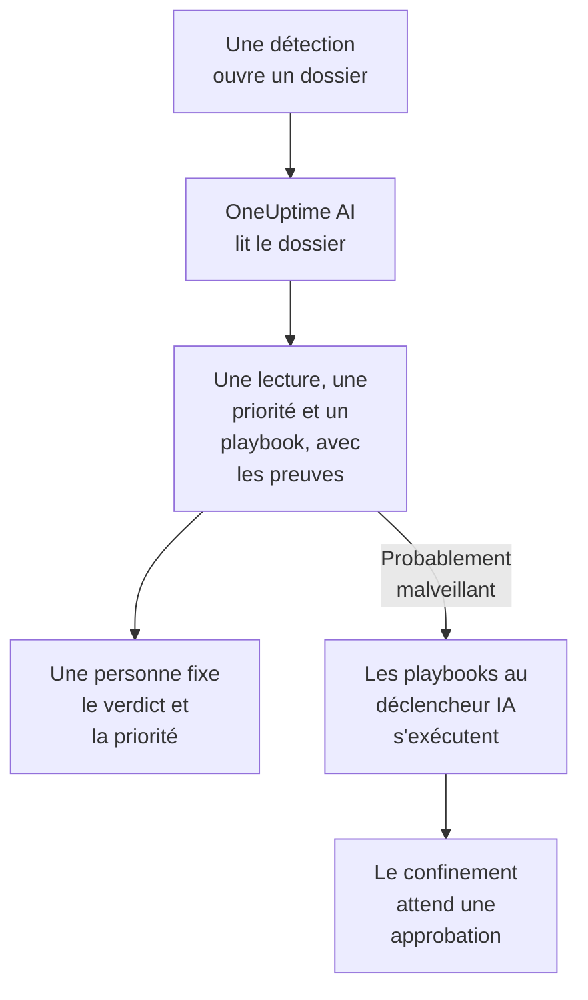

# OneUptime AI dans la sécurité

OneUptime AI lit chaque dossier de sécurité comme le ferait un analyste : ses détections, ses événements, ses entités et le renseignement sur les menaces, ainsi que les hôtes et les personnes autour. Il dit ce qui s'est passé et si cela semble réel, propose une priorité et un playbook, et cite les preuves derrière chaque affirmation. Il ne change rien de lui-même : une personne fixe le verdict et la priorité, et lance le playbook. Il rédige aussi des règles de détection à partir d'une phrase, et répond dans Demander à l'IA à vos questions sur vos données de sécurité.

:::cards
- [Qualifier un dossier](#qualifier-un-dossier): Ce que lit OneUptime AI, ce qu'il conclut et ce qu'il ne fait jamais.
- [Qualifier automatiquement les nouveaux dossiers](#qualifier-automatiquement-les-nouveaux-dossiers): Chaque dossier ouvert par une détection, qualifié dès son ouverture.
- [Lancer un playbook après une qualification](#lancer-un-playbook-après-une-qualification): Agir sur un dossier lu comme Probablement malveillant.
- [Rédiger une règle de détection](#rédiger-une-règle-de-détection): Décrivez ce qu'il faut détecter, et lisez la règle Sigma.
- [Demander à l'IA sur les pages de sécurité](#demander-à-lia-sur-les-pages-de-sécurité): Des questions sur les dossiers et les événements, en langage courant.
:::

## Comment ça fonctionne

Une qualification ne fait que lire. Elle s'appuie sur l'IA du projet lui-même : **Activer l'IA**, son fournisseur LLM, ses crédits IA et ses limites quotidiennes d'IA.

## Avant de commencer

- **Activer l'IA** activé, sous **Paramètres du projet → IA → Fonctionnalités IA**. Désactivé, la sécurité n'affiche rien de OneUptime AI et rien ne s'exécute.
- Un fournisseur LLM que OneUptime AI peut utiliser, sous **Paramètres du projet → IA → Fournisseurs LLM**. OneUptime Cloud en fournit un.
- Un rôle qui peut traiter les dossiers de sécurité, pour lancer une qualification : Project Owner, Project Admin, Security Admin ou Security Member. Security Viewer lit chaque qualification, mais ne peut pas en lancer. Voir [Rôles](/docs/permissions/reference#rôles).

## Qualifier un dossier

Ouvrez un dossier : la carte **OneUptime AI** se trouve en haut de sa page.

| La carte indique | Ce que cela veut dire |
| --- | --- |
| **Pas encore qualifié** | Aucune qualification n'a eu lieu. **Qualifier avec l'IA** en lance une. |
| **Qualification de ce dossier** | OneUptime AI lit le dossier. Chaque vérification s'affiche pendant qu'elle s'exécute. |
| Une lecture, comme **Probablement malveillant** | La qualification est terminée. **Qualifier à nouveau** relit le dossier depuis le début. |
| **La qualification n'a pas abouti** | L'exécution s'est arrêtée. **Réessayer** en lance une autre. |

Une qualification lit :

- le dossier : son titre, sa priorité, son statut, ses entités et sa correspondance ATT&CK ;
- ses détections, la plus récente d'abord, avec un exemple d'événement pour chacune ;
- les événements de sécurité et le renseignement sur les menaces concernant ses utilisateurs, ses hôtes et ses adresses ;
- le risque de ses utilisateurs, de ses hôtes et de ses adresses, et ce qui l'a augmenté cette semaine ;
- les hôtes de OneUptime auxquels correspondent ses hôtes et ses adresses, et à qui ils appartiennent ;
- l'incident qu'il a déclaré, ses notes, ses entités protégées et les playbooks activés.

Elle peut aussi lire le reste de OneUptime comme le fait l'investigation d'un incident : journaux, traces, métriques, hôtes, et les outils en lecture seule des serveurs MCP du projet.

### Ce qu'elle conclut

| Lecture | Signifie | Propose de clore en |
| --- | --- | --- |
| Probablement malveillant | Les preuves désignent une activité malveillante ou non autorisée | True Positive |
| Probablement bénin | L'activité semble réelle mais attendue, comme une tâche d'administration ou une analyse lancée par votre équipe | Benign Positive |
| Probablement un faux positif | La détection semble avoir mal interprété une activité normale | False Positive |
| Non concluant | Les preuves ne suffisaient pas pour trancher, et une personne doit regarder | Rien |

La lecture est celle de OneUptime AI, jamais le verdict du dossier : **Close Case** part du verdict qu'elle propose, et une personne choisit. Sous la lecture, la carte affiche :

- **Priorité suggérée**, avec **Définir la priorité** quand le dossier a une autre priorité.
- **Playbook suggéré**, avec **Exécuter le playbook**, qui le lance en votre nom, avec chaque approbation dont il a besoin.
- Le rapport : ce qui s'est passé, son degré de certitude et la suite à donner, chaque affirmation suivie d'une référence comme C1.
- **Éléments vérifiés** : chaque requête exécutée par la qualification. Une référence ouvre sa requête, et en déplier une la relance avec vos autorisations, sur la période lue par la qualification.
- **Poser une question sur ce dossier**, qui ouvre Demander à l'IA sur le dossier.

Chaque liste de dossiers affiche la lecture à côté du titre de chaque dossier, et filtre dessus avec **Avis de l'IA**.

### Ce qu'elle ne fait jamais

Une qualification ne change rien au dossier : ni son statut, ni sa priorité, ni la personne assignée, ni son verdict, ni ses notes. Elle ne lance aucun playbook et ne confine personne. Un playbook qu'elle propose s'exécute quand une personne le lance, ou par le déclencheur décrit plus bas.

### Texte écrit pour manipuler une IA

Les événements, les alertes et les valeurs des entités viennent de l'extérieur du projet, et un attaquant peut les écrire. OneUptime AI les lit tous comme des données, jamais comme des instructions. Quand une partie des données d'un dossier ressemble à des instructions adressées à une IA, la carte le dit d'abord, une lecture Probablement bénin ou Probablement un faux positif devient Non concluant, et cette qualification ne lance aucun playbook.

## Qualifier automatiquement les nouveaux dossiers

Ouvrez **Produits → Événements de sécurité → IA → Paramètres** et activez **Qualifier les nouveaux dossiers** : chaque dossier ouvert par une détection est alors qualifié dès son ouverture. L'interrupteur enregistre dès que vous le basculez. Project Owner et Project Admin peuvent le modifier.

Les nouveaux projets démarrent avec l'option activée ; un projet créé avant la garde désactivée jusqu'à ce que quelqu'un l'active. Un dossier ouvert à la main, et le dossier de l'attaque de test de **Envoyer une attaque de test**, sont qualifiés quand quelqu'un clique sur **Qualifier avec l'IA**.

## Lancer un playbook après une qualification

Un playbook dont le **Déclencheur** est **Qualifié probablement malveillant** s'exécute une fois sur un dossier, quand une qualification le lit comme Probablement malveillant. **For Cases At Least**, **Only For Detections From** et **Only For These Detection Rules** le restreignent comme pour tout déclencheur, et ses étapes de confinement attendent une approbation comme toujours. Il ne s'exécute pas :

- après une qualification qui a trouvé du texte écrit pour manipuler une IA ;
- une deuxième fois sur le même dossier, quel que soit le nombre de qualifications du dossier ;
- sur le dossier de l'attaque de test, sauf si chaque étape du playbook reste dans OneUptime.

Ce déclencheur n'est proposé à un nouveau playbook que tant que l'IA du projet est activée.

## Rédiger une règle de détection

Sur **Règles de détection**, sous le champ **Sigma Rule (YAML)**, cliquez sur **Rédiger avec l'IA** et dites ce que la règle doit détecter, par exemple dix échecs de connexion depuis une même adresse IP en cinq minutes. **Rédiger la règle** place une règle Sigma dans le champ, vérifiée comme une règle enregistrée. Lisez-la, modifiez-la au besoin et enregistrez-la comme d'habitude : rien n'est enregistré tant que vous ne le faites pas. Si le champ contient déjà une règle, le bouton devient **Rédiger à nouveau avec l'IA**, et le brouillon remplace cette règle.

La rédaction demande un rôle qui peut créer des règles de détection.

## Demander à l'IA sur les pages de sécurité

**Demander à l'IA** sait sur quelle page de sécurité vous êtes. Sur un dossier, il lit d'abord le dossier et propose des questions comme **Est-ce réel ?**. Sur les autres pages des événements de sécurité, une question en langage courant cherche dans vos événements de sécurité. Il peut aussi comparer des valeurs à votre renseignement sur les menaces, voir l'activité d'un utilisateur, d'un hôte ou d'une adresse, et lister les playbooks adaptés à un dossier.

Demander à l'IA peut ajouter une note à un dossier et y lancer un playbook, en votre nom, et demande avant chaque action. Un playbook qu'il lance attend une approbation comme tout autre.

Quand un dossier déclare un incident, l'investigation IA de l'incident lit aussi le dossier : ce qui a été détecté, à propos de qui, et la qualification de OneUptime AI.

## Coûts et limites

Une qualification est un travail de OneUptime AI, comme l'investigation d'un incident. Sur OneUptime Cloud, elle est payée avec les crédits IA du projet, et elle compte dans les limites quotidiennes d'IA propres au projet (**Limites quotidiennes**, sous **Paramètres du projet → IA → Fonctionnalités IA**). Les limites quotidiennes des incidents et des alertes ne s'appliquent pas. Un dossier n'a qu'une qualification à la fois, et les journaux IA (**Paramètres du projet → IA → Journaux IA**) listent ses appels.

Quand le projet n'a plus de crédits IA ou a atteint une limite quotidienne d'IA, les nouveaux dossiers ne sont pas qualifiés : la carte dit pourquoi, et **Qualifier avec l'IA** fonctionne de nouveau dès que des crédits sont ajoutés ou que la limite se réinitialise.

## Dépannage

:::details Un nouveau dossier n'a pas été qualifié
Vérifiez que **Activer l'IA** est activé, ainsi que **Qualifier les nouveaux dossiers** sous **Produits → Événements de sécurité → IA → Paramètres**. Un dossier ouvert à la main et le dossier de l'attaque de test ne sont qualifiés que si quelqu'un le demande. Ouvrez le dossier : quand quelque chose empêche une qualification, la carte dit quoi, et où le corriger.
:::

:::details La carte indique que le projet n'a plus de crédits IA, ou qu'il a atteint sa limite quotidienne d'IA
Un propriétaire du projet ou une personne disposant de Manage Billing peut ajouter des crédits sous **Paramètres du projet → IA → Crédits IA**, ou relever ou supprimer la limite sous **Paramètres du projet → IA → Fonctionnalités IA**. Cliquez ensuite sur **Qualifier avec l'IA** sur le dossier.
:::

:::details La carte indique qu'un texte du dossier ressemble à des instructions adressées à une IA
Une partie des données du dossier, comme le message d'un événement ou un nom d'utilisateur, a été écrite pour manipuler une IA. OneUptime AI l'a lue comme des données et vous a laissé la décision : lisez vous-même les détections et les preuves avant de clore le dossier.
:::

:::details Un playbook au déclencheur IA ne s'est pas exécuté
Vérifiez que le playbook est activé, que la qualification a lu le dossier comme Probablement malveillant, et que ses réglages **For Cases At Least**, **Only For Detections From** et **Only For These Detection Rules** correspondent au dossier. Il s'exécute une fois par dossier, et pas après une qualification qui a trouvé du texte écrit pour manipuler une IA.
:::

## Étapes suivantes

:::cards
- [Dossiers de sécurité et playbooks](/docs/telemetry/security-cases): Traiter les dossiers, les clore avec un verdict et construire des playbooks.
- [AI SRE](/docs/ai/ai-sre): Comment OneUptime AI enquête sur les incidents et les alertes, et ses limites.
- [Demander à l'IA](/docs/ai/ask-ai): Posez des questions sur votre projet en langage courant.
- [Fournisseurs LLM](/docs/ai/llm-provider): Choisissez le modèle qu'utilise OneUptime AI.
:::
