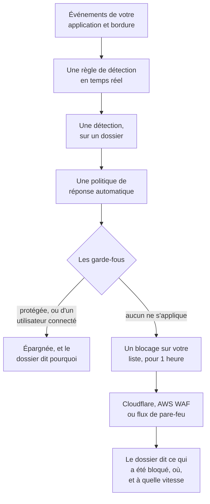

# Réponse automatique

Les politiques de réponse automatique soumettent à un défi ou bloquent une adresse qui attaque dès que la détection est faite, avant que quiconque trie le dossier : les scanners qui sondent votre application et les bots qui essaient mot de passe après mot de passe sont refoulés quelques minutes après leur première requête. Chaque projet comporte trois politiques prêtes à l'emploi, chacune désactivée jusqu'à ce que vous l'activiez, et chacune commence par une semaine de période d'essai qui ne fait qu'enregistrer ce qu'elle aurait fait. Des garde-fous permettent de laisser une politique activée sans risque : elle ne touche jamais vos propres adresses ni une adresse qu'utilisent vos utilisateurs connectés, et elle s'arrête et alerte une personne quand une attaque dépasse ce qu'elle devrait gérer seule.

:::cards
- [Activer une politique](#activer-une-politique): D'abord une semaine de période d'essai, puis un clic.
- [Les garde-fous](#les-garde-fous): Ce qu'une politique ne fait jamais, et quand elle s'arrête.
- [Délai de blocage](#délai-de-blocage): La vitesse de blocage de chaque politique, sur sa carte et sur le dossier.
- [Votre propre politique](#votre-propre-politique): Agir sur les techniques, règles ou renseignements sur les menaces de votre choix.
:::

## Fonctionnement

Une politique agit sur une détection dès qu'elle est enregistrée sur son dossier, quelques secondes après le déclenchement de la règle. Son blocage va sur votre [liste de blocage](/docs/telemetry/security-cases#liste-de-blocage) comme le fait l'étape de playbook **Bloquer l'adresse**, avec le nom de la politique comme auteur : les destinations qui appliquent votre liste de blocage le tiennent, il apparaît dans la chronologie du dossier et dans le journal d'audit, et il expire de lui-même. Il ne demande l'approbation de personne : la personne qui a activé la politique a approuvé ses blocages.

## Avant de commencer

- Une destination qui applique votre liste de blocage : Cloudflare, AWS WAF, ou un pare-feu ou un proxy qui lit un [flux de liste de blocage](/docs/telemetry/blocklist-feeds). Tant que rien ne l'applique, la page le dit, et les blocages d'une politique ne tiennent nulle part.
- Les événements que lisent les règles d'une politique : les journaux d'accès ou les traces de votre application, ou les événements de votre bordure, comme les événements de pare-feu de Cloudflare, et vos connexions. Voir [Événements de sécurité](/docs/telemetry/security-events).
- Un rôle qui peut activer une politique : Administrateur de la sécurité, Administrateur du projet ou Propriétaire du projet. Membre de la sécurité et Lecteur de la sécurité voient les politiques et ce qu'elles ont fait. Voir [Rôles](/docs/permissions/reference#rôles).

## Les politiques prêtes à l'emploi

| Politique | Agit sur | Fait | Premier blocage |
| --- | --- | --- | --- |
| **Scanners** | Analyses web et tentatives d'exploitation (ATT&CK T1595, T1190) : tentatives d'injection SQL, de traversée de répertoires et Log4Shell, et de nombreuses correspondances de règles gérées Cloudflare depuis une adresse, tant que chaque requête de l'adresse a été refusée | Défi | 1 heure |
| **Devinette de mots de passe** | Force brute et pulvérisation de mots de passe (ATT&CK T1110) : connexions échouées depuis une adresse, et connexions échouées puis une réussite depuis la même adresse | Bloquer | 1 heure |
| **Adresses connues comme malveillantes** | Toute détection concernant une adresse que votre [renseignement sur les menaces](/docs/telemetry/threat-intelligence) répertorie | Bloquer | 24 heures |

Les personnes réussissent un défi, les scripts et les bots, non. Scanners ne soumet une adresse à un défi que tant qu'aucune de ses requêtes n'a atteint votre application : une adresse dont des requêtes sont passées est un dossier pour une personne.

Activer Scanners ou Devinette de mots de passe, en période d'essai ou pour de bon, exécute en temps réel les règles de la **Bibliothèque de règles** sur lesquelles elle agit, en ajoutant celles que votre projet n'a pas : une règle en temps réel se déclenche quelques secondes après l'arrivée des événements, là où une règle planifiée lit avec des minutes de retard. Une règle que quelqu'un a désactivée reste désactivée. Un projet exécute au plus 50 règles en temps réel : au-delà, une règle reste sur sa planification, et la carte de la politique affiche **Selon une planification** à côté.

## Activer une politique

:::steps
### Ouvrir Réponse automatique

Ouvrez **Produits → Événements de sécurité → Playbooks → Réponse automatique**. Chaque politique a sa carte : ce qu'elle fait, une puce qui indique **Désactivé**, **Période d'essai**, **Essai terminé** ou **Activé**, et son interrupteur.

### Lancer sa période d'essai

Basculez l'interrupteur de la politique. Pendant 7 jours, elle enregistre ce qu'elle aurait fait et ne touche à aucun trafic : le dossier indique "Trial run: the Scanners policy would have challenged 35.205.11.131 for 1 hour." La carte compte les adresses jusqu'ici, et ce que ses garde-fous ont épargné.

### L'activer

Une fois la semaine écoulée, la carte dit ce que la politique aurait fait, par exemple "En 7 jours, elle aurait soumis 1 283 adresses à un défi. Aucune n'avait d'utilisateurs connectés, et aucune n'était à vous. L'activer ?", et vos responsables de la sécurité reçoivent la même chose par e-mail. Cliquez sur **Activer** : dès lors, la politique agit.
:::

Pour activer une politique sans sa semaine de période d'essai, ouvrez **Plus de paramètres** sur sa carte et cliquez sur **Activer sans période d'essai**. Ses garde-fous s'appliquent toujours. Basculez à nouveau l'interrupteur pour désactiver une politique ; réactivée après une semaine complète de période d'essai, elle agit tout de suite.

## Les garde-fous

- **Jamais vos propres adresses ni les adresses protégées.** Les entrées des **Entités protégées**, et tout ce que OneUptime protège de lui-même : vos hôtes, ressources cloud et sondes, les plages qui ne sont pas sur Internet, et la bordure devant votre application. Voir [Liste de blocage](/docs/telemetry/security-cases#liste-de-blocage).
- **Jamais une adresse qu'un utilisateur connecté a utilisée au cours des 30 derniers jours.** Le réseau d'un bureau, le proxy d'un client ou le domicile d'une personne : OneUptime cherche l'adresse dans les connexions de votre fournisseur d'identité et dans les requêtes que votre application a servies à un utilisateur connecté, celles qui portent un ID d'utilisateur dans leurs traces ou leurs journaux. Une adresse qu'il ne peut pas vérifier, parce que ces événements n'ont pas pu être lus ou que vos règles de masquage cachent les adresses d'une façon qu'il ne peut pas rapprocher, est laissée à une personne.
- **Des blocages plus longs pour une adresse qui revient.** Le premier blocage dure 1 heure, puis 24 heures, puis 7 jours pour une adresse bloquée de nouveau dans les 30 jours. Adresses connues comme malveillantes commence à 24 heures.
- **Au plus 50 blocages automatiques par heure.** Au-delà, vos politiques cessent de bloquer et alertent vos responsables de la sécurité : une attaque de cette ampleur demande une personne. La page le dit tant que cela dure.
- **Annulation en cas de doute.** Quand un utilisateur connecté est vu depuis une adresse qu'une politique a bloquée, la politique lève le blocage et prévient vos responsables de la sécurité.

Vos responsables de la sécurité sont les Administrateurs de la sécurité de votre projet ou, s'il n'en a aucun, les Propriétaires du projet. Chaque adresse qu'un garde-fou a épargnée figure sur son dossier, avec la raison.

## Là où une destination ne peut pas soumettre à un défi

Cloudflare et AWS WAF soumettent à un défi. Un pare-feu qui lit un flux de liste de blocage ne le peut pas : le défi d'une politique y est donc un blocage, pour la même durée, et la carte de la politique et le dossier le disent, par exemple "FortiGate feed cannot challenge, so it blocks the address there for the same time." Un défi que vous posez vous-même n'est jamais changé en blocage.

## Délai de blocage

Le délai de blocage court de la première requête de l'adresse, le premier événement de sa détection, jusqu'à ce que le blocage tienne en bordure. La carte de chaque politique trace ses 50e et 95e centiles jour par jour sur les 30 derniers jours. Un dossier qu'une réponse automatique a bloqué l'indique sous **Délai de confinement** sur sa **Vue d'ensemble**, par exemple "Bloquée automatiquement 41s après sa première requête", et sa chronologie dit ce qui a été bloqué, où et à quelle vitesse : "OneUptime challenged 35.205.11.131 at Cloudflare for 1 hour (Scanners policy), 41 seconds after its first request." L'étape de l'adresse dans le **Plan de réponse** du dossier est faite, avec **Lever** à côté.

## Votre propre politique

Cliquez sur **Créer une politique** sous les politiques prêtes à l'emploi. Une politique à vous a besoin d'un **Nom** et de ce sur quoi elle agit :

| Champ | Ce qu'il fait |
| --- | --- |
| **Techniques ATT&CK** | Les techniques qu'une détection doit porter, séparées par des virgules, comme `T1110, T1190`. Une technique couvre ses sous-techniques. |
| **Action** | **Bloquer** ou **Défi**. |
| **Durée du premier blocage** | Sous **Plus de champs** : 1 heure, 24 heures ou 7 jours. Une adresse qui revient est bloquée plus longtemps. |
| **Règles de détection** | Sous **Plus de champs** : ou une détection faite par l'une de ces règles. |
| **Uniquement les adresses que votre renseignement sur les menaces répertorie** | Sous **Plus de champs** : n'agit que sur les adresses que votre renseignement sur les menaces répertorie. Seul, agit sur toute détection concernant l'une d'elles. |
| **Uniquement tant que chaque requête a été refusée** | Sous **Plus de champs** : n'agit que tant qu'aucune requête de l'adresse n'a atteint votre application. |

Une politique à vous démarre désactivée, passe une semaine en période d'essai comme une politique prête à l'emploi, et a les mêmes garde-fous. **Modifier la politique** et **Supprimer la politique** sont sur sa carte ; la supprimer laisse ses blocages sur votre liste de blocage jusqu'à leur expiration.

## Dépannage

:::details Une politique est activée, mais elle n'a pas bloqué une adresse
Regardez la chronologie du dossier : une politique qui a épargné une adresse dit pourquoi, par exemple parce qu'un utilisateur connecté l'a utilisée. Vérifiez qu'une destination applique votre liste de blocage, et que les règles de la politique indiquent **Temps réel** sur sa carte.
:::

:::details La page dit que les blocages automatiques de l'heure sont épuisés
Vos politiques ont posé 50 blocages automatiques dans la dernière heure et ont alerté vos responsables de la sécurité. Elles reprennent à mesure que les blocages de l'heure vieillissent. Regardez les dossiers de l'attaque, et bloquez une plage depuis **Liste de blocage** si elle vient d'un seul réseau.
:::

## Étapes suivantes

:::cards
- [Dossiers de sécurité et playbooks](/docs/telemetry/security-cases): Traiter les dossiers sur lesquels vos politiques agissent, et bloquer à la main.
- [Flux de liste de blocage](/docs/telemetry/blocklist-feeds): Appliquer votre liste de blocage sur un pare-feu ou un proxy.
- [Renseignement sur les menaces](/docs/telemetry/threat-intelligence): Les flux sur lesquels Adresses connues comme malveillantes agit.
:::
