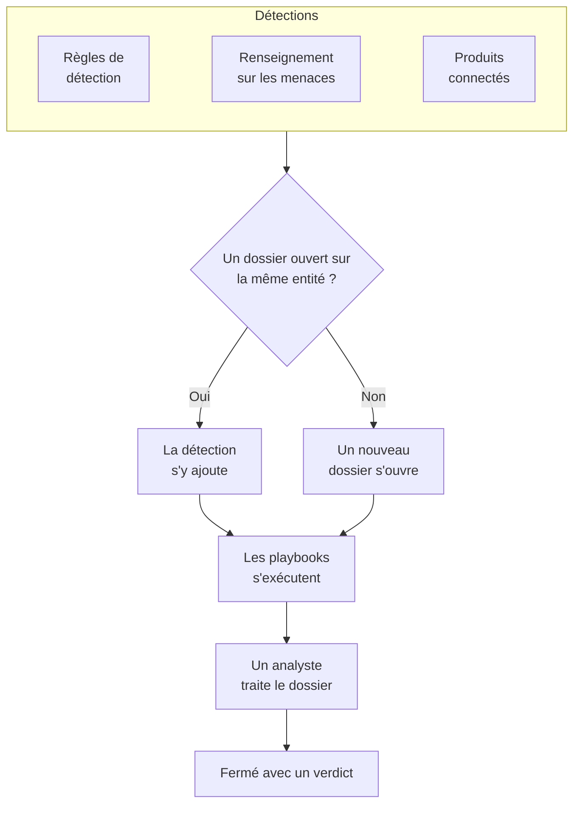

# Dossiers de sécurité et playbooks (SOAR)

Événements de sécurité transforme en dossiers ce que trouvent vos règles de détection, votre renseignement sur les menaces et vos produits de sécurité connectés : un dossier pour chaque élément qui mérite d'être examiné, dans lequel sont regroupées toutes les détections qui concernent le même utilisateur, le même hôte ou la même adresse. Les analystes traitent les dossiers dans une file d'attente, et les playbooks y répondent, d'eux-mêmes ou en un clic.

:::cards
- [Origine des dossiers](#origine-des-dossiers): Les règles de détection, le renseignement sur les menaces, les produits connectés et les personnes.
- [Traiter un dossier](#traiter-un-dossier): L'assigner, enquêter sur ses entités, le fermer avec un verdict.
- [Notifications](#notifications): Qui est prévenu d'un nouveau dossier, d'une attribution et d'une étape en attente d'approbation.
- [Playbooks](#playbooks): Des étapes qui s'exécutent sur un dossier, avec une approbation là où elle compte.
- [La vue d'ensemble](#la-vue-densemble): Ce qui demande une intervention maintenant, et la rapidité de traitement des dossiers.
:::

## Fonctionnement

Ouvrez **Produits → Événements de sécurité → Dossiers de sécurité → Dossiers ouverts** pour la file d'attente. **Attribués à moi**, **Non attribué**, **Dossiers fermés** et **Tous les dossiers** sont des pages à part à côté, chacune listant les dossiers que son nom indique.

## Avant de commencer

Les droits sur les dossiers et les playbooks dépendent des trois rôles de sécurité. Project Owner et Project Admin peuvent tout faire.

| Rôle | Ce qu'il peut faire |
| --- | --- |
| Security Admin | Tout, y compris supprimer des dossiers et configurer des playbooks |
| Security Member | Ouvrir, assigner, modifier et fermer des dossiers, écrire des notes, exécuter des playbooks et approuver ou rejeter leurs étapes |
| Security Viewer | Lire les dossiers, les détections, les notes, les playbooks et leurs exécutions |

Chacune de ces actions peut aussi être accordée isolément, de la création d'un dossier à l'approbation des étapes d'un playbook ; voir [Référence des autorisations](/docs/permissions/reference).

## Origine des dossiers

| Source | Ouvre un dossier quand | Pour la désactiver |
| --- | --- | --- |
| Règles de détection | Une règle correspond | **Open a Case on Match**, à l'étape **En cas de correspondance** de la règle |
| Renseignement sur les menaces | Un événement nomme un indicateur connu | **Open a Case on Match**, à l'étape **En cas de correspondance** du flux |
| Produits connectés | Une alerte propre au produit est importée à un niveau égal ou supérieur au seuil de la connexion | **Open Cases From** réglé sur **Jamais**, à l'étape **Polling** de la connexion |
| Personnes | Quelqu'un en ouvre un depuis **Dossiers de sécurité**, ou avec **Open Case** dans le panneau d'un événement | Impossible |

Chaque source est activée par défaut. Une connexion ouvre des dossiers pour **Élevé et au-dessus**, sauf si vous choisissez un autre niveau ; les alertes de niveau inférieur sont tout de même importées comme événements.

### Comment les détections sont regroupées

Une détection porte sur une entité : la valeur selon laquelle sa règle regroupe, comme l'adresse IP d'une règle de force brute, ou l'indicateur que nomme une correspondance de renseignement sur les menaces. Une détection sans entité reste isolée.

- Quand un dossier ouvert porte déjà sur cette entité, la détection s'y ajoute. Les entités et le mappage ATT&CK du dossier s'enrichissent, et sa priorité monte à celle de la détection, sans jamais baisser.
- Quand aucun dossier ouvert ne porte sur elle, un nouveau dossier s'ouvre, nommé d'après la détection, avec la priorité de la détection.
- Une détection qui se déclenche de nouveau incrémente le compteur de sa ligne au lieu d'en ajouter une nouvelle.

La priorité d'un dossier découle de la gravité de la détection :

| Gravité | Priorité |
| --- | --- |
| Critical ou Fatal | Critical |
| High | High |
| Medium, Unknown ou Other | Medium |
| Low | Low |
| Informational | Informational |

## Traiter un dossier

Un dossier passe par quatre statuts. Il peut en sauter un, comme un faux positif fermé directement depuis Nouveau, et il peut être rouvert.

| Statut | Signification |
| --- | --- |
| Nouveau | Personne ne l'a encore examiné |
| Investigation en cours | Quelqu'un cherche à comprendre ce qui s'est passé |
| Confiné | La menace ne peut plus nuire ; le nettoyage reste à faire |
| Fermé | Terminé, avec un verdict sur ce que c'était |

La page du dossier réunit tout ce qu'il faut pour le traiter :

- En haut : **Assign to Me**, **Run Playbook**, **Déclarer un incident** et **Close Case**, les étapes de statut, et la priorité, dans le menu à côté.
- **OneUptime AI** : ce que OneUptime AI a tiré du dossier, la priorité et le playbook qu'il propose, et les preuves derrière. Voir [OneUptime AI dans la sécurité](/docs/telemetry/security-ai).
- **Détections** : ce qui s'est déclenché pour ouvrir le dossier ou s'y ajouter, combien de fois, et le dernier événement correspondant.
- **Entités** : les utilisateurs, hôtes et adresses sur lesquels porte le dossier, avec leur activité dans l'ensemble de vos événements de sécurité des 7 derniers jours. Chacun s'ouvre dans **Corréler**.
- **MITRE ATT&CK** : les tactiques et techniques auxquelles se rattachent ses détections, chacune liée à sa page sur attack.mitre.org.
- **Exécutions de playbooks** : ce que chaque playbook a fait sur le dossier, étape par étape, et les étapes en attente d'approbation.
- **Notes** et **Chronologie** : ce que l'équipe a écrit, et tout ce qui s'est passé, avec son auteur.

Pour traiter plusieurs dossiers à la fois, sélectionnez-les dans la file d'attente et utilisez **Assign to Me**, **Change Status** ou **Change Priority**.

### Fermer un dossier

**Close Case** demande un verdict et une note de clôture facultative :

| Verdict | Signification |
| --- | --- |
| Vrai positif | Une activité malveillante ou non autorisée a bien eu lieu |
| Positif bénin | L'activité était réelle mais attendue, comme un test d'intrusion ou une tâche d'administration |
| Faux positif | La détection était erronée : la règle ou les données ont mal interprété une activité normale |
| Indéterminé | Les informations ne suffisaient pas pour trancher |

Les verdicts sont comptabilisés sur la vue d'ensemble. Une règle dont les dossiers se ferment sans cesse en faux positif est une règle à ajuster.

Un dossier ouvert à partir d'alertes Google SecOps les ferme aussi dans Google SecOps, avec le verdict et la note de clôture, quand sa connexion a **Fermer les alertes quand leur dossier est fermé** activé : voir [Google SecOps](/docs/integrations/google-secops#fermer-les-alertes-quand-leur-dossier-est-fermé).

### Déclarer un incident

**Déclarer un incident** ouvre un incident OneUptime pour le dossier, avec la gravité de votre choix, et les relie dans les deux sens : la description de l'incident nomme le dossier, et l'en-tête du dossier renvoie vers l'incident. L'astreinte, les pages de statut et le post-mortem prennent ensuite le relais. Il faut un rôle qui puisse à la fois traiter des dossiers et créer des incidents.

## Notifications

OneUptime prévient les personnes concernées de trois choses sur un dossier. Personne n'a rien à configurer : un projet qui a seulement cliqué sur **Activer les recommandations** est prévenu de ses dossiers de priorité Élevé et Critique par e-mail et par push.

| Notification | Qui est prévenu | Par défaut |
| --- | --- | --- |
| Nouveau dossier de sécurité | Toutes les personnes qui peuvent voir les dossiers du projet, quand un dossier s'ouvre ou monte en priorité, à partir de la priorité qu'elles ont choisie | Par e-mail et par push, pour les dossiers de priorité Élevé et Critique |
| Dossier de sécurité qui m'est attribué | La personne à qui le dossier est attribué, et les membres de l'équipe à laquelle il est attribué | Par e-mail et par push |
| Étape de playbook en attente de mon approbation | Les personnes du dossier qui peuvent approuver l'étape : la personne à qui il est attribué et les membres de son équipe. Quand aucune d'elles ne peut l'approuver, toutes les personnes du projet qui le peuvent | Par e-mail et par push |

- Seules les personnes qui peuvent voir le dossier en sont prévenues : Project Owner, Project Admin, et les rôles Security Admin, Security Member et Security Viewer. Un rôle limité à certaines étiquettes n'est prévenu que des dossiers qui portent ces étiquettes.
- Personne n'est prévenu de ce qu'il a fait lui-même : la personne qui ouvre un dossier à la main, l'attribue ou lance une exécution n'en reçoit pas de notification.
- Chaque personne n'est prévenue qu'une fois d'un dossier. Un dossier qui s'ouvre en Medium puis monte à Critique atteint, quand il monte, les personnes qui ont choisi Élevé et Critique ou Critique uniquement, mais pas de nouveau celles qui ont choisi Moyen et au-dessus, déjà prévenues à son ouverture.
- L'attaque de test lancée avec **Envoyer une attaque de test** ouvre un dossier qui ne prévient personne.
- Un dossier Critique et une étape en attente d'approbation sont envoyés aussitôt, jamais retenus dans un [récapitulatif par e-mail](/docs/emails/notification-rollup).
- La **Chronologie** du dossier indique qui a été prévenu, et quand.

### Choisir ce dont vous êtes prévenu

Chaque personne choisit pour elle-même, dans **Paramètres utilisateur → Paramètres de notification → Sécurité** : les canaux de chaque notification (e-mail, SMS, appel, push, Telegram, Slack, Microsoft Teams ou webhook), et, sous **Nouveau dossier de sécurité**, la priorité à partir de laquelle elle est prévenue :

| Choix | Prévient des dossiers de priorité |
| --- | --- |
| Critique uniquement | Critique |
| Élevé et Critique | Élevé et Critique (le choix par défaut) |
| Moyen et au-dessus | Critique, Élevé et Medium |
| Faible et au-dessus | Toutes sauf Informatifs |
| Tous les dossiers | Toutes |

Aucun message WhatsApp n'est envoyé pour les dossiers de sécurité. Une notification push ouvre l'application OneUptime, et son lien ouvre le dossier dans le navigateur.

### Publier dans des canaux Slack et Microsoft Teams

Pour publier dans un canal, ajoutez une règle sous **Produits → Événements de sécurité → Espace de travail → Slack** (ou **Microsoft Teams**). Quand ni l'un ni l'autre n'est connecté, la seule entrée de la section est **Connecter Slack ou Teams**. Une règle nomme les canaux où publier (et, dans Microsoft Teams, les conversations) et, si vous le souhaitez, les dossiers qu'elle concerne :

| Condition | Correspond à |
| --- | --- |
| Priorité du dossier de sécurité | Critique, Élevé, Medium, Low ou Informatifs |
| Titre du dossier de sécurité, Description du dossier de sécurité | Un texte que le titre ou la description du dossier contient, par lequel il commence ou par lequel il se termine |
| Statut du dossier de sécurité | Nouveau, Investigation en cours, Confiné ou Fermé |
| Source du dossier de sécurité | Règle de détection, Threat Intel, Connected Product ou Manuel |
| Étiquettes du dossier de sécurité | Les étiquettes du dossier |

Les trois notifications sont chacune publiées dans les canaux de toutes les règles auxquelles le dossier correspond à ce moment-là. Une règle où **Priorité du dossier de sécurité** contient l'une des valeurs **Critique** et **Élevé** publie les dossiers Élevé et Critique dès leur ouverture, et un dossier Medium quand il monte à Élevé. Un dossier de sécurité n'a jamais de canal à lui.

## Playbooks

Un playbook est une liste d'étapes qui s'exécutent sur un dossier. Créez-en un sous **Produits → Événements de sécurité → Playbooks**, à partir d'un modèle ou de zéro, et ajoutez ses étapes sur sa page.

### Quand un playbook s'exécute

| Exécutions | Quand |
| --- | --- |
| Dossier ouvert | Une fois, à l'ouverture d'un dossier |
| Détection ajoutée | Chaque fois qu'une nouvelle détection rejoint un dossier ouvert |
| Qualifié probablement malveillant | Une fois, quand la qualification de OneUptime AI lit le dossier comme Probablement malveillant |
| Manuel | Seulement quand quelqu'un l'exécute depuis un dossier |

Tout playbook activé peut aussi être lancé à la main, avec **Run Playbook** sur un dossier. Un playbook qui s'exécute de lui-même peut être restreint :

- **For Cases At Least** : seulement les dossiers de cette priorité ou d'une priorité supérieure.
- **Only For Detections From** : seulement quand la détection à l'origine du dossier vient de cette source.
- **Only For These Detection Rules** : seulement quand elle vient de l'une de ces règles.

Un playbook désactivé ne s'exécute ni de lui-même ni à la main.

### Étapes

| Catégorie | Étape | Ce qu'elle fait |
| --- | --- | --- |
| Dossier | Assign the case | Confie le dossier à une personne, à une équipe, ou aux deux |
| Dossier | Set the priority | Relève ou abaisse la priorité du dossier |
| Dossier | Set the status | Fait passer le dossier à Investigation en cours, Confiné ou Fermé, avec le verdict de votre choix |
| Dossier | Add a note | Écrit une note sur le dossier, comme une liste de vérification pour l'analyste |
| Dossier | Add labels | Applique des étiquettes au dossier |
| Investigation | Check entities against threat intel | Recherche chaque entité dans votre renseignement sur les menaces, et peut relever la priorité en cas de correspondance |
| Investigation | Look up entity activity | Compte les événements de sécurité de chaque entité sur une fenêtre récente, et consigne le résultat sur le dossier |
| Notification | Email people | Envoie par e-mail à des utilisateurs et des équipes un résumé du dossier, avec un lien vers celui-ci |
| Notification | Post to Slack | Publie un résumé du dossier dans un canal Slack |
| Notification | Post to Microsoft Teams | Publie un résumé du dossier dans un canal Microsoft Teams |
| Escalade | Page on-call | Exécute une politique d'astreinte |
| Escalade | Déclarer un incident | Ouvre un incident OneUptime lié au dossier |
| Confinement | Suspend the user in Okta | Suspend dans Okta l'utilisateur sur lequel porte le dossier |
| Confinement | End the user's Okta sessions | Déconnecte d'Okta l'utilisateur sur lequel porte le dossier et révoque ses jetons |
| Confinement | Contain the host in CrowdStrike | Applique le confinement réseau à l'hôte sur lequel porte le dossier avec CrowdStrike Falcon |
| Confinement | Isolate the device in Microsoft Defender | Isole l'hôte sur lequel porte le dossier avec Microsoft Defender for Endpoint |
| Confinement | Unsuspend the user in Okta | Lève dans Okta la suspension de l'utilisateur sur lequel porte le dossier |
| Confinement | Lift containment in CrowdStrike | Lève le confinement réseau appliqué par CrowdStrike Falcon à l'hôte sur lequel porte le dossier |
| Confinement | Release the device in Microsoft Defender | Libère de l'isolement dans Microsoft Defender for Endpoint l'hôte sur lequel porte le dossier |
| Automatisation | Send a webhook | Envoie le dossier en JSON à une URL |
| Automatisation | Run a workflow | Lance un flux de travail OneUptime avec le dossier en entrée |

Un playbook compte au plus 25 étapes. Elles s'exécutent dans l'ordre, chacune une fois la précédente terminée. Chaque étape peut aussi :

- **Needs Approval** : arrêter l'exécution avant l'étape jusqu'à ce que quelqu'un l'approuve sur le dossier. Les quatre étapes qui coupent l'accès à quelqu'un s'arrêtent toujours ainsi, sauf si un Security Admin désactive ce réglage.
- **Only If Threat Intel Matched** : sauter l'étape, sauf si une étape **Check entities against threat intel** antérieure de la même exécution a trouvé un indicateur connu.
- **Carry On If It Fails** : exécuter l'étape suivante même si celle-ci échoue. Sans ce réglage, une étape en échec arrête l'exécution.

### Confinement

Les étapes de confinement agissent via une [connexion d'événements de sécurité](/docs/telemetry/security-events#connecter-un-produit-de-sécurité) au produit, et cette connexion a besoin de plus qu'un accès en lecture :

| Étape | Connexion | Ce qu'il faut |
| --- | --- | --- |
| Suspend the user in Okta, End the user's Okta sessions, Unsuspend the user in Okta | Okta System Log | Un jeton d'API autorisé à gérer les utilisateurs |
| Contain the host in CrowdStrike, Lift containment in CrowdStrike | CrowdStrike Falcon | Un client API avec le scope Hosts en écriture |
| Isolate the device in Microsoft Defender, Release the device in Microsoft Defender | Microsoft Defender XDR | Une application avec l'autorisation Machine.Isolate |

Une étape de confinement n'agit que sur les utilisateurs ou hôtes sur lesquels porte le dossier, jamais sur tous ceux que le dossier nomme :

- La valeur selon laquelle une détection du dossier est regroupée, comme le compte selon lequel regroupe une règle de voyage impossible, ou l'hôte que nomme l'alerte d'un produit connecté.
- Un utilisateur ou un hôte du dossier que votre renseignement sur les menaces connaît comme indicateur.

Un dossier regroupé selon une adresse, comme une attaque par force brute contre votre VPN, ne porte sur aucun des deux : ses étapes de confinement sont sautées, et le compte qu'elle visait et la passerelle qu'elle a atteinte ne sont pas touchés. Une étape agit sur au plus 10 utilisateurs ou hôtes. Elle retrouve chacun dans le produit par son nom, et indique sur l'exécution ce qu'elle a fait de chacun : fait, déjà fait, introuvable, refusé ou protégé.

#### Entités protégées

**Protected Entities**, sous **Playbooks** dans le menu, liste les utilisateurs et les hôtes qu'aucun playbook ne confine, comme les comptes d'accès d'urgence, les contrôleurs de domaine et les passerelles VPN. Une valeur correspond quelle que soit sa casse, et `*` remplace n'importe quelle suite de caractères : `svc-*` protège tous les comptes de service. Une étape signale un utilisateur ou un hôte protégé comme protégé et n'y touche pas. Ce sont les Security Admins qui gèrent la liste.

#### Approbation

Les quatre étapes qui coupent l'accès à quelqu'un attendent une approbation. Seul un Security Admin peut désactiver **Needs Approval** pour l'une d'elles, et OneUptime enregistre qui l'a fait. L'approbation liste sous **Act On** les utilisateurs ou hôtes sur lesquels l'étape agirait, tous cochés : décochez ceux qu'elle doit épargner. Ceux qui sont protégés ne sont pas proposés. La personne qui a lancé une exécution ne peut pas en approuver les étapes : quelqu'un d'autre le fait, mais elle peut toujours les rejeter.

#### Annulation

Les étapes d'annulation agissent sur les utilisateurs ou hôtes sur lesquels porte le dossier, comme les étapes qu'elles annulent. Une fois l'exécution arrêtée, un utilisateur ou un hôte confiné a aussi son propre bouton sur son étape : **Unsuspend**, **Lift Containment** ou **Libérer**. La fin d'une session Okta ne peut pas être annulée. Chaque annulation est conservée dans la chronologie du dossier et dans le journal d'audit du projet.

### Messages

Une note, un e-mail, une publication Slack et une publication Teams peuvent utiliser les valeurs du dossier :

| Espace réservé | Devient |
| --- | --- |
| `{{case.number}}` | Le numéro du dossier, comme CASE-42 |
| `{{case.title}}` | Le titre du dossier |
| `{{case.priority}}` | Critical, High, Medium, Low ou Informational |
| `{{case.status}}` | New, Investigating, Contained ou Closed |
| `{{case.assignee}}` | La personne à qui le dossier est assigné |
| `{{case.url}}` | Un lien vers le dossier dans OneUptime |
| `{{case.entities}}` | Les utilisateurs, hôtes et adresses sur lesquels porte le dossier |
| `{{case.detections}}` | Le nombre de détections que contient le dossier |

Un e-mail ou une publication sans message propre envoie un résumé du dossier.

### Exécutions et approbations

Chaque exécution est listée, étape par étape, sur son dossier et sous **Produits → Événements de sécurité → Playbooks → Exécutions de playbooks** :

| Statut de l'exécution | Signification |
| --- | --- |
| En file d'attente | En attente d'un worker |
| En cours d'exécution | Exécute ses étapes |
| En attente d'approbation | Retenue avant une étape qui demande une approbation |
| Réussi | Chaque étape s'est exécutée ou a été sautée |
| Échec | Une étape a échoué et l'exécution s'est arrêtée |
| Annulé | Quelqu'un l'a annulée, ou a rejeté une étape |

Une étape en attente d'approbation affiche **Approve** et **Reject** sur l'exécution, avec un commentaire facultatif. Approuver poursuit l'exécution à partir de cette étape ; rejeter y met fin. La décision, son auteur et son commentaire sont conservés sur l'étape, dans la chronologie du dossier et dans le journal d'audit du projet. **En attente d'approbation**, sous **Playbooks** dans le menu, liste les exécutions qui attendent une décision et les compte ; **Exécutions de playbooks** liste toutes les exécutions.

Une exécution dont le worker ne donne plus signe de vie, après un redémarrage par exemple, est reprise : une exécution en file d'attente est remise en file au bout de 2 minutes, et une exécution restée muette pendant 30 minutes passe en échec.

## La vue d'ensemble

Le produit s'ouvre sur **Produits → Événements de sécurité → Vue d'ensemble** :

- Les dossiers ouverts qui vous sont assignés, les dossiers ouverts que personne n'a encore pris en charge, et les étapes de playbook en attente d'approbation, chacun ouvrant la page qui les liste.
- **Temps moyen de prise en charge**, **Temps moyen de confinement** et **Temps moyen de clôture**, sur les dossiers ouverts au cours des 30 derniers jours : de l'ouverture d'un dossier à sa prise en charge (assignation à une personne, ou sortie du statut Nouveau), à son passage à Confiné, et à sa fermeture. Un dossier encore en attente n'est pas compté dans une moyenne.
- Les dossiers ouverts chaque jour sur 30 jours, par priorité, et les détections levées chaque jour sur 14 jours, par source.
- Les dossiers ouverts par priorité et par statut, les verdicts des 30 derniers jours, les tactiques ATT&CK à l'origine des dossiers, les détections qui se sont le plus déclenchées, et les entités nommées par le plus de constats.

Au-dessus, un bandeau montre comment la sécurité est mise en place : ses sources, ses détections, ses dossiers et ses playbooks, chacun avec ses chiffres. Un projet qui ne l'a pas encore mise en place y voit **Activer les recommandations** et **Envoyer une attaque de test** ; voir [Bien démarrer avec la sécurité](/docs/telemetry/security-getting-started). Quand rien n'attend personne, la page affiche **Tout est calme**, et les graphiques apparaissent dès qu'il y a quelque chose à représenter.

## Trouver des menaces

- **Entités** classe les utilisateurs, hôtes, adresses et hachages que vos constats nomment le plus, sur le dernier jour, la dernière semaine ou le dernier mois, et recherche n'importe quelle valeur dans 30 jours d'événements.
- **Rule Library** propose des règles de détection prêtes à l'emploi, pour les menaces visant les identités, les terminaux, le cloud, le réseau, le web et Kubernetes. Chacune est une règle Sigma écrite pour les champs vers lesquels chaque source connectée est normalisée. Sa ligne indique ce qu'elle détecte, les tactiques et techniques MITRE ATT&CK auxquelles elle se rattache, les événements qu'elle lit et s'il en est arrivé au cours des 7 derniers jours (**Reçus** ou **Non reçus**), ainsi que sa gravité. Filtrez la liste par catégorie, par les données que lisent les règles et selon que vous les avez ajoutées ou non, ou cherchez-y par nom, technique ATT&CK ou gravité ; l'adresse de la page conserve les filtres. Sélectionnez une règle pour voir ses détails : comment commencer à envoyer les événements qu'elle lit, comment elle s'exécute, et sa règle Sigma. **Ajouter** la crée comme l'une de vos règles de détection, activée et ouvrant des dossiers plutôt que des alertes ; modifiez-la sous **Règles de détection** comme n'importe quelle autre. Les règles marquées **Recommandés** trouvent des menaces dans des données que OneUptime a déjà, et un bouton ajoute celles que vous n'avez pas encore.
- **ATT&CK Coverage** dessine la matrice MITRE ATT&CK en mettant en évidence les techniques que couvrent vos règles activées, et entoure celles qu'une règle de la bibliothèque couvrirait. Sélectionnez une technique pour voir les règles de la bibliothèque qui la couvrent, et ouvrir la **Rule Library** sur elles.

## Automatiser

- **Flux de travail** : un dossier ou une note peut lancer un flux de travail quand il est créé, mis à jour ou supprimé. Une étape **Run a workflow** lance un flux de travail dont le déclencheur est un webhook.
- **API** : les dossiers, les notes, les détections, les playbooks, les exécutions et les entités protégées ont la même API REST que le reste de OneUptime, sous `/security-case`, `/security-case-note`, `/security-detection`, `/security-playbook`, `/security-playbook-run` et `/security-protected-entity`. Voir [Référence de l'API](/docs/api-reference/api-reference).
- Agents IA : le serveur MCP dispose d'outils pour les dossiers, les notes, les détections et les playbooks. Voir [Serveur MCP](/docs/ai/mcp-server).

## Dépannage

:::details Une règle correspond, mais aucun dossier ne s'ouvre
Vérifiez **Open a Case on Match** à l'étape **En cas de correspondance** de la règle. Une détection portant sur une entité qui a déjà un dossier ouvert s'ajoute à ce dossier au lieu d'en ouvrir un autre : cherchez-la sous **Détections** dans le dossier ouvert.
:::

:::details Personne n'a été prévenu d'un dossier
Consultez la **Chronologie** du dossier, qui indique qui a été notifié. Une notification **Nouveau dossier de sécurité** va aux personnes dont la priorité choisie est atteinte par le dossier : un dossier Medium ne prévient donc personne qui ait gardé le choix par défaut, **Élevé et Critique**. Vérifiez que les personnes qui devraient être prévenues peuvent voir les dossiers de sécurité (avec un rôle de sécurité, ou comme Project Owner ou Project Admin), et que la notification est activée pour elles dans **Paramètres utilisateur → Paramètres de notification → Sécurité**.
:::

:::details Un playbook ne s'est pas exécuté
Vérifiez qu'il est activé, que son réglage **Déclencheur** convient (avec Dossier ouvert, il ne s'exécute qu'une fois, à l'ouverture d'un dossier), et que le dossier remplit ses conditions **For Cases At Least**, **Only For Detections From** et **Only For These Detection Rules**. Un dossier ouvert à la main n'a pas de détection, donc un playbook limité à une source ou à des règles ne s'exécute pas dessus.
:::

:::details Une étape de confinement a échoué
Ouvrez l'exécution sur le dossier : l'étape indique, pour chaque utilisateur ou hôte, si le produit l'a refusé, ne l'a pas trouvé ou n'a pas pu être joint. Vérifiez que l'identifiant de la connexion a le droit d'effectuer la modification, et utilisez **Tester la connexion** dans sa ligne.
:::

:::details Une étape de confinement a été sautée
Le dossier ne porte sur aucun utilisateur ni aucun hôte, seulement sur une adresse par exemple, ou chaque utilisateur ou hôte sur lequel il porte est protégé. Ouvrez l'exécution sur le dossier : l'étape indique la raison.
:::

## Étapes suivantes

:::cards
- [Événements de sécurité](/docs/telemetry/security-events): Envoyer des événements, écrire des règles de détection et connecter des produits de sécurité.
- [Renseignement sur les menaces](/docs/telemetry/threat-intelligence): Confronter vos événements à des flux STIX/TAXII.
- [OneUptime AI dans la sécurité](/docs/telemetry/security-ai): Qualifier les dossiers, rédiger des règles de détection et poser des questions sur la sécurité, avec l'IA.
- [Référence des autorisations](/docs/permissions/reference): Les rôles de sécurité, et ce que chacun peut faire.
:::
