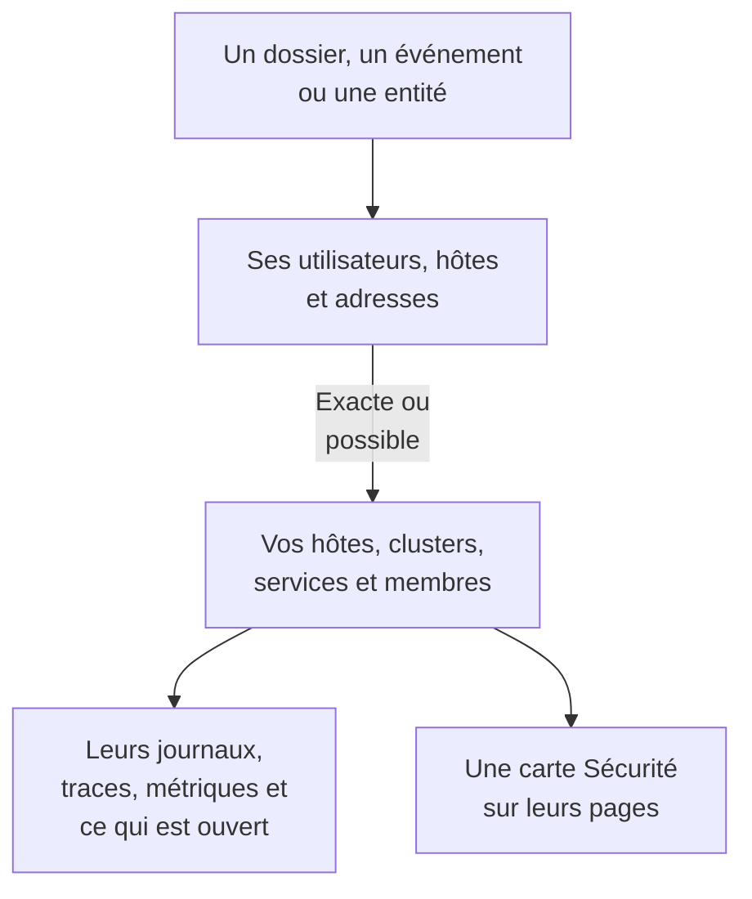

# Signaux connectés

Un dossier de sécurité dit quels utilisateurs, hôtes et adresses il concerne. Signaux connectés dit lesquels OneUptime connaît déjà - vos hôtes, hôtes de conteneurs, clusters Kubernetes, équipements réseau, services et membres - et ce qui se passait sur chacun autour du dossier : ses journaux, traces et métriques, les incidents et alertes ouverts sur lui, les moniteurs qui le surveillent et ce qui a changé sur lui. Dans l'autre sens, la page d'un hôte, d'un cluster, d'un service ou d'un membre dit ce qu'Événements de sécurité a trouvé à son sujet.

:::cards
- [Où le voir](#où-le-voir): La page d'un dossier, l'onglet d'un événement, la page d'une entité, et les pages de ce qu'ils nomment.
- [Comment une valeur est rapprochée](#comment-une-valeur-est-rapprochée): Ce qui compte comme le même enregistrement, et ce qui ne l'est que peut-être.
- [Ce que montre chaque enregistrement](#ce-que-montre-chaque-enregistrement): Ses signaux autour du dossier, et ce qui est ouvert sur lui.
- [Qui voit quoi](#qui-voit-quoi): Chaque enregistrement est lu avec le rôle du lecteur.
:::

## Comment ça marche

OneUptime recherche chaque valeur parmi les enregistrements du projet, dit à quel point chaque correspondance est sûre, et montre ce qui se passait sur chaque enregistrement autour du dossier.

## Avant de commencer

- Des événements de sécurité qui arrivent, et des hôtes, clusters Kubernetes, services ou membres du projet qu'ils peuvent nommer. Voir [Bien démarrer avec la sécurité](/docs/telemetry/security-getting-started).
- Un rôle qui peut lire les événements de sécurité, et les types d'enregistrements que vous voulez voir.

## Où le voir

- **Signaux connectés**, une page de chaque dossier de sécurité : ouvrez un dossier sous **Produits → Événements de sécurité → Dossiers de sécurité → Dossiers ouverts**, puis **Signaux connectés** après **Entités** dans son menu.
- **Connecté**, un onglet de chaque événement de sécurité : ouvrez un événement sous **Produits → Événements de sécurité → Événements**. Il liste ce que l'événement nomme, dans l'heure qui l'entoure.
- La page d'une entité, sous **Produits → Événements de sécurité → Risque des entités** : là où OneUptime connaît l'utilisateur, l'hôte ou l'adresse, autour de son dernier événement de sécurité.
- Une carte **Sécurité** sur la page de chaque hôte, hôte Docker, hôte Podman, cluster Kubernetes, équipement réseau, service, membre et élément d'inventaire : les dossiers de sécurité ouverts qui le nomment, combien d'événements de sécurité et de détections l'ont nommé au cours des 7 derniers jours, le plus grave d'entre eux, et son risque. **Ouvrir dans Événements de sécurité** l'y ouvre.
- Une carte **Sécurité** sur la page d'un incident, quand un dossier de sécurité a déclaré l'incident (**Déclaré depuis**) ou que des dossiers ouverts nomment un hôte ou un cluster qu'il touche (**Dossiers ouverts nommant ce qu'il touche**).

## Comment une valeur est rapprochée

Chaque utilisateur, hôte et adresse qu'un dossier ou un événement nomme est recherché parmi les enregistrements du projet :

| Ce que le dossier ou l'événement nomme | Rapproché de | Certitude |
| --- | --- | --- |
| Un nom d'hôte ou de domaine identique au nom que signale un hôte, un hôte de conteneurs, un cluster ou un équipement réseau | Cet enregistrement | Exacte |
| Le même nom, donné sans préciser qu'il s'agit d'un hôte | Cet enregistrement | Possible |
| Une forme courte ou complète du nom d'un enregistrement, comme `web-1` et `web-1.acme.internal` | Cet enregistrement | Possible |
| Une adresse IP publique qu'un seul enregistrement détient | Cet enregistrement | Exacte |
| Une adresse IP privée, ou une que plusieurs enregistrements détiennent | Chaque enregistrement qui la détient | Possible |
| L'adresse e-mail d'un membre | Ce membre | Exacte |
| L'enregistrement sous lequel une ligne de journal a été envoyée, pour les événements lus dans vos journaux | Cet hôte, ce cluster ou ce service | Exacte |
| Un simple nom d'utilisateur, une URL, une empreinte de fichier ou un processus | Rien : aucun enregistrement n'est indexé par eux | - |

- Une correspondance possible affiche **Correspondance possible** à côté de son nom, et dit pourquoi. Elle n'est jamais comptée sur la page de l'enregistrement, et un incident que le dossier déclare n'y est jamais lié.
- Ce qui a été recherché et n'est pas un enregistrement du projet est listé sous **Absent de OneUptime**. Une valeur n'y est jamais listée quand un type d'enregistrement qu'elle pourrait être n'a pas pu être lu.
- Au plus 10 enregistrements sont listés pour un dossier, les exacts en premier.

## Ce que montre chaque enregistrement

- Ses signaux, chacun ouvert sur l'enregistrement et la période du dossier : **Journaux**, **Traces** et **Métriques**, les **Exceptions** d'un service, les **Événements Kubernetes** d'un cluster, la **Topologie** de l'enregistrement, et son élément d'**Inventaire** quand l'inventaire en a un.
- Les incidents et alertes ouverts sur lui maintenant, et les moniteurs qui le surveillent, chacun ouvrant sa page.
- Ce qui a changé sur lui pendant la période : les déploiements d'un service, les déploiements progressifs d'un cluster et les corrections d'un hôte.

| Où | Période |
| --- | --- |
| Un dossier | De 30 minutes avant sa première détection à 30 minutes après sa dernière, au plus ses dernières 24 heures |
| Un événement | 30 minutes de part et d'autre |
| La page d'une entité | 30 minutes de part et d'autre de son dernier événement de sécurité |
| La carte **Sécurité** d'un enregistrement | Les 7 derniers jours |

## Qui voit quoi

- Signaux connectés et la carte **Sécurité** d'un enregistrement demandent un rôle qui peut lire les événements de sécurité : Security Admin, Security Member, Security Viewer, Project Owner ou Project Admin. Les autres ne voient de données de sécurité sur aucune page. Voir [Rôles](/docs/permissions/reference#rôles).
- La carte **Sécurité** d'un incident demande un rôle qui peut lire les dossiers de sécurité.
- Chaque enregistrement est lu avec votre propre rôle. Un type d'enregistrement que votre rôle ne peut pas lire est omis, et la page le dit ; un qui n'a pas pu être lu à l'instant le dit aussi, avec **Réessayer**.
- La page d'un enregistrement n'affiche sa carte **Sécurité** que dans un projet qui utilise Événements de sécurité : un qui a reçu un événement de sécurité au cours des 7 derniers jours.

## Incidents qu'un dossier déclare

**Déclarer un incident** sur un dossier, ou l'étape d'un playbook qui en déclare un, lie l'incident aux hôtes, hôtes Docker et Podman, clusters Kubernetes et services auxquels le dossier est connecté de façon exacte. L'incident apparaît sur leurs pages et les règles de leurs propriétaires s'y appliquent, et son fil nomme le dossier et ce à quoi il a été lié. Une correspondance possible n'est jamais liée.

## OneUptime AI

Le tri d'un dossier par OneUptime AI lit ses signaux connectés : ce qui est ouvert et ce qui a changé sur les hôtes, services et membres que le dossier nomme. L'investigation d'un incident lit le dossier de sécurité qui l'a déclaré et les dossiers ouverts qui nomment ce qu'il touche. Voir [OneUptime AI dans la sécurité](/docs/telemetry/security-ai).

## Dépannage

:::details Un hôte que le dossier nomme n'est pas listé
Vérifiez que le dossier nomme l'hôte comme l'hôte se nomme lui-même, ou nomme une adresse publique que seul cet hôte détient. Un nom court, comme `web-1` pour `web-1.acme.internal`, est listé comme correspondance possible, et un simple nom d'utilisateur, une URL, une empreinte de fichier ou un processus n'est pas recherché du tout.
:::

:::details Le bon hôte est listé comme correspondance possible
Une correspondance possible n'est jamais comptée ni liée, pour qu'un nom que partagent deux machines ne vous dise jamais rien sur la mauvaise. Faites nommer l'hôte par vos journaux et vos détections avec le nom qu'il signale.
:::

:::details La page d'un hôte n'a pas de carte Sécurité
La carte est montrée à un rôle qui peut lire les événements de sécurité, dans un projet qui a reçu un événement de sécurité au cours des 7 derniers jours. Un hôte que rien n'a nommé pendant ce temps affiche une ligne qui le dit.
:::

:::details La page dit que votre rôle ne peut pas voir un type d'enregistrement
Chaque enregistrement est lu avec votre propre rôle. Demandez à un Project Owner ou à un Project Admin un rôle qui peut lire ce type d'enregistrement.
:::

## Étapes suivantes

:::cards
- [Dossiers de sécurité et playbooks](/docs/telemetry/security-cases): Traiter un dossier, et en déclarer un incident.
- [Événements de sécurité (SIEM)](/docs/telemetry/security-events): Les événements derrière un dossier, et les journaux dont ils sont lus.
- [Risque des entités (alertes fondées sur le risque)](/docs/telemetry/security-entity-risk): La page d'une entité, son risque, et là où OneUptime la connaît.
- [OneUptime AI dans la sécurité](/docs/telemetry/security-ai): Comment un tri lit ce qu'un dossier nomme.
:::
