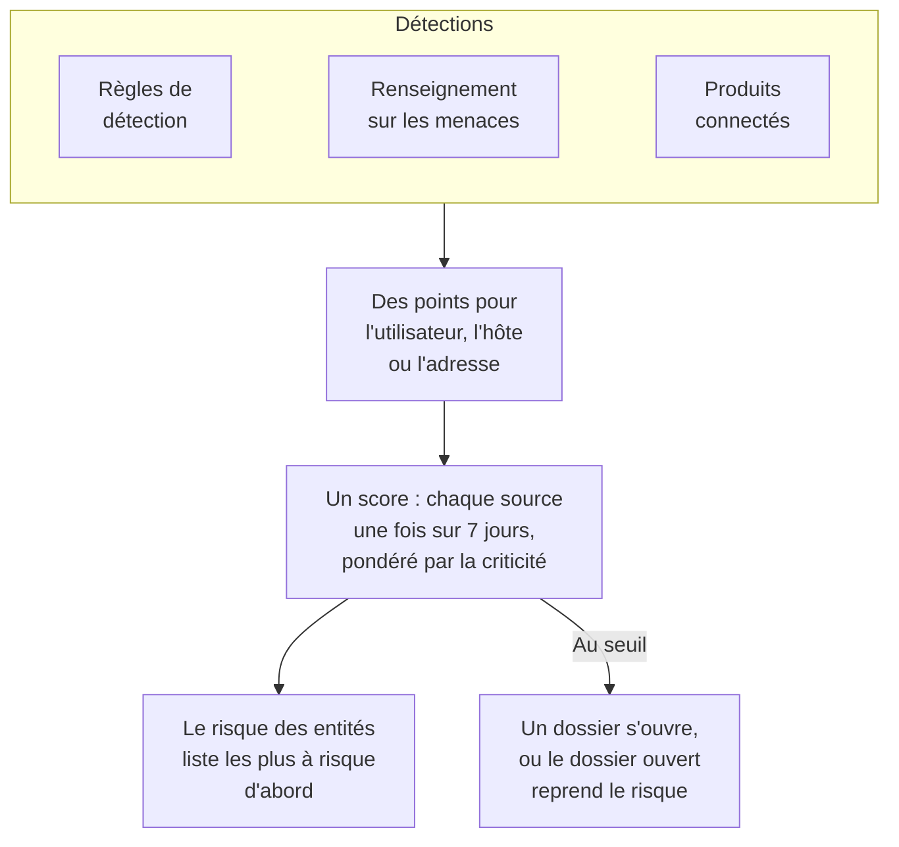

# Risque des entités (alertes fondées sur le risque)

Une détection isolée en dit rarement long. Une rafale de connexions échouées, un premier sudo sur un hôte et une connexion depuis un nouveau pays méritent chacun un coup d'œil ; le même compte dans les trois en une semaine mérite un dossier. Le risque des entités additionne ce que vos règles de détection, votre renseignement sur les menaces, vos produits connectés et Data Security trouvent sur chaque utilisateur, hôte, adresse IP et magasin de données, liste les plus à risque d'abord, et ouvre un dossier sur celui dont le risque atteint le seuil du projet.

:::cards
- [Comment un score est compté](#comment-un-score-est-compté): Des points selon la gravité, et chaque source une fois par semaine.
- [Niveaux de risque et dossiers](#niveaux-de-risque-et-dossiers): Ce que vaut un score, et quand un dossier s'ouvre.
- [Criticité des entités](#criticité-des-entités): Compter plus ce qui compte plus, et moins ce qui compte moins.
- [La page d'une entité](#la-page-dune-entité): Pourquoi elle est à risque, son mois, et les dossiers la concernant.
- [Points de risque d'une règle de détection](#points-de-risque-dune-règle-de-détection): Le poids propre d'une règle dans le score.
:::

## Comment ça marche

Ouvrez **Produits → Événements de sécurité → Risque des entités** : chaque utilisateur, hôte, adresse IP et magasin de données à risque, les plus à risque d'abord, avec son niveau, son importance, ce qui l'a trouvé et quand. Chacun s'ouvre sur sa propre page. **Entités les plus à risque**, sur la vue d'ensemble, montre le haut de cette liste, et **Rechercher une entité**, en dessous, recherche n'importe quelle valeur dans 30 jours d'événements, un domaine ou un hachage de fichier aussi.

## Avant de commencer

- Des événements de sécurité qui arrivent, et des règles de détection, du renseignement sur les menaces ou des produits connectés qui y trouvent quelque chose. Voir [Bien démarrer avec la sécurité](/docs/telemetry/security-getting-started).
- Des règles de détection qui regroupent selon un champ qui nomme quelqu'un : **Champ de regroupement**, par exemple `principalUser`, `principalHost` ou `principalIp`, ou les champs selon lesquels une corrélation regroupe. Une règle qui ne regroupe selon rien n'ajoute aucun risque.
- Pour modifier **Notation du risque** : Project Owner ou Project Admin pour son interrupteur et son seuil, et un rôle qui peut créer des règles de détection pour sa liste d'entités. Security Viewer lit tout. Voir [Rôles](/docs/permissions/reference#rôles).

## Comment un score est compté

Chaque détection ajoute des points de risque à l'utilisateur, l'hôte, l'adresse IP ou le magasin de données concerné :

| Une détection de gravité | Ajoute |
| --- | --- |
| Faible | 10 points |
| Moyenne | 25 points |
| Élevée | 50 points |
| Critique | 75 points |

- Une détection informative n'ajoute rien, et une détection de gravité inconnue compte comme Moyenne.
- Les points d'une règle de détection vont à la valeur selon laquelle elle regroupe. Une correspondance de renseignement sur les menaces ajoute à l'adresse IP que nomme l'indicateur. L'alerte d'un produit connecté ajoute à l'utilisateur et à l'hôte qu'elle nomme, sinon à son adresse IP. Un problème de Data Security ajoute au magasin de données où il a été trouvé.
- Chaque source compte une fois. Une règle de détection, un flux de renseignement sur les menaces, la règle d'un produit connecté ou un contrôle de Data Security compte une fois sur 7 jours, au plus qu'elle a ajouté, quel que soit le nombre de déclenchements : une règle bavarde ne peut jamais rendre une entité plus inquiétante que trois règles différentes.
- Une source qui n'a rien trouvé pendant 7 jours cesse de compter, et le score baisse. Les scores sont vérifiés toutes les 15 minutes, si bien qu'un score baisse à temps sans nouvelle détection.

Le score d'une entité est la somme de ses sources, pondérée par sa criticité. L'attaque de test de **Envoyer une attaque de test**, et un dossier ouvert à la main, n'ajoutent aucun risque.

## Niveaux de risque et dossiers

Chaque score se lit comme un niveau face au seuil du projet, 100 sauf si vous le changez :

| Score de risque | Se lit comme | Ce qui se passe |
| --- | --- | --- |
| 1 à 49 | Faible | Listé dans Risque des entités |
| 50 à 99 | Moyen | Listé dans Risque des entités |
| 100 à 199 | Élevé | Un dossier s'ouvre, en Élevé |
| 200 ou plus | Critique | Un dossier s'ouvre, en Critique |

Quand le risque d'une entité atteint le seuil, une détection de la source Risque des entités est levée à son sujet. Elle rejoint le dossier ouvert sur l'entité, ou en ouvre un portant son nom, par exemple `High risk — k.morgan@acme-commerce.example`, et elle liste les sources qui ont le plus ajouté au risque, jusqu'à 10, avec leurs points, le nombre de déclenchements de chacune et le dernier.

Une fois qu'un dossier s'est ouvert sur le risque d'une entité, ce qui était derrière n'est plus recompté : un autre dossier ne s'ouvre que lorsque des sources nouvelles depuis atteignent à nouveau le seuil. Un dossier clos comme traité n'est pas rouvert par les mêmes détections.

Changez le seuil dans **Produits → Événements de sécurité → Paramètres → Notation du risque → Seuil de risque** : un nombre entier de 10 à 10000. Moyen commence à sa moitié et Critique à son double, sur chaque page.

### Activer ou désactiver les dossiers de risque

**Dossiers de risque**, dans **Paramètres → Notation du risque**, décide si le risque ouvre des dossiers, et s'enregistre dès que vous le basculez. Les nouveaux projets commencent avec l'option activée. Un projet créé avant le risque des entités la garde désactivée jusqu'à ce que quelqu'un l'active, et **Risque des entités** le signale au-dessus de sa liste. Le risque est noté et listé dans tous les cas.

## Criticité des entités

Certaines entités comptent plus que d'autres : un contrôleur de domaine, le compte d'un dirigeant, un serveur de paiement. D'autres comptent moins, comme un scanner de vulnérabilités dont les scans sont attendus. Listez-les dans **Paramètres → Notation du risque → Criticité des entités** avec **Ajouter : Entité** :

| Criticité | Compte son risque |
| --- | --- |
| Faible | ×0.5 |
| Non listée | ×1 |
| Élevée | ×1.5 |
| Extrême | ×2 |

Une entrée est une valeur ou un motif `*`, sans tenir compte de la casse : `dc-*` désigne chaque contrôleur de domaine, et `*@contractors.example` chaque prestataire. **Type** la restreint aux utilisateurs, aux hôtes, aux adresses IP ou aux magasins de données ; vide, elle les vise tous. Quand plusieurs entrées nomment une entité, la plus précise compte : une valeur écrite en entier avant un motif, et un motif plus long avant un plus court. Une modification atteint le score de chaque entité en quelques minutes. Data Security liste lui-même les magasins de données qu'il juge sensibles, les confidentiels en Élevée et les restreints en Extrême ; modifiez une de ces entrées et elle est à vous : Data Security n'y touche plus.

## La page d'une entité

Cliquez sur **Voir** dans une ligne de **Risque des entités**, ou sur le risque à côté d'une entité dans la page **Entités** d'un dossier :

| Partie | Ce qu'elle montre |
| --- | --- |
| L'en-tête | Son type et sa criticité, son score et son niveau, et le calcul du score |
| **Activité** | Ses événements de sécurité et ses détections des 7 derniers jours |
| **Ce qui augmente son risque** | Chaque source, sa gravité, les points ajoutés, le nombre de déclenchements et le dernier |
| **Risque des 30 derniers jours** | Son score à la fin de chaque jour, coloré selon son niveau |
| **Dossiers la concernant** | Les dossiers de sécurité ouverts à son sujet, les plus récents d'abord |

**Ouvrir dans Corréler** trace un graphe de ses événements, et **Rechercher ses événements** ouvre **Événements** sur sa semaine. **Réinitialiser le risque** efface son score et ses sources, après un test prévu par exemple : ce qui est trouvé ensuite compte à partir de zéro, et ses dossiers ne changent pas. La réinitialisation demande un rôle qui peut supprimer des données de sécurité, et le [journal d'audit](/docs/configuration/audit-logs) l'enregistre.

OneUptime AI lit le risque des entités d'un dossier quand il le trie. Voir [OneUptime AI dans la sécurité](/docs/telemetry/security-ai).

## Points de risque d'une règle de détection

Une règle de détection ajoute les points de son niveau, issu de son `level` Sigma. Pour lui donner un poids propre, ouvrez le formulaire de la règle, allez à **En cas de correspondance**, ouvrez **Plus de champs** et réglez **Points de risque**, de 0, qui n'ajoute aucun risque, à 100. Laissez vide pour les points de son niveau.

## Dépannage

:::details Une entité n'apparaît pas dans Risque des entités
Vérifiez qu'une règle de détection, un flux de renseignement sur les menaces ou un produit connecté a trouvé quelque chose à son sujet ces 7 derniers jours, et que la règle regroupe selon un champ qui la nomme. Les détections informatives n'ajoutent rien, et une source qui n'a rien trouvé pendant 7 jours cesse de compter.
:::

:::details Le risque d'une entité a atteint le seuil, et aucun dossier ne s'est ouvert
Vérifiez que **Dossiers de risque** est activé dans **Paramètres → Notation du risque**. Si un dossier s'est déjà ouvert sur le risque de l'entité, seules les sources nouvelles depuis comptent pour le suivant.
:::

:::details Une règle se déclenche sans cesse, et le score de l'entité ne monte pas
C'est ainsi que le score est compté : une source compte une fois sur 7 jours, au plus qu'elle a ajouté. Baissez les **Points de risque** d'une règle bavarde, ou marquez une entité dont les détections sont attendues avec une criticité faible.
:::

:::details Un score ne correspond pas à la somme de ses sources
Sa criticité le pondère. La page de l'entité montre la somme de ses sources et le poids, par exemple 100 de ses sources × 2 = 200.
:::

## Étapes suivantes

:::cards
- [Dossiers de sécurité et playbooks](/docs/telemetry/security-cases): Traiter les dossiers qu'ouvre le risque, et les clore avec un verdict.
- [Événements de sécurité (SIEM)](/docs/telemetry/security-events): Règles de détection, Corréler et les événements derrière chaque détection.
- [Renseignement sur les menaces (STIX/TAXII)](/docs/telemetry/threat-intelligence): Les correspondances qui ajoutent au risque d'une adresse.
- [OneUptime AI dans la sécurité](/docs/telemetry/security-ai): Comment un tri lit le risque des entités d'un dossier.
:::
