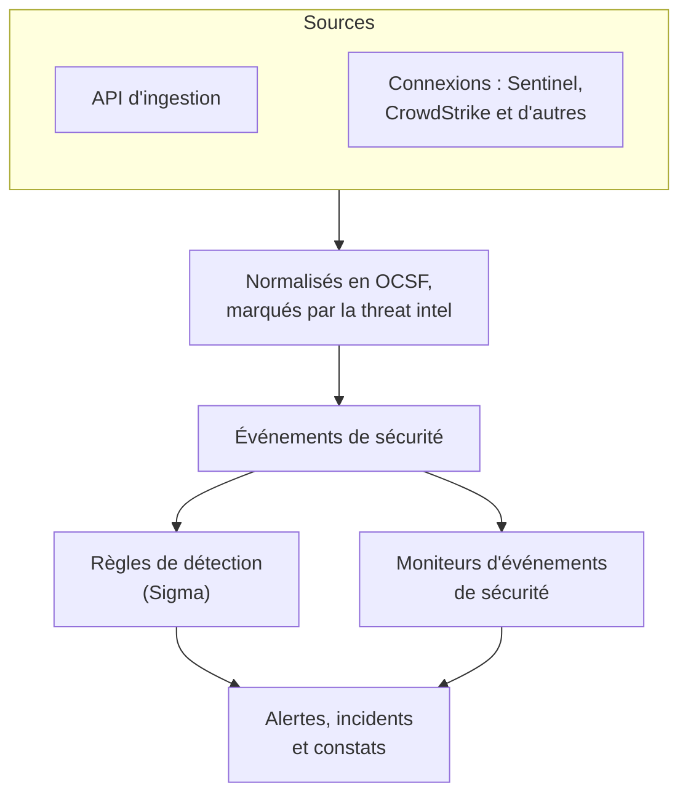
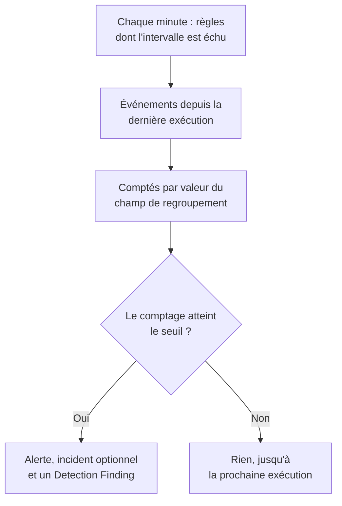

# Événements de sécurité (SIEM)

OneUptime conserve les événements de sécurité à côté de vos journaux, traces et métriques, et donne à chacun la même forme, [OCSF](https://schema.ocsf.io/) (l'Open Cybersecurity Schema Framework), quel que soit le format dans lequel il est arrivé. Envoyez des événements depuis n'importe quelle source, recherchez-les, et transformez ceux qui comptent en alertes avec des règles de détection Sigma, du renseignement sur les menaces et des moniteurs.

:::cards
- [Envoyer des événements](#envoyer-des-événements-de-sécurité): Un POST HTTPS, une sortie Fluent Bit ou une connexion à un produit de sécurité.
- [Rechercher et corréler](#explorer-les-événements-de-sécurité): L'explorateur d'événements et le graphe de corrélation.
- [Règles de détection](#règles-de-détection): Des règles Sigma qui ouvrent des alertes.
- [Moniteurs](#moniteurs-dévénements-de-sécurité): Des comptages sur une fenêtre glissante, avec un statut qui se rétablit.
:::

## Fonctionnement



Ouvrez **Produits → Événements de sécurité**, sous **Observabilité**. Ses onglets :

| Onglet | À quoi il sert |
| --- | --- |
| **Événements** | Rechercher et filtrer tous les événements, et en ouvrir un pour voir tous ses champs |
| **Corréler** | Un graphe des événements qui partagent un hôte, un utilisateur ou une adresse IP |
| **Règles de détection** | Des règles Sigma qui s'exécutent selon un calendrier et ouvrent des alertes |
| **Threat Intel** | Des flux STIX/TAXII d'indicateurs malveillants connus |
| **Moniteurs** | Les moniteurs d'événements de sécurité du projet |
| **Connexions** | Les produits de sécurité que OneUptime interroge pour obtenir de nouveaux enregistrements |
| **Guide de configuration** | Des extraits pour envoyer des événements, remplis avec votre clé d'ingestion |

## Avant de commencer

Seuls les rôles Project Owner et Project Admin, ainsi que les trois rôles de sécurité, lisent les données de sécurité ; les autres rôles ne voient rien dans Événements de sécurité. Voir [Rôles](/docs/permissions/reference#rôles).

| Rôle | Ce qu'il peut faire |
| --- | --- |
| Security Admin | Tout : événements, règles de détection, flux de renseignement et connexions |
| Security Member | Lire les événements et le renseignement, et créer, modifier et supprimer des règles de détection et des flux. Il ne peut ni configurer de connexions ni supprimer de données de sécurité. |
| Security Viewer | Lire les événements, les règles, les flux, les indicateurs et les connexions |

## Envoyer des événements de sécurité

:::steps
### Créer une clé d'ingestion

Ouvrez **Paramètres du projet → Télémétrie & APM → Clés d'ingestion** et cliquez sur **Créer une clé d'ingestion**. Les événements de sécurité utilisent les mêmes clés que le reste de votre télémétrie.

### Envoyer vos événements

Envoyez du JSON à `/security-events/v1/ingest` avec la clé dans `x-oneuptime-token` :

:::tabs
@tab OCSF
```bash
curl -X POST "https://oneuptime.com/security-events/v1/ingest?format=ocsf" \
  -H "Content-Type: application/json" \
  -H "x-oneuptime-token: YOUR_INGESTION_TOKEN" \
  -H "x-oneuptime-service-name: my-security-source" \
  -d '{ "events": [ { "class_uid": 3002, "severity_id": 4, "time": 1755770400000, "status": "Failure", "message": "Failed logon for alice", "actor": { "user": { "name": "alice" } }, "src_endpoint": { "ip": "203.0.113.7" } } ] }'
```
@tab Google UDM
```bash
curl -X POST "https://oneuptime.com/security-events/v1/ingest?format=udm" \
  -H "Content-Type: application/json" \
  -H "x-oneuptime-token: YOUR_INGESTION_TOKEN" \
  -d '{ "events": [ { "metadata": { "event_type": "USER_LOGIN", "event_timestamp": "2026-08-21T10:00:00Z" }, "principal": { "user": { "userid": "alice" }, "ip": ["203.0.113.7"] }, "security_result": [{ "severity": "HIGH", "action": ["BLOCK"] }] } ] }'
```
@tab Generic JSON
```bash
curl -X POST "https://oneuptime.com/security-events/v1/ingest" \
  -H "Content-Type: application/json" \
  -H "x-oneuptime-token: YOUR_INGESTION_TOKEN" \
  -d '{ "events": [ { "timestamp": "2026-08-21T10:00:00Z", "severity": "high", "event_type": "ssh_brute_force", "message": "12 failed SSH logins in 60s", "username": "root", "hostname": "web-01", "src_ip": "203.0.113.7" } ] }'
```
:::

L'endpoint répond `200` dès que les événements sont en file d'attente.

### Les retrouver dans Événements

Ouvrez **Produits → Événements de sécurité → Événements**. Les événements apparaissent en quelques secondes, avec leur gravité, leur classe, l'utilisateur, l'hôte et les adresses IP renseignés.
:::

### Formats

| `format` | Ce qu'il lit | Également accepté |
| --- | --- | --- |
| `ocsf` | JSON d'événement OCSF (`class_uid`, `severity_id` et ainsi de suite) | Aucun |
| `udm` | Événements UDM de Google SecOps (Chronicle) (`metadata.event_type` et ainsi de suite) | `chronicle`, `google-secops` |
| `google-secops-alert` | Détections et alertes de Google SecOps : webhooks SOAR et flux de détections | `secops-alert`, `detection` |
| `generic` | Tout autre JSON, lu d'après des noms de champs courants | Aucun |

Indiquez le format avec `?format=`, avec l'en-tête `x-oneuptime-security-event-format` ou avec un champ `"format"` de premier niveau. Si vous l'omettez, le format de chaque événement est déterminé séparément, si bien qu'un même webhook peut mêler détections et événements bruts.

- Le corps peut être un événement, un tableau d'événements ou `{ "events": [...] }`.
- L'en-tête `x-oneuptime-service-name` nomme le service de télémétrie auquel appartiennent les événements. Sans lui, ils appartiennent au service nommé d'après le produit ou le fournisseur du premier événement, ou à `Security Events`.
- Rien n'est écarté faute de correspondance : chaque champ de la source arrive dans les attributs de l'événement.

### Champs du JSON générique

Un événement générique est lu d'après des noms de champs courants :

| Champ de l'événement | Lu depuis le premier de |
| --- | --- |
| `message` | `message`, `msg`, `summary`, `description`, `title` |
| `severityName` | `severity`, `severity_name`, `level`, `priority`, `risk_level` |
| `time` | `timestamp`, `time`, `@timestamp`, `event_time`, `created_at` |
| `principalUser` | `user`, `username`, `user_name`, `account`, `actor` |
| `principalHost` | `host`, `hostname`, `computer`, `device`, `machine` |
| `principalIp` | `source_ip`, `src_ip`, `client_ip`, `ip` |
| `targetIp` | `destination_ip`, `dest_ip`, `dst_ip`, `target_ip` |
| `className` | `event_type`, `category`, `type`, `action` |
| `ruleName` | `rule`, `rule_name`, `signature`, `detection` |
| `productName` | `product`, `product_name`, `source`, `log_source` |

Un mot de gravité devient un niveau OCSF : `info` se lit Informational, `warning` Low, `error` Medium, `alert` Critical et `emergency` Fatal.

### Transférer avec Fluent Bit

Pour envoyer des journaux de sécurité que vous collectez déjà, par exemple ceux d'auditd, de syslog ou de Falco, ajoutez à Fluent Bit une sortie `http` :

```ini title="fluent-bit.conf"
[OUTPUT]
    Name             http
    Match            security.*
    Host             oneuptime.com
    Port             443
    tls              On
    URI              /security-events/v1/ingest
    Format           json
    Json_date_key    timestamp
    Json_date_format iso8601
    Header           x-oneuptime-token YOUR_INGESTION_TOKEN
    Header           x-oneuptime-service-name my-security-source
    Retry_Limit      5
```

L'onglet **Guide de configuration** contient ces extraits avec votre propre hôte et votre clé déjà remplis.

### Connecter un produit de sécurité

**Connexions** interroge un produit de sécurité pour vous et importe ses nouveaux enregistrements comme événements de sécurité. Une connexion conserve les paramètres du produit et un identifiant chiffré ; un worker l'interroge à l'intervalle que vous fixez et ignore les enregistrements déjà importés.

| Produit | Importe | Guide de configuration |
| --- | --- | --- |
| Google SecOps (Chronicle) | Détections de règles, détections sélectionnées et alertes, comme Detection Findings | [Google SecOps](/docs/integrations/google-secops) |
| Microsoft Sentinel | Incidents, comme Incident Findings | [Microsoft Sentinel](/docs/integrations/microsoft-sentinel) |
| Microsoft Defender XDR | Alertes, comme Detection Findings | [Microsoft Defender XDR](/docs/integrations/microsoft-defender-xdr) |
| CrowdStrike Falcon | Alertes, comme Detection Findings | [CrowdStrike Falcon](/docs/integrations/crowdstrike-falcon) |
| Splunk Enterprise Security | Notable events, ou toute recherche, comme Detection Findings | [Splunk Enterprise Security](/docs/integrations/splunk) |
| Elastic Security | Alertes de détection, comme Detection Findings | [Elastic Security](/docs/integrations/elastic-security) |
| AWS Security Hub | Findings, comme Detection et Compliance Findings | [AWS Security Hub](/docs/integrations/aws-security-hub) |
| Okta System Log | Événements de connexion, de MFA, de compte et de stratégie | [Okta System Log](/docs/integrations/okta) |

- Une connexion lit les enregistrements selon le moment où le produit les a créés, pas selon le moment de l'activité qu'ils décrivent. Une règle SIEM qui s'exécute toutes les heures crée des détections bien après les événements correspondants, et elles sont tout de même importées.
- La première interrogation remonte 24 heures en arrière, donc une nouvelle connexion montre tout de suite des enregistrements récents.
- **Tester la connexion**, dans la ligne de la connexion, vérifie l'accès au produit et que les workers de OneUptime tournent, sans rien importer. **Run now** interroge immédiatement.

## Ce que contient un événement

Chaque événement est stocké avec des champs typés et son payload source :

| Groupe | Champs |
| --- | --- |
| Classification | `categoryName`, `className`, `activityName`, `statusName`, avec leurs ID OCSF (`categoryUid`, `classUid`) |
| Gravité | `severityName`, l'une des valeurs Unknown, Informational, Low, Medium, High, Critical, Fatal ou Other, et `severityId` |
| Qui l'a fait | `principalUser`, `principalHost`, `principalIp`, `principalProcess` |
| Ce qui a été touché | `targetUser`, `targetHost`, `targetIp`, `targetPort`, `targetResource` |
| Source | `productName`, `vendorName`, `ruleId`, `ruleName`, `eventUid` |
| Contenu | `message`, `mitreTactics`, `mitreTechniques` et `observables` : chaque utilisateur, hôte, adresse IP, domaine et hash extrait de l'événement |
| Attributs | Tout le payload source, aplati en clés à points |

## Explorer les événements de sécurité

**Événements** est un explorateur de télémétrie comme ceux des journaux et des traces : un graphique des événements de la fenêtre par gravité, une barre latérale de facettes, la liste, et un panneau avec chaque champ et attribut de l'événement que vous ouvrez. La fenêtre, les filtres et la recherche sont tous dans l'URL, donc une vue filtrée se partage et survit à un rechargement.

### Recherche

La barre de recherche parle le même langage que les autres explorateurs de télémétrie (voir [Syntaxe de recherche](/docs/telemetry/search-syntax)) :

| Syntaxe | Signifie | Exemple |
| --- | --- | --- |
| texte libre | Le message le contient | `failed logon` |
| `"quoted phrase"` | Garder les mots ensemble | `"brute force"` |
| `<field>:<value>` | Un champ typé | `severity:Critical` |
| `@<attribute>:<value>` | Un attribut de la source | `@threat.matched:true` |
| `-<filter>` | Pas ceci | `-severity:Informational` |
| `<field>:(a OR b)` | L'une de ces valeurs | `severity:(High OR Critical)` |
| `<field>:a*` | `*` est n'importe quel texte, `?` un caractère | `host:web-*` |
| `@<attribute>:*` | L'attribut est présent | `@threat.indicator_id:*` |
| `@<attribute>:~text` | L'attribut contient le texte | `@finding_info.title:~ransom` |

Un champ est soit un nom court (`severity`, `class`, `category`, `activity`, `status`, `vendor`, `product`, `rule`, `user`, `host`, `ip`, `targetuser`, `targethost`, `targetip`, `observable`, `tactic`, `technique`), soit le nom propre du champ, comme `severityName` ou `principalHost`. Tout autre nom est lu comme un attribut de la source. `observable:<value>` trouve chaque événement qui mentionne une valeur, de quelque côté de l'activité qu'elle se trouve.

### Facettes

La barre latérale compte les événements de la fenêtre par **Source**, **Gravité**, **Classe d'événements**, **Catégorie**, **Activité**, **Statut**, **Fournisseur**, **Produit**, **Règle de détection**, **Utilisateur source** et **Hôte source**. Cliquez sur une valeur pour ne garder que ses événements, ou sur le signe moins à côté pour les exclure. Le graphique et chaque comptage décrivent exactement les événements de la liste.

### Corréler

**Corréler** dessine les événements autour d'un hôte, d'un utilisateur ou d'une adresse IP : leurs classes d'événements autour de ce que vous avez cherché, marquées par leur pire gravité, et les autres valeurs vues dans les mêmes événements sur l'anneau extérieur. Cliquez sur une classe pour lister ses événements, ou sur une valeur pour corréler ensuite sur elle. Chaque observable du panneau d'un événement dans **Événements** ouvre **Corréler** sur lui.

## Règles de détection

Une règle de détection est une règle [Sigma](https://sigmahq.io/), un format YAML ouvert pour décrire une activité suspecte, que OneUptime exécute selon un calendrier sur vos événements. Quand elle correspond, elle ouvre une alerte, éventuellement un incident, et écrit un Detection Finding dans les événements.



### Créer une règle

:::steps
1. Ouvrez **Produits → Événements de sécurité → Règles de détection** et cliquez sur **Créer : Règle de détection**.
2. Dans **Informations de base**, renseignez le **Nom** et laissez **Activé** activé.
3. Dans **Sigma Rule**, collez le YAML de la règle dans **Sigma Rule (YAML)**. Il est analysé à l'enregistrement, donc une erreur s'affiche dans le formulaire.
4. Dans **Évaluation**, réglez sa fréquence d'exécution et le nombre de correspondances qu'il lui faut ; voir [Paramètres d'évaluation](#paramètres-dévaluation).
5. Dans **En cas de correspondance**, choisissez ce que fait une correspondance : **Créer une alerte en cas de correspondance** (activé), **Créer un incident en cas de correspondance** (désactivé) et **Write Detection Finding on Match** (activé), avec une **Gravité de l'alerte** et une **Gravité de l'incident** optionnelles.
:::

Une première règle, qui correspond aux échecs de connexion venant de l'extérieur de `10.x.x.x` :

```yaml title="failed-logon-burst.yml"
title: Failed logon burst
description: Repeated authentication failures from one source.
level: high
tags:
  - attack.t1110
  - attack.ta0006
detection:
  selection:
    className: Authentication
    statusName: Failure
  filter_internal:
    principalIp|startswith: '10.'
  condition: selection and not filter_internal
```

### Ce qu'une règle peut exprimer

OneUptime exécute le noyau booléen de Sigma :

- Les sélections sont des tables de champs (chaque champ doit correspondre ; une liste de valeurs correspond à l'une d'elles) ou des listes de mots-clés, qui correspondent n'importe où dans le message.
- Les conditions combinent des sélections avec `and`, `or`, `not` et des parenthèses, ou avec `1 of selection_*`, `all of selection_*`, `any of them` et `all of them`.
- Modificateurs de champ : `contains`, `startswith`, `endswith`, `all`, `re`, `cased`, `gt`, `gte`, `lt`, `lte`, `cidr`, `exists` et `windash`. Le texte est comparé sans tenir compte de la casse, sauf si vous ajoutez `cased`.
- Un champ est un champ typé (`principalUser`), une graphie Sigma courante de l'un d'eux (`CommandLine`, `src_ip`, `Hostname`) ou n'importe quelle clé d'attribut, écrite comme dans l'événement (`threat.matched`).
- `level` fixe la gravité : `informational`, `low`, `medium`, `high` ou `critical`, et `medium` s'il manque. Les ID ATT&CK dans `tags` (`attack.t1110`, `attack.ta0006`) remplissent les champs MITRE du constat.

Les agrégations comme `| count() by principalIp > 5` sont refusées à l'enregistrement : utilisez plutôt **Champ de regroupement** et **Seuil de nombre de correspondances**. `logsource` est purement informatif et ne restreint rien : placez ce filtre dans une sélection, comme `className: Authentication`. Un `timeframe` est ignoré, car l'intervalle de la règle fixe sa fenêtre.

### Paramètres d'évaluation

| Champ | Ce qu'il fait |
| --- | --- |
| **Intervalle d'évaluation (minutes)** | La fréquence d'exécution de la règle : des minutes entières, de 1 à 1440. Le formulaire d'une nouvelle règle commence à 5. |
| **Champ de regroupement** | Facultatif. Les correspondances qui partagent la valeur de ce champ, comme `principalHost`, sont comptées, alertées et dédupliquées ensemble : une alerte par hôte au lieu de centaines. |
| **Champ de comptage distinct** | Facultatif. Compter les valeurs différentes de ce champ au lieu des événements correspondants. Les valeurs vides ne comptent pas. |
| **Seuil de nombre de correspondances** | Un groupe ne se déclenche que lorsque son comptage atteint ce nombre en une exécution : de 1 à 1000000, et 1 se déclenche à la moindre correspondance. |

Le regroupement et le comptage distinct prennent les mêmes noms de champs que la règle. Avec eux, le seuil dit « autant, de la même chose, en une exécution », sans moniteur par-dessus :

| Objectif | Champ de regroupement | Champ de comptage distinct | Seuil |
| --- | --- | --- | --- |
| Alerter à chaque correspondance | Vide | Vide | 1 |
| Une alerte par hôte | `principalHost` | Vide | 1 |
| Force brute : 5 échecs de connexion depuis une IP | `principalIp` | Vide | 5 |
| Password spraying : une IP qui échoue sur 5 comptes différents | `principalIp` | `principalUser` | 5 |
| Scan de ports : une IP qui atteint 20 ports différents | `principalIp` | `targetPort` | 20 |

### Quand une règle s'exécute

OneUptime vérifie chaque minute quelles règles activées ont dépassé leur intervalle depuis leur dernière exécution. Chaque exécution lit les événements dont l'heure d'événement tombe entre l'exécution précédente et maintenant, puis avance :

- Les fenêtres se suivent bout à bout, elles ne glissent pas. Avec un intervalle de 10 minutes, des échecs à 09:58 et à 10:01 peuvent tomber dans des exécutions différentes et sont comptés séparément, donc gardez une marge en choisissant un seuil.
- Après une interruption, comme une panne du worker ou une règle réactivée, l'exécution suivante couvre toute l'interruption, jusqu'aux 24 dernières heures.
- Un événement arrivé en retard, avec une heure antérieure à la dernière exécution de la règle, est stocké et consultable, mais cette règle ne le lit jamais.
- Au plus 100 groupes se déclenchent par exécution : ceux aux comptages les plus élevés.

### Gravité

Le `level` d'une règle est la gravité de ses constats : `informational`, `low`, `medium`, `high` et `critical` deviennent Informational, Low, Medium, High et Critical. Ses alertes et incidents prennent l'une des gravités de votre projet, dans cet ordre :

1. La **Gravité de l'alerte** (ou **Gravité de l'incident**) de la règle, si elle est réglée.
2. Votre gravité nommée d'après le niveau, comme High, quelle que soit la casse.
3. Par rang : les règles `critical` et `high` prennent votre gravité la plus élevée, les autres la plus basse.

> [!TIP]
> Nommez vos gravités d'alerte comme les niveaux Sigma (Critical, High, Medium, Low, Informational), et chaque règle tombe sur la bonne sans réglage par règle.

### Alertes et constats

Chaque groupe déclenché ouvre une alerte intitulée `[Detection] <rule name> — <group value>`, ou `[Detection] <rule name>` pour une règle sans champ de regroupement. Tant qu'elle est ouverte, d'autres correspondances de ce groupe n'en ouvrent pas d'autre. Une règle ne voit que des correspondances et ne peut pas savoir qu'une attaque a cessé, donc ses alertes restent ouvertes jusqu'à ce que quelqu'un les résolve.

Un Detection Finding est un événement de sécurité de classe `Detection Finding` (classe OCSF 2004) du produit `OneUptime Detections`, avec les tags MITRE de la règle, la valeur du groupe en premier dans `observables`, et ces attributs :

| Attribut | Valeur |
| --- | --- |
| `oneuptime.detection.rule_id` | L'ID de la règle qui s'est déclenchée |
| `oneuptime.detection.rule_name` | Le nom de la règle |
| `oneuptime.detection.match_count` | Combien d'événements se trouvent derrière le constat |
| `oneuptime.detection.distinct_count` | Combien de valeurs différentes se trouvent derrière, pour une règle avec comptage distinct |
| `oneuptime.detection.group_value` | La valeur du groupe, pour une règle avec champ de regroupement |
| `oneuptime.detection.sigma_id` | L'`id` propre de la règle Sigma |

Les constats sont des événements ordinaires : recherchez-les dans **Événements** et pivotez dessus dans **Corréler**. Pour essayer une nouvelle règle sans bruit, désactivez toutes les actions sauf le constat jusqu'à ce que vous lui fassiez confiance.

## Moniteurs d'événements de sécurité

Un moniteur d'événements de sécurité compte les événements qui correspondent à ses filtres sur une fenêtre glissante et applique au comptage les critères habituels des moniteurs : il change le statut du moniteur, ouvre des alertes ou des incidents, et alerte l'astreinte. Créez-en un sous **Moniteurs → Créer un moniteur**, avec **Événements de sécurité** comme type ; **Événements de sécurité → Moniteurs** les liste tous.

Son formulaire affiche **Surveiller les événements contenant ce texte**, **Surveiller les événements de sécurité pendant (durée)**, **Gravité de l'événement** et **Classe d'événements**. **Filtrer par service de télémétrie** et **Filtrer par attributs** attendent sous **Plus de champs**, dont l'en-tête montre ceux qu'un moniteur utilise. Ses critères vérifient **Security Event Count**.

| | Règle de détection | Moniteur d'événements de sécurité |
| --- | --- | --- |
| Correspond à | Une règle Sigma | Des filtres sur la gravité, la classe, le message, le service et les attributs |
| Fenêtre | Bout à bout, une par exécution | Glissante : des 5 dernières secondes aux 24 dernières heures |
| Compte par groupe | Oui, avec **Champ de regroupement** | Non : un seul comptage pour tout ce qui correspond |
| Ouvre | Des alertes, des incidents et des constats | Un statut, des alertes et des incidents |
| Se rétablit | Non : les alertes restent ouvertes jusqu'à leur résolution | Oui : le statut revient quand le comptage revient |

Écrivez la détection elle-même comme une règle, avec son seuil. Utilisez un moniteur quand vous voulez une fenêtre glissante, un statut qui se rétablit seul, une page de statut ou des politiques d'astreinte différentes par critère.

### Surveiller vos détections

Les constats sont des événements, donc un moniteur peut surveiller les règles elles-mêmes :

- Tempêtes : un moniteur sur la classe `Detection Finding`, qui compte chaque constat. Vingt règles différentes qui se déclenchent en une heure sont un signal qu'aucune règle seule ne peut voir.
- Changements de rythme : filtrez sur le `oneuptime.detection.rule_id` d'une règle. Une règle qui se déclenche chaque semaine et soudain cinquante fois par heure appelle une autre réponse.
- Silence : des constats qui tombent à zéro, alors que vous en voyez d'habitude quelques-uns, signifient le plus souvent qu'une source a cessé d'envoyer. Utilisez un critère qui vérifie un comptage inférieur à un nombre.

L'action **Créer un moniteur** dans la ligne d'une règle ouvre un nouveau moniteur déjà réglé ainsi : la classe `Detection Finding`, l'ID de la règle (jamais son nom, qu'un renommage changerait) et la dernière heure. Un tel moniteur compte des constats, un par groupe et par exécution, pas les événements qui se trouvent derrière. Pour exiger un nombre d'événements avant tout déclenchement, utilisez le **Seuil de nombre de correspondances** de la règle.

## Renseignement sur les menaces

**Threat Intel** s'abonne à des flux STIX/TAXII d'adresses IP, de domaines, d'URL, d'adresses e-mail et de hachages de fichiers malveillants connus. Les événements qui en mentionnent un sont marqués à l'arrivée par des attributs `threat.*`, sur lesquels les règles et les moniteurs peuvent filtrer, et chaque minute les événements récents sont confrontés aux flux, ouvrant alertes et constats comme une règle. Voir [Renseignement sur les menaces](/docs/telemetry/threat-intelligence).

## Conservation et facturation

Les événements de sécurité sont facturés par Go ingéré, comme le reste de votre télémétrie, et conservés selon votre conservation de télémétrie : la **Conservation par défaut (jours)** du projet, sous **Paramètres du projet → Télémétrie & APM → Rétention des données**, ou une conservation réglée sur le service de télémétrie auquel ils appartiennent. Quand la conservation d'un événement prend fin, il est supprimé.

## Dépannage

:::details Les événements n'apparaissent pas
Vérifiez la clé dans `x-oneuptime-token` et le chemin, `/security-events/v1/ingest`. Vérifiez ensuite la fenêtre dans **Événements**, la dernière journée sauf si vous la changez : un événement est placé à sa propre heure, donc un événement à l'horodatage plus ancien en sort.
:::

:::details Une règle ne correspond jamais
Vérifiez qu'elle est **Activé**, et lisez **Dernière évaluation** et **Dernière erreur** dans sa ligne. Ouvrez un événement auquel elle aurait dû correspondre et comparez-le à la règle, champ par champ : une valeur simple doit égaler tout le champ, donc utilisez `contains` ou `*` pour une partie. Un attribut se nomme comme dans l'événement (`threat.matched`, pas `attributes.threat.matched`). Avec un seuil supérieur à 1, les correspondances doivent tomber dans une seule exécution.
:::

:::details Une règle a correspondu, mais aucune alerte ne s'est ouverte
**Créer une alerte en cas de correspondance** est désactivé, ou une alerte pour la même règle et la même valeur de groupe est encore ouverte, et les correspondances suivantes s'y ajoutent. Un projet a besoin d'au moins une gravité d'alerte pour que les règles ouvrent des alertes.
:::

:::details Une règle ouvre trop d'alertes
Chaque valeur du **Champ de regroupement** reçoit sa propre alerte : regroupez sur quelque chose de plus large, relevez le seuil ou ajoutez un comptage distinct. Si c'est le rythme qui compte plutôt que chaque correspondance, désactivez **Créer une alerte en cas de correspondance** et placez un moniteur sur les constats de la règle.
:::

## Étapes suivantes

:::cards
- [Renseignement sur les menaces](/docs/telemetry/threat-intelligence): Confronter vos événements à des flux STIX/TAXII.
- [Google SecOps](/docs/integrations/google-secops): Faire entrer les détections et les événements de Chronicle.
- [Syntaxe de recherche](/docs/telemetry/search-syntax): Tout ce que comprend la barre de recherche.
- [Référence des autorisations](/docs/permissions/reference): Les rôles de sécurité, et ce que chacun peut faire.
:::
