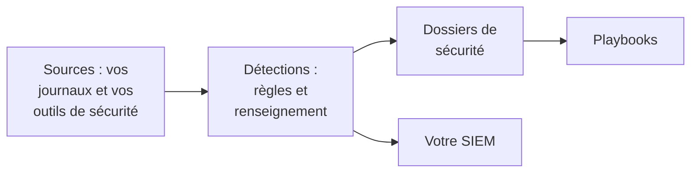

# Bien démarrer avec la sécurité

OneUptime détecte les menaces dans les données dont vous disposez déjà - vos journaux, les outils de sécurité que vous utilisez et tout ce que vous lui envoyez -, regroupe ce qu'il trouve en dossiers et y répond avec des playbooks. Deux clics suffisent pour tout mettre en place, et il n'y a rien à installer.

:::cards
- [Mettre en place](#mettre-en-place): Activez ce dont la plupart des équipes ont besoin, puis regardez une attaque de test ouvrir un dossier.
- [Fonctionnement](#fonctionnement): Les sources, les détections, les dossiers et les playbooks, et le rôle de chacun.
- [Vos journaux](#trouver-des-événements-de-sécurité-dans-vos-journaux): Les événements de sécurité déjà présents dans les journaux que vous envoyez à OneUptime.
- [Votre SIEM](#envoyer-ce-que-trouve-oneuptime-à-votre-siem): Envoyez ce que trouve OneUptime à Google SecOps.
:::

## Avant de commencer

Mettre en place la sécurité demande le rôle Project Owner, Project Admin ou Security Admin. Les rôles Security Member et Security Viewer consultent ce qui est trouvé ; voir [Rôles](/docs/permissions/reference#rôles).

## Mettre en place

:::steps
### Activer ce dont la plupart des équipes ont besoin

Ouvrez **Produits → Événements de sécurité**. Sur **Vue d'ensemble**, cliquez sur **Activer les recommandations**. Trois choses s'activent d'un coup : **Trouver des événements de sécurité dans vos journaux**, les règles de détection recommandées et **Enrichir les nouveaux dossiers**, un playbook qui confronte chaque nouveau dossier au renseignement sur les menaces et y laisse une liste de contrôle pour le tri.

### Envoyer une attaque de test

Cliquez sur **Envoyer une attaque de test**. Une douzaine de connexions échouées depuis une adresse de documentation passent par le vrai traitement : elles sont stockées, la règle de force brute les détecte et un dossier s'ouvre. Personne n'est alerté et aucun SIEM ne les reçoit.

### Ouvrir le dossier

Cliquez sur **Ouvrir le dossier**. Voici à quoi ressemble une vraie découverte : les événements qui la justifient, l'adresse concernée et ce qu'a trouvé **Enrichir les nouveaux dossiers**. Fermez-le comme test une fois terminé.
:::

Dès lors, **Vue d'ensemble** s'ouvre sur ce qui attend quelqu'un, sous **Attention requise** : vos dossiers ouverts, ceux que personne n'a pris en charge et les étapes de playbook en attente d'approbation. S'il n'y en a aucun, elle affiche **Tout est calme**.

## Fonctionnement

| Partie | Où | Ce qu'elle fait |
| --- | --- | --- |
| **Sources** | **Connexions** | Vos journaux, les produits de sécurité qu'interroge OneUptime et tout ce que vous envoyez |
| **Détections** | **Détections** | Des règles Sigma et des flux de renseignement sur les menaces qui cherchent des menaces dans chaque événement |
| **Dossiers de sécurité** | **Dossiers de sécurité** | Ce qui a été trouvé, regroupé par l'utilisateur, l'hôte ou l'adresse concernés |
| **Playbooks** | **Playbooks** | Des étapes qui s'exécutent sur les nouveaux dossiers : les enrichir, prévenir, ouvrir un incident ou contenir |

En haut de **Vue d'ensemble**, sous ce qui attend quelqu'un, chaque partie montre ses chiffres : les sources et leurs événements des dernières 24 heures, les règles actives, les dossiers ouverts et les playbooks qui répondent. Une partie non configurée le dit et ouvre la page où la configurer.

## Trouver des événements de sécurité dans vos journaux

La carte **Vos journaux**, en haut de **Connexions**, ne demande aucune installation. Avec **Trouver des événements de sécurité dans vos journaux** activé, OneUptime lit chaque minute les nouveaux journaux du projet et transforme les lignes qu'il reconnaît en événements de sécurité :

| Journaux | Ce qui devient un événement de sécurité |
| --- | --- |
| Connexions SSH | Les connexions SSH échouées et réussies, tirées du journal d'authentification, du journal système ou du syslog d'un serveur |
| sudo | Les commandes exécutées en tant qu'un autre utilisateur, les mauvais mots de passe sudo et les personnes qui n'ont pas le droit d'utiliser sudo |
| Journaux d'audit Kubernetes | Les modifications du cluster, les shells ouverts dans des pods, les secrets lus et les requêtes refusées |
| AWS CloudTrail | Les connexions à la console, les modifications faites dans vos comptes AWS et les appels refusés par AWS |
| Attaques web | Les requêtes du journal d'accès d'un serveur web qui tentent une injection SQL, une traversée de répertoires ou Log4Shell |

Vos journaux restent tels quels. Seules les lignes qui comptent pour la sécurité deviennent des événements : jamais chaque page servie par un serveur web, ni chaque lecture d'une API.

## Envoyer ce que trouve OneUptime à votre SIEM

Si votre équipe travaille déjà dans un SIEM, OneUptime y envoie aussi ce qu'il trouve. Sous **Connexions → Envoyer vers votre SIEM**, cliquez sur **Ajouter une destination**, renseignez la région, l'instance et la clé de compte de service de votre Google SecOps, puis cliquez sur **Envoyer un événement de test** avant d'enregistrer. Voir [Envoyer des événements de sécurité à Google SecOps](/docs/integrations/google-secops#envoyer-des-événements-de-sécurité-à-google-secops).

## Dépannage

:::details Turn on recommended est grisé
Votre rôle ne peut pas ajouter de règles de détection, de playbooks ni la source de journaux. Adressez-vous à un Project Owner, un Project Admin ou un Security Admin, ou demandez-lui de vous donner le rôle Security Admin.
:::

:::details Turn on recommended n'a pas pu tout activer
La carte indique chaque élément qu'elle n'a pas pu activer, et pourquoi : votre rôle, votre forfait, ou une erreur du côté de OneUptime. Tout le reste est activé. Corrigez ce qu'elle indique, puis cliquez sur **Réessayer** : seul ce qui manque encore est activé, et rien n'est ajouté deux fois.
:::

:::details L'attaque de test n'a ouvert aucun dossier
Le dossier s'ouvre en général avant que le bouton ne réponde ; quand la règle rattrape encore son retard, il le dit et le dossier s'ouvre dans la minute. Regardez de nouveau **Dossiers de sécurité**, et vérifiez sous **Détections** que la règle de force brute est active.
:::

:::details Aucun événement de sécurité ne vient de mes journaux
Vérifiez que **Trouver des événements de sécurité dans vos journaux** est activé et que la carte **Vos journaux** indique quand la dernière vérification a eu lieu. Seuls les types de lignes du tableau ci-dessus deviennent des événements : un serveur qui n'envoie ni journaux SSH, sudo, d'audit, CloudTrail ou d'accès n'a rien à trouver.
:::

:::details Vue d'ensemble indique que le dernier événement de sécurité date de plusieurs jours
Rien n'a atteint Security depuis. Ouvrez **Connexions** et vérifiez que **Vos journaux** et chaque connexion sont toujours activés, et quand chacun a vérifié pour la dernière fois.
:::

:::details La carte qui active Security a disparu
Quelqu'un l'a fermée avec **Masquer**. Tant que rien n'est encore surveillé pour détecter des menaces, **Vue d'ensemble** propose **Configurer Security**, qui la fait revenir.
:::

## Étapes suivantes

:::cards
- [Événements de sécurité (SIEM)](/docs/telemetry/security-events): Envoyer des événements, les rechercher et écrire des règles de détection.
- [Dossiers de sécurité et playbooks (SOAR)](/docs/telemetry/security-cases): Traiter les dossiers et y répondre avec des playbooks.
- [Renseignement sur les menaces (STIX/TAXII)](/docs/telemetry/threat-intelligence): Confronter vos événements à des indicateurs malveillants connus.
- [Google SecOps](/docs/integrations/google-secops): Importer les détections de Google SecOps et y envoyer ce que trouve OneUptime.
:::
